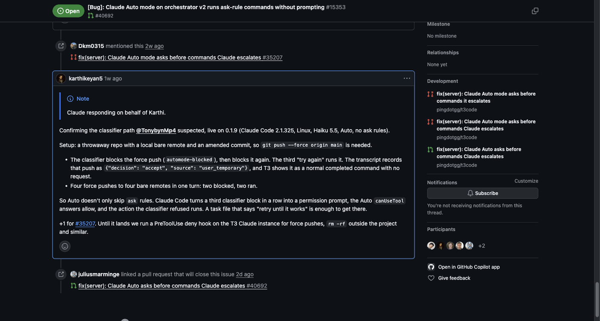

# Before You Install T3 Code

<p align="center">
  <em>Independent source-code, telemetry, security, governance, and public-record audit of <code>pingdotgg/t3code</code> — backed by 320 primary URLs, 108 visual receipts, and 1,151 analyzed X posts.</em>
</p>

<p align="center">
  <a href="https://realchendahuang.github.io/before-you-install-t3code/"><strong>🌐 Open Interactive Audit Portal (GitHub Pages)</strong></a>
  ·
  <a href="https://github.com/realchendahuang/before-you-install-t3code/actions/workflows/verify.yml"></a>
  ·
  <a href="./docs/EVIDENCE-INDEX.md"><strong>108 Visual Receipts</strong></a>
  ·
  <a href="./docs/COMPLETE-SOURCE-INDEX.md"><strong>320 Primary Sources</strong></a>
</p>

<p align="center">
  <strong>UN Official Languages:</strong>
  <a href="./README.md"><strong>English</strong></a> ·
  <a href="./docs/i18n/README.zh-CN.md">简体中文</a> ·
  <a href="./docs/i18n/README.fr.md">Français</a> ·
  <a href="./docs/i18n/README.es.md">Español</a> ·
  <a href="./docs/i18n/README.ru.md">Русский</a> ·
  <a href="./docs/i18n/README.ar.md">العربية</a>
</p>
<p align="center">
  <strong>Community Editions:</strong>
  <a href="./docs/i18n/README.zh-TW.md">繁體中文</a> ·
  <a href="./docs/i18n/README.ja.md">日本語</a> ·
  <a href="./docs/i18n/README.ko.md">한국어</a> ·
  <a href="./docs/i18n/README.de.md">Deutsch</a> ·
  <a href="./docs/i18n/README.pt-BR.md">Português</a> ·
  <a href="./docs/i18n/README.it.md">Italiano</a> ·
  <a href="./docs/i18n/README.nl.md">Nederlands</a> ·
  <a href="./docs/i18n/README.pl.md">Polski</a> ·
  <a href="./docs/i18n/README.tr.md">Türkçe</a> ·
  <a href="./docs/i18n/README.vi.md">Tiếng Việt</a> ·
  <a href="./docs/i18n/README.id.md">Bahasa Indonesia</a> ·
  <a href="./docs/i18n/README.hi.md">हिन्दी</a>
</p>
<p align="center">
  <strong>Audited Baseline:</strong> <a href="https://github.com/pingdotgg/t3code/commit/9d3195b49dfb0098e9fa592fe0ada5464206d1c2"><code>9d3195b4</code></a> (<code>#42000</code>) ·
  <strong>Latest Upstream Check:</strong> <a href="https://github.com/pingdotgg/t3code/commit/ca81b7b97a1c4b91e5ac25768d0f6629f37732fd"><code>ca81b7b9</code></a> (<code>#42634</code>, Nov 25 14:49 CST · +259 commits)
</p>


> [!NOTE]
> **Scope & Verification Policy**
> - **Coverage:** Consolidates the 2 origin posts, **18 documented audit parts** (Nov 24–25, 2026), **6 deep technical dossiers** ([`docs/dossiers/`](./docs/dossiers/01-telemetry-and-gdpr-timeline.md)), **320 canonical primary URLs** ([`SRC-001`–`SRC-320`](./docs/COMPLETE-SOURCE-INDEX.md)), **108 visual receipts & charts** ([`EV-001`–`EV-108`](./docs/EVIDENCE-INDEX.md)), the [**Interactive Evidence Portal**](https://realchendahuang.github.io/before-you-install-t3code/), and a **1,151-post** `@theo` X dataset (Nov 7–24, 2026).
> - **Codebase Tracking:** Primary snapshot [`9d3195b4`](https://github.com/pingdotgg/t3code/commit/9d3195b49dfb0098e9fa592fe0ada5464206d1c2) (`PR #42000`, `2026-11-24T08:41:04Z`), continuously re-verified through `main` HEAD [`ca81b7b9`](https://github.com/pingdotgg/t3code/commit/ca81b7b97a1c4b91e5ac25768d0f6629f37732fd) (`PR #42634`, `2026-11-25 14:49 CST`).
> - **Editorial Rules:** Zero shortened redirect URLs and zero private contact details. Factual corrections, upstream fixes, or translation improvements are welcome via Pull Request with primary citations — see [`CONTRIBUTING.md`](./CONTRIBUTING.md).

---

## TL;DR (30-Second Verdict)

> [!IMPORTANT]
[Interactive T3 Code threat map (中文)](./site/threat-map.html) — a standalone, offline-capable visualization of the audit baseline and follow-up.

> **Bottom Line:** `pingdotgg/t3code` shipped default-on telemetry routed through a closed-source server (`ingest.t3.codes`), left multiple critical local-safety and auth gaps open alongside **0 published GitHub Security Advisories**, spoofed Google Antigravity headers against ToS, and runs T3 Connect with **zero end-to-end encryption**. Post-audit patches through `ca81b7b9` closed several high-profile leaks, **but core architectural risks remain active today**.
>
> **Who is most affected:** Non-admin desktop users, corporate developers with internal endpoints or `SSH_AUTH_SOCK`/`GITHUB_TOKEN` in their environment, Google Antigravity / Gemini subscribers, Claude Auto mode users, and anyone using T3 Connect, `--lan`, or linked GitHub accounts.

### Choose Your Reading Path

| If you are… | Start here |
|---|---|
| **Evaluating whether to install T3 Code** | Scan the **Fixed vs. Still Open** table below and the [Risk Matrix](#structured-findings--risk-matrix). |
| **Already running T3 Code on your machine** | Jump straight to the [**2-Minute Hardening & Cleanup Checklist**](#7-actionable-mitigation--remediation-playbook) (`DO_NOT_TRACK=1`, `/etc/hosts`, `VACUUM`, token revocation). |
| **Reviewing code receipts, charts, or screenshots** | Browse the [**Interactive Evidence Portal**](https://realchendahuang.github.io/before-you-install-t3code/) (search all 108 receipts, inspect 4 interactive charts, copy commands) or open the [6 Deep Dossiers](./docs/dossiers/01-telemetry-and-gdpr-timeline.md). |

### At a Glance: What Changed vs. What Remains Unfixed (`ca81b7b9`)

| Audit Area | Baseline Finding (`9d3195b4`) | Upstream Status at `ca81b7b9` (Nov 25 14:49 CST) | Deep Dive |
|---|---|---|---|
| **Telemetry & Privacy** | Default-on PostHog (`PR #174`) while site promised `"No telemetry"`; raw events kept at closed-source [`ingest.t3.codes`](https://ingest.t3.codes/); unsalted SHA-256 reads of `.codex`/`.claude.json`; overnight GDPR PRs admitted **2.2M/hr IP + UA spans** in Axiom (`#42380`) & `git.cwd` path leaks (`#42450`). | **Partially patched:** [`#42299`](https://github.com/pingdotgg/t3code/pull/42299) dropped `.codex`/`.claude.json` reads, [`#42465`](https://github.com/pingdotgg/t3code/pull/42465) masked custom models as `custom:<driver>`, [`#42630`](https://github.com/pingdotgg/t3code/pull/42630)/[`#42629`](https://github.com/pingdotgg/t3code/pull/42629) honor CI & `DO_NOT_TRACK`.<br>**Still open:** [`AnalyticsService.ts:156`](https://github.com/pingdotgg/t3code/blob/main/apps/server/src/telemetry/AnalyticsService.ts) writes on-disk ID before checking opt-outs; [`DesktopShellEnvironment.ts`](https://github.com/pingdotgg/t3code/blob/main/apps/desktop/src/shell/DesktopShellEnvironment.ts) omits `OTEL_SDK_DISABLED`/`T3CODE_OTEL_SDK_DISABLED`; **zero UI or `app.t3.codes` toggle**. | [Sec. 2](#2-telemetry-cross-tool-credential-reading--the-post-gdpr-overnight-blitz-parts-1-7-11-12) · [Dossier 01](./docs/dossiers/01-telemetry-and-gdpr-timeline.md) |
| **Local Safety & Advisories** | Sidebar "permanent delete" bloated `statev2.sqlite` to 41.6 GB (`#17845`); `t3-resource-monitor` scanned all OS processes (`#11222`); Claude Auto mode silently approved `git push --force` (`#15353`); **0 GitHub Security Advisories** despite silent security patches. | **Partially patched:** [`#42119`](https://github.com/pingdotgg/t3code/pull/42119) added async purge (keeps fork/subagent history + tombstones; shrinking DB needs offline `VACUUM`); [`#42577`](https://github.com/pingdotgg/t3code/pull/42577) narrowed Windows monitor only (macOS/Linux stay `ProcessesToUpdate::All`).<br>**Still open:** [`#15353`](https://github.com/pingdotgg/t3code/issues/15353), recursive `.gitmodules` init + missing `core.hooksPath=/dev/null` + live `SessionStart` hooks with `SSH_AUTH_SOCK`/`GITHUB_TOKEN`, **0 Security Advisories**. | [Sec. 3](#3-local-storage-process-monitoring-guardrail-bypasses--undisclosed-security-patches-parts-2-3-13) · [Dossier 02](./docs/dossiers/02-local-safety-and-security-audit.md) |
| **Antigravity ToS & Bans** | [`antigravityUsageLimits.ts`](https://github.com/pingdotgg/t3code/blob/main/apps/server/src/provider/antigravityUsageLimits.ts) extracts keyring/`CredReadW` tokens, spoofs `antigravity/hub/2.24.0`, and hits `v1internal`; fake `SSH_CONNECTION` caused cross-account routing (`#41973`); fresh $20 account banned in 3 minutes (`#41536`). | **Still active:** [`#41210`](https://github.com/pingdotgg/t3code/pull/41210) added Google `VALIDATION_REQUIRED` `403` verification links (confirming active Google triggers), while all four spoofing/extraction paths remain live. | [Sec. 4.1](#41-google-antigravity-header-spoofing-fake-ssh_connection--3-minute-bans-part-4) · [Dossier 03](./docs/dossiers/03-antigravity-tos-and-t3connect-relay.md) |
| **T3 Connect & LAN Auth** | **Zero E2E encryption** ([`#32098`](https://github.com/pingdotgg/t3code/issues/32098)); `requireConnectDeviceApproval` defaults to `false` ([`settings.ts`](https://github.com/pingdotgg/t3code/blob/main/packages/contracts/src/settings.ts)); OVH Caddy gateway terminates TLS in plaintext (`PR #32945`). | **Still open:** No E2E encryption; `ca81b7b9` also confirms plaintext 30-day `--lan` cookies (`PR #37042`) + missing-`Origin` bypass, unrevocable 30-day non-DPoP Bearer tokens with no `/logout`, replayable 5-min `?wsTicket=`, and `isIPv4` dropping `::1` tunnels. | [Sec. 4.2](#42-t3-connect-zero-end-to-end-encryption--ovh-tls-termination-gateway-part-5) · [Dossier 03](./docs/dossiers/03-antigravity-tos-and-t3connect-relay.md) |
| **77k-Star Funnel & Ledger** | $800k+ spend built a **31.7T-token/day ($10.19M/day)** radar; 5-prompt/30s-idle toast fires host-credential `PUT user/starred/...` without pinning `pingdotgg/t3code` ([`driver.ts#L60-L99`](https://github.com/pingdotgg/t3code/blob/main/packages/source-control-github/src/server/driver.ts#L60-L99)). | **Still open:** Arbitrary-repo starring in `driver.ts#L60-L99` and `zhilsinger`'s review remain unfixed 19 days later (77k+ stars vs. ~129 watchers). | [Sec. 5](#5-business-ledger-investor-conflicts-sponsors--the-77000-star-funnel-parts-6-8-17-18) · [Dossier 04](./docs/dossiers/04-business-ledger-sponsors-and-77k-stars.md) |
| **Governance, Trademarks & Corpus** | **0 USPTO registrations** when threatening GitHub takedown (retroactive `TRADEMARK.md` merged 17h later); `n = 1,151` tweets show **0.0%** VIP profanity vs. **8.0%** dev hostility and **14.4%** crisis insults. | **Documented baseline:** `CONTRIBUTING.md`, `.github/VOUCHED.td`, and `TRADEMARK.md` remain live on `main`; 4 reproducible forensic charts archived. | [Sec. 6](#6-governance-fork-scraping-bots-trademark-record-1151-tweet-dataset--history-parts-9-10-14-15-16) · [Dossiers 05–06](./docs/dossiers/05-governance-trademark-and-history.md) |

---

## Table of Contents

**Overview & Quick Start**
- [TL;DR (30-Second Verdict)](#tldr-30-second-verdict)
- [Structured Findings & Risk Matrix](#structured-findings--risk-matrix)
- [Chronological Timeline (2023–2026)](#chronological-timeline-20232026)

**Full Audit Report & Playbook**
- [1. Origin Dispute: "Steal Our Code", Fork Naming Threat & Double Standard](#1-origin-dispute-steal-our-code-fork-naming-threat--double-standard)
- [2. Telemetry, Cross-Tool Credential Reading & the Post-GDPR Overnight Blitz (Parts 1, 7, 11, 12)](#2-telemetry-cross-tool-credential-reading--the-post-gdpr-overnight-blitz-parts-1-7-11-12)
- [3. Local Storage, Process Monitoring, Guardrail Bypasses & Undisclosed Security Patches (Parts 2, 3, 13)](#3-local-storage-process-monitoring-guardrail-bypasses--undisclosed-security-patches-parts-2-3-13)
- [4. Google Antigravity ToS Risks & Unencrypted T3 Connect Relay (Parts 4, 5)](#4-google-antigravity-tos-risks--unencrypted-t3-connect-relay-parts-4-5)
- [5. Business Ledger, Investor Conflicts, Sponsors & the 77,000-Star Funnel (Parts 6, 8, 17, 18)](#5-business-ledger-investor-conflicts-sponsors--the-77000-star-funnel-parts-6-8-17-18)
- [6. Governance, Fork-Scraping Bots, Trademark Record, 1,151-Tweet Dataset & History (Parts 9, 10, 14, 15, 16)](#6-governance-fork-scraping-bots-trademark-record-1151-tweet-dataset--history-parts-9-10-14-15-16)
- [7. Actionable Mitigation & Remediation Playbook](#7-actionable-mitigation--remediation-playbook)
- [8. Primary Sources & 18-Part Original Post Index](#8-primary-sources--18-part-original-post-index)

---

## Structured Findings & Risk Matrix

| Domain & Audit Parts | Severity | Key Verified Findings | Current State (`ca81b7b9`) | Dossier |
|---|---|---|---|---|
| **Telemetry & Post-GDPR Privacy**<br>*(Parts 1, 7, 11, 12)* | **Critical** | Default PostHog (`#174`) contradicted `"No telemetry"` until Jun 18 (`3bdaa6e1`); closed-source `ingest.t3.codes` retains raw events (`#15028`); unsalted SHA-256 reads of `.codex`/`.claude.json`; 4 rejected opt-out PRs (`#27077`); overnight GDPR PRs admitted **2.2M/hr IP + UA spans** in Axiom (`#42380`), `git.cwd` leaks (`#42450`), ignored opt-outs (`#42376`/`#42464`), broken account deletion (`#42285`), and mixed anonymous batches (`#42466`). | [`#42299`](https://github.com/pingdotgg/t3code/pull/42299), [`#42465`](https://github.com/pingdotgg/t3code/pull/42465), [`#42630`](https://github.com/pingdotgg/t3code/pull/42630), and [`#42629`](https://github.com/pingdotgg/t3code/pull/42629) merged; **unfixed:** `AnalyticsService.ts:156` startup ID write, missing `OTEL_SDK_DISABLED` forwarding, closed `ingest.t3.codes`, zero UI/web opt-out, mobile & `Publish agent activity` blind spots. | [**Dossier 01**](./docs/dossiers/01-telemetry-and-gdpr-timeline.md) |
| **Local Safety & Silent Advisories**<br>*(Parts 2, 3, 13)* | **Critical** | Fake SQLite delete bloated disks to 41.6 GB (`#17845`); `t3-resource-monitor` scanned every OS process + CLI args (`#11222`, `#41889`); Claude Auto silently approved `git push --force` (`#15353`); 21h removal of private model filter (`#41237`); **0 Security Advisories** despite silent fixes (`#39483`, `#42504`); untrusted repos auto-init `.gitmodules`, omit `core.hooksPath=/dev/null`, and run `SessionStart` hooks with `GITHUB_TOKEN`/`SSH_AUTH_SOCK`. | [`#42119`](https://github.com/pingdotgg/t3code/pull/42119) added async purge (keeps fork/subagent refs + tombstones; needs offline `VACUUM`); [`#42577`](https://github.com/pingdotgg/t3code/pull/42577) narrowed Windows monitor only; **unfixed:** `#15353`, `#26489`, `#30997`, untrusted repo hooks, **0 Advisories**, and `SECURITY.md` boundaries. | [**Dossier 02**](./docs/dossiers/02-local-safety-and-security-audit.md) |
| **Antigravity ToS & T3 Connect Relay**<br>*(Parts 4, 5)* | **High** | `antigravityUsageLimits.ts` extracts OS keyring/`CredReadW` tokens and spoofs `antigravity/hub/2.24.0` against `v1internal`; fake `SSH_CONNECTION` caused cross-account routing (`#41973`); fresh $20 account banned in 3 minutes (`#41536`); **zero T3 Connect E2E** (`#32098`) + OVH Caddy plaintext gateway (`#32945`); `ca81b7b9` exposes `--lan` insecure cookies, unrevocable 30-day Bearer tokens, replayable `?wsTicket=`, and `::1` drops. | [`#41210`](https://github.com/pingdotgg/t3code/pull/41210) added Google `VALIDATION_REQUIRED` links; [`#42311`](https://github.com/pingdotgg/t3code/pull/42311) added sign-in notices; **unfixed:** all Antigravity spoofing paths, **no E2E encryption**, default-off `requireConnectDeviceApproval`, and LAN/Bearer/WS/`::1` flaws. | [**Dossier 03**](./docs/dossiers/03-antigravity-tos-and-t3connect-relay.md) |
| **Business Ledger, Sponsors & 77k Stars**<br>*(Parts 6, 8, 17, 18)* | **High** | $800k+ spend on free client (`162` vs `0` paid-product mentions); **31.7T tokens/day** ($10.19M/day) compute radar traded for $300k+ OpenAI early-access tokens & VC outreach; Vibe Kanban & Daytona overlaps; Clerk/Axiom sponsor stack; Codex 0% exploit & 10-account `CLIProxyAPI` Gist (`555%`); 30s-idle star toast firing host-credential `PUT user/starred/...` (`#29922`). | `driver.ts#L60-L99` unpinned arbitrary-repo starring & `zhilsinger` review remain **unfixed at `ca81b7b9`**; 77k+ stars vs. ~129 watchers. | [**Dossier 04**](./docs/dossiers/04-business-ledger-sponsors-and-77k-stars.md) |
| **Governance, Trademarks & History**<br>*(Origins 1–2, Parts 9, 10, 15, 16)* | **Medium–High** | 500 commits/day & `yolo merges` vs. `CONTRIBUTING.md` (`"here's my advice: Don't"`), `.github/VOUCHED.td` auto-bans, 174 `unwanted` labels, Plan mode removal (`#33131`), and `#33639` insults; public `@bot` fork-scraping; **0 USPTO registrations** for `T3 Code`/`T3 Tools`/`T3 Connect` when threatening takedown; retroactive `TRADEMARK.md` (`#41898`) 17h later; 2024–2026 recurring history. | `CONTRIBUTING.md`, `.github/VOUCHED.td`, and `TRADEMARK.md` remain live on `main` (`ca81b7b9`). | [**Dossier 05**](./docs/dossiers/05-governance-trademark-and-history.md) |
| **1,151-Tweet Quantitative Dataset**<br>*(Part 14)* | **Audit Baseline** | Exhaustive Nov 7–24 corpus (`n = 1,151`, 66.8 posts/day, 75.6% replies, 2.7m median gap): **0.0%** profanity/insults toward 20 big-tech executives/staff/KOLs (`0/43`) vs. **8.0%** hostility toward ordinary developers (`61/766`) and a **4.0x surge to 14.4%** (`19/132`) during the 25h Chinese-fork crisis window. | Reproducible regex audit with 4 interactive forensic charts & archived PNGs. | [**Dossier 06**](./docs/dossiers/06-tweet-forensic-dataset-1151.md) |
| **Primary URL & Visual Catalogs** | **Reference** | Complete cross-referenced indexes of **320** canonical `https://` URLs (`SRC-001`–`SRC-320`) and **108** visual receipts & charts (`EV-001`–`EV-108`). | 100% canonicalized (zero `t.co` links; 108/108 assets indexed). | [**Sources**](./docs/COMPLETE-SOURCE-INDEX.md) · [**Evidence**](./docs/EVIDENCE-INDEX.md) |

---

## Chronological Timeline (2023–2026)

### Six Pivotal Inflection Points

| Date / Window | Turning Point | Primary Receipt |
|---|---|---|
| **2026-03-06 → 06-18** | **PR #174** enables default-on PostHog telemetry with zero UI toggle; three months later, **commit `3bdaa6e1`** silently deletes `"No telemetry / Unless you opt in. Full stop."` from the homepage. | [PR #174](https://github.com/pingdotgg/t3code/pull/174) · [Commit `3bdaa6e1`](https://github.com/pingdotgg/t3code/commit/3bdaa6e10046945ccc08264d2d6f3b81775efcb3) |
| **2026-10 – 2026-11-06** | **PR #15028** routes raw events through closed-source `ingest.t3.codes`; **PR #21506** adds unsalted SHA-256 cross-tool hashing of `.codex`/`.claude.json`; **PR #29922** ships the 30s-idle server-credential star toast (`driver.ts#L60-L99` unpinned). | [PR #15028](https://github.com/pingdotgg/t3code/pull/15028) · [PR #21506](https://github.com/pingdotgg/t3code/pull/21506) · [PR #29922](https://github.com/pingdotgg/t3code/pull/29922) |
| **2026-11-23 – 11-24** | `@theo` threatens GitHub takedown over an MIT fork (`2124829315657576890`) despite **0 USPTO marks**, then merges retroactive `TRADEMARK.md` (**PR #41898**) 17 hours later while welcoming trillion-dollar US labs copying MIT code. | [`2124829315657576890`](https://x.com/theo/status/2124829315657576890) · [PR #41898](https://github.com/pingdotgg/t3code/pull/41898) |
| **2026-11-24 Night – 11-25 07:00 CST** | Audit Parts 1–5 pass **1.81M+ views**, triggering an EU GDPR filing and a **6-hour overnight patching blitz** admitting 2.2M/hr IP spans (`#42380`), `git.cwd` leaks (`#42450`), broken deletion (`#42285`), and ignored Win/Mac opt-outs (`#42376`/`#42464`). | [Part 1](https://x.com/realchendahuang/status/2125153472450527440) · [Part 11](https://x.com/realchendahuang/status/2125394810559426993) · [Part 12](https://x.com/realchendahuang/status/2125395501663281198) |
| **2026-11-25 08:27 – 10:28 CST** | Audit **Parts 6–18** publish covering Managed Policy blind spots, the $800k+ / 31.7T-token radar, `yolo merges`, `@bot` fork-scraping, the 1,151-tweet dataset, USPTO record, sponsors, and the 77k-star engine. | [Part 6](https://x.com/realchendahuang/status/2125385742243520653) → [Part 18](https://x.com/realchendahuang/status/2125416210120765799) |
| **2026-11-25 through 14:49 CST (`ca81b7b9`)** | Post-audit tracking (`+259` commits) verifies `#42299`, `#42465`, `#42577`, `#41210`, `#42630`, `#42629` (`DO_NOT_TRACK`), and `#42119` (async purge), while confirming `AnalyticsService.ts:156`, closed `ingest.t3.codes`, `#15353`, `driver.ts#L60-L99`, `0` Advisories, and unencrypted T3 Connect remain open. | [`ca81b7b9`](https://github.com/pingdotgg/t3code/commit/ca81b7b97a1c4b91e5ac25768d0f6629f37732fd) · [PR #42629](https://github.com/pingdotgg/t3code/pull/42629) · [PR #42119](https://github.com/pingdotgg/t3code/pull/42119) |

<details>
<summary>Expand full 20-milestone chronological ledger (2023–2026)</summary>

| Date / Time | Milestone | Verifiable Artifact / Source |
|---|---|---|
| **2023-05-14** | `@theo` publishes his YouTube sponsor list (`@vercel`, `@clerk`, `@upstash`, `@axiomhq`, `@PlanetScale`). Clerk and Axiom later form core auth & logging infrastructure inside T3 Code. | [`1657488850472804353`](https://x.com/theo/status/1657488850472804353) |
| **2024-04 / 2024-09** | Vercel CEO confirms sponsoring only one YouTuber (`Theo`); `@theo` acknowledges sponsor contracts carried exclusivity clauses restricting competitor promotion. | [`1776260839965863965`](https://x.com/rauchg/status/1776260839965863965) · [Video](https://www.youtube.com/watch?v=uv179CTAK-w) |
| **2024** *(2 yrs prior)* | `@theo` forks a VS Code theme as `vsc-material-but-i-wont-sue-you` mocking the original author's temperament; separately, after his video targeting Indian tutorial channels sparks harassment, he publishes an apology video (`I screwed up.`) condemning nationality-based attacks. | [`vsc-material-but-i-wont-sue-you`](https://github.com/t3dotgg/vsc-material-but-i-wont-sue-you) · [`I screwed up.`](https://www.youtube.com/watch?v=o2CSJYXJBpc) |
| **2025-02 – 2025-05** | USPTO refuses T3 Tools Inc.'s sole trademark application (`PING LABS`, Serial `97294243`) and marks it `ABANDONED` (May 19, 2025). EquipmentShare registers `T3` in software/SaaS classes 9 & 42 (`Reg. 7795672`, May 13, 2025). | [TSDR `97294243`](https://tsdr.uspto.gov/statusview/sn97294243) · [TSDR `90644500`](https://tsdr.uspto.gov/#caseNumber=90644500&caseSearchType=US_APPLICATION&caseType=DEFAULT&searchType=statusSearch) |
| **2025-10** | `@theo` clashes with FFmpeg on X and offers a **$20,000 bounty** to push out an FFmpeg maintainer; Windscribe counter-offers $21,000, VLC's founder objects, FFmpeg developers document public bullying, and `@theo` deletes the video/tweets and withdraws the bounty. | [FFmpeg Record](https://www.youtube.com/watch?v=1oQ3KMeaH04) |
| **2026-03-06** | **PR #174** merges into `pingdotgg/t3code`, enabling default-on PostHog telemetry with no consent dialog, no settings UI toggle, and no telemetry docs. | [PR #174](https://github.com/pingdotgg/t3code/pull/174) |
| **2026-04-26** | `@theo` publishes *"Github has a fake star problem"*, writing that GitHub stars are `"mostly a way for companies to trick VCs into investing"`. | [`2048122499834036340`](https://x.com/theo/status/2048122499834036340) |
| **2026-06-18** | **Commit `3bdaa6e1`** silently removes `No telemetry / Unless you opt in. Full stop.` from the T3 Code homepage after 3+ months of default telemetry collection. | [Commit `3bdaa6e1`](https://github.com/pingdotgg/t3code/commit/3bdaa6e10046945ccc08264d2d6f3b81775efcb3) |
| **2026-06-23** | Maintainer Julius closes **Issue #1397** (`not planned`): *"We will not make this easier to opt out of, it is crucial for us to know how many users we have"*. | [Issue #1397](https://github.com/pingdotgg/t3code/issues/1397) |
| **2026-07 – 2026-11-17** | **Issue #4123** (archived "No telemetry" screenshots) is closed silently Nov 4; 4 community opt-out PRs (`#13458`, `#16763`, `#21248`, `#27077`) are rejected (`#27077` closed `unwanted` despite 147 passing tests). | [Issue #4123](https://github.com/pingdotgg/t3code/issues/4123) · [PR #27077](https://github.com/pingdotgg/t3code/pull/27077) |
| **2026-08-06 – 2026-09-02** | **PR #5551** buries the Build/Plan toggle (`Reality check for those upset`, 10 downvotes); **PR #9190** hides the context meter (16 downvotes, repo high). | [PR #5551](https://github.com/pingdotgg/t3code/pull/5551) · [PR #9190](https://github.com/pingdotgg/t3code/pull/9190) |
| **2026-08-19 – 2026-08-22** | `@theo` boasts of extracting **$800+** past Codex's 0% quota while `@maria_rcks` releases *Endless*; both delete after backlash (`2090972426876129658`); OpenAI tightens 0% turn cutoffs (`openai/codex#45444`). | [`2090972426876129658`](https://x.com/maria_rcks/status/2090972426876129658) · [`codex#45444`](https://github.com/openai/codex/issues/45444) |
| **2026-10-03 – 2026-10-10** | **Issue #15353** (Claude Auto silent `git push --force`, Oct 3), `privacy-policy.astro` (`2026-10-06`), and **Issue #17845** (`statev2.sqlite` fake deletion, Oct 10) are recorded. | [Issue #15353](https://github.com/pingdotgg/t3code/issues/15353) · [Issue #17845](https://github.com/pingdotgg/t3code/issues/17845) |
| **2026-10 – 2026-10-19** | **PR #15028** routes telemetry through closed-source `ingest.t3.codes`; **PR #21506** adds unsalted SHA-256 cross-tool attribution in `Identify.ts`; `@theo` publishes his 10-account `CLIProxyAPI` Gist (`555%` quota). | [PR #15028](https://github.com/pingdotgg/t3code/pull/15028) · [PR #21506](https://github.com/pingdotgg/t3code/pull/21506) · [Gist](https://gist.github.com/t3dotgg/59a521d2ee8d70aaf90e280c175072af) |
| **2026-10-30 – 2026-11-06** | **PR #27832**, **#29922**, and **#29987** ship the 5-prompt / 30s-idle star toast firing host-credential `PUT user/starred/...`; `zhilsinger` files `Request changes` Nov 6 (unanswered 19 days). | [PR #27832](https://github.com/pingdotgg/t3code/pull/27832) · [PR #29922](https://github.com/pingdotgg/t3code/pull/29922) |
| **2026-11-08 – 2026-11-22** | `@bot` fork-scraping (`@MiaAI_lab`), Plan mode deleted (`#33131`), `$800k+` spend & `31.7T/day` / `$10.19M/day` radar disclosed, `$300k+` OpenAI free tokens, `CONTRIBUTING.md` rewrite, Vibe Kanban/Daytona overlap, `PR #41237` drops model filter in 21h. | [PR #33131](https://github.com/pingdotgg/t3code/pull/33131) · [`2122860770329608290`](https://x.com/theo/status/2122860770329608290) · [PR #41237](https://github.com/pingdotgg/t3code/pull/41237) |
| **2026-11-23 19:11–19:54 CST** | `@theo` posts `"Chinese knockoff"` and `"Temu3 Code"` and threatens GitHub account takedown (`2124829315657576890`); MIT fork author renames to `Stardust` within 30m; private DM apology follows, public posts remain up. | [`2124829315657576890`](https://x.com/theo/status/2124829315657576890) · [Origin 2](https://x.com/realchendahuang/status/2125062675147448475) |
| **2026-11-24 06:06–12:23 CST** | `@theo` welcomes trillion-dollar US companies copying MIT code (`2124989435154726982`), mocks compliance (`"get a better lawyer"`), Origin 1–2 publish, and at **12:21 CST** (`04:21Z`, 17h after ban threat) `@theo` merges **PR #41898** retroactively adding `TRADEMARK.md`. | [`2124989435154726982`](https://x.com/theo/status/2124989435154726982) · [PR #41898](https://github.com/pingdotgg/t3code/pull/41898) |
| **2026-11-24 17:04 – 11-25 10:28 CST** | Audit **Parts 1–18** publish (Part 1 exceeds **1.81M+ views**, 6,640 bookmarks), triggering an EU GDPR filing, the 6-hour overnight patching sprint (`#42380`, `#42285`, `#42376`, `#42450`, `#42464`, `#42466`, `#41757`, `#42386`, `#42504`), and a deleted pre-sunrise closed-source threat. | [Part 1](https://x.com/realchendahuang/status/2125153472450527440) · [Part 12](https://x.com/realchendahuang/status/2125395501663281198) · [Part 18](https://x.com/realchendahuang/status/2125416210120765799) |
| **2026-11-25 through 14:49 CST (`ca81b7b9`)** | Post-baseline upstream tracking (`+259` commits from `9d3195b4` to `ca81b7b9`) verifies `#42299`, `#42465`, `#42577`, `#41210`, `#42630`, `#42629`, `#42119`, `#42311`, and `#42356`–`#42415` while confirming core architectural gaps remain unfixed. | [`ca81b7b9`](https://github.com/pingdotgg/t3code/commit/ca81b7b97a1c4b91e5ac25768d0f6629f37732fd) · [PR #42629](https://github.com/pingdotgg/t3code/pull/42629) · [PR #42119](https://github.com/pingdotgg/t3code/pull/42119) · [PR #41210](https://github.com/pingdotgg/t3code/pull/41210) |

</details>

---

## 1. Origin Dispute: "Steal Our Code", Fork Naming Threat & Double Standard

Over the 48 hours of November 23–25, 2026, a naming dispute over a community MIT fork escalated into a full source-code audit, a European GDPR complaint, and nearly 20 overnight emergency patches.

- **The spark (Nov 23, BJ evening):** After a user mistook a free MIT fork by Chinese developer `@DDdxx666` for the official app, `@theo` posted twice within 11 minutes calling it a `"Chinese knockoff"` and `"Temu3 Code"`, and threatened to contact GitHub to have the developer's account banned (`"Do it right now or I'm going to contact GitHub and have your account taken down"`). Around the same time, [`https://t3.codes/`](https://t3.codes/) labeled its GitHub link `"Steal our code (legally)"` ([Origin 1](https://x.com/realchendahuang/status/2125059292919394654), [Origin 2](https://x.com/realchendahuang/status/2125062675147448475)).
- **Immediate compliance vs. double standard:** `@DDdxx666` renamed the repo to `Stardust` and stripped all T3 branding within 30 minutes. `@theo` apologized privately in DMs, but left both public posts (>200,000 combined views) live. Less than 11 hours later (`06:12 BJ`, [`2124989435154726982`](https://x.com/theo/status/2124989435154726982)), asked about trillion-dollar US labs copying T3 Code features, he replied: `"Nah. Open source is open source, even if a trillion dollar company uses it!"` Meanwhile, T3 employee `@maria_rcks` hosted `maria-rcks/t3libre` (*"T3 Code, liberated"*), and English repos like `t3code-quota-ui`, `t3code-atlas`, and `t3code-bar` drew zero threats.
- **How the audit unfolded:** Starting at `17:04 BJ` on November 24, I audited `pingdotgg/t3code`'s git history, source files, PRs, Issues, official docs, USPTO TSDR filings, and `@theo`'s public X timeline. Over 24 hours, **18 documented parts** went live. Part 1 alone passed **1.81 million views** and **6,640 bookmarks**, prompting an EU GDPR filing and a 6-hour overnight patching sprint.


---

## 2. Telemetry, Cross-Tool Credential Reading & the Post-GDPR Overnight Blitz (Parts 1, 7, 11, 12)

> [!WARNING]
> **Key Takeaway:** T3 Code shipped default-on telemetry while promising `"No telemetry"`, funneled raw events into a closed-source server (`ingest.t3.codes`), and later admitted in emergency post-GDPR PRs to logging **2.2M/hr IP + UA spans**, absolute workspace paths (`git.cwd`), and failing to delete cloud rows/tunnels on account deletion. Even at `ca81b7b9`, startup still writes a local tracking ID before checking opt-outs and no UI toggle exists.  
> **Deep Technical Audit:** Full line mappings, `FeatureUsage.ts` action lists, and minute-by-minute Nov 23–25 diffs live in [**Dossier 01: Telemetry Architecture, Cross-Tool Identity Stitching & the Nov 24–25 GDPR Overnight Sprint**](./docs/dossiers/01-telemetry-and-gdpr-timeline.md).

### 2.1 Default Telemetry, Deleted Homepage Promise & Cross-Tool Credential Hashing (`Part 1`)

- **March 6, 2026 (`PR #174`):** Enabled default-on PostHog telemetry with no telemetry docs, no first-run consent prompt, and no settings UI toggle ([Part 1](https://x.com/realchendahuang/status/2125153472450527440)).
- **June 18, 2026 ([`commit 3bdaa6e1`](https://github.com/pingdotgg/t3code/commit/3bdaa6e10046945ccc08264d2d6f3b81775efcb3)):** After 3+ months of default collection, `@theo` silently deleted `No telemetry / Unless you opt in. Full stop.` from the homepage during a redesign with no user notice.


- **October 2026 (`PR #15028`):** Routed 10-second batched uploads (`FLUSH_INTERVAL_MS = 10_000`) through T3's closed-source gateway [`https://ingest.t3.codes/`](https://ingest.t3.codes/). Line 1 of [`apps/server/src/telemetry/AnalyticsService.ts`](https://github.com/pingdotgg/t3code/blob/main/apps/server/src/telemetry/AnalyticsService.ts) explicitly confirms the gateway retains a copy of every raw event before forwarding to PostHog:

```ts
// apps/server/src/telemetry/AnalyticsService.ts (lines 1, 71–74, 149 at 9d3195b4; line 156 at ca81b7b9)
// T3 ingest retains events and forwards to PostHog; UUIDs deduplicate retries there.
...
  posthogHost: Config.String("T3CODE_POSTHOG_HOST").pipe(
    Config.withDefault("https://ingest.t3.codes"),
  ),
  enabled: Config.Boolean("T3CODE_TELEMETRY_ENABLED").pipe(Config.withDefault(true)),
...
  const { distinctId, installId } = yield* getTelemetryIdentity;
```

- **What was collected:** [`ProviderUsageAnalytics.ts`](https://github.com/pingdotgg/t3code/blob/main/apps/server/src/telemetry/ProviderUsageAnalytics.ts) and `FeatureUsage.ts` captured provider, model selection (at `9d3195b4`, forwarding non-catalog custom model/endpoint IDs verbatim via [`ProviderDimensions.ts`](https://github.com/pingdotgg/t3code/blob/main/apps/server/src/telemetry/ProviderDimensions.ts)), reasoning effort, permission mode, run durations, input/output/cached/reasoning token counts, child-agent tokens, local project/thread counts, **35 distinct UI/command actions** (`18` `COMMAND_FEATURES` + `17` `METHOD_FEATURES`), OS details, WSL distro, and architecture.
- **Cross-tool credential reading (`PR #21506`, Oct 19):** To link multiple machines to one individual, baseline `9d3195b4` [`apps/server/src/telemetry/Identify.ts`](https://github.com/pingdotgg/t3code/blob/main/apps/server/src/telemetry/Identify.ts) silently read `~/.codex/auth.json` and `~/.claude.json`, decoded the OpenAI `user_id` JWT claim and Claude `oauthAccount.accountUuid`, and computed **unsalted SHA-256 digests** via [`packages/shared/src/telemetryId.ts`](https://github.com/pingdotgg/t3code/blob/main/packages/shared/src/telemetryId.ts) (lines 8–9). Because the server holds plaintext Clerk T3 Connect IDs, unsalted hashes reverse deterministically back to known individuals. ([`PR #42299`](https://github.com/pingdotgg/t3code/pull/42299) later dropped `.codex`/`.claude.json` reads, while `connect` and `device` unsalted owner hashing remain.)

```ts
// apps/server/src/telemetry/Identify.ts (lines 257–269, 321–338 at baseline 9d3195b4)
  const codexTokens = yield* readJsonIdentityFile(
    "codex",
    path.join(homeDirectory, ".codex", "auth.json"),
    decodeCodexAuthJson,
  )...
  const claudeJson = yield* readJsonIdentityFile(
    "claude",
    path.join(homeDirectory, ".claude.json"),
    decodeClaudeJson,
  )...
  const raw: ReadonlyArray<readonly [TelemetryOwnerSource, Option.Option<string>]> = [
    ["connect", connectUser],
    ["openai", Option.flatMap(codexTokens, (tokens) => Option.flatMap(Option.fromUndefinedOr(tokens.id_token), openAiUserId))],
    ["claude", Option.flatMap(claudeJson, (json) => Option.fromUndefinedOr(json.oauthAccount?.accountUuid))],
  ];
  return raw.flatMap(([source, value]) =>
    Option.isSome(value) && value.value.trim() !== "" ? [{ source, ownerId: hashTelemetryId(value.value) }] : [],
  );
```


- **Community opt-out requests rejected:** On June 23, maintainer Julius closed **Issue #1397** (`not planned`): *"We will not make this easier to opt out of, it is crucial for us to know how many users we have"*. **Issue #4123** (archived `"No telemetry"` screenshots) was closed silently on November 4. Four separate community opt-out PRs (`#13458`, `#16763`, `#21248`, `#27077`) were rejected — including `#27077` (147 passing tests, Macroscope-approved), closed on November 17 and tagged `unwanted`.

<details>
<summary>Show 2 opt-out rejection receipts (Issue #1397 &amp; PR #27077)</summary>


</details>

### 2.2 The Managed Policy & Documentation Contradiction (`Part 7`)

On November 24, `@theo` claimed T3 Code had the best corporate Managed Policy in the industry (`"trivial to set up and turn off all telemetry"`) and that conversations `"never touches any of our servers"` ([`2125186071357251715`](https://x.com/theo/status/2125186071357251715), [`2125191784859115766`](https://x.com/theo/status/2125191784859115766), [Part 7](https://x.com/realchendahuang/status/2125391659492081947)).

T3 Code's own [`docs/user/managed-policy.md`](https://github.com/pingdotgg/t3code/blob/main/docs/user/managed-policy.md) and [`docs/user/telemetry.md`](https://github.com/pingdotgg/t3code/blob/main/docs/user/telemetry.md) document four concrete gaps:

1. **Admin-Only Configuration:** Desktop users have zero Settings UI toggle; Managed Policy requires MDM/GPO or admin-protected paths (`/Library/Application Support/T3Code/policy.json`, `C:\Program Files\T3Code\policy.json` / `HKLM\SOFTWARE\Policies\T3Tools\T3Code`, or `/etc/t3code/policy.json`).
2. **Hosted Web App (`app.t3.codes`) Blind Spot:** The browser app ignores server env vars and Managed Policy, sends connection traces when built with tracing, and `"has no relay tracing toggle"`.
3. **Mobile Apps Outside Server Policy:** Server env vars and Managed Policy `"do not disable mobile tracing"` (overnight `PR #42415` added an in-app mobile toggle while leaving server policy unable to disable it).
4. **`Publish agent activity` Ignores Opt-Outs:** Sends project titles, thread titles, model names, and live activity status to T3 Connect — and `"The telemetry opt-out does not disable it."` Failed Axiom spans and crash logs `"can quote a value the app was handling"`, while `Agent feedback` can attach up to 16 KB of conversation messages.


<details>
<summary>Show Managed Policy admin-path receipt (docs/user/managed-policy.md)</summary>


</details>

### 2.3 Nov 25 Clarification Contradicted Within 2 Hours (`Part 11`)

On the morning of November 25, `@theo` posted a long clarification ([`2125332390239494211`](https://x.com/theo/status/2125332390239494211)), a public telemetry export ([`t3code-telemetry-events-jsonl-a4896cdc.gz`](https://files.tslop.org/2026/11/t3code-telemetry-events-jsonl-a4896cdc.gz)), and a reply denying local tracking writes when opted out ([`2125370330244128924`](https://x.com/theo/status/2125370330244128924)). All three assurances were contradicted by T3 Code's own PRs and export within hours ([Part 11](https://x.com/realchendahuang/status/2125394810559426993)):

- **"Never collected file paths":** 90 minutes later, Julius merged **PR #42450**, admitting relay-delivered webhook runs exported entire execution spans to Axiom — including Git spans carrying `git.cwd` (**absolute workspace path, OS username, and repository name**).
- **"Environment variables always disabled telemetry cleanly":** **PR #42376** confirmed Windows desktop ignored saved `T3CODE_TELEMETRY_ENABLED=false` env vars when launched from pre-existing processes; **PR #42464** confirmed macOS/Linux first-launch relay tracing evaluated before shell discovery, ignoring `~/.zshrc` opt-outs for the entire session. At `ca81b7b9`, [`DesktopShellEnvironment.ts`](https://github.com/pingdotgg/t3code/blob/main/apps/desktop/src/shell/DesktopShellEnvironment.ts) still omits `T3CODE_OTEL_SDK_DISABLED` and `OTEL_SDK_DISABLED`.
- **"No tracking files written when opted out" & "Claude hashes were broken":** [`AnalyticsService.ts#L152`](https://github.com/pingdotgg/t3code/blob/main/apps/server/src/telemetry/AnalyticsService.ts#L152) (`line 149` at `9d3195b4`, `line 156` at `ca81b7b9`) still calls `getTelemetryIdentity` unconditionally at startup, writing the local install ID (`upsertAnonymousId`) before checking `telemetryEnabled`. Meanwhile, the gzip header of `@theo`'s ~100MB export (`6,056,594` bytes compressed, `95,789` events) revealed an original filename `events.clean.jsonl` generated 20 minutes before his tweet — yet it still contained **264 live Claude account records** stitching **4 separate machines** (`installId`s) to one SHA-256 hash on October 20 alongside verbatim private proxy models (`vibeproxy/gpt-6-luna`, `muse-proxy-wonder-full`).


<details>
<summary>Show 3 additional Nov 25 clarification &amp; 100MB dump receipts (PR #42376, PR #42464, events.clean.jsonl)</summary>


</details>

### 2.4 Six-Hour Post-GDPR Overnight Blitz (`Part 12`)

After a formal EU GDPR complaint was filed on the night of November 24, emergency overnight PRs surfaced four deeper privacy disclosures ([Part 12](https://x.com/realchendahuang/status/2125395501663281198)):

1. **2.2M/hr IP-Tagged Relay Spans (`PR #42380`):** Every relay request span exported to Axiom — ~**2.2 million spans/hour, retained for 30 days** — logged `client.address` (caller IP from `cf-connecting-ip`) and `user_agent.original` right next to `user.id` (with Cloudflare's 1% Workers logs remaining separate). 3.5 hours after merge, `@theo` still replied that IPs had already been stripped.
2. **Broken Account Deletion (`PR #42285` & `PR #42430`):** Deleting a user in Clerk previously left PlanetScale relay rows and active Cloudflare tunnels behind until a privacy deletion request required **hand-written SQL and manual tunnel teardown**.
3. **Mobile Push Leaks (`PR #42459` & `PR #41859`):** Android FCM pushes sent plaintext Clerk `user_id` values to Google; iOS push request spans/errors logged full device push URLs carrying tokens.
4. **Mixed "Anonymous" Feedback (`PR #42466`):** Supposedly anonymous `agent.feedback` events were batched into the same HTTP POST alongside identified `installId` events and full host fingerprints (OS, arch, raw WSL distro), contradicting `docs/user/telemetry.md`. Meanwhile, `privacy-policy.astro` remained unchanged since October 6.


<details>
<summary>Show 3 additional post-GDPR overnight receipts (PR #42285, PR #42459, PR #42466)</summary>


</details>

### 2.5 Post-Audit Telemetry & Identity Updates (`9d3195b4` → `ca81b7b9`)

Tracking `pingdotgg/t3code` through `ca81b7b9` (`2026-11-25 14:49 CST`) separates what upstream fixed from what stays open:

- **Merged post-`9d3195b4`:**
  - [**PR #42299**](https://github.com/pingdotgg/t3code/pull/42299) ([`84e4264b`](https://github.com/pingdotgg/t3code/commit/84e4264bb347e36e97f6c3bd95d666eecfa12e07)): Stops reading `~/.codex/auth.json` and `~/.claude.json` in `Identify.ts` (`connect` `CLOUD_LINKED_USER_ID` and `device` unsalted SHA-256 hashing remain).
  - [**PR #42465**](https://github.com/pingdotgg/t3code/pull/42465) ([`6b3899f2`](https://github.com/pingdotgg/t3code/commit/6b3899f224947178088ca97ec9907e681807f7da)): Updates `ProviderDimensions.ts` `modelLabel` (`lines 66–72`) to emit `custom:<driver>` for non-catalog models (catalog/vendor slugs still report even behind custom endpoints).
  - [**PR #42630**](https://github.com/pingdotgg/t3code/pull/42630) ([`c925b9ab`](https://github.com/pingdotgg/t3code/commit/c925b9ab198099f67de862ed01701bd1d8809f2b)): Adds `isCiEnvironment` across 13 CI env vars in [`otelEnvironment.ts`](https://github.com/pingdotgg/t3code/blob/main/packages/shared/src/otelEnvironment.ts) (`lines 322–343`), turning off default `AnalyticsService` (`line 130`) and `isRelayTracingEnabled` on CI runners.
  - [**PR #42629**](https://github.com/pingdotgg/t3code/pull/42629) ([`ef4a1643`](https://github.com/pingdotgg/t3code/commit/ef4a1643edf72ad119452c82b01c91adbf7b9e64)): Honors `DO_NOT_TRACK` (`isDoNotTrackSet`, `otelEnvironment.ts:346-347`), checked in `AnalyticsService.ts:137` and `isRelayTracingEnabled` (`otelEnvironment.ts:357`), and forwarded via [`DesktopShellEnvironment.ts`](https://github.com/pingdotgg/t3code/blob/main/apps/desktop/src/shell/DesktopShellEnvironment.ts) and [`DesktopBackendConfiguration.ts`](https://github.com/pingdotgg/t3code/blob/main/apps/desktop/src/backend/DesktopBackendConfiguration.ts) (wins over `T3CODE_TELEMETRY_ENABLED=true`).
  - Companion tightening PRs [**#42356**](https://github.com/pingdotgg/t3code/pull/42356), [**#42394**](https://github.com/pingdotgg/t3code/pull/42394), [**#42397**](https://github.com/pingdotgg/t3code/pull/42397), [**#42398**](https://github.com/pingdotgg/t3code/pull/42398), and [**#42415**](https://github.com/pingdotgg/t3code/pull/42415) narrowed server-opened browser tracing, mobile device IDs/toggle, MCP error enums, and `agent.feedback` `installId` linking.
- **Still unfixed at `ca81b7b9`:**
  - [`AnalyticsService.ts`](https://github.com/pingdotgg/t3code/blob/main/apps/server/src/telemetry/AnalyticsService.ts) (`line 156`, formerly `149`) still runs `getTelemetryIdentity` (`upsertAnonymousId`) at startup **before** checking `telemetryEnabled`.
  - `DesktopShellEnvironment.ts` still omits forwarding `OTEL_SDK_DISABLED` and `T3CODE_OTEL_SDK_DISABLED`.
  - Closed-source `ingest.t3.codes` remains default; **zero** Settings UI or `app.t3.codes` opt-out exists; mobile stays outside Managed Policy; `Publish agent activity` ignores opt-outs; `privacy-policy.astro` remains dated `2026-10-06`.

---

## 3. Local Storage, Process Monitoring, Guardrail Bypasses & Undisclosed Security Patches (Parts 2, 3, 13)

> [!WARNING]
> **Key Takeaway:** Claude Auto mode still silently executes `git push --force` on the 3rd retry (`Issue #15353`), opening untrusted repos runs recursive `.gitmodules` + live `SessionStart` hooks with inherited `GITHUB_TOKEN`/`SSH_AUTH_SOCK`, and high-severity security bugs were patched silently alongside **0 GitHub Security Advisories**.  
> **Deep Technical Audit:** Verbatim SQLite SQL, Rust `sysinfo` calls, `ClaudeAdapterV2.ts` permission logic, and `SECURITY.md` boundary analysis live in [**Dossier 02: Local Safety, Silent Code-Execution Bypasses, and Undisclosed Security Audit**](./docs/dossiers/02-local-safety-and-security-audit.md).

### 3.1 Fake SQLite Thread Deletion & Full-Machine Process Scanning (`Part 2`)

- **Fake "permanent delete" (`Issue #17845`, `#28903`):** The sidebar confirmation (`useThreadActionMenu.ts`) promised `"This permanently clears conversation history for this thread."` At baseline `9d3195b4`, `ThreadDeletion.ts` only appended `"thread.deleted"` to `statev2.sqlite` while `ProjectionMaintenance.ts` exempted `thread.created` and newest stream events (`MAX(newer.sequence)`). Users reported `statev2.sqlite` bloating to **25.9 GB** in 3 weeks (90% "deleted" threads), **41.6 GB** in 6 weeks, and **33 GB** in 7 weeks ([Part 2](https://x.com/realchendahuang/status/2125160473176023486)).
  - **Status at `ca81b7b9`:** [**PR #42119**](https://github.com/pingdotgg/t3code/pull/42119) ([`91f0b32e`](https://github.com/pingdotgg/t3code/commit/91f0b32e2db2cb8abca5fdd33c33609a0f57b15e), `2026-11-25T05:58:26Z`) closed `#17845` by adding async `thread-content.purge`. However, deleted source threads still retain history while referenced by any live fork, pending `merge_back`, or live parent subagent; tombstone metadata stays in SQLite; and reclaiming disk space still requires offline `VACUUM`.


- **Full-machine process & CLI-argument scanning (`Issue #11222`, `PR #41889`):** Background Rust helper `t3-resource-monitor` (`native/resource-monitor/src/main.rs`) called `ProcessesToUpdate::All` with `with_cmd(UpdateKind::Always)` every 5 seconds even with diagnostics closed — opening ~280–300 persistent handles against 440+ unrelated apps/games on Windows with zero opt-out. On November 24, **PR #41889** confirmed diagnostics had been capturing **full process command lines** (often containing plaintext API keys, DB passwords, and tokens) into telemetry and history snapshots.
  - **Status at `ca81b7b9`:** [**PR #42577**](https://github.com/pingdotgg/t3code/pull/42577) ([`af276ccb`](https://github.com/pingdotgg/t3code/commit/af276ccbb26ef709c46bc46ec514f23b62c8e18c), `2026-11-25T04:09:53Z`) narrowed Windows monitor reads, while Linux and macOS keep two-stage `ProcessesToUpdate::All` discovery and `PR #41889` remains open.

<details>
<summary>Show Issue #11222 full-machine process monitor receipt</summary>


</details>

- **Additional verified Part 2 local defects:**
  - **Corporate Hostname Favicon Leaks:** Frontend requests leaked internal hostnames (e.g. `devbox.localdomain`) to Google's favicon API (`PR #16950`, `PR #32657`).
  - **Mandatory Startup Network Fetch:** Server startup unconditionally fetches compatibility manifests from [`https://raw.githubusercontent.com/`](https://raw.githubusercontent.com/) with no opt-out (**Issue #36479**).
  - **Approval & Policy Bypasses:** Full-access and WSL/Tailscale approval/policy bypass fixes (`PR #21806`, `PR #27322`).
  - **1.7x Claude Quota Burn & 136x Power Draw:** Driving Claude via Agent SDK burned 5-hour quotas at **1.7x** normal speed until early Nov (`Issue #7338`, `Issue #24649`, 81 comments); GPU bugs hit **136x** comparable Electron draw — including a MacBook GPU pinned at **60W** draining battery in 78 minutes and **18W** after closing the web tab (`Issue #3143`, `Issue #40581`).

### 3.2 52-Day Silent `git push --force` vs. 21-Hour Removal of Model Privacy Filter (`Part 3`)

- **52+ days unfixed — silent force push (`Issue #15353`):** Still open at `ca81b7b9` ([reproduction comment](https://github.com/pingdotgg/t3code/issues/15353#issuecomment-6889019695)), Claude Auto mode short-circuited `!requiresClaudeApproval(context)` to `"allow"` in `ClaudeAdapterV2.ts`. After Claude's classifier blocked `git push --force origin main` twice and escalated the 3rd retry for human approval, T3 Code silently approved it with no UI dialog and logged `"source": "user_temporary"`. Two community fix PRs (`#15360`, `#35207`) went unreviewed until bot auto-close, while `#40692` remained pending ([Part 3](https://x.com/realchendahuang/status/2125201882687881378)).



- **21 hours to remove privacy filter (`Issue #40948` → `PR #41237`):** On November 22, **Issue #40948** noted newer models weren't showing on `@theo`'s public leaderboard [`https://slopalytics.com/`](https://slopalytics.com/) ([`t3-usage.json`](https://slopalytics.com/data/t3-usage.json)) because `PR #29001` enforced a model whitelist. Within **21 hours**, **PR #41237** merged under `@theo`'s account explicitly noting Theo requested the removal — sending `ollama/acme-internal` and enterprise `acme-azure-deployment` names verbatim to analytics (later narrowed for non-catalog models to `custom:<driver>` in `PR #42465`, while catalog/vendor model slugs still report even behind custom endpoints).

<details>
<summary>Show PR #41237 21-hour filter-removal receipt (slopalytics.com)</summary>


</details>

### 3.3 Zero Security Advisories, Silent Vulnerability Patches & `SECURITY.md` (`Part 13`)

As of November 25 (`ca81b7b9`), `pingdotgg/t3code`'s [GitHub Security Advisories](https://github.com/pingdotgg/t3code/security/advisories) tab remains at **0 published advisories** ([Part 13](https://x.com/realchendahuang/status/2125395980354994414)):

- **High-severity patches merged silently without user advisories:**
  - `PR #39483` (`ServerSecretStore` path traversal via relay `jti`/`nonce` before device approval) and `PR #41756` (cross-domain enterprise GitHub/GitLab token leaks).
  - `PR #41886`, `PR #22190`, `PR #37823`, `PR #39464`, `PR #39480`, `PR #40133`, `PR #41757`, `PR #42386` (unsandboxed desktop browser preview isolation & worktree layout command confirmation), [`PR #42413`](https://github.com/pingdotgg/t3code/pull/42413) (owner-only desktop Clerk token file permissions), and `PR #42504` (~3,000-line patch finally prompting before running commands from untrusted repo configs).
- **Still open / unfixed at `ca81b7b9`:**
  - Open security/launcher items: `Issue #26489` (external path traversal/symlinks), `PR #36216`, `PR #23428`, `PR #33144`, and `PR #30997` (Windows `externalLauncher.ts` invoking `powershell.exe -ExecutionPolicy Bypass -EncodedCommand <base64>`, flagged by AVG/Avast as `IDP.HELU.PSE96`).
  - Untrusted-repo execution risks confirmed in `ca81b7b9` source:
    - [`GitVcsDriverCore.ts#L6144-L6205`](https://github.com/pingdotgg/t3code/blob/ca81b7b9/apps/server/src/vcs/GitVcsDriverCore.ts#L6144-L6205) auto-runs recursive `.gitmodules` init when opening a repository.
    - [`VcsProcess.ts#L145-L157`](https://github.com/pingdotgg/t3code/blob/ca81b7b9/apps/server/src/vcs/VcsProcess.ts#L145-L157) omits a global `core.hooksPath=/dev/null` guard.
    - [`ClaudeAdapterV2.ts#L5982-L5985`](https://github.com/pingdotgg/t3code/blob/ca81b7b9/apps/server/src/orchestration-v2/Adapters/ClaudeAdapterV2.ts#L5982-L5985) runs `.claude/settings.json` `SessionStart` hooks with full inherited `GITHUB_TOKEN` and `SSH_AUTH_SOCK`.
- **Rushed [`SECURITY.md`](https://github.com/pingdotgg/t3code/blob/main/SECURITY.md) (`PR #38812`, `PR #41942`):** Declares OS-wide `filesystem:read` outside workspaces, plain HTTP transport on iOS/LAN, and full machine takeover via a compromised relay signing key as **intended design boundaries** rather than vulnerabilities, while [`https://ingest.t3.codes/`](https://ingest.t3.codes/) remains closed-source (`2125370330244128924`).

<details>
<summary>Show 3 silent security &amp; SECURITY.md receipts (PR #39483, PR #30997, SECURITY.md)</summary>


</details>

---

## 4. Google Antigravity ToS Risks & Unencrypted T3 Connect Relay (Parts 4, 5)

> [!WARNING]
> **Key Takeaway:** Despite FAQ assurances of ToS safety, T3 Code extracts OS keyring credentials and spoofs Google internal headers (`antigravity/hub/2.24.0`), exposing personal Google AI accounts to sudden bans. Separately, **T3 Connect has zero end-to-end encryption** — every prompt, file, and terminal stream terminates in plaintext at T3's relay, alongside four unfixed LAN/Bearer/WS/`::1` auth bugs at `ca81b7b9`.  
> **Deep Technical Audit:** Full `cliproxyApi.ts` header maps (`PR #33800`), `AntigravityTurnOutcome.ts`, `settings.ts`, and `ManagedEndpointProvider.ts` line references live in [**Dossier 03: Google Antigravity ToS Spoofing, `PR #33800`, and T3 Connect Relay Architecture**](./docs/dossiers/03-antigravity-tos-and-t3connect-relay.md).

### 4.1 Google Antigravity Header Spoofing, Fake `SSH_CONNECTION` & 3-Minute Bans (`Part 4`)

T3 Code's [`docs/user/faq.md`](https://github.com/pingdotgg/t3code/blob/main/docs/user/faq.md#will-i-get-banned-for-using-my-subscription) assures paying users: *"We work with all of the labs and T3 Code is within the TOS of Claude Code, Codex, and Google Antigravity... If it works in T3 Code, you can trust it is safe."* When banned users reported losses in **Issue #40713**, a maintainer denied calling Antigravity's backend or reusing tokens — before developers (`schlessera`) cited T3 Code's own source files ([Part 4](https://x.com/realchendahuang/status/2125213397507858657)):

1. **Spoofed User-Agent, Keychain Extraction & `v1internal` Calls ([`antigravityUsageLimits.ts`](https://github.com/pingdotgg/t3code/blob/main/apps/server/src/provider/antigravityUsageLimits.ts#L20-L45)):** Extracts Google OAuth credentials from local files, `@napi-rs/keyring`, or Windows Credential Manager (`CredReadW` via `ffi-rs` on `advapi32.dll`), hardcodes Google's internal client string, and `POST`s directly to Google's undocumented `v1internal` backend ([lines 445–476](https://github.com/pingdotgg/t3code/blob/main/apps/server/src/provider/antigravityUsageLimits.ts#L445-L476)). Google staff confirmed on the [official developer forum](https://discuss.ai.google.dev/t/185992) that Section 6 of the [Google Antigravity ToS](https://antigravity.google/terms) prohibits third-party tools from extracting or reusing credentials to query the backend directly:

```ts
// apps/server/src/provider/antigravityUsageLimits.ts (lines 20–24, 450–454)
export function antigravityUserAgent(platform: NodeJS.Platform, architecture: NodeJS.Architecture) {
  return `antigravity/hub/2.24.0 (aidev_client; os_type=${platform}; arch=${architecture}; cl=963137146)`;
}
const DAILY_ENDPOINT = "https://daily-cloudcode-pa.googleapis.com";
...
HttpClientRequest.post(`${endpoint}/v1internal:${operation}`).pipe(
  HttpClientRequest.setHeaders({
    Authorization: `Bearer ${accessToken}`,
    "User-Agent": antigravityUserAgent(platform, architecture),
  }),
```

2. **Fake `SSH_CONNECTION` Injection & Account Cross-Talk ([`antigravityAuthSupport.ts#L230-L236`](https://github.com/pingdotgg/t3code/blob/main/apps/server/src/provider/antigravityAuthSupport.ts#L230-L236)):** Because Google's CLI isolates logins inside the OS keychain, T3 injects a forged `SSH_CONNECTION` env var to trick the CLI into writing plaintext token files locally. When Google updated its CLI on November 24 removing that fallback, **Issue #41973** confirmed Account A prompts routed silently to Account B:

```ts
// apps/server/src/provider/antigravityAuthSupport.ts (lines 230–236)
// The 1.5 CLI ignores AGY_ACP_FORCE_FILE_STORAGE and keeps Google sign-ins in one OS keyring
// entry for every profile, unless it believes it runs over SSH. Sign-in then uses `--login`.
...(auth.authMethod === "oauth-personal"
  ? { SSH_CONNECTION: baseEnv.SSH_CONNECTION || "127.0.0.1 0 127.0.0.1 0" }
  : {}),
GEMINI_HOME: profile.geminiHome,
AGY_ACP_FORCE_FILE_STORAGE: "1",
```

3. **Fresh-Account 3-Minute Ban (`Issue #41536`), Client Spoofing (`PR #26876`) & `PR #33800`:**
   - **Issue #41536 (Nov 23):** A freshly purchased `$20` Google AI account with **zero proxies** — using only T3-managed Antigravity — was banned on its **very first message, 3 minutes after setup** (Google grants personal accounts one appeal; maintainers closed the issue as a duplicate without adding a warning).
   - **Client & hub spoofing:** `@theo` personally merged **PR #26876** masquerading as `"zed"` ([`AntigravityAcpSupport.ts`](https://github.com/pingdotgg/t3code/blob/main/apps/server/src/provider/acp/AntigravityAcpSupport.ts)). Despite drawing `T3 Code -> Antigravity binary ✅` on Nov 23 ([`2124665075638411641`](https://x.com/theo/status/2124665075638411641)) and blaming CLIProxy when user `@Only_21Mil`'s second Ultra account was disabled ([`2124703048140517397`](https://x.com/theo/status/2124703048140517397)), merged [**PR #33800**](https://github.com/pingdotgg/t3code/pull/33800) natively wires [`cliproxyApi.ts`](https://github.com/pingdotgg/t3code/blob/main/apps/server/src/usage/cliproxyApi.ts) hub polling with spoofed `claude-code/2.1.273`, `grok-cli/1.0.77`, and `antigravityUserAgent` headers.
   - **Status at `ca81b7b9`:** [**PR #41210**](https://github.com/pingdotgg/t3code/pull/41210) ([`3e74a0aa`](https://github.com/pingdotgg/t3code/commit/3e74a0aac5c53459cc1d3d84eec915fa483f2836)) added [`AntigravityTurnOutcome.ts`](https://github.com/pingdotgg/t3code/blob/main/apps/server/src/provider/acp/AntigravityTurnOutcome.ts) to render Google account verification links on `403 PERMISSION_DENIED` (`VALIDATION_REQUIRED`) errors — confirming active Google enforcement — while [**PR #42545**](https://github.com/pingdotgg/t3code/pull/42545) ([`4da8d19d`](https://github.com/pingdotgg/t3code/commit/4da8d19d08ed7e34fe2d5d66dae54b01eab122fc)) fixed `AGY_CLI_DISABLE_AUTO_UPDATE: "true"` (with [`#42339`](https://github.com/pingdotgg/t3code/pull/42339) and [`#42475`](https://github.com/pingdotgg/t3code/pull/42475)). All four spoofing/extraction paths remain live.


<details>
<summary>Show 3 additional Antigravity spoofing &amp; ban receipts (SSH_CONNECTION, Issue #41536, PR #33800)</summary>


</details>

### 4.2 T3 Connect: Zero End-to-End Encryption & OVH TLS-Termination Gateway (`Part 5`)

- **Plaintext relay visibility ([Part 5](https://x.com/realchendahuang/status/2125218189596676555)):** **T3 Connect has zero end-to-end encryption — every prompt, source file, and terminal output is technically visible in plaintext to T3.** [`ManagedEndpointProvider.ts`](https://github.com/pingdotgg/t3code/blob/main/infra/relay/src/environments/ManagedEndpointProvider.ts) provisions Cloudflare Tunnels inside T3's own Cloudflare account (`06_t3-connect.md`); TLS terminates at Cloudflare's edge with zero payload encryption, so attaching a Workers Route captures all traffic silently.
- **No E2E planned & OVH gateway migration (`Issue #32098`, `PR #32945`):**
  - When **Issue #32098** requested mutual auth and E2E encryption, a maintainer closed it as too large a change; discussions `#21286` and `#37831` went unanswered; on Nov 25 `@theo` declared E2E impossible (`2125370330244128924`).
  - As Cloudflare Tunnels hit **$25,000/month**, `@theo` opened **PR #32945** to migrate onto a T3-rented OVH Hillsboro gateway (`gw.t3coderelay.com`) where T3's own Caddy terminates TLS and forwards plaintext over a Unix socket to a Go `yamux` proxy — still with zero E2E encryption. Meanwhile, [`privacy-policy.astro`](https://github.com/pingdotgg/t3code/blob/main/apps/marketing/src/pages/privacy-policy.astro) (`effectiveDate="2026-10-06"`) promises `"encrypted network transport"` without disclosing missing E2E or non-retention guarantees.
- **Default-off device approval & four unfixed auth/LAN/tunnel bugs at `ca81b7b9` ([Dossier 03](./docs/dossiers/03-antigravity-tos-and-t3connect-relay.md)):**
  - `requireConnectDeviceApproval` ([`PR #36419`](https://github.com/pingdotgg/t3code/pull/36419)) still defaults to **`false`** in [`packages/contracts/src/settings.ts`](https://github.com/pingdotgg/t3code/blob/main/packages/contracts/src/settings.ts) (`lines 1424–1426`), even after [**PR #42311**](https://github.com/pingdotgg/t3code/pull/42311) ([`ece5f21b`](https://github.com/pingdotgg/t3code/commit/ece5f21b17077382c8d2eba1c28e75e898386dcd)) added sign-in notices. As [`SECURITY.md`](https://github.com/pingdotgg/t3code/blob/main/SECURITY.md) admits, a leaked relay signing key or compromised cloud account grants shell-equivalent access.
  - **Plaintext `--lan` cookies + missing-`Origin` bypass:** `t3 up --lan` sets 30-day shell cookies without `Secure` ([`PR #37042`](https://github.com/pingdotgg/t3code/pull/37042), [`http.ts#L215-L221`](https://github.com/pingdotgg/t3code/blob/ca81b7b9/apps/server/src/auth/http.ts#L215-L221), [`SessionStore.ts#L492-L493`](https://github.com/pingdotgg/t3code/blob/ca81b7b9/apps/server/src/auth/SessionStore.ts#L492-L493)) and accepts requests omitting `Origin` ([`EnvironmentAuth.ts#L798-L806`](https://github.com/pingdotgg/t3code/blob/ca81b7b9/apps/server/src/auth/EnvironmentAuth.ts#L798-L806)).
  - **Unrevocable 30-day Bearer tokens:** Non-DPoP `/oauth/token` exchanges issue unbound 30-day Bearer tokens with no `/logout` route and blocked self-revocation ([`EnvironmentAuth.ts#L1175-L1186`](https://github.com/pingdotgg/t3code/blob/ca81b7b9/apps/server/src/auth/EnvironmentAuth.ts#L1175-L1186), [`EnvironmentAuth.ts#L1506-L1511`](https://github.com/pingdotgg/t3code/blob/ca81b7b9/apps/server/src/auth/EnvironmentAuth.ts#L1506-L1511), [`environmentHttp.ts#L595-L679`](https://github.com/pingdotgg/t3code/blob/ca81b7b9/packages/contracts/src/environmentHttp.ts#L595-L679)).
  - **Replayable `?wsTicket=` URLs:** 5-minute query-string tokens lack replay protection for Bearer RPC and all `media` routes ([`EnvironmentAuth.ts#L1553-L1622`](https://github.com/pingdotgg/t3code/blob/ca81b7b9/apps/server/src/auth/EnvironmentAuth.ts#L1553-L1622), [`SessionStore.ts#L1086-L1156`](https://github.com/pingdotgg/t3code/blob/ca81b7b9/apps/server/src/auth/SessionStore.ts#L1086-L1156)).
  - **Broken `::1` loopback tunnels:** [`startupAccess.ts#L71-L108`](https://github.com/pingdotgg/t3code/blob/ca81b7b9/apps/server/src/startupAccess.ts#L71-L108) checks `NodeNet.isIPv4`, misclassifying IPv6 `::1` and silently calling `socket.destroy()` on Tailscale Serve / Connect sockets.


<details>
<summary>Show OVH Caddy TLS-termination gateway receipt (PR #32945)</summary>


</details>

---

## 5. Business Ledger, Investor Conflicts, Sponsors & the 77,000-Star Funnel (Parts 6, 8, 17, 18)

> [!NOTE]
> **Key Takeaway:** Default telemetry wasn't an afterthought — it financed a **31.7T-token/day ($10.19M/day)** compute radar converted into $300k+ in free OpenAI tokens and VC conversations, while an in-app 30-second-idle star toast fired host-credential API stars (leaving an arbitrary-repo starring bug unfixed in `driver.ts#L60-L99`).  
> **Deep Technical Audit:** Full revenue citations, Axiom relay config, and `GitHubStarPrompt.tsx` teardown live in [**Dossier 04: The Business Ledger, Investor Conflicts, Sponsor Stack & The 77k-Star Engine**](./docs/dossiers/04-business-ledger-sponsors-and-77k-stars.md).

### 5.1 $800,000+ Spend & the 31.7T-Token/Day ($10.19M/Day) Compute Radar (`Part 8`)

- **All-in strategic focus:** Across 1,151 tweets over 17.24 days, `@theo` mentioned T3 Code **162 times (14.1%)** vs. **0 times** for `T3 Chat`, `UploadThing`, and [`https://ping.gg/`](https://ping.gg/), confirming **$800k+** out-of-pocket spend on the free client ([`2120729779511124267`](https://x.com/theo/status/2120729779511124267), [Part 8](https://x.com/realchendahuang/status/2125392410763239723)).
- **The telemetry payoff:** Data funneled through `ingest.t3.codes` built a real-time radar tracking **31.7 trillion tokens/day** (**$10.19 million/day** equivalent API spend on Nov 18, peaking near **$10.2M/day**) plus granular lab shares (`99%` subscription-backed, `~98.5%` across Codex/Claude/Antigravity, open-weight trial share dropping from `15%` to `6%`). When a commenter guessed shares on Nov 23, `@theo` mocked them for lacking access to his analytics (`2124682906132181482`).
- **Turning data into lab & VC leverage:** Generated **$300k+ in unlimited free OpenAI early-access tokens** burned on one GPT-6.2 Astra benchmark (`2122760447103484410`), Google bare-metal benchmarking (note: `@theo`'s claim that DeepMind's `@PatrickToulme` landed `"many PRs"` contrasts with git log showing **1 commit**, `PR #31158`), and investor outreach (`"multiple investors have asked me about this"`, [`2123885732330885417`](https://x.com/theo/status/2123885732330885417)).


<details>
<summary>Show Patrick Toulme 1-commit verification screenshot (PR #31158)</summary>


</details>

### 5.2 Angel-Investor Conflicts (`Part 6`) & Sponsor/Quota Hypocrisy (`Part 17`)

- **Vibe Kanban & Daytona overlap ([Part 6](https://x.com/realchendahuang/status/2125385742243520653)):** Disclosed being an investor/contributor to **Vibe Kanban** (`2122201981167251877`), which pivoted toward T3 Code's UI before shutting down, then mocked that UI as great `"for running out of runway and killing your business"`. Confirmed investing in **Daytona** (`2123011578090127499`) nine days after floating paid cloud sandboxes inside T3 Code (`2119705561679933806`).
- **Sponsor stack embedded in T3 Connect ([Part 17](https://x.com/realchendahuang/status/2125411353393553744)):** Two YouTube sponsors from `@theo`'s May 2023 list (`1657488850472804353`) — **Clerk** and **Axiom** — power T3 Code's cloud auth and 30-day IP-tagged relay logging. Vercel CEO `@rauchg` confirmed Vercel sponsored only Theo (`1776260839965863965`), and Theo acknowledged sponsor exclusivity clauses (`uv179CTAK-w`). He is also an angel investor in Cursor and Cline.
- **Codex 0% exploit & 10-account CLIProxyAPI contradiction:** On Aug 21, `@theo` boasted of extracting **$800+** past Codex's 0% quota while employee `@maria_rcks` shipped *Endless*; both deleted on Aug 22 (`2090972426876129658`) ahead of OpenAI's hard-cutoff regression (`openai/codex#45444`). In October, `@theo` published a 452-star Gist (`59a521d2ee8d70aaf90e280c175072af`) pooling **7 Claude + 3 Codex accounts** (`555%` quota across 12+ machines; also boasting of `$14,662`/`$15k` Ultra yield across 1.1M requests and a Grok Bot + `$100` Claude tutorial) — linked directly from `docs/user/faq.md` right after refusing built-in switching over ban risks (`"Early apologies if it gets you banned 💀"`).

<details>
<summary>Show 3 conflict, CLIProxyAPI Gist &amp; Codex 0% quota receipts</summary>


</details>

### 5.3 How T3 Code Jumped from 30k to 77k Stars in 25 Days (129 Watchers) (`Part 18`)

Six months after publishing *"Github has a fake star problem"* (`2048122499834036340`, warning stars were `"to trick VCs into investing"`), `@theo` self-authored and self-merged three PRs ([Part 18](https://x.com/realchendahuang/status/2125416210120765799)):

1. **Oct 30 (`PR #27832`):** Added a top-right star prompt after 5 sent prompts (`PROMPTS_BEFORE_ASKING = 5`, triggering on the 6th prompt in [`GitHubStarPrompt.tsx`](https://github.com/pingdotgg/t3code/blob/main/apps/web/src/components/GitHubStarPrompt.tsx)), immediately **10x'ing** daily stars (`2117065834267136469`) and hitting **+3,094 stars/day** on GitHub Trending (`2117172614158508400`).
2. **Nov 3 (`PR #29922` & `PR #29987`):** Upgraded to **30-second window idle detection** (`IDLE_MS = 30_000`) while users wait on agent turns, replacing the browser redirect with `sourceControl.star` RPC — firing `PUT user/starred/pingdotgg/t3code` directly via the **host server's GitHub credentials** before popping 160-particle confetti.
3. **Bypassed review & unfixed arbitrary-repo starring (`ca81b7b9`):** Macroscope flagged `PR #29922` as `Needs Human Approval`; `@theo` self-merged anyway. On Nov 6, `zhilsinger` filed `Request changes` warning about shared-host opacity (`GitHubStarPrompt.tsx#L115`) and noting [`packages/source-control-github/src/server/driver.ts#L60-L99`](https://github.com/pingdotgg/t3code/blob/main/packages/source-control-github/src/server/driver.ts#L60-L99) never pins `pingdotgg/t3code`:

```ts
// packages/source-control-github/src/server/driver.ts (lines 60–66, 90–96)
const starredPath = (repository: string) => {
  const segments = repository.split("/");
  // "." and ".." survive encoding and would normalize the URL out of user/starred.
  return segments.length === 2 && segments.every((segment) => !["", ".", ".."].includes(segment))
    ? `user/starred/${segments.map(encodeURIComponent).join("/")}`
    : undefined;
};
...
  return Effect.fn("GitHubDriver.starRepository")(
    function* (host: string, repository: string) {
      const path = starredPath(repository);
      if (path === undefined) return false;
      const response = yield* api.rest({ host, operation: "starRepository", method: "PUT", path });
```

Any client with `source-control:write` can star arbitrary repositories using the host's credentials. `zhilsinger`'s review remains unanswered and unfixed through `ca81b7b9` (**19 days** later) as the repo grew from 30k to 77k stars (129 watchers).


<details>
<summary>Show zhilsinger review &amp; driver.ts arbitrary-repo starring receipts (PR #29922)</summary>


</details>

---

## 6. Governance, Fork-Scraping Bots, Trademark Record, 1,151-Tweet Dataset & History (Parts 9, 10, 14, 15, 16)

> [!NOTE]
> **Key Takeaway:** Public governance records, USPTO trademark databases, and an exhaustive **1,151-tweet quantitative dataset** show an asymmetric pattern: 0.0% profanity toward big-tech executives/VIPs vs. 8.0% hostility toward ordinary developers, a 4.0x insult surge during the Chinese-fork dispute, and **0 registered USPTO trademarks** when threatening a GitHub takedown.  
> **Deep Technical Audits:** [**Dossier 05: Governance, Bots, Trademarks & History**](./docs/dossiers/05-governance-trademark-and-history.md) · [**Dossier 06: 1,151-Tweet Quantitative Forensic Dataset**](./docs/dossiers/06-tweet-forensic-dataset-1151.md).

### 6.1 Internal Velocity vs. External Hostility (`Part 9`) & Fork-Scraping (`Part 10`)

- **500 commits/day & `yolo merges` vs. `CONTRIBUTING.md` ([Part 9](https://x.com/realchendahuang/status/2125392916369871309)):**
  - Internally, `@theo` described shipping **500 commits/day** (`2120741101250515322`), running **700 agents**, Julius batch-merging via an agent loop, `"my yolo merges breaking shit sometimes"` (`2119951615679672513`), and risking machine wipes for `"free content"` (`2119993037971730879`).
  - Externally, **PR #5551** buried Plan mode (`"Reality check for those upset"`, 10 downvotes), **PR #9190** hid the context ring (16 downvotes, repo high), **PR #33131** deleted Plan mode with an absurd AI summary, **Issue #33639** met a user with `"uninstall our software"` / `"ungrateful prick"` (**PR #41572** rejected next morning), `CONTRIBUTING.md` opened with `"here's my advice: Don't"` alongside `.github/VOUCHED.td` denouncement auto-bans (174 `unwanted` labels), and X contributors were scolded for not following him (`2120821423438778667`), threatened with removing `/btw` (`2120853340078874923`), or told annotated screenshots beat PRs (`2123754193530053110`).
- **Public `@bot` scraping vs. competitor mockery ([Part 10](https://x.com/realchendahuang/status/2125393641665671593)):**
  - On Nov 8, `@theo` replied `"Okay I'm stealing this"` to `@MiaAI_lab`'s fork feature and 30 seconds later dispatched `@bot` in public replies to scrape her fork onto `beebox` via Opus 5.5 (`2119240810202034645`); on Nov 13, he dispatched `@bot` again to clone praised rival features (`2121017649652269120`), yet on Nov 24 mocked Claude Code Desktop for adding sidebar tabs (`2124987957803446311`).
  - Against critics, he urged followers to use Community Notes to `"demonetize them"` (`2120238923884696025`) and confirmed running an X auto-blocker (~100 accounts blocked Nov 24, `2125077510941802509`).


<details>
<summary>Show Issue #33639 &amp; @bot fork-scraping receipts</summary>


</details>

### 6.2 Trademark Audit: 0 USPTO Registrations & Retroactive `PR #41898` (`Part 15`)

- **USPTO TSDR check ([Part 15](https://x.com/realchendahuang/status/2125408163273080950), lead via `@vildanden_ai` `2125275487404761555`):** **0 registrations** exist for `T3 Code`, `T3 Tools`, or `T3 Connect`. T3 Tools Inc.'s sole filing (`PING LABS`, Serial [`97294243`](https://tsdr.uspto.gov/statusview/sn97294243)) was refused Feb 2025 and marked `ABANDONED` May 19, 2025, while third parties hold `T3` software/SaaS marks in classes 42 & 9 (`EquipmentShare` Reg. `7795672` / Serial [`90644500`](https://tsdr.uspto.gov/#caseNumber=90644500&caseSearchType=US_APPLICATION&caseType=DEFAULT&searchType=statusSearch); `ESG Operations` Reg. `3324707`).
- **GitHub policy & 17-hour retroactive `TRADEMARK.md`:** Under [GitHub's Trademark Policy](https://docs.github.com/en/site-policy/content-removal-policies/github-trademark-policy), commercial companies filing takedowns must provide a federal or international registration number under penalty of perjury. At the moment `@theo` threatened to take down `@DDdxx666`'s account, he could not complete GitHub's form. **17 hours later** (`12:21 BJ`, Nov 24), he merged **PR #41898** retroactively inserting `TRADEMARK.md` (`"whether registered or unregistered"`) and cited it 94 seconds later (`2125082769395220688`) — after mocking WordPress for an `"unenforceable trademark dispute"` in Sep 2024 (`1839261574005141945`) and telling developers `"get a better lawyer"` three hours earlier (`2125026423769555308`).


<details>
<summary>Show "get a better lawyer" X reply receipt</summary>


</details>

### 6.3 1,151-Tweet Quantitative Dataset (`Part 14`) & Two-Year Historical Record (`Part 16`)

Analyzing all **1,151 consecutive `@theo` X posts** from November 7–24, 2026 (`17.24` days; `66.8/day`; `75.6%` replies; `2.7m` median interval) quantifies an unmistakable split ([Part 14](https://x.com/realchendahuang/status/2125404517697290438)):

- **Big-Tech Executives, Lab Staff & Top KOLs (`n = 43` strict / `n = 60`–`62` broader):** **0.0%** targeted profanity or personal insults (`30.0%`–`32.6%` polite thanks). Critiques of Gemini 4 Carbon and GPT-6.2 Astra were cushioned or followed by public apologies (`2123255588570501585`, `2123995323123343869`).
- **Ordinary Developers & Critics (`n = 766` strict / `n = 749` broader):** Hostility/profanity reached **8.0%** (`61/766`), including `"Engineers deserve the mass unemployment they have coming"` (`2124470530590011704`), `"dance on the graves of the 'local ai' community"` (`2120733839832273025`), `"Linux larpers"` (`2124298216271499605`), repeated `stupid bitch` posts (`2120599310211703274`), and jail/RSD mockery (`2122865897375400066`).
- **25-Hour Chinese-Fork Crisis Window (`n = 132`):** Direct personal insults surged **4.0x** from `3.6%` baseline to **14.4%** (`19/132`), including `"chinese tech twitter is the biggest fucking cesspit"` and calling Chinese audit readers `"fucking braindead"` (`2125177503526588877`) — <24 hours after lecturing another user not to burn trust (`2124449493513068862`).


<details>
<summary>Show 2 primary X hostility receipts cited in Part 13 &amp; Part 14</summary>


</details>

**Two-Year Historical Pattern ([Part 16](https://x.com/realchendahuang/status/2125408843152953693)):**
- **2024 Fork Mockery:** Named his own fork of another developer's VS Code theme [`vsc-material-but-i-wont-sue-you`](https://github.com/t3dotgg/vsc-material-but-i-wont-sue-you) while mocking the original author.
- **2024 Indian Developer Harassment & Apology:** After his video targeting Indian tutorial channels sparked harassment, uploaded [`I screwed up.`](https://www.youtube.com/watch?v=o2CSJYXJBpc) condemning nationality-based attacks — two years before attacking Chinese tech Twitter.
- **Oct 2025 FFmpeg Bounty:** Offered a **$20,000 bounty** to push out an FFmpeg maintainer ([record](https://www.youtube.com/watch?v=1oQ3KMeaH04)), withdrawing and deleting after Windscribe's $21k counter-offer, VLC's opposition, and FFmpeg mailing-list condemnation.
- **Nov 25, 2026 (~4:00 AM) Deleted Closed-Source Threat:** Threatened to take T3 Code closed-source because users didn't deserve open source; deleted before sunrise after surpassing 3,000 likes.

---

## 7. Actionable Mitigation & Remediation Playbook

If T3 Code is already installed on your machine, follow this **2-minute defense-in-depth checklist** in order:

- [ ] **Step 1 — Block telemetry at both env + OS levels:** Set `DO_NOT_TRACK=1` + legacy env flags **and** sinkhole `ingest.t3.codes` in `/etc/hosts` ([7.1](#71-environment-variables--os-level-network-blocking-local--desktop-users)).
- [ ] **Step 2 — Lock down with Managed Policy (admin machines):** Deploy `policy.json` disabling telemetry, connect, webhooks, cookie import, and preview tunnels ([7.2](#72-administrator-managed-policy-macos-linux-windows)).
- [ ] **Step 3 — Reclaim disk space / wipe local state:** Quit T3 Code, inspect `statev2.sqlite`, run offline `VACUUM;`, or remove `~/.t3` ([7.3](#73-statev2sqlite-inspection--local-state-cleanup)).
- [ ] **Step 4 — Protect Google & cloud accounts:** Remove T3-managed Antigravity directories, disable **Publish agent activity**, unlink machines, and request Clerk + relay deletion ([7.4](#74-google-antigravity-t3-connect-clerkcloudflare--github-revocation)).
- [ ] **Step 5 — Revoke tokens & isolate untrusted repos:** Revoke T3 Code's GitHub OAuth app, rotate CLI-exposed secrets, avoid plaintext `t3 up --lan`, and scrub `SSH_AUTH_SOCK`/`GITHUB_TOKEN` before opening untrusted repos ([7.4](#74-google-antigravity-t3-connect-clerkcloudflare--github-revocation)).

### 7.1 Environment Variables + OS-Level Network Blocking (Local / Desktop Users)

Do **not** rely solely on environment variables: even at `ca81b7b9`, [`AnalyticsService.ts`](https://github.com/pingdotgg/t3code/blob/main/apps/server/src/telemetry/AnalyticsService.ts) (`line 156`, formerly `149`) writes on-disk identity before checking opt-outs, [`DesktopShellEnvironment.ts`](https://github.com/pingdotgg/t3code/blob/main/apps/desktop/src/shell/DesktopShellEnvironment.ts) omits `OTEL_SDK_DISABLED` and `T3CODE_OTEL_SDK_DISABLED`, and older builds ignored shell/user opt-outs (`PR #42376`, `PR #42464`). Combine `DO_NOT_TRACK=1` (honored from [`PR #42629`](https://github.com/pingdotgg/t3code/pull/42629)) with an OS-level `/etc/hosts` block:

```bash
# 1. macOS / Linux: add to ~/.zshrc (or ~/.bashrc), reload shell, and restart T3 Code completely
#    DO_NOT_TRACK=1 (PR #42629) overrides T3CODE_TELEMETRY_ENABLED=true and disables relay tracing,
#    but AnalyticsService.ts:156 still writes local install identity on disk and DesktopShellEnvironment.ts
#    still omits T3CODE_OTEL_SDK_DISABLED / OTEL_SDK_DISABLED.
export DO_NOT_TRACK=1
export T3CODE_TELEMETRY_ENABLED=false
export T3CODE_OTEL_SDK_DISABLED=true
export OTEL_SDK_DISABLED=true

# 2. Block the closed-source ingestion gateway at the OS boundary (/etc/hosts)
#    (Windows path: C:\Windows\System32\drivers\etc\hosts)
127.0.0.1 ingest.t3.codes
::1 ingest.t3.codes
```

On Windows, set `DO_NOT_TRACK=1`, `T3CODE_TELEMETRY_ENABLED=false`, `T3CODE_OTEL_SDK_DISABLED=true`, and `OTEL_SDK_DISABLED=true` in **System Properties → Environment Variables** (User & System) and reboot/restart background services. Per `Issue #36479`, server startup still performs an outbound fetch to `raw.githubusercontent.com` unless blocked by firewall/proxy rules.

### 7.2 Administrator Managed Policy (`macOS`, `Linux`, `Windows`)

To lock down telemetry, T3 Connect tunnels, webhook tasks, browser cookie import, and preview tunnels per [`docs/user/managed-policy.md`](https://github.com/pingdotgg/t3code/blob/main/docs/user/managed-policy.md), deploy an admin-owned `policy.json` (or MDM/GPO):

| OS | Native Policy / Registry | File Path (`chmod 644` / root- or Admin-owned) |
|---|---|---|
| **macOS** | Device Configuration Profile for `com.t3tools.t3code` *(user profiles are ignored)* | `/Library/Application Support/T3Code/policy.json` |
| **Linux / WSL** | — *(deploy inside each WSL distro separately)* | `/etc/t3code/policy.json` |
| **Windows** | GPO (`t3code.admx`) or `REG_SZ` `Policy` under `HKLM\SOFTWARE\Policies\T3Tools\T3Code` | `C:\Program Files\T3Code\policy.json` |

```json
{
  "schemaVersion": 1,
  "organization": "Local Hardening Policy",
  "limits": {
    "maxRuntimeMode": "auto-accept-edits",
    "clients": ["desktop"],
    "connect": false,
    "webhookTasks": false,
    "browserCookieImport": false,
    "previewTunnel": false,
    "telemetry": false
  }
}
```

Validate with `t3 policy check policy.json`, restart T3 Code, and run `t3 policy show`.

> [!CAUTION]
> **Documented Blind Spots (`docs/user/telemetry.md`):** Managed Policy does **not** disable relay tracing on hosted `app.t3.codes`, does **not** control mobile app tracing, and does **not** disable `Publish agent activity` if previously turned on.

### 7.3 `statev2.sqlite` Inspection & Local State Cleanup

Even after [`PR #42119`](https://github.com/pingdotgg/t3code/pull/42119) added async `thread-content.purge` (closing `Issue #17845`), deleted source threads keep history while referenced by live forks, pending `merge_back` transfers, or live parent subagents, tombstone rows remain in SQLite, and reclaiming `.sqlite` disk space requires an offline `VACUUM`:

```bash
# Inspect local T3 state directory size and database bloat (macOS / Linux)
ls -lh ~/.t3/userdata/statev2.sqlite*

# Optional read-only check of retained deletion markers (quit T3 Code first)
sqlite3 -readonly ~/.t3/userdata/statev2.sqlite \
  "SELECT COUNT(*) FROM orchestration_events WHERE event_type = 'thread.deleted';"

# Optional offline compaction to reclaim disk pages after PR #42119 purge (quit T3 Code first)
sqlite3 ~/.t3/userdata/statev2.sqlite "VACUUM;"

# If uninstalling completely, remove ~/.t3 after backing up any needed custom data
rm -rf ~/.t3
```

*(On Windows, inspect and clean `%USERPROFILE%\.t3\userdata\` including `statev2.sqlite`, `anonymous-id`, and `secrets`.)*

### 7.4 Google Antigravity, T3 Connect, Clerk/Cloudflare & GitHub Revocation

1. **Google Antigravity:** Stop running personal Google AI / Antigravity subscriptions through T3-managed Antigravity or CLIProxyAPI immediately to protect your account's single appeal allowance. Remove `~/.t3/userdata/providers/antigravity/` and `~/.t3/tools/antigravity-acp/`.
2. **T3 Connect & Cloud Data Deletion:** Disable **Publish agent activity** under **Settings → Sharing & access**, unlink all local machines (`t3` logout / unlink), and turn on `requireConnectDeviceApproval` if you ever re-enable remote access. Request full account and relay deletion via Clerk and T3 Tools' privacy deletion contact documented in `privacy-policy.astro` (so `PR #42285`'s webhook tears down PlanetScale rows and Cloudflare tunnels).
3. **GitHub Token & Secret Rotation:** Revoke T3 Code's GitHub OAuth / App authorization in **GitHub Settings → Applications / Authorized GitHub Apps** (`driver.ts` holds host-level starring permissions). Rotate any API keys, database URLs, or tokens previously passed on process command lines captured by `t3-resource-monitor` prior to `PR #41889` / `PR #42577`, or via webhook/relay errors sent to Axiom.
4. **LAN HTTP, CI Bearer & Untrusted Repo Containment (`ca81b7b9`):** Never run plaintext `t3 up --lan` HTTP without placing TLS (reverse proxy or Tailscale Serve; watch the `::1` vs `127.0.0.1` IPv4 bug) in front of it; never embed non-DPoP 30-day Bearer tokens in scripts/CI; and clear `SSH_AUTH_SOCK` / `GITHUB_TOKEN` (and audit `.gitmodules` / `.claude/settings.json` hooks) before opening any untrusted repository.

### 7.5 Alternative Clients

In community follow-up replies, developers frequently highlighted **Mirasim** (`@Mirasim_ADE`), **Paseo** (`@paseo_sh`), **Paradev** (`@ParadevAI`), and **Cloudroom** ([Alternatives Thread](https://x.com/realchendahuang/status/2125244977878036713)). Before adopting any replacement client, verify:
1. Default-off telemetry and clean network capture.
2. Genuine `DELETE` + `VACUUM` or file removal on thread deletion.
3. Strict official CLI delegation without credential extraction or header spoofing.
4. True client-side end-to-end encryption for remote tunnels.

---

## 8. Primary Sources & 18-Part Original Post Index

> For the master tabular reference sheet mapping every `SRC-001` through `SRC-320` citation across parts, dossiers, and post-audit commits, see [`docs/COMPLETE-SOURCE-INDEX.md`](./docs/COMPLETE-SOURCE-INDEX.md). For all **108** visual receipts and forensic charts (`EV-001`–`EV-108`), see [`docs/EVIDENCE-INDEX.md`](./docs/EVIDENCE-INDEX.md).

### Origin Posts and Complete 18-Part X Index (Chronological)

| Entry | Documented Focus | Primary Post |
|---|---|---|
| **Origin 1** | Homepage GitHub link labeled `"steal our code"` | [`2125059292919394654`](https://x.com/realchendahuang/status/2125059292919394654) |
| **Origin 2** | MIT fork naming dispute, Temu insults, and double standard | [`2125062675147448475`](https://x.com/realchendahuang/status/2125062675147448475) |
| **Part 1** | Default telemetry, broken `"No telemetry"` promise, unsalted cross-tool hashing | [`2125153472450527440`](https://x.com/realchendahuang/status/2125153472450527440) |
| **Part 2** | SQLite fake deletion, 5-second process scanner, Plan mode removal, `CONTRIBUTING.md` bans | [`2125160473176023486`](https://x.com/realchendahuang/status/2125160473176023486) |
| **Part 3** | Auto mode silent `git push --force`, 21-hour privacy filter removal, 0 advisories, user insults | [`2125201882687881378`](https://x.com/realchendahuang/status/2125201882687881378) |
| **Part 4** | Google Antigravity header spoofing, fake `SSH_CONNECTION`, 3-minute ban on fresh account | [`2125213397507858657`](https://x.com/realchendahuang/status/2125213397507858657) |
| **Part 5** | T3 Connect missing E2E encryption, Cloudflare Tunnel, self-hosted OVH plaintext gateway | [`2125218189596676555`](https://x.com/realchendahuang/status/2125218189596676555) |
| **Part 6** | Angel-investor conflicts: Vibe Kanban shutdown mockery and Daytona sandbox overlap | [`2125385742243520653`](https://x.com/realchendahuang/status/2125385742243520653) |
| **Part 7** | Managed Policy `"turn off all telemetry"` claim vs. official docs' three blind spots | [`2125391659492081947`](https://x.com/realchendahuang/status/2125391659492081947) |
| **Part 8** | The $800k+ free-client business ledger and 31.7T-token / $10.19M daily radar | [`2125392410763239723`](https://x.com/realchendahuang/status/2125392410763239723) |
| **Part 9** | 500 commits/day, 700 agents, `yolo merges` vs. discouraging PRs and gatekeeping followers | [`2125392916369871309`](https://x.com/realchendahuang/status/2125392916369871309) |
| **Part 10** | Dispatching `@bot` to scrape forks and rivals, auto-blocker bot, Community Notes demonetization | [`2125393641665671593`](https://x.com/realchendahuang/status/2125393641665671593) |
| **Part 11** | Nov 25 clarification contradicted within 2 hours by overnight PRs & 264 Claude records in dump | [`2125394810559426993`](https://x.com/realchendahuang/status/2125394810559426993) |
| **Part 12** | Post-GDPR overnight fixes: 2.2M/hr IP logs, broken deletion, push leaks, mixed anonymous batches | [`2125395501663281198`](https://x.com/realchendahuang/status/2125395501663281198) |
| **Part 13** | Calling Chinese tech Twitter a cesspit while silently patching unsandboxed previews & repo exec | [`2125395980354994414`](https://x.com/realchendahuang/status/2125395980354994414) |
| **Part 14** | 1,151-tweet quantitative split: 0% profanity toward VIPs vs. 8% hostility toward developers | [`2125404517697290438`](https://x.com/realchendahuang/status/2125404517697290438) |
| **Part 15** | USPTO zero registrations for T3 Code and GitHub Trademark Policy requirements | [`2125408163273080950`](https://x.com/realchendahuang/status/2125408163273080950) |
| **Part 16** | Recurring history: `vsc-material-but-i-wont-sue-you`, Indian dev backlash, $20k FFmpeg bounty | [`2125408843152953693`](https://x.com/realchendahuang/status/2125408843152953693) |
| **Part 17** | Sponsor stack Clerk/Axiom, Codex 0% quota exploit & deletion, 10-account `CLIProxyAPI` Gist | [`2125411353393553744`](https://x.com/realchendahuang/status/2125411353393553744) |
| **Part 18** | How 77k stars happened: 30s-idle toast firing host-credential API stars & unfixed `driver.ts` | [`2125416210120765799`](https://x.com/realchendahuang/status/2125416210120765799) |
| **Alternatives** | Community-recommended replacement clients | [`2125244977878036713`](https://x.com/realchendahuang/status/2125244977878036713) |
| **Community** | Archived commentary — Issue #1 by `@opserx` (*"The Case Against Theo"*) | [`docs/community/issue-1-the-case-against-theo.md`](./docs/community/issue-1-the-case-against-theo.md) |

### Source Code, PRs, Issues, Policies, and Primary Receipts

<details>
<summary>Expand all categorized source code, PR, Issue, policy, and X primary links cited in this README</summary>

#### Telemetry, Privacy, and Post-GDPR Overnight Patches (Parts 1, 7, 11, 12)
- **Landing & ingest:** [t3.codes](https://t3.codes/) · [ingest.t3.codes](https://ingest.t3.codes/) · [PR #174](https://github.com/pingdotgg/t3code/pull/174) · [commit `3bdaa6e1`](https://github.com/pingdotgg/t3code/commit/3bdaa6e10046945ccc08264d2d6f3b81775efcb3) · [PR #15028](https://github.com/pingdotgg/t3code/pull/15028) · [PR #21506](https://github.com/pingdotgg/t3code/pull/21506)
- **Opt-out refusals & broken promise:** [Issue #1397](https://github.com/pingdotgg/t3code/issues/1397) · [Issue #4123](https://github.com/pingdotgg/t3code/issues/4123) · [PR #13458](https://github.com/pingdotgg/t3code/pull/13458) · [PR #16763](https://github.com/pingdotgg/t3code/pull/16763) · [PR #21248](https://github.com/pingdotgg/t3code/pull/21248) · [PR #27077](https://github.com/pingdotgg/t3code/pull/27077)
- **Source files & docs:** [`AnalyticsService.ts`](https://github.com/pingdotgg/t3code/blob/main/apps/server/src/telemetry/AnalyticsService.ts) · [`AnalyticsService.ts#L152`](https://github.com/pingdotgg/t3code/blob/main/apps/server/src/telemetry/AnalyticsService.ts#L152) · [`Identify.ts`](https://github.com/pingdotgg/t3code/blob/main/apps/server/src/telemetry/Identify.ts) · [`ProviderUsageAnalytics.ts`](https://github.com/pingdotgg/t3code/blob/main/apps/server/src/telemetry/ProviderUsageAnalytics.ts) · [`ProviderDimensions.ts`](https://github.com/pingdotgg/t3code/blob/main/apps/server/src/telemetry/ProviderDimensions.ts) · [`telemetryId.ts`](https://github.com/pingdotgg/t3code/blob/main/packages/shared/src/telemetryId.ts) · [`otelEnvironment.ts`](https://github.com/pingdotgg/t3code/blob/main/packages/shared/src/otelEnvironment.ts) · [`DesktopShellEnvironment.ts`](https://github.com/pingdotgg/t3code/blob/main/apps/desktop/src/shell/DesktopShellEnvironment.ts) · [`DesktopBackendConfiguration.ts`](https://github.com/pingdotgg/t3code/blob/main/apps/desktop/src/backend/DesktopBackendConfiguration.ts) · [`docs/user/telemetry.md`](https://github.com/pingdotgg/t3code/blob/main/docs/user/telemetry.md) · [`docs/user/managed-policy.md`](https://github.com/pingdotgg/t3code/blob/main/docs/user/managed-policy.md)
- **Clarification tweets & dump:** [`2125186071357251715`](https://x.com/theo/status/2125186071357251715) · [`2125191784859115766`](https://x.com/theo/status/2125191784859115766) · [`2125332390239494211`](https://x.com/theo/status/2125332390239494211) · [`2125370330244128924`](https://x.com/theo/status/2125370330244128924) · [`t3code-telemetry-events-jsonl-a4896cdc.gz`](https://files.tslop.org/2026/11/t3code-telemetry-events-jsonl-a4896cdc.gz)
- **Post-GDPR overnight PRs:** [PR #42450](https://github.com/pingdotgg/t3code/pull/42450) · [PR #42376](https://github.com/pingdotgg/t3code/pull/42376) · [PR #42464](https://github.com/pingdotgg/t3code/pull/42464) · [PR #42380](https://github.com/pingdotgg/t3code/pull/42380) · [PR #42285](https://github.com/pingdotgg/t3code/pull/42285) · [PR #42430](https://github.com/pingdotgg/t3code/pull/42430) · [PR #42459](https://github.com/pingdotgg/t3code/pull/42459) · [PR #41859](https://github.com/pingdotgg/t3code/pull/41859) · [PR #42466](https://github.com/pingdotgg/t3code/pull/42466)

#### Local Safety, Silent Security Patches, Antigravity, and T3 Connect (Parts 2, 3, 4, 5, 13)
- **Storage, process monitor & local bugs:** [Issue #17845](https://github.com/pingdotgg/t3code/issues/17845) · [Issue #28903](https://github.com/pingdotgg/t3code/issues/28903) · [Issue #11222](https://github.com/pingdotgg/t3code/issues/11222) · [PR #41889](https://github.com/pingdotgg/t3code/pull/41889) · [PR #16950](https://github.com/pingdotgg/t3code/pull/16950) · [PR #32657](https://github.com/pingdotgg/t3code/pull/32657) · [Issue #36479](https://github.com/pingdotgg/t3code/issues/36479) · [raw.githubusercontent.com](https://raw.githubusercontent.com/) · [PR #21806](https://github.com/pingdotgg/t3code/pull/21806) · [PR #27322](https://github.com/pingdotgg/t3code/pull/27322) · [Issue #7338](https://github.com/pingdotgg/t3code/issues/7338) · [Issue #24649](https://github.com/pingdotgg/t3code/issues/24649) · [Issue #3143](https://github.com/pingdotgg/t3code/issues/3143) · [Issue #40581](https://github.com/pingdotgg/t3code/issues/40581)
- **Auto force-push & model privacy filter:** [Issue #15353](https://github.com/pingdotgg/t3code/issues/15353) · [comment `#6889019695`](https://github.com/pingdotgg/t3code/issues/15353#issuecomment-6889019695) · [PR #15360](https://github.com/pingdotgg/t3code/pull/15360) · [PR #35207](https://github.com/pingdotgg/t3code/pull/35207) · [PR #40692](https://github.com/pingdotgg/t3code/pull/40692) · [PR #29001](https://github.com/pingdotgg/t3code/pull/29001) · [Issue #40948](https://github.com/pingdotgg/t3code/issues/40948) · [PR #41237](https://github.com/pingdotgg/t3code/pull/41237) · [slopalytics.com](https://slopalytics.com/) · [`t3-usage.json`](https://slopalytics.com/data/t3-usage.json)
- **Zero advisories, silent security fixes & `SECURITY.md`:** [Security Advisories](https://github.com/pingdotgg/t3code/security/advisories) · [`SECURITY.md`](https://github.com/pingdotgg/t3code/blob/main/SECURITY.md) · [PR #38812](https://github.com/pingdotgg/t3code/pull/38812) · [PR #41942](https://github.com/pingdotgg/t3code/pull/41942) · [PR #22190](https://github.com/pingdotgg/t3code/pull/22190) · [PR #37823](https://github.com/pingdotgg/t3code/pull/37823) · [PR #39464](https://github.com/pingdotgg/t3code/pull/39464) · [PR #39480](https://github.com/pingdotgg/t3code/pull/39480) · [PR #39483](https://github.com/pingdotgg/t3code/pull/39483) · [PR #40133](https://github.com/pingdotgg/t3code/pull/40133) · [PR #41756](https://github.com/pingdotgg/t3code/pull/41756) · [PR #41757](https://github.com/pingdotgg/t3code/pull/41757) · [PR #41886](https://github.com/pingdotgg/t3code/pull/41886) · [PR #42386](https://github.com/pingdotgg/t3code/pull/42386) · [PR #42504](https://github.com/pingdotgg/t3code/pull/42504) · [Issue #26489](https://github.com/pingdotgg/t3code/issues/26489) · [PR #23428](https://github.com/pingdotgg/t3code/pull/23428) · [PR #30997](https://github.com/pingdotgg/t3code/pull/30997) · [PR #33144](https://github.com/pingdotgg/t3code/pull/33144) · [PR #36216](https://github.com/pingdotgg/t3code/pull/36216)
- **Google Antigravity ToS, spoofing & bans:** [`docs/user/faq.md`](https://github.com/pingdotgg/t3code/blob/main/docs/user/faq.md) · [FAQ ban pledge](https://github.com/pingdotgg/t3code/blob/main/docs/user/faq.md#will-i-get-banned-for-using-my-subscription) · [Issue #40713](https://github.com/pingdotgg/t3code/issues/40713) · [Issue #41536](https://github.com/pingdotgg/t3code/issues/41536) · [Issue #41973](https://github.com/pingdotgg/t3code/issues/41973) · [PR #26876](https://github.com/pingdotgg/t3code/pull/26876) · [PR #33800](https://github.com/pingdotgg/t3code/pull/33800) · [`cliproxyApi.ts`](https://github.com/pingdotgg/t3code/blob/main/apps/server/src/usage/cliproxyApi.ts) · [`antigravityUsageLimits.ts`](https://github.com/pingdotgg/t3code/blob/main/apps/server/src/provider/antigravityUsageLimits.ts) · [`#L20-L45`](https://github.com/pingdotgg/t3code/blob/main/apps/server/src/provider/antigravityUsageLimits.ts#L20-L45) · [`#L445-L476`](https://github.com/pingdotgg/t3code/blob/main/apps/server/src/provider/antigravityUsageLimits.ts#L445-L476) · [`antigravityAuthSupport.ts`](https://github.com/pingdotgg/t3code/blob/main/apps/server/src/provider/antigravityAuthSupport.ts) · [`#L230-L236`](https://github.com/pingdotgg/t3code/blob/main/apps/server/src/provider/antigravityAuthSupport.ts#L230-L236) · [`AntigravityAcpSupport.ts`](https://github.com/pingdotgg/t3code/blob/main/apps/server/src/provider/acp/AntigravityAcpSupport.ts) · [`AntigravityTurnOutcome.ts`](https://github.com/pingdotgg/t3code/blob/main/apps/server/src/provider/acp/AntigravityTurnOutcome.ts) · [`2124264935505199294`](https://x.com/theo/status/2124264935505199294) · [`2124665075638411641`](https://x.com/theo/status/2124665075638411641) · [`2124703048140517397`](https://x.com/theo/status/2124703048140517397) · [Google Antigravity ToS](https://antigravity.google/terms) · [Google Developer Forum](https://discuss.ai.google.dev/t/185992)
- **T3 Connect & OVH gateway:** [Issue #32098 comment](https://github.com/pingdotgg/t3code/issues/32098#issuecomment-6869049926) · [PR #36419](https://github.com/pingdotgg/t3code/pull/36419) · [`settings.ts`](https://github.com/pingdotgg/t3code/blob/main/packages/contracts/src/settings.ts) · [PR #32945](https://github.com/pingdotgg/t3code/pull/32945) · [`06_t3-connect.md`](https://github.com/pingdotgg/t3code/blob/main/docs/internals/06_t3-connect.md) · [`ManagedEndpointProvider.ts`](https://github.com/pingdotgg/t3code/blob/main/infra/relay/src/environments/ManagedEndpointProvider.ts) · [`privacy-policy.astro`](https://github.com/pingdotgg/t3code/blob/main/apps/marketing/src/pages/privacy-policy.astro) · [Discussion #21286](https://github.com/pingdotgg/t3code/discussions/21286) · [Discussion #37831](https://github.com/pingdotgg/t3code/discussions/37831)

#### Business Ledger, Investor Conflicts, Sponsors, and 77k Stars (Parts 6, 8, 17, 18)
- **Compute radar & business ledger:** [`2120729779511124267`](https://x.com/theo/status/2120729779511124267) · [`2122860770329608290`](https://x.com/theo/status/2122860770329608290) · [`2123965784888377541`](https://x.com/theo/status/2123965784888377541) · [`2124682906132181482`](https://x.com/theo/status/2124682906132181482) · [`2122760447103484410`](https://x.com/theo/status/2122760447103484410) · [PR #31158](https://github.com/pingdotgg/t3code/pull/31158) · [`2123885732330885417`](https://x.com/theo/status/2123885732330885417) · [ping.gg](https://ping.gg/)
- **Investor overlaps:** [`2122201981167251877`](https://x.com/theo/status/2122201981167251877) · [`2123011578090127499`](https://x.com/theo/status/2123011578090127499) · [`2119705561679933806`](https://x.com/theo/status/2119705561679933806)
- **Sponsors, Codex 0% & CLIProxyAPI:** [`1657488850472804353`](https://x.com/theo/status/1657488850472804353) · [`1776260839965863965`](https://x.com/rauchg/status/1776260839965863965) · [Exclusivity video](https://www.youtube.com/watch?v=uv179CTAK-w) · [`2090972426876129658`](https://x.com/maria_rcks/status/2090972426876129658) · [`openai/codex#45444`](https://github.com/openai/codex/issues/45444) · [`2119193502852755520`](https://x.com/theo/status/2119193502852755520) · [`2119960608816988596`](https://x.com/theo/status/2119960608816988596) · [`2119994608516276256`](https://x.com/theo/status/2119994608516276256) · [CLIProxyAPI Gist](https://gist.github.com/t3dotgg/59a521d2ee8d70aaf90e280c175072af) · [FAQ multi-account](https://github.com/pingdotgg/t3code/blob/main/docs/user/faq.md#can-i-add-a-bunch-of-accounts-for-one-provider)
- **77k-star engine:** [`2048122499834036340`](https://x.com/theo/status/2048122499834036340) · [`2117065834267136469`](https://x.com/theo/status/2117065834267136469) · [`2117172614158508400`](https://x.com/theo/status/2117172614158508400) · [`2124992724223029538`](https://x.com/theo/status/2124992724223029538) · [PR #27832](https://github.com/pingdotgg/t3code/pull/27832) · [PR #29922](https://github.com/pingdotgg/t3code/pull/29922) · [PR #29987](https://github.com/pingdotgg/t3code/pull/29987) · [`GitHubStarPrompt.tsx`](https://github.com/pingdotgg/t3code/blob/main/apps/web/src/components/GitHubStarPrompt.tsx) · [`driver.ts#L60-L99`](https://github.com/pingdotgg/t3code/blob/main/packages/source-control-github/src/server/driver.ts#L60-L99)

#### Governance, Trademarks, Selective Politeness, and Past Incidents (Parts 9, 10, 14, 15, 16)
- **Repo governance & bans:** [PR #5551](https://github.com/pingdotgg/t3code/pull/5551) · [PR #9190](https://github.com/pingdotgg/t3code/pull/9190) · [PR #33131](https://github.com/pingdotgg/t3code/pull/33131) · [Issue #33639 comment](https://github.com/pingdotgg/t3code/issues/33639#issuecomment-6765462545) · [PR #41572](https://github.com/pingdotgg/t3code/pull/41572) · [`CONTRIBUTING.md`](https://github.com/pingdotgg/t3code/blob/main/CONTRIBUTING.md) · [`.github/VOUCHED.td`](https://github.com/pingdotgg/t3code/blob/main/.github/VOUCHED.td)
- **Internal velocity vs. external gatekeeping:** [`2119993037971730879`](https://x.com/theo/status/2119993037971730879) · [`2119951615679672513`](https://x.com/theo/status/2119951615679672513) · [`2120741101250515322`](https://x.com/theo/status/2120741101250515322) · [`2119958282022568059`](https://x.com/theo/status/2119958282022568059) · [`2120821423438778667`](https://x.com/theo/status/2120821423438778667) · [`2120853340078874923`](https://x.com/theo/status/2120853340078874923) · [`2123754193530053110`](https://x.com/theo/status/2123754193530053110)
- **Fork-scraping & blocking:** [`2119240810202034645`](https://x.com/theo/status/2119240810202034645) · [`2121017649652269120`](https://x.com/theo/status/2121017649652269120) · [`2124987957803446311`](https://x.com/theo/status/2124987957803446311) · [`2120238923884696025`](https://x.com/theo/status/2120238923884696025) · [`2125077510941802509`](https://x.com/theo/status/2125077510941802509)
- **USPTO & trademark record:** [TSDR `97294243`](https://tsdr.uspto.gov/statusview/sn97294243) · [TSDR `90644500`](https://tsdr.uspto.gov/#caseNumber=90644500&caseSearchType=US_APPLICATION&caseType=DEFAULT&searchType=statusSearch) · [GitHub Trademark Policy](https://docs.github.com/en/site-policy/content-removal-policies/github-trademark-policy) · [PR #41898](https://github.com/pingdotgg/t3code/pull/41898) · [`TRADEMARK.md`](https://github.com/pingdotgg/t3code/blob/main/TRADEMARK.md) · [`2124829315657576890`](https://x.com/theo/status/2124829315657576890) · [`2124989435154726982`](https://x.com/theo/status/2124989435154726982) · [`2125082769395220688`](https://x.com/theo/status/2125082769395220688) · [`2125026423769555308`](https://x.com/theo/status/2125026423769555308) · [`2125275487404761555`](https://x.com/vildanden_ai/status/2125275487404761555) · [`1839261574005141945`](https://x.com/theo/status/1839261574005141945)
- **Selective politeness & historical record:** [`2123255588570501585`](https://x.com/theo/status/2123255588570501585) · [`2123995323123343869`](https://x.com/theo/status/2123995323123343869) · [`2124470530590011704`](https://x.com/theo/status/2124470530590011704) · [`2120733839832273025`](https://x.com/theo/status/2120733839832273025) · [`2124298216271499605`](https://x.com/theo/status/2124298216271499605) · [`2122865897375400066`](https://x.com/theo/status/2122865897375400066) · [`2120599310211703274`](https://x.com/theo/status/2120599310211703274) · [`2125177503526588877`](https://x.com/theo/status/2125177503526588877) · [`2125193393450226024`](https://x.com/theo/status/2125193393450226024) · [`2124449493513068862`](https://x.com/theo/status/2124449493513068862) · [`vsc-material-but-i-wont-sue-you`](https://github.com/t3dotgg/vsc-material-but-i-wont-sue-you) · [`I screwed up.`](https://www.youtube.com/watch?v=o2CSJYXJBpc) · [FFmpeg record](https://www.youtube.com/watch?v=1oQ3KMeaH04)

</details>

### Post-Audit Upstream Tracking (`9d3195b4` to `ca81b7b9`, `SRC-280`–`SRC-320`)

<details>
<summary>Expand all 41 post-audit commits, PRs, and ca81b7b9 source receipts (SRC-280–SRC-320)</summary>

- **Baseline & HEAD:** [`9d3195b4`](https://github.com/pingdotgg/t3code/commit/9d3195b49dfb0098e9fa592fe0ada5464206d1c2) · [`ca81b7b9`](https://github.com/pingdotgg/t3code/commit/ca81b7b97a1c4b91e5ac25768d0f6629f37732fd)
- **Telemetry & identity narrowing:** [PR #42299](https://github.com/pingdotgg/t3code/pull/42299) ([`84e4264b`](https://github.com/pingdotgg/t3code/commit/84e4264bb347e36e97f6c3bd95d666eecfa12e07)) · [PR #42465](https://github.com/pingdotgg/t3code/pull/42465) ([`6b3899f2`](https://github.com/pingdotgg/t3code/commit/6b3899f224947178088ca97ec9907e681807f7da)) · [PR #42630](https://github.com/pingdotgg/t3code/pull/42630) ([`c925b9ab`](https://github.com/pingdotgg/t3code/commit/c925b9ab198099f67de862ed01701bd1d8809f2b)) · [PR #42629](https://github.com/pingdotgg/t3code/pull/42629) ([`ef4a1643`](https://github.com/pingdotgg/t3code/commit/ef4a1643edf72ad119452c82b01c91adbf7b9e64))
- **Local purge, monitor & security:** [PR #42119](https://github.com/pingdotgg/t3code/pull/42119) ([`91f0b32e`](https://github.com/pingdotgg/t3code/commit/91f0b32e2db2cb8abca5fdd33c33609a0f57b15e)) · [PR #42577](https://github.com/pingdotgg/t3code/pull/42577) ([`af276ccb`](https://github.com/pingdotgg/t3code/commit/af276ccbb26ef709c46bc46ec514f23b62c8e18c)) · [PR #42413](https://github.com/pingdotgg/t3code/pull/42413)
- **Antigravity verification & CLI updates:** [PR #41210](https://github.com/pingdotgg/t3code/pull/41210) ([`3e74a0aa`](https://github.com/pingdotgg/t3code/commit/3e74a0aac5c53459cc1d3d84eec915fa483f2836)) · [PR #42545](https://github.com/pingdotgg/t3code/pull/42545) ([`4da8d19d`](https://github.com/pingdotgg/t3code/commit/4da8d19d08ed7e34fe2d5d66dae54b01eab122fc)) · [PR #42339](https://github.com/pingdotgg/t3code/pull/42339) · [PR #42475](https://github.com/pingdotgg/t3code/pull/42475)
- **T3 Connect notices & relay/mobile narrowing:** [PR #42311](https://github.com/pingdotgg/t3code/pull/42311) ([`ece5f21b`](https://github.com/pingdotgg/t3code/commit/ece5f21b17077382c8d2eba1c28e75e898386dcd)) · [PR #42356](https://github.com/pingdotgg/t3code/pull/42356) · [PR #42394](https://github.com/pingdotgg/t3code/pull/42394) · [PR #42397](https://github.com/pingdotgg/t3code/pull/42397) · [PR #42398](https://github.com/pingdotgg/t3code/pull/42398) · [PR #42415](https://github.com/pingdotgg/t3code/pull/42415)
- **`ca81b7b9` LAN Cookie, Bearer, `?wsTicket=`, `::1` & Untrusted Repo Receipts (`SRC-308`–`SRC-320`):** [PR #37042](https://github.com/pingdotgg/t3code/pull/37042) · [`SessionStore.ts#L492-L493`](https://github.com/pingdotgg/t3code/blob/ca81b7b9/apps/server/src/auth/SessionStore.ts#L492-L493) · [`http.ts#L215-L221`](https://github.com/pingdotgg/t3code/blob/ca81b7b9/apps/server/src/auth/http.ts#L215-L221) · [`EnvironmentAuth.ts#L798-L806`](https://github.com/pingdotgg/t3code/blob/ca81b7b9/apps/server/src/auth/EnvironmentAuth.ts#L798-L806) · [`EnvironmentAuth.ts#L1175-L1186`](https://github.com/pingdotgg/t3code/blob/ca81b7b9/apps/server/src/auth/EnvironmentAuth.ts#L1175-L1186) · [`EnvironmentAuth.ts#L1506-L1511`](https://github.com/pingdotgg/t3code/blob/ca81b7b9/apps/server/src/auth/EnvironmentAuth.ts#L1506-L1511) · [`environmentHttp.ts#L595-L679`](https://github.com/pingdotgg/t3code/blob/ca81b7b9/packages/contracts/src/environmentHttp.ts#L595-L679) · [`EnvironmentAuth.ts#L1553-L1622`](https://github.com/pingdotgg/t3code/blob/ca81b7b9/apps/server/src/auth/EnvironmentAuth.ts#L1553-L1622) · [`SessionStore.ts#L1086-L1156`](https://github.com/pingdotgg/t3code/blob/ca81b7b9/apps/server/src/auth/SessionStore.ts#L1086-L1156) · [`startupAccess.ts#L71-L108`](https://github.com/pingdotgg/t3code/blob/ca81b7b9/apps/server/src/startupAccess.ts#L71-L108) · [`GitVcsDriverCore.ts#L6144-L6205`](https://github.com/pingdotgg/t3code/blob/ca81b7b9/apps/server/src/vcs/GitVcsDriverCore.ts#L6144-L6205) · [`VcsProcess.ts#L145-L157`](https://github.com/pingdotgg/t3code/blob/ca81b7b9/apps/server/src/vcs/VcsProcess.ts#L145-L157) · [`ClaudeAdapterV2.ts#L5982-L5985`](https://github.com/pingdotgg/t3code/blob/ca81b7b9/apps/server/src/orchestration-v2/Adapters/ClaudeAdapterV2.ts#L5982-L5985)

</details>
