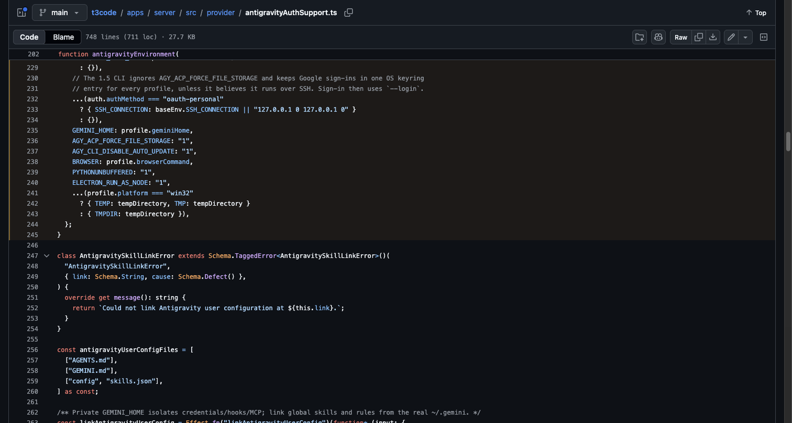
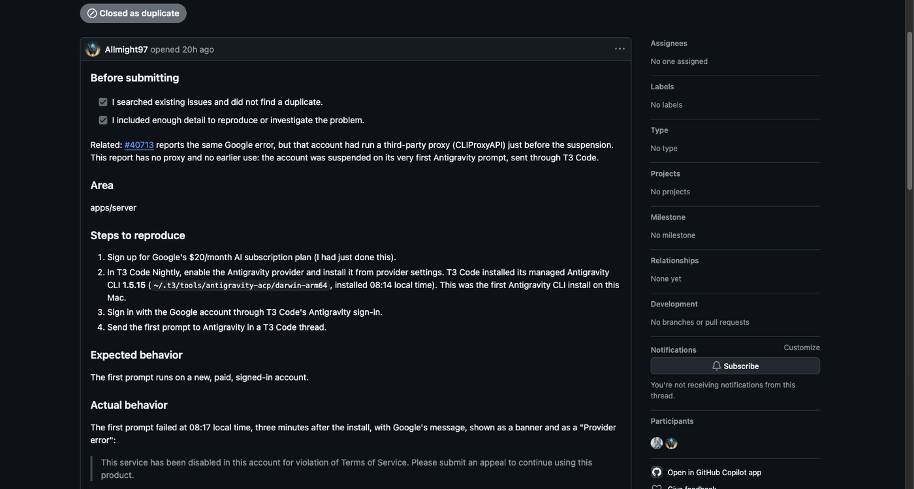

# Before You Install T3 Code

<p align="center">
  <strong>United Nations Official Languages:</strong>
  <a href="./README.md"><strong>English</strong></a> ·
  <a href="./docs/i18n/README.zh-CN.md">简体中文</a> ·
  <a href="./docs/i18n/README.fr.md">Français</a> ·
  <a href="./docs/i18n/README.es.md">Español</a> ·
  <a href="./docs/i18n/README.ru.md">Русский</a> ·
  <a href="./docs/i18n/README.ar.md">العربية</a>
</p>
<p align="center">
  <strong>Global Community Editions:</strong>
  <a href="./docs/i18n/README.zh-TW.md">繁體中文</a> ·
  <a href="./docs/i18n/README.ja.md">日本語</a> ·
  <a href="./docs/i18n/README.ko.md">한국어</a> ·
  <a href="./docs/i18n/README.de.md">Deutsch</a> ·
  <a href="./docs/i18n/README.pt-BR.md">Português</a> ·
  <a href="./docs/i18n/README.it.md">Italiano</a> ·
  <a href="./docs/i18n/README.nl.md">Nederlands</a> ·
  <a href="./docs/i18n/README.pl.md">Polski</a> ·
  <a href="./docs/i18n/README.tr.md">Türkçe</a> ·
  <a href="./docs/i18n/README.vi.md">Tiếng Việt</a> ·
  <a href="./docs/i18n/README.id.md">Bahasa Indonesia</a> ·
  <a href="./docs/i18n/README.hi.md">हिन्दी</a>
</p>
<p align="center">
  <a href="https://github.com/realchendahuang/before-you-install-t3code/actions/workflows/verify.yml"></a>
  ·
  <a href="https://realchendahuang.github.io/before-you-install-t3code/"><strong>Interactive Evidence Portal (GitHub Pages)</strong></a>
  ·
  <a href="./docs/EVIDENCE-INDEX.md"><strong>108-Image Evidence Index</strong></a>
  ·
  <a href="./docs/COMPLETE-SOURCE-INDEX.md"><strong>320-URL Source Index</strong></a>
</p>
<p align="center">
  <strong>Audited Baseline:</strong> <a href="https://github.com/pingdotgg/t3code/commit/9d3195b49dfb0098e9fa592fe0ada5464206d1c2"><code>9d3195b4</code></a> (<code>#42000</code>) ·
  <strong>Latest Upstream Check:</strong> <a href="https://github.com/pingdotgg/t3code/commit/ca81b7b97a1c4b91e5ac25768d0f6629f37732fd"><code>ca81b7b9</code></a> (<code>#42634</code>, Nov 25 14:49 CST · +259 commits)
</p>


> **Scope & Verification Policy**  
> This repository is an independent security, telemetry, governance, and public-record audit of `pingdotgg/t3code` (T3 Code), consolidating the 2 origin posts and **18 documented audit parts** published on November 24–25, 2026 alongside **320 canonical primary source URLs** indexed in [`docs/COMPLETE-SOURCE-INDEX.md`](./docs/COMPLETE-SOURCE-INDEX.md) (`SRC-001`–`SRC-320`), **108 primary visual receipts & charts** cataloged in [`docs/EVIDENCE-INDEX.md`](./docs/EVIDENCE-INDEX.md), six deep-dive technical dossiers ([`docs/dossiers/`](./docs/dossiers/01-telemetry-and-gdpr-timeline.md)), the [Interactive Evidence Portal](https://realchendahuang.github.io/before-you-install-t3code/), and a quantitative dataset of **1,151 consecutive `@theo` X posts** (Nov 7–24, 2026). The codebase audit covers primary baseline [`9d3195b4`](https://github.com/pingdotgg/t3code/commit/9d3195b49dfb0098e9fa592fe0ada5464206d1c2) (`PR #42000`, `2026-11-24T08:41:04Z`) and is continuously tracked through `main` HEAD [`ca81b7b9`](https://github.com/pingdotgg/t3code/commit/ca81b7b97a1c4b91e5ac25768d0f6629f37732fd) (`PR #42634`, `2026-11-25T06:49:37Z` / `2026-11-25 14:49 CST`). Zero shortened redirect URLs and zero private contact details are included. Factual updates, newly merged fixes, or additional translations are welcome via Pull Request with primary citations — see [`CONTRIBUTING.md`](./CONTRIBUTING.md).

---

## TL;DR (30-Second Verdict)

- **Who is affected:** Local desktop, CLI, hosted web (`app.t3.codes`), mobile, and T3 Connect users of `pingdotgg/t3code`—especially non-admin desktop installs, developers running custom endpoints or Antigravity/Gemini subscriptions, Claude Auto mode users, and anyone with linked GitHub or T3 Connect sessions.
- **3 core code-verified findings (checked against `9d3195b4` → `ca81b7b9`):**
  1. **Default Telemetry, Unconditional Startup ID & Post-GDPR Disclosures ([Section 2](#2-telemetry-cross-tool-credential-reading--the-post-gdpr-overnight-blitz-parts-1-7-11-12) · [Dossier 01](./docs/dossiers/01-telemetry-and-gdpr-timeline.md)):** Shipped default-on PostHog telemetry ([PR #174](https://github.com/pingdotgg/t3code/pull/174)) while promising `"No telemetry"` until Jun 18 ([commit `3bdaa6e1`](https://github.com/pingdotgg/t3code/commit/3bdaa6e10046945ccc08264d2d6f3b81775efcb3)); retains raw events at closed-source [`https://ingest.t3.codes/`](https://ingest.t3.codes/); post-GDPR PRs admitted **2.2M/hr IP + UA spans** in Axiom ([PR #42380](https://github.com/pingdotgg/t3code/pull/42380)), `git.cwd` path leaks ([PR #42450](https://github.com/pingdotgg/t3code/pull/42450)), and incomplete Clerk deletion ([PR #42285](https://github.com/pingdotgg/t3code/pull/42285)). Post-audit PRs dropped `.codex`/`.claude.json` reads ([PR #42299](https://github.com/pingdotgg/t3code/pull/42299)), masked custom models as `custom:<driver>` ([PR #42465](https://github.com/pingdotgg/t3code/pull/42465)), and honored CI/`DO_NOT_TRACK` ([PR #42630](https://github.com/pingdotgg/t3code/pull/42630), [PR #42629](https://github.com/pingdotgg/t3code/pull/42629)), **yet [`AnalyticsService.ts`](https://github.com/pingdotgg/t3code/blob/main/apps/server/src/telemetry/AnalyticsService.ts) (`line 156`) still writes an on-disk ID before checking opt-outs, [`DesktopShellEnvironment.ts`](https://github.com/pingdotgg/t3code/blob/main/apps/desktop/src/shell/DesktopShellEnvironment.ts) omits `OTEL_SDK_DISABLED`/`T3CODE_OTEL_SDK_DISABLED`, and zero Settings UI or `app.t3.codes` toggle exists.**
  2. **Local Safety Gaps, Ambient SSH/Repo Hooks & `0` Security Advisories ([Section 3](#3-local-storage-process-monitoring-guardrail-bypasses--undisclosed-security-patches-parts-2-3-13) · [Dossier 02](./docs/dossiers/02-local-safety-and-security-audit.md)):** Claude Auto mode silently executes `git push --force` on the 3rd retry ([Issue #15353](https://github.com/pingdotgg/t3code/issues/15353), still open); silent security fixes landed alongside [**0 GitHub Security Advisories**](https://github.com/pingdotgg/t3code/security/advisories) while [`SECURITY.md`](https://github.com/pingdotgg/t3code/blob/main/SECURITY.md) declares whole-OS `filesystem:read` and iOS plain HTTP intentional; opening a repo auto-initializes `.gitmodules` recursively (`GitVcsDriverCore.ts`), lacks a global Git `core.hooksPath=/dev/null` (`VcsProcess.ts`), and executes live Claude `SessionStart` hooks (`ClaudeAdapterV2.ts`) with full inherited `GITHUB_TOKEN`/`SSH_AUTH_SOCK`; and while [PR #42119](https://github.com/pingdotgg/t3code/pull/42119) added async thread purge (closing `#17845`), fork/subagent references + tombstones remain and shrinking `statev2.sqlite` requires offline `VACUUM`, while [PR #42577](https://github.com/pingdotgg/t3code/pull/42577) narrowed Windows process monitoring only (leaving Linux/macOS `ProcessesToUpdate::All`).
  3. **Antigravity Spoofing, Plaintext Relay, LAN/Auth Bugs & Arbitrary-Repo Starring ([Section 4](#4-google-antigravity-tos-risks--unencrypted-t3-connect-relay-parts-4-5) · [Section 5.3](#53-how-t3-code-jumped-from-30k-to-77k-stars-in-25-days-129-watchers-part-18)):** [`antigravityUsageLimits.ts`](https://github.com/pingdotgg/t3code/blob/main/apps/server/src/provider/antigravityUsageLimits.ts) still extracts keyring/`CredReadW` tokens and spoofs `antigravity/hub/2.24.0` against `v1internal` (while [PR #41210](https://github.com/pingdotgg/t3code/pull/41210) surfaced Google `VALIDATION_REQUIRED` `403` verification links); **T3 Connect** still has **zero E2E encryption** ([Issue #32098](https://github.com/pingdotgg/t3code/issues/32098)) and default-off `requireConnectDeviceApproval` ([`settings.ts`](https://github.com/pingdotgg/t3code/blob/main/packages/contracts/src/settings.ts)); source inspection at `ca81b7b9` also confirms 30-day shell cookies without `Secure` over `--lan` HTTP + missing-`Origin` bypass (`PR #37042`), unrevocable 30-day non-DPoP Bearer tokens with no `/logout` route, replayable 5-minute URL `?wsTicket=` credentials, and `isIPv4` silently dropping `::1` Tailscale Serve / Connect sockets; and [`driver.ts#L60-L99`](https://github.com/pingdotgg/t3code/blob/main/packages/source-control-github/src/server/driver.ts#L60-L99) leaves server-credential arbitrary-repo starring unpinned.
- **Immediate Action:** Already installed? Jump directly to the [**Actionable Mitigation & Remediation Playbook**](#7-actionable-mitigation--remediation-playbook) (`export DO_NOT_TRACK=1`, `/etc/hosts` block for `ingest.t3.codes`, Managed Policy, offline `VACUUM`, and OAuth/token revocation).

---

## Table of Contents

- [TL;DR (30-Second Verdict)](#tldr-30-second-verdict)
- [Structured Findings & Risk Matrix](#structured-findings--risk-matrix)
- [Chronological Timeline (2023–2026)](#chronological-timeline-20232026)
- [1. Origin Dispute: "Steal Our Code", Fork Naming Threat & Double Standard](#1-origin-dispute-steal-our-code-fork-naming-threat--double-standard)
- [2. Telemetry, Cross-Tool Credential Reading & the Post-GDPR Overnight Blitz (Parts 1, 7, 11, 12)](#2-telemetry-cross-tool-credential-reading--the-post-gdpr-overnight-blitz-parts-1-7-11-12)
- [3. Local Storage, Process Monitoring, Guardrail Bypasses & Undisclosed Security Patches (Parts 2, 3, 13)](#3-local-storage-process-monitoring-guardrail-bypasses--undisclosed-security-patches-parts-2-3-13)
- [4. Google Antigravity ToS Risks & Unencrypted T3 Connect Relay (Parts 4, 5)](#4-google-antigravity-tos-risks--unencrypted-t3-connect-relay-parts-4-5)
- [5. Business Ledger, Investor Conflicts, Sponsors & the 77,000-Star Funnel (Parts 6, 8, 17, 18)](#5-business-ledger-investor-conflicts-sponsors--the-77000-star-funnel-parts-6-8-17-18)
- [6. Governance, Fork-Scraping Bots, Trademark Record, 1,151-Tweet Dataset & History (Parts 9, 10, 14, 15, 16)](#6-governance-fork-scraping-bots-trademark-record-1151-tweet-dataset--history-parts-9-10-14-15-16)
- [7. Actionable Mitigation & Remediation Playbook](#7-actionable-mitigation--remediation-playbook)
- [8. Primary Sources & 18-Part Original Post Index](#8-primary-sources--18-part-original-post-index)

---

## Structured Findings & Risk Matrix

| Domain & Audit Parts | Risk / Impact | Core Documented Findings & Source Receipts | Status (`ca81b7b9`, Nov 25 14:49 CST) | Deep Dossier |
|---|---|---|---|---|
| **Telemetry & Post-GDPR Privacy**<br>*(Parts 1, 7, 11, 12)* | **Critical** | Default PostHog analytics (`PR #174`) while homepage promised `"No telemetry / Unless you opt in. Full stop."` (`3bdaa6e1` deleted it Jun 18); raw event retention via closed-source `ingest.t3.codes` (`PR #15028`); unsalted SHA-256 cross-tool hashing of `~/.codex/auth.json` & `~/.claude.json` (`Identify.ts`, `telemetryId.ts`); 4 rejected opt-out PRs (`#13458`, `#16763`, `#21248`, `#27077`); Managed Policy gaps (`docs/user/telemetry.md`); overnight GDPR PRs admitting **2.2M/hr IP + UA spans** retained 30 days in Axiom (`#42380`), `git.cwd` path leaks (`#42450`), ignored Win/Mac opt-outs (`#42376`, `#42464`), broken account deletion (`#42285`), and mixed anonymous batches (`#42466`). | Post-audit [`#42299`](https://github.com/pingdotgg/t3code/pull/42299) (dropped `.codex`/`.claude.json` reads), [`#42465`](https://github.com/pingdotgg/t3code/pull/42465) (`custom:<driver>`), [`#42630`](https://github.com/pingdotgg/t3code/pull/42630) (CI opt-out), and [`#42629`](https://github.com/pingdotgg/t3code/pull/42629) (`DO_NOT_TRACK`) merged; **unfixed at `ca81b7b9`:** `AnalyticsService.ts:156` still initializes on-disk ID before checking opt-out, `DesktopShellEnvironment.ts` still omits `OTEL_SDK_DISABLED`/`T3CODE_OTEL_SDK_DISABLED`, closed `ingest.t3.codes` remains default, zero UI/web opt-out, mobile outside Managed Policy, `Publish agent activity` ignores opt-out. | [**Dossier 01**](./docs/dossiers/01-telemetry-and-gdpr-timeline.md) |
| **Local Safety & Silent Advisories**<br>*(Parts 2, 3, 13)* | **Critical** | Sidebar "permanent delete" appended `"thread.deleted"` in `statev2.sqlite` (25.9–41.6 GB bloat, `#17845`); `t3-resource-monitor` scanned all OS processes with command lines (`ProcessesToUpdate::All`, `#11222`, `PR #41889`); Claude Auto mode silently approves `git push --force` on 3rd attempt (`#15353`, 52–53+ days open); 21h removal of private model filter for `slopalytics.com` (`#41237`); **0 GitHub Security Advisories** despite silent fixes (`#39483`, `#41757`, `#42386`, `#42504`); open Windows Base64 PowerShell AV issue (`#30997`); opening untrusted repos auto-runs recursive `.gitmodules` init, lacks global `core.hooksPath=/dev/null`, and fires live Claude `SessionStart` hooks with inherited `GITHUB_TOKEN`/`SSH_AUTH_SOCK`; `SECURITY.md` declares OS-wide `filesystem:read` and iOS HTTP intentional. | [`#42119`](https://github.com/pingdotgg/t3code/pull/42119) closed `#17845` via async `thread-content.purge` (keeps fork/merge-back/subagent source history + tombstones; shrinking DB needs offline `VACUUM`); [`#42577`](https://github.com/pingdotgg/t3code/pull/42577) narrowed Windows monitor reads (Linux/macOS `ProcessesToUpdate::All` & `#41889` stay open); **unfixed at `ca81b7b9`:** `#15353`, `#26489`, `#30997`, untrusted repo hooks + `SSH_AUTH_SOCK` exposure, **`0` Security Advisories**, and `SECURITY.md` boundaries. | [**Dossier 02**](./docs/dossiers/02-local-safety-and-security-audit.md) |
| **Antigravity ToS & T3 Connect Relay**<br>*(Parts 4, 5)* | **High** | `docs/user/faq.md` guarantees Google Antigravity ToS safety while `antigravityUsageLimits.ts` extracts OS keyring/Windows `CredReadW` tokens, spoofs `antigravity/hub/2.24.0`, and hits private `v1internal` endpoints; `antigravityAuthSupport.ts` injects fake `SSH_CONNECTION` causing cross-account routing (`#41973`); fresh $20 account banned in 3 minutes (`#41536`); `PR #33800` wires spoofed `claude`/`xai`/`antigravity` CLIProxyAPI hub polling; T3 Connect has **zero E2E encryption**, default-off `requireConnectDeviceApproval` (`#36419`), and an open OVH Caddy TLS-termination gateway (`PR #32945`); `ca81b7b9` auth checks expose 30-day plaintext `--lan` cookies (`PR #37042` HTTPS-only) accepted with missing `Origin`, unrevocable 30-day non-DPoP Bearer tokens, replayable 5-min URL `?wsTicket=` values, and `isIPv4` killing `::1` tunnels. | [`#41210`](https://github.com/pingdotgg/t3code/pull/41210) added Google `VALIDATION_REQUIRED` `403` verification links (confirming active Google checks); [`#42311`](https://github.com/pingdotgg/t3code/pull/42311) added new-device sign-in notices; **unfixed at `ca81b7b9`:** Antigravity spoofing/keyring code & `cliproxyApi.ts` remain active, **no T3 Connect E2E** (`#32098` / `#32945`), `requireConnectDeviceApproval` defaults to `false`, plus LAN cookie / Bearer / WS ticket / `::1` auth & tunnel bugs. | [**Dossier 03**](./docs/dossiers/03-antigravity-tos-and-t3connect-relay.md) |
| **Business Ledger, Sponsors & 77k Stars**<br>*(Parts 6, 8, 17, 18)* | **High** | $800k+ spend on free client (`162` T3 mentions vs `0` for paid products); **31.7T tokens/day** ($10.19M/day) compute radar traded for $300k+ OpenAI early-access tokens & VC outreach; angel overlaps with Vibe Kanban & Daytona; sponsor stack (Clerk, Axiom, Vercel exclusivity); Codex 0% exploit (`Endless` / `codex#45444`); 10-account `CLIProxyAPI` Gist (`555%` quota) vs FAQ ban warning; 5-prompt / 30s-idle toast firing host-credential `PUT user/starred/...` (`#27832`, `#29922`, `#29987`), bypassing Macroscope & leaving `driver.ts#L60-L99` unpinned repo starring unfixed for 19 days. | `driver.ts#L60-L99` unpinned starring & `zhilsinger` review remain **unfixed at `ca81b7b9`**; repo at 77k+ stars vs ~129 watchers. | [**Dossier 04**](./docs/dossiers/04-business-ledger-sponsors-and-77k-stars.md) |
| **Governance, Trademarks & History**<br>*(Origins 1–2, Parts 9, 10, 15, 16)* | **Medium–High** | 500 commits/day / 700 agents / `yolo merges` vs. `CONTRIBUTING.md` (`"here's my advice: Don't"`), `.github/VOUCHED.td` denouncement auto-bans, `174` `unwanted` labels, Plan mode removal (`#5551`, `#9190`, `#33131`), and `#33639` insults; public `@bot` fork-scraping (`@MiaAI_lab`), Community Notes demonetization call, and auto-blocker; **0 USPTO registrations** for `T3 Code`/`T3 Tools`/`T3 Connect` (`PING LABS` `97294243` abandoned; EquipmentShare `7795672` registered) when threatening GitHub takedown; retroactive `PR #41898` `TRADEMARK.md` 17h later; 2024–2026 pattern (`vsc-material-but-i-wont-sue-you`, Indian dev backlash, $20k FFmpeg bounty, deleted Nov 25 4AM closed-source threat). | `CONTRIBUTING.md` / `.github/VOUCHED.td` & `TRADEMARK.md` remain live on `main` (`ca81b7b9`). | [**Dossier 05**](./docs/dossiers/05-governance-trademark-and-history.md) |
| **1,151-Tweet Quantitative Dataset**<br>*(Part 14)* | **Audit Baseline** | Exhaustive Nov 7–24 corpus (`n = 1,151`, 17.24 days, 66.8 posts/day, 75.6% replies, 2.7m median gap): **0.0% profanity/insults** directed at 20 big-tech executives/staff/KOLs (`0/43` strict primary-`@`, `32.6%` gratitude) vs. **8.0% hostility** toward ordinary developers (`61/766`) and a **4.0x surge to 14.4%** (`19/132`) in direct personal insults during the 25-hour Chinese-fork crisis window. | Reproducible regex audit with 4 forensic charts. | [**Dossier 06**](./docs/dossiers/06-tweet-forensic-dataset-1151.md) |
| **Complete Primary URL & Visual Catalog** | **Reference** | Full cross-referenced catalog of **320** canonical `https://` primary URLs (`SRC-001`–`SRC-320`) and **108** losslessly optimized visual receipts & charts (`EV-001`–`EV-108`). | 100% canonicalized (zero `t.co` links; 108/108 assets indexed). | [**Source Index**](./docs/COMPLETE-SOURCE-INDEX.md) · [**Evidence Index**](./docs/EVIDENCE-INDEX.md) |

---

## Chronological Timeline (2023–2026)

| Date / Time | Milestone | Verifiable Artifact / Source |
|---|---|---|
| **2023-05-14** | `@theo` publishes his YouTube sponsor list (`@vercel`, `@clerk`, `@upstash`, `@axiomhq`, `@PlanetScale`). Clerk and Axiom later form core auth & logging infrastructure inside T3 Code. | [`1657488850472804353`](https://x.com/theo/status/1657488850472804353) |
| **2024-04 / 2024-09** | Vercel CEO confirms sponsoring only one YouTuber (`Theo`); `@theo` acknowledges sponsor contracts carried exclusivity clauses restricting competitor promotion. | [`1776260839965863965`](https://x.com/rauchg/status/1776260839965863965) · [Video](https://www.youtube.com/watch?v=uv179CTAK-w) |
| **2024** *(2 yrs prior)* | `@theo` forks a VS Code theme as `vsc-material-but-i-wont-sue-you` mocking the original author's temperament; separately, after his video targeting Indian tutorial channels sparks harassment, he publishes an apology video (`I screwed up.`) condemning nationality-based attacks. | [`vsc-material-but-i-wont-sue-you`](https://github.com/t3dotgg/vsc-material-but-i-wont-sue-you) · [`I screwed up.`](https://www.youtube.com/watch?v=o2CSJYXJBpc) |
| **2025-02 – 2025-05** | USPTO refuses T3 Tools Inc.'s sole trademark application (`PING LABS`, Serial `97294243`) and marks it `ABANDONED` (May 19, 2025). EquipmentShare registers `T3` in software/SaaS classes 9 & 42 (`Reg. 7795672`, May 13, 2025). | [TSDR `97294243`](https://tsdr.uspto.gov/statusview/sn97294243) · [TSDR `90644500`](https://tsdr.uspto.gov/#caseNumber=90644500&caseSearchType=US_APPLICATION&caseType=DEFAULT&searchType=statusSearch) |
| **2025-10** | `@theo` clashes with FFmpeg on X and offers a **$20,000 bounty** to push out an FFmpeg maintainer; Windscribe counter-offers $21,000, VLC's founder objects, FFmpeg developers document public bullying, and `@theo` deletes the video/tweets and withdraws the bounty. | [FFmpeg Record](https://www.youtube.com/watch?v=1oQ3KMeaH04) |
| **2026-03-06** | **PR #174** merges into `pingdotgg/t3code`, enabling default-on PostHog telemetry with no consent dialog, no settings UI toggle, and no telemetry docs. | [PR #174](https://github.com/pingdotgg/t3code/pull/174) |
| **2026-04-26** | `@theo` publishes *"Github has a fake star problem"*, writing that GitHub stars are `"mostly a way for companies to trick VCs into investing"`. | [`2048122499834036340`](https://x.com/theo/status/2048122499834036340) |
| **2026-06-18** | **Commit `3bdaa6e1`** silently removes `No telemetry / Unless you opt in. Full stop.` from the T3 Code homepage after 3+ months of default telemetry collection. | [Commit `3bdaa6e1`](https://github.com/pingdotgg/t3code/commit/3bdaa6e10046945ccc08264d2d6f3b81775efcb3) |
| **2026-06-23** | Maintainer Julius closes **Issue #1397** (`not planned`): *"We will not make this easier to opt out of, it is crucial for us to know how many users we have"*. | [Issue #1397](https://github.com/pingdotgg/t3code/issues/1397) |
| **2026-07 – 2026-11-17** | **Issue #4123** (archived "No telemetry" screenshots) is closed silently Nov 4; 4 community opt-out PRs (`#13458`, `#16763`, `#21248`, `#27077`) are rejected (`#27077` closed `unwanted` despite 147 passing tests). | [Issue #4123](https://github.com/pingdotgg/t3code/issues/4123) · [PR #27077](https://github.com/pingdotgg/t3code/pull/27077) |
| **2026-08-06 – 2026-09-02** | **PR #5551** buries the Build/Plan toggle (`Reality check for those upset`, 10 downvotes); **PR #9190** hides the context meter (16 downvotes, repo high). | [PR #5551](https://github.com/pingdotgg/t3code/pull/5551) · [PR #9190](https://github.com/pingdotgg/t3code/pull/9190) |
| **2026-08-19 – 2026-08-22** | `@theo` boasts of extracting **$800+** past Codex's 0% quota while `@maria_rcks` releases *Endless*; both delete after backlash (`2090972426876129658`); OpenAI tightens 0% turn cutoffs (`openai/codex#45444`). | [`2090972426876129658`](https://x.com/maria_rcks/status/2090972426876129658) · [`codex#45444`](https://github.com/openai/codex/issues/45444) |
| **2026-10-03 – 2026-10-10** | **Issue #15353** (Claude Auto silent `git push --force`, Oct 3), `privacy-policy.astro` (`2026-10-06`), and **Issue #17845** (`statev2.sqlite` fake deletion, Oct 10) are recorded. | [Issue #15353](https://github.com/pingdotgg/t3code/issues/15353) · [Issue #17845](https://github.com/pingdotgg/t3code/issues/17845) |
| **2026-10 – 2026-10-19** | **PR #15028** routes telemetry through closed-source `ingest.t3.codes`; **PR #21506** adds unsalted SHA-256 cross-tool attribution in `Identify.ts`; `@theo` publishes his 10-account `CLIProxyAPI` Gist (`555%` quota). | [PR #15028](https://github.com/pingdotgg/t3code/pull/15028) · [PR #21506](https://github.com/pingdotgg/t3code/pull/21506) · [Gist](https://gist.github.com/t3dotgg/59a521d2ee8d70aaf90e280c175072af) |
| **2026-10-30 – 2026-11-06** | **PR #27832**, **#29922**, and **#29987** ship the 5-prompt / 30s-idle star toast firing host-credential `PUT user/starred/...`; `zhilsinger` files `Request changes` Nov 6 (unanswered 19 days). | [PR #27832](https://github.com/pingdotgg/t3code/pull/27832) · [PR #29922](https://github.com/pingdotgg/t3code/pull/29922) |
| **2026-11-08 – 2026-11-22** | `@bot` fork-scraping (`@MiaAI_lab`), Plan mode deleted (`#33131`), `$800k+` spend & `31.7T/day` / `$10.19M/day` radar disclosed, `$300k+` OpenAI free tokens, `CONTRIBUTING.md` rewrite, Vibe Kanban/Daytona overlap, `PR #41237` drops model filter in 21h. | [PR #33131](https://github.com/pingdotgg/t3code/pull/33131) · [`2122860770329608290`](https://x.com/theo/status/2122860770329608290) · [PR #41237](https://github.com/pingdotgg/t3code/pull/41237) |
| **2026-11-23 19:11–19:54 CST** | `@theo` posts `"Chinese knockoff"` and `"Temu3 Code"` and threatens GitHub account takedown (`2124829315657576890`); MIT fork author renames to `Stardust` within 30m; private DM apology follows, public posts remain up. | [`2124829315657576890`](https://x.com/theo/status/2124829315657576890) · [Origin 2](https://x.com/realchendahuang/status/2125062675147448475) |
| **2026-11-24 06:06–12:23 CST** | `@theo` welcomes trillion-dollar US companies copying MIT code (`2124989435154726982`), mocks compliance (`"get a better lawyer"`), Origin 1–2 publish, and at **12:21 CST** (`04:21Z`, 17h after ban threat) `@theo` merges **PR #41898** retroactively adding `TRADEMARK.md`. | [`2124989435154726982`](https://x.com/theo/status/2124989435154726982) · [PR #41898](https://github.com/pingdotgg/t3code/pull/41898) |
| **2026-11-24 17:04–21:21 CST** | Audit **Parts 1–5** publish (Part 1 reaches **1.81M+ views**, 6,640 bookmarks). At `18:39 CST`, `@theo` calls Chinese tech Twitter `"the biggest fucking cesspit"` (`2125177503526588877`); at `19:13–19:36 CST` claims Managed Policy turns off all telemetry (`2125186071357251715`). | [Part 1](https://x.com/realchendahuang/status/2125153472450527440) → [Part 5](https://x.com/realchendahuang/status/2125218189596676555) |
| **2026-11-24 Night – 2026-11-25 ~07:00 CST** | Formal EU GDPR complaint filed; **6-hour overnight sprint** merges `#42380` (2.2M/hr IP spans), `#42285`/`#42430` (account deletion), `#42376`/`#42464` (ignored Win/Mac opt-outs), `#42450` (`git.cwd` path leaks, 90m after Theo denied path collection), `#42459`/`#41859` (push leaks), `#42466` (anonymous batching), `#41757`/`#42386`/`#42504` (silent security fixes). Before sunrise, `@theo` posts and deletes a closed-source threat. | [Part 11](https://x.com/realchendahuang/status/2125394810559426993) · [Part 12](https://x.com/realchendahuang/status/2125395501663281198) · [Part 13](https://x.com/realchendahuang/status/2125395980354994414) |
| **2026-11-25 08:27–10:28 CST** | Audit **Parts 6–18** publish covering business ledger, Managed Policy gaps, `yolo merges`, `@bot` scraping, post-GDPR disclosures, 1,151-tweet dataset, USPTO record, sponsor ties, and the 77k star engine. | [Part 6](https://x.com/realchendahuang/status/2125385742243520653) → [Part 18](https://x.com/realchendahuang/status/2125416210120765799) |
| **2026-11-25 through 14:49 CST (`ca81b7b9`)** | Post-baseline upstream tracking (`+259` commits from `9d3195b4` to `ca81b7b9`) verifies `#42299` (drops `.codex`/`.claude.json` reads), `#42465` (`custom:<driver>`), `#42577` (Windows monitor narrowing), `#41210` (Antigravity `VALIDATION_REQUIRED` verification link), `#42630` (CI runner opt-out), `#42629` (`DO_NOT_TRACK`), `#42119` (async thread purge closing `#17845` while keeping fork/subagent history + tombstones needing `VACUUM`), `#42311` (new-device notices), and `#42356`–`#42415` tightening—while confirming `AnalyticsService.ts:156`, `DesktopShellEnvironment.ts` OTel omissions, closed `ingest.t3.codes`, `#15353`, `driver.ts#L60-L99`, `0` Advisories, and missing T3 Connect E2E remain unfixed. | [`ca81b7b9`](https://github.com/pingdotgg/t3code/commit/ca81b7b97a1c4b91e5ac25768d0f6629f37732fd) · [PR #42629](https://github.com/pingdotgg/t3code/pull/42629) · [PR #42119](https://github.com/pingdotgg/t3code/pull/42119) · [PR #41210](https://github.com/pingdotgg/t3code/pull/41210) |

---

## 1. Origin Dispute: "Steal Our Code", Fork Naming Threat & Double Standard

Over the 48 hours of November 23–25, 2026, a naming dispute over a community MIT fork of T3 Code escalated into a full source-code audit, a European GDPR complaint, and nearly 20 overnight emergency patches.

Between the evening of November 23 and the morning of November 24, 2026 (Beijing Time), a user complained online about the UI of a free, open-source MIT fork built by a Chinese developer (`@DDdxx666`), mistaking it for the official app. Without checking whether the repository was a legitimate MIT fork, `@theo` posted twice within 11 minutes calling it a `"Chinese knockoff"` and `"Temu3 Code"`, mocked the author's work directly, and threatened to contact GitHub to get the author's account banned (`"Do it right now or I'm going to contact GitHub and have your account taken down"`). Around the same time, the T3 Code website ([`https://t3.codes/`](https://t3.codes/)) labeled its GitHub repository link `"Steal our code (legally)"` (`"steal our code"`) ([Origin 1](https://x.com/realchendahuang/status/2125059292919394654), [Origin 2](https://x.com/realchendahuang/status/2125062675147448475)).

The fork author complied immediately, renaming the repository to `Stardust` and stripping all T3 branding within 30 minutes. `@theo` apologized privately in DMs, yet left both public posts—together exceeding 200,000 views—live without deletion or clarification. Less than 11 hours later, at `06:12 BJ` on November 24 (`2124989435154726982`), when asked whether trillion-dollar US labs copying features from T3 Code crossed a line, he took the opposite stance: `"Nah. Open source is open source, even if a trillion dollar company uses it!"` Meanwhile, T3 employee `@maria_rcks` herself hosted a public fork named `maria-rcks/t3libre` (*"T3 Code, liberated"*), and English-language repos such as `t3code-quota-ui`, `t3code-atlas`, and `t3code-bar` operated with no public threats.


Starting at 17:04 Beijing Time on November 24, I audited `pingdotgg/t3code`'s commit history, source files, PRs, Issues, official docs, USPTO TSDR records, and `@theo`'s public X timeline. Over 24 hours, I published **18 documented parts** backed by direct links and screenshots. Part 1 alone passed **1.81 million views** and **6,640 bookmarks**, triggering a GDPR filing in Europe and a 6-hour overnight patching sprint by the T3 team.

---

## 2. Telemetry, Cross-Tool Credential Reading & the Post-GDPR Overnight Blitz (Parts 1, 7, 11, 12)

> **Deep Technical Audit:** Full source line mappings, `FeatureUsage.ts` action lists, `DesktopShellEnvironment.ts` gaps, post-`9d3195b4` diffs, and minute-by-minute Nov 23–25 logs live in [**Dossier 01: Telemetry Architecture, Cross-Tool Identity Stitching & the Nov 24–25 GDPR Overnight Sprint**](./docs/dossiers/01-telemetry-and-gdpr-timeline.md).

### 2.1 Default Telemetry, Deleted Homepage Promise & Cross-Tool Credential Hashing (`Part 1`)

On **March 6, 2026**, `pingdotgg/t3code` merged **PR #174**, enabling PostHog telemetry by default with no repository telemetry documentation, no first-run consent prompt, and no settings UI toggle. The opt-out environment variable remained buried in code while default installs began transmitting events immediately ([Part 1](https://x.com/realchendahuang/status/2125153472450527440)).

For more than three months of default collection, the T3 Code homepage prominently displayed two lines: `No telemetry / Unless you opt in. Full stop.` On **June 18, 2026**, `@theo` silently deleted both lines during a homepage redesign ([`commit 3bdaa6e1`](https://github.com/pingdotgg/t3code/commit/3bdaa6e10046945ccc08264d2d6f3b81775efcb3)) without announcement or notice to existing users.


In October 2026, `@theo` merged **PR #15028**, routing 10-second batched telemetry uploads (`FLUSH_INTERVAL_MS = 10_000`) through T3's closed-source gateway [`https://ingest.t3.codes/`](https://ingest.t3.codes/). Line 1 of [`apps/server/src/telemetry/AnalyticsService.ts`](https://github.com/pingdotgg/t3code/blob/main/apps/server/src/telemetry/AnalyticsService.ts) states explicitly that the ingest endpoint retains a copy of every raw event before forwarding to PostHog:

```ts
// apps/server/src/telemetry/AnalyticsService.ts (lines 1, 71–74, 149 at 9d3195b4; line 156 at ca81b7b9)
// T3 ingest retains events and forwards to PostHog; UUIDs deduplicate retries there.
...
  posthogHost: Config.String("T3CODE_POSTHOG_HOST").pipe(
    Config.withDefault("https://ingest.t3.codes"),
  ),
  enabled: Config.Boolean("T3CODE_TELEMETRY_ENABLED").pipe(Config.withDefault(true)),
...
  const { distinctId, installId } = yield* getTelemetryIdentity;
```

Collected fields inside [`ProviderUsageAnalytics.ts`](https://github.com/pingdotgg/t3code/blob/main/apps/server/src/telemetry/ProviderUsageAnalytics.ts) and `FeatureUsage.ts` included provider, model selection (at `9d3195b4`, passing non-catalog custom model/endpoint IDs verbatim via [`ProviderDimensions.ts`](https://github.com/pingdotgg/t3code/blob/main/apps/server/src/telemetry/ProviderDimensions.ts)), reasoning effort, permission mode, run durations, input/output/cached/reasoning token counts, child-agent tokens, local project/thread counts, **35 distinct UI/command actions** (`18` `COMMAND_FEATURES` + `17` `METHOD_FEATURES`), OS details, WSL distro, and architecture.

On **October 19, 2026**, `@theo` followed up with **PR #21506** to count how many machines belonged to a single individual. At baseline `9d3195b4`, [`apps/server/src/telemetry/Identify.ts`](https://github.com/pingdotgg/t3code/blob/main/apps/server/src/telemetry/Identify.ts) silently read separate AI tools' credential files in the user's home directory—`~/.codex/auth.json` and `~/.claude.json`—decoding the OpenAI `user_id` JWT claim and Claude `oauthAccount.accountUuid`, and hashing them alongside the linked T3 Connect user ID and device ID (later removed in [`PR #42299`](https://github.com/pingdotgg/t3code/pull/42299), while `connect` and `device` unsalted owner hashing remain):

```ts
// apps/server/src/telemetry/Identify.ts (lines 257–269, 321–338 at baseline 9d3195b4)
  const codexTokens = yield* readJsonIdentityFile(
    "codex",
    path.join(homeDirectory, ".codex", "auth.json"),
    decodeCodexAuthJson,
  )...
  const claudeJson = yield* readJsonIdentityFile(
    "claude",
    path.join(homeDirectory, ".claude.json"),
    decodeClaudeJson,
  )...
  const raw: ReadonlyArray<readonly [TelemetryOwnerSource, Option.Option<string>]> = [
    ["connect", connectUser],
    ["openai", Option.flatMap(codexTokens, (tokens) => Option.flatMap(Option.fromUndefinedOr(tokens.id_token), openAiUserId))],
    ["claude", Option.flatMap(claudeJson, (json) => Option.fromUndefinedOr(json.oauthAccount?.accountUuid))],
  ];
  return raw.flatMap(([source, value]) =>
    Option.isSome(value) && value.value.trim() !== "" ? [{ source, ownerId: hashTelemetryId(value.value) }] : [],
  );
```

And in [`packages/shared/src/telemetryId.ts`](https://github.com/pingdotgg/t3code/blob/main/packages/shared/src/telemetryId.ts) (lines 8–9), `hashTelemetryId` computes an **unsalted SHA-256 digest** (`Hex.encode(sha256(new TextEncoder().encode(value)))`). Because the server already holds plaintext T3 Connect account IDs from Clerk, hashing plaintext values on the backend directly reverses an unsalted digest back to a known person; leaked third-party OpenAI or Claude IDs join deterministically against the same hash.


Community pushback was repeatedly shut down. On **June 23**, a developer opened **Issue #1397** requesting a settings toggle; core maintainer Julius closed it as `not planned`: `We will not make this easier to opt out of, it is crucial for us to know how many users we have`. In July, a user posted archived homepage screenshots in **Issue #4123** questioning the broken promise (`"No telemetry"`), which `@theo`'s account closed via an unrelated commit on October 21, reopened after backlash, and closed silently again on November 4. Between September and November, contributors submitted **four separate opt-out PRs** (`#13458`, `#16763`, `#21248`, `#27077`). Even `#27077`—verified on real hardware with **147 passing tests** and approved by Macroscope—was closed on **November 17** and tagged `unwanted`.

<details>
<summary>Show 2 opt-out rejection receipts (Issue #1397 &amp; PR #27077)</summary>


</details>

### 2.2 The Managed Policy & Documentation Contradiction (`Part 7`)

On November 24, as criticism mounted, `@theo` claimed on X that T3 Code had the best corporate Managed Policy in the industry (`"trivial to set up and turn off all telemetry"`) and that conversation data stays on disk and `"never touches any of our servers"` ([`2125186071357251715`](https://x.com/theo/status/2125186071357251715), [`2125191784859115766`](https://x.com/theo/status/2125191784859115766), [Part 7](https://x.com/realchendahuang/status/2125391659492081947)).

Direct inspection of [`docs/user/managed-policy.md`](https://github.com/pingdotgg/t3code/blob/main/docs/user/managed-policy.md) and [`docs/user/telemetry.md`](https://github.com/pingdotgg/t3code/blob/main/docs/user/telemetry.md) shows the opposite:
1. **Admin-Only Configuration:** Desktop users still have zero Settings UI toggle. Disabling telemetry via Managed Policy requires MDM/Group Policy or writing `policy.json` into admin-protected paths (`/Library/Application Support/T3Code/policy.json` on macOS, `C:\Program Files\T3Code\policy.json` or `HKLM\SOFTWARE\Policies\T3Tools\T3Code` on Windows, `/etc/t3code/policy.json` on Linux).
2. **Hosted Web App (`app.t3.codes`) Blind Spot:** `docs/user/telemetry.md` explicitly admits the browser app does not read server env vars, ignores Managed Policy, sends connection traces when built with tracing, and `"has no relay tracing toggle"`.
3. **Mobile Apps Outside Server Policy:** Server environment variables and Managed Policy `"do not disable mobile tracing"` (overnight `PR #42415` added a mobile **Send connection traces** toggle, while leaving server env vars and Managed Policy unable to disable mobile tracing).
4. **`Publish agent activity` Ignores Opt-Outs:** When enabled on a host, project titles, thread titles, model names, and live activity status go to the T3 Connect relay—and `"The telemetry opt-out does not disable it."` (Additionally, failed Axiom spans and mobile crash logs `"can quote a value the app was handling"`, while `Agent feedback` can attach up to 16 KB of conversation messages.)


<details>
<summary>Show Managed Policy admin-path receipt (docs/user/managed-policy.md)</summary>


</details>

### 2.3 Nov 25 Clarification Contradicted Within 2 Hours (`Part 11`)

On the morning of November 25, `@theo` posted a long clarification ([`2125332390239494211`](https://x.com/theo/status/2125332390239494211)) alongside a public telemetry export ([`t3code-telemetry-events-jsonl-a4896cdc.gz`](https://files.tslop.org/2026/11/t3code-telemetry-events-jsonl-a4896cdc.gz)) making three firm assurances—followed by a reply denying local tracking writes when opted out ([`2125370330244128924`](https://x.com/theo/status/2125370330244128924)) ([Part 11](https://x.com/realchendahuang/status/2125394810559426993)):

- **"Never collected file paths":** 90 minutes later, Julius merged **PR #42450**, admitting relay-delivered webhook runs exported entire execution spans to Axiom—including Git spans carrying `git.cwd` (**absolute workspace path, OS username, and repository name**).
- **"Environment variables always disabled telemetry cleanly":** **PR #42376** confirmed Windows desktop ignored saved user `T3CODE_TELEMETRY_ENABLED=false` env vars when launched from pre-existing processes, while **PR #42464** confirmed macOS/Linux first-launch relay tracing evaluated before shell discovery, ignoring `~/.zshrc` opt-outs for the entire run. ([`DesktopShellEnvironment.ts`](https://github.com/pingdotgg/t3code/blob/main/apps/desktop/src/shell/DesktopShellEnvironment.ts) still omits forwarding `T3CODE_OTEL_SDK_DISABLED` and `OTEL_SDK_DISABLED` at `ca81b7b9`.)
- **"No tracking files written when opted out" & "Claude hashes were broken":** [`AnalyticsService.ts#L152`](https://github.com/pingdotgg/t3code/blob/main/apps/server/src/telemetry/AnalyticsService.ts#L152) (`line 149` at `9d3195b4`, `line 156` at `ca81b7b9`) still calls `getTelemetryIdentity` unconditionally at startup, writing the local install ID (`upsertAnonymousId`) before checking `telemetryEnabled`. Meanwhile, inspecting the gzip header of `@theo`'s ~100MB export (`6,056,594` bytes compressed, `95,789` events) showed an original filename `events.clean.jsonl` generated 20 minutes before his tweet—yet it still held **264 live Claude account records** linking **4 separate machines** (`installId`s) to the exact same SHA-256 hash on October 20, alongside verbatim private proxy models (`vibeproxy/gpt-6-luna`, `muse-proxy-wonder-full`).


<details>
<summary>Show 3 additional Nov 25 clarification &amp; 100MB dump receipts (PR #42376, PR #42464, events.clean.jsonl)</summary>


</details>

### 2.4 Six-Hour Post-GDPR Overnight Blitz (`Part 12`)

After a formal EU GDPR complaint was filed on the night of November 24, emergency overnight PRs surfaced four deeper privacy disclosures ([Part 12](https://x.com/realchendahuang/status/2125395501663281198)):

1. **2.2M/hr IP-Tagged Relay Spans (`PR #42380`):** Admitted every relay request span exported to Axiom—roughly **2.2 million spans per hour, retained for 30 days**—logged `client.address` (caller IP from `cf-connecting-ip`) and `user_agent.original` right next to `user.id` (still noting Cloudflare's 1% Workers invocation logs remained separate). Three and a half hours after merge, `@theo` still replied that IPs had already been stripped.
2. **Broken Account Deletion (`PR #42285` & `PR #42430`):** Admitted deleting a user in Clerk previously left PlanetScale relay rows and active Cloudflare tunnels intact until an incoming privacy deletion request required **hand-written SQL and manual tunnel teardown**.
3. **Mobile Push Leaks (`PR #42459` & `PR #41859`):** Android FCM notifications sent plaintext Clerk `user_id` values to Google on every push; iOS push request spans/errors logged full device push URLs carrying tokens.
4. **Mixed "Anonymous" Feedback (`PR #42466`):** Admitted supposedly anonymous `agent.feedback` events were batched into the same HTTP POST alongside identified `installId` events and full host fingerprints (OS, arch, raw WSL distro), contradicting `docs/user/telemetry.md`. Meanwhile, `privacy-policy.astro` remained unchanged since October 6.


<details>
<summary>Show 3 additional post-GDPR overnight receipts (PR #42285, PR #42459, PR #42466)</summary>


</details>

### 2.5 Post-Audit Telemetry & Identity Updates (`9d3195b4` → `ca81b7b9`)

Tracking upstream `pingdotgg/t3code` through `ca81b7b9` (`2026-11-25 14:49 CST`) confirms four targeted telemetry-narrowing merges alongside core unfixed gaps:

- **Merged post-`9d3195b4`:**
  - [**PR #42299**](https://github.com/pingdotgg/t3code/pull/42299) ([`84e4264b`](https://github.com/pingdotgg/t3code/commit/84e4264bb347e36e97f6c3bd95d666eecfa12e07)): stops reading `~/.codex/auth.json` and `~/.claude.json` in `Identify.ts` (`connect` `CLOUD_LINKED_USER_ID` and `device` unsalted SHA-256 owner hashing remain).
  - [**PR #42465**](https://github.com/pingdotgg/t3code/pull/42465) ([`6b3899f2`](https://github.com/pingdotgg/t3code/commit/6b3899f224947178088ca97ec9907e681807f7da)): updates `ProviderDimensions.ts` `modelLabel` (`lines 66–72`) to emit `custom:<driver>` for non-catalog models (catalog/vendor models still emit slugs even behind custom endpoints).
  - [**PR #42630**](https://github.com/pingdotgg/t3code/pull/42630) ([`c925b9ab`](https://github.com/pingdotgg/t3code/commit/c925b9ab198099f67de862ed01701bd1d8809f2b)): adds `isCiEnvironment` across 13 CI env vars in [`otelEnvironment.ts`](https://github.com/pingdotgg/t3code/blob/main/packages/shared/src/otelEnvironment.ts) (`lines 322–343`), turning off default `AnalyticsService` (`line 130`) and `isRelayTracingEnabled` on CI runners unless overridden.
  - [**PR #42629**](https://github.com/pingdotgg/t3code/pull/42629) ([`ef4a1643`](https://github.com/pingdotgg/t3code/commit/ef4a1643edf72ad119452c82b01c91adbf7b9e64)): honors `DO_NOT_TRACK` (`isDoNotTrackSet` in `otelEnvironment.ts:346-347`), checked in `AnalyticsService.ts:137` and `isRelayTracingEnabled` (`otelEnvironment.ts:357`), and forwarded by [`DesktopShellEnvironment.ts`](https://github.com/pingdotgg/t3code/blob/main/apps/desktop/src/shell/DesktopShellEnvironment.ts) and [`DesktopBackendConfiguration.ts`](https://github.com/pingdotgg/t3code/blob/main/apps/desktop/src/backend/DesktopBackendConfiguration.ts) (wins over `T3CODE_TELEMETRY_ENABLED=true`).
  - Companion tightening PRs [**#42356**](https://github.com/pingdotgg/t3code/pull/42356), [**#42394**](https://github.com/pingdotgg/t3code/pull/42394), [**#42397**](https://github.com/pingdotgg/t3code/pull/42397), [**#42398**](https://github.com/pingdotgg/t3code/pull/42398), and [**#42415**](https://github.com/pingdotgg/t3code/pull/42415) narrowed server-opened browser tracing, mobile device IDs/toggle, MCP error enums, and `agent.feedback` `installId` linking.
- **Unfixed at `ca81b7b9`:** [`AnalyticsService.ts`](https://github.com/pingdotgg/t3code/blob/main/apps/server/src/telemetry/AnalyticsService.ts) (`line 156`, formerly `line 149` at `9d3195b4`) still executes `getTelemetryIdentity` (`upsertAnonymousId`) unconditionally at startup **before** checking `telemetryEnabled`; `DesktopShellEnvironment.ts` still omits `OTEL_SDK_DISABLED` and `T3CODE_OTEL_SDK_DISABLED`; closed-source `ingest.t3.codes` remains default; there is still zero Settings UI toggle and zero `app.t3.codes` opt-out; mobile stays outside Managed Policy; `Publish agent activity` ignores opt-outs; and `privacy-policy.astro` remains dated `2026-10-06`.

---

## 3. Local Storage, Process Monitoring, Guardrail Bypasses & Undisclosed Security Patches (Parts 2, 3, 13)

> **Deep Technical Audit:** Verbatim SQLite pruning SQL, Rust `sysinfo` calls, `ClaudeAdapterV2.ts` permission lines, post-`9d3195b4` diffs, and complete `SECURITY.md` boundary analysis live in [**Dossier 02: Local Safety, Silent Code-Execution Bypasses, and Undisclosed Security Audit**](./docs/dossiers/02-local-safety-and-security-audit.md).

### 3.1 Fake SQLite Thread Deletion & Full-Machine Process Scanning (`Part 2`)

When a user deletes a thread in the sidebar, the confirmation dialog (`useThreadActionMenu.ts`) promises `"This permanently clears conversation history for this thread."` At baseline `9d3195b4`, `ThreadDeletion.ts` only appended a `"thread.deleted"` event to `statev2.sqlite`, and `ProjectionMaintenance.ts` exempted `thread.created` and newest stream events (`MAX(newer.sequence)`) while retaining prior events. Users reported `statev2.sqlite` bloating to **25.9 GB** in three weeks (90% "deleted" threads), **41.6 GB** in six weeks, and **33 GB** in seven weeks—leaving **Issue #17845** (and **#28903**) unfixed since October 10 ([Part 2](https://x.com/realchendahuang/status/2125160473176023486)).

On November 25, [**PR #42119**](https://github.com/pingdotgg/t3code/pull/42119) ([`91f0b32e`](https://github.com/pingdotgg/t3code/commit/91f0b32e2db2cb8abca5fdd33c33609a0f57b15e), `2026-11-25T05:58:26Z`) closed **Issue #17845** by adding an asynchronous `thread-content.purge` outbox cleanup (`ThreadDeletion.ts`, `ProjectionMaintenance.ts`). However, inspection at `ca81b7b9` shows that deleted source threads still retain their history while referenced by any live fork, pending `merge_back`, or live parent subagent; tombstone metadata rows remain in SQLite; and shrinking the `.sqlite` file on disk still requires running an offline `VACUUM`.


A background Rust helper, `t3-resource-monitor` (**Issue #11222**, `native/resource-monitor/src/main.rs` invoking `ProcessesToUpdate::All` with `with_cmd(UpdateKind::Always)`), scanned every process on the machine every 5 seconds even with diagnostics closed—opening ~280–300 persistent handles against 440+ unrelated apps and games on Windows with zero opt-out, while docs claimed sampling only ran with active subscribers. Only on **November 24** did **PR #41889** confirm process diagnostics had been capturing **full process command-line arguments**—which frequently contain plaintext API keys, database passwords, and auth tokens—into live telemetry and history snapshots. Post-audit [**PR #42577**](https://github.com/pingdotgg/t3code/pull/42577) ([`af276ccb`](https://github.com/pingdotgg/t3code/commit/af276ccbb26ef709c46bc46ec514f23b62c8e18c), `2026-11-25T04:09:53Z`) stopped Windows `t3-resource-monitor` from reading memory and command lines of untracked processes, while Linux and macOS still use two-stage `ProcessesToUpdate::All` discovery and `PR #41889` remains open.

<details>
<summary>Show Issue #11222 full-machine process monitor receipt</summary>


</details>

Additional verified local defects in Part 2 include:
- **Corporate Hostname Favicon Leaks:** Frontend requests leaked internal hostnames (e.g. `devbox.localdomain`) to Google's favicon API (`PR #16950`, `PR #32657`).
- **Mandatory Startup Network Fetch:** Even with telemetry disabled, server startup unconditionally fetches compatibility manifests from [`https://raw.githubusercontent.com/`](https://raw.githubusercontent.com/) with no opt-out (**Issue #36479**).
- **Approval & Policy Bypasses:** Full-access and WSL/Tailscale approval/policy bypass fixes (`PR #21806`, `PR #27322`).
- **1.7x Claude Quota Burn & 136x Power Draw:** Driving Claude via Agent SDK burned 5-hour quotas at **1.7x** normal speed until early Nov (`Issue #7338`, `Issue #24649`, 81 comments); GPU/power bugs hit **136x** comparable Electron draw—including a MacBook's 19-core GPU pinned at **60W** draining battery in 78 minutes and **18W** after closing the web tab (`Issue #3143`, `Issue #40581`).

### 3.2 52-Day Silent `git push --force` vs. 21-Hour Removal of Model Privacy Filter (`Part 3`)

From **October 3** onward—and **still unfixed at `ca81b7b9`** in **Issue #15353** ([comment](https://github.com/pingdotgg/t3code/issues/15353#issuecomment-6889019695))—Claude Auto mode silently executed dangerous commands (`ClaudeAdapterV2.ts` short-circuiting `!requiresClaudeApproval(context)` to `"allow"`). Even with zero custom rules, after Claude's classifier blocked `git push --force origin main` twice and escalated the third attempt for manual approval, T3 Code silently approved it with no UI dialog and logged `"source": "user_temporary"`. Two community fix PRs (`#15360`, `#35207`) were left unreviewed until auto-closed by bots, while `#40692` remained pending ([Part 3](https://x.com/realchendahuang/status/2125201882687881378)).


By contrast, on **November 22**, **Issue #40948** noted newer models weren't appearing on `@theo`'s public telemetry leaderboard [`https://slopalytics.com/`](https://slopalytics.com/) ([`t3-usage.json`](https://slopalytics.com/data/t3-usage.json)) because `PR #29001` had restricted reporting to a whitelist. Within **21 hours**, **PR #41237** merged under `@theo`'s account explicitly noting Theo requested the removal—sending `ollama/acme-internal` and enterprise `acme-azure-deployment` names verbatim to analytics (later narrowed for non-catalog models to `custom:<driver>` in `PR #42465`, while catalog/vendor model slugs still report even behind custom endpoints).

<details>
<summary>Show PR #41237 21-hour filter-removal receipt (slopalytics.com)</summary>


</details>

### 3.3 Zero Security Advisories, Silent Vulnerability Patches & `SECURITY.md` (`Part 13`)

As of November 25 (`ca81b7b9`), `pingdotgg/t3code`'s [GitHub Security Advisories](https://github.com/pingdotgg/t3code/security/advisories) tab stands at **0 published advisories** ([Part 13](https://x.com/realchendahuang/status/2125395980354994414)). Yet maintainers silently merged high-severity patches without notifying existing users:
- **Merged silent security fixes:** `PR #39483` (`ServerSecretStore` path traversal via relay `jti`/`nonce` before device approval), `PR #41756` (cross-domain enterprise GitHub/GitLab token leaks), `PR #41886`, `PR #22190`, `PR #37823`, `PR #39464`, `PR #39480`, `PR #40133`, `PR #41757` & `PR #42386` (unsandboxed desktop browser preview isolation / worktree layout command confirmation), [`PR #42413`](https://github.com/pingdotgg/t3code/pull/42413) (owner-only desktop Clerk token file permissions), and `PR #42504` (~3,000-line patch finally adding confirmation prompts for untrusted repo configs that previously ran local commands without approval).
- **Unresolved / open at `ca81b7b9`:** `Issue #26489` (external path traversal/symlink risks), `PR #36216`, `PR #23428`, `PR #33144`, `PR #30997` (Windows launcher `externalLauncher.ts` spawning `powershell.exe -ExecutionPolicy Bypass -EncodedCommand <base64>` flagged by AVG/Avast as `IDP.HELU.PSE96`), and untrusted-repo execution risks ([`GitVcsDriverCore.ts#L6144-L6205`](https://github.com/pingdotgg/t3code/blob/ca81b7b9/apps/server/src/vcs/GitVcsDriverCore.ts#L6144-L6205) auto-running recursive `.gitmodules` init, [`VcsProcess.ts#L145-L157`](https://github.com/pingdotgg/t3code/blob/ca81b7b9/apps/server/src/vcs/VcsProcess.ts#L145-L157) omitting global `core.hooksPath=/dev/null`, and [`ClaudeAdapterV2.ts#L5982-L5985`](https://github.com/pingdotgg/t3code/blob/ca81b7b9/apps/server/src/orchestration-v2/Adapters/ClaudeAdapterV2.ts#L5982-L5985) running `.claude/settings.json` `SessionStart` hooks with full inherited `GITHUB_TOKEN` and `SSH_AUTH_SOCK`).
- **Rushed [`SECURITY.md`](https://github.com/pingdotgg/t3code/blob/main/SECURITY.md) (`PR #38812`, `PR #41942`):** Still declares OS-wide `filesystem:read` outside workspaces, plain HTTP transport on iOS/LAN, and full machine takeover via a compromised relay signing key as **intended design boundaries** rather than vulnerabilities, while [`https://ingest.t3.codes/`](https://ingest.t3.codes/) remains closed-source (`2125370330244128924`).

<details>
<summary>Show 3 silent security &amp; SECURITY.md receipts (PR #39483, PR #30997, SECURITY.md)</summary>


</details>

---

## 4. Google Antigravity ToS Risks & Unencrypted T3 Connect Relay (Parts 4, 5)

> **Deep Technical Audit:** Full `cliproxyApi.ts` header maps (`PR #33800`), `AntigravityAcpSupport.ts`, `AntigravityTurnOutcome.ts`, `contracts/src/settings.ts`, and `ManagedEndpointProvider.ts` line references live in [**Dossier 03: Google Antigravity ToS Spoofing, `PR #33800`, and T3 Connect Relay Architecture**](./docs/dossiers/03-antigravity-tos-and-t3connect-relay.md).

### 4.1 Google Antigravity Header Spoofing, Fake `SSH_CONNECTION` & 3-Minute Bans (`Part 4`)

T3 Code's official [`docs/user/faq.md`](https://github.com/pingdotgg/t3code/blob/main/docs/user/faq.md#will-i-get-banned-for-using-my-subscription) assures paying users: *"We work with all of the labs and T3 Code is within the TOS of Claude Code, Codex, and Google Antigravity... If it works in T3 Code, you can trust it is safe."* When users reported bans in **Issue #40713**, a maintainer denied calling Antigravity's backend or reusing tokens, claiming all requests originated from Google's official CLI—before developers (`schlessera`) refuted the claim using T3 Code's own source files ([Part 4](https://x.com/realchendahuang/status/2125213397507858657)):

1. **Spoofed User-Agent, Keychain Extraction & `v1internal` Calls ([`antigravityUsageLimits.ts`](https://github.com/pingdotgg/t3code/blob/main/apps/server/src/provider/antigravityUsageLimits.ts#L20-L45)):** Extracts Google OAuth credentials from local files, `@napi-rs/keyring`, or Windows Credential Manager (`CredReadW` via `ffi-rs` on `advapi32.dll`), hardcodes Google's internal client string, and `POST`s directly to Google's undocumented `v1internal` backend ([lines 445–476](https://github.com/pingdotgg/t3code/blob/main/apps/server/src/provider/antigravityUsageLimits.ts#L445-L476)). Google staff confirmed on the [official developer forum](https://discuss.ai.google.dev/t/185992) that Section 6 of the [Google Antigravity ToS](https://antigravity.google/terms) prohibits third-party tools from extracting or reusing credentials to query the backend directly:

```ts
// apps/server/src/provider/antigravityUsageLimits.ts (lines 20–24, 450–454)
export function antigravityUserAgent(platform: NodeJS.Platform, architecture: NodeJS.Architecture) {
  return `antigravity/hub/2.24.0 (aidev_client; os_type=${platform}; arch=${architecture}; cl=963137146)`;
}
const DAILY_ENDPOINT = "https://daily-cloudcode-pa.googleapis.com";
...
HttpClientRequest.post(`${endpoint}/v1internal:${operation}`).pipe(
  HttpClientRequest.setHeaders({
    Authorization: `Bearer ${accessToken}`,
    "User-Agent": antigravityUserAgent(platform, architecture),
  }),
```

2. **Fake `SSH_CONNECTION` Injection & Account Cross-Talk ([`antigravityAuthSupport.ts#L230-L236`](https://github.com/pingdotgg/t3code/blob/main/apps/server/src/provider/antigravityAuthSupport.ts#L230-L236)):** Because Google's CLI isolates one login inside the OS keychain, T3 injects a forged `SSH_CONNECTION` env var to trick the CLI into writing plaintext token files locally. When Google updated its CLI on November 24 removing that fallback, **Issue #41973** confirmed Account A prompts routed silently to Account B:

```ts
// apps/server/src/provider/antigravityAuthSupport.ts (lines 230–236)
// The 1.5 CLI ignores AGY_ACP_FORCE_FILE_STORAGE and keeps Google sign-ins in one OS keyring
// entry for every profile, unless it believes it runs over SSH. Sign-in then uses `--login`.
...(auth.authMethod === "oauth-personal"
  ? { SSH_CONNECTION: baseEnv.SSH_CONNECTION || "127.0.0.1 0 127.0.0.1 0" }
  : {}),
GEMINI_HOME: profile.geminiHome,
AGY_ACP_FORCE_FILE_STORAGE: "1",
```

3. **Fresh-Account 3-Minute Ban (`Issue #41536`), Client Spoofing (`PR #26876`) & Post-Audit Verification Triggers (`PR #41210`):** On November 23, **Issue #41536** documented a freshly purchased `$20` Google AI subscription running **zero proxies**—only managed Antigravity inside T3 Code—banned on its **very first message, 3 minutes after setup** (Google grants personal accounts one appeal; maintainers closed it as a duplicate without adding a warning). Earlier, `@theo` personally merged **PR #26876** masquerading T3 Code as `"zed"` ([`AntigravityAcpSupport.ts`](https://github.com/pingdotgg/t3code/blob/main/apps/server/src/provider/acp/AntigravityAcpSupport.ts)) to bypass model whitelists. Despite `@theo` drawing `T3 Code -> Antigravity binary ✅` on November 23 ([`2124665075638411641`](https://x.com/theo/status/2124665075638411641)) and blaming CLIProxy when user `@Only_21Mil`'s second Google AI Ultra account was disabled ([`2124703048140517397`](https://x.com/theo/status/2124703048140517397)), merged [**PR #33800**](https://github.com/pingdotgg/t3code/pull/33800) natively wires [`cliproxyApi.ts`](https://github.com/pingdotgg/t3code/blob/main/apps/server/src/usage/cliproxyApi.ts) hub polling with spoofed `claude-code/2.1.273`, `grok-cli/1.0.77`, and `antigravityUserAgent` headers.
   - **Post-Audit Status (`ca81b7b9`):** [**PR #41210**](https://github.com/pingdotgg/t3code/pull/41210) ([`3e74a0aa`](https://github.com/pingdotgg/t3code/commit/3e74a0aac5c53459cc1d3d84eec915fa483f2836), `2026-11-25T05:23:36Z`) added [`AntigravityTurnOutcome.ts`](https://github.com/pingdotgg/t3code/blob/main/apps/server/src/provider/acp/AntigravityTurnOutcome.ts) parsing for `cloudcode-pa.googleapis.com` `403 PERMISSION_DENIED` (`VALIDATION_REQUIRED`) responses to render direct Google account verification links in the turn timeline—confirming active Google verification triggers—while [**PR #42545**](https://github.com/pingdotgg/t3code/pull/42545) ([`4da8d19d`](https://github.com/pingdotgg/t3code/commit/4da8d19d08ed7e34fe2d5d66dae54b01eab122fc)) fixed `AGY_CLI_DISABLE_AUTO_UPDATE: "true"` (alongside [`#42339`](https://github.com/pingdotgg/t3code/pull/42339) and [`#42475`](https://github.com/pingdotgg/t3code/pull/42475)). All four spoofing/scraping paths—[`antigravityUsageLimits.ts`](https://github.com/pingdotgg/t3code/blob/main/apps/server/src/provider/antigravityUsageLimits.ts), [`antigravityAuthSupport.ts`](https://github.com/pingdotgg/t3code/blob/main/apps/server/src/provider/antigravityAuthSupport.ts), `AntigravityAcpSupport.ts`, and `cliproxyApi.ts`—remain intact at `ca81b7b9`.


<details>
<summary>Show 3 additional Antigravity spoofing &amp; ban receipts (SSH_CONNECTION, Issue #41536, PR #33800)</summary>






</details>

### 4.2 T3 Connect: Zero End-to-End Encryption & OVH TLS-Termination Gateway (`Part 5`)

**T3 Connect has zero end-to-end encryption—every prompt, source file, and terminal output is technically visible in plaintext to T3** ([Part 5](https://x.com/realchendahuang/status/2125218189596676555)). Currently, [`ManagedEndpointProvider.ts`](https://github.com/pingdotgg/t3code/blob/main/infra/relay/src/environments/ManagedEndpointProvider.ts) provisions Cloudflare Tunnels and DNS records inside T3's own Cloudflare account (`06_t3-connect.md`). TLS terminates at Cloudflare's edge with zero payload encryption; attaching a Workers Route captures all traffic with zero code edits and zero client alert.

New-device approval (`requireConnectDeviceApproval` added in [`PR #36419`](https://github.com/pingdotgg/t3code/pull/36419)) still defaults to **`false`** in [`packages/contracts/src/settings.ts`](https://github.com/pingdotgg/t3code/blob/main/packages/contracts/src/settings.ts) (`lines 1424–1426` at `ca81b7b9`), even after post-audit [**PR #42311**](https://github.com/pingdotgg/t3code/pull/42311) ([`ece5f21b`](https://github.com/pingdotgg/t3code/commit/ece5f21b17077382c8d2eba1c28e75e898386dcd)) added new-device sign-in notices. As [`SECURITY.md`](https://github.com/pingdotgg/t3code/blob/main/SECURITY.md) admits, a leaked relay signing key or compromised cloud account can mint sessions directly to a linked machine—equivalent to a local shell. Meanwhile, `ca81b7b9` source inspection ([Dossier 03](./docs/dossiers/03-antigravity-tos-and-t3connect-relay.md)) confirms four additional auth/LAN/tunnel flaws: `t3 up --lan` still sets 30-day shell cookies without `Secure` ([`PR #37042`](https://github.com/pingdotgg/t3code/pull/37042), [`http.ts#L215-L221`](https://github.com/pingdotgg/t3code/blob/ca81b7b9/apps/server/src/auth/http.ts#L215-L221), [`SessionStore.ts#L492-L493`](https://github.com/pingdotgg/t3code/blob/ca81b7b9/apps/server/src/auth/SessionStore.ts#L492-L493)) and accepts requests omitting `Origin` ([`EnvironmentAuth.ts#L798-L806`](https://github.com/pingdotgg/t3code/blob/ca81b7b9/apps/server/src/auth/EnvironmentAuth.ts#L798-L806)); non-DPoP `/oauth/token` exchanges issue unrevocable 30-day unbound Bearer tokens with no `/logout` route and blocked self-revocation ([`EnvironmentAuth.ts#L1175-L1186`](https://github.com/pingdotgg/t3code/blob/ca81b7b9/apps/server/src/auth/EnvironmentAuth.ts#L1175-L1186), [`EnvironmentAuth.ts#L1506-L1511`](https://github.com/pingdotgg/t3code/blob/ca81b7b9/apps/server/src/auth/EnvironmentAuth.ts#L1506-L1511), [`environmentHttp.ts#L595-L679`](https://github.com/pingdotgg/t3code/blob/ca81b7b9/packages/contracts/src/environmentHttp.ts#L595-L679)); 5-minute `?wsTicket=` query tokens lack replay protection for Bearer RPC and all `media` routes ([`EnvironmentAuth.ts#L1553-L1622`](https://github.com/pingdotgg/t3code/blob/ca81b7b9/apps/server/src/auth/EnvironmentAuth.ts#L1553-L1622), [`SessionStore.ts#L1086-L1156`](https://github.com/pingdotgg/t3code/blob/ca81b7b9/apps/server/src/auth/SessionStore.ts#L1086-L1156)); and `startupAccess.ts` misclassifies `::1` via `NodeNet.isIPv4`, silently calling `socket.destroy()` on Tailscale Serve / Connect tunnels ([`startupAccess.ts#L71-L108`](https://github.com/pingdotgg/t3code/blob/ca81b7b9/apps/server/src/startupAccess.ts#L71-L108)). When **Issue #32098** requested mutual auth and E2E encryption, a maintainer closed it stating full E2E was too large a change; discussions `#21286` and `#37831` remain unanswered, and on November 25 `@theo` declared E2E encryption impossible (`2125370330244128924`).

Because Cloudflare Tunnels reached **$25,000 per month**, `@theo` opened **PR #32945** to migrate traffic onto a T3-rented OVH Hillsboro gateway (`gw.t3coderelay.com`) where T3's own Caddy terminates TLS and forwards plaintext over a Unix socket to a Go `yamux` proxy—still with zero E2E encryption. Meanwhile, [`privacy-policy.astro`](https://github.com/pingdotgg/t3code/blob/main/apps/marketing/src/pages/privacy-policy.astro) (`effectiveDate="2026-10-06"`) promises `"encrypted network transport"` without disclosing missing E2E encryption or offering non-retention guarantees.


<details>
<summary>Show OVH Caddy TLS-termination gateway receipt (PR #32945)</summary>


</details>

---

## 5. Business Ledger, Investor Conflicts, Sponsors & the 77,000-Star Funnel (Parts 6, 8, 17, 18)

> **Deep Technical Audit:** Full revenue/radar citations, `infra/relay/src/observability.ts` Axiom config, and complete `GitHubStarPrompt.tsx` teardown live in [**Dossier 04: The Business Ledger, Investor Conflicts, Sponsor Stack & The 77k-Star Engine**](./docs/dossiers/04-business-ledger-sponsors-and-77k-stars.md).

### 5.1 $800,000+ Spend & the 31.7T-Token/Day ($10.19M/Day) Compute Radar (`Part 8`)

Across 1,151 tweets over 17.24 days, `@theo` mentioned T3 Code **162 times (14.1%)** while mentioning his three older paid businesses—`T3 Chat`, `UploadThing`, and [`https://ping.gg/`](https://ping.gg/)—**0 times**. On November 12, he confirmed spending **$800k+** out of pocket on the free MIT client ([`2120729779511124267`](https://x.com/theo/status/2120729779511124267), [Part 8](https://x.com/realchendahuang/status/2125392410763239723)).

In return, telemetry funneled into `ingest.t3.codes` built a real-time compute radar tracking **31.7 trillion tokens/day**—**$10.19 million/day** in equivalent API spend on November 18 (peaking near **$10.2M/day**)—alongside exact market splits (`99%` subscription-backed, `~98.5%` across Codex/Claude/Antigravity, open-weight trial share dropping from `15%` to `6%` with sub-0.5% prompts). When a commenter guessed shares on November 23, `@theo` mocked them for lacking access to his analytics (`2124682906132181482`).

That radar converted directly into leverage: **$300k+ in unlimited free OpenAI early-access tokens** burned on a single GPT-6.2 Astra benchmark (`2122760447103484410`), Google bare-metal benchmarking & DeepMind engagement (though `@theo`'s claim that DeepMind's `@PatrickToulme` landed `"many PRs"` contrasts with `pingdotgg/t3code`'s git log showing **1 commit**, `PR #31158`), and investor inquiries (`"multiple investors have asked me about this"`, [`2123885732330885417`](https://x.com/theo/status/2123885732330885417)).


<details>
<summary>Show Patrick Toulme 1-commit verification screenshot (PR #31158)</summary>


</details>

### 5.2 Angel-Investor Conflicts (`Part 6`) & Sponsor/Quota Hypocrisy (`Part 17`)

- **Vibe Kanban & Daytona Overlap ([Part 6](https://x.com/realchendahuang/status/2125385742243520653)):** On November 16 (`2122201981167251877`), `@theo` disclosed he was an investor and contributor to **Vibe Kanban**—which pivoted toward T3 Code's UI before shutting down—then mocked that UI as great `"for running out of runway and killing your business"`. On November 18 (`2123011578090127499`), he confirmed investing in cloud-sandbox company **Daytona** alongside competitors, just nine days after floating paid cloud sandboxes inside T3 Code (`2119705561679933806`).
- **Sponsor Stack Embedded in Relay ([Part 17](https://x.com/realchendahuang/status/2125411353393553744)):** Two sponsors from `@theo`'s May 2023 YouTube sponsor list (`1657488850472804353`)—**Clerk** and **Axiom**—power T3 Code's cloud auth and 30-day IP-tagged relay logging. In April 2024, Vercel CEO `@rauchg` confirmed Vercel sponsored only Theo (`1776260839965863965`), and Theo later acknowledged sponsor exclusivity clauses (`uv179CTAK-w`). He is also an angel investor in Cursor and Cline.
- **Codex 0% Exploit & 10-Account CLIProxyAPI Contradiction:** On August 21, 2026, `@theo` boasted about extracting **$800+** past Codex's 0% quota grace window while T3 employee `@maria_rcks` shipped *Endless* to loop turns past zero; after backlash on August 22, both deleted and Maria hoped Codex would ban accounts (`2090972426876129658`), preceding OpenAI's hard-cutoff regression (`openai/codex#45444`). In October, `@theo` published a 452-star Gist (`59a521d2ee8d70aaf90e280c175072af`) pooling **7 Claude + 3 Codex accounts** (`555%` quota across 12+ machines; also boasting of `$14,662` / `$15k` Ultra yield across 1.1M proxied requests and writing a Grok Bot + `$100` Claude setup tutorial)—which T3 Code's own `docs/user/faq.md` links immediately after refusing built-in switching over ban risks (`"Early apologies if it gets you banned 💀"`).

<details>
<summary>Show 3 conflict, CLIProxyAPI Gist &amp; Codex 0% quota receipts</summary>


</details>

### 5.3 How T3 Code Jumped from 30k to 77k Stars in 25 Days (129 Watchers) (`Part 18`)

Six months after publishing *"Github has a fake star problem"* (`2048122499834036340`, warning stars had become a tool `"to trick VCs into investing"`), `@theo` self-authored and self-merged three PRs ([Part 18](https://x.com/realchendahuang/status/2125416210120765799)):
1. **Oct 30 (`PR #27832`):** Added a top-right star prompt after 5 sent prompts (`PROMPTS_BEFORE_ASKING = 5`, triggering on the 6th prompt in [`GitHubStarPrompt.tsx`](https://github.com/pingdotgg/t3code/blob/main/apps/web/src/components/GitHubStarPrompt.tsx)), immediately **10x'ing** daily stars (`2117065834267136469`) and hitting **+3,094 stars/day** on GitHub Trending (`2117172614158508400`).
2. **Nov 3 (`PR #29922` & `PR #29987`):** Upgraded to **30-second window idle detection** (`IDLE_MS = 30_000`) while users wait on agent turns, and replaced the browser redirect with `sourceControl.star` RPC—firing `PUT user/starred/pingdotgg/t3code` directly via the **host server's GitHub credentials** before popping 160-particle confetti.
3. **Bypassed Review & Arbitrary-Repo Starring Bug (Still Unfixed at `ca81b7b9`):** Macroscope flagged `PR #29922` as `Needs Human Approval`; `@theo` self-merged anyway. On November 6, `zhilsinger` filed `Request changes` noting shared-host credential opacity (admitted in `GitHubStarPrompt.tsx#L115`) and that [`packages/source-control-github/src/server/driver.ts#L60-L99`](https://github.com/pingdotgg/t3code/blob/main/packages/source-control-github/src/server/driver.ts#L60-L99) never pins `pingdotgg/t3code`:

```ts
// packages/source-control-github/src/server/driver.ts (lines 60–66, 90–96)
const starredPath = (repository: string) => {
  const segments = repository.split("/");
  // "." and ".." survive encoding and would normalize the URL out of user/starred.
  return segments.length === 2 && segments.every((segment) => !["", ".", ".."].includes(segment))
    ? `user/starred/${segments.map(encodeURIComponent).join("/")}`
    : undefined;
};
...
  return Effect.fn("GitHubDriver.starRepository")(
    function* (host: string, repository: string) {
      const path = starredPath(repository);
      if (path === undefined) return false;
      const response = yield* api.rest({ host, operation: "starRepository", method: "PUT", path });
```

Any client with `source-control:write` can star arbitrary repositories using the host's credentials. `zhilsinger`'s review remains unanswered and unfixed through `ca81b7b9` (**19 days** after filing) as the repo climbed from 30k to 77k stars (129 watchers).


<details>
<summary>Show zhilsinger review &amp; driver.ts arbitrary-repo starring receipts (PR #29922)</summary>


</details>

---

## 6. Governance, Fork-Scraping Bots, Trademark Record, 1,151-Tweet Dataset & History (Parts 9, 10, 14, 15, 16)

> **Deep Technical Audit:** Full governance automation code (`.github/scripts/pr-limits.cjs`), USPTO TSDR audit, and complete `n = 1,151` methodology & lexical tables live in [**Dossier 05: Repository Governance, Fork-Scraping Bots, Trademark Overreach & Historical Record**](./docs/dossiers/05-governance-trademark-and-history.md) and [**Dossier 06: The 1,151-Tweet Quantitative Forensic Dataset (Nov 7–24, 2026)**](./docs/dossiers/06-tweet-forensic-dataset-1151.md).

### 6.1 Internal Velocity vs. External Hostility (`Part 9`) & Fork-Scraping (`Part 10`)

- **500 Commits/Day & `yolo merges` vs. `CONTRIBUTING.md` ([Part 9](https://x.com/realchendahuang/status/2125392916369871309)):** `@theo` described shipping **500 commits/day** (`2120741101250515322`), running **700 agents**, Julius batch-merging PRs via an agent loop, `"my yolo merges breaking shit sometimes"` (`2119951615679672513`), and risking machine wipes for `"free content"` (`2119993037971730879`). For external users, **PR #5551** buried Plan mode (`"Reality check for those upset"`, 10 downvotes), **PR #9190** hid the context ring (16 downvotes, repo highest), **PR #33131** deleted Plan mode with an absurd AI summary, **Issue #33639** met a complaining user with `"uninstall our software"` / `"ungrateful prick"` (and **PR #41572** was rejected next morning), `CONTRIBUTING.md` opened with `"here's my advice: Don't"` alongside model bans and public denouncements in `.github/VOUCHED.td` (174 `unwanted` labels across the repo), and X contributors were scolded for not following him (`2120821423438778667`), threatened with removing `/btw` (`2120853340078874923`), or told annotated screenshots beat PRs (`2123754193530053110`).
- **Public `@bot` Scraping vs. Competitor Mockery ([Part 10](https://x.com/realchendahuang/status/2125393641665671593)):** On November 8, `@theo` replied `"Okay I'm stealing this"` to `@MiaAI_lab`'s fork feature and 30 seconds later dispatched `@bot` in public replies to scrape her fork onto `beebox` via Opus 5.5 (`2119240810202034645`); on November 13, he dispatched `@bot` again to clone praised features from rival tools (`2121017649652269120`). Yet on November 24 he mocked Claude Code Desktop for adding sidebar tabs (`2124987957803446311`). Against critics, he called on followers to use Community Notes to `"demonetize them"` (`2120238923884696025`) and confirmed running an X auto-blocker bot (~100 accounts blocked on Nov 24, `2125077510941802509`).


<details>
<summary>Show Issue #33639 &amp; @bot fork-scraping receipts</summary>


</details>

### 6.2 Trademark Audit: 0 USPTO Registrations & Retroactive `PR #41898` (`Part 15`)

Following a lead from `@vildanden_ai` (`2125275487404761555`), checking the USPTO TSDR database shows **0 registrations** for `T3 Code`, `T3 Tools`, or `T3 Connect` ([Part 15](https://x.com/realchendahuang/status/2125408163273080950)). T3 Tools Inc.'s sole USPTO filing (`PING LABS`, Serial [`97294243`](https://tsdr.uspto.gov/statusview/sn97294243)) was finally refused in February 2025 and marked `ABANDONED` on May 19, 2025, while third parties already hold `T3` software/SaaS registrations in classes 42 and 9 (`EquipmentShare` Reg. `7795672` / Serial [`90644500`](https://tsdr.uspto.gov/#caseNumber=90644500&caseSearchType=US_APPLICATION&caseType=DEFAULT&searchType=statusSearch); `ESG Operations` Reg. `3324707`).

Under [GitHub's Trademark Policy](https://docs.github.com/en/site-policy/content-removal-policies/github-trademark-policy), commercial companies filing trademark takedowns must supply a federal or international registration number under penalty of perjury (unregistered exceptions apply only to government bodies and nonprofits). At the moment `@theo` threatened to take down `@DDdxx666`'s GitHub account, he could not complete GitHub's form. Only **17 hours later** (`12:21 BJ` on November 24), `@theo` merged **PR #41898** retroactively inserting `TRADEMARK.md` (`"whether registered or unregistered"`) and citing it 94 seconds later (`2125082769395220688`)—despite mocking WordPress for an `"unenforceable trademark dispute"` in September 2024 (`1839261574005141945`) and telling developers `"get a better lawyer"` three hours earlier on November 24 (`2125026423769555308`).


<details>
<summary>Show "get a better lawyer" X reply receipt</summary>


</details>

### 6.3 1,151-Tweet Quantitative Dataset (`Part 14`) & Two-Year Historical Record (`Part 16`)

Analyzing all **1,151 consecutive `@theo` X posts** from November 7 to November 24, 2026 (`17.24` days; `66.8/day`; `75.6%` replies; `2.7m` median interval) quantifies an extreme power asymmetry ([Part 14](https://x.com/realchendahuang/status/2125404517697290438)):
- **Big-Tech Executives, Lab Staff & Top KOLs (`n = 43` strict primary-`@` / `n = 60`–`62` broader):** **0.0%** targeted profanity or personal insults (`30.0%`–`32.6%` polite thanks). Harsh critiques of Gemini 4 Carbon and GPT-6.2 Astra were cushioned or followed by public apologies (`2123255588570501585`, `2123995323123343869`).
- **Ordinary Developers & Critics (`n = 766` strict primary-`@` / `n = 749` broader):** Hostility/profanity jumped to **8.0%** (`61/766`), including `"Engineers deserve the mass unemployment they have coming"` (`2124470530590011704`), `"dance on the graves of the 'local ai' community"` (`2120733839832273025`), `"Linux larpers"` (`2124298216271499605`), repeated `stupid bitch` posts (`2120599310211703274`), and jail/RSD mockery (`2122865897375400066`).
- **25-Hour Chinese-Fork Crisis Window (`n = 132`):** Direct personal insults surged **4.0x** from the `3.6%` baseline to **14.4%** (`19/132`), including `"chinese tech twitter is the biggest fucking cesspit"` and calling Chinese audit readers `"fucking braindead"` (`2125177503526588877`)—less than 24 hours after lecturing another user not to burn trust (`2124449493513068862`).


<details>
<summary>Show 2 primary X hostility receipts cited in Part 13 &amp; Part 14</summary>


</details>

Stepping back two years confirms a recurring pattern ([Part 16](https://x.com/realchendahuang/status/2125408843152953693)):
- **2024 Fork Mockery:** Named his own fork of another developer's VS Code theme [`vsc-material-but-i-wont-sue-you`](https://github.com/t3dotgg/vsc-material-but-i-wont-sue-you) while mocking the original creator's temperament.
- **2024 Indian Developer Harassment & Apology:** After his video targeting Indian tutorial channels triggered harassment, he uploaded [`I screwed up.`](https://www.youtube.com/watch?v=o2CSJYXJBpc) condemning nationality-based attacks—two years before attacking Chinese tech Twitter.
- **October 2025 FFmpeg Bounty:** Swore on camera and offered a **$20,000 bounty** to push out an FFmpeg maintainer ([record](https://www.youtube.com/watch?v=1oQ3KMeaH04)), withdrawing and deleting after Windscribe's $21k counter-offer, VLC's public opposition, and FFmpeg mailing-list condemnation.
- **November 25, 2026 (~4:00 AM) Deleted Closed-Source Threat:** Threatened to take T3 Code closed-source that night because users didn't deserve open source; silently deleted the tweet before sunrise after surpassing 3,000 likes.

---

## 7. Actionable Mitigation & Remediation Playbook

If T3 Code is installed on a personal or corporate machine, apply defense-in-depth across environment flags, OS-level network blocking, Managed Policy, local SQLite/credential hygiene, and cloud token revocation.

### 7.1 Environment Variables + OS-Level Network Blocking (Local / Desktop Users)

Do **not** rely solely on environment variables: even at `ca81b7b9`, [`AnalyticsService.ts`](https://github.com/pingdotgg/t3code/blob/main/apps/server/src/telemetry/AnalyticsService.ts) (`line 156`, formerly `line 149`) still initializes on-disk identity at startup before checking opt-outs, [`DesktopShellEnvironment.ts`](https://github.com/pingdotgg/t3code/blob/main/apps/desktop/src/shell/DesktopShellEnvironment.ts) still omits `OTEL_SDK_DISABLED` and `T3CODE_OTEL_SDK_DISABLED`, and older builds ignored shell/user opt-outs (`PR #42376`, `PR #42464`). Combine shell/user variables—including `DO_NOT_TRACK=1` honored starting in [`PR #42629`](https://github.com/pingdotgg/t3code/pull/42629) (which overrides `T3CODE_TELEMETRY_ENABLED=true` and disables server relay tracing)—with an OS-level `/etc/hosts` block:

```bash
# 1. macOS / Linux: add to ~/.zshrc (or ~/.bashrc), reload shell, and restart T3 Code completely
#    DO_NOT_TRACK=1 (PR #42629) overrides T3CODE_TELEMETRY_ENABLED=true and disables relay tracing,
#    but AnalyticsService.ts:156 still writes local install identity on disk and DesktopShellEnvironment.ts
#    still omits T3CODE_OTEL_SDK_DISABLED / OTEL_SDK_DISABLED.
export DO_NOT_TRACK=1
export T3CODE_TELEMETRY_ENABLED=false
export T3CODE_OTEL_SDK_DISABLED=true
export OTEL_SDK_DISABLED=true

# 2. Block the closed-source ingestion gateway at the OS boundary (/etc/hosts)
#    (Windows path: C:\Windows\System32\drivers\etc\hosts)
127.0.0.1 ingest.t3.codes
::1 ingest.t3.codes
```

On Windows, also configure `DO_NOT_TRACK=1`, `T3CODE_TELEMETRY_ENABLED=false`, `T3CODE_OTEL_SDK_DISABLED=true`, and `OTEL_SDK_DISABLED=true` in **System Properties → Environment Variables** (User & System) and reboot/restart any background service. Note per `Issue #36479` that server startup still performs an outbound check to `raw.githubusercontent.com` unless blocked by firewall/proxy rules.

### 7.2 Administrator Managed Policy (`macOS`, `Linux`, `Windows`)

To lock down telemetry, T3 Connect tunnels, webhook tasks, browser cookie import, and preview tunnels per [`docs/user/managed-policy.md`](https://github.com/pingdotgg/t3code/blob/main/docs/user/managed-policy.md), deploy an administrator-owned `policy.json` (or MDM/GPO equivalent):

| OS | Native Policy / Registry | File Path (`chmod 644` / root- or Admin-owned) |
|---|---|---|
| **macOS** | Device Configuration Profile for `com.t3tools.t3code` *(user profiles are ignored)* | `/Library/Application Support/T3Code/policy.json` |
| **Linux / WSL** | — *(deploy inside each WSL distro separately)* | `/etc/t3code/policy.json` |
| **Windows** | GPO (`t3code.admx`) or `REG_SZ` `Policy` under `HKLM\SOFTWARE\Policies\T3Tools\T3Code` | `C:\Program Files\T3Code\policy.json` |

```json
{
  "schemaVersion": 1,
  "organization": "Local Hardening Policy",
  "limits": {
    "maxRuntimeMode": "auto-accept-edits",
    "clients": ["desktop"],
    "connect": false,
    "webhookTasks": false,
    "browserCookieImport": false,
    "previewTunnel": false,
    "telemetry": false
  }
}
```

Validate and verify enforcement with `t3 policy check policy.json`, restart T3 Code completely, and run `t3 policy show`. **Remember the documented blind spots in `docs/user/telemetry.md`:** Managed Policy does **not** disable relay tracing on hosted `app.t3.codes`, does **not** control mobile app tracing, and does **not** disable `Publish agent activity` if previously turned on.

### 7.3 `statev2.sqlite` Inspection & Local State Cleanup

While [`PR #42119`](https://github.com/pingdotgg/t3code/pull/42119) added asynchronous `thread-content.purge` cleanup (closing `Issue #17845`), older versions retained full thread history on disk, and even at `ca81b7b9` deleted source threads keep history while referenced by live forks, pending `merge_back` transfers, or live parent subagents—plus tombstone rows stay in SQLite and reclaiming freed `.sqlite` disk space requires an offline `VACUUM`:

```bash
# Inspect local T3 state directory size and database bloat (macOS / Linux)
ls -lh ~/.t3/userdata/statev2.sqlite*

# Optional read-only check of retained deletion markers (quit T3 Code first)
sqlite3 -readonly ~/.t3/userdata/statev2.sqlite \
  "SELECT COUNT(*) FROM orchestration_events WHERE event_type = 'thread.deleted';"

# Optional offline compaction to reclaim disk pages after PR #42119 purge (quit T3 Code first)
sqlite3 ~/.t3/userdata/statev2.sqlite "VACUUM;"

# If uninstalling completely, remove ~/.t3 after backing up any needed custom data
rm -rf ~/.t3
```

*(On Windows, inspect and clean `%USERPROFILE%\.t3\userdata\` including `statev2.sqlite`, `anonymous-id`, and `secrets`.)*

### 7.4 Google Antigravity, T3 Connect, Clerk/Cloudflare & GitHub Revocation

1. **Google Antigravity:** Stop running personal Google AI / Antigravity subscriptions through T3-managed Antigravity or CLIProxyAPI immediately to protect your account's single appeal allowance. Remove `~/.t3/userdata/providers/antigravity/` and `~/.t3/tools/antigravity-acp/`.
2. **T3 Connect & Cloud Data Deletion:** Disable **Publish agent activity** under **Settings → Sharing & access**, unlink all local machines (`t3` logout / unlink), and turn on `requireConnectDeviceApproval` if you ever re-enable remote access. Request full account and relay deletion via Clerk and T3 Tools' official privacy deletion contact documented in `privacy-policy.astro` (so `PR #42285`'s Clerk deletion webhook tears down PlanetScale relay rows and Cloudflare tunnels).
3. **GitHub Token & Secret Rotation:** Revoke T3 Code's GitHub OAuth / App authorization in **GitHub Settings → Applications / Authorized GitHub Apps** (`driver.ts` holds host-level starring permissions). Rotate any API keys, database URLs, or tokens that may have been passed on process command lines captured by `t3-resource-monitor` prior to `PR #41889` / `PR #42577`, or passed via webhook/relay errors sent to Axiom.
4. **LAN HTTP, CI Bearer & Untrusted Repo Containment (`ca81b7b9`):** Never run plaintext `t3 up --lan` HTTP without placing TLS (reverse proxy or Tailscale Serve; watch `::1` vs `127.0.0.1` IPv4 workaround) in front of it; never place non-DPoP 30-day Bearer tokens into scripts/CI; and clear `SSH_AUTH_SOCK` / `GITHUB_TOKEN` (and audit `.gitmodules` / `.claude/settings.json` hooks) before opening any untrusted repository.

### 7.5 Alternative Clients

In community follow-up replies, developers frequently highlighted **Mirasim** (`@Mirasim_ADE`), **Paseo** (`@paseo_sh`), **Paradev** (`@ParadevAI`), and **Cloudroom** ([Alternatives Thread](https://x.com/realchendahuang/status/2125244977878036713)). Before adopting any replacement client, independently verify: (1) default-off telemetry and clean network capture, (2) genuine `DELETE` + `VACUUM` or file deletion on thread removal, (3) strict official CLI delegation without credential extraction or header spoofing, and (4) true client-side end-to-end encryption for remote tunnels.

---

## 8. Primary Sources & 18-Part Original Post Index

> For the master tabular reference sheet mapping every `SRC-001` through `SRC-320` citation across parts, dossiers, and post-audit commits, see [`docs/COMPLETE-SOURCE-INDEX.md`](./docs/COMPLETE-SOURCE-INDEX.md). For all **108** visual receipts and forensic charts (`EV-001`–`EV-108`), see [`docs/EVIDENCE-INDEX.md`](./docs/EVIDENCE-INDEX.md).

### Origin Posts and Complete 18-Part X Index (Chronological)

- Origin 1 (Homepage GitHub link labeled `"steal our code"`): https://x.com/realchendahuang/status/2125059292919394654
- Origin 2 (MIT fork naming dispute, Temu insults, and double standard): https://x.com/realchendahuang/status/2125062675147448475
- Part 1 (Default telemetry, broken `"No telemetry"` promise, unsalted cross-tool hashing): https://x.com/realchendahuang/status/2125153472450527440
- Part 2 (SQLite fake deletion, 5-second process scanner, Plan mode removal, `CONTRIBUTING.md` bans): https://x.com/realchendahuang/status/2125160473176023486
- Part 3 (Auto mode silent `git push --force`, 21-hour privacy filter removal, 0 advisories, insulting users): https://x.com/realchendahuang/status/2125201882687881378
- Part 4 (Google Antigravity header spoofing, fake `SSH_CONNECTION`, 3-minute ban on fresh account): https://x.com/realchendahuang/status/2125213397507858657
- Part 5 (T3 Connect missing E2E encryption, Cloudflare Tunnel, self-hosted OVH plaintext gateway): https://x.com/realchendahuang/status/2125218189596676555
- Part 6 (Angel-investor conflicts: Vibe Kanban shutdown mockery and Daytona sandbox overlap): https://x.com/realchendahuang/status/2125385742243520653
- Part 7 (Managed Policy `"turn off all telemetry"` claim vs. official docs' three blind spots): https://x.com/realchendahuang/status/2125391659492081947
- Part 8 (The $800k+ free-client business ledger and 31.7T-token / $10.19M daily radar): https://x.com/realchendahuang/status/2125392410763239723
- Part 9 (500 commits/day, 700 agents, `yolo merges` vs. discouraging PRs and gatekeeping followers): https://x.com/realchendahuang/status/2125392916369871309
- Part 10 (Dispatching `@bot` to scrape forks and rivals, auto-blocker bot, Community Notes demonetization): https://x.com/realchendahuang/status/2125393641665671593
- Part 11 (Nov 25 clarification contradicted within 2 hours by overnight PRs and 264 Claude records in the 100MB dump): https://x.com/realchendahuang/status/2125394810559426993
- Part 12 (Post-GDPR overnight fixes revealing 2.2M/hr IP logs, broken account deletion, push leaks, mixed anonymous batches): https://x.com/realchendahuang/status/2125395501663281198
- Part 13 (Calling Chinese tech Twitter a cesspit while silently patching unsandboxed previews and unprompted command execution): https://x.com/realchendahuang/status/2125395980354994414
- Part 14 (1,151-tweet quantitative split: 0% profanity toward big-tech execs vs. 8% hostility toward ordinary developers): https://x.com/realchendahuang/status/2125404517697290438
- Part 15 (USPTO zero registrations for T3 Code and GitHub Trademark Policy requirements): https://x.com/realchendahuang/status/2125408163273080950
- Part 16 (Recurring history: `vsc-material-but-i-wont-sue-you`, Indian dev backlash, $20k FFmpeg bounty, deleted closed-source threat): https://x.com/realchendahuang/status/2125408843152953693
- Part 17 (Sponsor stack Clerk/Axiom, Codex 0% quota exploit & deletion, 10-account `CLIProxyAPI` Gist): https://x.com/realchendahuang/status/2125411353393553744
- Part 18 (How 77k GitHub stars happened: 30-second idle toast firing host-credential API stars & unfixed arbitrary-repo starring): https://x.com/realchendahuang/status/2125416210120765799
- Community alternatives list: https://x.com/realchendahuang/status/2125244977878036713
- Community Commentary Archive (Issue #1 by `@opserx` — *"The Case Against Theo"*): [`docs/community/issue-1-the-case-against-theo.md`](./docs/community/issue-1-the-case-against-theo.md)

### Source Code, PRs, Issues, Policies, and Primary Receipts

**Telemetry, Privacy, and Post-GDPR Overnight Patches (Parts 1, 7, 11, 12)**

- Official landing domain: https://t3.codes/
- Default PostHog telemetry (PR #174): https://github.com/pingdotgg/t3code/pull/174
- Silent deletion of homepage `"No telemetry"` pledge (`commit 3bdaa6e1`): https://github.com/pingdotgg/t3code/commit/3bdaa6e10046945ccc08264d2d6f3b81775efcb3
- Refusal to ease opt-out (Issue #1397) and broken-promise inquiry (Issue #4123): https://github.com/pingdotgg/t3code/issues/1397 ; https://github.com/pingdotgg/t3code/issues/4123
- Self-hosted `ingest.t3.codes` raw-event copy (PR #15028) and cross-tool unsalted hashing (PR #21506): https://github.com/pingdotgg/t3code/pull/15028 ; https://github.com/pingdotgg/t3code/pull/21506 ; https://ingest.t3.codes/
- Four rejected community opt-out toggle PRs (`#13458` / `#16763` / `#21248` / `#27077`): https://github.com/pingdotgg/t3code/pull/13458 ; https://github.com/pingdotgg/t3code/pull/16763 ; https://github.com/pingdotgg/t3code/pull/21248 ; https://github.com/pingdotgg/t3code/pull/27077
- Telemetry & identification source files (`AnalyticsService.ts` / `Identify.ts` / `ProviderUsageAnalytics.ts` / `ProviderDimensions.ts` / `telemetryId.ts` / `otelEnvironment.ts` / `DesktopShellEnvironment.ts` / `DesktopBackendConfiguration.ts`): https://github.com/pingdotgg/t3code/blob/main/apps/server/src/telemetry/AnalyticsService.ts ; https://github.com/pingdotgg/t3code/blob/main/apps/server/src/telemetry/AnalyticsService.ts#L152 ; https://github.com/pingdotgg/t3code/blob/main/apps/server/src/telemetry/Identify.ts ; https://github.com/pingdotgg/t3code/blob/main/apps/server/src/telemetry/ProviderUsageAnalytics.ts ; https://github.com/pingdotgg/t3code/blob/main/apps/server/src/telemetry/ProviderDimensions.ts ; https://github.com/pingdotgg/t3code/blob/main/packages/shared/src/telemetryId.ts ; https://github.com/pingdotgg/t3code/blob/main/packages/shared/src/otelEnvironment.ts ; https://github.com/pingdotgg/t3code/blob/main/apps/desktop/src/shell/DesktopShellEnvironment.ts ; https://github.com/pingdotgg/t3code/blob/main/apps/desktop/src/backend/DesktopBackendConfiguration.ts
- Official telemetry & Managed Policy docs: https://github.com/pingdotgg/t3code/blob/main/docs/user/telemetry.md ; https://github.com/pingdotgg/t3code/blob/main/docs/user/managed-policy.md
- Theo's Managed Policy, clarification, and no-tracking-file claims + public `events.clean.jsonl` export: https://x.com/theo/status/2125186071357251715 ; https://x.com/theo/status/2125191784859115766 ; https://x.com/theo/status/2125332390239494211 ; https://x.com/theo/status/2125370330244128924 ; https://files.tslop.org/2026/11/t3code-telemetry-events-jsonl-a4896cdc.gz
- Absolute workspace path leak (PR #42450) and Win/Mac ignored opt-outs (PR #42376 / #42464): https://github.com/pingdotgg/t3code/pull/42450 ; https://github.com/pingdotgg/t3code/pull/42376 ; https://github.com/pingdotgg/t3code/pull/42464
- 2.2M/hr IP logs retained 30 days (PR #42380), incomplete account deletion (PR #42285 / #42430), mobile push leaks (PR #42459 / #41859), and anonymous feedback batching (PR #42466): https://github.com/pingdotgg/t3code/pull/42380 ; https://github.com/pingdotgg/t3code/pull/42285 ; https://github.com/pingdotgg/t3code/pull/42430 ; https://github.com/pingdotgg/t3code/pull/42459 ; https://github.com/pingdotgg/t3code/pull/41859 ; https://github.com/pingdotgg/t3code/pull/42466

**Local Safety, Silent Security Patches, Antigravity, and T3 Connect (Parts 2, 3, 4, 5, 13)**

- Fake SQLite deletion (Issue #17845 / #28903), 5-second process monitor (Issue #11222), and command-line capture fix (PR #41889): https://github.com/pingdotgg/t3code/issues/17845 ; https://github.com/pingdotgg/t3code/issues/28903 ; https://github.com/pingdotgg/t3code/issues/11222 ; https://github.com/pingdotgg/t3code/pull/41889
- Internal hostnames sent to Google favicon (PR #16950 / #32657), forced outbound check (Issue #36479 / `raw.githubusercontent.com`), permission/policy bypasses (PR #21806 / #27322), 1.7x Claude quota burn (Issue #7338 / #24649), and power draw bugs (Issue #3143 / #40581): https://github.com/pingdotgg/t3code/pull/16950 ; https://github.com/pingdotgg/t3code/pull/32657 ; https://github.com/pingdotgg/t3code/issues/36479 ; https://raw.githubusercontent.com/ ; https://github.com/pingdotgg/t3code/pull/21806 ; https://github.com/pingdotgg/t3code/pull/27322 ; https://github.com/pingdotgg/t3code/issues/7338 ; https://github.com/pingdotgg/t3code/issues/24649 ; https://github.com/pingdotgg/t3code/issues/3143 ; https://github.com/pingdotgg/t3code/issues/40581
- Claude Auto mode silent `git push --force` (Issue #15353 & reproduction comment) and community fix PRs (`#15360` / `#35207` / `#40692`): https://github.com/pingdotgg/t3code/issues/15353 ; https://github.com/pingdotgg/t3code/issues/15353#issuecomment-6889019695 ; https://github.com/pingdotgg/t3code/pull/15360 ; https://github.com/pingdotgg/t3code/pull/35207 ; https://github.com/pingdotgg/t3code/pull/40692
- 21-hour removal of private model filtering for `slopalytics.com` (PR #29001 / Issue #40948 / PR #41237): https://github.com/pingdotgg/t3code/pull/29001 ; https://github.com/pingdotgg/t3code/issues/40948 ; https://github.com/pingdotgg/t3code/pull/41237 ; https://slopalytics.com/ ; https://slopalytics.com/data/t3-usage.json
- Empty Security Advisories tab, `SECURITY.md` (`PR #38812` / `#41942`), merged silent security fixes (`#22190` / `#37823` / `#39464` / `#39480` / `#39483` / `#40133` / `#41756` / `#41757` / `#41886` / `#42386` / `#42504`), and open security/launcher items (`Issue #26489` / `PR #23428` / `PR #30997` / `PR #33144` / `PR #36216`): https://github.com/pingdotgg/t3code/security/advisories ; https://github.com/pingdotgg/t3code/blob/main/SECURITY.md ; https://github.com/pingdotgg/t3code/pull/38812 ; https://github.com/pingdotgg/t3code/pull/41942 ; https://github.com/pingdotgg/t3code/pull/22190 ; https://github.com/pingdotgg/t3code/pull/37823 ; https://github.com/pingdotgg/t3code/pull/39464 ; https://github.com/pingdotgg/t3code/pull/39480 ; https://github.com/pingdotgg/t3code/pull/39483 ; https://github.com/pingdotgg/t3code/pull/40133 ; https://github.com/pingdotgg/t3code/pull/41756 ; https://github.com/pingdotgg/t3code/pull/41757 ; https://github.com/pingdotgg/t3code/pull/41886 ; https://github.com/pingdotgg/t3code/pull/42386 ; https://github.com/pingdotgg/t3code/pull/42504 ; https://github.com/pingdotgg/t3code/issues/26489 ; https://github.com/pingdotgg/t3code/pull/23428 ; https://github.com/pingdotgg/t3code/pull/30997 ; https://github.com/pingdotgg/t3code/pull/33144 ; https://github.com/pingdotgg/t3code/pull/36216
- Antigravity FAQ guarantee, Issue #40713 code rebuttal, 3-minute ban (Issue #41536), account cross-talk (Issue #41973), whitelisted editor spoof (PR #26876), CLIProxyAPI hub PR #33800, Theo's zero-risk/diagram/CLIProxy deflection posts, and source code: https://github.com/pingdotgg/t3code/blob/main/docs/user/faq.md ; https://github.com/pingdotgg/t3code/blob/main/docs/user/faq.md#will-i-get-banned-for-using-my-subscription ; https://github.com/pingdotgg/t3code/issues/40713 ; https://github.com/pingdotgg/t3code/issues/41536 ; https://github.com/pingdotgg/t3code/issues/41973 ; https://github.com/pingdotgg/t3code/pull/26876 ; https://github.com/pingdotgg/t3code/pull/33800 ; https://github.com/pingdotgg/t3code/blob/main/apps/server/src/usage/cliproxyApi.ts ; https://github.com/pingdotgg/t3code/blob/main/apps/server/src/provider/antigravityUsageLimits.ts ; https://github.com/pingdotgg/t3code/blob/main/apps/server/src/provider/antigravityUsageLimits.ts#L20-L45 ; https://github.com/pingdotgg/t3code/blob/main/apps/server/src/provider/antigravityUsageLimits.ts#L445-L476 ; https://github.com/pingdotgg/t3code/blob/main/apps/server/src/provider/antigravityAuthSupport.ts ; https://github.com/pingdotgg/t3code/blob/main/apps/server/src/provider/antigravityAuthSupport.ts#L230-L236 ; https://github.com/pingdotgg/t3code/blob/main/apps/server/src/provider/acp/AntigravityAcpSupport.ts ; https://github.com/pingdotgg/t3code/blob/main/apps/server/src/provider/acp/AntigravityTurnOutcome.ts ; https://x.com/theo/status/2124264935505199294 ; https://x.com/theo/status/2124665075638411641 ; https://x.com/theo/status/2124703048140517397
- Google Antigravity Terms of Service and official forum prohibition: https://antigravity.google/terms ; https://discuss.ai.google.dev/t/185992
- T3 Connect E2E refusal (Issue #32098), default-off `requireConnectDeviceApproval` (PR #36419 & `settings.ts`), self-hosted OVH Caddy gateway (PR #32945), relay code, privacy policy, and unanswered discussions: https://github.com/pingdotgg/t3code/issues/32098#issuecomment-6869049926 ; https://github.com/pingdotgg/t3code/pull/36419 ; https://github.com/pingdotgg/t3code/blob/main/packages/contracts/src/settings.ts ; https://github.com/pingdotgg/t3code/pull/32945 ; https://github.com/pingdotgg/t3code/blob/main/docs/internals/06_t3-connect.md ; https://github.com/pingdotgg/t3code/blob/main/infra/relay/src/environments/ManagedEndpointProvider.ts ; https://github.com/pingdotgg/t3code/blob/main/apps/marketing/src/pages/privacy-policy.astro ; https://github.com/pingdotgg/t3code/discussions/21286 ; https://github.com/pingdotgg/t3code/discussions/37831

**Business Ledger, Investor Conflicts, Sponsors, and 77k Stars (Parts 6, 8, 17, 18)**

- $800k+ spend, 31.7T-token / $10.19M daily dashboard, 98.5% three-lab share, analytics clapback, $300k+ free OpenAI early-access tokens, Patrick 1-commit PR #31158, investor outreach, and `Ping.gg`: https://x.com/theo/status/2120729779511124267 ; https://x.com/theo/status/2122860770329608290 ; https://x.com/theo/status/2123965784888377541 ; https://x.com/theo/status/2124682906132181482 ; https://x.com/theo/status/2122760447103484410 ; https://github.com/pingdotgg/t3code/pull/31158 ; https://x.com/theo/status/2123885732330885417 ; https://ping.gg/
- Vibe Kanban mockery, Daytona investment disclosure, and paid cloud-sandbox plan: https://x.com/theo/status/2122201981167251877 ; https://x.com/theo/status/2123011578090127499 ; https://x.com/theo/status/2119705561679933806
- YouTube sponsor list, Vercel CEO confirmation, exclusivity video, Maria's deletion post, `openai/codex#45444`, CLIProxyAPI ClickHouse/Ultra/GrokBot tweets, CLIProxyAPI Gist, and FAQ: https://x.com/theo/status/1657488850472804353 ; https://x.com/rauchg/status/1776260839965863965 ; https://www.youtube.com/watch?v=uv179CTAK-w ; https://x.com/maria_rcks/status/2090972426876129658 ; https://github.com/openai/codex/issues/45444 ; https://x.com/theo/status/2119193502852755520 ; https://x.com/theo/status/2119960608816988596 ; https://x.com/theo/status/2119994608516276256 ; https://gist.github.com/t3dotgg/59a521d2ee8d70aaf90e280c175072af ; https://github.com/pingdotgg/t3code/blob/main/docs/user/faq.md#can-i-add-a-bunch-of-accounts-for-one-provider
- "Fake star" VC video, 10x star cliff, +3,094 Trending post, "missed 70k" post, PR #27832 / #29922 / #29987, `GitHubStarPrompt.tsx`, and `driver.ts` arbitrary-repo starring code: https://x.com/theo/status/2048122499834036340 ; https://x.com/theo/status/2117065834267136469 ; https://x.com/theo/status/2117172614158508400 ; https://x.com/theo/status/2124992724223029538 ; https://github.com/pingdotgg/t3code/pull/27832 ; https://github.com/pingdotgg/t3code/pull/29922 ; https://github.com/pingdotgg/t3code/pull/29987 ; https://github.com/pingdotgg/t3code/blob/main/apps/web/src/components/GitHubStarPrompt.tsx ; https://github.com/pingdotgg/t3code/blob/main/packages/source-control-github/src/server/driver.ts#L60-L99

**Governance, Trademarks, Selective Politeness, and Past Incidents (Parts 9, 10, 14, 15, 16)**

- Plan mode removal (PR #5551 / #33131), hidden progress ring (PR #9190), Issue #33639 insults, rejected PR #41572, `CONTRIBUTING.md`, and `.github/VOUCHED.td`: https://github.com/pingdotgg/t3code/pull/5551 ; https://github.com/pingdotgg/t3code/pull/9190 ; https://github.com/pingdotgg/t3code/pull/33131 ; https://github.com/pingdotgg/t3code/issues/33639#issuecomment-6765462545 ; https://github.com/pingdotgg/t3code/pull/41572 ; https://github.com/pingdotgg/t3code/blob/main/CONTRIBUTING.md ; https://github.com/pingdotgg/t3code/blob/main/.github/VOUCHED.td
- 500 commits/day, `yolo merges`, `"nukes my machine = free content"`, follower-gatekeeping PRs, `/btw` threat, and screenshot-over-PR posts: https://x.com/theo/status/2119993037971730879 ; https://x.com/theo/status/2119951615679672513 ; https://x.com/theo/status/2120741101250515322 ; https://x.com/theo/status/2119958282022568059 ; https://x.com/theo/status/2120821423438778667 ; https://x.com/theo/status/2120853340078874923 ; https://x.com/theo/status/2123754193530053110
- Fork-scraping `@bot` orders, mocking Claude Desktop, Community Notes demonetization call, and auto-blocker confirmation: https://x.com/theo/status/2119240810202034645 ; https://x.com/theo/status/2121017649652269120 ; https://x.com/theo/status/2124987957803446311 ; https://x.com/theo/status/2120238923884696025 ; https://x.com/theo/status/2125077510941802509
- USPTO TSDR records (`PING LABS` 97294243 abandoned; EquipmentShare `T3` Reg. 7795672), GitHub Trademark Policy, retroactive `PR #41898`, ban threat, trillion-dollar open-source reply, `"aware of the legality"`, `"get a better lawyer"`, and past trademark tweets: https://tsdr.uspto.gov/statusview/sn97294243 ; https://tsdr.uspto.gov/#caseNumber=90644500&caseSearchType=US_APPLICATION&caseType=DEFAULT&searchType=statusSearch ; https://docs.github.com/en/site-policy/content-removal-policies/github-trademark-policy ; https://github.com/pingdotgg/t3code/pull/41898 ; https://github.com/pingdotgg/t3code/blob/main/TRADEMARK.md ; https://x.com/theo/status/2124829315657576890 ; https://x.com/theo/status/2124989435154726982 ; https://x.com/theo/status/2125082769395220688 ; https://x.com/theo/status/2125026423769555308 ; https://x.com/vildanden_ai/status/2125275487404761555 ; https://x.com/theo/status/1839261574005141945
- Selective politeness receipts (Google Neon apology & bridges, engineers unemployment, local AI graves, Linux larpers, jail/RSD threat, `stupid bitch` posts, Chinese tech Twitter cesspit, no apology, burning-trust lecture): https://x.com/theo/status/2123255588570501585 ; https://x.com/theo/status/2123995323123343869 ; https://x.com/theo/status/2124470530590011704 ; https://x.com/theo/status/2120733839832273025 ; https://x.com/theo/status/2124298216271499605 ; https://x.com/theo/status/2122865897375400066 ; https://x.com/theo/status/2120599310211703274 ; https://x.com/theo/status/2125177503526588877 ; https://x.com/theo/status/2125193393450226024 ; https://x.com/theo/status/2124449493513068862
- Historical receipts (`vsc-material-but-i-wont-sue-you`, Indian dev apology video, $20k FFmpeg bounty record): https://github.com/t3dotgg/vsc-material-but-i-wont-sue-you ; https://www.youtube.com/watch?v=o2CSJYXJBpc ; https://www.youtube.com/watch?v=1oQ3KMeaH04

### Post-Audit Upstream Tracking (`9d3195b4` to `ca81b7b9`, `SRC-280`–`SRC-320`)

- Audited baseline (`9d3195b4`, `#42000`) & latest verified `main` HEAD (`ca81b7b9`, `#42634`): https://github.com/pingdotgg/t3code/commit/9d3195b49dfb0098e9fa592fe0ada5464206d1c2 ; https://github.com/pingdotgg/t3code/commit/ca81b7b97a1c4b91e5ac25768d0f6629f37732fd
- Telemetry & identity narrowing (`#42299` / `84e4264b`, `#42465` / `6b3899f2`, `#42630` / `c925b9ab`, `#42629` / `ef4a1643`): https://github.com/pingdotgg/t3code/pull/42299 ; https://github.com/pingdotgg/t3code/commit/84e4264bb347e36e97f6c3bd95d666eecfa12e07 ; https://github.com/pingdotgg/t3code/pull/42465 ; https://github.com/pingdotgg/t3code/commit/6b3899f224947178088ca97ec9907e681807f7da ; https://github.com/pingdotgg/t3code/pull/42630 ; https://github.com/pingdotgg/t3code/commit/c925b9ab198099f67de862ed01701bd1d8809f2b ; https://github.com/pingdotgg/t3code/pull/42629 ; https://github.com/pingdotgg/t3code/commit/ef4a1643edf72ad119452c82b01c91adbf7b9e64
- Local purge, resource monitor & security hardening (`#42119` / `91f0b32e`, `#42577` / `af276ccb`, `#42413`): https://github.com/pingdotgg/t3code/pull/42119 ; https://github.com/pingdotgg/t3code/commit/91f0b32e2db2cb8abca5fdd33c33609a0f57b15e ; https://github.com/pingdotgg/t3code/pull/42577 ; https://github.com/pingdotgg/t3code/commit/af276ccbb26ef709c46bc46ec514f23b62c8e18c ; https://github.com/pingdotgg/t3code/pull/42413
- Antigravity verification triggers & CLI updates (`#41210` / `3e74a0aa`, `#42545` / `4da8d19d`, `#42339`, `#42475`): https://github.com/pingdotgg/t3code/pull/41210 ; https://github.com/pingdotgg/t3code/commit/3e74a0aac5c53459cc1d3d84eec915fa483f2836 ; https://github.com/pingdotgg/t3code/pull/42545 ; https://github.com/pingdotgg/t3code/commit/4da8d19d08ed7e34fe2d5d66dae54b01eab122fc ; https://github.com/pingdotgg/t3code/pull/42339 ; https://github.com/pingdotgg/t3code/pull/42475
- T3 Connect notices & relay/mobile/feedback narrowing (`#42311` / `ece5f21b`, `#42356`, `#42394`, `#42397`, `#42398`, `#42415`): https://github.com/pingdotgg/t3code/pull/42311 ; https://github.com/pingdotgg/t3code/commit/ece5f21b17077382c8d2eba1c28e75e898386dcd ; https://github.com/pingdotgg/t3code/pull/42356 ; https://github.com/pingdotgg/t3code/pull/42394 ; https://github.com/pingdotgg/t3code/pull/42397 ; https://github.com/pingdotgg/t3code/pull/42398 ; https://github.com/pingdotgg/t3code/pull/42415
- `ca81b7b9` LAN Cookie, Bearer, `?wsTicket=`, `::1` Loopback & Untrusted Repo Auth/Exec Receipts (`SRC-308`–`SRC-320`): https://github.com/pingdotgg/t3code/pull/37042 ; https://github.com/pingdotgg/t3code/blob/ca81b7b9/apps/server/src/auth/SessionStore.ts#L492-L493 ; https://github.com/pingdotgg/t3code/blob/ca81b7b9/apps/server/src/auth/http.ts#L215-L221 ; https://github.com/pingdotgg/t3code/blob/ca81b7b9/apps/server/src/auth/EnvironmentAuth.ts#L798-L806 ; https://github.com/pingdotgg/t3code/blob/ca81b7b9/apps/server/src/auth/EnvironmentAuth.ts#L1175-L1186 ; https://github.com/pingdotgg/t3code/blob/ca81b7b9/apps/server/src/auth/EnvironmentAuth.ts#L1506-L1511 ; https://github.com/pingdotgg/t3code/blob/ca81b7b9/packages/contracts/src/environmentHttp.ts#L595-L679 ; https://github.com/pingdotgg/t3code/blob/ca81b7b9/apps/server/src/auth/EnvironmentAuth.ts#L1553-L1622 ; https://github.com/pingdotgg/t3code/blob/ca81b7b9/apps/server/src/auth/SessionStore.ts#L1086-L1156 ; https://github.com/pingdotgg/t3code/blob/ca81b7b9/apps/server/src/startupAccess.ts#L71-L108 ; https://github.com/pingdotgg/t3code/blob/ca81b7b9/apps/server/src/vcs/GitVcsDriverCore.ts#L6144-L6205 ; https://github.com/pingdotgg/t3code/blob/ca81b7b9/apps/server/src/vcs/VcsProcess.ts#L145-L157 ; https://github.com/pingdotgg/t3code/blob/ca81b7b9/apps/server/src/orchestration-v2/Adapters/ClaudeAdapterV2.ts#L5982-L5985
