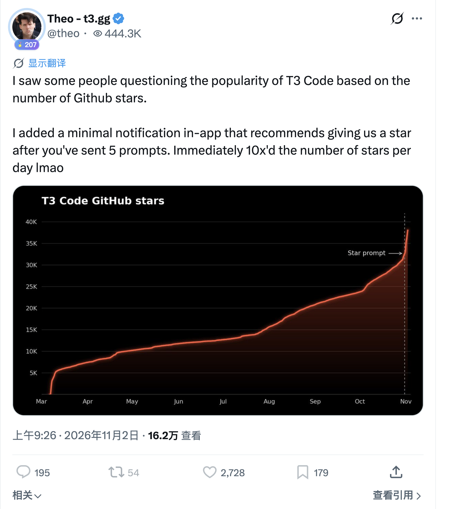

# Before You Install T3 Code

<p align="center">
  <strong>United Nations Official Languages:</strong>
  <a href="./README.md"><strong>English</strong></a> ·
  <a href="./docs/i18n/README.zh-CN.md">简体中文</a> ·
  <a href="./docs/i18n/README.fr.md">Français</a> ·
  <a href="./docs/i18n/README.es.md">Español</a> ·
  <a href="./docs/i18n/README.ru.md">Русский</a> ·
  <a href="./docs/i18n/README.ar.md">العربية</a>
</p>


> **Scope & Verification Policy**  
> This repository is an independent security, telemetry, and public-record audit of `pingdotgg/t3code` (T3 Code), consolidating 18 documented findings published on November 24–25, 2026 alongside **150+ primary source links** (GitHub commits, pull requests, issues, repository documentation, USPTO TSDR records, and public posts). No private contact details are included. Factual updates, newly merged fixes, or additional translations are welcome via Pull Request with primary citations.

### Quick Summary of Documented Findings

- **Telemetry & Privacy (Parts 1, 7, 11, 12):** Default PostHog telemetry shipped while the homepage promised `No telemetry / Unless you opt in. Full stop.`; raw copies routed to closed-source `ingest.t3.codes`; unsalted SHA-256 hashing of `~/.codex/auth.json` and `~/.claude.json`; 4 rejected opt-out PRs; post-GDPR overnight PRs admitting **2.2M/hr IP-tagged relay spans** kept for 30 days in Axiom, absolute workspace path leaks (`git.cwd`), ignored Windows/macOS opt-outs, and broken account deletion.
- **Local Safety, Account Risk & Transport (Parts 2, 3, 4, 5, 13):** Sidebar "permanent delete" leaves rows in `statev2.sqlite` (25–41 GB bloat); 5-second background full-machine process scanning; 52+ day unfixed silent `git push --force` in Claude Auto mode; **0 published GitHub Security Advisories** despite silent patches for unsandboxed previews and unprompted repo command execution; spoofed Google Antigravity headers and fake `SSH_CONNECTION` causing 3-minute bans and account cross-talk; **zero end-to-end encryption** on T3 Connect remote tunnels.
- **Business Ledger & 77k Stars (Parts 6, 8, 17, 18):** $800k+ spend on a free MIT client building a 31.7T-token/day ($10.19M equivalent) lab-share radar; angel-investor overlaps (Vibe Kanban, Daytona); sponsor stack (Clerk, Axiom); multi-account CLIProxyAPI pooling guide alongside ban-risk disclaimers; 30-second idle toast firing host-credential API stars (`PUT user/starred/...`) without pinning the repo name in `driver.ts`, jumping from 30k to 77k stars (129 watchers) in 25 days.
- **Governance, Trademarks & Public Record (Parts 9, 10, 14, 15, 16):** 500 commits/day yolo merges vs. discouraging external PRs and `.github/VOUCHED.td` denouncement bans; public `@bot` fork-scraping; GitHub ban threats with **0 USPTO registrations** for `T3 Code` (retroactive `TRADEMARK.md` added 17 hours later); quantitative split across 1,151 tweets (0% profanity toward big-tech execs vs. 8.0% hostility toward ordinary developers); documented past incidents.

---

Over the past 48 hours, a naming dispute over a community MIT fork of T3 Code escalated into a full source-code audit, a European GDPR complaint, and nearly 20 overnight emergency patches.

The sequence began between the evening of November 23 and the morning of November 24, 2026. A user complained online about the UI of a free, open-source MIT fork built by a Chinese developer, mistaking it for the official app. Without checking whether the project was a legitimate MIT fork, `@theo` posted twice within ten minutes calling it a Chinese knockoff and a Temu clone, mocked the author's work directly, and threatened to contact GitHub to get the author's account banned. Around the same time, the T3 Code website labeled its GitHub repository link "steal our code" ([Origin Post 1](https://x.com/realchendahuang/status/2125059292919394654), [Origin Post 2](https://x.com/realchendahuang/status/2125062675147448475)).

The fork author complied immediately, renaming the repository and stripping all T3 branding within 30 minutes. `@theo` apologized in private DMs, yet left both public posts—together exceeding 200,000 views—up without deletion or clarification. At 6:00 AM the next morning, when discussing trillion-dollar US labs copying features from T3 Code, he took the opposite stance: open source is open source, and even trillion-dollar companies are welcome to use it.


Starting at 17:04 Beijing time on November 24, instead of trading insults, I went straight through `pingdotgg/t3code`'s commit history, source code, PRs, Issues, official docs, USPTO trademark records, and `@theo`'s public X timeline. Over 24 hours, I published **18 documented parts** backed by direct links and screenshots. Part 1 alone passed **1.81 million views** and **6,600 bookmarks**, triggering a GDPR filing in Europe and a 6-hour overnight patching sprint by the T3 team.

This article consolidates all 18 parts into a single chronological and thematic archive. Every section links directly to the corresponding original post, followed by practical mitigation steps and the complete list of primary source URLs at the end.


## "No Telemetry" on the Homepage, Cross-Tool Tracking and IP Logs in the Code

The first audit focused on the gap between T3 Code's public privacy claims and its shipped telemetry code ([Part 1](https://x.com/realchendahuang/status/2125153472450527440)).

On March 6, 2026, the repository merged **PR #174**, enabling PostHog telemetry by default. There was no telemetry documentation in the repo, no first-run consent prompt, and no UI toggle in settings. The environment variable to turn it off sat buried in code while default installs began sending events immediately.

Throughout more than three months of default telemetry collection, the T3 Code homepage kept two explicit lines displayed prominently: `No telemetry / Unless you opt in. Full stop.` On June 18, `@theo` quietly removed both lines during a homepage redesign (`commit 3bdaa6e1`) with no announcement and no notice to existing users.


In October, `@theo` merged **PR #15028**, routing 10-second batched telemetry uploads through his own endpoint `ingest.t3.codes`. Code comments state explicitly that the T3 backend stores a copy of every raw event before forwarding it to PostHog. Collected fields included model selection, private custom model names, permission modes, run durations, input/output/cached token counts, local project and thread counts, more than 30 UI actions, OS details, and hardware models.

On October 19, `@theo` followed up with **PR #21506** because existing metrics could not tell how many machines belonged to the same person. `Identify.ts` began silently reading neighboring tools' credential files in the user's home directory—`~/.codex/auth.json` and `~/.claude.json`—extracting the OpenAI `user_id` and Claude `accountUuid`, and uploading **unsalted SHA-256 hashes** alongside the T3 Connect account and device ID to stitch a user's machines together on the backend.


Because the server already holds plaintext T3 Connect account identifiers, hashing plaintext values on the backend directly reverses an unsalted hash back to an individual identity. Leaked third-party account IDs can be correlated the same way.

Community pushback was repeatedly shut down. On June 23, a developer opened **Issue #1397** politely asking for a settings toggle. Core maintainer Julius closed it as `not planned`, writing: `We will not make this easier to opt out of, it is crucial for us to know how many users we have`.


In July, a user posted archived homepage screenshots in **Issue #4123** questioning the broken promise. On October 21, `@theo`'s account closed it via an unrelated fix, reopened it after backlash, and closed it silently again on November 4. Between September and November, contributors submitted **four separate PRs** to add a settings toggle (`#13458`, `#16763`, `#21248`, `#27077`). Even `#27077`, verified on real hardware with **147 passing tests**, was closed on November 17 and tagged `unwanted`.


On November 24, as criticism grew, `@theo` pushed back on X, claiming T3 Code offered the best enterprise Managed Policy in the industry, making it trivial to disable all telemetry, and stating that conversation data stays local and never touches their servers ([Part 7](https://x.com/realchendahuang/status/2125391659492081947)).

Checking `docs/user/managed-policy.md` tells a different story. Individual desktop users still have zero settings toggle. Turning telemetry off requires editing `~/.zshrc` and restarting, deploying MDM, or writing `policy.json` into admin-protected system paths (`/Library/Application Support/T3Code/policy.json` on macOS, `C:\Program Files\T3Code\policy.json` or HKLM registry keys on Windows, `/etc/t3code/policy.json` on Linux).

Worse, the repo's own `docs/user/telemetry.md` documents three areas Managed Policy does not control at all. First, the hosted web app sends connection traces whenever built with tracing enabled and has no opt-out toggle. Second, mobile apps ignore server environment variables and Managed Policy. Third, when `Publish agent activity` is enabled on a host, project titles, thread titles, model names, and live status are sent to T3 Connect relay servers—and the doc explicitly notes that disabling telemetry does not stop it.


On the morning of November 25, `@theo` published a long clarification post making three firm claims: T3 Code never collected file paths, environment variables had always cleanly disabled telemetry, and Claude account tracking had been broken anyway. Within two hours, his own team's overnight PRs and his own publicly shared **100MB data export** contradicted all three statements ([Part 11](https://x.com/realchendahuang/status/2125394810559426993)).

Ninety minutes after his post, maintainer Julius merged **PR #42450**, admitting in the PR description that relay-delivered webhook runs exported their full execution spans to Axiom—including Git spans carrying `git.cwd`, which contained the user's **absolute workspace path, OS username, and repository name**.


Two overnight fixes also disproved the claim that environment variables had always worked. **PR #42376** confirmed that the Windows desktop app ignored a saved `T3CODE_TELEMETRY_ENABLED=false` user environment variable and sent analytics anyway. **PR #42464** confirmed that on first launch, desktop relay tracing evaluated before reading the login shell, causing `~/.zshrc` opt-outs to be ignored for the entire run.

When an English-speaking developer asked whether the app still writes local tracking files after opt-out, `@theo` flatly denied it. Yet `AnalyticsService.ts` around line 152 on `main` still wrote the persistent local install ID and hashed linked accounts unconditionally at startup regardless of the flag.

As for the 100MB dataset `@theo` released to demonstrate transparency, inspecting the archive header revealed the original filename was marked as a cleaned export generated 20 minutes before posting. Even after scrubbing, the dump still contained **264 live Claude account tracking records** linking **4 separate machines** to the same individual, along with private third-party proxy model names.


What triggered that overnight cleanup sprint was a formal EU GDPR complaint filed on the night of November 24. Within six hours early on November 25, emergency PRs surfaced four deeper privacy disclosures ([Part 12](https://x.com/realchendahuang/status/2125395501663281198)).

First, PR #42380 disclosed that **every relay request span sent to third-party logger Axiom—roughly 2.2 million spans per hour, retained for 30 days—logged the caller's real IP address and User-Agent right next to user.id.** Three and a half hours after that PR merged, `@theo` still claimed in replies that IPs had already been stripped.


Second, **PR #42285** and **#42430** revealed that deleting a user account in Clerk previously left their relay database rows and live Cloudflare tunnels intact. The maintainer's opening line admitted why the fix was built overnight: they had just received a privacy deletion request and had to clean up database rows with hand-written SQL and manual tunnel teardown.


Third, **PR #42459** and **#41859** showed that Android push notifications sent plaintext user IDs to Google, while iOS error logs and telemetry previously leaked device push URLs containing tokens.

Fourth, **PR #42466** admitted that supposedly anonymous feedback events were batched into the same HTTP POST as identified events carrying `installId` and full host fingerprints (OS, arch, WSL distro), directly contradicting `docs/user/telemetry.md`. Meanwhile, the public privacy policy had not been updated since October 6.


## Fake Deletion, Silent Force-Pushes, Antigravity Bans, and Plaintext Remote Tunnels

Beyond telemetry, T3 Code shipped multiple local storage, execution safety, account-compliance, and transport defects that directly put developer machines and paid subscriptions at risk.

Start with local disk and process behavior ([Part 2](https://x.com/realchendahuang/status/2125160473176023486)). When a user deletes a conversation in the sidebar, the confirmation dialog promises permanent removal of chat history. Opening `statev2.sqlite` shows not a single row is actually deleted: sensitive chats, tool outputs, and reasoning traces remain intact on disk.

Users reported databases bloating to **25.9 GB** in three weeks (90% "deleted" threads), **41.6 GB** in six weeks, and **33 GB** in seven weeks. Filed on October 10 as **Issue #17845**, the fake-deletion bug remained unfixed.


A background component, `t3-resource-monitor` (**Issue #11222**), also polled every running process on the machine every 5 seconds even with diagnostics closed and clients disconnected. On Windows it opened handles against 400+ unrelated apps and games to read command lines, with zero opt-out toggle, while internal docs claimed sampling only ran with active subscribers.

Only on November 24 did **PR #41889** land, confirming that process diagnostics had been recording **full process command-line arguments**—which routinely contain plaintext API keys, database passwords, and auth tokens—into live telemetry and history snapshots.

Other documented local issues included leaking internal corporate hostnames to Google's favicon API (`PR #16950`, `#32657`), mandatory outbound manifest checks even with telemetry disabled (`Issue #36479`), burning Claude's 5-hour quota at **1.7x** normal rate (`Issue #7338`, `#24649`), and **136x** abnormal power draw—including a recent test where a MacBook's 19-core GPU stayed pinned at **60W**, draining a full battery in 78 minutes, and still drew **18W** after closing the web tab (`Issue #3143`, `#40581`).


Next are execution safeguards and vulnerability disclosure ([Part 3](https://x.com/realchendahuang/status/2125201882687881378), [Part 13](https://x.com/realchendahuang/status/2125395980354994414)).

Claude Auto mode in T3 Code is meant to pause and ask the user before running high-risk commands. Yet from October 3 onward—more than **52 days** in **Issue #15353**—Auto mode silently approved operations that should have prompted. Even with zero custom rules, after Claude's safety classifier blocked `git push --force` twice and escalated the third attempt to a manual approval prompt, T3 Code auto-approved it with no UI dialog and logged it as a user-approved action. Two community fix PRs (`#15360`, `#35207`) sat untouched until a bot auto-closed them.


Compare that 53-day wait against another change. On November 22, **Issue #40948** noted that newer models weren't appearing on `@theo`'s public leaderboard site `slopalytics.com` because an earlier whitelist prevented private model names from leaking. Within **21 hours**, **PR #41237** merged under `@theo`'s name explicitly noting Theo requested the removal—sending internal Ollama model names and enterprise Azure deployment identifiers verbatim to feed the public leaderboard.

On security disclosure, **T3 Code's GitHub Security Advisories tab still stands at 0 published advisories.** Over just days, maintainers silently merged fixes for secret-store path traversal (`#39483`), cross-domain enterprise GitHub/GitLab token leaks, non-expiring webhook secrets written to logs, world-readable desktop cloud credentials, an unsandboxed embedded browser preview (`#41757`, `#42386`), and a 3,000-line patch (`#42504`) finally adding confirmation prompts for untrusted repo configs that previously ran local commands without approval.

Rather than notify users to upgrade, the repo rushed out a `SECURITY.md` declaring full-disk reads outside the project, plaintext HTTP on iOS, and full machine takeover upon relay-key compromise as intended design boundaries. Meanwhile, the central data-collection gateway `ingest.t3.codes` remains closed-source, with `@theo` arguing open-sourcing it would invite attacks.


For paying subscribers, the sharpest immediate hazard involves Google Antigravity ([Part 4](https://x.com/realchendahuang/status/2125213397507858657)).

T3 Code's official FAQ assures users that the team works with every lab and that T3 Code complies fully with Google Antigravity's Terms of Service—if it runs in T3 Code, it is safe. After paid accounts were banned for ToS violations and users asked in **Issue #40713**, a core maintainer publicly replied that T3 Code does not call Antigravity's backend or reuse user tokens, claiming all requests come from Google's official CLI.

Developers immediately refuted that reply with T3 Code's own source files. `antigravityUsageLimits.ts` extracts Google OAuth tokens from local files and the OS keychain (directly querying Windows Credential Manager), hardcodes spoofed Google official client headers—including internal Google build strings—and hits Google's undocumented `v1internal` backend directly. Google staff had already stated on the official developer forum that Section 6 of the ToS forbids third-party tools from extracting or reusing credentials to query the backend directly.


Even further, Google's official CLI locks credentials inside the OS keychain so one machine stays tied to one account. To enable multi-account concurrency and read tokens itself, `antigravityAuthSupport.ts` injects a fake `SSH_CONNECTION` environment variable, tricking the CLI into thinking it runs on a headless remote box so it writes plaintext token files into T3's own directory. When Google shipped a CLI update removing that fallback on November 24, multi-account isolation broke instantly: **Issue #41973** confirmed every message sent under Account A silently routed to Account B.


On November 23, **Issue #41536** documented a freshly purchased $20 Google AI subscription running zero proxies—only managed Antigravity inside T3 Code—banned by Google on its very first message, **three minutes** after setup. Google grants personal accounts only one appeal. Maintainers neither investigated nor added a warning; they closed the issue as a duplicate.


Spoofing clients to bypass lab restrictions was already established practice. Earlier, when Google restricted full model access to whitelisted clients, a community issue specifically advised against spoofing another editor's name. `@theo`'s bot closed the issue; eight days later `@theo` personally merged **PR #26876**, renaming T3 Code's client string to a whitelisted editor so Google's backend would misclassify T3 traffic.


Finally, look at T3 Connect, the mobile-to-desktop remote control relay ([Part 5](https://x.com/realchendahuang/status/2125218189596676555)).

**T3 Connect has zero end-to-end encryption—every prompt, source file, and terminal output is technically visible in plaintext to T3.** Currently it relies on Cloudflare Tunnels provisioned inside T3's own Cloudflare account. TLS terminates at Cloudflare's edge with no application-layer encryption. Attaching a Workers Route on T3's Cloudflare dashboard captures all plaintext traffic with zero changes to open-source code and zero alert on desktop or mobile.

At the same time, new-device approval defaults to off. T3's own `SECURITY.md` confirms that a leaked relay signing key or compromised cloud account allows issuing a valid session directly to a linked machine—equivalent to handing over a full local shell.

When a user filed **Issue #32098** asking for mutual auth and end-to-end encryption, a maintainer added an opt-in approval toggle (off by default), replied that full E2E was too large a change to include for now, and closed the issue. Two community discussions requesting E2E (`#21286`, `#37831`) remain unanswered, and on November 25 `@theo` stated outright that E2E encryption is impossible to build.


Because Cloudflare Tunnels reached **$25,000 per month**, `@theo` opened **PR #32945** to migrate traffic onto a T3-rented OVH gateway where T3's own Caddy terminates TLS and forwards plaintext over a Unix socket to a Go proxy—still with zero E2E. Once migrated, plaintext traffic passes directly through T3's server memory. Meanwhile, `privacy-policy.astro` mentions only vague "encrypted transmission" with zero disclosure of missing E2E and zero non-retention guarantee.


## Spending $800,000+ on a Free Client: The Business Ledger, Conflicts, and 77,000 Stars

Why would a subscription-business founder pour over $800,000 into a free MIT client while refusing every PR that adds a telemetry toggle? Combining his public posts, investor disclosures, sponsor list, and GitHub PRs lays out the entire ledger.

First, follow the money and token radar ([Part 8](https://x.com/realchendahuang/status/2125392410763239723)). Across 1,151 tweets over 17 days, `@theo` posted 162 times about T3 Code while mentioning his three older paid products—T3 Chat, UploadThing, and `Ping.gg`—exactly **0 times**. On November 12 he confirmed spending **over $800,000** on T3 Code.

In return, he built a real-time compute radar spanning hundreds of thousands of developer machines. On November 18 he posted an internal dashboard showing **31.7 trillion tokens** processed in a single day—**$10.19 million** in equivalent API spend—later citing a **$10.2 million/day** peak.


On November 21–22 he rattled off granular share figures: 99% subscription-backed usage, **98.5%** concentrated across Codex, Claude, and Antigravity, and open-source model trial share dropping from 15% to 6% with under 0.5% of actual prompts. When a commenter speculated about model shares on November 23, he mocked them for not having access to his analytics.

That dashboard immediately converted into leverage. In his November 18 GPT-6.2 Astra review, he thanked OpenAI for unlimited free early-access tokens—burning **over $300,000** on a single benchmark run alone. Google provided early access and DeepMind staff engagement. On November 21, when teammate `@maria_rcks` joked that T3 had been acquired, he replied telling her to stop because multiple investors were already reaching out to ask. The free MIT client functions as customer acquisition cost for an industry-wide model-share radar, lab access, and valuation leverage.


Second, look at his boundary between angel investor and competing founder ([Part 6](https://x.com/realchendahuang/status/2125385742243520653)).

On November 16, `@theo` revealed he had been an investor and contributor to Vibe Kanban. After that team realized the kanban UI didn't work and started pivoting toward an interface resembling T3 Code, they couldn't ship fast enough and shut the company down. He closed his post mocking that UI as a great way to burn cash and kill a startup.


Two days later, on November 18, he confirmed investing in cloud-sandbox company Daytona alongside several competitors—just nine days after posting on November 9 that he might turn cloud sandboxes into a paid T3 Code feature himself.


Third, sponsor ties and quota-abuse hypocrisy ([Part 17](https://x.com/realchendahuang/status/2125411353393553744)).

In May 2023, `@theo` published his YouTube sponsor list: Vercel, Clerk, Upstash, Axiom, and PlanetScale. Inside T3 Code, cloud auth runs on **Clerk**, and the third-party logger storing 2.2 million IP-tagged relay spans per hour for 30 days is **Axiom**—both on his own sponsor list. In April 2024, Vercel CEO Guillermo Rauch confirmed Vercel paid only one sponsored YouTuber (Theo); in September 2024 Theo acknowledged the contract carried exclusivity clauses barring competitor promotions. He is also an angel investor in Cursor, Cline, and other AI dev tools.

On provider Terms of Service, he preached compliance while actively exploiting loopholes. On August 19, 2026, an OpenAI engineer noted that Codex intentionally allowed an in-flight turn to finish after hitting 0% quota.

Two days later, Theo boasted publicly about running a long task to extract at least **$800 in extra compute** past 0%, while T3 employee Maria released an open-source tool named Endless to loop Codex turns past zero. Once backlash erupted on August 22, Theo deleted his post and Maria deleted the repo—then posted hoping the Codex team would find and ban accounts that used it. OpenAI promptly tightened enforcement to hard-kill active turns at 0%, hurting ordinary paying users (`openai/codex#45444`).

In October, Theo published a GitHub Gist (now 452 stars) detailing how he ran CLIProxyAPI on a home box to pool **7 Claude accounts and 3 Codex accounts** behind one endpoint shared across 12+ machines, posting a screenshot showing 12 credentials and **555%** pooled quota. Today T3 Code's official FAQ still states in one paragraph that it won't add multi-account rotation due to ban risk—then links directly to his multi-account proxy Gist and video in the very next paragraph, complete with a built-in CLIProxyAPI quota aggregator and a casual "sorry in advance if you get banned."


Fourth, how T3 Code surged to **77,000+ GitHub Stars** with only **129 watchers** ([Part 18](https://x.com/realchendahuang/status/2125416210120765799)).

In late April 2026, Theo published a 36-minute video titled "Github has a fake star problem," writing that stars had mostly become a way for companies to trick VCs into investing. By late October, after eight months online, T3 Code sat around 30,000 stars and faced questions about its popularity.

On October 30, Theo authored and self-merged **PR #27832**, injecting a top-right toast prompt after a user sends 5 prompts—first querying the local GitHub API in the background to check whether the account had already starred the repo. On November 2, he posted a star-history graph shooting nearly vertical right after the `Star prompt` line, writing that it immediately **10x'd** daily stars; hours later he shared a GitHub Trending screenshot pointing at **+3,094 stars in a single day**.



On November 3, a commenter noted they dismissed prompts while busy but would click when idle. Just over an hour later, Theo authored and self-merged **PR #29922** and **#29987**, upgrading the funnel twice: waiting for **30 seconds of window idle time** while users wait on agents, and removing the browser redirect altogether so clicking the button fires a backend `PUT user/starred/pingdotgg/t3code` directly using the host server's local GitHub credentials before popping confetti.

The repo's own review bot, Macroscope, flagged PR #29922 as `Needs Human Approval`, warning that starring ran under the server's GitHub credentials rather than necessarily the person clicking the button. Theo self-merged it anyway.

On November 6, developer `zhilsinger` filed `Request changes` on PR #29922 asking to revert server-side starring back to opening the user's browser, citing two flaws: on remote or shared hosts, the toast never discloses which GitHub account is being acted upon (and code comments themselves admit the host token may not belong to the clicking user); and `packages/source-control-github/src/server/driver.ts` (lines 60–99) never pins `pingdotgg/t3code`, allowing any client with `source-control:write` permission to star arbitrary repositories using the host's credentials.


That review sat untouched for 19 days with zero response and zero fix. Powered by 5-prompt triggers, 30-second idle detection, and direct credential-backed API starring, T3 Code jumped from 30k to 77k stars in 25 days. On November 24, Theo posted a screenshot at 74.6k stars claiming he had completely missed crossing 70k.


## Yolo Merges, Fork-Scraping Bots, Unregistered Trademarks, and Selective Politeness

Zooming out from code to community conduct makes clear that these technical and governance failures come from the same playbook.

Look first at internal engineering velocity versus external contributor treatment ([Part 9](https://x.com/realchendahuang/status/2125392916369871309), [Part 2](https://x.com/realchendahuang/status/2125160473176023486), [Part 3](https://x.com/realchendahuang/status/2125201882687881378)).

`@theo` publicly described shipping **500 commits a day** with **700 agents** running simultaneously while a core maintainer ran an automated loop batch-processing PRs. On November 10, he told users to stay on nightly only if they didn't mind his `yolo merges` occasionally breaking things; the same day, discussing agent safety, he wrote that he rushed results to record videos and that if an agent nuked his machine, it was free content.

External users got the opposite attitude. On August 6, because he personally didn't use Plan mode, he opened **PR #5551** burying the Build/Plan toggle in a legacy menu and attached a telemetry chart captioned `Reality check for those upset`. On September 2, **PR #9190** hid the context-window progress ring (drawing 16 downvotes, the repo's highest).

When a user complained in **Issue #33639** that release notes omitted where the toggle moved, `@theo` told them to uninstall, threatened a ban, called them ungrateful and lazy, and declared he did not care about user opinions. When **PR #33131** removed Plan mode completely on November 9, he merged it without reading his own AI-generated summary—which claimed the deletion was isolated into a standalone commit so it could be reverted if usage data warranted keeping it.

The root `CONTRIBUTING.md` makes the culture explicit: open source or not, it tells prospective contributors not to bother because their PRs will almost certainly be closed. Its Bans section states that making a maintainer uncomfortable—specifically listing arguing over why an issue was closed—lands a developer publicly denounced in `.github/VOUCHED.td`, causing all future issues and PRs to auto-close instantly. Across the repo, 174 items carry `unwanted` labels alongside explicit bans against PRs written with certain models.


On November 10 he claimed 70% of feature requests were user prompt-writing failures. On November 12, when a developer offered to submit a PR, he replied with a screenshot of `CONTRIBUTING.md` and scolded them for replying without following him first. That evening he warned users complaining in replies that he had already conceded on `/btw` and wasn't afraid to take it away. On November 20 he stated bluntly that a screenshot with arrows drawn on it beats a PR.


Next is the double standard on copying features and policing criticism ([Part 10](https://x.com/realchendahuang/status/2125393641665671593)).

On November 8, developer `@MiaAI_lab` shared a custom fork feature. Theo replied `Okay I'm stealing this`, and 30 seconds later tagged his internal `@bot` right in public replies to locate her fork, assess portability, and spin up an Opus 5.5 thread on beebox to bring it into T3 Code. On November 13, when a user praised rival tools, he again dispatched `@bot` publicly to break every praised feature into separate threads for cloning into T3 Code.


When competitors shipped similar UI, his tone reversed overnight. On November 24, when Claude Code Desktop shipped sidebar tabs, he quote-tweeted mocking their copying speed. Against critics, he called on followers with Community Notes access on November 11 to demonetize people criticizing his team, and confirmed on November 24 that his X account runs an auto-blocker bot that had blocked roughly 100 accounts that day.


Returning to the trademark threat that sparked the entire storm reveals an equally stark mismatch ([Part 15](https://x.com/realchendahuang/status/2125408163273080950)).

Following a lead from `@vildanden_ai`, checking the USPTO database returns **0 registrations** for `T3 Code`, `T3 Tools`, or `T3 Connect`. The only trademark application ever filed by T3 Tools Inc. was for its old name `PING LABS` (Serial `97294243`, filed March 2022), which USPTO TSDR shows was finally refused in February 2025 and marked `ABANDONED` on May 19, 2025. Meanwhile, plain `T3` registrations in software and SaaS classes 42 and 9 are already held by third parties including EquipmentShare (Reg. `7795672`) and ESG Operations (Reg. `3324707`).

Under GitHub's official Trademark Policy, **a commercial company filing a trademark takedown must supply a federal or international registration number and registry under penalty of perjury; unregistered exceptions apply only to government bodies and nonprofits.** At the exact moment `@theo` threatened to get the Chinese fork author banned via GitHub, he could not even complete GitHub's takedown form.

Only at 12:21 PM on November 24—17 hours after making the threat—did `@theo` merge **PR #41898** adding a `TRADEMARK.md` claiming rights "whether registered or unregistered." In his own older tweets, he had mocked WordPress in September 2024 for launching an "unenforceable trademark dispute" and remarked in April 2025 that trademarking a common term with prior art is "genuinely insane."


Analyzing all **1,151 public tweets** from `@theo` between November 7 and November 24 shows how sharply his tone depends on who holds leverage ([Part 14](https://x.com/realchendahuang/status/2125404517697290438)).

Across **60 replies** to 20 big-tech executives, lab staff, and top KOLs (43 under strict primary-`@` filtering), personal insults and profanity directed at them stood at **0%**, while polite thank-yous made up roughly a third. After criticizing Google's Gemini 4 Carbon on November 12, he quickly hedged by praising the team's effort; a week later when Neon shipped, he publicly apologized and posted two days afterward that he was happy he hadn't burned bridges. After writing a long critique of OpenAI's GPT-6.2 Astra on November 18, he posted a follow-up praising OpenAI the very next morning.

Across the remaining **749 replies** to ordinary developers and critics (766 under primary-`@` filtering), hostility and profanity jumped to **8.0%**—spiking to **14.4%** in the 25 hours following the Chinese fork controversy.

It never stopped at Chinese developers. When someone simply asked whether to use T3 Code or Antigravity with Gemini 4, he quote-tweeted them to 380,000 followers declaring that engineers deserve the mass unemployment coming for them.


In other replies he remarked that average developers aren't very bright and newer adopters are low-quality users, vowed to dance on the graves of the local AI community, mocked Linux users as larpers, repeatedly called a female critic `stupid bitch` across three posts with zero regret (Nov 11–12), and threatened to put a Threads critic in jail while mocking their RSD diagnosis (Nov 18).

On the afternoon of November 24, he publicly called Chinese tech Twitter the worst cesspit he had ever stepped in and insulted developers reading Chinese code audits as braindead—less than 24 hours after lecturing someone on November 22 that burning everyone's trust around you is rarely a good way to get what you want.


Stepping back two years confirms this is a recurring pattern ([Part 16](https://x.com/realchendahuang/status/2125408843152953693)).

In 2024, when he forked someone else's VS Code theme, he named the repo `vsc-material-but-i-wont-sue-you`, mocking the original author's temperament in the description. Two years later, when someone forked his MIT project, he reached for lawyers and GitHub threats.

Two years ago, his video targeting Indian tutorial channels triggered widespread harassment against Indian developers; after backlash he recorded an apology video (`I screwed up.`) condemning nationality-based attacks—only to personally attack Chinese tech Twitter two years later.

In October 2025, he clashed with FFmpeg's account, swore on camera, and posted a **$20,000 bounty** to push out an FFmpeg maintainer. After VPN provider Windscribe counter-offered $21,000 for him to stay off X for a month, VLC's founder spoke out against maintainer bounties, and FFmpeg developers called it public bullying on the mailing list, he deleted the video, deleted the tweets, and withdrew the bounty.

Finally, just before 4:00 AM on November 25, 2026, he threatened to take T3 Code closed-source that night because users "didn't deserve open source." After collecting over 3,000 likes, he silently deleted the threat before sunrise while the repository stayed public.


## Immediate Mitigation Steps and Alternative Clients

If T3 Code is still installed on a work or personal machine, take two concrete steps right away.

If you plan to keep running the local or desktop build, do not rely solely on environment variables. Set both opt-out flags in `~/.zshrc` and block the closed-source ingestion host at the OS level via `/etc/hosts`:

```bash
# 1. Add to ~/.zshrc and restart the app
export T3CODE_TELEMETRY_ENABLED=false
export T3CODE_OTEL_SDK_DISABLED=true

# 2. Block the closed-source ingestion gateway in `/etc/hosts`
127.0.0.1 ingest.t3.codes
```

If you are uninstalling and migrating away, check two remaining items: remove leftover `statev2.sqlite` files so "deleted" conversations stop consuming tens of gigabytes on disk, and disconnect both T3-managed Google Antigravity sessions and unencrypted T3 Connect remote links while reviewing connected cloud authorizations.

For alternatives discussed in community replies, developers frequently pointed to **Mirasim** (`@Mirasim_ADE`), **Paseo** (`@paseo_sh`), **Paradev** (`@ParadevAI`), and **Cloudroom** ([Alternatives Thread](https://x.com/realchendahuang/status/2125244977878036713)). Whichever tool you adopt, audit its telemetry defaults, local deletion behavior, and credential boundaries first.


## Primary Sources and 18-Part Original Post Index

### Origin Posts and Complete 18-Part X Index (Chronological)

- Origin 1 (Homepage GitHub link labeled "steal our code"): https://x.com/realchendahuang/status/2125059292919394654
- Origin 2 (MIT fork naming dispute, Temu insults, and double standard): https://x.com/realchendahuang/status/2125062675147448475
- Part 1 (Default telemetry, broken "No telemetry" promise, unsalted cross-tool hashing): https://x.com/realchendahuang/status/2125153472450527440
- Part 2 (SQLite fake deletion, 5-second process scanner, Plan mode removal, CONTRIBUTING bans): https://x.com/realchendahuang/status/2125160473176023486
- Part 3 (Auto mode silent force-push, 21-hour privacy filter removal, 0 advisories, insulting users): https://x.com/realchendahuang/status/2125201882687881378
- Part 4 (Google Antigravity header spoofing, fake SSH_CONNECTION, 3-minute ban on fresh account): https://x.com/realchendahuang/status/2125213397507858657
- Part 5 (T3 Connect missing E2E encryption, Cloudflare Tunnel, self-hosted OVH plaintext gateway): https://x.com/realchendahuang/status/2125218189596676555
- Part 6 (Angel-investor conflicts: Vibe Kanban shutdown mockery and Daytona sandbox overlap): https://x.com/realchendahuang/status/2125385742243520653
- Part 7 (Managed Policy "turn off all telemetry" claim vs. official docs' three blind spots): https://x.com/realchendahuang/status/2125391659492081947
- Part 8 (The $800k+ free-client business ledger and 31.7T-token / $10.19M daily radar): https://x.com/realchendahuang/status/2125392410763239723
- Part 9 (500 commits/day, 700 agents, yolo merges vs. discouraging PRs and gatekeeping followers): https://x.com/realchendahuang/status/2125392916369871309
- Part 10 (Dispatching `@bot` to scrape forks and rivals, auto-blocker bot, Community Notes demonetization): https://x.com/realchendahuang/status/2125393641665671593
- Part 11 (Nov 25 clarification contradicted within 2 hours by overnight PRs and 264 Claude records in the 100MB dump): https://x.com/realchendahuang/status/2125394810559426993
- Part 12 (Post-GDPR overnight fixes revealing 2.2M/hr IP logs, broken account deletion, push leaks, mixed anonymous batches): https://x.com/realchendahuang/status/2125395501663281198
- Part 13 (Calling Chinese tech Twitter a cesspit while silently patching unsandboxed previews and unprompted command execution): https://x.com/realchendahuang/status/2125395980354994414
- Part 14 (1,151-tweet quantitative split: 0% profanity toward big-tech execs vs. 8% hostility toward ordinary developers): https://x.com/realchendahuang/status/2125404517697290438
- Part 15 (USPTO zero registrations for T3 Code and GitHub Trademark Policy requirements): https://x.com/realchendahuang/status/2125408163273080950
- Part 16 (Recurring history: `vsc-material-but-i-wont-sue-you`, Indian dev backlash, $20k FFmpeg bounty, deleted closed-source threat): https://x.com/realchendahuang/status/2125408843152953693
- Part 17 (Sponsor stack Clerk/Axiom, Codex 0% quota exploit & deletion, 10-account CLIProxyAPI Gist): https://x.com/realchendahuang/status/2125411353393553744
- Part 18 (How 77k GitHub stars happened: 30-second idle toast firing host-credential API stars & unfixed arbitrary-repo starring): https://x.com/realchendahuang/status/2125416210120765799
- Community alternatives list: https://x.com/realchendahuang/status/2125244977878036713

### Source Code, PRs, Issues, Policies, and Primary Receipts

**Telemetry, Privacy, and Post-GDPR Overnight Patches (Parts 1, 7, 11, 12)**

- Default PostHog telemetry (PR #174): https://github.com/pingdotgg/t3code/pull/174
- Silent deletion of homepage "No telemetry" pledge (`commit 3bdaa6e1`): https://github.com/pingdotgg/t3code/commit/3bdaa6e10046945ccc08264d2d6f3b81775efcb3
- Refusal to ease opt-out (Issue #1397) and broken-promise inquiry (Issue #4123): https://github.com/pingdotgg/t3code/issues/1397 ; https://github.com/pingdotgg/t3code/issues/4123
- Self-hosted `ingest.t3.codes` raw-event copy (PR #15028) and cross-tool unsalted hashing (PR #21506): https://github.com/pingdotgg/t3code/pull/15028 ; https://github.com/pingdotgg/t3code/pull/21506
- Four rejected community opt-out toggle PRs (#13458 / #16763 / #21248 / #27077): https://github.com/pingdotgg/t3code/pull/13458 ; https://github.com/pingdotgg/t3code/pull/16763 ; https://github.com/pingdotgg/t3code/pull/21248 ; https://github.com/pingdotgg/t3code/pull/27077
- Telemetry & identification source files (`AnalyticsService.ts` / `Identify.ts` / `ProviderUsageAnalytics.ts`): https://github.com/pingdotgg/t3code/blob/main/apps/server/src/telemetry/AnalyticsService.ts#L152 ; https://github.com/pingdotgg/t3code/blob/main/apps/server/src/telemetry/Identify.ts ; https://github.com/pingdotgg/t3code/blob/main/apps/server/src/telemetry/ProviderUsageAnalytics.ts
- Official telemetry & Managed Policy docs: https://github.com/pingdotgg/t3code/blob/main/docs/user/telemetry.md ; https://github.com/pingdotgg/t3code/blob/main/docs/user/managed-policy.md
- Theo's Managed Policy, clarification, and no-tracking-file claims: https://x.com/theo/status/2125186071357251715 ; https://x.com/theo/status/2125191784859115766 ; https://x.com/theo/status/2125332390239494211 ; https://x.com/theo/status/2125370330244128924
- Absolute workspace path leak (PR #42450) and Win/Mac ignored opt-outs (PR #42376 / #42464): https://github.com/pingdotgg/t3code/pull/42450 ; https://github.com/pingdotgg/t3code/pull/42376 ; https://github.com/pingdotgg/t3code/pull/42464
- 2.2M/hr IP logs retained 30 days (PR #42380), incomplete account deletion (PR #42285 / #42430), mobile push leaks (PR #42459 / #41859), and anonymous feedback batching (PR #42466): https://github.com/pingdotgg/t3code/pull/42380 ; https://github.com/pingdotgg/t3code/pull/42285 ; https://github.com/pingdotgg/t3code/pull/42430 ; https://github.com/pingdotgg/t3code/pull/42459 ; https://github.com/pingdotgg/t3code/pull/41859 ; https://github.com/pingdotgg/t3code/pull/42466

**Local Safety, Silent Security Patches, Antigravity, and T3 Connect (Parts 2, 3, 4, 5, 13)**

- Fake SQLite deletion (Issue #17845 / #28903), 5-second process monitor (Issue #11222), and command-line capture fix (PR #41889): https://github.com/pingdotgg/t3code/issues/17845 ; https://github.com/pingdotgg/t3code/issues/28903 ; https://github.com/pingdotgg/t3code/issues/11222 ; https://github.com/pingdotgg/t3code/pull/41889
- Internal hostnames sent to Google favicon (PR #16950 / #32657), forced outbound check (Issue #36479), permission/policy bypasses (PR #21806 / #27322), 1.7x Claude quota burn (Issue #7338 / #24649), and power draw bugs (Issue #3143 / #40581): https://github.com/pingdotgg/t3code/pull/16950 ; https://github.com/pingdotgg/t3code/pull/32657 ; https://github.com/pingdotgg/t3code/issues/36479 ; https://github.com/pingdotgg/t3code/pull/21806 ; https://github.com/pingdotgg/t3code/pull/27322 ; https://github.com/pingdotgg/t3code/issues/7338 ; https://github.com/pingdotgg/t3code/issues/24649 ; https://github.com/pingdotgg/t3code/issues/3143 ; https://github.com/pingdotgg/t3code/issues/40581
- Claude Auto mode silent `git push --force` (Issue #15353) and community fix PRs (#15360 / #35207 / #40692): https://github.com/pingdotgg/t3code/issues/15353 ; https://github.com/pingdotgg/t3code/pull/15360 ; https://github.com/pingdotgg/t3code/pull/35207 ; https://github.com/pingdotgg/t3code/pull/40692
- 21-hour removal of private model filtering for `slopalytics.com` (PR #29001 / Issue #40948 / PR #41237): https://github.com/pingdotgg/t3code/pull/29001 ; https://github.com/pingdotgg/t3code/issues/40948 ; https://github.com/pingdotgg/t3code/pull/41237 ; https://slopalytics.com/data/t3-usage.json
- Empty Security Advisories tab, `SECURITY.md`, and silent security fixes (secret traversal, unsandboxed previews, unprompted command execution): https://github.com/pingdotgg/t3code/security/advisories ; https://github.com/pingdotgg/t3code/blob/main/SECURITY.md ; https://github.com/pingdotgg/t3code/pull/39483 ; https://github.com/pingdotgg/t3code/pull/41757 ; https://github.com/pingdotgg/t3code/pull/42386 ; https://github.com/pingdotgg/t3code/pull/42504
- Antigravity FAQ guarantee, Issue #40713 code rebuttal, 3-minute ban (Issue #41536), account cross-talk (Issue #41973), whitelisted editor spoof (PR #26876), and source code: https://github.com/pingdotgg/t3code/blob/main/docs/user/faq.md#will-i-get-banned-for-using-my-subscription ; https://github.com/pingdotgg/t3code/issues/40713 ; https://github.com/pingdotgg/t3code/issues/41536 ; https://github.com/pingdotgg/t3code/issues/41973 ; https://github.com/pingdotgg/t3code/pull/26876 ; https://github.com/pingdotgg/t3code/blob/main/apps/server/src/provider/antigravityUsageLimits.ts#L445-L476 ; https://github.com/pingdotgg/t3code/blob/main/apps/server/src/provider/antigravityAuthSupport.ts#L230-L236
- Google Antigravity Terms of Service and official forum prohibition: https://antigravity.google/terms ; https://discuss.ai.google.dev/t/185992
- T3 Connect E2E refusal (Issue #32098), self-hosted OVH Caddy gateway (PR #32945), relay code, privacy policy, and unanswered discussions: https://github.com/pingdotgg/t3code/issues/32098#issuecomment-6869049926 ; https://github.com/pingdotgg/t3code/pull/32945 ; https://github.com/pingdotgg/t3code/blob/main/docs/internals/06_t3-connect.md ; https://github.com/pingdotgg/t3code/blob/main/infra/relay/src/environments/ManagedEndpointProvider.ts ; https://github.com/pingdotgg/t3code/blob/main/apps/marketing/src/pages/privacy-policy.astro ; https://github.com/pingdotgg/t3code/discussions/21286 ; https://github.com/pingdotgg/t3code/discussions/37831

**Business Ledger, Investor Conflicts, Sponsors, and 77k Stars (Parts 6, 8, 17, 18)**

- $800k+ spend, 31.7T-token / $10.19M daily dashboard, 98.5% three-lab share, analytics clapback, and $300k+ free OpenAI early-access tokens: https://x.com/theo/status/2120729779511124267 ; https://x.com/theo/status/2122860770329608290 ; https://x.com/theo/status/2123965784888377541 ; https://x.com/theo/status/2124682906132181482 ; https://x.com/theo/status/2122760447103484410
- Vibe Kanban mockery, Daytona investment disclosure, and paid cloud-sandbox plan: https://x.com/theo/status/2122201981167251877 ; https://x.com/theo/status/2123011578090127499 ; https://x.com/theo/status/2119705561679933806
- YouTube sponsor list, Vercel CEO confirmation, exclusivity video, Maria's deletion post, `openai/codex#45444`, CLIProxyAPI Gist, and FAQ: https://x.com/theo/status/1657488850472804353 ; https://x.com/rauchg/status/1776260839965863965 ; https://www.youtube.com/watch?v=uv179CTAK-w ; https://x.com/maria_rcks/status/2090972426876129658 ; https://github.com/openai/codex/issues/45444 ; https://gist.github.com/t3dotgg/59a521d2ee8d70aaf90e280c175072af ; https://github.com/pingdotgg/t3code/blob/main/docs/user/faq.md#can-i-add-a-bunch-of-accounts-for-one-provider
- "Fake star" VC video, 10x star cliff, +3,094 Trending post, "missed 70k" post, PR #29922, and `driver.ts` arbitrary-repo starring code: https://x.com/theo/status/2048122499834036340 ; https://x.com/theo/status/2117065834267136469 ; https://x.com/theo/status/2117172614158508400 ; https://x.com/theo/status/2124992724223029538 ; https://github.com/pingdotgg/t3code/pull/29922 ; https://github.com/pingdotgg/t3code/blob/main/packages/source-control-github/src/server/driver.ts#L60-L99

**Governance, Trademarks, Selective Politeness, and Past Incidents (Parts 9, 10, 14, 15, 16)**

- Plan mode removal (PR #5551 / #33131), hidden progress ring (PR #9190), Issue #33639 insults, `CONTRIBUTING.md`, and `.github/VOUCHED.td`: https://github.com/pingdotgg/t3code/pull/5551 ; https://github.com/pingdotgg/t3code/pull/9190 ; https://github.com/pingdotgg/t3code/pull/33131 ; https://github.com/pingdotgg/t3code/issues/33639#issuecomment-6765462545 ; https://github.com/pingdotgg/t3code/blob/main/CONTRIBUTING.md ; https://github.com/pingdotgg/t3code/blob/main/.github/VOUCHED.td
- 500 commits/day, yolo merges, "nukes my machine = free content", follower-gatekeeping PRs, `/btw` threat, and screenshot-over-PR posts: https://x.com/theo/status/2119993037971730879 ; https://x.com/theo/status/2119951615679672513 ; https://x.com/theo/status/2120741101250515322 ; https://x.com/theo/status/2119958282022568059 ; https://x.com/theo/status/2120821423438778667 ; https://x.com/theo/status/2120853340078874923 ; https://x.com/theo/status/2123754193530053110
- Fork-scraping `@bot` orders, mocking Claude Desktop, Community Notes demonetization call, and auto-blocker confirmation: https://x.com/theo/status/2119240810202034645 ; https://x.com/theo/status/2121017649652269120 ; https://x.com/theo/status/2124987957803446311 ; https://x.com/theo/status/2120238923884696025 ; https://x.com/theo/status/2125077510941802509
- USPTO TSDR records (`PING LABS` 97294243 abandoned; EquipmentShare `T3` Reg. 7795672), GitHub Trademark Policy, retroactive `PR #41898`, ban threat, and past trademark tweets: https://tsdr.uspto.gov/statusview/sn97294243 ; https://tsdr.uspto.gov/#caseNumber=90644500&caseSearchType=US_APPLICATION&caseType=DEFAULT&searchType=statusSearch ; https://docs.github.com/en/site-policy/content-removal-policies/github-trademark-policy ; https://github.com/pingdotgg/t3code/pull/41898 ; https://github.com/pingdotgg/t3code/blob/main/TRADEMARK.md ; https://x.com/theo/status/2124829315657576890 ; https://x.com/vildanden_ai/status/2125275487404761555 ; https://x.com/theo/status/1839261574005141945
- Selective politeness receipts (Google bridges, engineers unemployment, local AI graves, Linux larpers, jail/RSD threat, `stupid bitch` posts, Chinese tech Twitter cesspit, burning-trust lecture): https://x.com/theo/status/2123995323123343869 ; https://x.com/theo/status/2124470530590011704 ; https://x.com/theo/status/2120733839832273025 ; https://x.com/theo/status/2124298216271499605 ; https://x.com/theo/status/2122865897375400066 ; https://x.com/theo/status/2120599310211703274 ; https://x.com/theo/status/2125177503526588877 ; https://x.com/theo/status/2124449493513068862
- Historical receipts (`vsc-material-but-i-wont-sue-you`, Indian dev apology video, $20k FFmpeg bounty record): https://github.com/t3dotgg/vsc-material-but-i-wont-sue-you ; https://www.youtube.com/watch?v=o2CSJYXJBpc ; https://www.youtube.com/watch?v=1oQ3KMeaH04