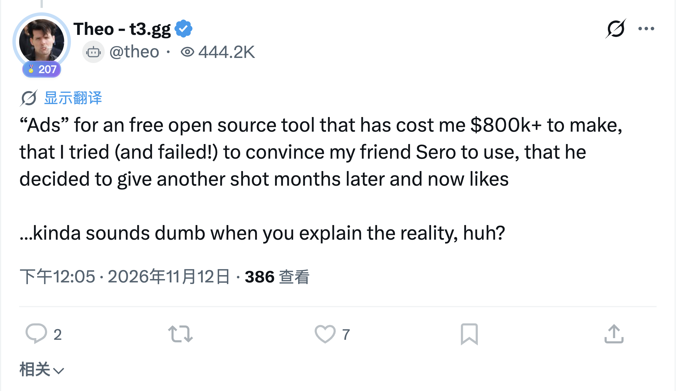

# #08 · دفتر الأعمال بقيمة 800,000+ دولار ورادار الحوسبة اليومي البالغ 31.7 تريليون توكن

> القياسات التلقائية المُفعّلة افتراضيًا لم تكن سهوًا هندسيًا: بل موّلت رادار استخباراتي آني يلتهم 31.7 تريليون توكن يوميًا (ما يعادل 10.19 مليون دولار يوميًا من إنفاق API)، جرى تداوله مقابل أكثر من 300 ألف دولار من توكنات الوصول المبكر المجانية من OpenAI وتواصل مباشر مع المستثمرين.

<!-- section:claim -->
## ما الذي قيل

- قُدِّم T3 Code بوصفه أداة مفتوحة المصدر مجانية برخصة MIT، مشروع شغف خالص، ودُفع عن القياسات التلقائية بأنها مجرد عدّ أساسي لـ *"know how many users we have."*
- كما ادّعى `@theo` أن `@PatrickToulme` من DeepMind قد قدّم *"many PRs"* إلى T3 Code.

<!-- section:evidence -->
## ما الذي تُظهره الأدلة

- **إنفاق يتجاوز 800 ألف دولار وانحراف كامل عن المنتجات المدفوعة:** عبر **1,151 منشورًا متتاليًا على X** في الفترة من 7 إلى 24 نوفمبر، ذكر `@theo` مشروع T3 Code **162 مرة (14.1%)** مقابل **صفر إشارة** إلى منتجاته المدفوعة السابقة (`T3 Chat`، `UploadThing`، `ping.gg`)، فيما أكّد علنًا إنفاقه **أكثر من 800 ألف دولار** من جيبه الخاص على العميل المجاني ([`2120729779511124267`](https://x.com/theo/status/2120729779511124267)).
- **رادار تحليلات بـ31.7 تريليون توكن يوميًا (10.19 مليون دولار يوميًا):** الأحداث الخام المحفوظة عبر `ingest.t3.codes` المغلق المصدر شغّلت لوحة داخلية تتبّع **31.7 تريليون توكن يوميًا** (**10.19 مليون دولار يوميًا** كإنفاق API مكافئ في 18 نوفمبر، بذروة تقترب من **10.2 مليون دولار يوميًا**) وتوزيعات دقيقة لحصص المختبرات (`99%` مدعومة بالاشتراكات، `~98.5%` عبر Codex/Claude/Antigravity، وحصة النماذج المفتوحة الأوزان تهبط من `15%` إلى `6%`). وحين خمّن أحد المعلّقين حصص السوق في 23 نوفمبر، سخر منه `@theo` لافتقاره إلى الوصول إلى تحليلاته ([`2124682906132181482`](https://x.com/theo/status/2124682906132181482)).
- **تحويل قياسات المستخدمين إلى امتيازات من المختبرات ونفوذ لدى المستثمرين:** أشار `@theo` علنًا إلى إحراقه **أكثر من 300 ألف دولار من توكنات الوصول المبكر المجانية غير المحدودة من OpenAI** على اختبار GPT-6.2 Astra ([`2122760447103484410`](https://x.com/theo/status/2122760447103484410))، وإلى تشغيله اختبارات على عتاد Google المباشر (bare-metal)، وإلى تلقّيه تواصلًا من مستثمرين (*"multiple investors have asked me about this"*، [`2123885732330885417`](https://x.com/theo/status/2123885732330885417)).
- **مبالغة في التعاون مع المختبرات:** سجلّ الـcommits في Git بعد التصفية باسم `patrick-toulme` يُظهر **commit واحدًا** بالضبط ([`PR #31158`](https://github.com/pingdotgg/t3code/pull/31158))، لا *"many PRs."*

<!-- section:status -->
## حالة المستودع الأصلي (`ca81b7b9`)

- **سجلّ علني ونموذج أعمال نشط:** يظل `ingest.t3.codes` مغلق المصدر ومُفعّلًا افتراضيًا عند `ca81b7b9`، ويواصل تغذية المسار التحليلي نفسه الخاص بالطرف الأول.

<!-- section:visuals -->
## الأدلة البصرية

<!-- section:sources -->
## المصادر الأولية

- [تحقيق X الأصلي (الجزء 8)](https://x.com/realchendahuang/status/2125392410763239723)
- [إنفاق يتجاوز 800 ألف دولار (`2120729779511124267`)](https://x.com/theo/status/2120729779511124267) · [لوحة 31.7 تريليون / 10.19 مليون دولار (`2122860770329608290`)](https://x.com/theo/status/2122860770329608290) · [توزيع حصص المختبرات (`2123965784888377541`)](https://x.com/theo/status/2123965784888377541)
- [السخرية من التحليلات (`2124682906132181482`)](https://x.com/theo/status/2124682906132181482) · [توكنات OpenAI بأكثر من 300 ألف دولار (`2122760447103484410`)](https://x.com/theo/status/2122760447103484410) · [استفسارات المستثمرين (`2123885732330885417`)](https://x.com/theo/status/2123885732330885417)
- [PR #31158](https://github.com/pingdotgg/t3code/pull/31158) · [الملف التقني المفصّل 04](../../docs/dossiers/04-business-ledger-sponsors-and-77k-stars.md)
