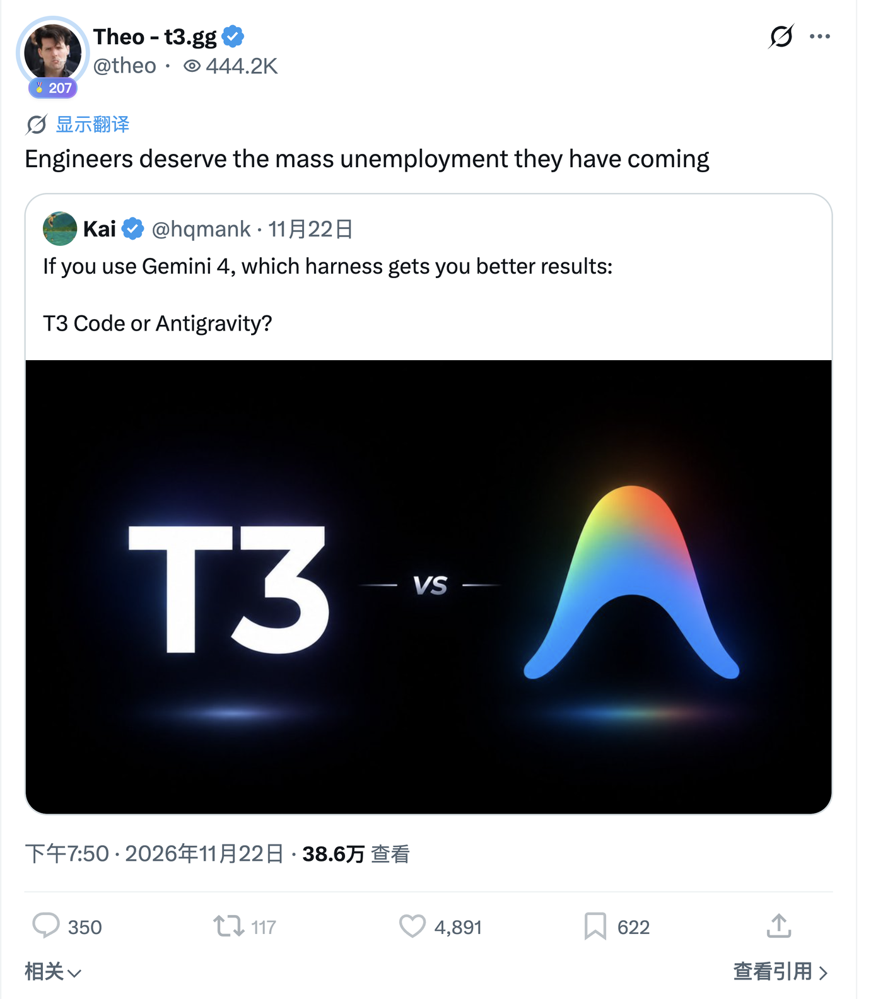

# #14 · Quantitativer Datensatz aus 1.151 Tweets: selektive Höflichkeit und 4,0-facher Anstieg antichinesischer Attacken in der Krise

> Eine erschöpfende quantitative Analyse von 1.151 aufeinanderfolgenden X-Posts von @theo (7.–24. November 2026) belegt eine krude Machtasymmetrie: 0,0 % Profanität gegenüber 20 Big-Tech-Executives und Lab-Mitarbeitern gegenüber 8,0 % Feindseligkeit gegenüber gewöhnlichen Entwicklern – ein Anstieg um das 4,0-Fache auf 14,4 % während des 25-stündigen Streits um den chinesischen Fork.

<!-- section:claim -->
## Was behauptet wurde

- Weniger als 24 Stunden vor dem Streit um den chinesischen Fork ermahnte `@theo` einen anderen Nutzer auf X, nicht das Vertrauen der Community zu verbrennen ([`2124449493513068862`](https://x.com/theo/status/2124449493513068862)).
- Sein scharfer Ton wird von Verteidigern häufig damit begründet, er behandle alle gleich – mit ungefilterter Direktheit.

<!-- section:evidence -->
## Was die Belege zeigen

Die Auswertung jedes aufeinanderfolgenden `@theo`-Posts auf X vom **7. bis 24. November 2026** (`n = 1,151`; `17.24` Tage; `66.8` Posts/Tag; `75.6%` Antworten; Median-Intervall `2.7` Minuten) ergibt eine messbare, reproduzierbare Hierarchie des Respekts:

- **Big-Tech-Executives, Lab-Mitarbeiter & Top-KOLs (`n = 43` eng / `60`–`62` weiter gefasst):** **0,0 %** gezielte Profanität oder persönliche Beleidigungen (`30.0%`–`32.6%` höflicher Dank). Selbst Kritik an großen Labs (Gemini 4 Carbon, GPT-6.2 Astra) wurde mit Lob abgemildert oder von öffentlichen Entschuldigungen begleitet ([`2123255588570501585`](https://x.com/theo/status/2123255588570501585), [`2123995323123343869`](https://x.com/theo/status/2123995323123343869)).
- **Gewöhnliche Entwickler & Kritiker (`n = 766` eng / `749` weiter gefasst):** Feindseligkeit und Profanität erreichen **8,0 %** (`61/766`) – darunter ein Quote-Tweet zu einem einfachen Tool-Vergleich mit der Feststellung *"Engineers deserve the mass unemployment they have coming"* ([`2124470530590011704`](https://x.com/theo/status/2124470530590011704)), der Wunsch, *"dance on the graves of the 'local ai' community"* zu tanzen ([`2120733839832273025`](https://x.com/theo/status/2120733839832273025)), die Bezeichnung von Linux-Nutzern als *"Linux larpers"* ([`2124298216271499605`](https://x.com/theo/status/2124298216271499605)), wiederholte `"stupid bitch"`-Attacken ([`2120599310211703274`](https://x.com/theo/status/2120599310211703274)) und Spott über Jail/RSD ([`2122865897375400066`](https://x.com/theo/status/2122865897375400066)).
- **Das 25-Stunden-Krisenfenster um den chinesischen Fork (`n = 132`):** Direkte persönliche Beleidigungen steigen um das **4,0-Fache** von der Basislinie `3.6%` auf **14,4 %** (`19/132`) – darunter die Bezeichnung des chinesischen Tech-Twitter als *"the biggest fucking cesspit"* und die Etikettierung von Entwicklern, die chinesische Code-Audits lesen, als *"fucking braindead"* ([`2125177503526588877`](https://x.com/theo/status/2125177503526588877)).

<!-- section:status -->
## Upstream-Status (`ca81b7b9`)

- **Reproduzierbare Basislinie:** Vollständige Methodik, Regex-Klassifizierungsregeln, Handle-Listen und vier interaktive forensische Diagramme sind in Dossier 06 archiviert.

<!-- section:visuals -->
## Visuelle Belege

<!-- section:sources -->
## Primärquellen

- [Ursprüngliche X-Recherche (Teil 14)](https://x.com/realchendahuang/status/2125404517697290438)
- ["Engineers deserve mass unemployment" (`2124470530590011704`)](https://x.com/theo/status/2124470530590011704) · ["Chinese tech Twitter cesspit" (`2125177503526588877`)](https://x.com/theo/status/2125177503526588877)
- ["Dance on the graves of local AI" (`2120733839832273025`)](https://x.com/theo/status/2120733839832273025) · ["Linux larpers" (`2124298216271499605`)](https://x.com/theo/status/2124298216271499605) · [Spott über Jail/RSD (`2122865897375400066`)](https://x.com/theo/status/2122865897375400066)
- [Abmilderung gegenüber Big Tech (`2123255588570501585`)](https://x.com/theo/status/2123255588570501585) · [`2123995323123343869`](https://x.com/theo/status/2123995323123343869) · ["Burning trust" (`2124449493513068862`)](https://x.com/theo/status/2124449493513068862)
- [Tiefgehendes technisches Dossier 06 (vollständiger Datensatz aus 1.151 Tweets)](../../docs/dossiers/06-tweet-forensic-dataset-1151.md)
