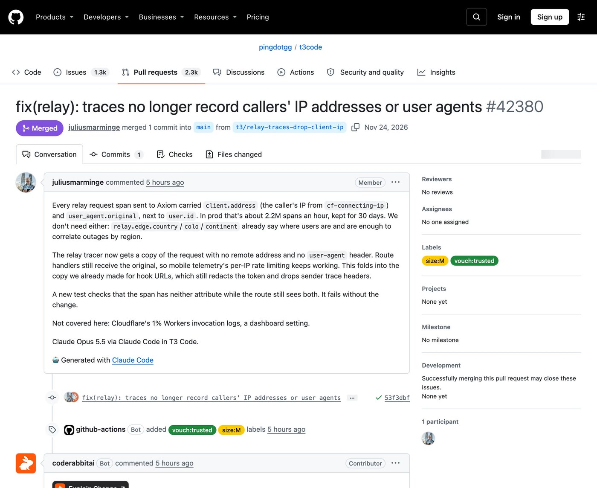

# #12 · Six-Hour Post-GDPR Overnight Blitz: 2.2M/hr IP Logs & Broken Account Deletion

> After a formal EU GDPR complaint was filed on November 24, six hours of emergency overnight patches inadvertently surfaced four deeper privacy disclosures — led by 2.2 million/hour IP-tagged Axiom spans retained for 30 days.

<!-- section:claim -->
## What Was Claimed

- Even 3.5 hours after `PR #42380` merged, `@theo` replied publicly that caller IPs had already been stripped.
- Official docs (`docs/user/telemetry.md`) promised `agent.feedback` reports were anonymous and account deletion cleanly removed user data.

<!-- section:evidence -->
## What the Evidence Shows

- **2.2 million/hour IP + User-Agent relay spans (`PR #42380`):** Every relay request span exported to Axiom — approximately **2.2 million spans per hour, retained for 30 days** — recorded `client.address` (real caller IP from `cf-connecting-ip`) and `user_agent.original` directly alongside `user.id` (with Cloudflare's 1% Workers logs remaining separate).
- **Broken Clerk account deletion (`PR #42285` & `PR #42430`):** Deleting a user account in Clerk previously left PlanetScale relay rows and active Cloudflare tunnels running behind the scenes — until an actual user privacy deletion request forced engineers to run **hand-written SQL and manual tunnel teardown**.
- **Mobile push token & user-ID leaks (`PR #42459` & `PR #41859`):** Android FCM push payloads transmitted plaintext Clerk `user_id` values to Google on every notification; iOS APNs spans and error logs captured full device push URLs carrying push tokens.
- **Mixed "anonymous" feedback batches (`PR #42466`):** Supposedly anonymous `agent.feedback` events were batched inside the exact same HTTP POST alongside identified `installId` events and full host fingerprints (OS, architecture, raw WSL distro), directly contradicting `docs/user/telemetry.md`.

<!-- section:status -->
## Upstream Status (`ca81b7b9`)

- **Partially patched:** Emergency PRs `#42380`, `#42285`, `#42430`, `#42459`, `#41859`, and `#42466` merged during the overnight GDPR sprint.
- **Still open:** `privacy-policy.astro` remained unchanged since `2026-10-06`, closed-source `ingest.t3.codes` retains raw event copies without independent auditability, and prior 30-day Axiom retention windows were never formally disclosed to affected users.

<!-- section:visuals -->
## Visual Evidence

<!-- section:sources -->
## Primary Sources

- [Original X Investigation (Part 12)](https://x.com/realchendahuang/status/2125395501663281198)
- [PR #42380](https://github.com/pingdotgg/t3code/pull/42380) · [PR #42285](https://github.com/pingdotgg/t3code/pull/42285) · [PR #42430](https://github.com/pingdotgg/t3code/pull/42430)
- [PR #42459](https://github.com/pingdotgg/t3code/pull/42459) · [PR #41859](https://github.com/pingdotgg/t3code/pull/41859) · [PR #42466](https://github.com/pingdotgg/t3code/pull/42466)
- [`privacy-policy.astro`](https://github.com/pingdotgg/t3code/blob/main/apps/marketing/src/pages/privacy-policy.astro) · [Deep Technical Dossier 01](../../docs/dossiers/01-telemetry-and-gdpr-timeline.md)
