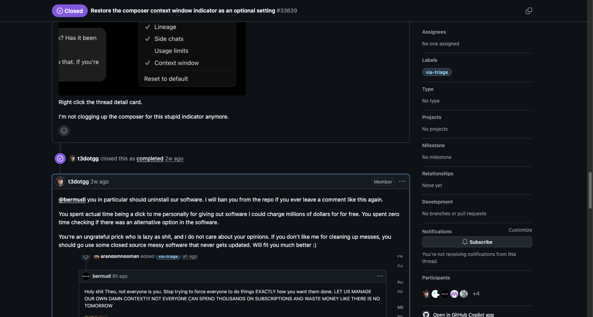

# #09 · Fusiones internas `yolo merges` frente a la hostilidad de la comunidad externa y los baneos de `.github/VOUCHED.td`

> Internamente, T3 Code publicaba 500 commits al día mediante bucles automatizados de agentes y admitía «yolo merges breaking shit»; mientras tanto, de cara al exterior, decía a los contribuyentes «here's my advice: Don't», denunciaba a usuarios vía `.github/VOUCHED.td` e insultaba a quienes reportaban issues.

<!-- section:claim -->
## Lo que se afirmó

- T3 Code se presenta como un proyecto de código abierto ágil y acogedor con la comunidad, construido por ingenieros para ingenieros.

<!-- section:evidence -->
## Lo que muestra la evidencia

- **Velocidad de fusión interna temeraria:** `@theo` describió públicamente que publicaba **500 commits al día** ([`2120741101250515322`](https://x.com/theo/status/2120741101250515322)), ejecutaba **700 agentes concurrentes**, fusionaba en lote PRs de la comunidad mediante un bucle automatizado de agentes, admitía *"my yolo merges breaking shit sometimes"* ([`2119951615679672513`](https://x.com/theo/status/2119951615679672513)) y bromeaba con que arriesgar un borrado de la máquina equivale a *"free content"* ([`2119993037971730879`](https://x.com/theo/status/2119993037971730879)).
- **Gobernanza hostil y baneos por denuncia pública:** [`CONTRIBUTING.md`](https://github.com/pingdotgg/t3code/blob/main/CONTRIBUTING.md) abría con *"here's my advice: Don't"*, respaldado por autobaneos por denuncia en [`.github/VOUCHED.td`](https://github.com/pingdotgg/t3code/blob/main/.github/VOUCHED.td) y **174 etiquetas `unwanted`** en PRs de la comunidad rechazados.
- **Eliminaciones unilaterales de funciones e insultos a usuarios:** [`PR #5551`](https://github.com/pingdotgg/t3code/pull/5551) enterró el conmutador Build/Plan (*"Reality check for those upset"*, 10 votos negativos), [`PR #9190`](https://github.com/pingdotgg/t3code/pull/9190) ocultó el anillo de uso de contexto (16 votos negativos, el máximo del repositorio) y [`PR #33131`](https://github.com/pingdotgg/t3code/pull/33131) eliminó por completo el modo Plan con un resumen de IA autocontradictorio. En [`Issue #33639`](https://github.com/pingdotgg/t3code/issues/33639#issuecomment-6765462545), `@theo` le dijo al usuario `@bermudi` que *"uninstall our software"* y lo llamó *"ungrateful prick"*, además de rechazar su [`PR #41572`](https://github.com/pingdotgg/t3code/pull/41572) de seguimiento a la mañana siguiente.
- **Exigencia de seguidores en X:** se reprendió a los contribuyentes por no seguir a `@theo` ([`2120821423438778667`](https://x.com/theo/status/2120821423438778667)), se les amenazó con eliminar `/btw` ([`2120853340078874923`](https://x.com/theo/status/2120853340078874923)) y se afirmó que una captura anotada vale más que enviar un PR ([`2123754193530053110`](https://x.com/theo/status/2123754193530053110)).

<!-- section:status -->
## Estado upstream (`ca81b7b9`)

- **Sigue vigente:** `CONTRIBUTING.md` y `.github/VOUCHED.td` continúan vigentes en `main` en `ca81b7b9`.

<!-- section:visuals -->
## Evidencia visual

<!-- section:sources -->
## Fuentes primarias

- [Investigación original en X (Parte 9)](https://x.com/realchendahuang/status/2125392916369871309)
- [`CONTRIBUTING.md`](https://github.com/pingdotgg/t3code/blob/main/CONTRIBUTING.md) · [`.github/VOUCHED.td`](https://github.com/pingdotgg/t3code/blob/main/.github/VOUCHED.td)
- [PR #5551](https://github.com/pingdotgg/t3code/pull/5551) · [PR #9190](https://github.com/pingdotgg/t3code/pull/9190) · [PR #33131](https://github.com/pingdotgg/t3code/pull/33131) · [Comentario del Issue #33639](https://github.com/pingdotgg/t3code/issues/33639#issuecomment-6765462545) · [PR #41572](https://github.com/pingdotgg/t3code/pull/41572)
- [500 commits al día (`2120741101250515322`)](https://x.com/theo/status/2120741101250515322) · [`yolo merges` (`2119951615679672513`)](https://x.com/theo/status/2119951615679672513) · [Borrado de la máquina = free content (`2119993037971730879`)](https://x.com/theo/status/2119993037971730879)
- [Dosier técnico profundo 05](../../docs/dossiers/05-governance-trademark-and-history.md)
