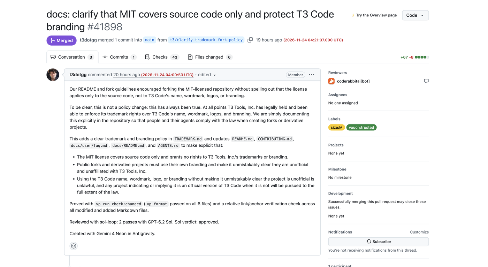

# #15 · Cero marcas registradas en la USPTO detrás de la amenaza de veto en GitHub y un `TRADEMARK.md` retroactivo 17 horas después

> Cuando @theo amenazó con contactar a GitHub para eliminar la cuenta de un desarrollador chino por "trademark infringement", T3 Tools Inc. tenía 0 registros en la USPTO de `T3 Code`, `T3 Tools` o `T3 Connect` — y fusionó `TRADEMARK.md` de forma retroactiva 17 horas después.

<!-- section:claim -->
## Qué se afirmó

- El 23 de noviembre, `@theo` acusó al autor del fork MIT de "trademark infringement" y amenazó con eliminar su cuenta de GitHub ([`2124829315657576890`](https://x.com/theo/status/2124829315657576890)).
- Tres horas antes de fusionar `TRADEMARK.md`, dijo a los desarrolladores que cuestionaban sus reclamos que *"get a better lawyer"* ([`2125026423769555308`](https://x.com/theo/status/2125026423769555308)) — pese a haberse burlado de WordPress en septiembre de 2024 por una *"unenforceable trademark dispute"* ([`1839261574005141945`](https://x.com/theo/status/1839261574005141945)).

<!-- section:evidence -->
## Qué muestra la evidencia

- **Cero registros en la USPTO para las marcas T3:** La verificación directa en USPTO TSDR (a partir de una pista de `@vildanden_ai`, [`2125275487404761555`](https://x.com/vildanden_ai/status/2125275487404761555)) muestra **0 registros** para `T3 Code`, `T3 Tools` o `T3 Connect`. La única solicitud de T3 Tools Inc. ante la USPTO (`PING LABS`, Serial [`97294243`](https://tsdr.uspto.gov/statusview/sn97294243)) fue rechazada en febrero de 2025 y marcada como `ABANDONED` el 19 de mayo de 2025. Mientras tanto, terceros no relacionados mantienen registros activos de software/SaaS `T3` en las clases 9 y 42 (`EquipmentShare`, Reg. `7795672` / Serial [`90644500`](https://tsdr.uspto.gov/#caseNumber=90644500&caseSearchType=US_APPLICATION&caseType=DEFAULT&searchType=statusSearch); `ESG Operations`, Reg. `3324707`).
- **Requisito de la Política de Marcas de GitHub:** Según la [Política de Marcas de GitHub](https://docs.github.com/en/site-policy/content-removal-policies/github-trademark-policy), las solicitudes comerciales de retirada por marca exigen un número de registro federal o internacional bajo pena de perjurio. En el momento en que `@theo` amenazó con eliminar la cuenta de `@DDdxx666`, no podía completar el formulario de GitHub.
- **`TRADEMARK.md` retroactivo 17 horas después (`PR #41898`):** A las **12:21 CST del 24 de noviembre** — 17 horas después de la amenaza de veto — `@theo` fusionó [`PR #41898`](https://github.com/pingdotgg/t3code/pull/41898) insertando `TRADEMARK.md`, que reclama derechos *"whether registered or unregistered"*, y lo citó en X 94 segundos después ([`2125082769395220688`](https://x.com/theo/status/2125082769395220688)).

<!-- section:status -->
## Estado upstream (`ca81b7b9`)

- **Registro público:** El `TRADEMARK.md` retroactivo permanece en `main`; los registros de USPTO TSDR siguen mostrando 0 registros de T3 Tools Inc. para `T3 Code`.

<!-- section:visuals -->
## Evidencia visual

<!-- section:sources -->
## Fuentes primarias

- [Investigación original en X (Parte 15)](https://x.com/realchendahuang/status/2125408163273080950)
- [USPTO TSDR `97294243` (PING LABS — ABANDONED)](https://tsdr.uspto.gov/statusview/sn97294243) · [USPTO TSDR `90644500` (EquipmentShare `T3`)](https://tsdr.uspto.gov/#caseNumber=90644500&caseSearchType=US_APPLICATION&caseType=DEFAULT&searchType=statusSearch)
- [Política de Marcas de GitHub](https://docs.github.com/en/site-policy/content-removal-policies/github-trademark-policy)
- [PR #41898](https://github.com/pingdotgg/t3code/pull/41898) · [`TRADEMARK.md`](https://github.com/pingdotgg/t3code/blob/main/TRADEMARK.md)
- [Cita retroactiva 94 s después (`2125082769395220688`)](https://x.com/theo/status/2125082769395220688) · ["Get a better lawyer" (`2125026423769555308`)](https://x.com/theo/status/2125026423769555308) · [Burla a WordPress (`1839261574005141945`)](https://x.com/theo/status/1839261574005141945)
- [Dosier técnico profundo 05](../../docs/dossiers/05-governance-trademark-and-history.md)
