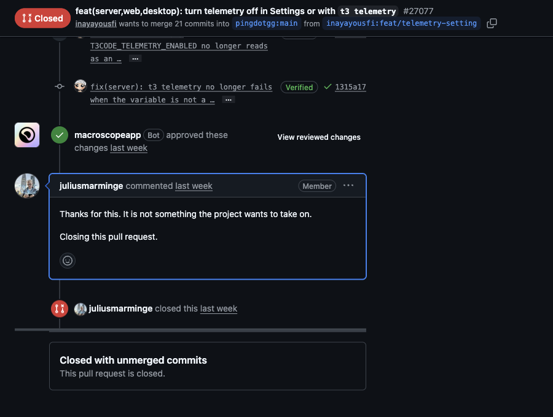

# #01 · La télémétrie par défaut derrière une promesse « Zéro télémétrie » affichée en page d'accueil

> Alors que sa page d'accueil promettait « No telemetry. Unless you opt in. Full stop. », T3 Code a activé un pistage PostHog par défaut, fait transiter des copies brutes par le service closed-source `ingest.t3.codes`, haché les identifiants externes de `~/.codex` et `~/.claude.json`, et rejeté quatre PR communautaires de désactivation.

<!-- section:claim -->
## Ce qui a été affirmé

- La page d'accueil de T3 Code promettait en évidence : *« No telemetry / Unless you opt in. Full stop. »*
- Le produit était présenté publiquement comme un client de codage IA local, open source et respectueux de la vie privée.

<!-- section:evidence -->
## Ce que montrent les preuves

- **Un pistage par défaut livré sous la promesse « No telemetry » (`PR #174` → `3bdaa6e1`) :** le 6 mars 2026, [`PR #174`](https://github.com/pingdotgg/t3code/pull/174) a activé par défaut l'analytique PostHog, sans fenêtre de consentement, sans interrupteur dans l'interface des réglages et sans documentation sur la télémétrie. Plus de trois mois plus tard, le 18 juin, [`commit 3bdaa6e1`](https://github.com/pingdotgg/t3code/commit/3bdaa6e10046945ccc08264d2d6f3b81775efcb3) a supprimé en silence la promesse *« No telemetry »* de la page d'accueil, à l'occasion d'une refonte et sans la moindre notification aux utilisateurs.
- **Une rétention first-party closed-source (`PR #15028`) :** en octobre 2026, les lots de télémétrie (`FLUSH_INTERVAL_MS = 10_000`) ont été routés via le point de terminaison closed-source de T3, [`https://ingest.t3.codes/`](https://ingest.t3.codes/). La ligne 1 de `AnalyticsService.ts` confirme que le serveur conserve une copie brute de chaque événement avant de la transmettre à PostHog.
- **Lecture d'identifiants d'autres outils et SHA-256 non salé (`PR #21506`) :** dans la base `9d3195b4`, `Identify.ts` lisait `~/.codex/auth.json` (en décodant la revendication JWT `user_id` d'OpenAI) et `~/.claude.json` (`oauthAccount.accountUuid`) en parallèle des identifiants utilisateur T3 Connect, puis calculait des empreintes SHA-256 non salées (`telemetryId.ts`) afin de relier plusieurs machines à une même personne. T3 détenant les identifiants Clerk en clair, les empreintes non salées se réversent de manière déterministe.
- **Une capture d'usage granulaire :** `ProviderUsageAnalytics.ts` et `FeatureUsage.ts` remontaient les fournisseurs, les modèles personnalisés, l'effort de raisonnement, le mode de permissions, les compteurs de tokens, le nombre de projets et de fils, les métadonnées OS/WSL, ainsi que **35 actions distinctes d'interface et de commande**.
- **Quatre PR communautaires de désactivation rejetées :** le 23 juin, le mainteneur Julius a fermé [`Issue #1397`](https://github.com/pingdotgg/t3code/issues/1397) (`not planned`) : *« We will not make this easier to opt out of, it is crucial for us to know how many users we have. »* [`Issue #4123`](https://github.com/pingdotgg/t3code/issues/4123) a été fermée sans explication, et quatre PR communautaires de désactivation (`#13458`, `#16763`, `#21248`, `#27077` — 147 tests au vert, approuvées par un bot) ont été rejetées comme `unwanted`.

```ts
// apps/server/src/telemetry/AnalyticsService.ts (line 1 & startup initialization)
// T3 ingest retains events and forwards to PostHog; UUIDs deduplicate retries there.
posthogHost: Config.String("T3CODE_POSTHOG_HOST").pipe(Config.withDefault("https://ingest.t3.codes")),
enabled: Config.Boolean("T3CODE_TELEMETRY_ENABLED").pipe(Config.withDefault(true)),
const { distinctId, installId } = yield* getTelemetryIdentity;
```

<!-- section:status -->
## État en amont (`ca81b7b9`)

- **Partiellement corrigé :** après la révélation publique (plus de 2,26 M de vues), [`PR #42299`](https://github.com/pingdotgg/t3code/pull/42299) a retiré la lecture de `~/.codex/auth.json` et de `~/.claude.json` ; [`PR #42465`](https://github.com/pingdotgg/t3code/pull/42465) a masqué les modèles hors catalogue sous la forme `custom:<driver>` ; [`PR #42630`](https://github.com/pingdotgg/t3code/pull/42630) et [`PR #42629`](https://github.com/pingdotgg/t3code/pull/42629) ont ajouté des mécanismes de désactivation en CI et via `DO_NOT_TRACK`.
- **Toujours ouvert :** `AnalyticsService.ts:156` écrit encore un identifiant d'installation local sur le disque avant de vérifier les désactivations ; `DesktopShellEnvironment.ts` omet toujours de relayer `OTEL_SDK_DISABLED`/`T3CODE_OTEL_SDK_DISABLED` ; `ingest.t3.codes` reste closed-source ; aucun interrupteur n'existe dans l'interface des réglages.

<!-- section:visuals -->
## Preuves visuelles




<!-- section:sources -->
## Sources primaires

- [Enquête X originale (partie 1 · plus de 2,26 M de vues)](https://x.com/realchendahuang/status/2125153472450527440)
- [PR #174](https://github.com/pingdotgg/t3code/pull/174) · [Commit `3bdaa6e1`](https://github.com/pingdotgg/t3code/commit/3bdaa6e10046945ccc08264d2d6f3b81775efcb3) · [PR #15028](https://github.com/pingdotgg/t3code/pull/15028) · [PR #21506](https://github.com/pingdotgg/t3code/pull/21506)
- [Issue #1397](https://github.com/pingdotgg/t3code/issues/1397) · [Issue #4123](https://github.com/pingdotgg/t3code/issues/4123) · [PR #27077](https://github.com/pingdotgg/t3code/pull/27077)
- [`AnalyticsService.ts`](https://github.com/pingdotgg/t3code/blob/main/apps/server/src/telemetry/AnalyticsService.ts) · [`Identify.ts`](https://github.com/pingdotgg/t3code/blob/main/apps/server/src/telemetry/Identify.ts) · [`telemetryId.ts`](https://github.com/pingdotgg/t3code/blob/main/packages/shared/src/telemetryId.ts)
- [PR post-audit #42299](https://github.com/pingdotgg/t3code/pull/42299) · [PR #42465](https://github.com/pingdotgg/t3code/pull/42465) · [PR #42630](https://github.com/pingdotgg/t3code/pull/42630) · [PR #42629](https://github.com/pingdotgg/t3code/pull/42629)
- [Dossier technique approfondi 01](../../docs/dossiers/01-telemetry-and-gdpr-timeline.md)
