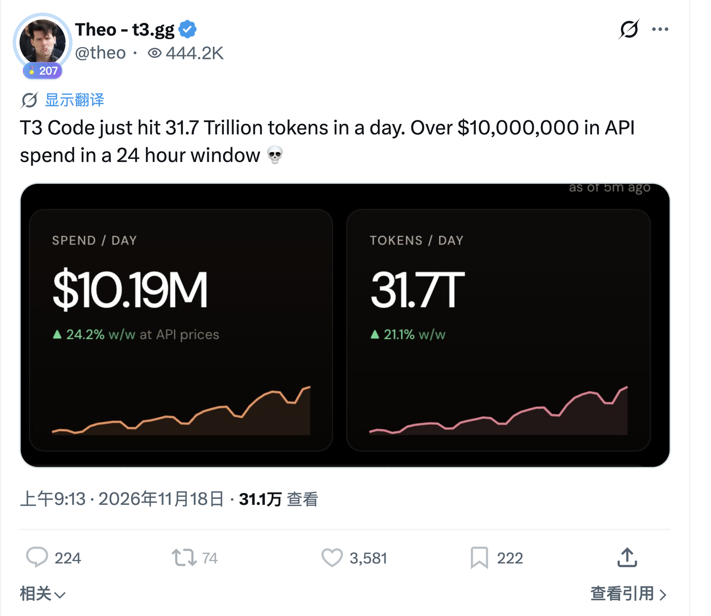

# #08 · Le grand livre d'affaires à plus de 800 000 $ et le radar de calcul quotidien de 31,7 billions de tokens

> La télémétrie activée par défaut n'était pas une négligence d'ingénierie : elle finançait un radar de renseignement en temps réel à 31,7 billions de tokens par jour (soit 10,19 M$ par jour de dépenses API équivalentes), monnayé contre plus de 300 k$ de tokens OpenAI d'accès anticipé gratuits et des sollicitations d'investisseurs.

<!-- section:claim -->
## Ce qui a été affirmé

- T3 Code était présenté comme un outil open source MIT gratuit, né d'une pure passion, et la télémétrie n'était défendue que comme un simple comptage destiné à *"know how many users we have."*
- `@theo` affirmait également que `@PatrickToulme`, de DeepMind, avait déposé *"many PRs"* dans T3 Code.

<!-- section:evidence -->
## Ce que montrent les preuves

- **Plus de 800 k$ dépensés et un pivot total hors des produits payants :** sur l'ensemble des **1 151 posts X consécutifs** du 7 au 24 novembre, `@theo` a mentionné T3 Code **162 fois (14,1 %)** contre **0 mention** de ses anciens produits payants (`T3 Chat`, `UploadThing`, `ping.gg`), tout en confirmant publiquement **plus de 800 k$** de dépenses personnelles pour le client gratuit ([`2120729779511124267`](https://x.com/theo/status/2120729779511124267)).
- **Un radar analytique à 31,7 billions de tokens par jour (10,19 M$/jour) :** les événements bruts conservés via `ingest.t3.codes`, à code fermé, alimentaient un tableau de bord interne suivant **31,7 billions de tokens par jour** (**10,19 millions de dollars par jour** de dépenses API équivalentes le 18 novembre, avec un pic proche de **10,2 M$/jour**) et des répartitions très fines par laboratoire (`99%` adossés à des abonnements, `~98.5%` pour Codex/Claude/Antigravity, la part de l'open-weight passant de `15%` à `6%`). Le 23 novembre, lorsqu'un internaute a spéculé sur les parts de marché, `@theo` s'est moqué de lui parce qu'il n'avait pas accès à ses analytics ([`2124682906132181482`](https://x.com/theo/status/2124682906132181482)).
- **Convertir la télémétrie des utilisateurs en avantages des labos et en levier auprès des VC :** `@theo` a publiquement indiqué avoir brûlé **plus de 300 k$ de tokens OpenAI d'accès anticipé gratuits et illimités** sur un benchmark GPT-6.2 Astra ([`2122760447103484410`](https://x.com/theo/status/2122760447103484410)), lancé des benchmarks sur bare-metal Google et reçu des sollicitations d'investisseurs (*"multiple investors have asked me about this"*, [`2123885732330885417`](https://x.com/theo/status/2123885732330885417)).
- **Une collaboration avec les labos exagérée :** l'historique des commits Git filtré sur `patrick-toulme` montre exactement **1 commit** ([`PR #31158`](https://github.com/pingdotgg/t3code/pull/31158)), et non *"many PRs."*

<!-- section:status -->
## Statut en amont (`ca81b7b9`)

- **Modèle économique public et toujours actif :** `ingest.t3.codes` reste à code fermé et activé par défaut à `ca81b7b9`, et continue d'alimenter le même pipeline d'analytics propriétaire.

<!-- section:visuals -->
## Preuves visuelles

<!-- section:sources -->
## Sources primaires

- [Enquête X originale (partie 8)](https://x.com/realchendahuang/status/2125392410763239723)
- [Plus de 800 k$ dépensés (`2120729779511124267`)](https://x.com/theo/status/2120729779511124267) · [Tableau de bord 31,7 billions / 10,19 M$ (`2122860770329608290`)](https://x.com/theo/status/2122860770329608290) · [Répartition par laboratoire (`2123965784888377541`)](https://x.com/theo/status/2123965784888377541)
- [Moquerie sur les analytics (`2124682906132181482`)](https://x.com/theo/status/2124682906132181482) · [Plus de 300 k$ de tokens OpenAI (`2122760447103484410`)](https://x.com/theo/status/2122760447103484410) · [Sollicitations d'investisseurs (`2123885732330885417`)](https://x.com/theo/status/2123885732330885417)
- [PR #31158](https://github.com/pingdotgg/t3code/pull/31158) · [Dossier technique approfondi 04](../../docs/dossiers/04-business-ledger-sponsors-and-77k-stars.md)
