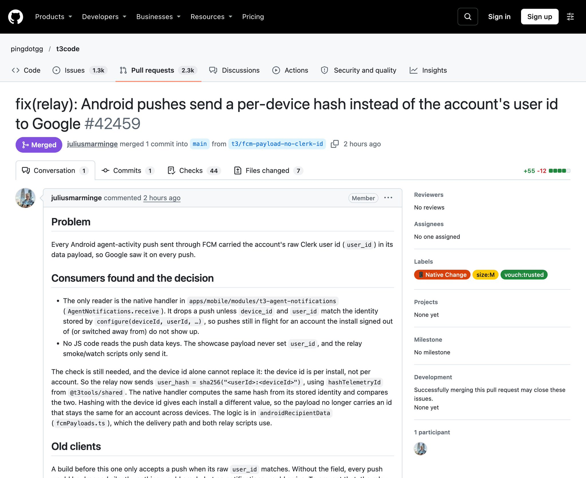

# #12 · Blitz nocturne de six heures après le RGPD : 2,2 M de journaux d'IP par heure et suppression de compte défaillante

> Après le dépôt d'une plainte formelle auprès du RGPD de l'UE le 24 novembre, six heures de correctifs d'urgence passés en pleine nuit ont involontairement mis au jour quatre révélations plus profondes sur la vie privée — à commencer par 2,2 millions de spans Axiom étiquetés par IP par heure, conservés pendant 30 jours.

<!-- section:claim -->
## Ce qui avait été affirmé

- Même 3,5 heures après la fusion de `PR #42380`, `@theo` a répondu publiquement que les IP des appelants avaient déjà été retirées.
- La documentation officielle (`docs/user/telemetry.md`) promettait que les rapports `agent.feedback` étaient anonymes et que la suppression de compte effaçait proprement les données utilisateur.

<!-- section:evidence -->
## Ce que montrent les preuves

- **Spans de relais avec IP + User-Agent à 2,2 millions/heure (`PR #42380`) :** Chaque span de requête de relais exporté vers Axiom — environ **2,2 millions de spans par heure, conservés 30 jours** — enregistrait `client.address` (l'IP réelle de l'appelant issue de `cf-connecting-ip`) et `user_agent.original` directement à côté de `user.id` (les journaux Workers de Cloudflare, limités à 1 %, restant séparés).
- **Suppression de compte Clerk défaillante (`PR #42285` et `PR #42430`) :** Supprimer un compte utilisateur dans Clerk laissait auparavant tourner en arrière-plan des lignes de relais PlanetScale et des tunnels Cloudflare actifs — jusqu'à ce qu'une véritable demande de suppression pour raisons de vie privée oblige les ingénieurs à exécuter **du SQL écrit à la main et un démontage manuel des tunnels**.
- **Fuites de jetons push mobiles et d'ID utilisateur (`PR #42459` et `PR #41859`) :** Les charges utiles push FCM d'Android transmettaient en clair les valeurs `user_id` de Clerk à Google à chaque notification ; les spans APNs iOS et les journaux d'erreurs capturaient les URL push complètes des appareils, lesquelles portaient les jetons push.
- **Lots de retours « anonymes » mélangés (`PR #42466`) :** Des événements `agent.feedback` censés être anonymes étaient regroupés dans exactement le même HTTP POST que des événements `installId` identifiés et des empreintes d'hôte complètes (OS, architecture, distribution WSL brute), contredisant directement `docs/user/telemetry.md`.

<!-- section:status -->
## État en amont (`ca81b7b9`)

- **Partiellement corrigé :** Les PR d'urgence `#42380`, `#42285`, `#42430`, `#42459`, `#41859` et `#42466` ont été fusionnées pendant le sprint RGPD nocturne.
- **Toujours ouvert :** `privacy-policy.astro` est resté inchangé depuis le `2026-10-06`, le service à code fermé `ingest.t3.codes` conserve des copies brutes des événements sans auditabilité indépendante, et les précédentes fenêtres de conservation Axiom de 30 jours n'ont jamais été formellement divulguées aux utilisateurs concernés.

<!-- section:visuals -->
## Preuves visuelles

<!-- section:sources -->
## Sources primaires

- [Enquête originale sur X (partie 12)](https://x.com/realchendahuang/status/2125395501663281198)
- [PR #42380](https://github.com/pingdotgg/t3code/pull/42380) · [PR #42285](https://github.com/pingdotgg/t3code/pull/42285) · [PR #42430](https://github.com/pingdotgg/t3code/pull/42430)
- [PR #42459](https://github.com/pingdotgg/t3code/pull/42459) · [PR #41859](https://github.com/pingdotgg/t3code/pull/41859) · [PR #42466](https://github.com/pingdotgg/t3code/pull/42466)
- [`privacy-policy.astro`](https://github.com/pingdotgg/t3code/blob/main/apps/marketing/src/pages/privacy-policy.astro) · [Dossier technique approfondi 01](../../docs/dossiers/01-telemetry-and-gdpr-timeline.md)
