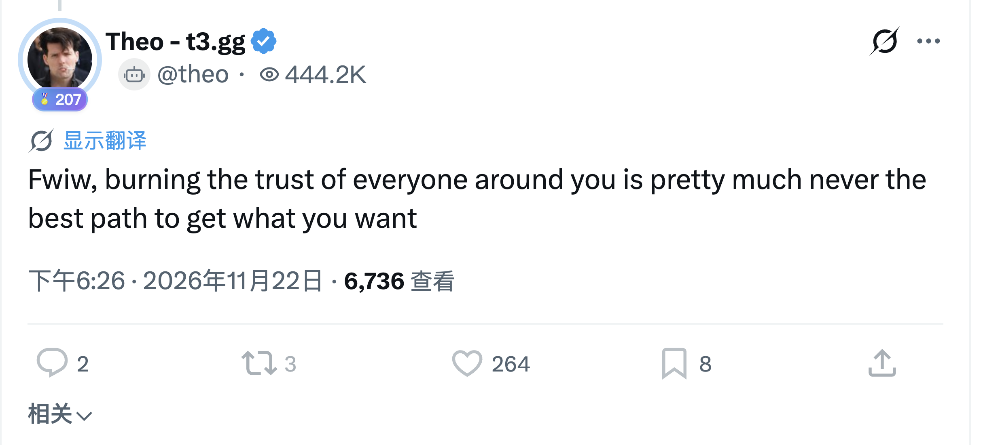

# #16 · Un schéma historique sur deux ans : les représailles fondées sur la nationalité, la prime FFmpeg de 20 000 $ et les menaces supprimées

> L'éclat de novembre 2026 autour du fork chinois n'était pas un dérapage isolé — les archives publiques de 2024 à 2026 documentent un cycle récurrent de harcèlement ciblé sur la nationalité, d'intimidation envers l'open source, de moqueries visant les interfaces d'autres développeurs et de suppressions après les représailles.

<!-- section:claim -->
## Ce qui a été affirmé

- Dans sa vidéo d'excuses de 2024 [`I screwed up.`](https://www.youtube.com/watch?v=o2CSJYXJBpc), `@theo` condamnait explicitement le fait de diriger une hostilité fondée sur la nationalité contre des communautés de développeurs.

<!-- section:evidence -->
## Ce que démontrent les preuves

- **Harcèlement et excuses envers un développeur indien en 2024 :** Après avoir publié une vidéo ciblant des chaînes indiennes de tutoriels de programmation, qui avait déclenché des vagues de harcèlement fondé sur la nationalité, `@theo` a mis en ligne [`I screwed up.`](https://www.youtube.com/watch?v=o2CSJYXJBpc) pour condamner ces attaques — deux ans avant de qualifier un fork chinois du MIT de `"Temu3 Code"` et de décrire le Twitter tech chinois comme *"the biggest fucking cesspit."*
- **Moqueries autour d'un fork et de l'interface de DHH en 2024 :** `@theo` avait auparavant nommé son propre fork du thème VS Code d'un autre développeur [`vsc-material-but-i-wont-sue-you`](https://github.com/t3dotgg/vsc-material-but-i-wont-sue-you), afin de railler la susceptibilité juridique de l'auteur original, et avait suscité un engagement viral en juin 2024 en tournant publiquement en dérision l'interface du client mail de DHH, créateur de Rails ([`2125066552785711291`](https://x.com/realchendahuang/status/2125066552785711291)).
- **Octobre 2025 — prime FFmpeg de 20 000 $ :** Au cours d'un différend sur X avec FFmpeg, `@theo` a publiquement offert une **prime de 20 000 $** pour évincer un mainteneur de FFmpeg ([trace documentée](https://www.youtube.com/watch?v=1oQ3KMeaH04)). Après que Windscribe eut proposé 21 000 $ en contre-offre, que le fondateur de VLC se fut opposé à lui et que les développeurs de FFmpeg eurent documenté le harcèlement, `@theo` a retiré la prime et supprimé la vidéo ainsi que ses publications.
- **Représailles liées à Stop Killing Games et documentation YouTube antérieure :** Lors de précédents différends autour des droits des consommateurs, `@theo` a insulté à plusieurs reprises les partisans de *Stop Killing Games* tout en prenant le parti des éditeurs ([`2125064674307985520`](https://x.com/realchendahuang/status/2125064674307985520)), parallèlement à une documentation YouTube au format long comparant ses déclarations publiques à des messages privés ([`2125066387647513072`](https://x.com/realchendahuang/status/2125066387647513072)).
- **25 novembre 2026 (~4 h 00) — menace supprimée de passer en closed source :** Pendant les retombées de l'audit nocturne, `@theo` a publié une menace de passer T3 Code en closed source au motif que les utilisateurs ne méritaient pas l'open source — puis a supprimé la publication avant le lever du soleil, après qu'elle eut dépassé les 3 000 likes.

<!-- section:status -->
## Statut en amont (`ca81b7b9`)

- **Archive publique :** Le schéma observé de 2024 à 2026 établit une constance comportementale sur le long terme dans plusieurs communautés de développeurs, plutôt qu'un malentendu isolé.

<!-- section:visuals -->
## Preuves visuelles

<!-- section:sources -->
## Sources primaires

- [Enquête originale sur X (partie 16)](https://x.com/realchendahuang/status/2125408843152953693)
- [`vsc-material-but-i-wont-sue-you`](https://github.com/t3dotgg/vsc-material-but-i-wont-sue-you) · [`I screwed up.` (YouTube)](https://www.youtube.com/watch?v=o2CSJYXJBpc) · [Trace de la prime FFmpeg de 20 000 $ (YouTube)](https://www.youtube.com/watch?v=1oQ3KMeaH04)
- [Réponses apportant le contexte historique d'origine : `2125064674307985520`](https://x.com/realchendahuang/status/2125064674307985520) · [`2125066387647513072`](https://x.com/realchendahuang/status/2125066387647513072) · [`2125066552785711291`](https://x.com/realchendahuang/status/2125066552785711291)
- [Dossier technique approfondi 05](../../docs/dossiers/05-governance-trademark-and-history.md)
