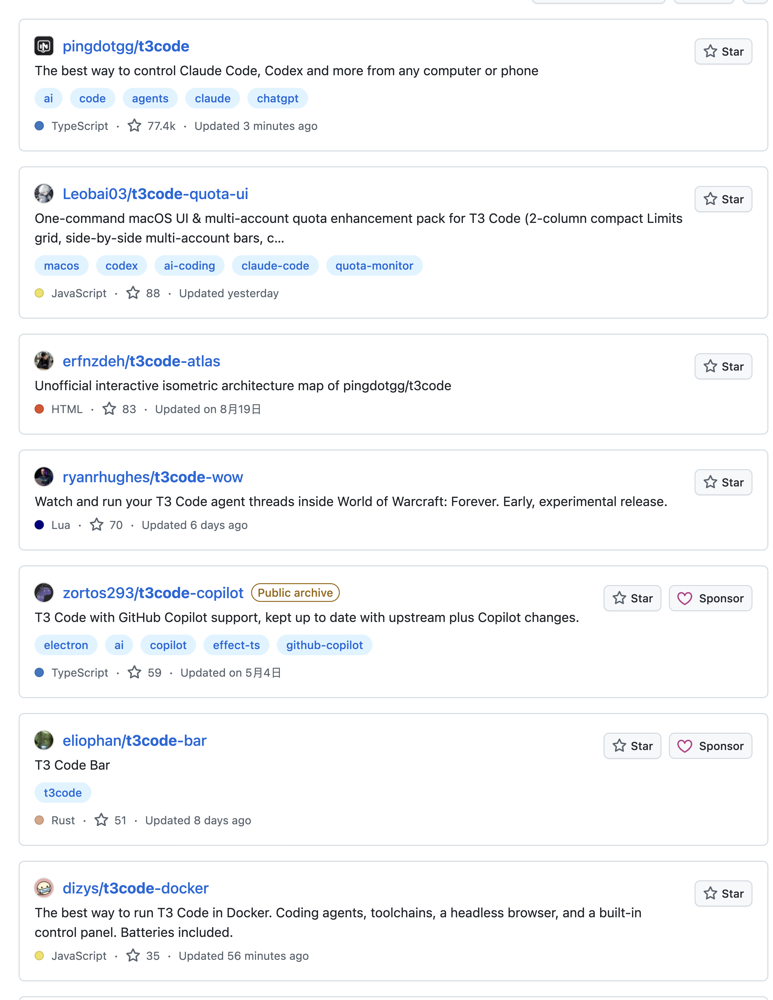

# #00 · Sengketa Asal-Usul: "Steal Our Code", Ancaman Penamaan Fork & Standar Ganda Rasial

> Dalam waktu 11 menit, @theo menyebut fork MIT gratis milik pengembang Tiongkok sebagai "Chinese knockoff" dan "Temu3 Code" serta mengancam akan memblokir akun GitHub — lalu secara terbuka menyambut perusahaan-perusahaan Amerika bernilai triliunan dolar yang menyalin kode MIT kurang dari 11 jam kemudian.

<!-- section:claim -->
## Apa yang Diklaim

- Halaman utama T3 Code ([`t3.codes`](https://t3.codes/)) memberi label pada tautan GitHub publiknya *"Steal our code (legally)"* di bawah lisensi MIT.
- Kurang dari 11 jam setelah menyerang fork MIT milik pengembang Tiongkok, ketika ditanya apakah perusahaan Amerika bernilai triliunan dolar yang menyalin T3 Code mengganggunya, `@theo` menjawab: *"Nah. Open source is open source, even if a trillion dollar company uses it!"* ([`2124989435154726982`](https://x.com/theo/status/2124989435154726982)).

<!-- section:evidence -->
## Apa yang Ditunjukkan Bukti

- **Permusuhan yang tertuju pada satu fork MIT (23 Nov, 19.11–19.54 CST):** Setelah seorang pengamat keliru mengira fork MIT gratis milik pengembang Tiongkok `@DDdxx666` sebagai aplikasi resmi, `@theo` mengunggah dua cuitan dalam 11 menit yang menyebutnya *"Chinese knockoff"* dan *"Temu3 Code"* serta mengancam akan meminta seluruh akun GitHub pengembang tersebut dihapus: *"Do it right now or I'm going to contact GitHub and have your account taken down"* ([`2124829315657576890`](https://x.com/theo/status/2124829315657576890)).
- **Kepatuhan seketika, permintaan maaf yang asimetris:** `@DDdxx666` mengganti nama repositori menjadi `Stardust` dan menghapus seluruh merek T3 dalam waktu 30 menit. `@theo` meminta maaf secara privat melalui pesan langsung, namun membiarkan kedua unggahan publiknya (total lebih dari 200.000 tayangan) tetap beredar.
- **Penegakan aturan secara selektif berdasarkan kewarganegaraan:** Anggota tim T3 `@maria_rcks` secara publik menghosting `maria-rcks/t3libre` (*"T3 Code, liberated"*), dan repositori berbahasa Inggris seperti `t3code-quota-ui`, `t3code-atlas`, serta `t3code-bar` beroperasi tanpa gangguan dan tanpa ancaman penurunan konten sama sekali.
- **Inspirasi mereka sendiri diakui di FAQ:** FAQ T3 Code sendiri secara eksplisit menyatakan bahwa mereka mengambil inspirasi langsung dari Codex Desktop, Conductor, Claude Desktop, dan Cursor ([`2125066677188702698`](https://x.com/realchendahuang/status/2125066677188702698)).
- **Pemicu investigasi menyeluruh:** Sejak 24 November, penelusuran baris demi baris atas `pingdotgg/t3code` dan catatan publik mengungkap 19 ekshibit terdokumentasi yang menyusul — memicu pengaduan GDPR dari Eropa dan hampir 20 tambalan darurat pada malam hari.

<!-- section:status -->
## Status Upstream (`ca81b7b9`)

- **Catatan publik:** Kedua serangan publik pada 23 November dan balasan *"Open source is open source"* pada 24 November tetap menjadi bagian dari catatan publik yang permanen.

<!-- section:visuals -->
## Bukti Visual

<!-- section:sources -->
## Sumber Primer

- [Origin Post 1 ("steal our code")](https://x.com/realchendahuang/status/2125059292919394654)
- [Origin Post 2 (Fork dispute & double standard)](https://x.com/realchendahuang/status/2125062675147448475)
- [`@theo` GitHub ban threat (`2124829315657576890`)](https://x.com/theo/status/2124829315657576890)
- [`@theo` welcoming trillion-dollar US companies (`2124989435154726982`)](https://x.com/theo/status/2124989435154726982)
- [FAQ inspiration context (`2125066677188702698`)](https://x.com/realchendahuang/status/2125066677188702698)
- [T3 Code homepage (`t3.codes`)](https://t3.codes/)
- [Deep Technical Dossier 05](../../docs/dossiers/05-governance-trademark-and-history.md)
