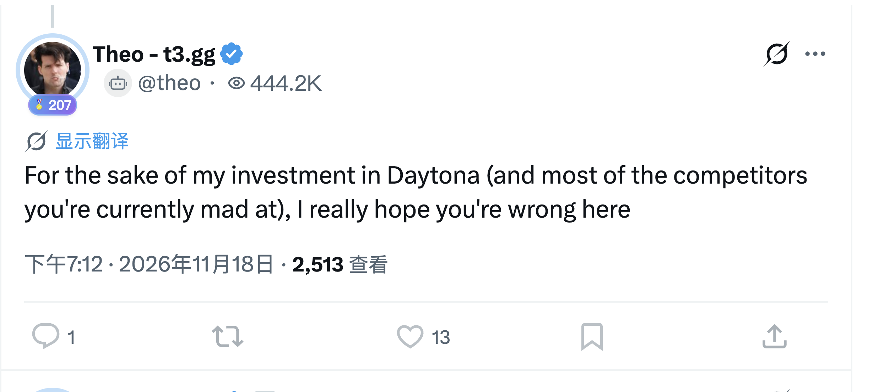

# #06 · Konflik Investor Angel: Ejekan Penutupan Vibe Kanban & Tumpang Tindih Daytona

> Di luar cacat kode, unggahan publik @theo di X mendokumentasikan konflik tajam antara perannya sebagai investor angel di startup pengembang yang bersaing dan pengelolaan T3 Code olehnya.

<!-- section:claim -->
## Apa yang Diklaim

- `@theo` secara rutin menampilkan diri sebagai advokat pengembang independen yang membagikan pandangan blak-blakan dan tidak memihak tentang alat coding dan alur kerja startup.

<!-- section:evidence -->
## Apa yang Ditunjukkan Bukti

- **Investasi di Vibe Kanban & ejekan publik (`2122201981167251877`):** Pada 16 November, `@theo` secara publik mengungkapkan bahwa ia pernah menjadi investor angel dan kontributor **Vibe Kanban**. Ia menceritakan bahwa tim tersebut beralih dari kanban ke pola UI T3 Code sebelum kehabisan dana dan tutup — lalu secara terbuka mengejek UI itu sebagai hebat *"for running out of runway and killing your business."*
- **Investasi di Daytona bersamaan dengan sandbox berbayar T3 (`2119705561679933806` → `2123011578090127499`):** Sembilan hari setelah menggulirkan wacana sandbox cloud berbayar di dalam T3 Code (9 Nov), `@theo` secara publik mengonfirmasi pada 18 November bahwa ia adalah investor di **Daytona**, startup infrastruktur sandbox cloud.
- **Tumpang tindih lebih luas yang tak diungkap:** Catatan publik juga mengonfirmasi bahwa `@theo` memiliki investasi angel di alat coding AI pesaing, **Cursor** dan **Cline**, sembari aktif menerbitkan kritik produk dan perbandingan yang mendorong lalu lintas di pasar yang sama.

<!-- section:status -->
## Status Hulu (`ca81b7b9`)

- **Catatan publik:** Ketiga pengungkapan di X (`2122201981167251877`, `2119705561679933806`, `2123011578090127499`) tersimpan verbatim dalam arsip.

<!-- section:visuals -->
## Bukti Visual

<!-- section:sources -->
## Sumber Primer

- [Investigasi X Asli (Bagian 6)](https://x.com/realchendahuang/status/2125385742243520653)
- [Unggahan Vibe Kanban (`2122201981167251877`)](https://x.com/theo/status/2122201981167251877)
- [Unggahan sandbox cloud berbayar (`2119705561679933806`)](https://x.com/theo/status/2119705561679933806)
- [Unggahan investor Daytona (`2123011578090127499`)](https://x.com/theo/status/2123011578090127499)
- [Dossier Teknis Mendalam 04](../../docs/dossiers/04-business-ledger-sponsors-and-77k-stars.md)
