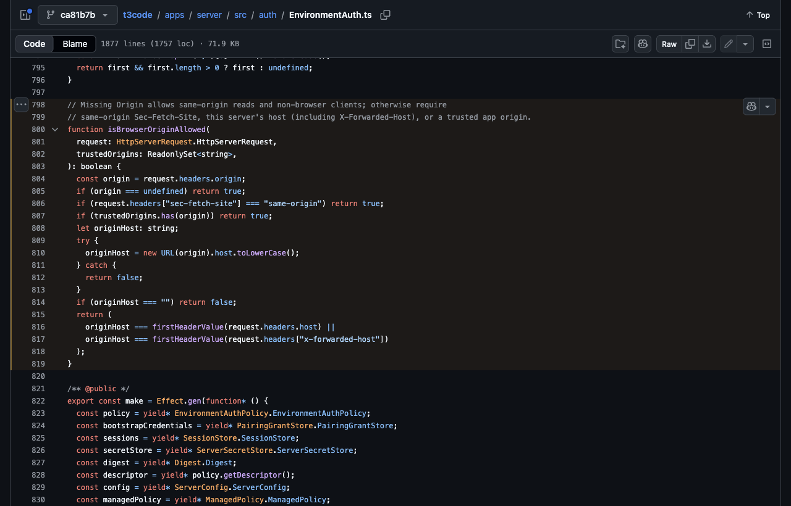
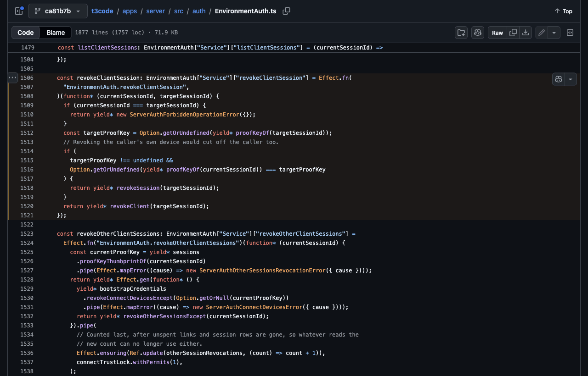

# #19 · `ca81b7b9` Audit Kritis Autentikasi & Eksekusi Repo: Shell LAN Plaintext 30 Hari, Token Tanpa Pencabutan & Paparan `SSH_AUTH_SOCK`

> Verifikasi baris demi baris terhadap `main` HEAD terbaru (`ca81b7b9`, 25 Nov 14:49 CST) mengonfirmasi lima cacat keamanan dan keandalan yang masih aktif: cookie shell `--lan` plaintext berumur 30 hari dengan bypass `Origin` yang hilang, token Bearer 30 hari yang tak dapat dicabut, URL `?wsTicket=` yang dapat diputar ulang, `isIPv4` yang mematikan tunnel `::1`, serta repositori tak tepercaya yang mengeksekusi hook/submodule dengan `SSH_AUTH_SOCK` dan `GITHUB_TOKEN` warisan.

<!-- section:claim -->
## Klaim yang Diajukan

- Setelah rentetan penambalan semalam pada 24–25 November, T3 Code dipresentasikan sebagai sudah dibersihkan dan aman untuk pemakaian rekayasa sehari-hari.
- `SECURITY.md` mendefinisikan sesi bawaan sebagai kendali shell penuh atas pengguna OS, sekaligus mengklaim bahwa batas lokal/LAN dikelola dengan benar.

<!-- section:evidence -->
## Yang Ditunjukkan Bukti

Diverifikasi langsung terhadap commit upstream [`ca81b7b9`](https://github.com/pingdotgg/t3code/commit/ca81b7b97a1c4b91e5ac25768d0f6629f37732fd):

- **1. Cookie shell `--lan` plaintext 30 hari + bypass `Origin` yang hilang:** [`SessionStore.ts#L492-L493`](https://github.com/pingdotgg/t3code/blob/ca81b7b9/apps/server/src/auth/SessionStore.ts#L492-L493) menetapkan TTL sesi bawaan 30 hari (setara dengan akses shell OS penuh menurut `SECURITY.md`). [`PR #37042`](https://github.com/pingdotgg/t3code/pull/37042) hanya menambahkan atribut `Secure` untuk `https:`, sehingga cookie HTTP `t3 up --lan` terkirim dalam teks polos ([`http.ts#L215-L221`](https://github.com/pingdotgg/t3code/blob/ca81b7b9/apps/server/src/auth/http.ts#L215-L221)). Lebih buruk lagi, [`EnvironmentAuth.ts#L798-L806`](https://github.com/pingdotgg/t3code/blob/ca81b7b9/apps/server/src/auth/EnvironmentAuth.ts#L798-L806) mengembalikan `true` setiap kali `Origin` tidak disertakan — jadi siapa pun yang menyadap satu paket LAN saja dapat memutar ulang cookie itu dari skrip non-browser tanpa `Origin` dan memegang akses shell host 30 hari secara senyap.
- **2. Token Bearer non-DPoP 30 hari tanpa pencabutan & tidak ada rute `/logout`:** `/oauth/token` hanya mempersingkat masa berlaku menjadi 1 jam bila bukti DPoP disertakan; selain itu ia menerbitkan **token Bearer 30 hari** tanpa ikatan ([`EnvironmentAuth.ts#L1175-L1186`](https://github.com/pingdotgg/t3code/blob/ca81b7b9/apps/server/src/auth/EnvironmentAuth.ts#L1175-L1186)). Kontrak HTTP mendefinisikan **nol endpoint `/logout`** ([`environmentHttp.ts#L595-L679`](https://github.com/pingdotgg/t3code/blob/ca81b7b9/packages/contracts/src/environmentHttp.ts#L595-L679)), dan `revokeClientSession` secara eksplisit memblokir pencabutan sesi sendiri dengan `current_session_revoke_not_allowed` ([`EnvironmentAuth.ts#L1506-L1511`](https://github.com/pingdotgg/t3code/blob/ca81b7b9/apps/server/src/auth/EnvironmentAuth.ts#L1506-L1511)).
- **3. Token URL `?wsTicket=` 5 menit yang dapat diputar ulang:** Tiket WebSocket berjalan di query string (`?wsTicket=`, sehingga tercatat di log proxy/akses) dengan TTL 5 menit. [`SessionStore.ts#L1086-L1156`](https://github.com/pingdotgg/t3code/blob/ca81b7b9/apps/server/src/auth/SessionStore.ts#L1086-L1156) memeriksa tanda tangan, masa berlaku, audiens, dan pencabutan **tanpa penyimpanan pemutaran ulang `jti` sekali pakai** — memungkinkan pemutaran ulang tak terbatas atas Bearer RPC dan seluruh tiket `media` dalam 5 menit ([`EnvironmentAuth.ts#L1553-L1622`](https://github.com/pingdotgg/t3code/blob/ca81b7b9/apps/server/src/auth/EnvironmentAuth.ts#L1553-L1622)).
- **4. Repositori tak tepercaya berjalan dengan `SSH_AUTH_SOCK` & `GITHUB_TOKEN` penuh:** Penyiapan worktree otomatis menjalankan `git submodule update --init --recursive` setiap kali `.gitmodules` ada ([`GitVcsDriverCore.ts#L6144-L6205`](https://github.com/pingdotgg/t3code/blob/ca81b7b9/apps/server/src/vcs/GitVcsDriverCore.ts#L6144-L6205)); [`VcsProcess.ts#L145-L157`](https://github.com/pingdotgg/t3code/blob/ca81b7b9/apps/server/src/vcs/VcsProcess.ts#L145-L157) tidak menyertakan pengaman global `core.hooksPath=/dev/null`; dan [`ClaudeAdapterV2.ts#L5982-L5985`](https://github.com/pingdotgg/t3code/blob/ca81b7b9/apps/server/src/orchestration-v2/Adapters/ClaudeAdapterV2.ts#L5982-L5985) menjalankan hook `SessionStart` dari `.claude/settings.json` secara sinkron — semuanya mewarisi `process.env` host penuh termasuk `GITHUB_TOKEN` dan `SSH_AUTH_SOCK` (yang radius dampaknya mencakup setiap repo remote dan server produksi yang dapat ditandatangani oleh agen SSH Anda).
- **5. `isIPv4` diam-diam menghancurkan tunnel loopback `::1`:** [`startupAccess.ts#L71-L108`](https://github.com/pingdotgg/t3code/blob/ca81b7b9/apps/server/src/startupAccess.ts#L71-L108) menambahkan `::1` ke allowlist loopback pada baris 39, lalu memanggil `NodeNet.isIPv4` pada baris 73 — salah mengklasifikasikan soket Tailscale Serve dan T3 Connect loopback IPv6 sebagai lalu lintas eksternal dan memanggil `socket.destroy()`.

<!-- section:status -->
## Status Upstream (`ca81b7b9`)

- **Kelima masalah masih aktif belum diperbaiki pada `ca81b7b9`:** Dikonfirmasi baris demi baris pada `main` HEAD (`2026-11-25 14:49 CST`), disertai **0 GitHub Security Advisory yang diterbitkan** (termasuk perbaikan path-traversal senyap pada 20 Nov di `PR #39483`).

<!-- section:visuals -->
## Bukti Visual

<!-- section:sources -->
## Sumber Primer

- [Original X Audit Post — Part 19 (ZH)](https://x.com/realchendahuang/status/2125494234614788390) · [Part 19 (EN)](https://x.com/realchendahuang/status/2125494623640465525)
- [Commit `ca81b7b9`](https://github.com/pingdotgg/t3code/commit/ca81b7b97a1c4b91e5ac25768d0f6629f37732fd) · [PR #37042](https://github.com/pingdotgg/t3code/pull/37042) · [PR #39483](https://github.com/pingdotgg/t3code/pull/39483)
- [`SessionStore.ts#L492-L493`](https://github.com/pingdotgg/t3code/blob/ca81b7b9/apps/server/src/auth/SessionStore.ts#L492-L493) · [`http.ts#L215-L221`](https://github.com/pingdotgg/t3code/blob/ca81b7b9/apps/server/src/auth/http.ts#L215-L221) · [`EnvironmentAuth.ts#L798-L806`](https://github.com/pingdotgg/t3code/blob/ca81b7b9/apps/server/src/auth/EnvironmentAuth.ts#L798-L806)
- [`EnvironmentAuth.ts#L1175-L1186`](https://github.com/pingdotgg/t3code/blob/ca81b7b9/apps/server/src/auth/EnvironmentAuth.ts#L1175-L1186) · [`EnvironmentAuth.ts#L1506-L1511`](https://github.com/pingdotgg/t3code/blob/ca81b7b9/apps/server/src/auth/EnvironmentAuth.ts#L1506-L1511) · [`environmentHttp.ts#L595-L679`](https://github.com/pingdotgg/t3code/blob/ca81b7b9/packages/contracts/src/environmentHttp.ts#L595-L679)
- [`EnvironmentAuth.ts#L1553-L1622`](https://github.com/pingdotgg/t3code/blob/ca81b7b9/apps/server/src/auth/EnvironmentAuth.ts#L1553-L1622) · [`SessionStore.ts#L1086-L1156`](https://github.com/pingdotgg/t3code/blob/ca81b7b9/apps/server/src/auth/SessionStore.ts#L1086-L1156) · [`startupAccess.ts#L71-L108`](https://github.com/pingdotgg/t3code/blob/ca81b7b9/apps/server/src/startupAccess.ts#L71-L108)
- [`GitVcsDriverCore.ts#L6144-L6205`](https://github.com/pingdotgg/t3code/blob/ca81b7b9/apps/server/src/vcs/GitVcsDriverCore.ts#L6144-L6205) · [`VcsProcess.ts#L145-L157`](https://github.com/pingdotgg/t3code/blob/ca81b7b9/apps/server/src/vcs/VcsProcess.ts#L145-L157) · [`ClaudeAdapterV2.ts#L5982-L5985`](https://github.com/pingdotgg/t3code/blob/ca81b7b9/apps/server/src/orchestration-v2/Adapters/ClaudeAdapterV2.ts#L5982-L5985)
- [Deep Technical Dossier 03](../../docs/dossiers/03-antigravity-tos-and-t3connect-relay.md)
