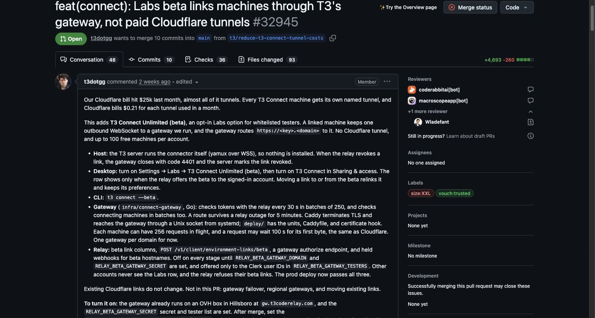

# #05 · T3 Connect: crittografia end-to-end assente e gateway con terminazione TLS in chiaro

> Ogni prompt, file sorgente e flusso di terminale instradato tramite T3 Connect termina in chiaro all'interno dell'infrastruttura controllata da T3, con crittografia end-to-end assente e approvazione dei dispositivi disattivata per default.

<!-- section:claim -->
## Cosa è stato dichiarato

- Il 24 novembre, `@theo` ha affermato che i dati delle conversazioni *"lives on your machine. It never touches any of our servers"* ([`2125191784859115766`](https://x.com/theo/status/2125191784859115766)).
- [`privacy-policy.astro`](https://github.com/pingdotgg/t3code/blob/main/apps/marketing/src/pages/privacy-policy.astro) (`effectiveDate="2026-10-06"`) promette *"encrypted network transport"* senza dichiarare l'assenza di crittografia end-to-end.

<!-- section:evidence -->
## Cosa dimostrano le prove

- **Visibilità in chiaro all'interno del relay di T3 (`ManagedEndpointProvider.ts`):** T3 Connect crea Cloudflare Tunnel all'interno dell'account Cloudflare di proprietà di T3 (`docs/internals/06_t3-connect.md`). Il TLS di trasporto termina all'edge di Cloudflare senza alcuna crittografia del payload da client a client: di conseguenza, collegare una Cloudflare Workers Route espone in chiaro ogni prompt, file e flusso di terminale.
- **Crittografia E2E respinta in quanto fuori ambito (`Issue #32098`):** Quando gli sviluppatori hanno richiesto autenticazione reciproca e crittografia end-to-end, un maintainer ha chiuso [`Issue #32098`](https://github.com/pingdotgg/t3code/issues/32098#issuecomment-6869049926) definendola una modifica troppo estesa; le Discussion `#21286` e `#37831` sono rimaste senza risposta. Il 25 novembre, `@theo` ha dichiarato impossibile la crittografia E2E ([`2125370330244128924`](https://x.com/theo/status/2125370330244128924)).
- **Migrazione al gateway Caddy OVH gestito da T3 (`PR #32945`):** Dopo che le bollette di Cloudflare Tunnel hanno raggiunto i **25.000 $/mese**, `@theo` ha aperto [`PR #32945`](https://github.com/pingdotgg/t3code/pull/32945) per passare a un server OVH di Hillsboro noleggiato da T3 (`gw.t3coderelay.com`), dove l'istanza Caddy di T3 termina il TLS e inoltra il traffico in chiaro tramite un socket Unix a un proxy Go `yamux`, sempre senza crittografia E2E.
- **Approvazione dei dispositivi disattivata per default (`PR #36419`, `settings.ts`):** `requireConnectDeviceApproval` è ancora impostato su `false` per default in [`packages/contracts/src/settings.ts`](https://github.com/pingdotgg/t3code/blob/main/packages/contracts/src/settings.ts) (`lines 1424–1426`). Come riconosce `SECURITY.md`, un account cloud compromesso o una chiave di firma del relay divulgata garantiscono un accesso all'host equivalente a quello di una shell.

<!-- section:status -->
## Stato upstream (`ca81b7b9`)

- **Ancora aperto:** [`PR #42311`](https://github.com/pingdotgg/t3code/pull/42311) ha aggiunto le notifiche di accesso, ma **T3 Connect continua a non avere alcuna crittografia end-to-end**, `requireConnectDeviceApproval` resta `false` per default e `privacy-policy.astro` è invariato dal `2026-10-06`.

<!-- section:visuals -->
## Prove visive

<!-- section:sources -->
## Fonti primarie

- [Indagine originale su X (Parte 5)](https://x.com/realchendahuang/status/2125218189596676555)
- [Commento all'Issue #32098](https://github.com/pingdotgg/t3code/issues/32098#issuecomment-6869049926) · [Discussion #21286](https://github.com/pingdotgg/t3code/discussions/21286) · [Discussion #37831](https://github.com/pingdotgg/t3code/discussions/37831)
- [PR #32945](https://github.com/pingdotgg/t3code/pull/32945) · [PR #36419](https://github.com/pingdotgg/t3code/pull/36419) · [PR #42311](https://github.com/pingdotgg/t3code/pull/42311)
- [`ManagedEndpointProvider.ts`](https://github.com/pingdotgg/t3code/blob/main/infra/relay/src/environments/ManagedEndpointProvider.ts) · [`settings.ts`](https://github.com/pingdotgg/t3code/blob/main/packages/contracts/src/settings.ts) · [`06_t3-connect.md`](https://github.com/pingdotgg/t3code/blob/main/docs/internals/06_t3-connect.md) · [`privacy-policy.astro`](https://github.com/pingdotgg/t3code/blob/main/apps/marketing/src/pages/privacy-policy.astro)
- [Dossier tecnico approfondito 03](../../docs/dossiers/03-antigravity-tos-and-t3connect-relay.md)
