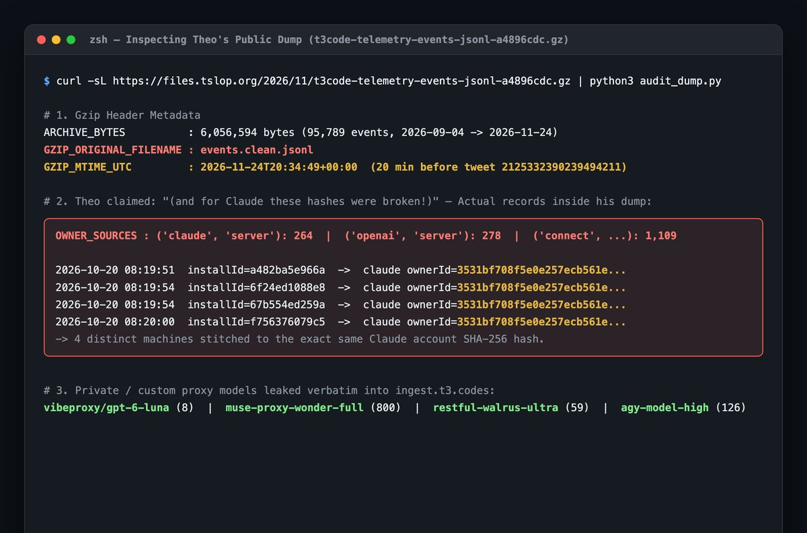

# #11 · Chiarimento del 25 novembre smentito in meno di 2 ore dalle PR notturne e da un dump da 100 MB

> La mattina del 25 novembre, @theo ha rilasciato tre ampie rassicurazioni sulla privacy e pubblicato un dump di telemetria da 100 MB — tutte e tre le dichiarazioni sono state smentite entro due ore dalle PR del suo stesso team e dal dump gzippato stesso.

<!-- section:claim -->
## Cosa è stato dichiarato

Nel suo chiarimento del mattino del 25 novembre ([`2125332390239494211`](https://x.com/theo/status/2125332390239494211)) e nella risposta successiva ([`2125370330244128924`](https://x.com/theo/status/2125370330244128924)), `@theo` ha assicurato agli utenti che:
- T3 Code *"never collected file paths."*
- Le variabili d'ambiente *"always disabled telemetry cleanly."*
- Le installazioni con opt-out non scrivono alcun file di tracciamento locale, e gli hash dei proprietari Claude erano *"broken."*

<!-- section:evidence -->
## Cosa dimostrano le prove

- **Contraddizione 1 — fuga di percorsi assoluti del workspace tramite `git.cwd` (`PR #42450`):** Circa 90 minuti dopo il post, il maintainer core Julius ha fatto il merge della [`PR #42450`](https://github.com/pingdotgg/t3code/pull/42450), ammettendo che le esecuzioni webhook consegnate via relay esportavano interi span di esecuzione verso Axiom — inclusi gli span Git contenenti `git.cwd` (**percorso assoluto completo del workspace, nome utente del sistema operativo e nome del repository**).
- **Contraddizione 2 — opt-out non funzionanti su Windows e macOS (`PR #42376`, `PR #42464`):** La [`PR #42376`](https://github.com/pingdotgg/t3code/pull/42376) ha ammesso che il desktop Windows ignorava le variabili d'ambiente utente salvate `T3CODE_TELEMETRY_ENABLED=false` quando avviato da processi preesistenti. La [`PR #42464`](https://github.com/pingdotgg/t3code/pull/42464) ha ammesso che su macOS/Linux il tracing relay al primo avvio veniva inizializzato prima della scoperta della shell, ignorando gli opt-out in `~/.zshrc` per l'intera sessione.
- **Contraddizione 3 — scritture su disco incondizionate e 264 record Claude attivi in `events.clean.jsonl`:** [`AnalyticsService.ts#L152`](https://github.com/pingdotgg/t3code/blob/main/apps/server/src/telemetry/AnalyticsService.ts#L152) (`line 156` a `ca81b7b9`) chiama ancora `getTelemetryIdentity` incondizionatamente all'avvio, scrivendo l'UUID di installazione locale (`upsertAnonymousId`) prima di verificare `telemetryEnabled`. Nel frattempo, l'header gzip dell'export pubblico di `@theo` (`6,056,594` byte compressi, `95,789` eventi) mostrava un nome file originale `events.clean.jsonl` generato 20 minuti prima della pubblicazione — eppure conteneva ancora **264 record attivi di proprietari Claude** che collegavano **4 macchine separate** (`installId`) a un unico hash SHA-256, insieme a modelli proxy privati riportati alla lettera (`vibeproxy/gpt-6-luna`, `muse-proxy-wonder-full`).

<!-- section:status -->
## Stato upstream (`ca81b7b9`)

- **Parzialmente corretto:** `PR #42450`, `PR #42376` e `PR #42464` sono stati uniti durante la notte.
- **Ancora aperto:** `AnalyticsService.ts:156` scrive ancora l'ID anonimo locale incondizionatamente prima di verificare gli opt-out, e `DesktopShellEnvironment.ts` omette ancora l'inoltro di `T3CODE_OTEL_SDK_DISABLED` e `OTEL_SDK_DISABLED`.

<!-- section:visuals -->
## Prove visive

<!-- section:sources -->
## Fonti primarie

- [Indagine originale su X (Parte 11)](https://x.com/realchendahuang/status/2125394810559426993)
- [Chiarimento di `@theo` del 25 novembre (`2125332390239494211`)](https://x.com/theo/status/2125332390239494211) · [Risposta successiva (`2125370330244128924`)](https://x.com/theo/status/2125370330244128924) · [Dump gzippato pubblico](https://files.tslop.org/2026/11/t3code-telemetry-events-jsonl-a4896cdc.gz)
- [PR #42450](https://github.com/pingdotgg/t3code/pull/42450) · [PR #42376](https://github.com/pingdotgg/t3code/pull/42376) · [PR #42464](https://github.com/pingdotgg/t3code/pull/42464)
- [`AnalyticsService.ts#L152`](https://github.com/pingdotgg/t3code/blob/main/apps/server/src/telemetry/AnalyticsService.ts#L152) · [`DesktopShellEnvironment.ts`](https://github.com/pingdotgg/t3code/blob/main/apps/desktop/src/shell/DesktopShellEnvironment.ts)
- [Dossier tecnico approfondito 01](../../docs/dossiers/01-telemetry-and-gdpr-timeline.md)
