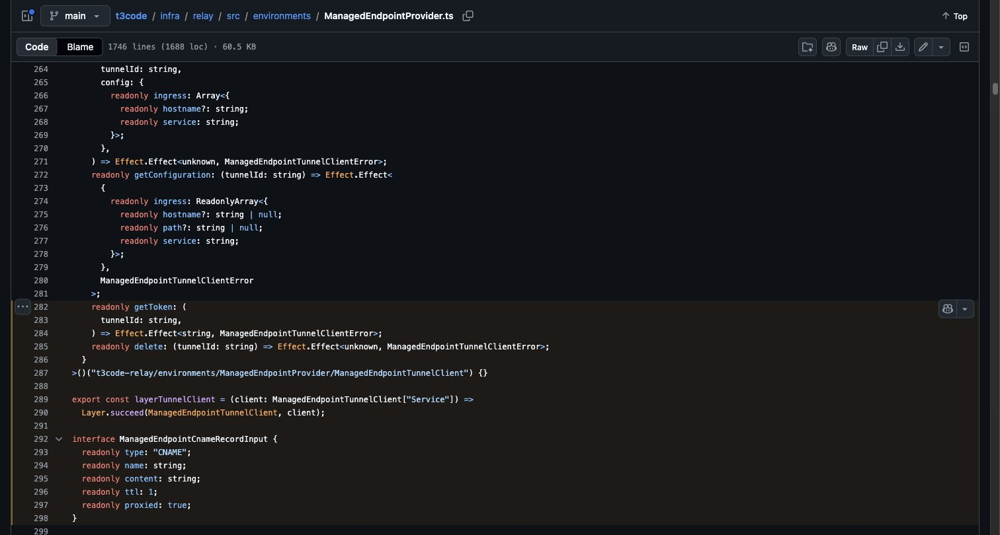

# #05 · T3 Connect：エンドツーエンド暗号化ゼロ、平文TLS終端ゲートウェイ

> T3 Connectを経由するすべてのプロンプト、ソースファイル、ターミナルストリームは、T3が管理するインフラ内で平文のまま終端する——エンドツーエンド暗号化は皆無で、デバイス承認もデフォルトでオフだ。

<!-- section:claim -->
## 主張されていた内容

- 11月24日、`@theo`は会話データについて*「lives on your machine. It never touches any of our servers」*と述べた（[`2125191784859115766`](https://x.com/theo/status/2125191784859115766)）。
- [`privacy-policy.astro`](https://github.com/pingdotgg/t3code/blob/main/apps/marketing/src/pages/privacy-policy.astro)（`effectiveDate="2026-10-06"`）は*「encrypted network transport」*を約束しているが、エンドツーエンド暗号化が存在しないことには触れていない。

<!-- section:evidence -->
## 証拠が示すもの

- **T3のリレー内部における平文の可視性（`ManagedEndpointProvider.ts`）：** T3 Connectは、T3自身のCloudflareアカウント内にCloudflare Tunnelをプロビジョニングする（`docs/internals/06_t3-connect.md`）。トランスポート層のTLSはCloudflareのエッジで終端し、クライアント間のペイロード暗号化は一切ない。つまりCloudflare Workers Routeをアタッチすれば、あらゆるプロンプト、ファイル、ターミナルストリームが平文で露出する。
- **E2E暗号化はスコープ外として却下（`Issue #32098`）：** 開発者たちが相互認証とエンドツーエンド暗号化を求めたところ、メンテナーは変更規模が大きすぎるとして[`Issue #32098`](https://github.com/pingdotgg/t3code/issues/32098#issuecomment-6869049926)をクローズした。Discussions `#21286` と `#37831` は回答が得られなかった。11月25日、`@theo`はE2E暗号化は不可能だと宣言した（[`2125370330244128924`](https://x.com/theo/status/2125370330244128924)）。
- **T3運用のOVH Caddyゲートウェイへの移行（`PR #32945`）：** Cloudflare Tunnelの請求額が**月額25,000ドル**に達した後、`@theo`はT3がレンタルするOVHヒルズボロのサーバー（`gw.t3coderelay.com`）へ移行するため[`PR #32945`](https://github.com/pingdotgg/t3code/pull/32945)をオープンした。そこではT3自身のCaddyインスタンスがTLSを終端し、Unixソケット経由でGo製の`yamux`プロキシへ平文を転送する——やはりE2E暗号化はない。
- **デフォルトでオフのデバイス承認（`PR #36419`、`settings.ts`）：** `requireConnectDeviceApproval`は[`packages/contracts/src/settings.ts`](https://github.com/pingdotgg/t3code/blob/main/packages/contracts/src/settings.ts)（`lines 1424–1426`）において依然として`false`がデフォルトだ。`SECURITY.md`も認めている通り、クラウドアカウントが侵害されるかリレーの署名鍵が漏洩すれば、シェル相当のホストアクセスが得られてしまう。

<!-- section:status -->
## 上流のステータス（`ca81b7b9`）

- **依然として未解決：** [`PR #42311`](https://github.com/pingdotgg/t3code/pull/42311)はサインイン通知を追加したが、**T3 Connectには依然としてエンドツーエンド暗号化が一切なく**、`requireConnectDeviceApproval`はデフォルトで`false`のまま、`privacy-policy.astro`も`2026-10-06`以降変更されていない。

<!-- section:visuals -->
## 視覚的証拠

<!-- section:sources -->
## 一次資料

- [元のX調査（Part 5）](https://x.com/realchendahuang/status/2125218189596676555)
- [Issue #32098 のコメント](https://github.com/pingdotgg/t3code/issues/32098#issuecomment-6869049926) · [Discussion #21286](https://github.com/pingdotgg/t3code/discussions/21286) · [Discussion #37831](https://github.com/pingdotgg/t3code/discussions/37831)
- [PR #32945](https://github.com/pingdotgg/t3code/pull/32945) · [PR #36419](https://github.com/pingdotgg/t3code/pull/36419) · [PR #42311](https://github.com/pingdotgg/t3code/pull/42311)
- [`ManagedEndpointProvider.ts`](https://github.com/pingdotgg/t3code/blob/main/infra/relay/src/environments/ManagedEndpointProvider.ts) · [`settings.ts`](https://github.com/pingdotgg/t3code/blob/main/packages/contracts/src/settings.ts) · [`06_t3-connect.md`](https://github.com/pingdotgg/t3code/blob/main/docs/internals/06_t3-connect.md) · [`privacy-policy.astro`](https://github.com/pingdotgg/t3code/blob/main/apps/marketing/src/pages/privacy-policy.astro)
- [技術深掘りドシエ 03](../../docs/dossiers/03-antigravity-tos-and-t3connect-relay.md)
