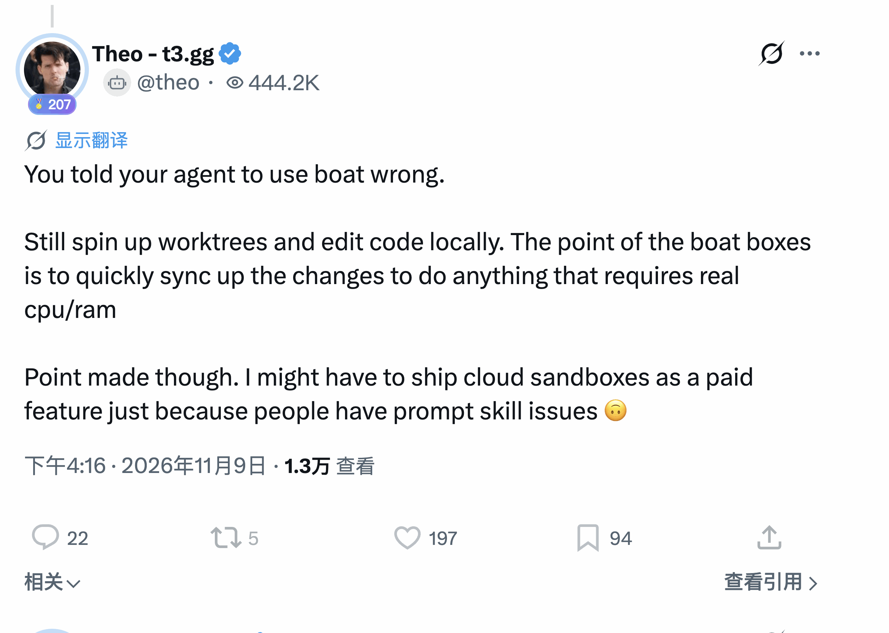

# #06 · エンジェル投資家の利益相反：Vibe Kanban終了の嘲笑とDaytonaとの重なり

> コードの欠陥にとどまらず、@theoのX上の公開投稿は、競合する開発者向けスタートアップへのエンジェル投資家としての立場と、T3 Codeの運営との間の鋭い利益相反を記録している。

<!-- section:claim -->
## 何が主張されていたか

- `@theo`は、コーディングツールやスタートアップのワークフローについて率直で偏りのない見解を共有する、独立した開発者アドボケイトとして自らを日常的に位置づけている。

<!-- section:evidence -->
## 証拠が示すもの

- **Vibe Kanbanへの投資と公の場での嘲笑（`2122201981167251877`）：** 11月16日、`@theo`は自身が**Vibe Kanban**のエンジェル投資家であり貢献者でもあったことを公表した。同氏は、チームがかんばん（kanban）からT3 CodeのUIパターンへと方向転換したものの、資金が尽きてサービスを終了するに至った経緯を語り、そのうえでそのUIを、*"for running out of runway and killing your business."* にうってつけだと公に嘲笑した。
- **Daytonaへの投資とT3の有料サンドボックス（`2119705561679933806` → `2123011578090127499`）：** T3 Code内で有料クラウドサンドボックスの構想を打ち出してから9日後（11月9日）、`@theo`は11月18日、クラウドサンドボックス基盤のスタートアップ**Daytona**の投資家であることを公に認めた。
- **指摘されていないより広範な重複：** 公開記録はまた、`@theo`が競合するAIコーディングツール**Cursor**と**Cline**にエンジェル投資を行っていること、そして同じ市場で製品への批評や集客を狙った比較記事を積極的に発信し続けていることを裏付けている。

<!-- section:status -->
## 上流ステータス（`ca81b7b9`）

- **公開記録：** 3件のXでの開示（`2122201981167251877`、`2119705561679933806`、`2123011578090127499`）はいずれもアーカイブに原文のまま保存されている。

<!-- section:visuals -->
## 視覚的証拠

<!-- section:sources -->
## 一次資料

- [Xでの元調査（第6部）](https://x.com/realchendahuang/status/2125385742243520653)
- [Vibe Kanbanに関する投稿（`2122201981167251877`）](https://x.com/theo/status/2122201981167251877)
- [有料クラウドサンドボックスに関する投稿（`2119705561679933806`）](https://x.com/theo/status/2119705561679933806)
- [Daytona投資家に関する投稿（`2123011578090127499`）](https://x.com/theo/status/2123011578090127499)
- [詳細技術ドシエ 04](../../docs/dossiers/04-business-ledger-sponsors-and-77k-stars.md)
