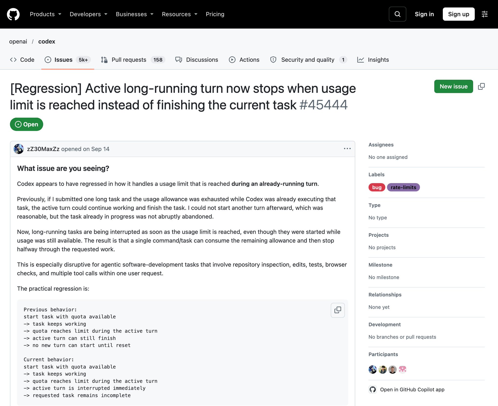

# #17 · スポンサー企業のスタックへの依存、Codex 0%枠の悪用、そして10アカウント`CLIProxyAPI`の偽善

> コンプライアンスを唱え、BANリスクを理由に組み込みのアカウント切り替えを拒みながら、T3 Codeは@theoのYouTubeスポンサー（ClerkとAxiom）をクラウドスタックに組み込んでいる。一方で@theoはCodexの0%枠バグを悪用したと自慢し、T3のFAQから直接リンクされた10アカウントの`CLIProxyAPI`プーリングGistを公開していた。

<!-- section:claim -->
## 何が主張されていたか

- T3 CodeのFAQは、アカウントのプールがプロバイダーの利用規約違反となりBANされるリスクがあると警告し、組み込みのマルチアカウント切り替えを拒否している。
- `@theo`は自身のインフラとワークフローに関する推奨を、中立なエンジニアリング上の選択として日常的に提示している。

<!-- section:evidence -->
## 証拠が示すもの

- **T3 Connectに組み込まれたYouTubeスポンサー企業のスタック：** 2023年5月14日、`@theo`は自身のYouTubeスポンサーを公開で列挙した。`@vercel`、`@clerk`、`@upstash`、`@axiomhq`、`@PlanetScale`である（[`1657488850472804353`](https://x.com/theo/status/1657488850472804353)）。**Clerk**、**Axiom**、**PlanetScale**は、T3 Code内部の中核的なクラウド認証、30日間のIPタグ付きログ、リレー用データベースのスタックを構成している。VercelのCEO `@rauchg`は、VercelがスポンサーしたYouTuberはTheoただ一人だと認め（[`1776260839965863965`](https://x.com/rauchg/status/1776260839965863965)）、`@theo`も、スポンサー契約には競合他社のプロモーションを制限する独占条項が含まれていたと認めた（[動画](https://www.youtube.com/watch?v=uv179CTAK-w)）。
- **Codex 0%枠の悪用と削除（`openai/codex#45444`）：** 2026年8月21日、`@theo`はCodexの0%使用上限を超えて**800ドル以上**を引き出したと自慢し、T3の従業員`@maria_rcks`は同じ隙間を突く*Endless*を公開した。両者は反発を受けて8月22日に投稿を削除し（[`2090972426876129658`](https://x.com/maria_rcks/status/2090972426876129658)）、ちょうどその頃、OpenAIは全一般ユーザーを対象に0%枠のターン打ち切りを厳格化した（[`openai/codex#45444`](https://github.com/openai/codex/issues/45444)）。
- **公式FAQにリンクされた10アカウントの`CLIProxyAPI` Gist（`555%`枠）：** 2026年10月、`@theo`は452スターのGistを公開し（[`59a521d2ee8d70aaf90e280c175072af`](https://gist.github.com/t3dotgg/59a521d2ee8d70aaf90e280c175072af)）、**7つのClaudeアカウントと3つのCodexアカウント**をプールし（12台以上のマシンにまたがる合計`555%`の枠）、`$200`のプランで`$14,662`／`$15k`の収益（`1.1M`リクエスト）を誇り、Grok Botと`$100`のClaudeルーティングのチュートリアルまで公開した。一方、T3自身の[`docs/user/faq.md`](https://github.com/pingdotgg/t3code/blob/main/docs/user/faq.md#can-i-add-a-bunch-of-accounts-for-one-provider)は、BANに関する免責文（*"Early apologies if it gets you banned 💀"*）のすぐ下で、そのGistへ直接リンクしている。

<!-- section:status -->
## 上流の状況（`ca81b7b9`）

- **公開記録：** Clerk、Axiom、PlanetScale、および10アカウントの`CLIProxyAPI` GistへのFAQリンクは、リポジトリ内に文書化されたまま残っている。

<!-- section:visuals -->
## 視覚的証拠

<!-- section:sources -->
## 一次資料

- [X上の原調査（Part 17）](https://x.com/realchendahuang/status/2125411353393553744)
- [2023年のスポンサー一覧（`1657488850472804353`）](https://x.com/theo/status/1657488850472804353) · [Vercel CEO（`1776260839965863965`）](https://x.com/rauchg/status/1776260839965863965) · [スポンサー独占に関する動画](https://www.youtube.com/watch?v=uv179CTAK-w)
- [`@maria_rcks`の投稿（`2090972426876129658`）](https://x.com/maria_rcks/status/2090972426876129658) · [`openai/codex#45444`](https://github.com/openai/codex/issues/45444)
- [`CLIProxyAPI` Gist（`59a521d2ee8d70aaf90e280c175072af`）](https://gist.github.com/t3dotgg/59a521d2ee8d70aaf90e280c175072af) · [`docs/user/faq.md`のマルチアカウントの節](https://github.com/pingdotgg/t3code/blob/main/docs/user/faq.md#can-i-add-a-bunch-of-accounts-for-one-provider)
- [Deep Technical Dossier 04](../../docs/dossiers/04-business-ledger-sponsors-and-77k-stars.md)
