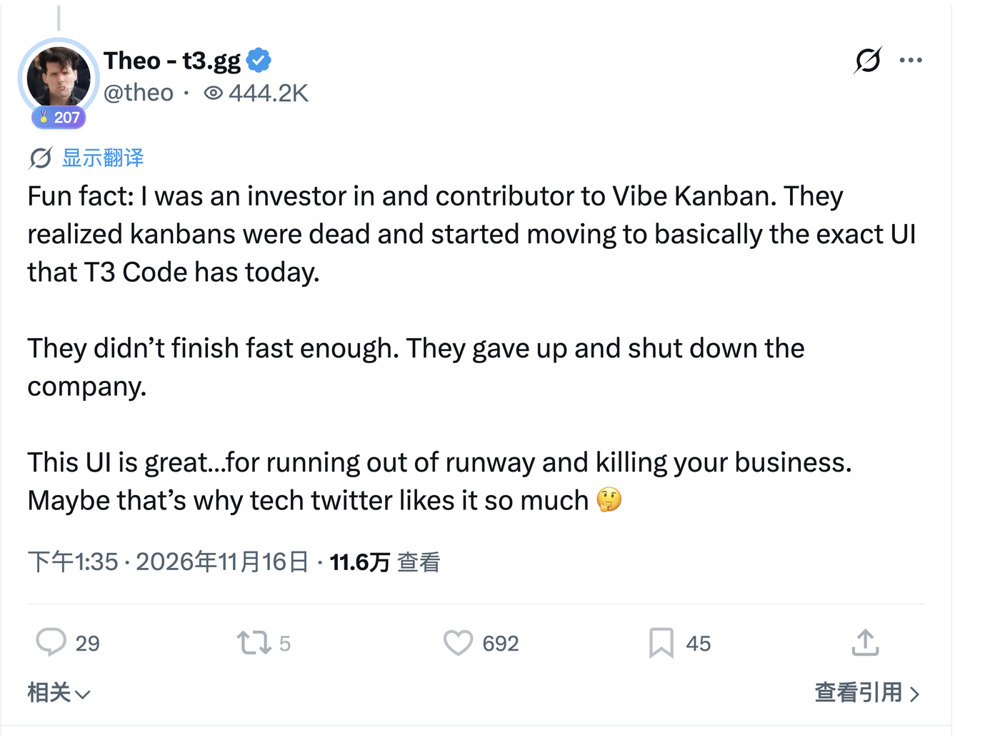

# #06 · 엔젤 투자자 이해충돌: Vibe Kanban 셧다운 조롱과 Daytona 중복 투자

> 코드 결함을 넘어서, @theo의 공개 X 게시물들은 경쟁 개발자 스타트업에 대한 그의 엔젤 투자자 역할과 T3 Code 운영 사이의 첨예한 이해충돌을 기록해 둔다.

<!-- section:claim -->
## 주장된 내용

- `@theo`는 자신을 독립적인 개발자 옹호자로 내세우며, 코딩 도구와 스타트업 워크플로에 대해 솔직하고 편향 없는 견해를 공유한다고 늘 말해 왔다.

<!-- section:evidence -->
## 증거가 보여주는 것

- **Vibe Kanban 투자와 공개 조롱 (`2122201981167251877`):** 11월 16일, `@theo`는 자신이 **Vibe Kanban**의 엔젤 투자자이자 기여자였음을 공개적으로 밝혔다. 그는 팀이 칸반에서 T3 Code의 UI 패턴으로 방향을 틀었다가 런웨이가 바닥나 셧다운했다고 회고한 뒤, 그 UI를 두고 *"for running out of runway and killing your business."* 라고 공개적으로 조롱했다.
- **Daytona 투자와 T3 유료 샌드박스의 병행 (`2119705561679933806` → `2123011578090127499`):** T3 Code 안에서 유료 클라우드 샌드박스를 언급한 지(11월 9일) 9일 뒤인 11월 18일, `@theo`는 클라우드 샌드박스 인프라 스타트업 **Daytona**의 투자자임을 공개적으로 확인했다.
- **더 넓게 드러난 미고지 이해충돌:** 공개 기록은 또한 `@theo`가 경쟁 AI 코딩 도구인 **Cursor**와 **Cline**에 엔젤 투자를 보유한 상태에서, 같은 시장을 대상으로 제품 비평과 트래픽 유도용 비교 콘텐츠를 활발히 게시하고 있음을 확인해 준다.

<!-- section:status -->
## 업스트림 현황 (`ca81b7b9`)

- **공개 기록:** 세 건의 X 공개 발언(`2122201981167251877`, `2119705561679933806`, `2123011578090127499`)은 모두 아카이브에 원문 그대로 보존되어 있다.

<!-- section:visuals -->
## 시각 자료

<!-- section:sources -->
## 1차 출처

- [X 원본 조사 (파트 6)](https://x.com/realchendahuang/status/2125385742243520653)
- [Vibe Kanban 게시물 (`2122201981167251877`)](https://x.com/theo/status/2122201981167251877)
- [유료 클라우드 샌드박스 게시물 (`2119705561679933806`)](https://x.com/theo/status/2119705561679933806)
- [Daytona 투자자 게시물 (`2123011578090127499`)](https://x.com/theo/status/2123011578090127499)
- [심층 기술 문서 04](../../docs/dossiers/04-business-ledger-sponsors-and-77k-stars.md)
