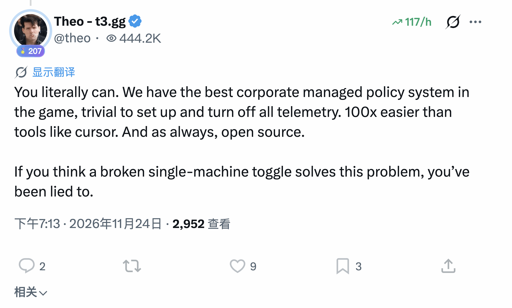

# #07 · 관리형 정책의 모순: 문서로 확인된 네 가지 텔레메트리 사각지대

> @theo는 T3 Code가 "best corporate managed policy system"을 갖추고 있어 "trivial to turn off all telemetry"하다고 주장했다 — 그러나 이는 T3 Code 자체의 `docs/user/telemetry.md`와 `docs/user/managed-policy.md`에 의해 정면으로 반박된다.

<!-- section:claim -->
## 무엇이 주장되었나

- 11월 24일 19:13 CST, `@theo`는 사용자 옵트아웃 토글이 없다는 지적을 일축하며 이렇게 말했다: *"We have the best corporate managed policy system in the game, trivial to set up and turn off all telemetry. 100x easier than tools like cursor."* ([`2125186071357251715`](https://x.com/theo/status/2125186071357251715)).
- 30분 후, 그는 대화 데이터가 *"never touches any of our servers"*라고 덧붙였다 ([`2125191784859115766`](https://x.com/theo/status/2125191784859115766)).

<!-- section:evidence -->
## 증거가 보여주는 것

T3 Code 자체의 공식 문서([`docs/user/managed-policy.md`](https://github.com/pingdotgg/t3code/blob/main/docs/user/managed-policy.md)와 [`docs/user/telemetry.md`](https://github.com/pingdotgg/t3code/blob/main/docs/user/telemetry.md))에는 네 가지 구체적인 사각지대가 기록되어 있다:

- **관리자 전용 배포(개인 UI 스위치 없음):** 데스크톱 사용자에게는 설정 토글이 없다. 관리형 정책은 MDM/GPO 또는 관리자가 보호하는 OS 경로(`/Library/Application Support/T3Code/policy.json`, `C:\Program Files\T3Code\policy.json` / `HKLM\SOFTWARE\Policies\T3Tools\T3Code`, 또는 `/etc/t3code/policy.json`)를 요구하며, 비관리자 데스크톱 사용자는 전혀 접근할 수 없다.
- **호스팅 웹 앱(`app.t3.codes`)이 정책을 무시:** 브라우저 앱은 서버 환경 변수와 관리형 정책을 무시하고, 트레이싱이 포함된 빌드에서는 연결 트레이스를 내보내며, *"has no relay tracing toggle"*이다.
- **모바일 앱은 서버 정책의 범위 밖:** 공식 문서는 서버 환경 변수와 관리형 정책이 *"do not disable mobile tracing"*임을 확인해 준다.
- **`Publish agent activity`가 옵트아웃을 무시:** 프로젝트 제목, 스레드 제목, 모델 이름, 실시간 상태를 T3 Connect로 업로드하며, 문서에는 명시되어 있다: *"The telemetry opt-out does not disable it."* 게다가 실패한 Axiom 스팬/크래시 로그는 *"can quote a value the app was handling"*할 수 있고, `Agent feedback`은 최대 16KB의 대화 메시지를 첨부할 수 있다.

<!-- section:status -->
## 업스트림 상태 (`ca81b7b9`)

- **여전히 미해결:** 밤사이 [`PR #42415`](https://github.com/pingdotgg/t3code/pull/42415)가 앱 내 모바일 트레이스 토글을 추가했지만, 관리형 정책은 여전히 모바일 트레이싱을 비활성화할 수 없고, 호스팅된 `app.t3.codes`에는 여전히 옵트아웃 토글이 전혀 없으며, `Publish agent activity`는 여전히 텔레메트리 옵트아웃을 무시하고, 데스크톱 설정 UI 토글도 존재하지 않는다.

<!-- section:visuals -->
## 시각적 증거

<!-- section:sources -->
## 1차 출처

- [원본 X 조사 (7부)](https://x.com/realchendahuang/status/2125391659492081947)
- [`docs/user/telemetry.md`](https://github.com/pingdotgg/t3code/blob/main/docs/user/telemetry.md) · [`docs/user/managed-policy.md`](https://github.com/pingdotgg/t3code/blob/main/docs/user/managed-policy.md)
- [`@theo`의 관리형 정책 주장 (`2125186071357251715`)](https://x.com/theo/status/2125186071357251715) · [`@theo`의 "never touches servers" (`2125191784859115766`)](https://x.com/theo/status/2125191784859115766)
- [PR #42415](https://github.com/pingdotgg/t3code/pull/42415) · [심층 기술 자료 01](../../docs/dossiers/01-telemetry-and-gdpr-timeline.md)
