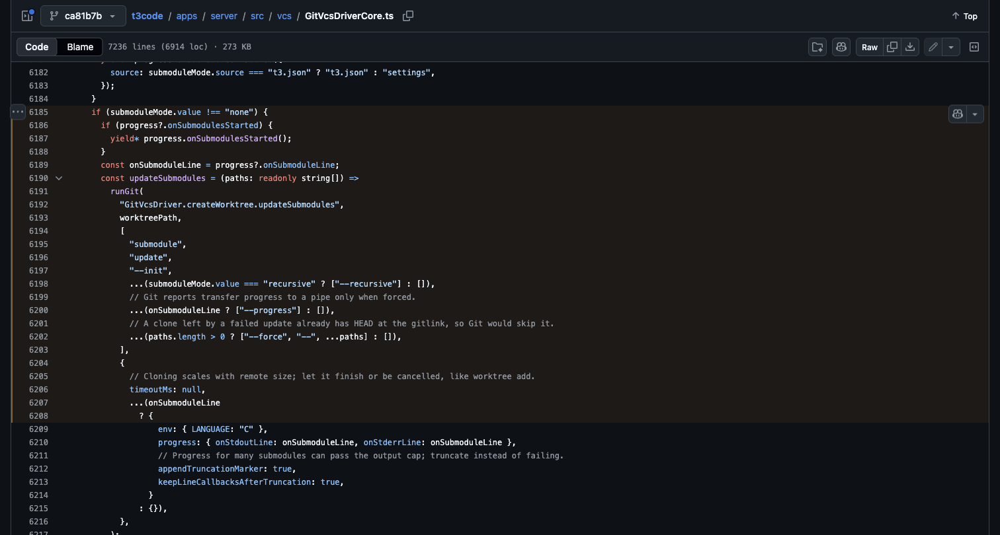

# #19 · `ca81b7b9` 인증·저장소 실행 긴급 감사: 30일간 평문으로 흐르는 LAN 셸, 취소 불가 토큰, 그리고 `SSH_AUTH_SOCK` 노출

> 최신 `main` HEAD(`ca81b7b9`, 11월 25일 14:49 CST)를 한 줄씩 검증한 결과, 현재 활동 중인 보안·신뢰성 결함 다섯 가지가 확인됐다: `Origin` 부재 시 우회되는 30일 평문 `--lan` 셸 쿠키, 취소 불가능한 30일 Bearer 토큰, 재사용 가능한 `?wsTicket=` URL, `::1` 터널을 무력화하는 `isIPv4`, 그리고 상속된 `SSH_AUTH_SOCK`·`GITHUB_TOKEN`으로 훅과 서브모듈을 실행하는 신뢰할 수 없는 저장소.

<!-- section:claim -->
## 무엇을 주장했나

- 11월 24~25일 밤샘 패치 작업 이후, T3 Code는 정리되어 일상 엔지니어링에 안전한 상태로 제시됐다.
- `SECURITY.md`는 기본 세션을 OS 사용자 권한의 완전한 셸 제어로 규정하면서, 로컬/LAN 경계는 적절히 관리된다고 주장한다.

<!-- section:evidence -->
## 증거가 보여주는 것

업스트림 커밋 [`ca81b7b9`](https://github.com/pingdotgg/t3code/commit/ca81b7b97a1c4b91e5ac25768d0f6629f37732fd)를 직접 검증했다:

- **1. 30일 평문 `--lan` 셸 쿠키 + `Origin` 부재 우회:** [`SessionStore.ts#L492-L493`](https://github.com/pingdotgg/t3code/blob/ca81b7b9/apps/server/src/auth/SessionStore.ts#L492-L493)은 기본 세션 TTL을 30일로 설정한다(`SECURITY.md` 기준 OS 셸 전체 접근과 동일). [`PR #37042`](https://github.com/pingdotgg/t3code/pull/37042)는 `https:`인 경우에만 `Secure` 속성을 추가했기에, `t3 up --lan` HTTP 쿠키는 평문으로 전송된다([`http.ts#L215-L221`](https://github.com/pingdotgg/t3code/blob/ca81b7b9/apps/server/src/auth/http.ts#L215-L221)). 더 나쁜 것은 [`EnvironmentAuth.ts#L798-L806`](https://github.com/pingdotgg/t3code/blob/ca81b7b9/apps/server/src/auth/EnvironmentAuth.ts#L798-L806)이 `Origin`이 생략될 때마다 `true`를 반환한다는 점이다. 즉 LAN 패킷 하나만 스니핑한 사람이라면 누구든 `Origin` 없이 비브라우저 스크립트로 쿠키를 재전송해 30일간 호스트 셸 접근을 조용히 확보할 수 있다.
- **2. 취소 불가능한 30일 비-DPoP Bearer 토큰 + `/logout` 라우트 부재:** `/oauth/token`은 DPoP 증명이 제공될 때만 수명을 1시간으로 단축하며, 그렇지 않으면 바인딩되지 않은 **30일 Bearer 토큰**을 발급한다([`EnvironmentAuth.ts#L1175-L1186`](https://github.com/pingdotgg/t3code/blob/ca81b7b9/apps/server/src/auth/EnvironmentAuth.ts#L1175-L1186)). HTTP 계약에는 **`/logout` 엔드포인트가 전혀 없으며**([`environmentHttp.ts#L595-L679`](https://github.com/pingdotgg/t3code/blob/ca81b7b9/packages/contracts/src/environmentHttp.ts#L595-L679)), `revokeClientSession`은 `current_session_revoke_not_allowed`로 자기 세션 폐기를 명시적으로 차단한다([`EnvironmentAuth.ts#L1506-L1511`](https://github.com/pingdotgg/t3code/blob/ca81b7b9/apps/server/src/auth/EnvironmentAuth.ts#L1506-L1511)).
- **3. 재사용 가능한 5분짜리 `?wsTicket=` URL 토큰:** WebSocket 티켓은 5분 TTL로 쿼리 문자열(`?wsTicket=`, 프록시/액세스 로그에 남는다)을 통해 이동한다. [`SessionStore.ts#L1086-L1156`](https://github.com/pingdotgg/t3code/blob/ca81b7b9/apps/server/src/auth/SessionStore.ts#L1086-L1156)은 서명, 만료, 대상, 폐기 여부를 확인하지만 **일회용 `jti` 재전송 저장소가 없어**, 5분 이내라면 Bearer RPC와 모든 `media` 티켓을 무제한으로 재전송할 수 있다([`EnvironmentAuth.ts#L1553-L1622`](https://github.com/pingdotgg/t3code/blob/ca81b7b9/apps/server/src/auth/EnvironmentAuth.ts#L1553-L1622)).
- **4. 완전한 `SSH_AUTH_SOCK`·`GITHUB_TOKEN`으로 실행되는 신뢰할 수 없는 저장소:** 워크트리 설정은 `.gitmodules`가 존재하면 자동으로 `git submodule update --init --recursive`를 실행하며([`GitVcsDriverCore.ts#L6144-L6205`](https://github.com/pingdotgg/t3code/blob/ca81b7b9/apps/server/src/vcs/GitVcsDriverCore.ts#L6144-L6205)), [`VcsProcess.ts#L145-L157`](https://github.com/pingdotgg/t3code/blob/ca81b7b9/apps/server/src/vcs/VcsProcess.ts#L145-L157)은 전역 `core.hooksPath=/dev/null` 가드를 빠뜨리고 있다. 또한 [`ClaudeAdapterV2.ts#L5982-L5985`](https://github.com/pingdotgg/t3code/blob/ca81b7b9/apps/server/src/orchestration-v2/Adapters/ClaudeAdapterV2.ts#L5982-L5985)는 `.claude/settings.json`의 `SessionStart` 훅을 동기적으로 실행한다. 이 모두가 `GITHUB_TOKEN`과 `SSH_AUTH_SOCK`(그 영향 범위는 당신의 SSH 에이전트가 서명할 수 있는 모든 원격 저장소와 프로덕션 서버에 걸친다)을 포함한 호스트 `process.env` 전체를 상속한다.
- **5. `::1` 루프백 터널을 조용히 파괴하는 `isIPv4`:** [`startupAccess.ts#L71-L108`](https://github.com/pingdotgg/t3code/blob/ca81b7b9/apps/server/src/startupAccess.ts#L71-L108)은 39번째 줄에서 `::1`을 루프백 허용 목록에 추가한 뒤, 73번째 줄에서 `NodeNet.isIPv4`를 호출한다. 그 결과 IPv6 루프백 Tailscale Serve와 T3 Connect 소켓이 외부 트래픽으로 잘못 분류되어 `socket.destroy()`가 호출된다.

<!-- section:status -->
## 업스트림 현황 (`ca81b7b9`)

- **`ca81b7b9` 기준 다섯 가지 이슈 모두 여전히 미수정:** `main` HEAD(`2026-11-25 14:49 CST`)에서 한 줄씩 확인했으며, **공개된 GitHub Security Advisory는 0건**이다(11월 20일 `PR #39483`의 조용한 경로 탐색 수정 포함).

<!-- section:visuals -->
## 시각 증거

<!-- section:sources -->
## 1차 출처

- [원본 X 감사 게시물 — Part 19 (ZH)](https://x.com/realchendahuang/status/2125494234614788390) · [Part 19 (EN)](https://x.com/realchendahuang/status/2125494623640465525)
- [커밋 `ca81b7b9`](https://github.com/pingdotgg/t3code/commit/ca81b7b97a1c4b91e5ac25768d0f6629f37732fd) · [PR #37042](https://github.com/pingdotgg/t3code/pull/37042) · [PR #39483](https://github.com/pingdotgg/t3code/pull/39483)
- [`SessionStore.ts#L492-L493`](https://github.com/pingdotgg/t3code/blob/ca81b7b9/apps/server/src/auth/SessionStore.ts#L492-L493) · [`http.ts#L215-L221`](https://github.com/pingdotgg/t3code/blob/ca81b7b9/apps/server/src/auth/http.ts#L215-L221) · [`EnvironmentAuth.ts#L798-L806`](https://github.com/pingdotgg/t3code/blob/ca81b7b9/apps/server/src/auth/EnvironmentAuth.ts#L798-L806)
- [`EnvironmentAuth.ts#L1175-L1186`](https://github.com/pingdotgg/t3code/blob/ca81b7b9/apps/server/src/auth/EnvironmentAuth.ts#L1175-L1186) · [`EnvironmentAuth.ts#L1506-L1511`](https://github.com/pingdotgg/t3code/blob/ca81b7b9/apps/server/src/auth/EnvironmentAuth.ts#L1506-L1511) · [`environmentHttp.ts#L595-L679`](https://github.com/pingdotgg/t3code/blob/ca81b7b9/packages/contracts/src/environmentHttp.ts#L595-L679)
- [`EnvironmentAuth.ts#L1553-L1622`](https://github.com/pingdotgg/t3code/blob/ca81b7b9/apps/server/src/auth/EnvironmentAuth.ts#L1553-L1622) · [`SessionStore.ts#L1086-L1156`](https://github.com/pingdotgg/t3code/blob/ca81b7b9/apps/server/src/auth/SessionStore.ts#L1086-L1156) · [`startupAccess.ts#L71-L108`](https://github.com/pingdotgg/t3code/blob/ca81b7b9/apps/server/src/startupAccess.ts#L71-L108)
- [`GitVcsDriverCore.ts#L6144-L6205`](https://github.com/pingdotgg/t3code/blob/ca81b7b9/apps/server/src/vcs/GitVcsDriverCore.ts#L6144-L6205) · [`VcsProcess.ts#L145-L157`](https://github.com/pingdotgg/t3code/blob/ca81b7b9/apps/server/src/vcs/VcsProcess.ts#L145-L157) · [`ClaudeAdapterV2.ts#L5982-L5985`](https://github.com/pingdotgg/t3code/blob/ca81b7b9/apps/server/src/orchestration-v2/Adapters/ClaudeAdapterV2.ts#L5982-L5985)
- [심층 기술 문서 03](../../docs/dossiers/03-antigravity-tos-and-t3connect-relay.md)
