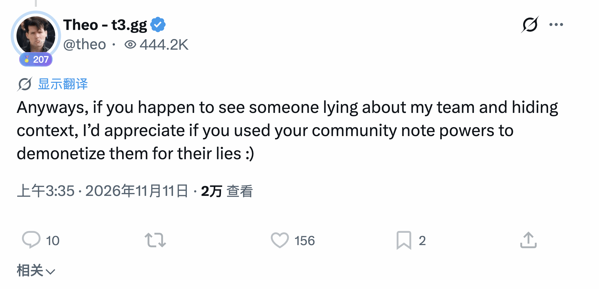

# #10 · Publiek `@bot`-fork-scraping, spot met concurrenten & onderdrukking van critici

> Terwijl hij rivalen bespotte omdat ze UI-patronen kopieerden, antwoordde @theo publiekelijk "Okay I'm stealing this" op de fork van een ontwikkelaar en stuurde 30 seconden later `@bot` eropaf om haar code te scrapen — terwijl hij auto-blockers inzette en volgers opriep critici te demonetiseren.

<!-- section:claim -->
## Wat er werd beweerd

- Op 24 november bespotte `@theo` publiekelijk Claude Code Desktop omdat het sidebar-tabs toevoegde ([`2124987957803446311`](https://x.com/theo/status/2124987957803446311)) en stelde hij zichzelf voor als verdediger van origineel productwerk tegen knockoffs.

<!-- section:evidence -->
## Wat het bewijs laat zien

- **Publiek `@bot`-fork-scraping in 30 seconden (`2119240810202034645`):** Op 8 november, nadat de onafhankelijke ontwikkelaar `@MiaAI_lab` een zelfgebouwde fork-functie had gedeeld, antwoordde `@theo` *"Okay I'm stealing this"* en tagde hij 30 seconden later publiekelijk zijn eigen automatiseringsbot (`@bot`) in de reacties om haar fork op te sporen en met Opus 5.5 naar `beebox` te scrapen.
- **Rivale functies klonen op verzoek (`2121017649652269120`):** Op 13 november, toen een gebruiker functies in concurrerende tools prees, stuurde `@theo` opnieuw `@bot` eropaf in publieke reacties om die mogelijkheden rechtstreeks in T3 Code te klonen.
- **Critici demonetiseren & geautomatiseerd massaal blokkeren:** Tegen critici op X moedigde `@theo` volgers aan om specifiek Community Notes in te dienen met als doel hen te *"demonetize them"* ([`2120238923884696025`](https://x.com/theo/status/2120238923884696025)), en bevestigde hij publiekelijk dat hij een geautomatiseerde X-blockerbot beheerde die op 24 november alleen al ongeveer 100 accounts blokkeerde ([`2125077510941802509`](https://x.com/theo/status/2125077510941802509)).

<!-- section:status -->
## Upstream-status (`ca81b7b9`)

- **Publiekelijk vastgelegd:** Alle publieke `@bot`-scrapingreacties, uitspraken over Community Notes en bevestigingen van de auto-blocker blijven gedocumenteerd in het archief.

<!-- section:visuals -->
## Visueel bewijs

<!-- section:sources -->
## Primaire bronnen

- [Oorspronkelijk X-onderzoek (deel 10)](https://x.com/realchendahuang/status/2125393641665671593)
- [`@bot`-fork-scraping (`2119240810202034645`)](https://x.com/theo/status/2119240810202034645) · [Rivale tools klonen (`2121017649652269120`)](https://x.com/theo/status/2121017649652269120) · [Spot met Claude Desktop (`2124987957803446311`)](https://x.com/theo/status/2124987957803446311)
- [Oproep tot demonetisering (`2120238923884696025`)](https://x.com/theo/status/2120238923884696025) · [Bevestiging auto-blocker (`2125077510941802509`)](https://x.com/theo/status/2125077510941802509)
- [Deep Technical Dossier 05](../../docs/dossiers/05-governance-trademark-and-history.md)
