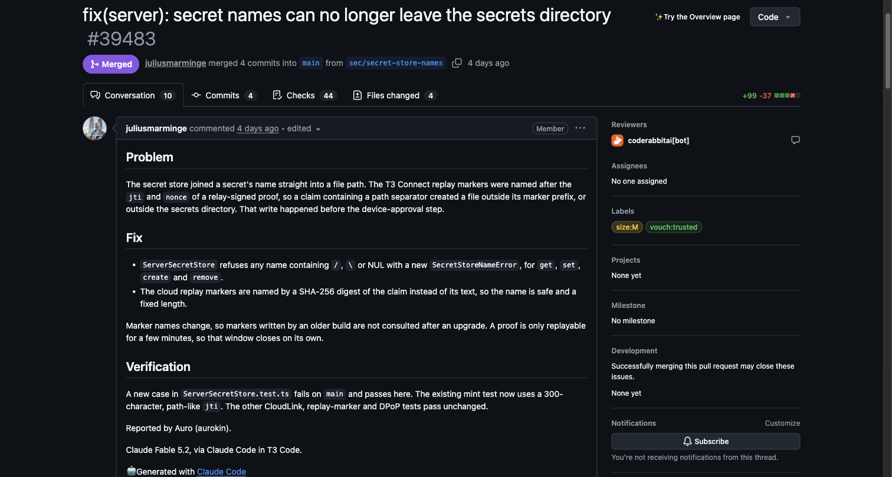

# #13 · Zero doradztw bezpieczeństwa GitHub, ciche łatki o wysokiej wadze i pośpiesznie przygotowany `SECURITY.md`

> Odpierając na X zarzuty chińskich audytorów kodu źródłowego, T3 Code po cichu scalił poprawki poważnych luk — w tym path traversal w magazynie sekretów, wycieki tokenów między domenami i wykonywanie poleceń z niezaufanych repozytoriów — pozostawiając liczbę opublikowanych doradztw bezpieczeństwa GitHub na poziomie 0.

<!-- section:claim -->
## Co zostało twierdzone

- 24 listopada `@theo` odrzucił na X chińskojęzyczne audyty techniczne jako pochodzące od *„the biggest fucking cesspit”* i obraził deweloperów, którzy je czytali ([`2125177503526588877`](https://x.com/theo/status/2125177503526588877)).
- Pośpieszne wersje `SECURITY.md` (`PR #38812`, `PR #41942`) przedstawiały szeroki dostęp do hosta i niezaszyfrowany transport jako akceptowalne, zamierzone granice.

<!-- section:evidence -->
## Co pokazują dowody

- **Zero opublikowanych doradztw bezpieczeństwa (`0`):** Na stan `ca81b7b9` strona [GitHub Security Advisories](https://github.com/pingdotgg/t3code/security/advisories) repozytorium `pingdotgg/t3code` wymienia **zero** opublikowanych doradztw — pozostawiając dotychczasowych użytkowników aplikacji desktopowej i serwera bez jakichkolwiek formalnych alertów CVE czy ostrzeżeń o aktualizacji.
- **Cicho naprawione luki o wysokiej wadze:**
  - [`PR #39483`](https://github.com/pingdotgg/t3code/pull/39483): path traversal w `ServerSecretStore` przez `jti`/`nonce` przekaźnika przed zatwierdzeniem urządzenia.
  - [`PR #41756`](https://github.com/pingdotgg/t3code/pull/41756): wycieki tokenów enterprise GitHub/GitLab między domenami.
  - [`PR #41757`](https://github.com/pingdotgg/t3code/pull/41757) i [`PR #42386`](https://github.com/pingdotgg/t3code/pull/42386): izolacja podglądu przeglądarki w aplikacji desktopowej bez sandboxa oraz potwierdzanie poleceń układu worktree.
  - [`PR #42413`](https://github.com/pingdotgg/t3code/pull/42413): uprawnienia pliku tokena Clerk w aplikacji desktopowej tylko dla właściciela.
  - [`PR #42504`](https://github.com/pingdotgg/t3code/pull/42504): łatka licząca ~3 000 linii, która wreszcie dodaje monity potwierdzenia przed wykonaniem poleceń z niezaufanych konfiguracji repozytoriów (obok wcześniejszych cichych poprawek `#22190`, `#37823`, `#39464`, `#39480`, `#40133`, `#41886`).
- **Otwarte lokalne defekty bezpieczeństwa:** [`Issue #26489`](https://github.com/pingdotgg/t3code/issues/26489) (zewnętrzny path traversal/symlinki) i [`PR #30997`](https://github.com/pingdotgg/t3code/pull/30997) (Windows `externalLauncher.ts` uruchamiający `powershell.exe -ExecutionPolicy Bypass -EncodedCommand <base64>`, oznaczony przez AVG/Avast jako `IDP.HELU.PSE96`) pozostają niescalone.
- **`SECURITY.md` zawęża odpowiedzialność zamiast utwardzać architekturę:** jawnie deklaruje ogólnosystemowe `filesystem:read` poza workspace'ami, czysty HTTP na iOS/LAN oraz pełne przejęcie maszyny hosta przez skompromitowany klucz podpisujący przekaźnika jako *zamierzone granice projektu*.

<!-- section:status -->
## Status upstream (`ca81b7b9`)

- **Nadal otwarte:** opublikowane doradztwa bezpieczeństwa GitHub pozostają na poziomie **0**; `Issue #26489` i `PR #30997` pozostają nienaprawione; `SECURITY.md` wciąż klasyfikuje ogólnosystemowe odczyty i czysty HTTP jako zamierzone zachowanie.

<!-- section:visuals -->
## Dowody wizualne

<!-- section:sources -->
## Źródła pierwotne

- [Original X Investigation (Part 13)](https://x.com/realchendahuang/status/2125395980354994414)
- [GitHub Security Advisories (0 published)](https://github.com/pingdotgg/t3code/security/advisories) · [`SECURITY.md`](https://github.com/pingdotgg/t3code/blob/main/SECURITY.md)
- [PR #39483](https://github.com/pingdotgg/t3code/pull/39483) · [PR #41756](https://github.com/pingdotgg/t3code/pull/41756) · [PR #41757](https://github.com/pingdotgg/t3code/pull/41757) · [PR #42386](https://github.com/pingdotgg/t3code/pull/42386) · [PR #42413](https://github.com/pingdotgg/t3code/pull/42413) · [PR #42504](https://github.com/pingdotgg/t3code/pull/42504)
- [Issue #26489](https://github.com/pingdotgg/t3code/issues/26489) · [PR #30997](https://github.com/pingdotgg/t3code/pull/30997) · [Deep Technical Dossier 02](../../docs/dossiers/02-local-safety-and-security-audit.md)
