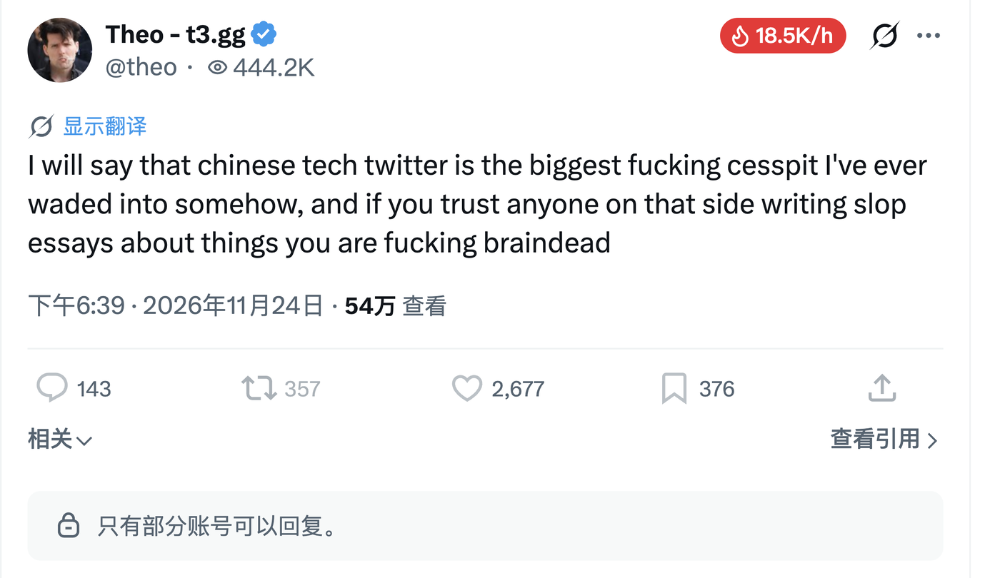

# #16 · Dwuletni wzorzec historyczny: nagonki na tle narodowościowym, nagroda $20 tys. za FFmpeg i usunięte groźby

> Wybuch wokół chińskiego forka w listopadzie 2026 roku nie był odosobnionym potknięciem — publiczne zapisy z lat 2024–2026 dokumentują powtarzający się cykl: nękanie wymierzone w narodowość, bullying w open source, wyśmiewanie interfejsów innych deweloperów oraz usuwanie wpisów po nagonce.

<!-- section:claim -->
## Co twierdzono

- W swoim przepraszającym filmie z 2024 roku [`I screwed up.`](https://www.youtube.com/watch?v=o2CSJYXJBpc) `@theo` jednoznacznie potępił kierowanie wrogości na tle narodowościowym wobec społeczności deweloperów.

<!-- section:evidence -->
## Co pokazują dowody

- **Nękanie indyjskich deweloperów w 2024 roku i przeprosiny:** Po opublikowaniu filmu wymierzonego w indyjskie kanały z tutorialami programistycznymi, który wywołał fale nękania na tle narodowościowym, `@theo` wgrał [`I screwed up.`](https://www.youtube.com/watch?v=o2CSJYXJBpc), potępiając takie ataki — dwa lata przed nazwaniem chińskiego forka na licencji MIT `"Temu3 Code"` i określeniem chińskiego tech Twittera jako *"the biggest fucking cesspit."*
- **Kpiny z forka w 2024 roku i drwiny z interfejsu DHH:** `@theo` wcześniej nazwał własny fork motywu VS Code innego dewelopera [`vsc-material-but-i-wont-sue-you`](https://github.com/t3dotgg/vsc-material-but-i-wont-sue-you), by wykpić wrażliwość prawną oryginalnego autora, a w czerwcu 2024 roku zbudował wiralowe zaangażowanie, publicznie wyśmiewając interfejs klienta poczty twórcy Rails, DHH ([`2125066552785711291`](https://x.com/realchendahuang/status/2125066552785711291)).
- **Październik 2025 — nagroda $20 000 za FFmpeg:** Podczas sporu na X z FFmpeg `@theo` publicznie zaoferował **nagrodę $20 000** za usunięcie opiekuna FFmpeg ([udokumentowany zapis](https://www.youtube.com/watch?v=1oQ3KMeaH04)). Gdy Windscribe zaproponował kontrofertę w wysokości $21 000, założyciel VLC mu się sprzeciwił, a deweloperzy FFmpeg udokumentowali nękanie — wtedy `@theo` wycofał nagrodę i usunął film oraz wpisy.
- **Nagonka wokół Stop Killing Games i wcześniejsza dokumentacja na YouTube:** We wcześniejszych sporach o prawa konsumentów `@theo` wielokrotnie obrażał zwolenników *Stop Killing Games*, stając po stronie wydawców ([`2125064674307985520`](https://x.com/realchendahuang/status/2125064674307985520)), czemu towarzyszyła długa dokumentacja na YouTube porównująca jego publiczne wypowiedzi z prywatnymi wiadomościami ([`2125066387647513072`](https://x.com/realchendahuang/status/2125066387647513072)).
- **25 listopada 2026 (~4:00) — usunięta groźba zamknięcia kodu:** W trakcie nocnych następstw audytu `@theo` opublikował groźbę zamknięcia T3 Code, bo użytkownicy nie zasługują na open source — a następnie usunął wpis przed świtem, gdy przekroczył 3 000 polubień.

<!-- section:status -->
## Status upstream (`ca81b7b9`)

- **Zapis publiczny:** Wzorzec z lat 2024–2026 wskazuje na długotrwałą powtarzalność zachowań w wielu społecznościach deweloperskich, a nie na jednorazowe nieporozumienie.

<!-- section:visuals -->
## Dowody wizualne

<!-- section:sources -->
## Źródła pierwotne

- [Oryginalne śledztwo na X (część 16)](https://x.com/realchendahuang/status/2125408843152953693)
- [`vsc-material-but-i-wont-sue-you`](https://github.com/t3dotgg/vsc-material-but-i-wont-sue-you) · [`I screwed up.` (YouTube)](https://www.youtube.com/watch?v=o2CSJYXJBpc) · [Zapis nagrody $20 tys. za FFmpeg (YouTube)](https://www.youtube.com/watch?v=1oQ3KMeaH04)
- [Odpowiedzi źródłowe z kontekstem historycznym: `2125064674307985520`](https://x.com/realchendahuang/status/2125064674307985520) · [`2125066387647513072`](https://x.com/realchendahuang/status/2125066387647513072) · [`2125066552785711291`](https://x.com/realchendahuang/status/2125066552785711291)
- [Pogłębione dossier techniczne 05](../../docs/dossiers/05-governance-trademark-and-history.md)
