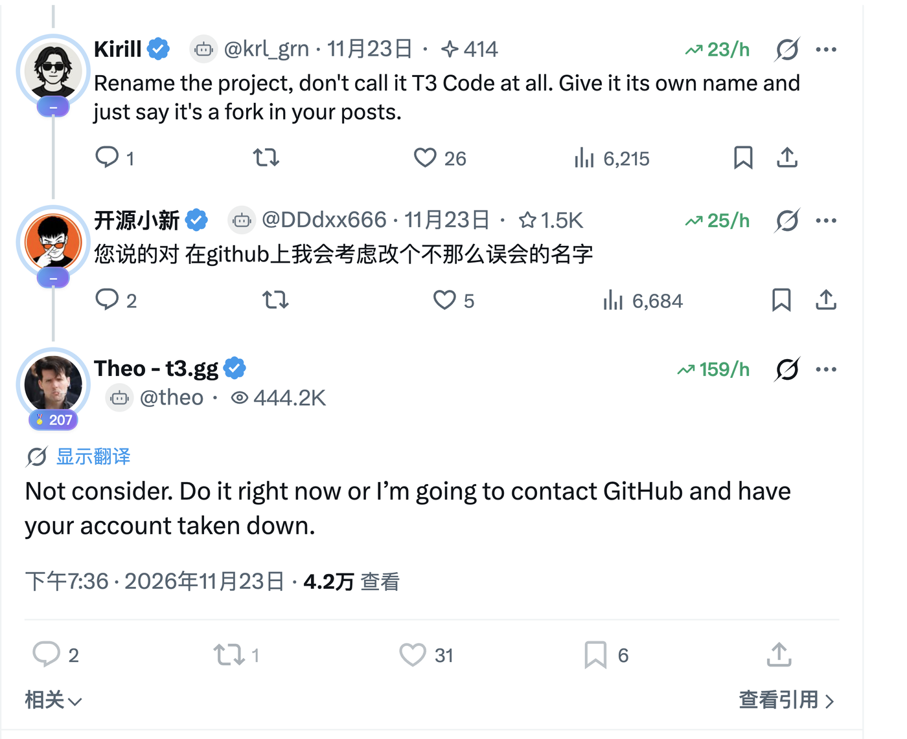

# #00 · Disputa de Origem: "Steal Our Code", Ameaças por Nome de Fork e Dois Pesos Raciais

> Em 11 minutos, @theo classificou o fork gratuito sob MIT de um desenvolvedor chinês como "Chinese knockoff" e "Temu3 Code" e ameaçou derrubar uma conta do GitHub — para, menos de 11 horas depois, receber publicamente com tranquilidade empresas bilionárias dos EUA copiando código MIT.

<!-- section:claim -->
## O Que Foi Alegado

- A homepage do T3 Code ([`t3.codes`](https://t3.codes/)) rotulava seu link público do GitHub como *"Steal our code (legally)"*, sob licença MIT.
- Menos de 11 horas depois de atacar o fork MIT de um desenvolvedor chinês, ao ser questionado se empresas bilionárias dos EUA copiando o T3 Code o incomodavam, `@theo` respondeu: *"Nah. Open source is open source, even if a trillion dollar company uses it!"* ([`2124989435154726982`](https://x.com/theo/status/2124989435154726982)).

<!-- section:evidence -->
## O Que as Evidências Mostram

- **Hostilidade direcionada a um fork MIT (23 nov, 19:11–19:54 CST):** Depois que um terceiro confundiu um fork gratuito sob MIT do desenvolvedor chinês `@DDdxx666` com o app oficial, `@theo` publicou duas vezes em 11 minutos, chamando-o de *"Chinese knockoff"* e *"Temu3 Code"* e ameaçando remover toda a conta GitHub do desenvolvedor: *"Do it right now or I'm going to contact GitHub and have your account taken down"* ([`2124829315657576890`](https://x.com/theo/status/2124829315657576890)).
- **Cumprimento imediato, desculpa assimétrica:** `@DDdxx666` renomeou o repositório para `Stardust` e removeu toda a identidade visual do T3 em 30 minutos. `@theo` pediu desculpas em mensagens diretas privadas, mas manteve as duas publicações públicas no ar (mais de 200 mil visualizações somadas).
- **Aplicação seletiva por nacionalidade:** A integrante da equipe T3 `@maria_rcks` hospedava publicamente `maria-rcks/t3libre` (*"T3 Code, liberated"*), e repositórios em inglês como `t3code-quota-ui`, `t3code-atlas` e `t3code-bar` operavam sem qualquer incômodo e sem nenhuma ameaça de remoção.
- **A própria inspiração admitida no FAQ:** O FAQ do próprio T3 Code afirma explicitamente que se inspirou diretamente em Codex Desktop, Conductor, Claude Desktop e Cursor ([`2125066677188702698`](https://x.com/realchendahuang/status/2125066677188702698)).
- **Catalisador da investigação completa:** A partir de 24 de novembro, a revisão linha por linha de `pingdotgg/t3code` e de registros públicos revelou as 19 exposições documentadas a seguir — o que motivou uma denúncia à GDPR europeia e quase 20 patches emergenciais durante a madrugada.

<!-- section:status -->
## Status no Upstream (`ca81b7b9`)

- **Registro público:** Tanto os dois ataques públicos de 23 de novembro quanto a resposta *"Open source is open source"* de 24 de novembro seguem fazendo parte do registro público permanente.

<!-- section:visuals -->
## Evidências Visuais

<!-- section:sources -->
## Fontes Primárias

- [Post de origem 1 ("steal our code")](https://x.com/realchendahuang/status/2125059292919394654)
- [Post de origem 2 (disputa de fork e dois pesos)](https://x.com/realchendahuang/status/2125062675147448475)
- [Ameaça de banimento no GitHub de `@theo` (`2124829315657576890`)](https://x.com/theo/status/2124829315657576890)
- [`@theo` recebendo bem empresas bilionárias dos EUA (`2124989435154726982`)](https://x.com/theo/status/2124989435154726982)
- [Contexto da inspiração no FAQ (`2125066677188702698`)](https://x.com/realchendahuang/status/2125066677188702698)
- [Homepage do T3 Code (`t3.codes`)](https://t3.codes/)
- [Dossiê Técnico Profundo 05](../../docs/dossiers/05-governance-trademark-and-history.md)
