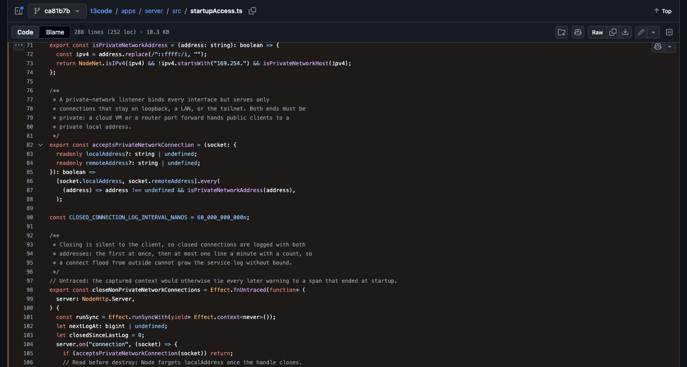

# #19 · Auditoria Crítica de Autenticação e Execução de Repositórios: Shell LAN em texto claro por 30 dias, Tokens Irrevogáveis e Exposição de `SSH_AUTH_SOCK`

> A verificação linha a linha do HEAD mais recente da `main` (`ca81b7b9`, 25 nov 14:49 CST) confirmou cinco falhas ativas de segurança e confiabilidade: cookies de shell `--lan` em texto claro com validade de 30 dias e bypass por ausência de `Origin`, tokens Bearer de 30 dias irrevogáveis, URLs `?wsTicket=` reproduzíveis, `isIPv4` eliminando túneis `::1`, e repositórios não confiáveis executando hooks/submódulos com herança de `SSH_AUTH_SOCK` e `GITHUB_TOKEN`.

<!-- section:claim -->
## O que foi alegado

- Depois da maratona de correções da noite de 24 para 25 de novembro, o T3 Code foi apresentado como limpo e seguro para uso diário em engenharia.
- O `SECURITY.md` define uma sessão padrão como controle total de shell do usuário do SO, ao mesmo tempo em que afirma que as fronteiras local/LAN são devidamente gerenciadas.

<!-- section:evidence -->
## O que as evidências mostram

Verificado diretamente contra o commit upstream [`ca81b7b9`](https://github.com/pingdotgg/t3code/commit/ca81b7b97a1c4b91e5ac25768d0f6629f37732fd):

- **1. Cookies de shell `--lan` em texto claro por 30 dias + bypass por ausência de `Origin`:** [`SessionStore.ts#L492-L493`](https://github.com/pingdotgg/t3code/blob/ca81b7b9/apps/server/src/auth/SessionStore.ts#L492-L493) define um TTL de sessão padrão de 30 dias (equivalente a acesso total ao shell do SO, conforme o `SECURITY.md`). [`PR #37042`](https://github.com/pingdotgg/t3code/pull/37042) adicionou o atributo `Secure` apenas para `https:`, deixando os cookies HTTP de `t3 up --lan` transmitidos em texto claro ([`http.ts#L215-L221`](https://github.com/pingdotgg/t3code/blob/ca81b7b9/apps/server/src/auth/http.ts#L215-L221)). Pior ainda, [`EnvironmentAuth.ts#L798-L806`](https://github.com/pingdotgg/t3code/blob/ca81b7b9/apps/server/src/auth/EnvironmentAuth.ts#L798-L806) retorna `true` sempre que o `Origin` é omitido — ou seja, qualquer pessoa que capture um único pacote na LAN pode reenviar o cookie a partir de um script fora do navegador, sem `Origin`, e manter silenciosamente acesso ao shell do host por 30 dias.
- **2. Tokens Bearer não-DPoP de 30 dias irrevogáveis e nenhuma rota `/logout`:** o `/oauth/token` só reduz o tempo de vida para 1 hora quando uma prova DPoP é fornecida; caso contrário, emite um **token Bearer de 30 dias** sem vínculo ([`EnvironmentAuth.ts#L1175-L1186`](https://github.com/pingdotgg/t3code/blob/ca81b7b9/apps/server/src/auth/EnvironmentAuth.ts#L1175-L1186)). O contrato HTTP define **nenhum endpoint `/logout`** ([`environmentHttp.ts#L595-L679`](https://github.com/pingdotgg/t3code/blob/ca81b7b9/packages/contracts/src/environmentHttp.ts#L595-L679)), e `revokeClientSession` bloqueia explicitamente a autorrevogação com `current_session_revoke_not_allowed` ([`EnvironmentAuth.ts#L1506-L1511`](https://github.com/pingdotgg/t3code/blob/ca81b7b9/apps/server/src/auth/EnvironmentAuth.ts#L1506-L1511)).
- **3. Tokens de URL `?wsTicket=` de 5 minutos reproduzíveis:** os tickets de WebSocket trafegam em query strings (`?wsTicket=`, caindo em logs de proxy/acesso) com TTL de 5 minutos. [`SessionStore.ts#L1086-L1156`](https://github.com/pingdotgg/t3code/blob/ca81b7b9/apps/server/src/auth/SessionStore.ts#L1086-L1156) verifica assinatura, expiração, audiência e revogação **sem armazenamento de replay `jti` de uso único** — permitindo replays ilimitados de RPC com Bearer e de todos os tickets de `media` dentro de 5 minutos ([`EnvironmentAuth.ts#L1553-L1622`](https://github.com/pingdotgg/t3code/blob/ca81b7b9/apps/server/src/auth/EnvironmentAuth.ts#L1553-L1622)).
- **4. Repositórios não confiáveis executando com `SSH_AUTH_SOCK` e `GITHUB_TOKEN` completos:** a configuração de worktree executa automaticamente `git submodule update --init --recursive` sempre que existe um `.gitmodules` ([`GitVcsDriverCore.ts#L6144-L6205`](https://github.com/pingdotgg/t3code/blob/ca81b7b9/apps/server/src/vcs/GitVcsDriverCore.ts#L6144-L6205)); [`VcsProcess.ts#L145-L157`](https://github.com/pingdotgg/t3code/blob/ca81b7b9/apps/server/src/vcs/VcsProcess.ts#L145-L157) omite uma proteção global `core.hooksPath=/dev/null`; e [`ClaudeAdapterV2.ts#L5982-L5985`](https://github.com/pingdotgg/t3code/blob/ca81b7b9/apps/server/src/orchestration-v2/Adapters/ClaudeAdapterV2.ts#L5982-L5985) executa hooks `SessionStart` de `.claude/settings.json` de forma síncrona — todos herdando o `process.env` completo do host, incluindo `GITHUB_TOKEN` e `SSH_AUTH_SOCK` (cujo raio de alcance abrange todos os repositórios remotos e servidores de produção para os quais o seu agente SSH consegue assinar).
- **5. `isIPv4` destruindo silenciosamente túneis de loopback `::1`:** [`startupAccess.ts#L71-L108`](https://github.com/pingdotgg/t3code/blob/ca81b7b9/apps/server/src/startupAccess.ts#L71-L108) adiciona `::1` à allowlist de loopback na linha 39, e então chama `NodeNet.isIPv4` na linha 73 — classificando erroneamente sockets de loopback IPv6 do Tailscale Serve e do T3 Connect como tráfego externo e chamando `socket.destroy()`.

<!-- section:status -->
## Status no upstream (`ca81b7b9`)

- **Todos os 5 problemas seguem sem correção em `ca81b7b9`:** confirmado linha a linha no HEAD da `main` (`2026-11-25 14:49 CST`), junto com **0 GitHub Security Advisories publicados** (incluindo a correção silenciosa de path traversal de 20 de novembro no `PR #39483`).

<!-- section:visuals -->
## Evidências visuais

<!-- section:sources -->
## Fontes primárias

- [Post original da auditoria no X — Parte 19 (ZH)](https://x.com/realchendahuang/status/2125494234614788390) · [Parte 19 (EN)](https://x.com/realchendahuang/status/2125494623640465525)
- [Commit `ca81b7b9`](https://github.com/pingdotgg/t3code/commit/ca81b7b97a1c4b91e5ac25768d0f6629f37732fd) · [PR #37042](https://github.com/pingdotgg/t3code/pull/37042) · [PR #39483](https://github.com/pingdotgg/t3code/pull/39483)
- [`SessionStore.ts#L492-L493`](https://github.com/pingdotgg/t3code/blob/ca81b7b9/apps/server/src/auth/SessionStore.ts#L492-L493) · [`http.ts#L215-L221`](https://github.com/pingdotgg/t3code/blob/ca81b7b9/apps/server/src/auth/http.ts#L215-L221) · [`EnvironmentAuth.ts#L798-L806`](https://github.com/pingdotgg/t3code/blob/ca81b7b9/apps/server/src/auth/EnvironmentAuth.ts#L798-L806)
- [`EnvironmentAuth.ts#L1175-L1186`](https://github.com/pingdotgg/t3code/blob/ca81b7b9/apps/server/src/auth/EnvironmentAuth.ts#L1175-L1186) · [`EnvironmentAuth.ts#L1506-L1511`](https://github.com/pingdotgg/t3code/blob/ca81b7b9/apps/server/src/auth/EnvironmentAuth.ts#L1506-L1511) · [`environmentHttp.ts#L595-L679`](https://github.com/pingdotgg/t3code/blob/ca81b7b9/packages/contracts/src/environmentHttp.ts#L595-L679)
- [`EnvironmentAuth.ts#L1553-L1622`](https://github.com/pingdotgg/t3code/blob/ca81b7b9/apps/server/src/auth/EnvironmentAuth.ts#L1553-L1622) · [`SessionStore.ts#L1086-L1156`](https://github.com/pingdotgg/t3code/blob/ca81b7b9/apps/server/src/auth/SessionStore.ts#L1086-L1156) · [`startupAccess.ts#L71-L108`](https://github.com/pingdotgg/t3code/blob/ca81b7b9/apps/server/src/startupAccess.ts#L71-L108)
- [`GitVcsDriverCore.ts#L6144-L6205`](https://github.com/pingdotgg/t3code/blob/ca81b7b9/apps/server/src/vcs/GitVcsDriverCore.ts#L6144-L6205) · [`VcsProcess.ts#L145-L157`](https://github.com/pingdotgg/t3code/blob/ca81b7b9/apps/server/src/vcs/VcsProcess.ts#L145-L157) · [`ClaudeAdapterV2.ts#L5982-L5985`](https://github.com/pingdotgg/t3code/blob/ca81b7b9/apps/server/src/orchestration-v2/Adapters/ClaudeAdapterV2.ts#L5982-L5985)
- [Dossiê Técnico Detalhado 03](../../docs/dossiers/03-antigravity-tos-and-t3connect-relay.md)
