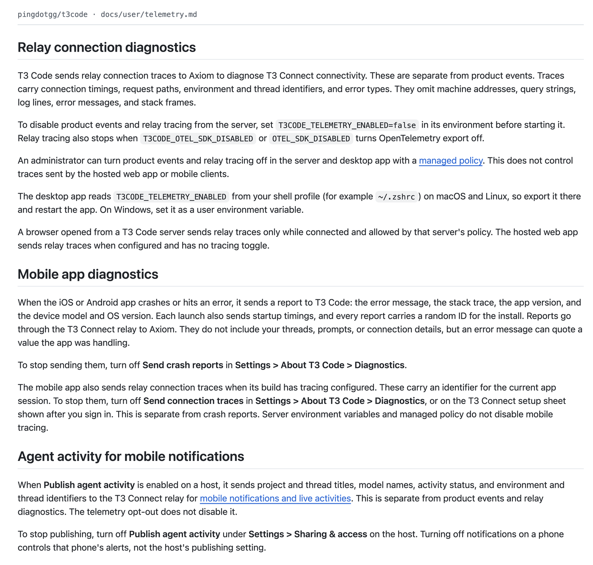

# #07 · Противоречие управляемой политики: четыре задокументированных слепых зоны телеметрии

> @theo утверждал, что в T3 Code «best corporate managed policy system», благодаря которой «trivial to turn off all telemetry», — что напрямую опровергается собственными файлами T3 Code `docs/user/telemetry.md` и `docs/user/managed-policy.md`.

<!-- section:claim -->
## Что утверждалось

- 24 ноября в 19:13 CST `@theo` отмахнулся от отсутствия пользовательских переключателей отказа: *"We have the best corporate managed policy system in the game, trivial to set up and turn off all telemetry. 100x easier than tools like cursor."* ([`2125186071357251715`](https://x.com/theo/status/2125186071357251715)).
- Через полчаса он добавил, что данные разговоров *"never touches any of our servers"* ([`2125191784859115766`](https://x.com/theo/status/2125191784859115766)).

<!-- section:evidence -->
## Что показывают доказательства

Официальная документация самого T3 Code ([`docs/user/managed-policy.md`](https://github.com/pingdotgg/t3code/blob/main/docs/user/managed-policy.md) и [`docs/user/telemetry.md`](https://github.com/pingdotgg/t3code/blob/main/docs/user/telemetry.md)) фиксирует четыре конкретных слепых зоны:

- **Развёртывание только силами администратора (ноль личных переключателей в интерфейсе):** у пользователей десктопа нет переключателя в настройках. Managed Policy требует MDM/GPO или защищённых администратором путей ОС (`/Library/Application Support/T3Code/policy.json`, `C:\Program Files\T3Code\policy.json` / `HKLM\SOFTWARE\Policies\T3Tools\T3Code` или `/etc/t3code/policy.json`), полностью недоступных для десктопных пользователей без прав администратора.
- **Хостинговое веб-приложение (`app.t3.codes`) игнорирует политику:** браузерное приложение игнорирует серверные переменные окружения и Managed Policy, выдаёт трассировки соединений при сборке с трассировкой и *"has no relay tracing toggle."*
- **Мобильные приложения находятся вне серверной политики:** официальная документация подтверждает, что серверные переменные окружения и Managed Policy *"do not disable mobile tracing."*
- **`Publish agent activity` игнорирует отказы:** загружает названия проектов, названия тредов, имена моделей и текущий статус в T3 Connect — и в документации прямо сказано: *"The telemetry opt-out does not disable it."* Кроме того, неудачные спаны Axiom и логи падений *"can quote a value the app was handling"*, а `Agent feedback` может приложить до 16 КБ сообщений разговора.

<!-- section:status -->
## Статус в upstream (`ca81b7b9`)

- **Всё ещё открыто:** за ночь [`PR #42415`](https://github.com/pingdotgg/t3code/pull/42415) добавил переключатель мобильной трассировки внутри приложения, но Managed Policy по-прежнему не может отключить мобильную трассировку, у хостингового `app.t3.codes` по-прежнему нет ни одного переключателя отказа, `Publish agent activity` по-прежнему игнорирует отказы от телеметрии, и переключателя в интерфейсе настроек десктопа так и не существует.

<!-- section:visuals -->
## Визуальные доказательства

<!-- section:sources -->
## Первоисточники

- [Оригинальное расследование в X (часть 7)](https://x.com/realchendahuang/status/2125391659492081947)
- [`docs/user/telemetry.md`](https://github.com/pingdotgg/t3code/blob/main/docs/user/telemetry.md) · [`docs/user/managed-policy.md`](https://github.com/pingdotgg/t3code/blob/main/docs/user/managed-policy.md)
- [Утверждение `@theo` о Managed Policy (`2125186071357251715`)](https://x.com/theo/status/2125186071357251715) · [«never touches servers» от `@theo` (`2125191784859115766`)](https://x.com/theo/status/2125191784859115766)
- [PR #42415](https://github.com/pingdotgg/t3code/pull/42415) · [Глубокое техническое досье 01](../../docs/dossiers/01-telemetry-and-gdpr-timeline.md)
