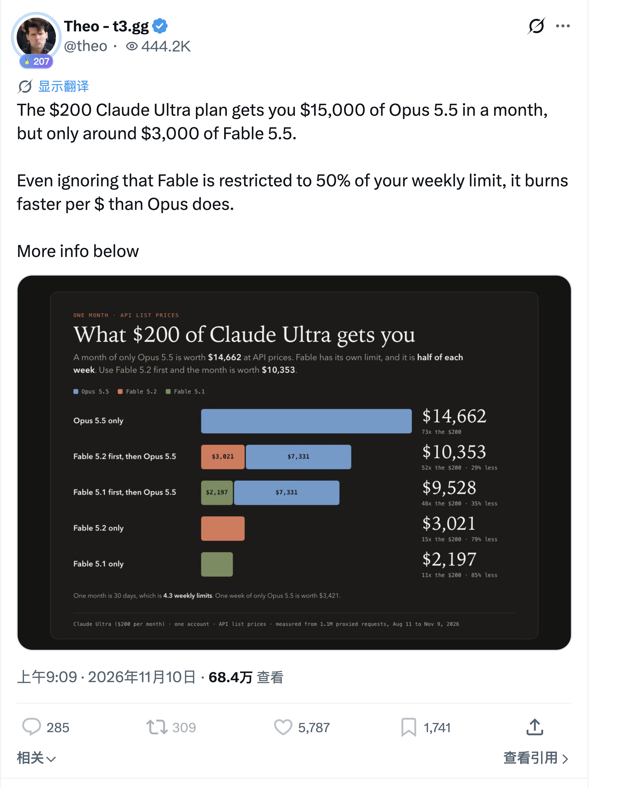

# #17 · Спонсорские связки в стеке, эксплуатация бага 0% квоты Codex и лицемерие `CLIProxyAPI` с 10 аккаунтами

> Проповедуя комплаенс и отказываясь от встроенного переключения аккаунтов из-за риска блокировок, T3 Code встраивает в свой облачный стек YouTube-спонсоров @theo (Clerk и Axiom), тогда как сам @theo хвастался эксплуатацией бага 0% квоты Codex и опубликовал Gist с объединением 10 аккаунтов через `CLIProxyAPI`, на который напрямую ссылается FAQ T3.

<!-- section:claim -->
## Что утверждалось

- FAQ T3 Code отказывается от встроенного переключения между несколькими аккаунтами, поскольку предупреждает пользователей: объединение аккаунтов в пул рискует нарушить ToS провайдеров и привести к блокировке.
- `@theo` регулярно подаёт свои рекомендации по инфраструктуре и рабочим процессам как нейтральные инженерные решения.

<!-- section:evidence -->
## Что показывают доказательства

- **YouTube-спонсорский стек, встроенный в T3 Connect:** 14 мая 2023 года `@theo` публично перечислил своих YouTube-спонсоров: `@vercel`, `@clerk`, `@upstash`, `@axiomhq` и `@PlanetScale` ([`1657488850472804353`](https://x.com/theo/status/1657488850472804353)). **Clerk**, **Axiom** и **PlanetScale** образуют ядро облачного стека аутентификации, 30-дневного логирования с привязкой к IP и базы данных-ретранслятора внутри T3 Code. CEO Vercel `@rauchg` подтвердил, что Vercel спонсировал только одного ютубера — Тео ([`1776260839965863965`](https://x.com/rauchg/status/1776260839965863965)), а `@theo` признал, что спонсорские контракты включали условия об эксклюзивности, ограничивающие продвижение конкурентов ([видео](https://www.youtube.com/watch?v=uv179CTAK-w)).
- **Эксплуатация 0% квоты Codex и удаление постов (`openai/codex#45444`):** 21 августа 2026 года `@theo` хвастался тем, что выжал **$800+** сверх лимита 0% использования Codex, пока сотрудник T3 `@maria_rcks` выпустил *Endless*, чтобы эксплуатировать ту же лазейку. Оба удалили свои посты 22 августа после волны критики ([`2090972426876129658`](https://x.com/maria_rcks/status/2090972426876129658)) — как раз когда OpenAI ужесточила отсечку ходов при 0% для всех обычных пользователей ([`openai/codex#45444`](https://github.com/openai/codex/issues/45444)).
- **Gist `CLIProxyAPI` на 10 аккаунтов (`555%` квоты), указанный в официальном FAQ:** в октябре 2026 года `@theo` опубликовал Gist с 452 звёздами ([`59a521d2ee8d70aaf90e280c175072af`](https://gist.github.com/t3dotgg/59a521d2ee8d70aaf90e280c175072af)), объединяющий **7 аккаунтов Claude + 3 аккаунта Codex** (`555%` суммарной квоты на 12+ машинах), хвастался доходностью `$14,662` / `$15k` на плане за `$200` (`1.1M` запросов) и опубликовал туториал по маршрутизации Grok Bot + `$100` Claude — при этом собственный [`docs/user/faq.md`](https://github.com/pingdotgg/t3code/blob/main/docs/user/faq.md#can-i-add-a-bunch-of-accounts-for-one-provider) T3 ведёт прямо к этому Gist, сразу под дисклеймером о блокировках (*"Early apologies if it gets you banned 💀"*).

<!-- section:status -->
## Статус в upstream (`ca81b7b9`)

- **Публичный след:** Clerk, Axiom, PlanetScale и ссылка из FAQ на Gist `CLIProxyAPI` с 10 аккаунтами по-прежнему задокументированы в репозитории.

<!-- section:visuals -->
## Визуальные доказательства

<!-- section:sources -->
## Первоисточники

- [Оригинальное расследование в X (часть 17)](https://x.com/realchendahuang/status/2125411353393553744)
- [Список спонсоров 2023 года (`1657488850472804353`)](https://x.com/theo/status/1657488850472804353) · [CEO Vercel (`1776260839965863965`)](https://x.com/rauchg/status/1776260839965863965) · [Видео об эксклюзивности спонсорства](https://www.youtube.com/watch?v=uv179CTAK-w)
- [Пост `@maria_rcks` (`2090972426876129658`)](https://x.com/maria_rcks/status/2090972426876129658) · [`openai/codex#45444`](https://github.com/openai/codex/issues/45444)
- [Gist `CLIProxyAPI` (`59a521d2ee8d70aaf90e280c175072af`)](https://gist.github.com/t3dotgg/59a521d2ee8d70aaf90e280c175072af) · [Раздел FAQ о мультиаккаунтах в `docs/user/faq.md`](https://github.com/pingdotgg/t3code/blob/main/docs/user/faq.md#can-i-add-a-bunch-of-accounts-for-one-provider)
- [Углублённое техническое досье 04](../../docs/dossiers/04-business-ledger-sponsors-and-77k-stars.md)
