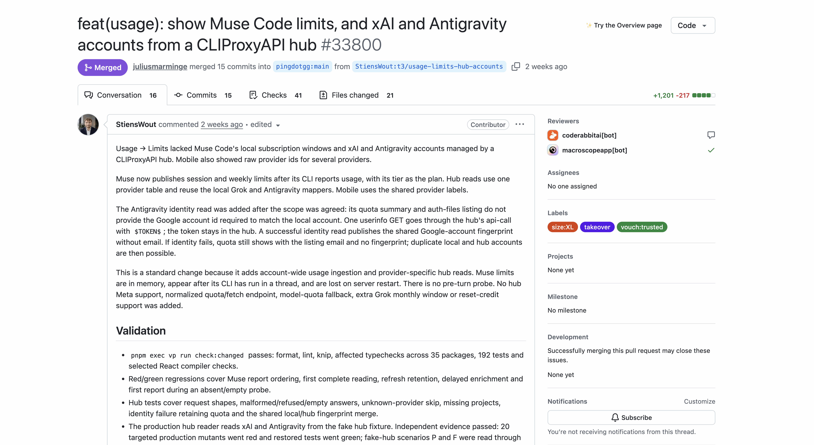

# #04 · Google Antigravity Başlık Sahtekârlığı, Sahte `SSH_CONNECTION` ve 3 Dakikada Hesap Banları

> T3 Code, SSS'inde kullanım koşullarına uyduğunu garanti etmesine rağmen işletim sistemi anahtarlığındaki (keyring) kimlik bilgilerini çıkarıyor, `v1internal` karşısında Google'ın dahili başlıklarını (`antigravity/hub/2.24.0`) taklit ediyor ve sahte `SSH_CONNECTION` değerleri enjekte ediyor — kişisel Google aboneliklerini hızlı banlara maruz bırakıyor.

<!-- section:claim -->
## Ne İddia Edilmişti

- [`docs/user/faq.md`](https://github.com/pingdotgg/t3code/blob/main/docs/user/faq.md#will-i-get-banned-for-using-my-subscription) ödeme yapan abonelere şu güvenceyi veriyordu: *"We work with all of the labs and T3 Code is within the TOS of Claude Code, Codex, and Google Antigravity... If it works in T3 Code, you can trust it is safe."*
- Banlanan kullanıcılar [`Issue #40713`](https://github.com/pingdotgg/t3code/issues/40713) açtığında, bir bakımcı Antigravity'nin arka ucuna istek atıldığını veya token'ların yeniden kullanıldığını reddetti — ve X'te `@theo` suçu üçüncü taraf proxylere attı (`"Not with cliproxy right?"`).

<!-- section:evidence -->
## Kanıtlar Ne Gösteriyor

- **İşletim sistemi kimlik bilgisi çıkarımı ve sahte `v1internal` çağrıları:** [`antigravityUsageLimits.ts`](https://github.com/pingdotgg/t3code/blob/main/apps/server/src/provider/antigravityUsageLimits.ts#L20-L45) Google OAuth token'larını yerel dosyalardan, `@napi-rs/keyring` üzerinden veya Windows Credential Manager'dan (`advapi32.dll` üzerinde `ffi-rs` aracılığıyla `CredReadW`) çıkarıyor, `antigravity/hub/2.24.0` değerini sabit kodluyor ve doğrudan Google'ın özel `v1internal` uç noktasına `POST` gönderiyor. Google çalışanları [resmî forumda](https://discuss.ai.google.dev/t/185992), [Google Antigravity Kullanım Koşulları](https://antigravity.google/terms) Bölüm 6'nın üçüncü taraf araçların arka uç uç noktalarını doğrudan sorgulamak için kimlik bilgilerini çıkarmasını veya yeniden kullanmasını yasakladığını doğruladı.
- **Sahte `SSH_CONNECTION` ve hesaplar arası sızıntı:** [`antigravityAuthSupport.ts#L230-L236`](https://github.com/pingdotgg/t3code/blob/main/apps/server/src/provider/antigravityAuthSupport.ts#L230-L236), Google'ın CLI'sini işletim sistemi anahtarlık (keychain) izolasyonundan çıkarıp düz metin dosyalara yönlendirmek için sahte bir `SSH_CONNECTION` ortam değişkeni (`"127.0.0.1 0 127.0.0.1 0"`) enjekte ediyor. Google CLI'sini 24 Kasım'da güncellediğinde, [`Issue #41973`](https://github.com/pingdotgg/t3code/issues/41973) Hesap A'dan gelen istemlerin sessizce Hesap B'ye yönlendirildiğini doğruladı.
- **Yeni bir $20'lık hesap 3 dakikada banlandı (`Issue #41536`):** Sıfır proxy kullanan, yalnızca T3 tarafından yönetilen Antigravity'yi kullanan yepyeni bir $20'lık Google AI aboneliği, kurulumdan 3 dakika sonra ilk mesajında banlandı. Bakımcılar, herhangi bir kullanıcı uyarısı eklemeden sorunu yinelenen (duplicate) kaydı olarak kapattı.
- **Yerel istemci ve CLIProxyAPI sahtekârlığı:** `@theo` bizzat `"zed"` gibi görünen [`PR #26876`](https://github.com/pingdotgg/t3code/pull/26876) değişikliğini birleştirdi; birleştirilen [`PR #33800`](https://github.com/pingdotgg/t3code/pull/33800) ise [`cliproxyApi.ts`](https://github.com/pingdotgg/t3code/blob/main/apps/server/src/usage/cliproxyApi.ts) hub yoklamasını sahte `claude-code/2.1.273`, `grok-cli/1.0.77` ve `antigravityUserAgent` başlıklarıyla bağladı.

```ts
// apps/server/src/provider/antigravityUsageLimits.ts (lines 20–24, 450–454)
export function antigravityUserAgent(platform: NodeJS.Platform, architecture: NodeJS.Architecture) {
  return `antigravity/hub/2.24.0 (aidev_client; os_type=${platform}; arch=${architecture}; cl=963137146)`;
}
HttpClientRequest.post(`${endpoint}/v1internal:${operation}`).pipe(
  HttpClientRequest.setHeaders({ Authorization: `Bearer ${accessToken}`, "User-Agent": antigravityUserAgent(platform, architecture) })
);
```

<!-- section:status -->
## Üst Kaynak (Upstream) Durumu (`ca81b7b9`)

- **Hâlâ aktif:** [`PR #41210`](https://github.com/pingdotgg/t3code/pull/41210), Google'ın `403 PERMISSION_DENIED` (`VALIDATION_REQUIRED`) hesap doğrulama bağlantılarını göstermek için [`AntigravityTurnOutcome.ts`](https://github.com/pingdotgg/t3code/blob/main/apps/server/src/provider/acp/AntigravityTurnOutcome.ts) dosyasını ekledi — bu da Google'ın yaptırımının fiilen sürdüğünü doğruluyor — ve dört sahtekârlık ile token çıkarma yolunun tamamı hâlâ canlı.

<!-- section:visuals -->
## Görsel Kanıtlar




<!-- section:sources -->
## Birincil Kaynaklar

- [Orijinal X İncelemesi (Bölüm 4)](https://x.com/realchendahuang/status/2125213397507858657)
- [SSS'teki kullanım koşulları garantisi](https://github.com/pingdotgg/t3code/blob/main/docs/user/faq.md#will-i-get-banned-for-using-my-subscription) · [Google Antigravity Kullanım Koşulları](https://antigravity.google/terms) · [Google Geliştirici Forumu](https://discuss.ai.google.dev/t/185992)
- [`antigravityUsageLimits.ts`](https://github.com/pingdotgg/t3code/blob/main/apps/server/src/provider/antigravityUsageLimits.ts#L20-L45) · [`antigravityAuthSupport.ts`](https://github.com/pingdotgg/t3code/blob/main/apps/server/src/provider/antigravityAuthSupport.ts#L230-L236) · [`cliproxyApi.ts`](https://github.com/pingdotgg/t3code/blob/main/apps/server/src/usage/cliproxyApi.ts)
- [Issue #40713](https://github.com/pingdotgg/t3code/issues/40713) · [Issue #41536](https://github.com/pingdotgg/t3code/issues/41536) · [Issue #41973](https://github.com/pingdotgg/t3code/issues/41973)
- [PR #26876](https://github.com/pingdotgg/t3code/pull/26876) · [PR #33800](https://github.com/pingdotgg/t3code/pull/33800) · [PR #41210](https://github.com/pingdotgg/t3code/pull/41210)
- [Derin Teknik Dosya 03](../../docs/dossiers/03-antigravity-tos-and-t3connect-relay.md)
