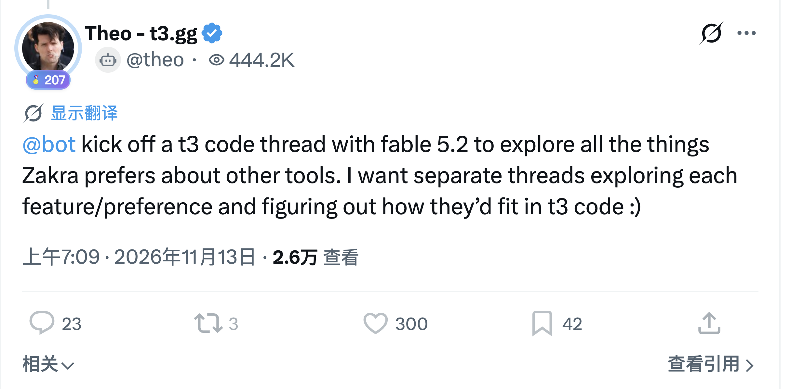

# #10 · Kamuya Açık `@bot` ile Fork Kazıma, Rakip Alayı ve Eleştirmen Susturma

> `@theo`, rakiplerini arayüz kalıplarını kopyalamakla alaya alırken, bir geliştiricinin fork'una kamuya açık şekilde "Okay I'm stealing this" diye yanıt verdi ve 30 saniye sonra onun kodunu kazıması için `@bot`'u görevlendirdi — bu sırada otomatik engelleyicileri devreye alıyor ve takipçilerini eleştirmenleri demonetize etmeye çağırıyordu.

<!-- section:claim -->
## Ne İddia Edildi

- 24 Kasım'da `@theo`, Claude Code Desktop'ı kenar çubuğu sekmeleri eklediği için kamu önünde alaya aldı ([`2124987957803446311`](https://x.com/theo/status/2124987957803446311)) ve kendisini taklitlere karşı orijinal ürün emeğini savunuyor gibi gösterdi.

<!-- section:evidence -->
## Kanıtlar Ne Gösteriyor

- **30 saniyede kamuya açık `@bot` fork kazıma (`2119240810202034645`):** 8 Kasım'da bağımsız geliştirici `@MiaAI_lab` kendi geliştirdiği özel bir fork özelliğini paylaştıktan sonra `@theo` *"Okay I'm stealing this"* diye yanıtladı ve 30 saniye sonra fork'unu bulup Opus 5.5 kullanarak `beebox` üzerine kazıması için kendi otomasyon botunu (`@bot`) kamuya açık şekilde yanıtlarda etiketledi.
- **Talep üzerine rakip özelliklerini klonlama (`2121017649652269120`):** 13 Kasım'da bir kullanıcı rakip araçlardaki özellikleri övdüğünde, `@theo` bu yetenekleri doğrudan T3 Code'a klonlaması için `@bot`'u yeniden kamuya açık yanıtlarda görevlendirdi.
- **Eleştirmenleri demonetize etme ve otomatik kitlesel engelleme:** X'teki eleştirmenlere karşı `@theo`, takipçilerini özellikle *"demonetize them"* amacıyla Community Notes göndermeye teşvik etti ([`2120238923884696025`](https://x.com/theo/status/2120238923884696025)) ve 24 Kasım'da tek başına yaklaşık 100 hesabı engelleyen otomatik bir X engelleyici botu çalıştırdığını kamuya açık şekilde doğruladı ([`2125077510941802509`](https://x.com/theo/status/2125077510941802509)).

<!-- section:status -->
## Üst Akış Durumu (`ca81b7b9`)

- **Kamuya açık kayıt:** Tüm kamuya açık `@bot` kazıma yanıtları, Community Notes açıklamaları ve otomatik engelleyici doğrulamaları arşivde belgelenmiş olarak duruyor.

<!-- section:visuals -->
## Görsel Kanıtlar

<!-- section:sources -->
## Birincil Kaynaklar

- [Orijinal X İncelemesi (Bölüm 10)](https://x.com/realchendahuang/status/2125393641665671593)
- [`@bot` fork kazıma (`2119240810202034645`)](https://x.com/theo/status/2119240810202034645) · [Rakip araçları klonlama (`2121017649652269120`)](https://x.com/theo/status/2121017649652269120) · [Claude Desktop ile alay etme (`2124987957803446311`)](https://x.com/theo/status/2124987957803446311)
- [Demonetize çağrısı (`2120238923884696025`)](https://x.com/theo/status/2120238923884696025) · [Otomatik engelleyici doğrulaması (`2125077510941802509`)](https://x.com/theo/status/2125077510941802509)
- [Derin Teknik Dosya 05](../../docs/dossiers/05-governance-trademark-and-history.md)
