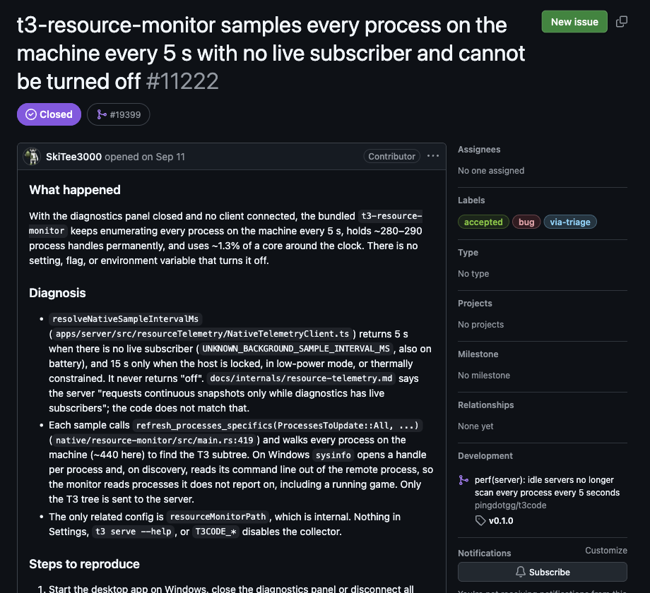

# #02 · Xóa Thread SQLite Giả Tạo (Phình Dữ Liệu 41.6 GB) & Quét Toàn Bộ Tiến Trình Hệ Điều Hành Mỗi 5 Giây

> Việc bấm "permanently delete" vẫn để nguyên toàn bộ lịch sử hội thoại bên trong `statev2.sqlite` (khiến đĩa cục bộ phình lên 41.6 GB), trong khi một monitor Rust chạy nền quét mọi tiến trình hệ điều hành và toàn bộ dòng lệnh mỗi 5 giây mà không có bất kỳ tùy chọn tắt nào.

<!-- section:claim -->
## Những Gì Đã Được Tuyên Bố

- Hộp thoại xác nhận xóa trên sidebar (`useThreadActionMenu.ts`) nói rõ với người dùng: *"This permanently clears conversation history for this thread."*
- T3 Code được quảng bá như một không gian lập trình cục bộ gọn nhẹ và nhanh.

<!-- section:evidence -->
## Những Gì Bằng Chứng Cho Thấy

- **Xóa vĩnh viễn giả tạo (`Issue #17845`, `#28903`):** Ở baseline `9d3195b4`, việc xóa một thread chỉ ghi thêm một sự kiện `"thread.deleted"` vào `statev2.sqlite`, trong khi các tin nhắn trước đó, output công cụ và dấu vết reasoning vẫn còn nguyên trên đĩa. Người dùng ghi nhận `statev2.sqlite` phình lên **25.9 GB** trong 3 tuần (90% thread "deleted"), **41.6 GB** trong 6 tuần và **33 GB** trong 7 tuần.
- **Quét tiến trình & dòng lệnh trên toàn máy (`Issue #11222`, `PR #41889`):** Tiến trình phụ chạy nền `t3-resource-monitor` (`native/resource-monitor/src/main.rs`) chạy `ProcessesToUpdate::All` với `with_cmd(UpdateKind::Always)` mỗi 5 giây ngay cả khi bảng chẩn đoán đã đóng — giữ 280–300 handle thường trực xuyên qua hơn 440 ứng dụng/trò chơi không liên quan trên Windows. Ngày 24 tháng 11, [`PR #41889`](https://github.com/pingdotgg/t3code/pull/41889) xác nhận phần chẩn đoán đã ghi **toàn bộ dòng lệnh tiến trình** (thường chứa API key dạng plaintext, mật khẩu database và token) vào các snapshot và telemetry.
- **Rò rỉ hostname nội bộ doanh nghiệp & việc bắt buộc tải dữ liệu lúc khởi động:** Các request favicon từ frontend làm rò rỉ hostname nội bộ (chẳng hạn `devbox.localdomain`) tới dịch vụ favicon của Google (`PR #16950`, `PR #32657`), trong khi server lúc khởi động luôn tải manifest tương thích từ `raw.githubusercontent.com` mà không có tùy chọn tắt (`Issue #36479`).
- **Đốt quota nghiêm trọng & lỗi tiêu thụ điện:** Điều khiển Claude qua Agent SDK đốt quota 5 giờ với tốc độ **1.7x** bình thường (`Issue #7338`, `Issue #24649`, 81 bình luận), trong khi các hồi quy GPU tiêu thụ điện lên tới **136x** so với mức điện năng Electron tương đương — ghim GPU của MacBook ở **60W** (pin cạn trong 78 phút) và **18W** sau khi đóng tab web (`Issue #3143`, `Issue #40581`).

<!-- section:status -->
## Trạng Thái Upstream (`ca81b7b9`)

- **Đã vá một phần:** [`PR #42119`](https://github.com/pingdotgg/t3code/pull/42119) thêm `thread-content.purge` bất đồng bộ (đóng `#17845`), và [`PR #42577`](https://github.com/pingdotgg/t3code/pull/42577) thu hẹp phạm vi đọc của process-monitor trên Windows.
- **Vẫn còn mở:** Các source thread đã xóa vẫn giữ lịch sử khi còn được tham chiếu bởi fork đang sống, bởi `merge_back` đang chờ xử lý, hoặc bởi subagent đang chạy; các hàng tombstone vẫn nằm trong SQLite và việc thu hồi dung lượng đĩa vẫn cần chạy `VACUUM` offline; Linux và macOS vẫn giữ cơ chế phát hiện `ProcessesToUpdate::All`, và `PR #41889` vẫn còn mở.

<!-- section:visuals -->
## Bằng Chứng Hình Ảnh

<!-- section:sources -->
## Nguồn Sơ Cấp

- [Điều tra gốc trên X (Phần 2)](https://x.com/realchendahuang/status/2125160473176023486)
- [Issue #17845](https://github.com/pingdotgg/t3code/issues/17845) · [Issue #28903](https://github.com/pingdotgg/t3code/issues/28903) · [PR #42119](https://github.com/pingdotgg/t3code/pull/42119)
- [Issue #11222](https://github.com/pingdotgg/t3code/issues/11222) · [PR #41889](https://github.com/pingdotgg/t3code/pull/41889) · [PR #42577](https://github.com/pingdotgg/t3code/pull/42577)
- [Issue #36479](https://github.com/pingdotgg/t3code/issues/36479) · [Issue #24649](https://github.com/pingdotgg/t3code/issues/24649) · [Issue #40581](https://github.com/pingdotgg/t3code/issues/40581)
- [Hồ sơ Kỹ thuật Chuyên sâu 02](../../docs/dossiers/02-local-safety-and-security-audit.md)
