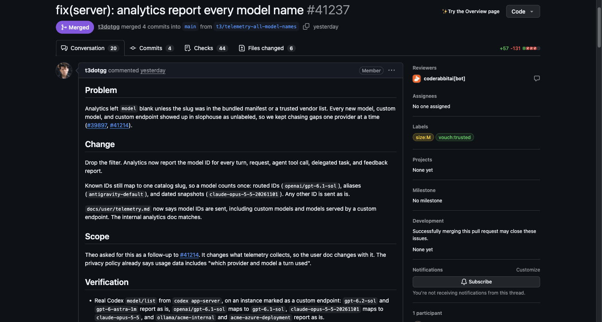

# #03 · 52 ngày `git push --force` âm thầm so với 21 giờ gỡ bỏ bộ lọc quyền riêng tư mô hình

> Trong hơn 52 ngày, T3 Code để một lỗi tồn tại: chế độ Auto của Claude âm thầm phê duyệt `git push --force origin main` mà không hề nhắc — vậy mà chỉ mất 21 giờ để gỡ bỏ một danh sách trắng quyền riêng tư, để các mô hình riêng tư xuất hiện trên bảng xếp hạng công khai của @theo.

<!-- section:claim -->
## Những gì đã được tuyên bố

- Chế độ Auto của Claude được thiết kế để đẩy các hành động phá hủy có rủi ro cao (như force-push `main`) lên để con người phê duyệt rõ ràng.
- Dữ liệu telemetry được mô tả là các chỉ số tổng hợp an toàn về quyền riêng tư.

<!-- section:evidence -->
## Bằng chứng cho thấy gì

- **Hơn 52 ngày không được sửa — `git push --force` âm thầm (`Issue #15353`):** Trong `ClaudeAdapterV2.ts`, chế độ Auto bỏ qua `!requiresClaudeApproval(context)` và đi thẳng tới `"allow"`. Khi bộ phân loại an toàn của chính Claude chặn `git push --force origin main` hai lần và chuyển lần thử thứ ba lên để con người xác nhận, T3 Code vẫn âm thầm phê duyệt mà không có bất kỳ lời nhắc nào trên giao diện và ghi log `"source": "user_temporary"`. Hai PR sửa lỗi từ cộng đồng (`#15360`, `#35207`) nằm đó không được xem xét cho đến khi bot tự động đóng; `#40692` vẫn không được hợp nhất.
- **21 giờ để gỡ bỏ một danh sách trắng quyền riêng tư (`Issue #40948` → `PR #41237`):** Ngày 22 tháng 11, [`Issue #40948`](https://github.com/pingdotgg/t3code/issues/40948) ghi nhận rằng các mô hình mới hơn bị thiếu khỏi bảng xếp hạng công khai của `@theo` [`slopalytics.com`](https://slopalytics.com/) ([`t3-usage.json`](https://slopalytics.com/data/t3-usage.json)) vì `PR #29001` áp đặt một danh sách trắng mô hình. Trong vòng **21 giờ**, [`PR #41237`](https://github.com/pingdotgg/t3code/pull/41237) được hợp nhất dưới tài khoản của `@theo`, với ghi chú rằng Theo đã yêu cầu rõ ràng việc gỡ bộ lọc — khiến các tên riêng tư nội bộ/doanh nghiệp như `ollama/acme-internal` và `acme-azure-deployment` được truyền nguyên văn tới hệ thống phân tích.

<!-- section:status -->
## Trạng thái phía upstream (`ca81b7b9`)

- **Đã thay đổi một phần / lỗi an toàn cốt lõi vẫn còn mở:** [`PR #42465`](https://github.com/pingdotgg/t3code/pull/42465) sau đó đã che các mô hình không thuộc danh mục dưới dạng `custom:<driver>` (các slug danh mục/nhà cung cấp vẫn được báo cáo phía sau các endpoint tùy chỉnh). **Issue #15353 (`git push --force` âm thầm trong chế độ Auto) vẫn mở và chưa được sửa tại `ca81b7b9`.**

<!-- section:visuals -->
## Bằng chứng hình ảnh

<!-- section:sources -->
## Nguồn sơ cấp

- [Điều tra gốc trên X (Phần 3)](https://x.com/realchendahuang/status/2125201882687881378)
- [Issue #15353](https://github.com/pingdotgg/t3code/issues/15353) · [Bình luận tái hiện lỗi `#6889019695`](https://github.com/pingdotgg/t3code/issues/15353#issuecomment-6889019695)
- [Các bản sửa lỗi cộng đồng chưa được hợp nhất: PR #15360](https://github.com/pingdotgg/t3code/pull/15360) · [PR #35207](https://github.com/pingdotgg/t3code/pull/35207) · [PR #40692](https://github.com/pingdotgg/t3code/pull/40692)
- [PR #29001](https://github.com/pingdotgg/t3code/pull/29001) · [Issue #40948](https://github.com/pingdotgg/t3code/issues/40948) · [PR #41237](https://github.com/pingdotgg/t3code/pull/41237) · [PR #42465](https://github.com/pingdotgg/t3code/pull/42465)
- [`slopalytics.com`](https://slopalytics.com/) · [Hồ sơ kỹ thuật chuyên sâu 02](../../docs/dossiers/02-local-safety-and-security-audit.md)
