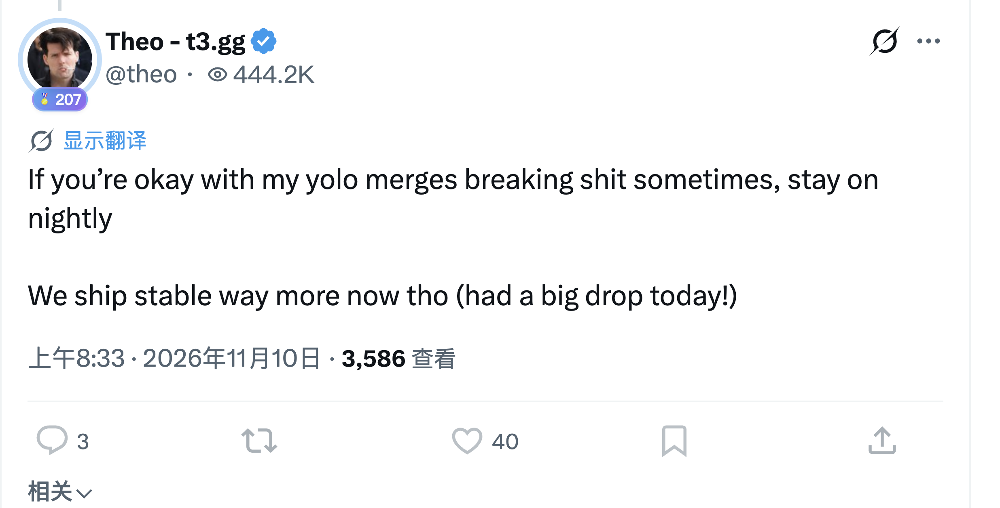

# #09 · Chuyện `yolo merges` nội bộ đối lập với thái độ thù địch với cộng đồng bên ngoài & các lệnh cấm trong `.github/VOUCHED.td`

> Bên trong, T3 Code tung ra 500 commit/ngày thông qua các vòng lặp agent tự động và tự nhận *"my yolo merges breaking shit"* — trong khi bên ngoài lại nói với người đóng góp *"here's my advice: Don't"*, tố cáo người dùng qua `.github/VOUCHED.td`, và lăng mạ những người mở issue.

<!-- section:claim -->
## Điều đã được tuyên bố

- T3 Code tự quảng bá là một dự án mã nguồn mở phát triển nhanh, cởi mở với cộng đồng, do kỹ sư làm cho kỹ sư.

<!-- section:evidence -->
## Bằng chứng cho thấy gì

- **Tốc độ merge nội bộ liều lĩnh:** `@theo` công khai mô tả việc tung ra **500 commits/day** ([`2120741101250515322`](https://x.com/theo/status/2120741101250515322)), chạy **700 concurrent agents**, merge hàng loạt PR cộng đồng qua một vòng lặp agent tự động, thừa nhận *"my yolo merges breaking shit sometimes"* ([`2119951615679672513`](https://x.com/theo/status/2119951615679672513)), và đùa rằng nguy cơ xoá sạch máy cũng chỉ là *"free content"* ([`2119993037971730879`](https://x.com/theo/status/2119993037971730879)).
- **Quản trị thù địch & những lệnh cấm từ tố cáo công khai:** [`CONTRIBUTING.md`](https://github.com/pingdotgg/t3code/blob/main/CONTRIBUTING.md) mở đầu bằng *"here's my advice: Don't"*, kèm theo [`.github/VOUCHED.td`](https://github.com/pingdotgg/t3code/blob/main/.github/VOUCHED.td) tự động ban những người bị tố cáo và **174 nhãn `unwanted`** trên các PR cộng đồng bị từ chối.
- **Đơn phương xoá tính năng & lăng mạ người dùng:** [`PR #5551`](https://github.com/pingdotgg/t3code/pull/5551) chôn vùi nút bật/tắt Build/Plan (*"Reality check for those upset"*, 10 lượt downvote), [`PR #9190`](https://github.com/pingdotgg/t3code/pull/9190) ẩn vòng hiển thị mức dùng context (16 lượt downvote, mức cao nhất của repository), và [`PR #33131`](https://github.com/pingdotgg/t3code/pull/33131) xoá thẳng chế độ Plan kèm một bản tóm tắt AI tự mâu thuẫn. Trong [`Issue #33639`](https://github.com/pingdotgg/t3code/issues/33639#issuecomment-6765462545), `@theo` bảo người dùng `@bermudi` rằng hãy *"uninstall our software"* và gọi anh ta là *"ungrateful prick"* — rồi sáng hôm sau từ chối luôn [`PR #41572`](https://github.com/pingdotgg/t3code/pull/41572) mà người này nộp tiếp.
- **Siết follower trên X:** Người đóng góp bị mắng vì không follow `@theo` ([`2120821423438778667`](https://x.com/theo/status/2120821423438778667)), bị doạ xoá `/btw` ([`2120853340078874923`](https://x.com/theo/status/2120853340078874923)), và được khuyên rằng một ảnh chụp màn hình có chú thích còn hơn là nộp PR ([`2123754193530053110`](https://x.com/theo/status/2123754193530053110)).

<!-- section:status -->
## Trạng thái upstream (`ca81b7b9`)

- **Vẫn còn hiệu lực:** `CONTRIBUTING.md` và `.github/VOUCHED.td` vẫn tồn tại trên `main` tại `ca81b7b9`.

<!-- section:visuals -->
## Bằng chứng hình ảnh

<!-- section:sources -->
## Nguồn sơ cấp

- [Điều tra gốc trên X (Phần 9)](https://x.com/realchendahuang/status/2125392916369871309)
- [`CONTRIBUTING.md`](https://github.com/pingdotgg/t3code/blob/main/CONTRIBUTING.md) · [`.github/VOUCHED.td`](https://github.com/pingdotgg/t3code/blob/main/.github/VOUCHED.td)
- [PR #5551](https://github.com/pingdotgg/t3code/pull/5551) · [PR #9190](https://github.com/pingdotgg/t3code/pull/9190) · [PR #33131](https://github.com/pingdotgg/t3code/pull/33131) · [Bình luận Issue #33639](https://github.com/pingdotgg/t3code/issues/33639#issuecomment-6765462545) · [PR #41572](https://github.com/pingdotgg/t3code/pull/41572)
- [500 commits/day (`2120741101250515322`)](https://x.com/theo/status/2120741101250515322) · [`yolo merges` (`2119951615679672513`)](https://x.com/theo/status/2119951615679672513) · [Xoá sạch máy = free content (`2119993037971730879`)](https://x.com/theo/status/2119993037971730879)
- [Hồ sơ kỹ thuật chuyên sâu 05](../../docs/dossiers/05-governance-trademark-and-history.md)
