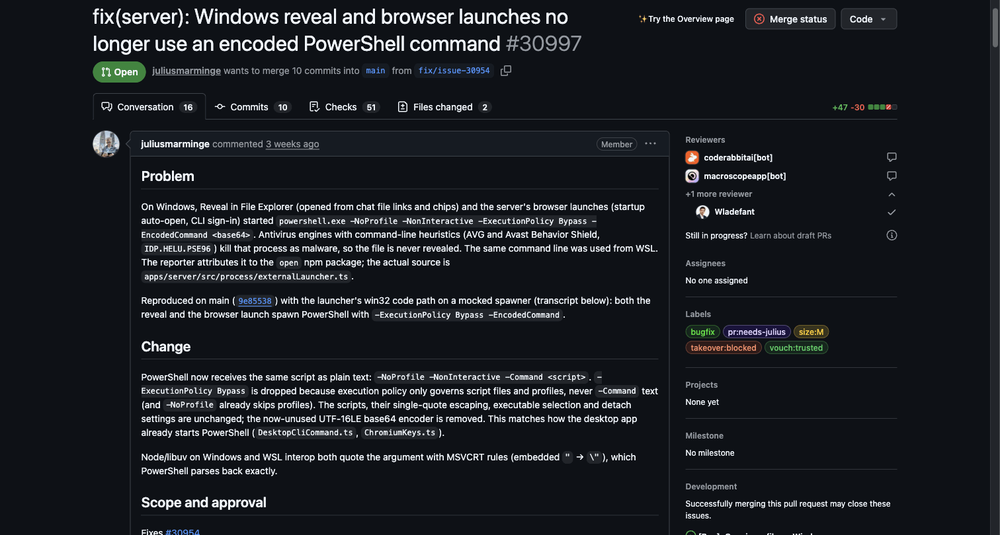

# #13 · Không có cảnh báo bảo mật GitHub nào, vá lỗ hổng nghiêm trọng trong im lặng & `SECURITY.md` vội vã

> Trong lúc các kiểm toán viên mã nguồn Trung Quốc bị gạt bỏ trên X, T3 Code lặng lẽ hợp nhất các bản vá lỗ hổng nghiêm trọng — gồm path traversal trong kho lưu trữ bí mật, rò rỉ token xuyên miền và thực thi lệnh từ repo không đáng tin cậy — đồng thời vẫn giữ số Cảnh báo Bảo mật GitHub được công bố ở mức 0.

<!-- section:claim -->
## Những gì đã được tuyên bố

- Ngày 24 tháng 11, trên X, `@theo` gạt bỏ các bài kiểm toán kỹ thuật bằng tiếng Trung, cho rằng chúng đến từ *"the biggest fucking cesspit"*, và lăng mạ những nhà phát triển đọc chúng ([`2125177503526588877`](https://x.com/theo/status/2125177503526588877)).
- Các bản sửa đổi `SECURITY.md` vội vã (`PR #38812`, `PR #41942`) mô tả quyền truy cập rộng vào host và truyền tải không mã hóa là những ranh giới chủ đích có thể chấp nhận.

<!-- section:evidence -->
## Bằng chứng cho thấy gì

- **Không có Cảnh báo Bảo mật nào được công bố (`0`):** Tính đến `ca81b7b9`, trang [Cảnh báo Bảo mật GitHub](https://github.com/pingdotgg/t3code/security/advisories) của `pingdotgg/t3code` liệt kê **0** cảnh báo được công bố — khiến người dùng desktop/server hiện hữu không có bất kỳ cảnh báo CVE chính thức hay khuyến cáo nâng cấp nào.
- **Các lỗ hổng nghiêm trọng được vá âm thầm:**
  - [`PR #39483`](https://github.com/pingdotgg/t3code/pull/39483): Path traversal trong `ServerSecretStore` qua `jti`/`nonce` của relay trước khi thiết bị được phê duyệt.
  - [`PR #41756`](https://github.com/pingdotgg/t3code/pull/41756): Rò rỉ token GitHub/GitLab của doanh nghiệp giữa các miền.
  - [`PR #41757`](https://github.com/pingdotgg/t3code/pull/41757) & [`PR #42386`](https://github.com/pingdotgg/t3code/pull/42386): Cách ly bản xem trước trình duyệt desktop vốn không có sandbox và xác nhận lệnh bố cục worktree.
  - [`PR #42413`](https://github.com/pingdotgg/t3code/pull/42413): Quyền đối với tệp token Clerk trên desktop chỉ dành cho chủ sở hữu.
  - [`PR #42504`](https://github.com/pingdotgg/t3code/pull/42504): Bản vá dài ~3.000 dòng cuối cùng cũng thêm lời nhắc xác nhận trước khi thực thi lệnh từ cấu hình repository không đáng tin cậy (cùng với các bản sửa lỗi âm thầm trước đó `#22190`, `#37823`, `#39464`, `#39480`, `#40133`, `#41886`).
- **Các lỗ hổng bảo mật cục bộ vẫn mở:** [`Issue #26489`](https://github.com/pingdotgg/t3code/issues/26489) (path traversal/symlink bên ngoài) và [`PR #30997`](https://github.com/pingdotgg/t3code/pull/30997) (`externalLauncher.ts` trên Windows chạy `powershell.exe -ExecutionPolicy Bypass -EncodedCommand <base64>`, bị AVG/Avast gắn cờ là `IDP.HELU.PSE96`) vẫn chưa được hợp nhất.
- **`SECURITY.md` thu hẹp trách nhiệm thay vì gia cố kiến trúc:** Tuyên bố rõ rằng quyền `filesystem:read` trên toàn hệ điều hành bên ngoài workspace, truyền tải HTTP thuần trên iOS/LAN, và việc chiếm toàn bộ máy host thông qua khóa ký relay bị xâm phạm là *ranh giới thiết kế chủ đích*.

<!-- section:status -->
## Tình trạng phía upstream (`ca81b7b9`)

- **Vẫn còn mở:** Các Cảnh báo Bảo mật GitHub được công bố vẫn ở mức **0**; `Issue #26489` và `PR #30997` vẫn chưa được sửa; `SECURITY.md` tiếp tục phân loại việc đọc toàn hệ điều hành và HTTP thuần là hành vi chủ đích.

<!-- section:visuals -->
## Bằng chứng hình ảnh

<!-- section:sources -->
## Nguồn sơ cấp

- [Điều tra gốc trên X (Phần 13)](https://x.com/realchendahuang/status/2125395980354994414)
- [Cảnh báo Bảo mật GitHub (0 được công bố)](https://github.com/pingdotgg/t3code/security/advisories) · [`SECURITY.md`](https://github.com/pingdotgg/t3code/blob/main/SECURITY.md)
- [PR #39483](https://github.com/pingdotgg/t3code/pull/39483) · [PR #41756](https://github.com/pingdotgg/t3code/pull/41756) · [PR #41757](https://github.com/pingdotgg/t3code/pull/41757) · [PR #42386](https://github.com/pingdotgg/t3code/pull/42386) · [PR #42413](https://github.com/pingdotgg/t3code/pull/42413) · [PR #42504](https://github.com/pingdotgg/t3code/pull/42504)
- [Issue #26489](https://github.com/pingdotgg/t3code/issues/26489) · [PR #30997](https://github.com/pingdotgg/t3code/pull/30997) · [Hồ sơ Kỹ thuật Chuyên sâu 02](../../docs/dossiers/02-local-safety-and-security-audit.md)
