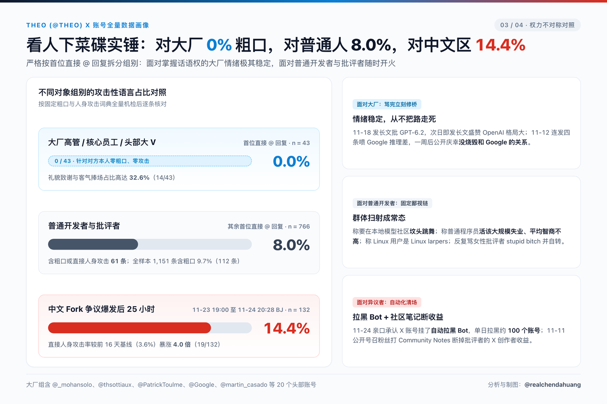

# #14 · 1,151 条连续推文量化铁证：对大厂 VIP 0.0% 粗口 vs 辱华危机期暴涨 4.0 倍

> 对 2026 年 11 月 7 日至 24 日 @theo 全部 1,151 条连续推文做穷举量化审计，坐实了赤裸的权力看人下菜碟：面对 20 位大厂高管与员工 0.0% 粗口，面对普通开发者 8.0% 敌意，而在中文二改 25 小时窗口内人身攻击暴涨 4.0 倍至 14.4%。

<!-- section:claim -->
## 官方 / Theo 宣称

- 就在中文二改冲突爆发前不到 24 小时，`@theo` 还在 X 上说教他人不要“透支社区信任”（[`2124449493513068862`](https://x.com/theo/status/2124449493513068862)）。
- 支持者常将其粗口洗白为“一视同仁、直性子”。

<!-- section:evidence -->
## 源码与公开记录铁证

穷举统计 **2026 年 11 月 7 日至 24 日**全部连续发帖（`n = 1,151`，跨度 `17.24` 天，日均 `66.8` 条，回复占 `75.6%`，间隔中位数 `2.7` 分钟），结果呈现泾渭分明的等级双标：

- **面对大厂高管、实验室员工与头部 KOL（严格口径 `n = 43` / 宽口径 `60`–`62`）：** 针对性粗口与人身攻击为 **0.0%**，礼貌致谢占 **30.0%–32.6%**。哪怕吐槽 Gemini 4 Carbon 或 GPT-6.2 Astra，句尾立刻找补称赞团队或专门公开致歉（[`2123255588570501585`](https://x.com/theo/status/2123255588570501585)、[`2123995323123343869`](https://x.com/theo/status/2123995323123343869)）。
- **面对普通开发者与质疑者（严格口径 `n = 766` / 宽口径 `749`）：** 敌意与粗口占比达 **8.0%**（`61/766`）——包括转发普通工具对比提问宣称 *"Engineers deserve the mass unemployment they have coming"*（工程师活该大规模失业，[`2124470530590011704`](https://x.com/theo/status/2124470530590011704)）、声称要 *"dance on the graves of the 'local ai' community"*（在本地 AI 社区坟头蹦迪，[`2120733839832273025`](https://x.com/theo/status/2120733839832273025)）、嘲讽 Linux 用户为 *"Linux larpers"*（[`2124298216271499605`](https://x.com/theo/status/2124298216271499605)）、多次辱骂 `"stupid bitch"`（[`2120599310211703274`](https://x.com/theo/status/2120599310211703274)）及拿坐牢与 RSD 病症嘲讽他人（[`2122865897375400066`](https://x.com/theo/status/2122865897375400066)）。
- **中文二改 25 小时危机窗口（`n = 132`）：** 直接人身攻击从日常 `3.6%` 基线**暴涨 4.0 倍至 14.4%**（`19/132`），包括将整个中文技术推特骂作 *"the biggest fucking cesspit"*，并辱骂相信中文源码审计的开发者为 *"fucking braindead"*（[`2125177503526588877`](https://x.com/theo/status/2125177503526588877)）。

<!-- section:status -->
## 上游最新状态（`ca81b7b9`）

- **可复现量化基线：** 完整统计口径、正则分类规则、大厂账号清单及四张可交互取证图表已完整归档于卷宗 06。

<!-- section:visuals -->
## 一手实证原图

<!-- section:sources -->
## 可核验原始来源

- [X 调查原帖（第 14 弹）](https://x.com/realchendahuang/status/2125404517697290438)
- [宣称工程师活该失业（`2124470530590011704`）](https://x.com/theo/status/2124470530590011704) · [辱骂中文技术推特（`2125177503526588877`）](https://x.com/theo/status/2125177503526588877)
- [嘲讽本地 AI 社区（`2120733839832273025`）](https://x.com/theo/status/2120733839832273025) · [嘲讽 Linux 用户（`2124298216271499605`）](https://x.com/theo/status/2124298216271499605) · [坐牢与 RSD 嘲讽（`2122865897375400066`）](https://x.com/theo/status/2122865897375400066)
- [对大厂找补致歉（`2123255588570501585`）](https://x.com/theo/status/2123255588570501585) · [`2123995323123343869`](https://x.com/theo/status/2123995323123343869) · [危机前夜说教别透支信任（`2124449493513068862`）](https://x.com/theo/status/2124449493513068862)
- [深度技术卷宗 06（1,151 条推文完整数据集）](../../docs/dossiers/06-tweet-forensic-dataset-1151.md)
