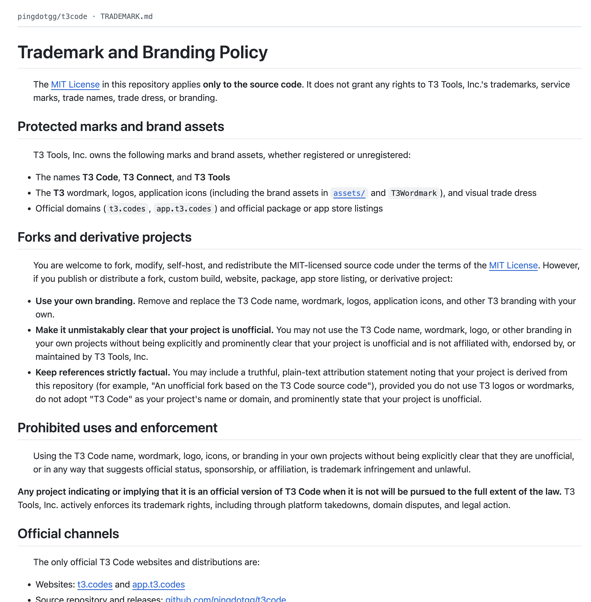

# #15 · 威胁 GitHub 封号时 USPTO 注册商标为 0，17 小时后紧急补写 `TRADEMARK.md`

> 当 @theo 威胁找 GitHub 封杀中国开发者账号并指控对方“侵犯商标”时，T3 Tools Inc. 名下对 `T3 Code`、`T3 Tools` 与 `T3 Connect` 的 USPTO 注册商标全部为 0——直到 17 小时后他才仓促补合了一份 `TRADEMARK.md`。

<!-- section:claim -->
## 官方 / Theo 宣称

- 11 月 23 日，`@theo` 指控 MIT 二改作者侵犯商标并威胁联系 GitHub 封掉对方整个账号（[`2124829315657576890`](https://x.com/theo/status/2124829315657576890)）。
- 补写 `TRADEMARK.md` 前三小时，他嘲讽提出法律质疑的开发者 *"get a better lawyer"*（找个好点的律师，[`2125026423769555308`](https://x.com/theo/status/2125026423769555308)）——尽管 2024 年 9 月他自己还发帖嘲讽 WordPress 打的是 *"unenforceable trademark dispute"*（[`1839261574005141945`](https://x.com/theo/status/1839261574005141945)）。

<!-- section:evidence -->
## 源码与公开记录铁证

- **USPTO 官方数据库核查为 0 注册：** 顺着 `@vildanden_ai` 的线索（[`2125275487404761555`](https://x.com/vildanden_ai/status/2125275487404761555)）直查美国专利商标局 TSDR 数据库，`T3 Code`、`T3 Tools`、`T3 Connect` 注册记录全为 **0 条**。T3 Tools Inc. 历史上提交过的唯一申请（`PING LABS`，序列号 [`97294243`](https://tsdr.uspto.gov/statusview/sn97294243)）已于 2025 年 2 月被驳回、5 月 19 日标为 `ABANDONED`。反倒是不相干的第三方在第 9/42 类软件与 SaaS 中持有有效 `T3` 注册商标（`EquipmentShare` 注册号 `7795672` / 序列号 [`90644500`](https://tsdr.uspto.gov/#caseNumber=90644500&caseSearchType=US_APPLICATION&caseType=DEFAULT&searchType=statusSearch)；`ESG Operations` 注册号 `3324707`）。
- **GitHub 商标下架政策的硬门槛：** 按 [GitHub Trademark Policy](https://docs.github.com/en/site-policy/content-removal-policies/github-trademark-policy)，商业公司提起商标下架必须在伪证罪约束下填写联邦或国际注册商标号。`@theo` 威胁封号那一刻，他连 GitHub 投诉表单都填不出来。
- **17 小时后紧急补写 `TRADEMARK.md`（`PR #41898`）：** 11 月 24 日 **12:21 CST**（封号威胁 17 小时后），`@theo` 合入 [`PR #41898`](https://github.com/pingdotgg/t3code/pull/41898) 补写 `TRADEMARK.md`，宣称无论 *"whether registered or unregistered"*（注册还是未注册）均享有权利，并在 **94 秒后**立即在 X 上甩出该文件链接（[`2125082769395220688`](https://x.com/theo/status/2125082769395220688)）。

<!-- section:status -->
## 上游最新状态（`ca81b7b9`）

- **公开历史留档：** 事后补写的 `TRADEMARK.md` 留在 `main` 中，而 USPTO 官方数据库对 `T3 Code` 的注册记录依然为 0。

<!-- section:visuals -->
## 一手实证原图

<!-- section:sources -->
## 可核验原始来源

- [X 调查原帖（第 15 弹）](https://x.com/realchendahuang/status/2125408163273080950)
- [USPTO TSDR `97294243`（PING LABS — ABANDONED）](https://tsdr.uspto.gov/statusview/sn97294243) · [USPTO TSDR `90644500`（EquipmentShare `T3`）](https://tsdr.uspto.gov/#caseNumber=90644500&caseSearchType=US_APPLICATION&caseType=DEFAULT&searchType=statusSearch)
- [GitHub 商标下架政策](https://docs.github.com/en/site-policy/content-removal-policies/github-trademark-policy)
- [PR #41898](https://github.com/pingdotgg/t3code/pull/41898) · [`TRADEMARK.md`](https://github.com/pingdotgg/t3code/blob/main/TRADEMARK.md)
- [94 秒后引用新文件（`2125082769395220688`）](https://x.com/theo/status/2125082769395220688) · ["get a better lawyer"（`2125026423769555308`）](https://x.com/theo/status/2125026423769555308) · [曾嘲讽 WordPress 商标战（`1839261574005141945`）](https://x.com/theo/status/1839261574005141945)
- [深度技术卷宗 05](../../docs/dossiers/05-governance-trademark-and-history.md)
