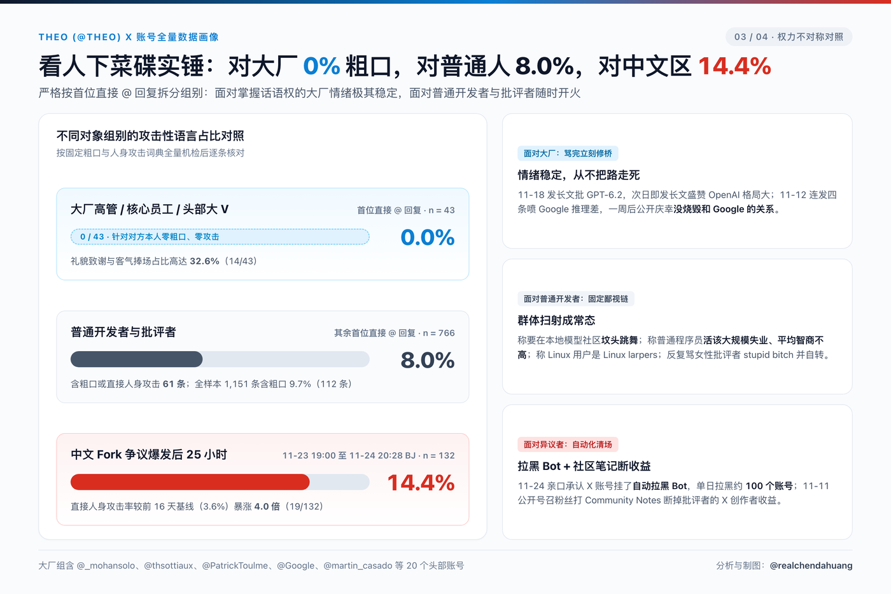

# #14 · 1,151 則連續推文量化鐵證：對大廠 VIP 0.0% 粗口 vs 辱華危機期暴漲 4.0 倍

> 對 2026 年 11 月 7 日至 24 日 @theo 全部 1,151 則連續推文做窮舉量化審計，坐實了赤裸裸的權力大小眼：面對 20 位大廠高階主管與員工 0.0% 粗口，面對一般開發者 8.0% 敵意，而在中文二改 25 小時窗口內人身攻擊暴漲 4.0 倍至 14.4%。

<!-- section:claim -->
## 官方／Theo 宣稱

- 就在中文二改衝突爆發前不到 24 小時，`@theo` 還在 X 上說教他人不要「透支社群信任」（[`2124449493513068862`](https://x.com/theo/status/2124449493513068862)）。
- 支持者常把其粗口洗白為「一視同仁、直性子」。

<!-- section:evidence -->
## 原始碼與公開紀錄鐵證

窮舉統計 **2026 年 11 月 7 日至 24 日**全部連續發帖（`n = 1,151`，跨度 `17.24` 天，日均 `66.8` 則，回覆佔 `75.6%`，間隔中位數 `2.7` 分鐘），結果呈現涇渭分明的等級雙標：

- **面對大廠高階主管、實驗室員工與頭部 KOL（嚴格口徑 `n = 43`／寬鬆口徑 `60`–`62`）：** 針對性粗口與人身攻擊為 **0.0%**，禮貌致謝佔 **30.0%–32.6%**。哪怕抱怨 Gemini 4 Carbon 或 GPT-6.2 Astra，句尾立刻補上稱讚團隊或特地公開致歉（[`2123255588570501585`](https://x.com/theo/status/2123255588570501585)、[`2123995323123343869`](https://x.com/theo/status/2123995323123343869)）。
- **面對一般開發者與質疑者（嚴格口徑 `n = 766`／寬鬆口徑 `749`）：** 敵意與粗口佔比達 **8.0%**（`61/766`）——包括轉發一般工具比較提問並宣稱 *"Engineers deserve the mass unemployment they have coming"*（工程師活該大規模失業，[`2124470530590011704`](https://x.com/theo/status/2124470530590011704)）、揚言要 *"dance on the graves of the 'local ai' community"*（在本地 AI 社群墳頭跳舞，[`2120733839832273025`](https://x.com/theo/status/2120733839832273025)）、嘲諷 Linux 使用者為 *"Linux larpers"*（[`2124298216271499605`](https://x.com/theo/status/2124298216271499605)）、多次辱罵 `"stupid bitch"`（[`2120599310211703274`](https://x.com/theo/status/2120599310211703274)）及以坐牢與 RSD 病症嘲諷他人（[`2122865897375400066`](https://x.com/theo/status/2122865897375400066)）。
- **中文二改 25 小時危機窗口（`n = 132`）：** 直接人身攻擊從日常 `3.6%` 基線**暴漲 4.0 倍至 14.4%**（`19/132`），包括將整個中文技術推特罵為 *"the biggest fucking cesspit"*，並辱罵相信中文原始碼審計的開發者為 *"fucking braindead"*（[`2125177503526588877`](https://x.com/theo/status/2125177503526588877)）。

<!-- section:status -->
## 上游最新狀態（`ca81b7b9`）

- **可複現量化基線：** 完整統計口徑、正則分類規則、大廠帳號清單及四張可互動取證圖表已完整歸檔於卷宗 06。

<!-- section:visuals -->
## 一手實證原圖

<!-- section:sources -->
## 可核驗原始來源

- [X 調查原帖（第 14 彈）](https://x.com/realchendahuang/status/2125404517697290438)
- [宣稱工程師活該失業（`2124470530590011704`）](https://x.com/theo/status/2124470530590011704) · [辱罵中文技術推特（`2125177503526588877`）](https://x.com/theo/status/2125177503526588877)
- [嘲諷本地 AI 社群（`2120733839832273025`）](https://x.com/theo/status/2120733839832273025) · [嘲諷 Linux 使用者（`2124298216271499605`）](https://x.com/theo/status/2124298216271499605) · [坐牢與 RSD 嘲諷（`2122865897375400066`）](https://x.com/theo/status/2122865897375400066)
- [對大廠補救致歉（`2123255588570501585`）](https://x.com/theo/status/2123255588570501585) · [`2123995323123343869`](https://x.com/theo/status/2123995323123343869) · [危機前夜說教別透支信任（`2124449493513068862`）](https://x.com/theo/status/2124449493513068862)
- [深度技術卷宗 06（1,151 則推文完整資料集）](../../docs/dossiers/06-tweet-forensic-dataset-1151.md)
