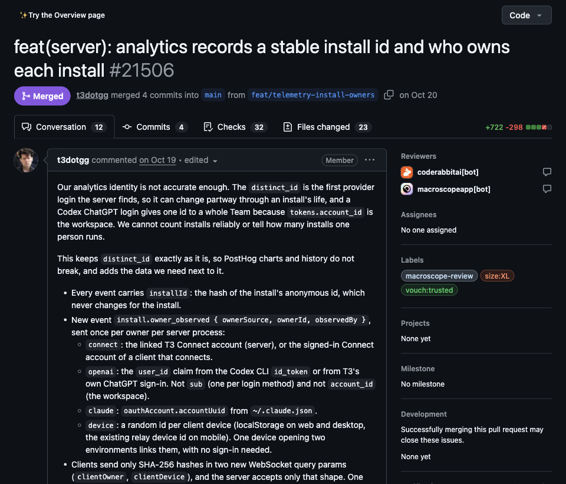
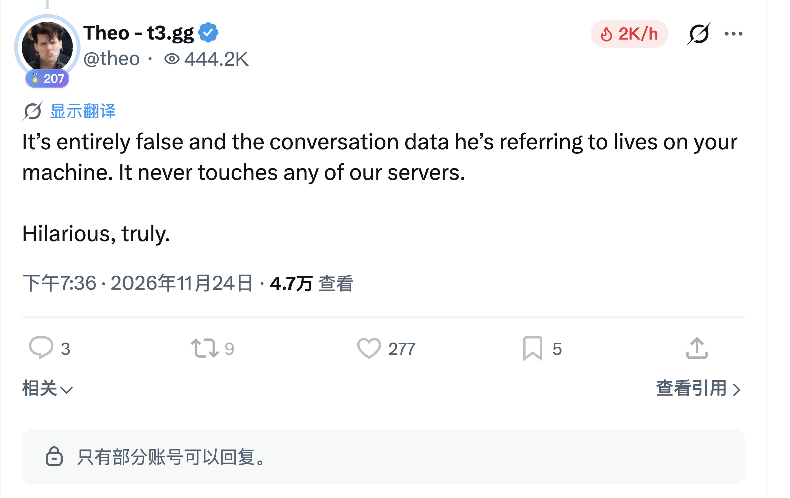

# Dossier 01: Telemetry Architecture, Cross-Tool Identity Stitching & the Nov 24–25 GDPR Overnight Sprint

[Back to README](../../README.md) · [Complete Source Index](../COMPLETE-SOURCE-INDEX.md) · [Next Dossier: Local Safety & Security Audit →](./02-local-safety-and-security-audit.md)

> **Covers:** Audit [Part 1](https://x.com/realchendahuang/status/2125153472450527440), [Part 7](https://x.com/realchendahuang/status/2125391659492081947), [Part 11](https://x.com/realchendahuang/status/2125394810559426993), and [Part 12](https://x.com/realchendahuang/status/2125395501663281198), plus the minute-by-minute Nov 23–25, 2026 event sequence and primary source verification against `pingdotgg/t3code`.

---

## Table of Contents

1. [Executive Summary](#1-executive-summary)
2. [Chronology of Default Telemetry & Community Opt-Out Rejections (Mar–Nov 2026)](#2-chronology-of-default-telemetry--community-opt-out-rejections-marnov-2026)
3. [Source-Code Audit: `AnalyticsService.ts`, `Identify.ts`, `ProviderUsageAnalytics.ts` & `FeatureUsage.ts`](#3-source-code-audit-analyticsservicets-identifyts-providerusageanalyticsts--featureusagets)
4. [The Managed Policy & Documentation Contradiction (Part 7)](#4-the-managed-policy--documentation-contradiction-part-7)
5. [The Nov 25 Morning Clarification vs. Overnight PRs & 100MB Dump (Part 11)](#5-the-nov-25-morning-clarification-vs-overnight-prs--100mb-dump-part-11)
6. [The 6-Hour Post-GDPR Overnight Sprint: Four Deeper Disclosures (Part 12)](#6-the-6-hour-post-gdpr-overnight-sprint-four-deeper-disclosures-part-12)
7. [Minute-by-Minute Timeline: Nov 23–25, 2026 (CST / UTC)](#7-minute-by-minute-timeline-nov-2325-2026-cst--utc)
8. [Verification & Remediation Summary](#8-verification--remediation-summary)
9. [Primary References](#9-primary-references)

---

## 1. Executive Summary

Between March 6 and November 25, 2026, `pingdotgg/t3code` (T3 Code) shipped default-on analytics while asserting public privacy assurances that repeatedly conflicted with both its runtime code and its own documentation:

- **Default-on collection during a "No telemetry" pledge:** PostHog analytics shipped enabled by default in **PR #174** (March 6, 2026) while the homepage displayed `No telemetry / Unless you opt in. Full stop.` for over three months until `@theo` silently deleted those lines in **commit `3bdaa6e1`** (June 18, 2026).
- **First-party retention proxy:** **PR #15028** (October 2026) routed 10-second batched telemetry payloads to `https://ingest.t3.codes`, whose first-line code comment in `AnalyticsService.ts` states that T3's closed-source ingest endpoint retains raw copies of every event before forwarding to PostHog.
- **Cross-tool identity stitching:** **PR #21506** (October 19–20, 2026) added code in `Identify.ts` that reads `~/.codex/auth.json` and `~/.claude.json` from the user's home directory, extracting OpenAI `user_id` and Claude `accountUuid` alongside T3 Connect user IDs and hashing them with unsalted SHA-256 (`packages/shared/src/telemetryId.ts`) to link multiple machines to one individual.
- **Repeated rejection of UI opt-outs:** Maintainers closed **Issue #1397** (`not planned`), closed **Issue #4123** twice, and rejected **four community opt-out PRs** (`#13458`, `#16763`, `#21248`, `#27077`), including `#27077` after automated review approval and 147 passing tests.
- **Overnight GDPR fallout:** After Part 1 reached 1.81M+ views and a European GDPR complaint was filed on the night of November 24, emergency PRs merged within six hours revealed **2.2M relay spans/hour** logging real caller IPs (`cf-connecting-ip`) and `user-agent` beside `user.id` for 30 days in Axiom (`#42380`), absolute workspace path leaks via `git.cwd` (`#42450`), ignored Windows (`#42376`) and macOS first-launch (`#42464`) telemetry opt-outs, broken Clerk account deletion (`#42285`), plaintext Android FCM `user_id` pushes to Google (`#42459`), and supposedly "anonymous" feedback mixed into identified host batches (`#42466`).

---

## 2. Chronology of Default Telemetry & Community Opt-Out Rejections (Mar–Nov 2026)

| Date (2026) | Artifact / Event | Documented Fact | Primary Citation |
|---|---|---|---|
| **Mar 6** | **PR #174** merged | Enables PostHog telemetry by default; no consent modal, no settings UI toggle, no telemetry docs in repo. | [PR #174](https://github.com/pingdotgg/t3code/pull/174) |
| **Jun 18** | **Commit `3bdaa6e1`** | `@theo` deletes `No telemetry / Unless you opt in. Full stop.` from homepage during a redesign with no announcement or user notice. | [Commit `3bdaa6e1`](https://github.com/pingdotgg/t3code/commit/3bdaa6e10046945ccc08264d2d6f3b81775efcb3) |
| **Jun 23** | **Issue #1397** closed | Maintainer `juliusmarminge` closes opt-out toggle request as `not planned`: `"We will not make this easier to opt out of, it is crucial for us to know how many users we have"`. | [Issue #1397](https://github.com/pingdotgg/t3code/issues/1397) |
| **Jul–Nov 4** | **Issue #4123** | User cites archived homepage screenshots questioning default telemetry. Closed Oct 21 via an unrelated commit, reopened after pushback, silently closed again Nov 4. | [Issue #4123](https://github.com/pingdotgg/t3code/issues/4123) |
| **Sep–Nov** | **4 rejected PRs** | Community submits settings/CLI opt-out PRs `#13458`, `#16763`, `#21248`, and `#27077` (by `inayayousfi`, approved by `macroscopeapp[bot]`, 147 passing tests). Closed Nov 17 as `unwanted` (`"It is not something the project wants to take on"`). | [`#13458`](https://github.com/pingdotgg/t3code/pull/13458) · [`#16763`](https://github.com/pingdotgg/t3code/pull/16763) · [`#21248`](https://github.com/pingdotgg/t3code/pull/21248) · [`#27077`](https://github.com/pingdotgg/t3code/pull/27077) |
| **Oct** | **PR #15028** | Routes 10-second batched uploads through self-hosted `https://ingest.t3.codes` so T3 retains a copy of every raw event before PostHog forwarding. | [PR #15028](https://github.com/pingdotgg/t3code/pull/15028) |
| **Oct 19–20** | **PR #21506** | `@theo` merges `feat(server): analytics records a stable install id and who owns each install` to read `~/.codex/auth.json` and `~/.claude.json` and link machines via `install.owner_observed`. | [PR #21506](https://github.com/pingdotgg/t3code/pull/21506) |


---

## 3. Source-Code Audit: `AnalyticsService.ts`, `Identify.ts`, `ProviderUsageAnalytics.ts` & `FeatureUsage.ts`

Direct inspection of `pingdotgg/t3code` source files establishes the exact mechanics of collection, identification, and persistence.

### 3.1 `AnalyticsService.ts`: Closed-Source Retention Endpoint, 10s Flush & Unconditional Startup Identity

In [`apps/server/src/telemetry/AnalyticsService.ts`](https://github.com/pingdotgg/t3code/blob/main/apps/server/src/telemetry/AnalyticsService.ts):

- **Line 1** explicitly confirms dual retention:
  ```ts
  // T3 ingest retains events and forwards to PostHog; UUIDs deduplicate retries there.
  ```
- **Lines 43 & 67–80** set the default flush cadence (`10_000` ms), hardcoded default PostHog key, self-hosted ingest URL, and default-enabled state (`true`):
  ```ts
  const FLUSH_INTERVAL_MS = 10_000;
  ...
  const TelemetryEnvConfig = Config.all({
    posthogKey: Config.String("T3CODE_POSTHOG_KEY").pipe(
      Config.withDefault("phc_XOWci4oZP4VvLiEyrFqkFjP4CZn55mjYYBMREK5Wd6m"),
    ),
    posthogHost: Config.String("T3CODE_POSTHOG_HOST").pipe(
      Config.withDefault("https://ingest.t3.codes"),
    ),
    enabled: Config.Boolean("T3CODE_TELEMETRY_ENABLED").pipe(Config.withDefault(true)),
    flushBatchSize: Config.Number("T3CODE_TELEMETRY_FLUSH_BATCH_SIZE").pipe(Config.withDefault(20)),
    maxBufferedEvents: Config.Number("T3CODE_TELEMETRY_MAX_BUFFERED_EVENTS").pipe(
      Config.withDefault(1_000),
    ),
    wslDistroName: Config.String("WSL_DISTRO_NAME").pipe(Config.option),
  });
  ```
- **Line 149** (corresponding to the `#L152` region cited during Nov 25 verification) executes `getTelemetryIdentity` unconditionally during service initialization **before** checking whether telemetry is enabled (`telemetryEnabled` is only evaluated lazily inside `record()` at line 315 and `sendBatch()` at line 203):
  ```ts
  const { distinctId, installId } = yield* getTelemetryIdentity;
  ```
  As a result, even when `T3CODE_TELEMETRY_ENABLED=false` or a Managed Policy disables telemetry, startup unconditionally triggers `upsertAnonymousId` (creating/persisting the UUID file on disk at `anonymousIdPath`) and `readProviderLogins(homeDirectory)` (reading `~/.codex/auth.json` and `~/.claude.json`).
- **Lines 205–231** attach host metadata (`installId`, `platform`, `wsl`, `arch`, `t3CodeVersion`, `telemetryChannel`, `clientType`, `serverOs`, `serverArch`, `serverWslDistro`, `serverAppVersion`, `serverMode`) and POST batches to `${telemetryConfig.posthogHost}/batch/`.

### 3.2 `Identify.ts` & `telemetryId.ts`: Reading External Credentials & Unsalted SHA-256

In [`apps/server/src/telemetry/Identify.ts`](https://github.com/pingdotgg/t3code/blob/main/apps/server/src/telemetry/Identify.ts):

- **Lines 253–271** read credential files belonging to separate AI CLIs directly from the user's home directory:
  ```ts
  const codexTokens = yield* readJsonIdentityFile(
    "codex",
    path.join(homeDirectory, ".codex", "auth.json"),
    decodeCodexAuthJson,
  ).pipe(
    skipOnError,
    Effect.map(Option.flatMap((authJson) => Option.fromUndefinedOr(authJson.tokens))),
  );
  const claudeJson = yield* readJsonIdentityFile(
    "claude",
    path.join(homeDirectory, ".claude.json"),
    decodeClaudeJson,
  ).pipe(skipOnError);
  ```
- **Lines 181–189** base64url-decode the JWT payload of Codex `id_token` (without verifying signature) to extract `claims["https://api.openai.com/auth"].user_id`, specifically bypassing shared Team `account_id` and per-login `sub` so every machine logs the same user identifier (explained in lines 43–48 and PR `#21506` description).
- **Lines 307–339** collect `connect` (from `ServerSecretStore` key `CLOUD_LINKED_USER_ID`), `openai` (`user_id`), and `claude` (`oauthAccount?.accountUuid`), hashing each with `hashTelemetryId(value.value)` and emitting `install.owner_observed` via `AnalyticsService.recordOwners` (`AnalyticsService.ts:347`).

In [`packages/shared/src/telemetryId.ts`](https://github.com/pingdotgg/t3code/blob/main/packages/shared/src/telemetryId.ts) (lines 8–9), `hashTelemetryId` performs a **plain, unsalted SHA-256 digest**:

```ts
export const hashTelemetryId = (value: string): string =>
  Hex.encode(sha256(new TextEncoder().encode(value)));
```

**Why unsalted SHA-256 is not anonymization:** Because T3's backend already possesses plaintext T3 Connect user IDs (via Clerk authentication), hashing any known user ID directly reproduces its `ownerId` for exact lookup. Likewise, any third-party OpenAI `user_id` or Claude `accountUuid` breach or shared dataset joins deterministically against the same unsalted digest.




### 3.3 `ProviderUsageAnalytics.ts`, `ProviderDimensions.ts` & `FeatureUsage.ts`

- [`apps/server/src/telemetry/ProviderUsageAnalytics.ts`](https://github.com/pingdotgg/t3code/blob/main/apps/server/src/telemetry/ProviderUsageAnalytics.ts) emits `provider.turn.completed` (line 415) and `provider.request.completed` (line 422), capturing `provider`, `model`, `observedModel`, `effort`, `serviceTier`, `runtimeMode`, `interactionMode`, `durationMs`, `inputTokens`, `cachedInputTokens`, `cacheCreationTokens`, `outputTokens`, `reasoningTokens`, `nativeChildTurns`, `childInputTokens`, and `childOutputTokens`.
- [`apps/server/src/telemetry/ProviderDimensions.ts`](https://github.com/pingdotgg/t3code/blob/main/apps/server/src/telemetry/ProviderDimensions.ts) (lines 48–50) passes non-catalog model IDs straight through verbatim (`return fileName(catalogSlug(providers, model) ?? model)`), leaking custom proxy and internal endpoint names.
- [`apps/server/src/telemetry/FeatureUsage.ts`](https://github.com/pingdotgg/t3code/blob/main/apps/server/src/telemetry/FeatureUsage.ts) tracks **18 `COMMAND_FEATURES`** (lines 20–49: `guest_message.send`, `checkpoint.rollback`, `thread.fork`, `thread.merge_back`, `provider.switch`, `thread.archive`, `thread.snooze`, `thread.pin`, `thread.settle`, `thread.pull_request.link`, `thread.pull_request.watch`, `thread.runtime_mode.set`, `thread.interaction_mode.set`, `run.interrupt`, `queue.steer`, `queue.edit`, `guest_share.close`, `guest_message.dismiss`) and **17 `METHOD_FEATURES`** (lines 56–76: `terminal.open`, `preview.open`, `device.open`, `editor.open`, `worktree.create`, `git.stacked_action`, `pull_request.action`, `pull_request.review`, `pull_request.comment`, `scheduled_task.save`, `scheduled_task.run_now`, `agent_session.import`, `project.clone`, `repository.publish`, `source_control.sign_in`, `keybinding.customize`, `guest_share.create`) — **35 distinct UI/command actions**.

### 3.4 `DesktopShellEnvironment.ts` Gap: Missing `T3CODE_OTEL_SDK_DISABLED` Forwarding

In [`apps/desktop/src/shell/DesktopShellEnvironment.ts`](https://github.com/pingdotgg/t3code/blob/main/apps/desktop/src/shell/DesktopShellEnvironment.ts):
- `LOGIN_SHELL_ENV_NAMES` (lines 102–131), POSIX copying (lines 541–563), and `CACHED_ENV_NAMES` (lines 652–666) explicitly forward `T3CODE_TELEMETRY_ENABLED` from `~/.zshrc` / login shells.
- Neither `T3CODE_OTEL_SDK_DISABLED` nor `OTEL_SDK_DISABLED` appears in `LOGIN_SHELL_ENV_NAMES`, `WINDOWS_PROFILE_ENV_NAMES` (line 132), or `CACHED_ENV_NAMES`. Meanwhile, `packages/shared/src/otelEnvironment.ts` (lines 254–269, 321–332) documents `T3CODE_OTEL_SDK_DISABLED` and `OTEL_SDK_DISABLED` as primary OpenTelemetry kill switches, creating a silent disparity where desktop users who export only `T3CODE_OTEL_SDK_DISABLED=true` in their shell profile never have it forwarded by the Electron shell discovery layer.

---

## 4. The Managed Policy & Documentation Contradiction (Part 7)

At **19:13 CST on November 24, 2026** ([`2125186071357251715`](https://x.com/theo/status/2125186071357251715)), `@theo` dismissed criticism of missing user toggles by claiming:

> "We have the best corporate managed policy system in the game, trivial to set up and turn off all telemetry. 100x easier than tools like cursor."

Twenty-three minutes later, at **19:36 CST** ([`2125191784859115766`](https://x.com/theo/status/2125191784859115766)), he added:

> "It's entirely false and the conversation data he's referring to lives on your machine. It never touches any of our servers."




Checking T3 Code's own repository documentation disproved both claims:

1. **System-Administrator Barrier (`docs/user/managed-policy.md`, lines 49–59):** Individual users cannot flip a toggle in Settings. Configuring a Managed Policy requires root/administrator privileges to write system files or deploy MDM profiles:
   - **macOS:** `/Library/Application Support/T3Code/policy.json` (or device-level MDM configuration profile for `com.t3tools.t3code`; user profiles are ignored per line 68)
   - **Windows:** `C:\Program Files\T3Code\policy.json` or Group Policy / Registry `REG_SZ` at `HKLM\SOFTWARE\Policies\T3Tools\T3Code`
   - **Linux:** `/etc/t3code/policy.json`
2. **Three Explicit Blind Spots (`docs/user/telemetry.md`):**
   - **Hosted Web App (`app.t3.codes`) — Zero Opt-Out:** Lines 82–84 state: *"The web app in a browser, including one the `t3` CLI opens, does not read these environment variables. When its build has relay tracing configured, it sends its own connection traces even if the server has opted out. The browser app has no relay tracing toggle."* (Also confirmed in `managed-policy.md` lines 260–261: *"A browser that opens the server, such as app.t3.codes, still sends its own relay traces."*)
   - **Mobile Apps (iOS / Android) — Outside Server Policy & Env Vars:** In the Nov 24 repo snapshot (`docs/user/telemetry.md` lines 96–99), the documentation stated outright: *"The mobile app also sends relay connection traces when its build has tracing configured. These carry an identifier for the current app session. **Send crash reports** does not control these traces, and the mobile app has no separate relay tracing toggle. Server environment variables and managed policy do not disable mobile tracing."* (Overnight fixes before 08:34 CST Nov 25 added a mobile **Send connection traces** setting, while leaving server env vars and Managed Policy unable to disable mobile tracing.)
   - **Agent Activity Publishing Ignores Telemetry Opt-Out:** Lines 103–106 confirm that when **Publish agent activity** is active on a host, *"it sends project and thread titles, model names, activity status, and environment and thread identifiers to the T3 Connect relay... The telemetry opt-out does not disable it."*
   - **Error Values & Optional Conversation Payloads:** Lines 68–69 & 91–92 note that failed Axiom relay spans and mobile crash reports *"can quote a value the app was handling"*, while `Agent feedback` (lines 43–45) supports attaching up to **16 KB** of conversation messages (1,000 characters/message).


---

## 5. The Nov 25 Morning Clarification vs. Overnight PRs & 100MB Dump (Part 11)

Early on November 25 UTC+8 (~20:54 UTC Nov 24, `04:54 CST` Nov 25), `@theo` published a long clarification post ([`2125332390239494211`](https://x.com/theo/status/2125332390239494211)) alongside a public telemetry export, and separately denied in replies ([`2125370330244128924`](https://x.com/theo/status/2125370330244128924)) that opted-out clients write tracking files. Three core assurances collapsed within hours:

| Theo's Clarification Claim | Contradicting Primary Evidence |
|---|---|
| **1. "Never collected file paths"** | Ninety minutes later, maintainer `juliusmarminge` merged [**PR #42450**](https://github.com/pingdotgg/t3code/pull/42450) (`fix(server): relay-delivered webhook runs no longer export their spans to the relay`), admitting: *"So the whole run went to Axiom: thread launch, worktree setup, branch naming, SQL and every git command. Git spans carry `git.cwd`, the absolute workspace path, which includes the user name and repo name. The relay span filter only strips URLs and server addresses."* Regression check showed **29 spans** exported to the relay on `main`. |
| **2. "Environment variables always disabled telemetry cleanly"** | Overnight PRs [**#42376**](https://github.com/pingdotgg/t3code/pull/42376) and [**#42464**](https://github.com/pingdotgg/t3code/pull/42464) documented that env opt-outs had silently failed on both major desktop platforms. In **#42376** (`fix(desktop): Windows desktop applies the saved user telemetry opt-out`), a saved Windows User env var `T3CODE_TELEMETRY_ENABLED=false` was ignored when launched from a parent process predating the setting, sending `["server.boot.heartbeat", "install.owner_observed"]` within 16s of launch. In **#42464** (`fix(server): relay tracing waits for the desktop shell environment before exporting`), first launch with `T3CODE_DESKTOP_SHELL_DISCOVERY_PENDING=1` evaluated relay tracing once at module load, ignoring `~/.zshrc` `T3CODE_TELEMETRY_ENABLED=false` for the entire session and exporting relay spans to Axiom. Plus `DesktopShellEnvironment.ts` still omitted `T3CODE_OTEL_SDK_DISABLED`. |
| **3. "Claude account tracking was broken anyway" & "No tracking files written when opted out"** | In `AnalyticsService.ts` line 149 (L152 area on `main`), `getTelemetryIdentity` runs unconditionally at startup regardless of opt-out, creating/persisting the `anonymousIdPath` file via `upsertAnonymousId` and reading/hashing `~/.codex/auth.json` + `~/.claude.json`. Meanwhile, inspecting Theo's own public dump (`https://files.tslop.org/2026/11/t3code-telemetry-events-jsonl-a4896cdc.gz`, `6,056,594` bytes gzipped, `95,789` events spanning `2026-09-04` to `2026-11-24`) revealed gzip header metadata `events.clean.jsonl` with `mtime` `2026-11-24T20:34:49+00:00` (20 minutes prior to tweet `2125332390239494211`)—yet it still contained **264 `('claude', 'server')` records** (and `278` `('openai', 'server')`, `1,109` `('connect', ...)` records), stitching **4 separate `installId`s** (`a482ba5e966a`, `6f24ed1088e8`, `67b554ed259a`, `f756376079c5`) to the exact same Claude SHA-256 hash (`3531bf708f5e0e257ecb561e...`) between `2026-10-20 08:19:51` and `08:20:00`, plus custom proxy model strings leaked verbatim (`vibeproxy/gpt-6-luna` [8], `muse-proxy-wonder-full` [800], `restful-walrus-ultra` [59], `agy-model-high` [126]). |


---

## 6. The 6-Hour Post-GDPR Overnight Sprint: Four Deeper Disclosures (Part 12)

Following a formal European GDPR complaint filed on the night of November 24, the T3 team merged a flurry of emergency patches across roughly six hours overnight (late UTC Nov 24 / pre-dawn CST Nov 25). Each PR description disclosed historical data handling that contradicted public assurances:

### 6.1 `PR #42380`: 2.2 Million IP + User-Agent Spans/Hour Retained 30 Days in Axiom

- **Merged PR:** [`fix(relay): traces no longer record callers' IP addresses or user agents #42380`](https://github.com/pingdotgg/t3code/pull/42380)
- **Verbatim Admission:** *"Every relay request span sent to Axiom carried `client.address` (the caller's IP from `cf-connecting-ip`) and `user_agent.original`, next to `user.id`. In prod that's about 2.2M spans an hour, kept for 30 days."*
- **Remaining Gap Explicitly Noted:** *"Not covered here: Cloudflare's 1% Workers invocation logs, a dashboard setting."*
- **Contradiction:** Three and a half hours after `#42380` merged, `@theo` claimed in X replies that IPs had already been stripped.


### 6.2 `PR #42285` & `PR #42430`: Account Deletion Left DB Rows & Live Cloudflare Tunnels Intact

- **Merged PRs:** [`feat(relay): delete a user's relay data when Clerk deletes the user #42285`](https://github.com/pingdotgg/t3code/pull/42285) and [`#42430`](https://github.com/pingdotgg/t3code/pull/42430)
- **Verbatim Admission:** *"Deleting a user in Clerk left their relay rows and managed Cloudflare tunnels behind. Every privacy deletion request (we just had one) needed hand-written SQL plus tunnel cleanup."*
- **Architecture Exposed:** Before this emergency patch adding `POST /v1/webhooks/clerk` (`user.deleted`) and a `relay_account_deletions` retry table, Clerk account deletion failed to purge PlanetScale relay records (`links`, `mobile devices`, `Live Activities`, `delivery attempts`, `tunnel limit override`), revoke access tokens, or tear down active Cloudflare tunnels.


### 6.3 `PR #42459` & `PR #41859`: Mobile Push Identity & Token Leaks

- **Android FCM (`PR #42459`):** [`fix(relay): Android pushes send a per-device hash instead of the account's user id to Google #42459`](https://github.com/pingdotgg/t3code/pull/42459) confirmed: *"Every Android agent-activity push sent through FCM carried the account's raw Clerk user id (`user_id`) in its data payload, so Google saw it on every push."*
- **iOS Push URLs (`PR #41859`):** [`PR #41859`](https://github.com/pingdotgg/t3code/pull/41859) addressed iOS push notifications where full device push URLs carrying push tokens had been logged into error logs and telemetry.


### 6.4 `PR #42466`: Supposedly "Anonymous" Feedback Batched With `installId` & Host Fingerprints

- **Merged PR:** [`fix(server): anonymous analytics events go out in their own request #42466`](https://github.com/pingdotgg/t3code/pull/42466)
- **Verbatim Admission:** *"Anonymous analytics events (only `agent.feedback`) were batched into the same POST as identified events carrying `installId`, and got the full host envelope (OS, arch, raw WSL distro, client type, server mode). The ingest could therefore link an 'anonymous' report to its install by request or by fingerprint, which contradicts `docs/user/telemetry.md`."*
- **Stale Formal Privacy Policy:** Throughout the entire sprint, [`apps/marketing/src/pages/privacy-policy.astro`](https://github.com/pingdotgg/t3code/blob/main/apps/marketing/src/pages/privacy-policy.astro) remained unchanged at `effectiveDate="2026-10-06"` / `lastUpdated="2026-10-06"`.


---

## 7. Minute-by-Minute Timeline: Nov 23–25, 2026 (CST / UTC)

All timestamps below come directly from archived X analytics metadata (`all_18_posts.txt`), the 1,151-tweet dataset (`theo_posts_forensic_analysis.md` / `slice_china_zh.txt`), gzip header metadata (`post11-4.jpg`), and PR merge windows captured in repository screenshots.

| Time (CST / UTC+8) | Time (UTC) | Actor / Source | Exact Event | Primary Link / Artifact |
|---|---|---|---|---|
| **Nov 23, 19:11:49** | `11:11:49Z` | `@theo` | Quote-tweets UI complaint about a Chinese MIT fork: *"I think there's a Chinese knockoff of T3 Code going around because this definitely is NOT our app"*. | [`2124823227570745504`](https://x.com/theo/status/2124823227570745504) |
| **Nov 23, 19:22:31** | `11:22:31Z` | `@theo` | Quote-tweets himself 10m 42s later: *"Temu3 Code"*. | [`2124825920808829077`](https://x.com/theo/status/2124825920808829077) |
| **Nov 23, ~19:35** | `~11:35Z` | `@theo` | Threatens to contact GitHub to take down fork author's account; author renames repo to `Stardust` and strips T3 branding within 30 min; private DM apology follows, public posts remain live. | [`2124829315657576890`](https://x.com/theo/status/2124829315657576890) |
| **Nov 24, 06:06:24** | `Nov 23 22:06:24Z` | `@theo` | Takes permissive stance when US big labs copy UI, then mocks Claude Desktop sidebar tabs. | [`2124987957803446311`](https://x.com/theo/status/2124987957803446311) |
| **Nov 24, 08:38–08:39** | `00:38–00:39Z` | `@theo` | Calls compliance rules barring agent merges *"really vague and dumb"* and advises *"get a better lawyer"*. | [`2125026248321872335`](https://x.com/theo/status/2125026248321872335) |
| **Nov 24, 10:49:51** | `02:49:51Z` | `@realchendahuang` | **Origin 1:** Documents T3 homepage labeling GitHub link `"steal our code"`. | [`2125059292919394654`](https://x.com/realchendahuang/status/2125059292919394654) |
| **Nov 24, 11:03:18** | `03:03:18Z` | `@realchendahuang` | **Origin 2:** Calls out MIT fork naming dispute, Temu insults, and double standard (283k views). | [`2125062675147448475`](https://x.com/realchendahuang/status/2125062675147448475) |
| **Nov 24, 11:28–12:55** | `03:28–04:55Z` | `@theo` | Posts 40+ replies defending trademark threat; confirms auto-blocker bot at `12:02:15` (`2125077510941802509`). | [`2125077510941802509`](https://x.com/theo/status/2125077510941802509) |
| **Nov 24, 12:21:35** | `04:21:35Z` | `@theo` | Merges **PR #41898** (`commit 0aeb7921`) retroactively adding `TRADEMARK.md` (`"whether registered or unregistered"`), citing it in replies 94s later at `12:23:09`. | [PR #41898](https://github.com/pingdotgg/t3code/pull/41898) |
| **Nov 24, 17:04:05** | `09:04:05Z` | `@realchendahuang` | **Part 1 published:** Full telemetry audit (PR `#174`, `3bdaa6e1`, `#15028`, `#21506`, `Identify.ts`, 4 rejected PRs). Reaches **1.81M views**, 14,919 likes, 6,640 bookmarks. | [`2125153472450527440`](https://x.com/realchendahuang/status/2125153472450527440) |
| **Nov 24, 17:31:55** | `09:31:55Z` | `@realchendahuang` | **Part 2 published:** SQLite fake deletion, 5s process monitor, Plan mode removals, `CONTRIBUTING.md` bans. | [`2125160473176023486`](https://x.com/realchendahuang/status/2125160473176023486) |
| **Nov 24, 18:39:35** | `10:39:35Z` | `@theo` | Calls Chinese tech Twitter *"the biggest fucking cesspit"* and readers *"fucking braindead"*, followed by `"完了，又伤害中国人民的感情了。"` at `18:41:21`, `18:43:26`, `19:45:14`. | [`2125177503526588877`](https://x.com/theo/status/2125177503526588877) |
| **Nov 24, 19:13:38** | `11:13:38Z` | `@theo` | Claims Managed Policy makes it *"trivial to set up and turn off all telemetry"*. | [`2125186071357251715`](https://x.com/theo/status/2125186071357251715) |
| **Nov 24, 19:36:20** | `11:36:20Z` | `@theo` | Claims conversation data *"never touches any of our servers"*; states *"I'm not apologizing"* at `19:42:43`. | [`2125191784859115766`](https://x.com/theo/status/2125191784859115766) |
| **Nov 24, 20:16:27** | `12:16:27Z` | `@realchendahuang` | **Part 3 published:** Auto mode silent `git push --force`, 21h `slopalytics.com` filter drop, 0 Security Advisories. | [`2125201882687881378`](https://x.com/realchendahuang/status/2125201882687881378) |
| **Nov 24, 21:02:13** | `13:02:13Z` | `@realchendahuang` | **Part 4 published:** Google Antigravity spoofing, `SSH_CONNECTION` bypass, 3-minute fresh-account ban. | [`2125213397507858657`](https://x.com/realchendahuang/status/2125213397507858657) |
| **Nov 24, 21:21:15** | `13:21:15Z` | `@realchendahuang` | **Part 5 published:** T3 Connect missing E2E encryption, Cloudflare Tunnel, OVH Caddy gateway. | [`2125218189596676555`](https://x.com/realchendahuang/status/2125218189596676555) |
| **Nov 24 Night** | `~14:00–20:00Z` | Community / T3 | Formal EU GDPR complaint filed; T3 team starts 6-hour overnight emergency patching sprint (`#42380`, `#42376`, `#42285`, `#42430`, `#42450`, `#42459`, `#42464`, `#42466`, `#41757`, `#42386`, `#42504`). | [Part 12](https://x.com/realchendahuang/status/2125395501663281198) |
| **Nov 25, ~04:00** | `~20:00Z` (Nov 24) | `@theo` / Julius | `PR #42380` (2.2M/hr IP logs) & `PR #42376` (Windows opt-out) merged (~5h before morning screenshots); Theo also posts then deletes closed-source threat before sunrise. | [PR #42380](https://github.com/pingdotgg/t3code/pull/42380) · [PR #42376](https://github.com/pingdotgg/t3code/pull/42376) |
| **Nov 25, 04:34:49** | `20:34:49Z` (Nov 24) | `@theo` | Gzip `mtime` of `events.clean.jsonl` telemetry dump (`6,056,594` bytes, `95,789` events). | [`events.clean.jsonl` receipt](../../evidence/extra/x-post11-4-dump-264-claude-records.jpg) |
| **Nov 25, ~04:54** | `~20:54Z` (Nov 24) | `@theo` | Posts clarification thread (20m after dump creation) denying path collection, broken opt-outs, and working Claude hashes; later denies local tracking file writes (`2125370330244128924`). | [`2125332390239494211`](https://x.com/theo/status/2125332390239494211) · [`2125370330244128924`](https://x.com/theo/status/2125370330244128924) |
| **Nov 25, ~06:24–07:00** | `~22:24–23:00Z` | Julius | **90 min after Theo's post:** `PR #42450` merges confirming `git.cwd` path leaks; `PR #42464`, `#42459`, `#42466` merge (~2h before 09:05 screenshots). | [PR #42450](https://github.com/pingdotgg/t3code/pull/42450) · [PR #42464](https://github.com/pingdotgg/t3code/pull/42464) |
| **Nov 25, 08:27–10:28** | `00:27–02:28Z` | `@realchendahuang` | **Parts 6–18 published:** Full investigative series covering business ledger, Managed Policy, Yolo merges, `@bot` scraping, clarification audit, post-GDPR sprint, silent security patches, 1,151-tweet dataset, USPTO trademark check, sponsor ties, and 77k star mechanism. | [Part 6](https://x.com/realchendahuang/status/2125385742243520653) → [Part 18](https://x.com/realchendahuang/status/2125416210120765799) |

---

## 8. Verification & Remediation Summary

1. **Block `ingest.t3.codes` at the OS boundary** in `/etc/hosts` (`127.0.0.1 ingest.t3.codes`) rather than relying solely on environment variables, because `AnalyticsService.ts:149` still initializes identity on disk and older desktop builds ignored shell/user opt-outs.
2. **Export both disable flags** in shell profiles (`~/.zshrc` / Windows User env) **and** understand that `DesktopShellEnvironment.ts` forwards `T3CODE_TELEMETRY_ENABLED`, not `T3CODE_OTEL_SDK_DISABLED`, so set both `T3CODE_TELEMETRY_ENABLED=false` and `T3CODE_OTEL_SDK_DISABLED=true` in the environment launching T3, or enforce `"limits": { "telemetry": false }` via an administrator-owned `policy.json`.
3. **Treat `app.t3.codes` and mobile clients separately:** Per `docs/user/telemetry.md`, the hosted web app still has no relay tracing toggle, and `Publish agent activity` continues transmitting project/thread titles and model names even when telemetry is disabled.

---

## 9. Primary References

- Origin 1 (`2026-11-24T10:49:51+08:00`): https://x.com/realchendahuang/status/2125059292919394654
- Origin 2 (`2026-11-24T11:03:18+08:00`): https://x.com/realchendahuang/status/2125062675147448475
- Part 1 (`2026-11-24T17:04:05+08:00`): https://x.com/realchendahuang/status/2125153472450527440
- Part 7 (`2026-11-25T08:50:34+08:00`): https://x.com/realchendahuang/status/2125391659492081947
- Part 11 (`2026-11-25T09:03:05+08:00`): https://x.com/realchendahuang/status/2125394810559426993
- Part 12 (`2026-11-25T09:05:50+08:00`): https://x.com/realchendahuang/status/2125395501663281198
- Ingest Gateway: https://ingest.t3.codes/
- PR #174 (Default PostHog telemetry): https://github.com/pingdotgg/t3code/pull/174
- Commit `3bdaa6e1` (Silent deletion of homepage promise): https://github.com/pingdotgg/t3code/commit/3bdaa6e10046945ccc08264d2d6f3b81775efcb3
- Issue #1397 (`"We will not make this easier to opt out of"`): https://github.com/pingdotgg/t3code/issues/1397
- Issue #4123 (False-promise inquiry): https://github.com/pingdotgg/t3code/issues/4123
- PR #15028 (`ingest.t3.codes` retention): https://github.com/pingdotgg/t3code/pull/15028
- PR #21506 (Cross-tool identity stitching): https://github.com/pingdotgg/t3code/pull/21506
- Rejected opt-out PRs: https://github.com/pingdotgg/t3code/pull/13458 ; https://github.com/pingdotgg/t3code/pull/16763 ; https://github.com/pingdotgg/t3code/pull/21248 ; https://github.com/pingdotgg/t3code/pull/27077
- Telemetry Source Files: https://github.com/pingdotgg/t3code/blob/main/apps/server/src/telemetry/AnalyticsService.ts ; https://github.com/pingdotgg/t3code/blob/main/apps/server/src/telemetry/Identify.ts ; https://github.com/pingdotgg/t3code/blob/main/apps/server/src/telemetry/ProviderUsageAnalytics.ts
- Official Docs: https://github.com/pingdotgg/t3code/blob/main/docs/user/telemetry.md ; https://github.com/pingdotgg/t3code/blob/main/docs/user/managed-policy.md
- Theo Claims & Clarifications: https://x.com/theo/status/2125186071357251715 ; https://x.com/theo/status/2125191784859115766 ; https://x.com/theo/status/2125332390239494211 ; https://x.com/theo/status/2125370330244128924
- Post-GDPR & Overnight PRs: https://github.com/pingdotgg/t3code/pull/42450 ; https://github.com/pingdotgg/t3code/pull/42376 ; https://github.com/pingdotgg/t3code/pull/42464 ; https://github.com/pingdotgg/t3code/pull/42380 ; https://github.com/pingdotgg/t3code/pull/42285 ; https://github.com/pingdotgg/t3code/pull/42430 ; https://github.com/pingdotgg/t3code/pull/42459 ; https://github.com/pingdotgg/t3code/pull/41859 ; https://github.com/pingdotgg/t3code/pull/42466
- Theo Public Cleaned Telemetry Dump: https://files.tslop.org/2026/11/t3code-telemetry-events-jsonl-a4896cdc.gz
