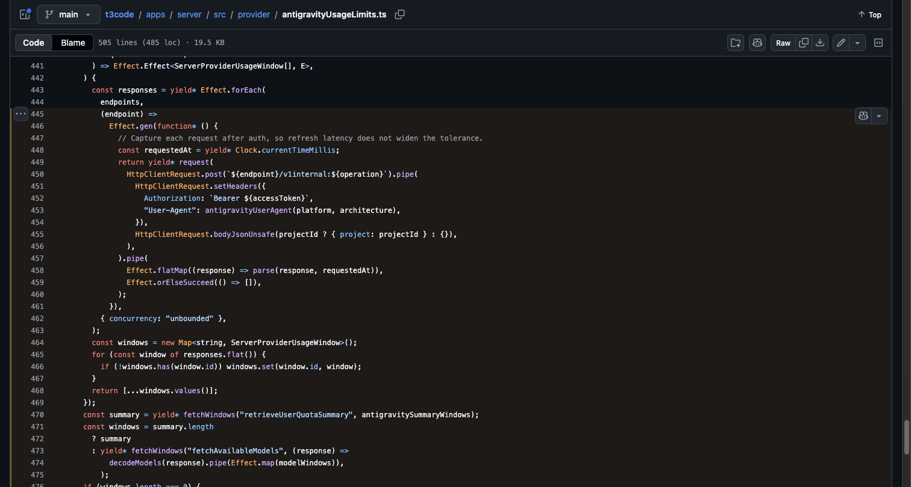
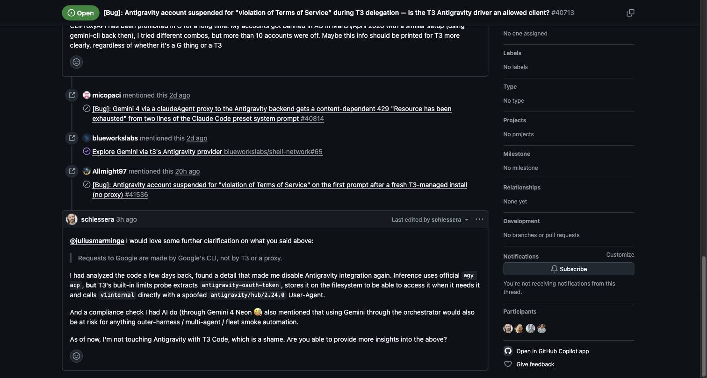
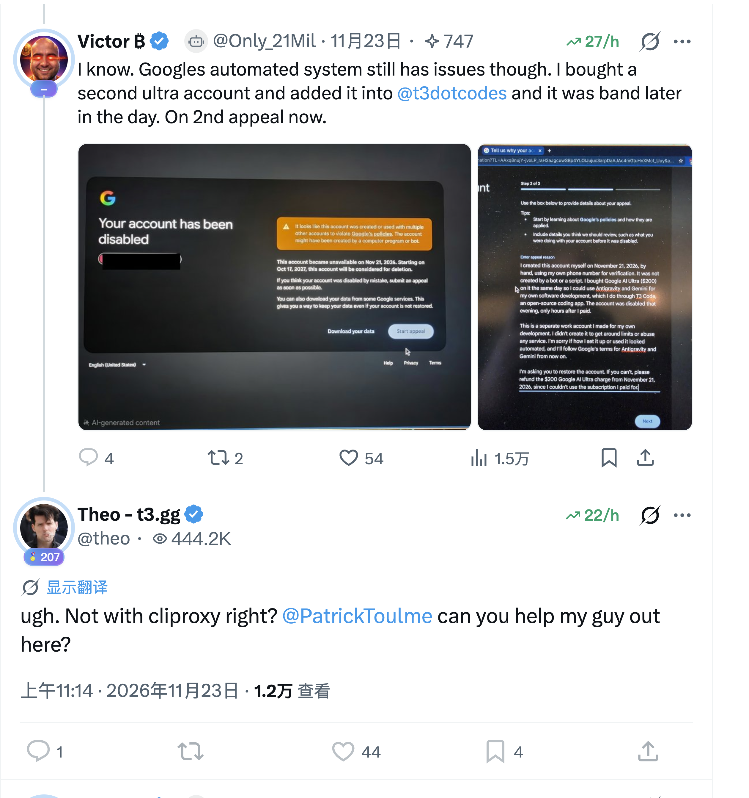
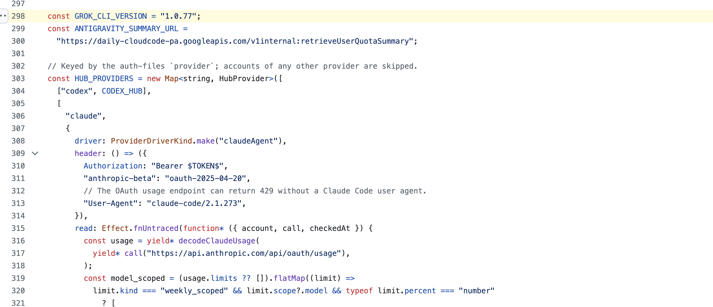
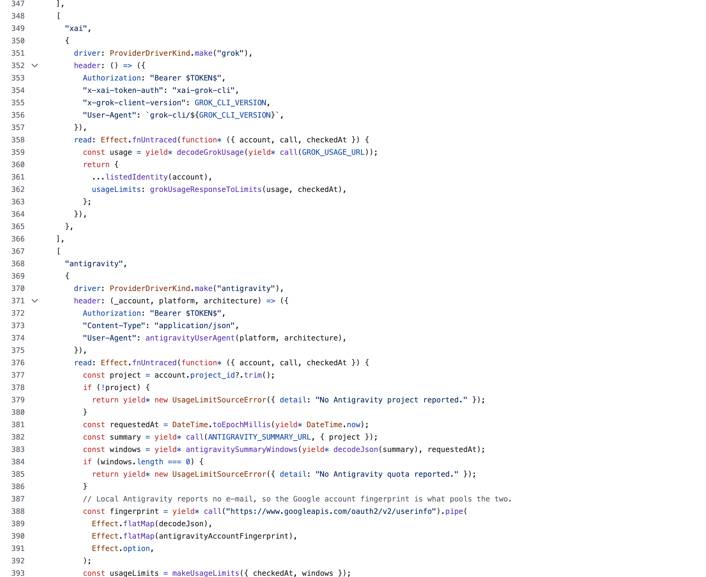

# Dossier 03: Google Antigravity ToS Spoofing, `PR #33800`, and T3 Connect Relay Architecture

[Back to README](../../README.md) · [← Dossier 02: Local Safety & Security Audit](./02-local-safety-and-security-audit.md) · [Dossier 04: Business Ledger, Sponsors & 77k Stars →](./04-business-ledger-sponsors-and-77k-stars.md) · [Complete Source Index](../COMPLETE-SOURCE-INDEX.md)

> **Scope:** Deep technical forensic audit covering **Parts 4 and 5** plus **`PR #33800`** (`pingdotgg/t3code` local checkout, GitHub issues/PRs, Google developer policy notices, Theo X posts, and verified screenshot receipts):
> 1. T3 Code FAQ's Terms-of-Service safety guarantee vs. Google's official ban policy (`discuss.ai.google.dev/t/185992`).
> 2. Source-code spoofing across `antigravityUsageLimits.ts`, `antigravityAuthSupport.ts`, `AntigravityAcpSupport.ts`, and `cliproxyApi.ts` (`PR #33800`).
> 3. Fresh-account bans (`Issue #41536`), maintainer denial & `schlessera` rebuttal (`Issue #40713`), and Theo's public contradictions regarding CLIProxyAPI.
> 4. T3 Connect remote relay: zero E2E encryption (`Issue #32098`, `Nov 25` post `2125370330244128924`), default-off `requireConnectDeviceApproval` (`packages/contracts/src/settings.ts`), `ManagedEndpointProvider.ts`, `privacy-policy.astro` omissions, and the OVH Hillsboro Caddy/Unix-socket gateway (`PR #32945`).

---

## 1. Google Antigravity ToS Guarantee vs. Official Policy & Source-Level Spoofing (Part 4)

### 1.1 What `docs/user/faq.md` Tells Users vs. Google's Enforcement

T3 Code's user-facing FAQ (`docs/user/faq.md`) assures users that connecting Google Antigravity through T3 Code complies with Google's Terms of Service. By contrast, Google Terms of Service (Section 6) and Google's official developer enforcement thread (`https://discuss.ai.google.dev/t/185992`) restrict consumer Antigravity/Gemini OAuth credentials from being used via spoofed third-party clients or unauthorized internal API proxies.


### 1.2 Three Spoofing & Credential-Harvesting Mechanisms in Core Provider Code

Inspection of `apps/server/src/provider/` inside the local checkout reveals three distinct spoofing and credential-extraction paths:

#### A. Hardcoded `antigravity/hub/2.24.0` User-Agent, Private `v1internal` Calls, and OS Keyring Scraping (`antigravityUsageLimits.ts`)

`apps/server/src/provider/antigravityUsageLimits.ts` synthesizes an Antigravity Hub `User-Agent`, targets Google's internal Cloud Code endpoints (`daily-cloudcode-pa.googleapis.com` and `cloudcode-pa.googleapis.com`), and extracts `"gemini:antigravity"` credentials directly from Windows Credential Manager (`CredReadW` via `ffi-rs` on `advapi32.dll`) or the OS keyring (`@napi-rs/keyring`):

```ts
// apps/server/src/provider/antigravityUsageLimits.ts
// (lines 20–25, 201, 238, 450–454)
export function antigravityUserAgent(platform: NodeJS.Platform, architecture: NodeJS.Architecture) {
  return `antigravity/hub/2.24.0 (aidev_client; os_type=${platform}; arch=${architecture}; cl=963137146)`;
}

const DAILY_ENDPOINT = "https://daily-cloudcode-pa.googleapis.com";
const PROD_ENDPOINT = "https://cloudcode-pa.googleapis.com";
...
    paramsValue: ["gemini:antigravity", 1, 0, out], // CredReadW via ffi-rs on advapi32.dll
...
              requireExternal("@napi-rs/keyring") ... AsyncEntry("gemini", "antigravity").getSecret();
...
              HttpClientRequest.post(`${endpoint}/v1internal:${operation}`).pipe(
                HttpClientRequest.setHeaders({
                  Authorization: `Bearer ${accessToken}`,
                  "User-Agent": antigravityUserAgent(platform, architecture),
                }),
```




#### B. Fake `SSH_CONNECTION` Injection (`antigravityAuthSupport.ts` → `Issue #41973`)

Because Antigravity CLI `1.5` ignores `AGY_ACP_FORCE_FILE_STORAGE` when running locally and consolidates logins into a single OS keyring entry, `apps/server/src/provider/antigravityAuthSupport.ts` injects a forged `SSH_CONNECTION` variable whenever `auth.authMethod === "oauth-personal"` so the CLI believes it is running over SSH:

```ts
// apps/server/src/provider/antigravityAuthSupport.ts (lines 230–237)
    // The 1.5 CLI ignores AGY_ACP_FORCE_FILE_STORAGE and keeps Google sign-ins in one OS keyring
    // entry for every profile, unless it believes it runs over SSH. Sign-in then uses `--login`.
    ...(auth.authMethod === "oauth-personal"
      ? { SSH_CONNECTION: baseEnv.SSH_CONNECTION || "127.0.0.1 0 127.0.0.1 0" }
      : {}),
    GEMINI_HOME: profile.geminiHome,
    AGY_ACP_FORCE_FILE_STORAGE: "1",
```

This environment-spoofing workaround was later tied to cross-account credential leakage reported in `Issue #41973`.


#### C. Historical `"zed"` Client Masquerade (`AntigravityAcpSupport.ts`, `PR #26876`)

In `apps/server/src/provider/acp/AntigravityAcpSupport.ts`, T3 Code identified itself to the Antigravity ACP handshake as `{ name: "zed", version: "0.0.0" }` for versions below `1.5.1`, switching to `{ name: "t3-code", title: "T3 Code", version: packageJson.version }` only once `OPEN_MODEL_ACCESS_RELEASE = [1, 5, 1]` was reached (`PR #26876` merged):

```ts
// apps/server/src/provider/acp/AntigravityAcpSupport.ts (lines 75, 107–112)
const OPEN_MODEL_ACCESS_RELEASE = [1, 5, 1] as const;
...
export function antigravityClientInfo(version: string | null | undefined) {
  const parsed = parseAntigravityVersion(version);
  return parsed !== undefined && compareVersions(parsed, OPEN_MODEL_ACCESS_RELEASE) >= 0
    ? { name: "t3-code", title: "T3 Code", version: packageJson.version }
    : { name: "zed", version: "0.0.0" };
}
```


---

### 1.3 Maintainer Denials (`Issue #40713`) and Fresh-Account Bans (`Issue #41536`)

When users reported Antigravity ToS violations and account disables, two primary GitHub issues preserved the contradiction between maintainer statements and observed failures:

- **`Issue #40713`:** A maintainer initially denied that T3 Code bypassed Antigravity restrictions, after which contributor `schlessera` countered with direct evidence from the codebase.
- **`Issue #41536`:** User `@Allmight97` installed the managed Antigravity CLI `1.5.15` (`~/.t3/tools/antigravity-acp/darwin-arm64`) at `08:14` local time on a fresh `$20` Google AI subscription with no proxy; the **first prompt failed at `08:17` (3 minutes later)** with:
  > `"This service has been disabled in this account for violation of Terms of Service. Please submit an appeal to continue using this product."`





---

### 1.4 Theo's `"not cliproxy"` Claim vs. Merged `PR #33800` (`cliproxyApi.ts`)

Publicly on X, Theo posted a diagram (`T3 Code -> Antigravity binary ✅`) and explicitly asserted *"not cliproxy"* while separately posting CLIProxy ClickHouse telemetry, a Grok Bot / `$100` Claude setup walkthrough, and `$15k` Ultra figures.

| Claim vs. Primary Artifact | Screenshot / Commit Evidence |
|---|---|
| Public denial (`not cliproxy` / `T3 Code -> Antigravity binary ✅`) |  |
| CLIProxy ClickHouse chart posted by Theo |  |
| Grok Bot & `$100` Claude tutorial + `$15k` Ultra posts |  |
| `$15k` Ultra reference post |  |

In reality, merged **`PR #33800`** (*"feat(usage): show Muse Code limits, and xAi and Antigravity accounts from a CLIProxyAPI hub #33800"*, authored by `StiensWout`, merged by `juliusmarminge`, `+1,201 -217` across 21 files) wires native **CLIProxyAPI** hub polling directly into `apps/server/src/usage/cliproxyApi.ts` (lines 298–375). It injects CLIProxyAPI's `$TOKEN$` placeholder alongside spoofed upstream client headers for **three providers** (`claude`, `xai`, `antigravity`), plus Google `oauth2/v2/userinfo` fingerprint matching:

```ts
// apps/server/src/usage/cliproxyApi.ts (lines 298–375)
const GROK_CLI_VERSION = "1.0.77";
const ANTIGRAVITY_SUMMARY_URL = "https://daily-cloudcode-pa.googleapis.com/v1internal:retrieveUserQuotaSummary";
...
    "claude", { driver: ProviderDriverKind.make("claudeAgent"), header: () => ({ Authorization: "Bearer $TOKEN$", "anthropic-beta": "oauth-2025-04-20", "User-Agent": "claude-code/2.1.273" }), ... }
...
    "xai", { driver: ProviderDriverKind.make("grok"), header: () => ({ Authorization: "Bearer $TOKEN$", "x-xai-token-auth": "xai-grok-cli", "x-grok-client-version": GROK_CLI_VERSION, "User-Agent": `grok-cli/${GROK_CLI_VERSION}` }), ... }
...
    "antigravity", { driver: ProviderDriverKind.make("antigravity"), header: (_account, platform, architecture) => ({ Authorization: "Bearer $TOKEN$", "Content-Type": "application/json", "User-Agent": antigravityUserAgent(platform, architecture) }), ... }
```






---

## 2. T3 Connect Remote Relay: Zero E2E Encryption, Policy Gaps, and OVH Gateway (Part 5)

### 2.1 No End-to-End Encryption & Default-Off Device Approval (`Issue #32098`, `PR #36419`)

T3 Connect enables remote control of a local machine from web or mobile clients via T3's cloud relay (`docs/internals/06_t3-connect.md`). However, traffic is **not end-to-end encrypted**:

1. **Maintainer Closure (`Issue #32098`):** `juliusmarminge` confirmed that *"a compromised account or relay signing key would have been enough to control it"* and closed `Issue #32098` stating:
   > *"Full end-to-end encryption with mutual pairing would be a bigger change, and we've left it out for now."*
2. **Default-Off Mitigation (`PR #36419`):** Although `PR #36419` introduced `requireConnectDeviceApproval` as a mitigation, the schema in `packages/contracts/src/settings.ts` defaults it to **`false`**:
   ```ts
   // packages/contracts/src/settings.ts (lines 1418–1420)
     requireConnectDeviceApproval: Schema.Boolean.pipe(
       Schema.withDecodingDefault(Effect.succeed(false)),
     ),
   ```
   This aligns with `SECURITY.md` lines 101–102: `"A compromised relay signing key can mint for linked environments. That is the stated trust assumption; device approval is the mitigation."`
3. **Unanswered Discussions & Nov 25 E2E Refusal:** Two earlier E2E discussions (`#21286` and `#37831`) went unanswered. On November 25, Theo stated publicly (`https://x.com/theo/status/2125370330244128924`) that end-to-end encryption is impossible for the architecture.


---

### 2.2 Managed Cloudflare Tunnels (`ManagedEndpointProvider.ts`) vs. `privacy-policy.astro`

In `infra/relay/src/environments/ManagedEndpointProvider.ts` (lines 1288–1296, 1365–1373, 1417–1423), T3's relay provisions named Cloudflare tunnels under T3's own Cloudflare account (`tunnels.create({ name: tunnelName, configSrc: "cloudflare" })`), configures origin routing (`putConfiguration` with `service: formatOriginService(input.origin)`), and writes a proxied `CNAME` record pointing to `${tunnel.id}.cfargotunnel.com` (`proxied: true`).


Meanwhile, `apps/marketing/src/pages/privacy-policy.astro` (lines 24–25, 366, 395–398; `effectiveDate="2026-10-06"`, `lastUpdated="2026-10-06"`) promises `"encrypted network transport"` and `"redaction of authorization headers from relay diagnostics"`, without disclosing that T3 Connect terminates TLS at the relay/proxy boundary with no E2E encryption between user devices and local coding agents.

---

### 2.3 `$25k/Month` Cloudflare Bill & OVH Hillsboro Caddy/Unix-Socket Gateway (`PR #32945`)

Open pull request **`PR #32945`** (*"feat(connect): Labs beta links machines through T3's gateway, not paid Cloudflare tunnels #32945"*, authored by `t3dotgg`, `+4,693 -260` across 93 files — **Open** in the captured PR record) explains the infrastructure shift away from paid Cloudflare tunnels:

- T3's Cloudflare named-tunnel bill hit **`$25k` in the prior month** (`$0.21` per named tunnel used in a month).
- To cut tunnel fees while keeping up to `100` free machines per account (`t3 connect --beta`), `PR #32945` introduces a gateway architecture hosted on an **OVH server in Hillsboro** (`gw.t3coderelay.com`).
- On that OVH box, **Caddy terminates TLS** and forwards traffic over a **Unix socket** into T3's Go gateway (`infra/connect-gateway`) running `yamux over WSS`.


---

## 3. Primary References

### Local Checkout Files Inspected (`scratch/t3code/`)
- `docs/user/faq.md` (Antigravity ToS safety guarantee)
- `apps/server/src/provider/antigravityUsageLimits.ts` (lines 20–25, 201, 238, 450–454)
- `apps/server/src/provider/antigravityAuthSupport.ts` (lines 230–237)
- `apps/server/src/provider/acp/AntigravityAcpSupport.ts` (lines 75, 107–112)
- `apps/server/src/usage/cliproxyApi.ts` (lines 298–375)
- `packages/contracts/src/settings.ts` (lines 1418–1420)
- `infra/relay/src/environments/ManagedEndpointProvider.ts` (lines 1288–1296, 1365–1373, 1417–1423)
- `apps/marketing/src/pages/privacy-policy.astro` (lines 24–25, 366, 395–398)
- `docs/internals/06_t3-connect.md`
- `SECURITY.md` (lines 101–102)

### Primary Issues, Pull Requests, Policies & Posts Cited
- Google Policy Enforcement: https://discuss.ai.google.dev/t/185992
- Antigravity Spoofing, Rebuttals & Bans (Part 4 + `PR #33800`):
  - https://github.com/pingdotgg/t3code/pull/26876 (Merged — `zed` spoof prior to Antigravity `1.5.1`)
  - https://github.com/pingdotgg/t3code/pull/33800 (Merged — CLIProxyAPI hub usage integration in `cliproxyApi.ts`)
  - https://github.com/pingdotgg/t3code/issues/40713 (maintainer denial & `schlessera` rebuttal)
  - https://github.com/pingdotgg/t3code/issues/41536 (`@Allmight97` 3-minute fresh-account disable)
  - https://github.com/pingdotgg/t3code/issues/41973 (cross-account leak linked to `SSH_CONNECTION` profile spoofing)
- T3 Connect Relay & E2E Encryption (Part 5):
  - https://github.com/pingdotgg/t3code/issues/32098 (`juliusmarminge` E2E exclusion confirmation)
  - https://github.com/pingdotgg/t3code/pull/36419 (Merged — opt-in `requireConnectDeviceApproval`)
  - https://github.com/pingdotgg/t3code/discussions/21286, https://github.com/pingdotgg/t3code/discussions/37831
  - https://github.com/pingdotgg/t3code/pull/32945 (Open — `$25k/mo` Cloudflare bill, OVH Hillsboro `gw.t3coderelay.com` Caddy + Go Unix-socket gateway)
  - https://x.com/theo/status/2125370330244128924 (Nov 25 post stating E2E encryption is impossible)
