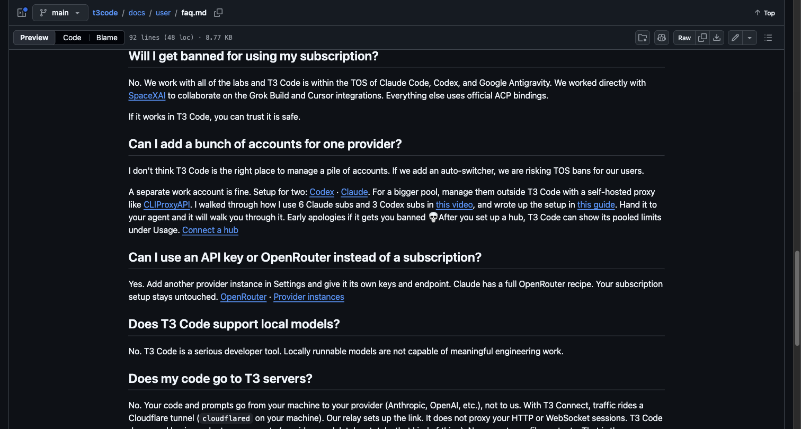
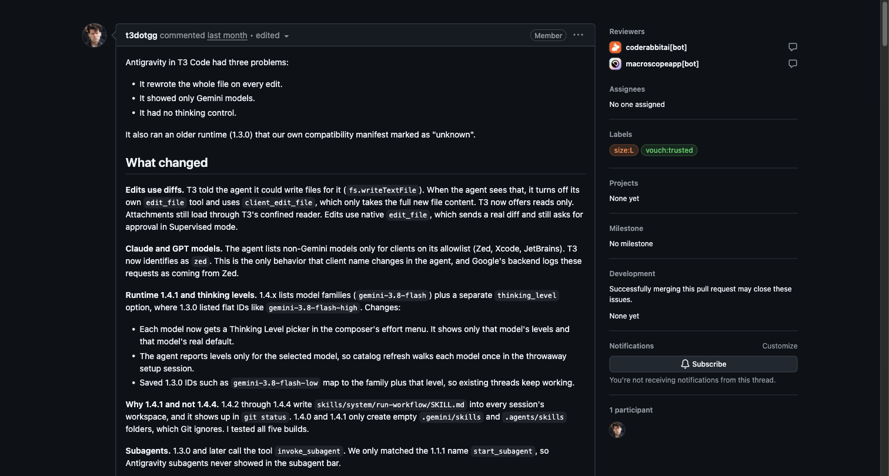
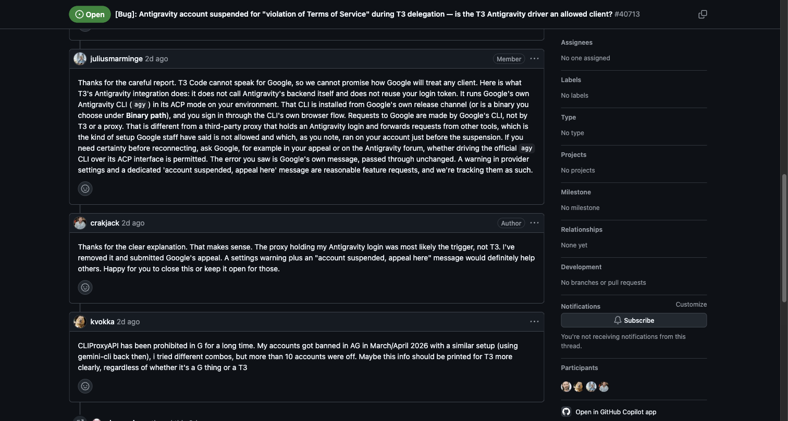
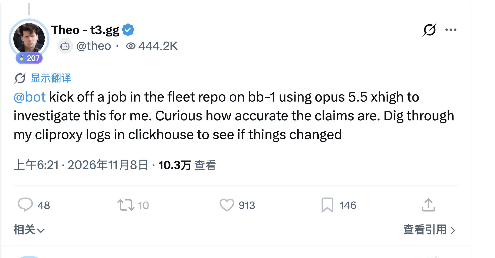
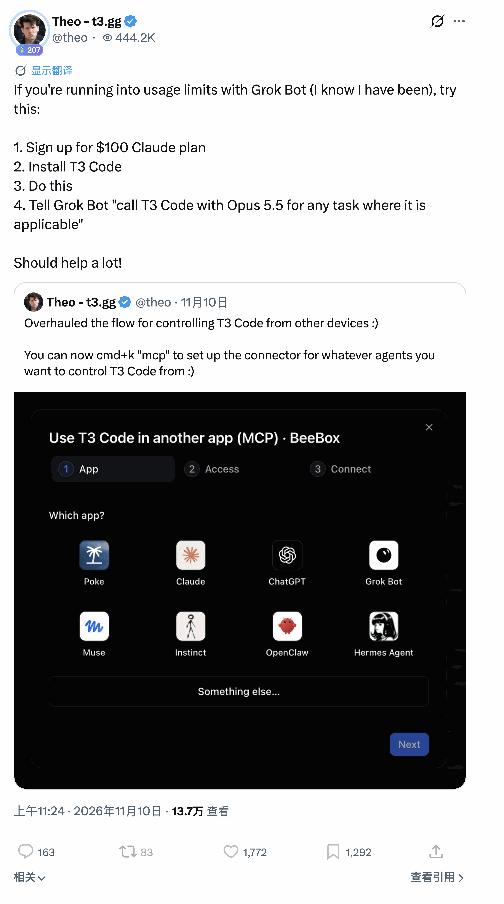
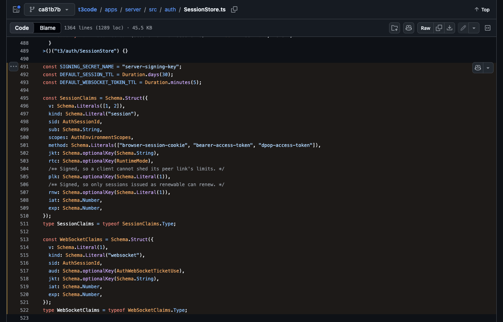
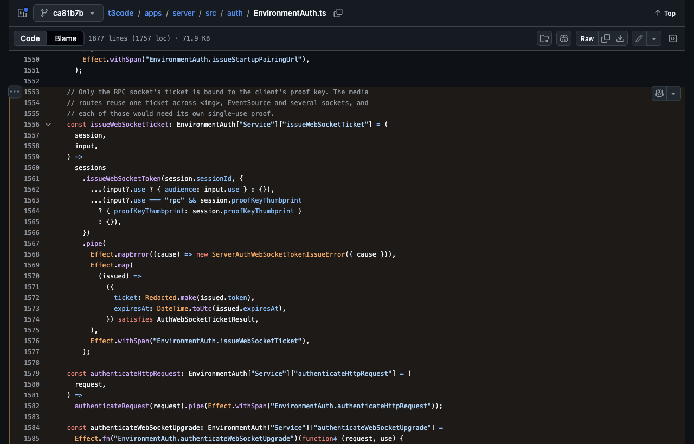
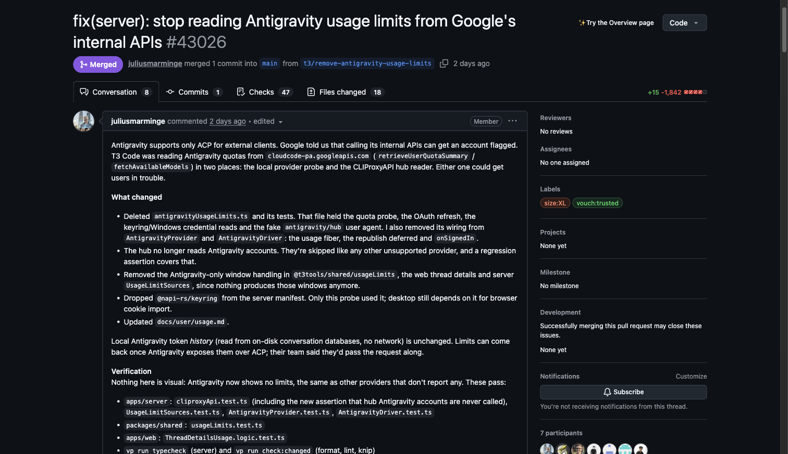
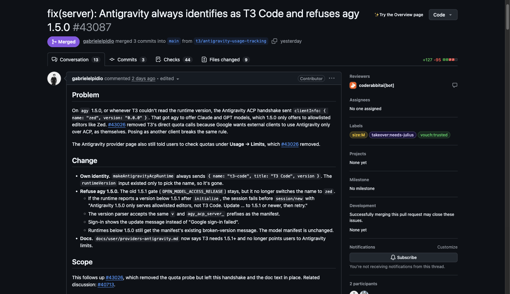

# Dossier 03: Google Antigravity ToS Spoofing, `PR #33800`, and T3 Connect Relay Architecture

[Back to README](../../README.md) · [← Dossier 02: Local Safety & Security Audit](./02-local-safety-and-security-audit.md) · [Dossier 04: Business Ledger, Sponsors & 77k Stars →](./04-business-ledger-sponsors-and-77k-stars.md) · [Complete Source Index](../COMPLETE-SOURCE-INDEX.md)

> **Scope:** Deep technical forensic audit covering **Parts 4 and 5** plus **`PR #33800`** (`pingdotgg/t3code` local checkout, GitHub issues/PRs, Google developer policy notices, Theo X posts, and verified screenshot receipts):
> 1. T3 Code FAQ's Terms-of-Service safety guarantee vs. Google's official ban policy (`discuss.ai.google.dev/t/185992`).
> 2. Source-code spoofing across `antigravityUsageLimits.ts`, `antigravityAuthSupport.ts`, `AntigravityAcpSupport.ts`, and `cliproxyApi.ts` (`PR #33800`).
> 3. Fresh-account bans (`Issue #41536`), maintainer denial & `schlessera` rebuttal (`Issue #40713`), and Theo's public contradictions regarding CLIProxyAPI.
> 4. T3 Connect remote relay: zero E2E encryption (`Issue #32098`, `Nov 25` post `2125370330244128924`), default-off `requireConnectDeviceApproval` (`packages/contracts/src/settings.ts`), `ManagedEndpointProvider.ts`, `privacy-policy.astro` omissions, and the OVH Hillsboro Caddy/Unix-socket gateway (`PR #32945`).
>
> **Audited Upstream Snapshot:** [`9d3195b4`](https://github.com/pingdotgg/t3code/commit/9d3195b49dfb0098e9fa592fe0ada5464206d1c2) (`PR #42000`, `2026-11-24T08:41:04Z` / `2026-11-24 16:41:04 CST`)  
> **Post-Audit Upstream Re-Audit:** [`ca81b7b9`](https://github.com/pingdotgg/t3code/commit/ca81b7b97a1c4b91e5ac25768d0f6629f37732fd) (`PR #42634`, `2026-11-25T06:49:37Z` / `2026-11-25 14:49:37 CST`, `259` commits ahead of `9d3195b4`)

---

## 1. Google Antigravity ToS Guarantee vs. Official Policy & Source-Level Spoofing (Part 4)

### 1.1 What `docs/user/faq.md` Tells Users vs. Google's Enforcement

T3 Code's user-facing FAQ (`docs/user/faq.md`) assures users that connecting Google Antigravity through T3 Code complies with Google's Terms of Service. By contrast, Google Terms of Service (Section 6) and Google's official developer enforcement thread (`https://discuss.ai.google.dev/t/185992`) restrict consumer Antigravity/Gemini OAuth credentials from being used via spoofed third-party clients or unauthorized internal API proxies.



### 1.2 Three Spoofing & Credential-Harvesting Mechanisms in Core Provider Code

Inspection of `apps/server/src/provider/` inside the local checkout reveals three distinct spoofing and credential-extraction paths:

#### A. Hardcoded `antigravity/hub/2.24.0` User-Agent, Private `v1internal` Calls, and OS Keyring Scraping (`antigravityUsageLimits.ts`)

`apps/server/src/provider/antigravityUsageLimits.ts` synthesizes an Antigravity Hub `User-Agent`, targets Google's internal Cloud Code endpoints (`daily-cloudcode-pa.googleapis.com` and `cloudcode-pa.googleapis.com`), and extracts `"gemini:antigravity"` credentials directly from Windows Credential Manager (`CredReadW` via `ffi-rs` on `advapi32.dll`) or the OS keyring (`@napi-rs/keyring`):

```ts
// apps/server/src/provider/antigravityUsageLimits.ts
// (lines 20–25, 201, 238, 450–454)
export function antigravityUserAgent(platform: NodeJS.Platform, architecture: NodeJS.Architecture) {
  return `antigravity/hub/2.24.0 (aidev_client; os_type=${platform}; arch=${architecture}; cl=963137146)`;
}

const DAILY_ENDPOINT = "https://daily-cloudcode-pa.googleapis.com";
const PROD_ENDPOINT = "https://cloudcode-pa.googleapis.com";
...
    paramsValue: ["gemini:antigravity", 1, 0, out], // CredReadW via ffi-rs on advapi32.dll
...
              requireExternal("@napi-rs/keyring") ... AsyncEntry("gemini", "antigravity").getSecret();
...
              HttpClientRequest.post(`${endpoint}/v1internal:${operation}`).pipe(
                HttpClientRequest.setHeaders({
                  Authorization: `Bearer ${accessToken}`,
                  "User-Agent": antigravityUserAgent(platform, architecture),
                }),
```


#### B. Fake `SSH_CONNECTION` Injection (`antigravityAuthSupport.ts` → `Issue #41973`)

Because Antigravity CLI `1.5` ignores `AGY_ACP_FORCE_FILE_STORAGE` when running locally and consolidates logins into a single OS keyring entry, `apps/server/src/provider/antigravityAuthSupport.ts` injects a forged `SSH_CONNECTION` variable whenever `auth.authMethod === "oauth-personal"` so the CLI believes it is running over SSH:

```ts
// apps/server/src/provider/antigravityAuthSupport.ts (lines 230–237)
    // The 1.5 CLI ignores AGY_ACP_FORCE_FILE_STORAGE and keeps Google sign-ins in one OS keyring
    // entry for every profile, unless it believes it runs over SSH. Sign-in then uses `--login`.
    ...(auth.authMethod === "oauth-personal"
      ? { SSH_CONNECTION: baseEnv.SSH_CONNECTION || "127.0.0.1 0 127.0.0.1 0" }
      : {}),
    GEMINI_HOME: profile.geminiHome,
    AGY_ACP_FORCE_FILE_STORAGE: "1",
```

This environment-spoofing workaround was later tied to cross-account credential leakage reported in `Issue #41973`.


#### C. Historical `"zed"` Client Masquerade (`AntigravityAcpSupport.ts`, `PR #26876`)

In `apps/server/src/provider/acp/AntigravityAcpSupport.ts`, T3 Code identified itself to the Antigravity ACP handshake as `{ name: "zed", version: "0.0.0" }` for versions below `1.5.1`, switching to `{ name: "t3-code", title: "T3 Code", version: packageJson.version }` only once `OPEN_MODEL_ACCESS_RELEASE = [1, 5, 1]` was reached (`PR #26876` merged):

```ts
// apps/server/src/provider/acp/AntigravityAcpSupport.ts (lines 75, 107–112)
const OPEN_MODEL_ACCESS_RELEASE = [1, 5, 1] as const;
...
export function antigravityClientInfo(version: string | null | undefined) {
  const parsed = parseAntigravityVersion(version);
  return parsed !== undefined && compareVersions(parsed, OPEN_MODEL_ACCESS_RELEASE) >= 0
    ? { name: "t3-code", title: "T3 Code", version: packageJson.version }
    : { name: "zed", version: "0.0.0" };
}
```



---

### 1.3 Maintainer Denials (`Issue #40713`) and Fresh-Account Bans (`Issue #41536`)

When users reported Antigravity ToS violations and account disables, two primary GitHub issues preserved the contradiction between maintainer statements and observed failures:

- **`Issue #40713`:** A maintainer initially denied that T3 Code bypassed Antigravity restrictions, after which contributor `schlessera` countered with direct evidence from the codebase.
- **`Issue #41536`:** User `@Allmight97` installed the managed Antigravity CLI `1.5.15` (`~/.t3/tools/antigravity-acp/darwin-arm64`) at `08:14` local time on a fresh `$20` Google AI subscription with no proxy; the **first prompt failed at `08:17` (3 minutes later)** with:
  > `"This service has been disabled in this account for violation of Terms of Service. Please submit an appeal to continue using this product."`




---

### 1.4 Theo's `"not cliproxy"` Claim vs. Merged `PR #33800` (`cliproxyApi.ts`)

Publicly on X, Theo posted a diagram (`T3 Code -> Antigravity binary ✅`) and explicitly asserted *"not cliproxy"* while separately posting CLIProxy ClickHouse telemetry, a Grok Bot / `$100` Claude setup walkthrough, and `$15k` Ultra figures.

| Claim vs. Primary Artifact | Screenshot / Commit Evidence |
|---|---|
| Public denial (`not cliproxy` / `T3 Code -> Antigravity binary ✅`) |  |
| CLIProxy ClickHouse chart posted by Theo |  |
| Grok Bot & `$100` Claude tutorial + `$15k` Ultra posts |  |
| `$15k` Ultra reference post |  |

In reality, merged **`PR #33800`** (*"feat(usage): show Muse Code limits, and xAi and Antigravity accounts from a CLIProxyAPI hub #33800"*, authored by `StiensWout`, merged by `juliusmarminge`, `+1,201 -217` across 21 files) wires native **CLIProxyAPI** hub polling directly into `apps/server/src/usage/cliproxyApi.ts` (lines 298–375). It injects CLIProxyAPI's `$TOKEN$` placeholder alongside spoofed upstream client headers for **three providers** (`claude`, `xai`, `antigravity`), plus Google `oauth2/v2/userinfo` fingerprint matching:

```ts
// apps/server/src/usage/cliproxyApi.ts (lines 298–375)
const GROK_CLI_VERSION = "1.0.77";
const ANTIGRAVITY_SUMMARY_URL = "https://daily-cloudcode-pa.googleapis.com/v1internal:retrieveUserQuotaSummary";
...
    "claude", { driver: ProviderDriverKind.make("claudeAgent"), header: () => ({ Authorization: "Bearer $TOKEN$", "anthropic-beta": "oauth-2025-04-20", "User-Agent": "claude-code/2.1.273" }), ... }
...
    "xai", { driver: ProviderDriverKind.make("grok"), header: () => ({ Authorization: "Bearer $TOKEN$", "x-xai-token-auth": "xai-grok-cli", "x-grok-client-version": GROK_CLI_VERSION, "User-Agent": `grok-cli/${GROK_CLI_VERSION}` }), ... }
...
    "antigravity", { driver: ProviderDriverKind.make("antigravity"), header: (_account, platform, architecture) => ({ Authorization: "Bearer $TOKEN$", "Content-Type": "application/json", "User-Agent": antigravityUserAgent(platform, architecture) }), ... }
```


---

## 2. T3 Connect Remote Relay: Zero E2E Encryption, Policy Gaps, and OVH Gateway (Part 5)

### 2.1 No End-to-End Encryption & Default-Off Device Approval (`Issue #32098`, `PR #36419`)

T3 Connect enables remote control of a local machine from web or mobile clients via T3's cloud relay (`docs/internals/06_t3-connect.md`). However, traffic is **not end-to-end encrypted**:

1. **Maintainer Closure (`Issue #32098`):** `juliusmarminge` confirmed that *"a compromised account or relay signing key would have been enough to control it"* and closed `Issue #32098` stating:
   > *"Full end-to-end encryption with mutual pairing would be a bigger change, and we've left it out for now."*
2. **Default-Off Mitigation (`PR #36419`):** Although `PR #36419` introduced `requireConnectDeviceApproval` as a mitigation, the schema in `packages/contracts/src/settings.ts` defaults it to **`false`**:
   ```ts
   // packages/contracts/src/settings.ts (lines 1418–1420)
     requireConnectDeviceApproval: Schema.Boolean.pipe(
       Schema.withDecodingDefault(Effect.succeed(false)),
     ),
   ```
   This aligns with `SECURITY.md` lines 101–102: `"A compromised relay signing key can mint for linked environments. That is the stated trust assumption; device approval is the mitigation."`
3. **Unanswered Discussions & Nov 25 E2E Refusal:** Two earlier E2E discussions (`#21286` and `#37831`) went unanswered. On November 25, Theo stated publicly (`https://x.com/theo/status/2125370330244128924`) that end-to-end encryption is impossible for the architecture.


---

### 2.2 Managed Cloudflare Tunnels (`ManagedEndpointProvider.ts`) vs. `privacy-policy.astro`

In `infra/relay/src/environments/ManagedEndpointProvider.ts` (lines 1288–1296, 1365–1373, 1417–1423), T3's relay provisions named Cloudflare tunnels under T3's own Cloudflare account (`tunnels.create({ name: tunnelName, configSrc: "cloudflare" })`), configures origin routing (`putConfiguration` with `service: formatOriginService(input.origin)`), and writes a proxied `CNAME` record pointing to `${tunnel.id}.cfargotunnel.com` (`proxied: true`).


Meanwhile, `apps/marketing/src/pages/privacy-policy.astro` (lines 24–25, 366, 395–398; `effectiveDate="2026-10-06"`, `lastUpdated="2026-10-06"`) promises `"encrypted network transport"` and `"redaction of authorization headers from relay diagnostics"`, without disclosing that T3 Connect terminates TLS at the relay/proxy boundary with no E2E encryption between user devices and local coding agents.

---

### 2.3 `$25k/Month` Cloudflare Bill & OVH Hillsboro Caddy/Unix-Socket Gateway (`PR #32945`)

Open pull request **`PR #32945`** (*"feat(connect): Labs beta links machines through T3's gateway, not paid Cloudflare tunnels #32945"*, authored by `t3dotgg`, `+4,693 -260` across 93 files — **Open** in the captured PR record) explains the infrastructure shift away from paid Cloudflare tunnels:

- T3's Cloudflare named-tunnel bill hit **`$25k` in the prior month** (`$0.21` per named tunnel used in a month).
- To cut tunnel fees while keeping up to `100` free machines per account (`t3 connect --beta`), `PR #32945` introduces a gateway architecture hosted on an **OVH server in Hillsboro** (`gw.t3coderelay.com`).
- On that OVH box, **Caddy terminates TLS** and forwards traffic over a **Unix socket** into T3's Go gateway (`infra/connect-gateway`) running `yamux over WSS`.


---

## 3. Post-Audit Upstream Tracking (9d3195b4 to ca81b7b9)

Re-auditing `pingdotgg/t3code` from baseline [`9d3195b4`](https://github.com/pingdotgg/t3code/commit/9d3195b49dfb0098e9fa592fe0ada5464206d1c2) (`2026-11-24T08:41:04Z`) through `main` HEAD [`ca81b7b9`](https://github.com/pingdotgg/t3code/commit/ca81b7b97a1c4b91e5ac25768d0f6629f37732fd) (`2026-11-25T06:49:37Z`) shows upstream adapting to active Google account-verification triggers while leaving Antigravity spoofing and T3 Connect relay encryption gaps untouched.

### 3.1 Antigravity: `PR #41210` Confirms Active Google Verification Triggers While Spoofing Remains

- **Direct Verification Link on Failed Turns ([`PR #41210`](https://github.com/pingdotgg/t3code/pull/41210) / [`3e74a0aa`](https://github.com/pingdotgg/t3code/commit/3e74a0aac5c53459cc1d3d84eec915fa483f2836), `2026-11-25T05:23:36Z`):**
  - `apps/server/src/provider/acp/AntigravityTurnOutcome.ts` (`lines 29–51, 157–197, 243–254`) now parses HTTP `403 PERMISSION_DENIED` JSON `google.rpc.ErrorInfo` responses from `cloudcode-pa.googleapis.com` carrying `reason: "VALIDATION_REQUIRED"` and `metadata.validation_url`, returning `"Verify your Google account, then retry this turn."` (`code: "VALIDATION_REQUIRED"`) and rendering a direct verification link in `apps/web/src/components/chat/TimelineWorkEntryRow.tsx`.
  - **Evidentiary significance:** Building dedicated error parsing and UI verification links for `cloudcode-pa.googleapis.com` `VALIDATION_REQUIRED` `403` blocks directly confirms that Google's anti-abuse/verification triggers are firing on real Antigravity turns inside T3 Code—contradicting `docs/user/faq.md` assurances and `@theo`'s `"zero risk"` statement ([`2124264935505199294`](https://x.com/theo/status/2124264935505199294)).
- **Companion Post-`9d3195b4` Antigravity Commits:**
  - [**`PR #42545`**](https://github.com/pingdotgg/t3code/pull/42545) / [`4da8d19d`](https://github.com/pingdotgg/t3code/commit/4da8d19d08ed7e34fe2d5d66dae54b01eab122fc) (`2026-11-25T03:09:49Z`) changed `AGY_CLI_DISABLE_AUTO_UPDATE` in `antigravityAuthSupport.ts:238` from `"1"` to `"true"` after discovering `"1"` allowed the interactive CLI to keep self-updating.
  - [**`PR #42339`**](https://github.com/pingdotgg/t3code/pull/42339) (`8261b232`) preserved `'Resets in'` timing text on quota failures; [**`PR #42475`**](https://github.com/pingdotgg/t3code/pull/42475) (`5d020754`) surfaced broken Antigravity setup errors during model refresh.
- **Unchanged Spoofing & Scraping Paths at `ca81b7b9`:**
  1. [`apps/server/src/provider/antigravityUsageLimits.ts`](https://github.com/pingdotgg/t3code/blob/main/apps/server/src/provider/antigravityUsageLimits.ts) (`lines 20–26, 201, 238, 450–454`): still hardcodes `antigravity/hub/2.24.0`, extracts `"gemini:antigravity"` credentials from Windows `CredReadW` or OS keyring, and calls `${endpoint}/v1internal:${operation}` directly.
  2. [`apps/server/src/provider/antigravityAuthSupport.ts`](https://github.com/pingdotgg/t3code/blob/main/apps/server/src/provider/antigravityAuthSupport.ts) (`lines 230–238`): still injects fake `SSH_CONNECTION: baseEnv.SSH_CONNECTION || "127.0.0.1 0 127.0.0.1 0"` on `oauth-personal` (`Issue #41973` remains open).
  3. [`apps/server/src/provider/acp/AntigravityAcpSupport.ts`](https://github.com/pingdotgg/t3code/blob/main/apps/server/src/provider/acp/AntigravityAcpSupport.ts) (`lines 76, 108–113`): still retains the `{ name: "zed", version: "0.0.0" }` fallback below `1.5.1`.
  4. [`apps/server/src/usage/cliproxyApi.ts`](https://github.com/pingdotgg/t3code/blob/main/apps/server/src/usage/cliproxyApi.ts) (`lines 298–375`): still polls CLIProxyAPI hubs with spoofed `claude-code/2.1.273`, `grok-cli/1.0.77`, and `antigravityUserAgent` headers.

### 3.2 T3 Connect Relay Status at `ca81b7b9`

- **End-to-End Encryption (`Issue #32098`) Remains Absent:** `Issue #32098` remains closed without E2E encryption, `PR #32945` (OVH Hillsboro gateway) remains **Open**, and `SECURITY.md` (`lines 101–102`) continues to state that a compromised relay signing key can mint sessions for linked environments.
- **`requireConnectDeviceApproval` Still Defaults to `false`:** In [`packages/contracts/src/settings.ts`](https://github.com/pingdotgg/t3code/blob/main/packages/contracts/src/settings.ts) (`lines 1424–1426` at `ca81b7b9`), `requireConnectDeviceApproval` remains `Schema.withDecodingDefault(Effect.succeed(false))`. [**`PR #42311`**](https://github.com/pingdotgg/t3code/pull/42311) ([`ece5f21b`](https://github.com/pingdotgg/t3code/commit/ece5f21b17077382c8d2eba1c28e75e898386dcd), `2026-11-24T18:44:13Z`) added UI notices when a new T3 Connect device signs in (`packages/client-runtime/src/connectDeviceNotices.ts`), but did not switch approval enforcement on by default.
- **Hosted Web App & Privacy Policy:** While [**`PR #42356`**](https://github.com/pingdotgg/t3code/pull/42356) (`dc7b8802`) made server-opened browsers honor server opt-outs and stripped address/message/stack attributes from relay spans, `docs/user/telemetry.md` (`lines 91–92`) still confirms `app.t3.codes` has no tracing toggle, and `privacy-policy.astro` (`lines 24–25`) remains dated `2026-10-06`.

### 3.3 LAN Cookie, Unbound Bearer, Replayable WS Ticket & IPv6 Loopback Bugs (`ca81b7b9`)

Deep source verification against `pingdotgg/t3code` HEAD `ca81b7b9` confirms four live authentication, transport, and tunnel-availability defects alongside the previously fixed secret-store traversal (`PR #39483`; see [Dossier 02](./02-local-safety-and-security-audit.md)):

1. **P1 — 30-Day Plaintext `--lan` Session Cookie & Missing-`Origin` Bypass ([`SessionStore.ts#L492-L493`](https://github.com/pingdotgg/t3code/blob/ca81b7b9/apps/server/src/auth/SessionStore.ts#L492-L493), [`http.ts#L215-L221`](https://github.com/pingdotgg/t3code/blob/ca81b7b9/apps/server/src/auth/http.ts#L215-L221), [`EnvironmentAuth.ts#L798-L806`](https://github.com/pingdotgg/t3code/blob/ca81b7b9/apps/server/src/auth/EnvironmentAuth.ts#L798-L806)):**
   - `DEFAULT_SESSION_TTL` is `Duration.days(30)` (`SessionStore.ts#L492`), and `SECURITY.md` defines a full-scope session as equivalent to the host OS user's terminal shell.
   - [`PR #37042`](https://github.com/pingdotgg/t3code/pull/37042) (`39fcae52`, Nov 15) added the `Secure` attribute only when `url.protocol === "https:"`; under `t3 up --lan` plain HTTP, the cookie still crosses the LAN in cleartext without `Secure`.
   - `isBrowserOriginAllowed` (`EnvironmentAuth.ts#L800-L819`) unconditionally returns `true` when `origin === undefined`, so anyone capturing one LAN packet can replay the cookie in a non-browser script without an `Origin` header for 30 days with zero UI errors.
   
   
   

2. **P2 — 30-Day Unbound Bearer Without DPoP, Missing `/logout` & Blocked Self-Revocation ([`EnvironmentAuth.ts#L1175-L1186`](https://github.com/pingdotgg/t3code/blob/ca81b7b9/apps/server/src/auth/EnvironmentAuth.ts#L1175-L1186), [`EnvironmentAuth.ts#L1506-L1511`](https://github.com/pingdotgg/t3code/blob/ca81b7b9/apps/server/src/auth/EnvironmentAuth.ts#L1506-L1511), [`environmentHttp.ts#L595-L679`](https://github.com/pingdotgg/t3code/blob/ca81b7b9/packages/contracts/src/environmentHttp.ts#L595-L679)):**
   - `/oauth/token` drops TTL to 1 hour only when `proofKeyThumbprint` (DPoP) is present; otherwise it falls back to a 30-day unbound `bearer-access-token` that commonly lands in scripts or CI secrets.
   - `environmentHttp.ts` exposes no logout route, and `revokeClientSession` blocks self-revocation (`ServerAuthForbiddenOperationError` / `current_session_revoke_not_allowed`), requiring a separate session or local CLI to revoke a token.
   

3. **P2 — URL-Borne `?wsTicket=` Replayable for 5 Minutes ([`EnvironmentAuth.ts#L1553-L1622`](https://github.com/pingdotgg/t3code/blob/ca81b7b9/apps/server/src/auth/EnvironmentAuth.ts#L1553-L1622), [`SessionStore.ts#L1086-L1156`](https://github.com/pingdotgg/t3code/blob/ca81b7b9/apps/server/src/auth/SessionStore.ts#L1086-L1156)):**
   - WebSocket tickets carry a 5-minute TTL (`SessionStore.ts#L493`) and travel inside the `?wsTicket=` query string (`EnvironmentAuth.ts#L1588-L1591`), persisting in reverse-proxy logs and packet captures.
   - `verifyWebSocketToken` checks signature, expiry, audience, and session revocation, with no single-use `jti` replay table. While DPoP-bound `rpc` tickets verify proof-of-possession, Bearer-issued `rpc` tickets and **all `media` route tickets** can be replayed repeatedly within 5 minutes.
   

4. **P2 — `::1` Misclassified by `NodeNet.isIPv4` Silently Kills Tailscale Serve / Connect ([`startupAccess.ts#L71-L108`](https://github.com/pingdotgg/t3code/blob/ca81b7b9/apps/server/src/startupAccess.ts#L71-L108)):**
   - `startupAccess.ts#L39` explicitly permits `"::1"` in `isLoopbackHost`, but `isPrivateNetworkAddress` (`lines 71–74`) evaluates `NodeNet.isIPv4(ipv4)`. Pure IPv6 `::1` returns `false`, causing `closeNonPrivateNetworkConnections` to call `socket.destroy()` on valid local Tailscale Serve and T3 Connect tunnel connections.
   

---

## 3.5 Nov 25–26 Google Flagging Admission & `v0.1.13` Silent Removal (Exhibit #21)

Two days after closing `#40713` and `#41536`, upstream merged two PRs acknowledging Antigravity policy warnings while burying both changes inside `v0.1.13`'s `"Plus 380 more bug fixes"` rollup with `0` Security Advisories:

- **[PR #43026](https://github.com/pingdotgg/t3code/pull/43026)** (`2026-11-25T19:25:43Z`, `@juliusmarminge`): Admitted *"Antigravity supports only ACP for external clients. Google told us that calling its internal APIs can get an account flagged"* (`"Either one could get users in trouble"`), deleting `antigravityUsageLimits.ts` and dropping `@napi-rs/keyring` from `apps/server`.
- **[PR #43087](https://github.com/pingdotgg/t3code/pull/43087)** (`2026-11-26T15:42:39Z`, `@gabrielelpidio`): Removed fallback `clientInfo: { name: "zed", version: "0.0.0" }` impersonation from the Antigravity ACP handshake (`"Posing as another client breaks the same rule"`).
- **[`v0.1.13`](https://github.com/pingdotgg/t3code/releases/tag/v0.1.13)** (`2026-11-26T19:32:24Z`, `401 changes`): Highlighted 7 minor items (GBK/GB18030 files, path copying, simulator toggles) while omitting Google's warning and both PRs from the top changelog.





---

### 3.6 Architectural Counter-Proof: Built-In `acpRegistry` & Official `agy acp` (Zero Spoofing Required)

Even prior to `PR #43026` and `PR #43087`, T3 Code already shipped a generic `acpRegistry` provider driver ([`AcpRegistrySessions.ts`](https://github.com/pingdotgg/t3code/blob/ca81b7b9/apps/server/src/provider/AcpRegistrySessions.ts), [`builtInDrivers.ts`](https://github.com/pingdotgg/t3code/blob/ca81b7b9/apps/server/src/provider/builtInDrivers.ts)) that spawns a user-installed, Google-signed `agy acp` binary directly over standard JSON-RPC (`stdin`/`stdout`):

- **Why this refutes "necessary workaround" defenses:** Disabling the built-in Antigravity provider and routing through `acpRegistry` → official `agy acp` conducts normal coding sessions with **zero** `v1internal:retrieveUserQuotaSummary` polling, **zero** fake `SSH_CONNECTION` injection, **zero** `CredReadW` / OS keyring extraction, and **zero** `"zed"` client spoofing. The spoofing and credential-scraping code in `antigravityUsageLimits.ts` and `antigravityAuthSupport.ts` was strictly non-essential to ACP execution—it existed solely to drive T3's sidebar quota bar and multi-account/CLIProxyAPI scraping.
- **Official CLI quota alternative (and strict ToS removal):** Independent open-source Antigravity integration [`robbin/paseo-antigravity`](https://github.com/robbin/paseo-antigravity/blob/a3a020e9/server/usage.ts) (`server/usage.ts` at `v0.3.5` `a3a020e9`, lines 196–198) retrieved quota via the official CLI command (`agy` with `"/usage", "--output-format", "json"`) instead of forging `antigravity/hub/2.24.0` headers against `v1internal`, and subsequently removed plan-quota polling altogether in `v0.4.0` ([`d5a99247`](https://github.com/robbin/paseo-antigravity/commit/d5a99247bf48a1ffd797ddc8d61b12cd1e6e80db), `2026-11-26`) for strict ToS compliance—retaining only standard `agy acp`.
- **`/etc/hosts` warning:** Do **not** block `daily-cloudcode-pa.googleapis.com` in `/etc/hosts` to stop older T3 builds' or unpatched forks' built-in quota poller; Google's official `agy` CLI uses that endpoint for legitimate requests, so host-blocking it breaks the official CLI too. Disable the built-in Antigravity provider in Settings instead.

### 3.7 Fork & Alternative Client Migration Hazards (Inherited Spoofing, SQLite Schema Collisions & Closed-Source Trade-Offs)

Users migrating away from official T3 Code should verify three concrete source-level risks before switching:

1. **High-star T3 Forks still inherit `antigravityUsageLimits.ts`:** Even after upstream deleted `antigravityUsageLimits.ts` in `PR #43026` (`v0.1.13`), both [`MiaAI-Lab/m3code`](https://github.com/MiaAI-Lab/m3code/blob/main/apps/server/src/provider/antigravityUsageLimits.ts) (which strips upstream telemetry) and [`zds-xiaoxin/stardust`](https://github.com/zds-xiaoxin/stardust/blob/main/apps/server/src/provider/antigravityUsageLimits.ts) (the renamed MIT fork) still retain upstream's `antigravityUsageLimits.ts` `v1internal` / keyring-scraping code on `main`. Switching to a de-telemetered fork does **not** remove Antigravity ToS exposure unless the built-in Antigravity driver is disabled or the fork syncs `PR #43026`/`PR #43087`.
2. **SQLite `statev2.sqlite` migration collisions (never share `~/.t3` across forks):**
   - Official `v0.1.11` migrations end at [`102_ThreadItemCounts.ts`](https://github.com/pingdotgg/t3code/blob/v0.1.11/apps/server/src/persistence/Migrations/102_ThreadItemCounts.ts); official `v0.1.12` advances to [`117_WorkflowMailSender.ts`](https://github.com/pingdotgg/t3code/blob/v0.1.12/apps/server/src/persistence/Migrations/117_WorkflowMailSender.ts).
   - `zds-xiaoxin/stardust` advances to [`105_TaskFolders.ts`](https://github.com/zds-xiaoxin/stardust/blob/main/apps/server/src/persistence/Migrations/105_TaskFolders.ts) (one-way upgrade relative to `v0.1.11`; downgrading back to `v0.1.11` fails on schema version mismatch).
   - `MiaAI-Lab/m3code` renumbered upstream migrations (`103_IssueTrackerAdditionalScopes.ts` shifted to `126_IssueTrackerAdditionalScopes.ts` while `103` became `103_ProjectionMessageSearchText.ts`, reaching [`138_WorkflowRunTags.ts`](https://github.com/MiaAI-Lab/m3code/blob/main/apps/server/src/persistence/Migrations/138_WorkflowRunTags.ts)). Sharing `~/.t3/userdata/statev2.sqlite` between `m3code` and official T3 Code causes migration-number collisions; always isolate data directories and ports, and back up `statev2.sqlite` first.
3. **Closed-source trade-offs vs. auditable E2EE alternatives:** Leaving an auditable open-source client with telemetry for a closed-source commercial client (such as Mirasim) eliminates the ability to audit outbound traffic or credential handling. Developers requiring both open-source auditability and end-to-end encrypted remote access can inspect [`getpaseo/paseo`](https://github.com/getpaseo/paseo) (paired with [`robbin/paseo-antigravity`](https://github.com/robbin/paseo-antigravity)) or [`stablyai/orca`](https://github.com/stablyai/orca) (MIT, with an in-app telemetry toggle and `DO_NOT_TRACK=1` support).

---

## 4. Primary References

### Local Checkout Files Inspected (`scratch/t3code/`)
- `docs/user/faq.md` (Antigravity ToS safety guarantee)
- `apps/server/src/provider/antigravityUsageLimits.ts` (lines 20–25, 201, 238, 450–454)
- `apps/server/src/provider/antigravityAuthSupport.ts` (lines 230–238)
- `apps/server/src/provider/acp/AntigravityAcpSupport.ts` (lines 75–76, 107–113)
- `apps/server/src/provider/acp/AntigravityTurnOutcome.ts` (lines 29–51, 157–197, 243–254)
- `apps/server/src/usage/cliproxyApi.ts` (lines 298–375)
- `packages/contracts/src/settings.ts` (lines 1418–1420 at `9d3195b4`; lines 1424–1426 at `ca81b7b9`)
- `apps/server/src/auth/SessionStore.ts` (lines 492–493, 513–521, 1086–1156 at `ca81b7b9`)
- `apps/server/src/auth/http.ts` (lines 141, 215–221 at `ca81b7b9`)
- `apps/server/src/auth/EnvironmentAuth.ts` (lines 798–819, 1175–1186, 1506–1511, 1553–1622 at `ca81b7b9`)
- `packages/contracts/src/environmentHttp.ts` (lines 595–679 at `ca81b7b9`)
- `apps/server/src/startupAccess.ts` (lines 39, 71–108 at `ca81b7b9`)
- `infra/relay/src/environments/ManagedEndpointProvider.ts` (lines 1288–1296, 1365–1373, 1417–1423)
- `apps/marketing/src/pages/privacy-policy.astro` (lines 24–25, 366, 395–398)
- `docs/internals/06_t3-connect.md`
- `SECURITY.md` (lines 18–20, 101–102)

### Primary Issues, Pull Requests, Policies & Posts Cited
- Baseline & Post-Audit Upstream Snapshots: https://github.com/pingdotgg/t3code/commit/9d3195b49dfb0098e9fa592fe0ada5464206d1c2 ; https://github.com/pingdotgg/t3code/commit/ca81b7b97a1c4b91e5ac25768d0f6629f37732fd
- LAN Auth, Bearer, WebSocket & IPv6 Loopback (`ca81b7b9`):
  - https://github.com/pingdotgg/t3code/pull/37042 (`Secure` flag added only for HTTPS URLs)
  - https://github.com/pingdotgg/t3code/blob/ca81b7b9/apps/server/src/auth/SessionStore.ts#L492-L493
  - https://github.com/pingdotgg/t3code/blob/ca81b7b9/apps/server/src/auth/http.ts#L215-L221
  - https://github.com/pingdotgg/t3code/blob/ca81b7b9/apps/server/src/auth/EnvironmentAuth.ts#L798-L806
  - https://github.com/pingdotgg/t3code/blob/ca81b7b9/apps/server/src/auth/EnvironmentAuth.ts#L1175-L1186
  - https://github.com/pingdotgg/t3code/blob/ca81b7b9/apps/server/src/auth/EnvironmentAuth.ts#L1506-L1511
  - https://github.com/pingdotgg/t3code/blob/ca81b7b9/packages/contracts/src/environmentHttp.ts#L595-L679
  - https://github.com/pingdotgg/t3code/blob/ca81b7b9/apps/server/src/auth/EnvironmentAuth.ts#L1553-L1622
  - https://github.com/pingdotgg/t3code/blob/ca81b7b9/apps/server/src/auth/SessionStore.ts#L1086-L1156
  - https://github.com/pingdotgg/t3code/blob/ca81b7b9/apps/server/src/startupAccess.ts#L71-L108
- Google Policy Enforcement: https://discuss.ai.google.dev/t/185992
- Antigravity Spoofing, Rebuttals & Bans (Part 4 + `PR #33800`):
  - https://github.com/pingdotgg/t3code/pull/26876 (Merged — `zed` spoof prior to Antigravity `1.5.1`)
  - https://github.com/pingdotgg/t3code/pull/33800 (Merged — CLIProxyAPI hub usage integration in `cliproxyApi.ts`)
  - https://github.com/pingdotgg/t3code/issues/40713 (maintainer denial & `schlessera` rebuttal)
  - https://github.com/pingdotgg/t3code/issues/41536 (`@Allmight97` 3-minute fresh-account disable)
  - https://github.com/pingdotgg/t3code/issues/41973 (cross-account leak linked to `SSH_CONNECTION` profile spoofing)
  - https://github.com/pingdotgg/t3code/pull/41210 ; https://github.com/pingdotgg/t3code/commit/3e74a0aac5c53459cc1d3d84eec915fa483f2836 (Merged — direct Google account verification links on `VALIDATION_REQUIRED` `403` turns)
  - https://github.com/pingdotgg/t3code/pull/42545 ; https://github.com/pingdotgg/t3code/commit/4da8d19d08ed7e34fe2d5d66dae54b01eab122fc (Merged — `AGY_CLI_DISABLE_AUTO_UPDATE: "true"`)
  - https://github.com/pingdotgg/t3code/pull/42339 ; https://github.com/pingdotgg/t3code/pull/42475 (Post-audit Antigravity error/quota handling)
  - https://x.com/theo/status/2124264935505199294 (`"zero risk to using Gemini subs in T3 Code"`)
- T3 Connect Relay & E2E Encryption (Part 5):
  - https://github.com/pingdotgg/t3code/issues/32098 (`juliusmarminge` E2E exclusion confirmation)
  - https://github.com/pingdotgg/t3code/pull/36419 (Merged — opt-in `requireConnectDeviceApproval`)
  - https://github.com/pingdotgg/t3code/pull/42311 ; https://github.com/pingdotgg/t3code/commit/ece5f21b17077382c8d2eba1c28e75e898386dcd (Merged — new T3 Connect device sign-in notices)
  - https://github.com/pingdotgg/t3code/blob/main/packages/contracts/src/settings.ts ; https://github.com/pingdotgg/t3code/blob/main/apps/server/src/provider/acp/AntigravityTurnOutcome.ts
  - https://github.com/pingdotgg/t3code/discussions/21286, https://github.com/pingdotgg/t3code/discussions/37831
  - https://github.com/pingdotgg/t3code/pull/32945 (Open — `$25k/mo` Cloudflare bill, OVH Hillsboro `gw.t3coderelay.com` Caddy + Go Unix-socket gateway)
  - https://x.com/theo/status/2125370330244128924 (Nov 25 post stating E2E encryption is impossible)
- Google Flagging Admission & Zed Impersonation Removal (Exhibit #21):
  - https://github.com/pingdotgg/t3code/pull/43026 ; https://github.com/pingdotgg/t3code/pull/43087 ; https://github.com/pingdotgg/t3code/releases/tag/v0.1.13 ; https://x.com/realchendahuang/status/2126228292231659944
- Built-In `acpRegistry`, Fork Migration Collisions & Open-Source Alternatives:
  - https://github.com/pingdotgg/t3code/blob/ca81b7b9/apps/server/src/provider/AcpRegistrySessions.ts
  - https://github.com/pingdotgg/t3code/blob/ca81b7b9/apps/server/src/provider/builtInDrivers.ts
  - https://github.com/pingdotgg/t3code/blob/v0.1.11/apps/server/src/persistence/Migrations/102_ThreadItemCounts.ts
  - https://github.com/pingdotgg/t3code/blob/v0.1.12/apps/server/src/persistence/Migrations/117_WorkflowMailSender.ts
  - https://github.com/MiaAI-Lab/m3code/blob/main/apps/server/src/provider/antigravityUsageLimits.ts
  - https://github.com/MiaAI-Lab/m3code/blob/main/apps/server/src/persistence/Migrations/138_WorkflowRunTags.ts
  - https://github.com/zds-xiaoxin/stardust/blob/main/apps/server/src/provider/antigravityUsageLimits.ts
  - https://github.com/zds-xiaoxin/stardust/blob/main/apps/server/src/persistence/Migrations/105_TaskFolders.ts
  - https://github.com/robbin/paseo-antigravity/blob/a3a020e9/server/usage.ts ; https://github.com/robbin/paseo-antigravity/commit/d5a99247bf48a1ffd797ddc8d61b12cd1e6e80db ; https://github.com/robbin/paseo-antigravity
  - https://github.com/getpaseo/paseo ; https://github.com/stablyai/orca
