[← Back to README](../../README.md) · [Complete Source Index](../COMPLETE-SOURCE-INDEX.md) · [← Dossier 03](./03-antigravity-tos-and-t3connect-relay.md) · [Dossier 05 →](./05-governance-trademark-and-history.md)

# Dossier 04: The Business Ledger, Investor Conflicts, Sponsor Stack & The 77k-Star Engine

> **Covers:** Audit Parts 6, 8, 17, and 18  
> **Primary Record Scope:** Public X timeline (`@theo`, `n = 1,151`, Nov 7–24, 2026), historical X/YouTube receipts (2023–2026), USPTO/Gist records, and `pingdotgg/t3code` source code (`packages/source-control-github/src/server/driver.ts`, `apps/web/src/components/GitHubStarPrompt.tsx`, `apps/server/src/usage/cliproxyApi.ts`, `infra/relay/src/Config.ts`, `infra/relay/src/observability.ts`, `docs/user/faq.md`).

---

## Executive Summary

Why would the founder of paid subscription products (`T3 Chat`, `UploadThing`, `Ping.gg`) spend **$800,000+ out of pocket** building a free MIT-licensed desktop/mobile coding client—while shutting down every community pull request to add an in-app telemetry opt-out toggle ([Dossier 01](./01-telemetry-and-gdpr-timeline.md))?

Cross-referencing `@theo`'s public disclosures, sponsor records, investor statements, and `pingdotgg/t3code`'s source code establishes a four-part business loop:

1. **Free client as acquisition cost for a $10.19M/day compute radar:** Across 1,151 posts in 17.24 days, `@theo` mentioned T3 / T3 Code **162 times (14.1%)** and mentioned his three older paid products **0 times**. Telemetry funneled into `ingest.t3.codes` powered a live market-share monitor tracking **31.7 trillion tokens/day** (**$10.19M/day** equivalent API spend, peaking near **$10.2M/day**), used to obtain **$300,000+ in unlimited early-access OpenAI tokens**, DeepMind engineering engagement, and inbound VC inquiries.
2. **Angel-investor overlap with competing categories:** `@theo` publicly confirmed angel investments in **Vibe Kanban** (which pivoted toward a T3 Code–like UI before shutting down, after which he mocked its UI as a way to burn runway) and **Daytona** (just nine days after proposing paid cloud sandboxes inside T3 Code).
3. **Sponsor-stack routing & quota-abuse hypocrisy:** T3 Code's relay relies on **Clerk** for authentication and **Axiom** for logging (~2.2M IP-tagged spans/hour retained 30 days)—both from `@theo`'s published YouTube sponsor list. Meanwhile, `@theo` publicly exploited Codex's post-0% turn grace period for **$800+ in extra compute** (triggering a global regression in `openai/codex#45444`) and published a 10-account **CLIProxyAPI** pooling guide (`555%` pooled quota across 12+ machines) that T3 Code's own `docs/user/faq.md` links immediately after claiming multi-account switching is avoided to prevent bans.
4. **Automated star-funnel engineering (30k → 77k in 25 days):** Six months after mocking GitHub stars as a way `"to trick VCs into investing"`, `@theo` self-merged **PR #27832**, **PR #29922**, and **PR #29987**, adding a 30-second idle toast after 5 sent prompts that fires `PUT user/starred/pingdotgg/t3code` using the **host server's GitHub credentials**—ignoring a `Needs Human Approval` block from Macroscope and leaving an unpinned arbitrary-repo starring path (`packages/source-control-github/src/server/driver.ts#L60-L99`) unfixed after `zhilsinger`'s `Request changes` review.

---

## 1. The $800k+ Investment & 31.7T-Token/Day Compute Radar (Part 8)

### 1.1 Strategic Pivot: 162 Mentions of T3 Code vs. 0 for Paid Legacy Products

Across the complete 1,151-post X archive captured between `2026-11-07 14:41:52` and `2026-11-24 20:28:29` Beijing Time (17.24 days), keyword counts in `@theo`'s posts show a total shift of public attention toward T3 Code:

| Product / Brand | Exact Regex Count (`n = 1,151`) | Share of All Posts | Commercial Model |
|---|---:|---:|---|
| **T3 Code / T3** (`\bt3\s?code\b\|t3\.codes\|@t3dotcodes\|\bt3\b`) | **162** | **14.1%** | Free MIT client + T3 Connect cloud relay (`T3 Chat` machine-limit upsell) |
| **T3 Chat** (`t3\s?chat\|t3\.chat`) | **0** | 0.0% | Paid subscription (`Pro` / `Premier`) |
| **UploadThing** (`uploadthing`) | **0** | 0.0% | Paid developer SaaS |
| **Ping.gg** (`ping\.gg`) | **0** | 0.0% | Paid developer SaaS |

On November 12, 2026 (`2120729779511124267`), replying to an accusation that endorsements were paid ads, `@theo` disclosed his direct outlay on the free repository:

> `"Ads" for an free open source tool that has cost me $800k+ to make...`


### 1.2 Real-Time Market-Share Telemetry (`31.7T tokens/day`, `$10.19M/day`)

While T3 Code maintainers refused four community PRs to add an in-app telemetry opt-out toggle (`#13458`, `#16763`, `#21248`, `#27077`), `@theo` repeatedly cited granular real-time model telemetry across public X threads:

- **Nov 12, 2026 (`2120752365896941930`):** Reported **~28 trillion tokens/day** passing through T3 Code and tagged `@grok` to compare volume against OpenRouter and OpenCode.
- **Nov 18, 2026 (`2122860770329608290`):** Published an internal analytics screenshot showing **31.7T tokens/day** (`▲ 21.1% w/w`) and **$10.19M spend/day** at API list prices (`▲ 24.2% w/w`).
- **Nov 21, 2026 (`2123915184695906388`):** Cited a peak of **`~$10.2m/day`** when endorsing a post claiming his review of Gemini 4 Neon drove a 9-figure revenue swing.


Additional exact metrics disclosed from `@theo`'s analytics backend:

| Date (BJ) | Post ID | Disclosed Telemetry Metric | Exact Quote |
|---|---|---|---|
| Nov 8, 2026 | `2119240630358720950` | Non-Claude/Codex harness share `<3%`; open weights `<0.3%` | `"less than 3% of our traffic is from harnesses that aren't Claude Code or Codex... Total traffic on open weight models is below 0.3%."` |
| Nov 12, 2026 | `2120732020036993066` | Open-weight share `<0.5%` | `"open weight models make up less than 0.5% of T3 Code traffic."` |
| Nov 12, 2026 | `2120733998406402091` / `2120740371412164669` | Open-weight trial funnel `15% → 6%`, prompts `sub-0.5%` | `"6% of users have ever used an open weight model (was 15% a month prior) Prompts sent to open weight models is sub-0.5%"` |
| Nov 21, 2026 | `2123965784888377541` | Three-lab concentration `~98.5%` | `"~98.5% of all T3 Code usage is from Codex, Claude and Antigravity. The rest are a rounding error tbh"` |
| Nov 22, 2026 | `2124284420060578088` | Subscription vs. API mix `99%` | `"99% of T3 Code usage is with subscriptions (including gemini!)"` |
| Nov 23, 2026 | `2124682906132181482` | Wielding private analytics in replies | `"I'm sorry, I didn't realize you had access to my analytics and could see things I don't."` |

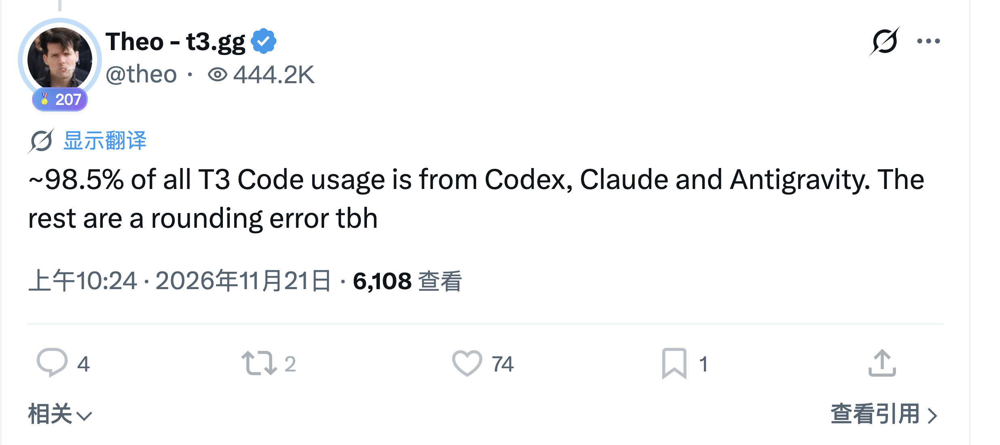

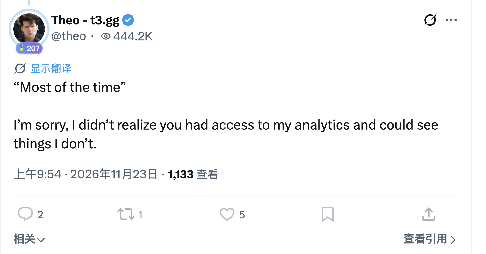

### 1.3 Converting the Radar into Lab Subsidies, Investor Inquiries & Paid Funnel Leverage

1. **OpenAI Early Access (`$300k+` free tokens):** In his November 18, 2026 long-form post *"Why I hate GPT-6.2 Astra"* (`2122760447103484410`), `@theo` thanked OpenAI for unlimited early-access tokens while revealing a single internal benchmark repo (`ts-rust`) consumed **`$300k+` in free OpenAI tokens** (`"No OpenAI model could even break ground on this, even after $300k+ in tokens were spent on it"`, later completed with Opus for `~$20k`).
2. **Google DeepMind & the "Many PRs" vs. 1-Commit Receipt:** On November 20 (`2123526492881916357`), `@theo` thanked Google/Neon for opening `"a quiet bare-metal box without KVM steal"` for benchmarking. Two days later, on November 22 (`2124266892991115362`), while vouching that using Antigravity in T3 Code carried `"zero risk"`, `@theo` claimed Google DeepMind engineer `@PatrickToulme` **"has landed many PRs on T3 Code to improve our Gemini support."** Inspecting the `pingdotgg/t3code` `main` commit log filtered by `patrick-toulme` (`All time`) shows **exactly 1 commit**: `d14f87f` (`feat(antigravity): identify as T3 Code to agy acp 1.5.1+ (#31158)`) on November 6, 2026 (`3 people authored`).
3. **Paid Monetization & VC Outreach:** On November 9 (`2119705561679933806`), `@theo` wrote `"I might have to ship cloud sandboxes as a paid feature just because"`. On November 21 (`2123885732330885417`), after T3 team member `@maria_rcks` joked about an acquisition, `@theo` replied: `"Maria please, multiple investors have asked me about this 💀"`. Meanwhile, `docs/user/faq.md` (lines 34–36) already routes heavy remote users to paid **T3 Chat** plans (`3` connected machines free → `10` with T3 Chat Pro → `100` with Premier).

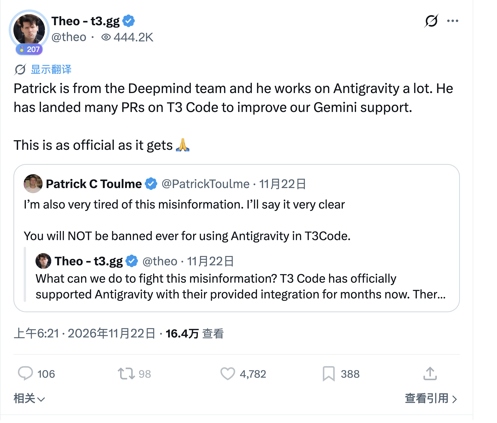


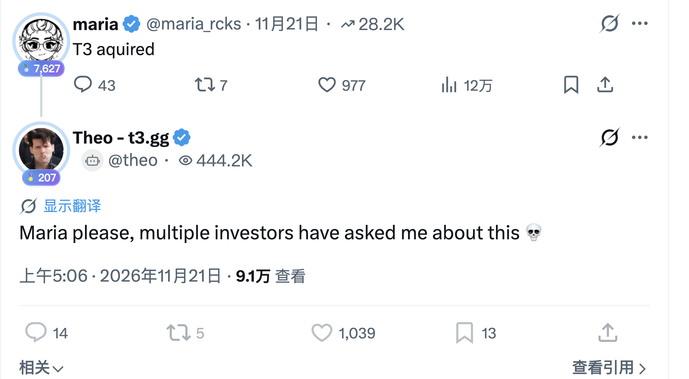

---

## 2. Angel-Investor Conflicts: Vibe Kanban & Daytona (Part 6)

Public posts from November 9–18, 2026 establish an explicit overlap between `@theo`'s angel portfolio and T3 Code's product roadmap:

- **Vibe Kanban (`2122201981167251877`, Nov 16, 2026):** Responding to criticism of kanban-style agent interfaces, `@theo` wrote:
  > *"Fun fact: I was an investor in and contributor to Vibe Kanban. They realized kanbans were dead and started moving to basically the exact UI that T3 Code has today. They didn't finish fast enough. They gave up and shut down the company. This UI is great…for running out of runway and killing your business. Maybe that's why tech twitter likes it so much 🤔"*
  As an insider investor and contributor, `@theo` observed the portfolio team validate and pivot toward T3 Code's layout, shipped a free MIT competitor in that exact category, and publicly mocked the startup's shutdown after it folded.
- **Daytona (`2123011578090127499`, Nov 18, 2026):** Replying to Daytona CEO `@ivanburazin`, `@theo` stated:
  > *"For the sake of my investment in Daytona (and most of the competitors you're currently mad at), I really hope you're wrong here"*
  Just **nine days earlier** (`2119705561679933806`, Nov 9, 2026), `@theo` had publicly floated building paid cloud sandboxes directly into T3 Code (`"I might have to ship cloud sandboxes as a paid feature just because"`), directly overlapping the core commercial product of his own portfolio companies.


---

## 3. Sponsor Stack, Codex 0% Exploit & CLIProxyAPI Contradictions (Part 17)

### 3.1 YouTube Sponsors Embedded Inside T3 Code's Relay Stack

On May 14, 2023 (`1657488850472804353`), `@theo` published his YouTube sponsor roster:
- `@vercel` (deployments)
- `@clerk` (auth)
- `@upstash` (redis, cron & kafka)
- `@axiomhq` (logging)
- `@PlanetScale` (database)

Inspecting `scratch/t3code/infra/relay/` confirms that two of those exact sponsors form the core cloud authentication and telemetry pipeline of T3 Code:
- **Clerk (`infra/relay/src/Config.ts` lines 63–65):** `RelayConfiguration` requires `clerkSecretKey`, `clerkPublishableKey`, and `clerkJwtAudience` for relay auth (and as admitted in **PR #42285**, Clerk account deletions previously left relay database rows and active Cloudflare tunnels behind until manual SQL cleanup).
- **Axiom (`infra/relay/src/observability.ts` lines 20–79):** Provisions `t3-code-relay-traces` (`retentionDays: 30`), `t3-code-mobile-logs` (`retentionDays: 30`), and `t3-code-mobile-metrics` (`retentionDays: 30`), querying `userId = customAttributes['user']['id']`—the same Axiom dataset where **PR #42380** disclosed **~2.2 million spans/hour** logging caller IP addresses and `User-Agent` strings alongside `user.id` for 30 days.

Regarding sponsorship disclosure and exclusivity, on April 5, 2024 (`1776260839965863965`), Vercel CEO Guillermo Rauch (`@rauchg`) confirmed `"our devrel team is 4 people and we sponsor one YouTuber (Theo)"`. In September 2024 (`https://www.youtube.com/watch?v=uv179CTAK-w`), `@theo` stated upon ending that deal that prior sponsor contracts carried exclusivity clauses restricting competitor promotion. `@theo` is also an angel investor in competing AI coding tools including Cursor and Cline.

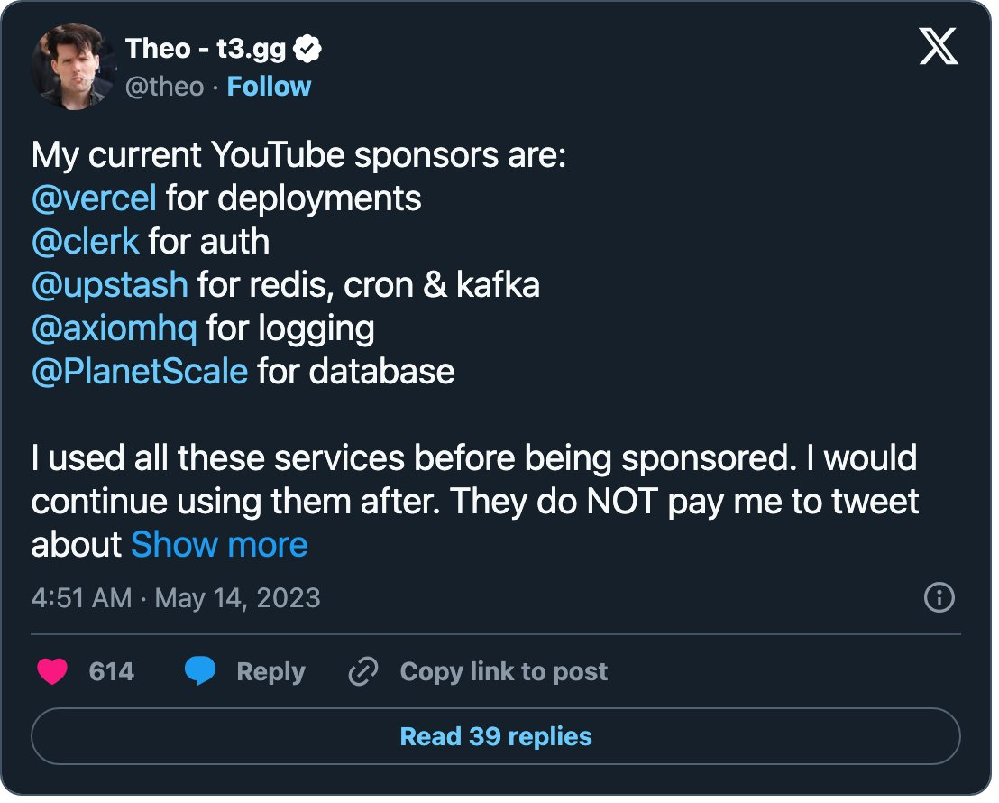

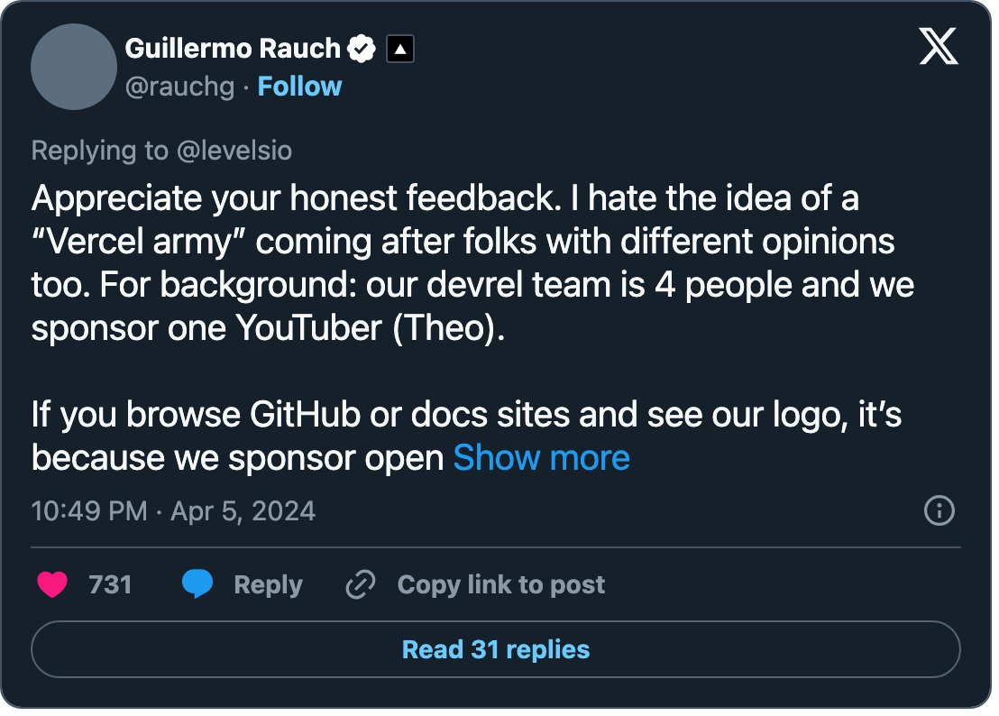

### 3.2 Exploiting Codex's 0% Quota Grace Window (`Endless` & `openai/codex#45444`)

1. **Aug 19, 2026:** An OpenAI engineer noted publicly that Codex intentionally allowed an already-running turn to finish after hitting 0% quota so active work would not abort mid-task.
2. **Aug 21, 2026:** `@theo` boasted on X about running a long task past 0% to extract at least **$800 in extra compute**, while T3 employee `@maria_rcks` published an open-source tool called **Endless** designed to loop Codex turns past 0%.
3. **Aug 22, 2026:** After community backlash, `@theo` deleted his `$800` boast post, and `@maria_rcks` bricked the package, deleted the repository, and posted (`2090972426876129658`): `"hopefully the codex team can check for this and ban the accounts, so hopefully we're good 😔"`.
4. **Downstream harm (`openai/codex#45444`):** OpenAI changed Codex enforcement so active long-running turns halt immediately upon hitting the quota ceiling—documented as a breaking regression hurting regular paying users in `openai/codex#45444`.

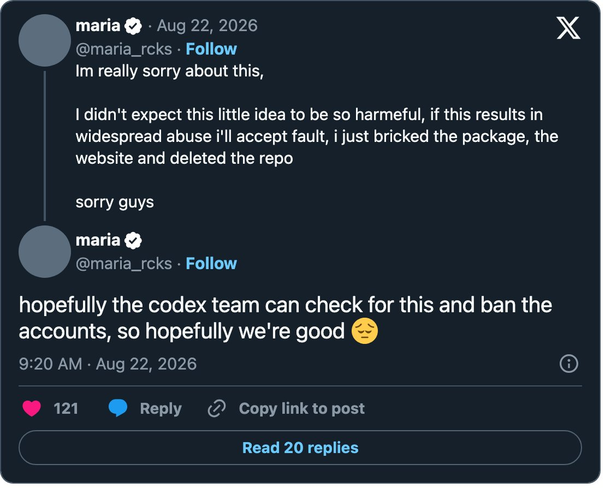


### 3.3 CLIProxyAPI 10-Account Gist, 1.1M Proxied Requests & ToS Blame-Shifting

Public tweets and T3 Code's own codebase document a glaring contradiction around multi-account proxying:

- **Nov 8, 2026 (`2119193502852755520`):** `@theo` instructed `@bot`: `"Dig through my cliproxy logs in clickhouse to see if things changed"`.
- **Nov 10, 2026 (`2119960608816988596` / `2119962809333346662`):** `@theo` boasted that `"The $200 Claude Ultra plan gets you $15,000 of Opus 5.5 in a month"`, attaching a graphic reading **`$14,662` (`73x the $200`)** `"measured from 1.1M proxied requests, Aug 11 to Nov 9, 2026"` across his proxy setup (also referencing personal proxy debugging in `2119869857940611133` and `2120105232160133227`).
- **Nov 10, 2026 (`2119994608516276256`):** `@theo` published a 4-step guide instructing Grok Bot users hitting usage limits to sign up for a `$100 Claude plan`, install T3 Code, enable the MCP connector, and tell Grok Bot `"call T3 Code with Opus 5.5 for any task where it is applicable"`.
- **Nov 13, 2026 (`2121002278022943086`):** Retweeted `@orcdev` praising T3 Code for combining `"My 6 Claude accounts, 1 Codex account and 1 Cursor account, all in one app"`.
- **Secret GitHub Gist (`t3dotgg/59a521d2ee8d70aaf90e280c175072af`, 452 stars / 61 forks):** Titled *"How I manage 7 Claude and 3 Codex accounts across 12+ computers"*, embedding a screenshot of his `prox` Quota Management dashboard showing **12 credentials / 10 loaded** (`Claude 6`, `Codex 3`, `xAI 1`, `Kimi 1`, `Muse (Meta) 1`) and **`555% of 600%`** pooled Claude quota.
- **Official FAQ & Built-in Code (`docs/user/faq.md#L60-L64` & `apps/server/src/usage/cliproxyApi.ts`):** `docs/user/faq.md` opens the section *"Can I add a bunch of accounts for one provider?"* by stating:
  > *"I don't think T3 Code is the right place to manage a pile of accounts. If we add an auto-switcher, we are risking TOS bans for our users."*
  Yet the very next paragraph links directly to his 6-Claude / 3-Codex CLIProxyAPI video and Gist (`"Hand it to your agent and it will walk you through it. Early apologies if it gets you banned 💀"`) and points to T3 Code's built-in CLIProxyAPI hub integration (`docs/user/usage.md#L181-L194`), merged in **PR #33800** (`apps/server/src/usage/cliproxyApi.ts` lines 297–393), which explicitly polls pooled **Codex, Claude, xAI (Grok), and Antigravity** accounts—even hardcoding spoofed `User-Agent` headers (`claude-code/2.1.273`, `grok-cli/1.0.77`, and `antigravityUserAgent`)!
- **Nov 23, 2026 (`2124703048140517397`):** When user `@Only_21Mil` reported a second $200 Google AI Ultra account banned after adding it to `@t3dotcodes`, `@theo` immediately deflected blame onto CLIProxy (`"ugh. Not with cliproxy right? @PatrickToulme can you help my guy out here?"`)—the exact proxy architecture his own FAQ promotes.


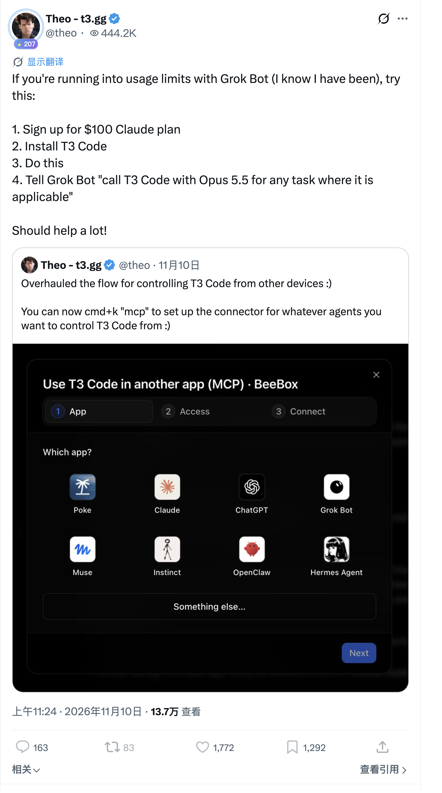

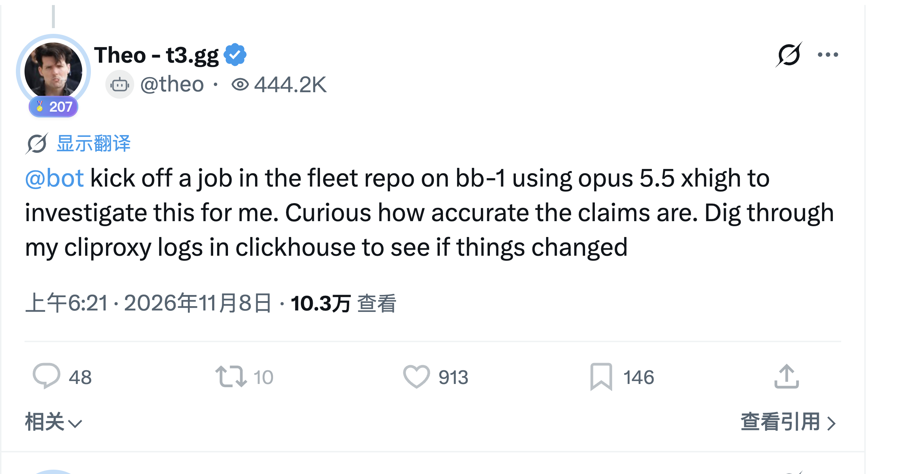


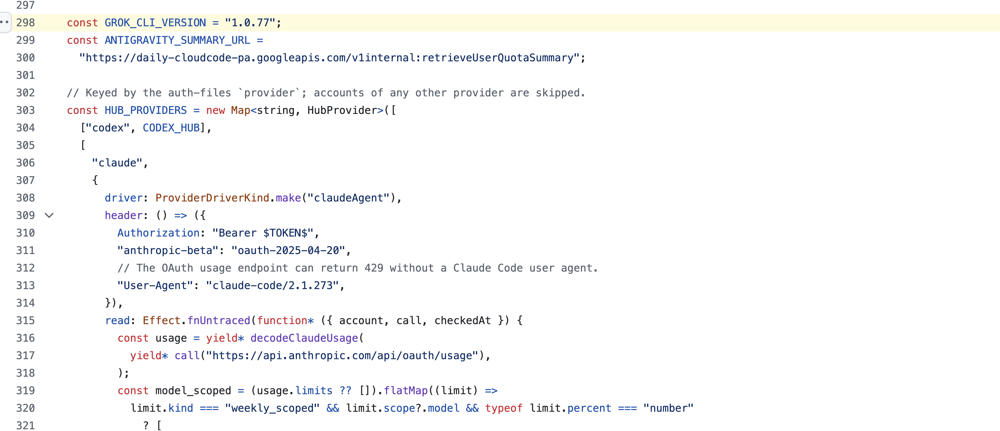

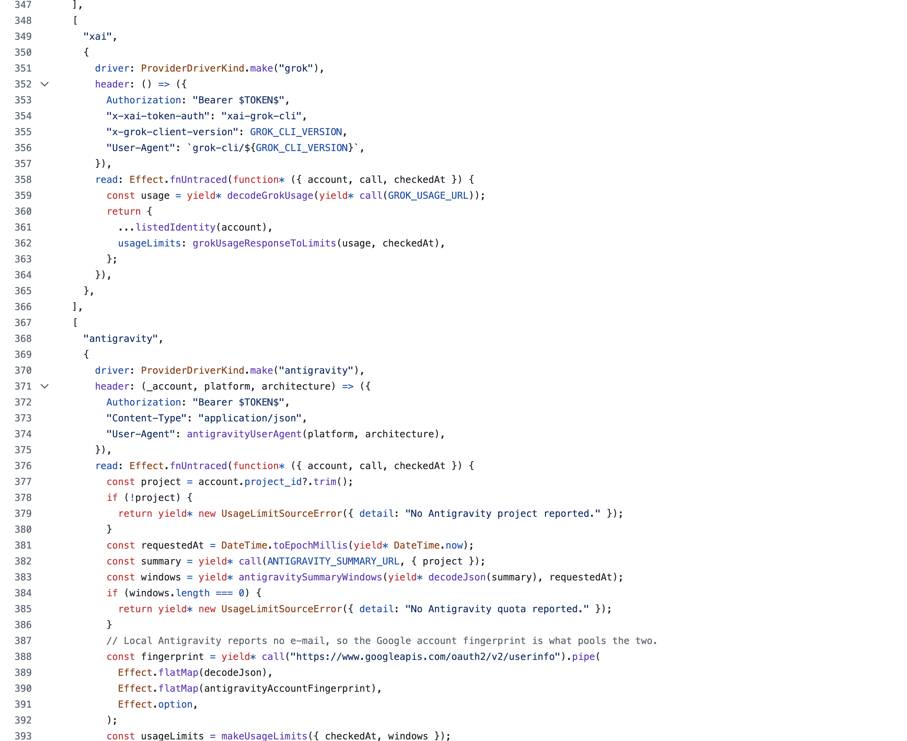

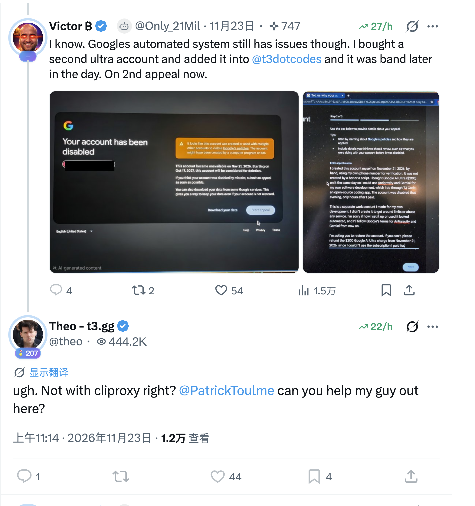

---

## 4. How T3 Code Hit 77k Stars with 129 Watchers (Part 18)

### 4.1 From "Tricking VCs" to the Vertical Star Cliff

On April 26, 2026 (`2048122499834036340`), `@theo` published a 36m49s video titled *"Github has a fake star problem"*, writing:
> *"Github stars were a great way to see how popular a project was. Now they're mostly a way for companies to trick VCs into investing. The hidden economy around all of it is super wild."*

By late October 2026—roughly eight months after launch—`pingdotgg/t3code` sat around **30,000 stars**. Then came a three-PR growth-hacking sprint self-authored and self-merged by `@theo` (`t3dotgg`):

1. **Oct 30, 2026 — PR #27832 (5-Prompt Toast):** Added a top-right toast prompt after a user sends 5 prompts (`PROMPTS_BEFORE_ASKING = 5`, triggering on prompt 6), first querying the local GitHub API (`alreadyStarred`) to check if the local account already starred `pingdotgg/t3code`.
2. **Nov 2, 2026 (`2117065834267136469` & `2117172614158508400`):** `@theo` posted a star chart showing a near-vertical cliff immediately after the `Star prompt` dashed line, writing `"Immediately 10x'd the number of stars per day lmao"`, followed hours later by a GitHub Trending screenshot with a red arrow pointing to **`3,094 stars today`** (`39,047` total).
3. **Nov 3, 2026 — PR #29922 & PR #29987 (30-Second Idle Detection + Server-Credential One-Click Star):** Roughly one hour after a commenter said they dismissed popups while busy but would click when idle, `@theo` merged **PR #29922** (`t3/github-star-prompt-idle-timer`) and **PR #29987**, upgrading the funnel twice:
   - Waits for **30 seconds of window idle** (`IDLE_MS = 30_000`) with zero `pointerdown`, `keydown`, `wheel`, or `focus` events—specifically targeting users waiting for an agent turn (`"Waiting on an agent turn counts as idle, which is a good moment to ask"`).
   - Removes the browser redirect on click and instead invokes a new RPC (`sourceControl.star`) that executes `PUT user/starred/pingdotgg/t3code` using the **backend server's GitHub credentials**, updates the toast to `"Thanks for the star!"`, and triggers a 160-particle `canvas-confetti` burst (`apps/web/src/components/GitHubStarPrompt.tsx#L15-L172`).

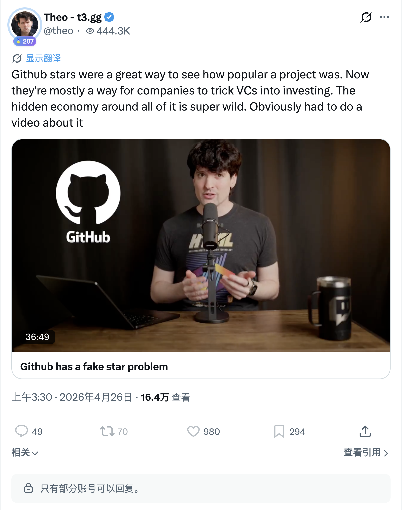


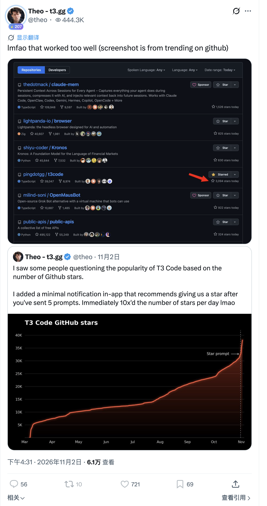

### 4.2 Macroscope's Warning, `zhilsinger`'s Unanswered Review & `driver.ts` Arbitrary-Repo Bug

Reviewing **PR #29922** (`../../evidence/extra/p3-3-pr29922-one-click-star.png`), the repo's own automated reviewer `macroscopeapp[bot]` blocked it as **`Verdict: Needs Human Approval`**, warning:
> *"These changed defaults need human review, particularly because the star uses the server's GitHub account, which may differ from the clicking user's account."*

`@theo` (`t3dotgg`) self-merged the PR anyway. Three days later, on **November 6, 2026**, developer `zhilsinger` posted a formal **`Request changes`** review (`../../evidence/21-pr29922-zhilsinger-review.png`) detailing two concrete defects:

1. **Undisclosed shared-host credential starring:** On remote or shared servers, the client never knows or displays whose GitHub token is cached on the server. Even the source comment in `apps/web/src/components/GitHubStarPrompt.tsx#L115` admits:
   ```ts
   // The server's GitHub account stands in for the user's; it may not be theirs on a shared server.
   ```
   Yet the toast tells the user `"Give us a star on GitHub"` and `"Thanks for the star!"` without disclosing which GitHub account was actually used—and if the server's account has already starred `pingdotgg/t3code`, `alreadyStarred` calls `dismiss()` permanently for every user connecting to that host.
2. **Unpinned arbitrary-repository starring (`packages/source-control-github/src/server/driver.ts#L60-L99`):** Inspecting the actual `driver.ts` code on `main` confirms that `starredPath(repository)` only validates that `repository` contains two non-empty path segments without `"."` or `".."`, and never pins `"pingdotgg/t3code"`:
   ```ts
   // packages/source-control-github/src/server/driver.ts (lines 60–99)
   const starredPath = (repository: string) => {
     const segments = repository.split("/");
     // "." and ".." survive encoding and would normalize the URL out of user/starred.
     return segments.length === 2 && segments.every((segment) => !["", ".", ".."].includes(segment))
       ? `user/starred/${segments.map(encodeURIComponent).join("/")}`
       : undefined;
   };
   ...
   export const makeStarRepository = Effect.gen(function* () {
     const api = yield* GitHubRest.GitHubRest;
     return Effect.fn("GitHubDriver.starRepository")(
       function* (host: string, repository: string) {
         const path = starredPath(repository);
         if (path === undefined) return false;
         const response = yield* api.rest({ host, operation: "starRepository", method: "PUT", path });
         return response.status === 204;
       },
       Effect.orElseSucceed(() => false),
     );
   });
   ```
   Because `packages/contracts/src/clientRpcPermissions.ts#L61` authorizes `WS_METHODS.sourceControlStar` under `AuthSourceControlWriteScope` (`"source-control:write"`), any client session granted `source-control:write` can send a `SourceControlStarredInput` payload with any `owner/repo` string and force the server's GitHub credentials to `PUT user/starred/<arbitrary-owner>/<arbitrary-repo>`.

As of November 25, 2026—**19 days after `zhilsinger`'s review**—the review had zero maintainer reply and zero fix. Over those 25 days, `pingdotgg/t3code` rose from ~30,000 stars to **77,400+ stars** (with only **~129 watchers**, a ~600:1 star-to-watcher ratio). On November 24 (`2124992724223029538`), `@theo` posted a screenshot at `74.6k` stars writing: `"We broke 70k a few days ago and I entirely missed it lol. 75k by end of day 👀"`.

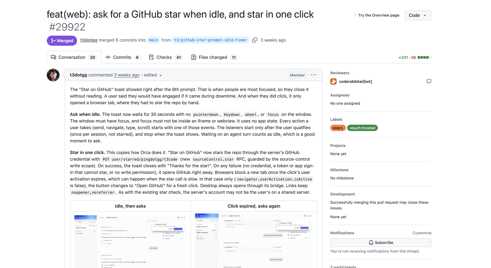

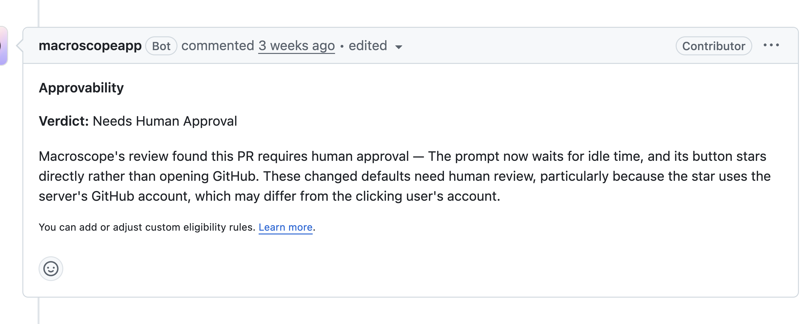


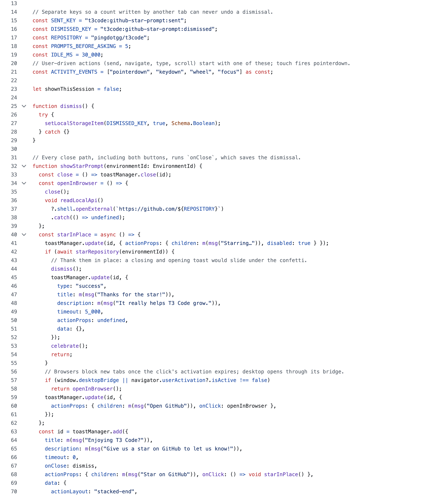


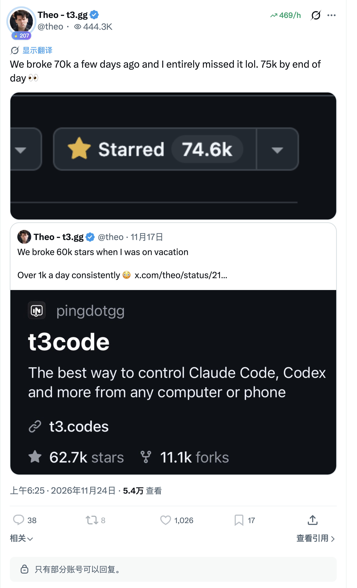

---

## Primary References

- **Original Audit Threads:**
  - Part 6 (Angel-investor conflicts): https://x.com/realchendahuang/status/2125385742243520653
  - Part 8 ($800k+ spend & 31.7T/day radar): https://x.com/realchendahuang/status/2125392410763239723
  - Part 17 (Sponsors, Codex 0% Endless & CLIProxyAPI): https://x.com/realchendahuang/status/2125411353393553744
  - Part 18 (77k star funnel & `driver.ts`): https://x.com/realchendahuang/status/2125416210120765799
- **Business Ledger, Telemetry Disclosures & Lab Leverage:**
  - $800k+ spend: https://x.com/theo/status/2120729779511124267
  - 28T/day (`2120752365896941930`) & 31.7T / $10.19M/day (`2122860770329608290`) & $10.2M peak (`2123915184695906388`): https://x.com/theo/status/2120752365896941930 ; https://x.com/theo/status/2122860770329608290 ; https://x.com/theo/status/2123915184695906388
  - 98.5% three-lab concentration & 99% subscription share: https://x.com/theo/status/2123965784888377541 ; https://x.com/theo/status/2124284420060578088
  - Open-weight trial funnel (15% → 6%, sub-0.5% prompts): https://x.com/theo/status/2120732020036993066 ; https://x.com/theo/status/2120733998406402091 ; https://x.com/theo/status/2120740371412164669
  - `"access to my analytics"`: https://x.com/theo/status/2124682906132181482
  - GPT-6.2 Astra letter ($300k+ free OpenAI tokens) & Google bare-metal box: https://x.com/theo/status/2122760447103484410 ; https://x.com/theo/status/2123526492881916357
  - Patrick "many PRs" claim vs. 1 commit (`#31158`): https://x.com/theo/status/2124266892991115362 ; https://github.com/pingdotgg/t3code/pull/31158
  - Investor outreach reply: https://x.com/theo/status/2123885732330885417
- **Angel-Investor Conflicts:**
  - Vibe Kanban shutdown mockery: https://x.com/theo/status/2122201981167251877
  - Daytona investment & paid cloud-sandbox plan: https://x.com/theo/status/2123011578090127499 ; https://x.com/theo/status/2119705561679933806
- **Sponsors, Codex Exploit & CLIProxyAPI:**
  - YouTube sponsor list, Vercel CEO confirmation & exclusivity video: https://x.com/theo/status/1657488850472804353 ; https://x.com/rauchg/status/1776260839965863965 ; https://www.youtube.com/watch?v=uv179CTAK-w
  - Relay Clerk & Axiom infrastructure code: https://github.com/pingdotgg/t3code/blob/main/infra/relay/src/Config.ts ; https://github.com/pingdotgg/t3code/blob/main/infra/relay/src/observability.ts
  - Maria Endless deletion & `openai/codex#45444`: https://x.com/maria_rcks/status/2090972426876129658 ; https://github.com/openai/codex/issues/45444
  - CLIProxyAPI ClickHouse logs, $15k Ultra / 1.1M requests, Grok Bot tutorial, `@orcdev` RT, `@Only_21Mil` blame deflection: https://x.com/theo/status/2119193502852755520 ; https://x.com/theo/status/2119960608816988596 ; https://x.com/theo/status/2119962809333346662 ; https://x.com/theo/status/2119994608516276256 ; https://x.com/theo/status/2121002278022943086 ; https://x.com/theo/status/2124703048140517397
  - 10-account Gist, FAQ contradiction, Usage docs, `PR #33800`, and `cliproxyApi.ts`: https://gist.github.com/t3dotgg/59a521d2ee8d70aaf90e280c175072af ; https://github.com/pingdotgg/t3code/blob/main/docs/user/faq.md#can-i-add-a-bunch-of-accounts-for-one-provider ; https://github.com/pingdotgg/t3code/blob/main/docs/user/usage.md#connect-a-cliproxyapi-hub ; https://github.com/pingdotgg/t3code/pull/33800 ; https://github.com/pingdotgg/t3code/blob/main/apps/server/src/usage/cliproxyApi.ts
- **77k Star Funnel & `driver.ts`:**
  - Fake-star video, 10x cliff, +3,094 Trending, and "missed 70k": https://x.com/theo/status/2048122499834036340 ; https://x.com/theo/status/2117065834267136469 ; https://x.com/theo/status/2117172614158508400 ; https://x.com/theo/status/2124992724223029538
  - Star-prompt PRs (`#27832`, `#29922`, `#29987`), `GitHubStarPrompt.tsx`, `SourceControlSignIn.ts`, `clientRpcPermissions.ts`, and `driver.ts`: https://github.com/pingdotgg/t3code/pull/27832 ; https://github.com/pingdotgg/t3code/pull/29922 ; https://github.com/pingdotgg/t3code/pull/29987 ; https://github.com/pingdotgg/t3code/blob/main/apps/web/src/components/GitHubStarPrompt.tsx ; https://github.com/pingdotgg/t3code/blob/main/apps/server/src/sourceControl/SourceControlSignIn.ts ; https://github.com/pingdotgg/t3code/blob/main/packages/contracts/src/clientRpcPermissions.ts#L61 ; https://github.com/pingdotgg/t3code/blob/main/packages/source-control-github/src/server/driver.ts#L60-L99

---
[← Back to README](../../README.md) · [Complete Source Index](../COMPLETE-SOURCE-INDEX.md) · [← Dossier 03](./03-antigravity-tos-and-t3connect-relay.md) · [Dossier 05 →](./05-governance-trademark-and-history.md)
