[← Back to README](../../README.md) · [Complete Source Index](../COMPLETE-SOURCE-INDEX.md) · [← Dossier 04](./04-business-ledger-sponsors-and-77k-stars.md) · [Dossier 06 →](./06-tweet-forensic-dataset-1151.md)

# Dossier 05: Repository Governance, Fork-Scraping Bots, Trademark Overreach & Historical Record

> **Covers:** Origin Posts 1–2 and Audit Parts 9, 10, 15, and 16 (plus governance findings from Parts 2–3)  
> **Primary Record Scope:** `pingdotgg/t3code` files (`CONTRIBUTING.md`, `TRADEMARK.md`, `.github/VOUCHED.td`, `.github/scripts/pr-limits.cjs`, `.github/workflows/issue-vouch.yml`, `apps/marketing/src/i18n/en.ts`), USPTO TSDR records, GitHub Trademark Policy, and public X/YouTube receipts (2024–2026).  
> **Audited Upstream Snapshot:** [`9d3195b4`](https://github.com/pingdotgg/t3code/commit/9d3195b49dfb0098e9fa592fe0ada5464206d1c2) (`PR #42000`, `2026-11-24T08:41:04Z` / `2026-11-24 16:41:04 CST`)  
> **Post-Audit Upstream Re-Audit:** [`ca81b7b9`](https://github.com/pingdotgg/t3code/commit/ca81b7b97a1c4b91e5ac25768d0f6629f37732fd) (`PR #42634`, `2026-11-25T06:49:37Z` / `2026-11-25 14:49:37 CST`, `259` commits ahead of `9d3195b4`) — `TRADEMARK.md`, `CONTRIBUTING.md`, `.github/VOUCHED.td`, `.github/scripts/pr-limits.cjs`, and `.github/workflows/issue-vouch.yml` remain unchanged.

---

## Executive Summary

The telemetry, security, and growth patterns documented in [Dossiers 01–04](./04-business-ledger-sponsors-and-77k-stars.md) reflect a consistent governance model inside `pingdotgg/t3code`:

1. **Origin Trigger (Nov 23–24, 2026):** While T3 Code's own website labeled its GitHub link `"Steal our code (legally)"` (`apps/marketing/src/i18n/en.ts#L32`), `@theo` reacted to a UI complaint about an MIT-licensed Chinese fork (`@DDdxx666`) within 11 minutes by calling it a `"Chinese knockoff"` and `"Temu3 Code"` and threatening to contact GitHub to terminate the author's account—even though the author stripped all T3 branding within 30 minutes. Twelve hours later, asked about trillion-dollar US companies copying T3 Code, `@theo` declared: `"Open source is open source, even if a trillion dollar company uses it!"`
2. **Internal Velocity vs. External Hostility:** Internally, `@theo` boasted of **500 commits/day**, **700 agents**, `"yolo merges breaking shit sometimes"`, an automated maintainer merge loop, and risking machine wipes for `"free content"`. Externally, he removed Plan mode and context meters despite community backlash (`#5551`, `#9190`, `#33131`), told a user in **Issue #33639** to uninstall and called him an `"ungrateful prick"`, rejected PRs from contributors who didn't follow him on X, codified `"here's my advice: Don't"` in `CONTRIBUTING.md`, and enforced public denouncements in `.github/VOUCHED.td` that auto-close every issue and PR on sight.
3. **Asymmetric Copying & Moderation:** `@theo` publicly dispatched his internal `@bot` on X to locate and clone features from `@MiaAI_lab`'s fork (`"Okay I'm stealing this"`) and rival tools, yet mocked Claude Code Desktop for adding sidebar tabs. Against critics, he called on followers to use Community Notes to `"demonetize them"` and ran an X auto-blocker bot banning ~100 accounts on November 24.
4. **Zero USPTO Registrations & Retroactive `TRADEMARK.md`:** At the moment `@theo` threatened a GitHub trademark takedown, **T3 Tools, Inc. held 0 USPTO registrations** for `T3 Code`, `T3 Tools`, or `T3 Connect`—its sole USPTO filing (`PING LABS`, Serial `97294243`) was refused and marked `ABANDONED` on May 19, 2025, while third parties (`EquipmentShare`, `ESG Operations`) already held software/SaaS `T3` registrations. Under GitHub's Trademark Policy, commercial takedowns require a registration number under penalty of perjury. Only **17 hours after** the ban threat did `@theo` merge **PR #41898** adding `TRADEMARK.md` claiming `"unregistered"` rights—while T3 employee `@maria_rcks` maintained a public fork named `t3libre` and dozens of English `t3code-*` repos operated undisturbed.
5. **Recurring Two-Year Pattern:** From mocking another author's copyright sensitivity with `vsc-material-but-i-wont-sue-you` (2024), to an apology video (`I screwed up.`) after an Indian developer harassment wave, to a **$20,000 bounty** to push out an FFmpeg maintainer (Oct 2025, withdrawn after Windscribe's $21k counter-bounty and VLC/FFmpeg backlash), to a deleted 4:00 AM threat on Nov 25, 2026 to take T3 Code closed-source.

---

## 1. Origin Incident: "Steal Our Code" & The MIT Fork Naming Dispute (Origin 1 & 2)

T3 Code's marketing site (`apps/marketing/src/pages/[...locale]/index.astro#L98`) renders a localized source-code link defined in `apps/marketing/src/i18n/en.ts#L32` (`"Steal our code (legally)"`) and `zh.ts#L32` (`"来偷我们的代码（合法地）"`).

Between the evening of **November 23** and the morning of **November 24, 2026 (Beijing Time)**, a user criticized the UI of a Chinese developer's (`@DDdxx666`) free, MIT-licensed fork, mistaking it for the official T3 Code client ([Origin 1](https://x.com/realchendahuang/status/2125059292919394654), [Origin 2](https://x.com/realchendahuang/status/2125062675147448475)):

- **Nov 23, 19:11:49 BJ (`2124823227570745504`):** Without checking whether the repo was an open-source MIT fork, `@theo` quote-tweeted: `"I think there's a Chinese knockoff of T3 Code going around because this definitely is NOT our app"`.
- **Nov 23, 19:22:31 BJ (`2124825920808829077`):** Eleven minutes later, `@theo` quote-tweeted himself: `"Temu3 Code"`.
- **Nov 23, 19:35:34–19:36:00 BJ (`2124829203174740010` / `2124829315657576890`):** After `@DDdxx666` agreed to consider renaming the GitHub repo to avoid confusion, `@theo` replied:
  > *"Not consider. Do it right now or I'm going to contact GitHub and have your account taken down."*
- **Aftermath:** `@DDdxx666` complied within 30 minutes, renaming the project to `Stardust` and removing T3 branding. `@theo` apologized privately in DMs, yet kept both public posts—accumulating over 200,000 views—live without clarification.
- **Nov 24, 06:12:16 BJ (`2124989435154726982`):** Less than 11 hours later, asked whether a trillion-dollar US lab copying T3 Code crossed a line, `@theo` replied:
  > *"Nah. Open source is open source, even if a trillion dollar company uses it!"*

---

## 2. Internal Velocity vs. External Contributor Hostility (Part 9 + Parts 2–3)

### 2.1 500 Commits/Day, 700 Agents & "Free Content" Yolo Merges

`@theo`'s own X posts describe an internal engineering process built around speed and video output rather than stability:

- **500 commits/day (`2120741101250515322`, Nov 12, 2026):** `"I'm often at 500 commits/day, this is just t3 code lol"`.
- **700 agents (`2122203951701585972`, Nov 16, 2026):** `"Knowing what my 1 video editor is working on is very different from knowing what my 700 agents did last week."`
- **Automated PR merge loops (`2120131740471861485`, Nov 10, 2026):** `"Julius had a massive agent loop running to clear out and merge open PRs from contributors. Someone had 'fable 5.5' in a commit message and it got attached to his username when it merged."`
- **Yolo merges & nuked machines (`2119951615679672513` & `2119993037971730879`, Nov 10, 2026):**
  - `"If you're okay with my yolo merges breaking shit sometimes, stay on nightly"`
  - `"I need results fast because I have to film, and if it nukes my machine that's free content"`

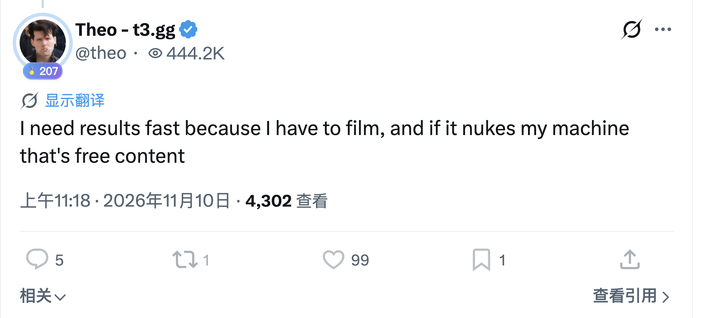

### 2.2 Removing Plan Mode, Hiding the Context Meter & Issue #33639 Insults

When ordinary users objected to unilateral UI removals, `@theo` responded with dismissive telemetry charts and personal abuse:

1. **Aug 6–7, 2026 — PR #5551 (`t3code/remove-build-plan-toggle`):** Because `@theo` did not personally use Plan mode, he buried the composer's Build/Plan toggle inside legacy settings (`default false`), attaching an unscaled telemetry line chart captioned **`"Reality check for those upset"`** (10 downvotes).
2. **Sept 2, 2026 — PR #9190:** Hid the composer context-window progress ring by default, drawing **16 downvotes** (the highest downvote count in the repository).
3. **Nov 9, 2026 — PR #33131 (`t3/audit-labs-settings`):** Deleted Plan mode completely. `@theo` merged his own AI-generated PR description without catching an absurd contradiction in it: *"The plan mode removal is its own commit, so it can be dropped if usage data says to keep it."* Commenter `InterStella0` mocked the contradiction (`"brainrotted so hard he didnt even read his own AI summary to see how this sentence makes 0 sense"`) and community forks (`Ta-noshii/t3code`) restored the context meter and Plan mode.
4. **Issue #33639 & PR #41572:** When user `@bermudi` complained that release notes omitted where the context indicator moved and not everyone could afford thousands of dollars in subscriptions, `@t3dotgg` replied:
   > *"@bermudi you in particular should uninstall our software. I will ban you from the repo if you ever leave a comment like this again. You spent actual time being a dick to me personally for giving out software I could charge millions of dollars for for free... You're an ungrateful prick who is lazy as shit, and I do not care about your opinions."*
   When another contributor submitted **PR #41572** integrating the context ring cleanly inside the send button without taking composer space, it was closed immediately the next morning.

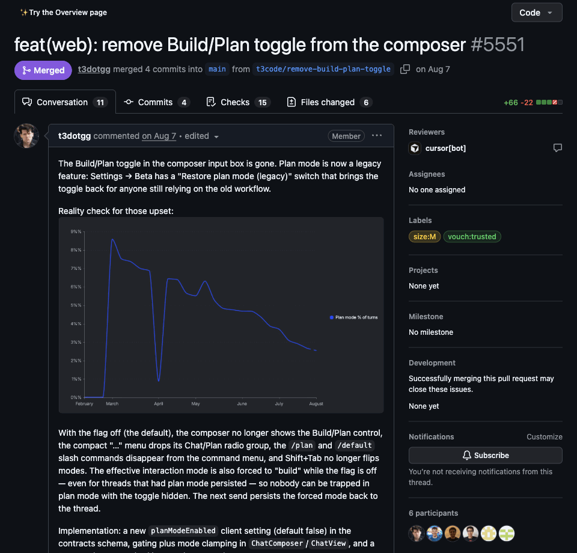

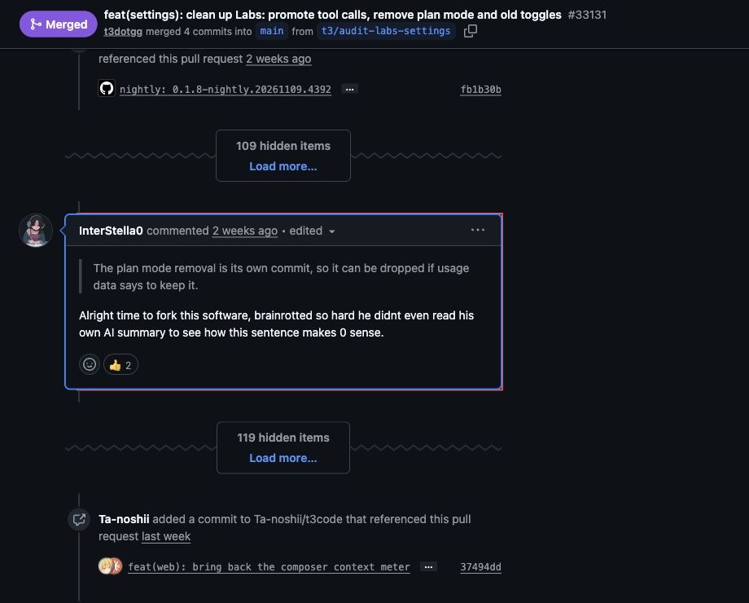

### 2.3 `CONTRIBUTING.md`, `.github/VOUCHED.td`, `unwanted` Labels & Public Gatekeeping

On November 12, 2026 (`2120821825433469311`), the same day T3 Code passed 1,000 contributors, `@theo` replaced the repository's `CONTRIBUTING.md` (`"Previous one was basically an LLM-written placeholder. This is...much more me :)"`). Direct inspection of `scratch/t3code/CONTRIBUTING.md` and `.github/` workflows shows how external contributors are filtered:

- **Explicit PR discouragement (`CONTRIBUTING.md#L6-L18`):**
  > *"That said, it is also ours. T3 Code is built and maintained by a small team with a clear vision. We are explicitly NOT INTERESTED in new feature addition PRs from people outside of said team... If you're looking for things to contribute, here's my advice: Don't. ... Your work will almost certainly be closed."*
- **Model-based PR ban (`CONTRIBUTING.md#L96-L103`):**
  > *"We close PRs when the author says that a Gemini model or Muse Wonder wrote any of the code. Gemini 4 Neon and Muse Wonder Full are accepted."*
  *(Note: `@theo` himself later used `Gemini 4 Neon in Antigravity` to author `PR #41898`.)*
- **Public denouncement list & automated bans (`CONTRIBUTING.md#L122-L129`, `.github/VOUCHED.td`, `.github/scripts/pr-limits.cjs`, `.github/workflows/issue-vouch.yml`):**
  > *"If you make our lives harder as reviewers and maintainers, you will be banned. Examples are repeated pings, a fight over a closure, and a second account to get around a limit. A banned account is denounced in `.github/VOUCHED.td`. Any issue or PR it opens is closed when it is opened."*
  Inspecting `.github/VOUCHED.td` confirms public denouncements using `-github:<login> <reason>` (e.g., `-github:coygeek` on line 25 and `-github:wSedlacek` on line 92). When a denounced user opens any new issue or PR, `issue-vouch.yml` (lines 96–111) and `pr-limits.cjs` (lines 301–314) automatically post a public ban comment and close it immediately. Across the repository, **174 items** carry `unwanted` labels (including hardware-tested telemetry toggle **PR #27077** with 147 passing tests).
- **X contributor gatekeeping:**
  - **Nov 10 (`2119958282022568059`):** `"~70% of feature requests in T3 Code are prompt skill issues at this point"`.
  - **Nov 12 (`2120821423438778667`):** Rejecting a developer offering a PR: `"From your eagerness to contribute to the fact that you reply to my posts without following me...not sure this is the best project for you to put your time into."`
  - **Nov 12 (`2120853340078874923`):** `"I already caved for y'all with /btw, be careful. I am not afraid to take it away."`
  - **Nov 20 (`2123754193530053110`):** `"The pic with arrows and labels makes it really really easy for me (and Claude) (and neon) to understand, agree, and then implement. I'll take a pic like that over a PR literally any day"`.

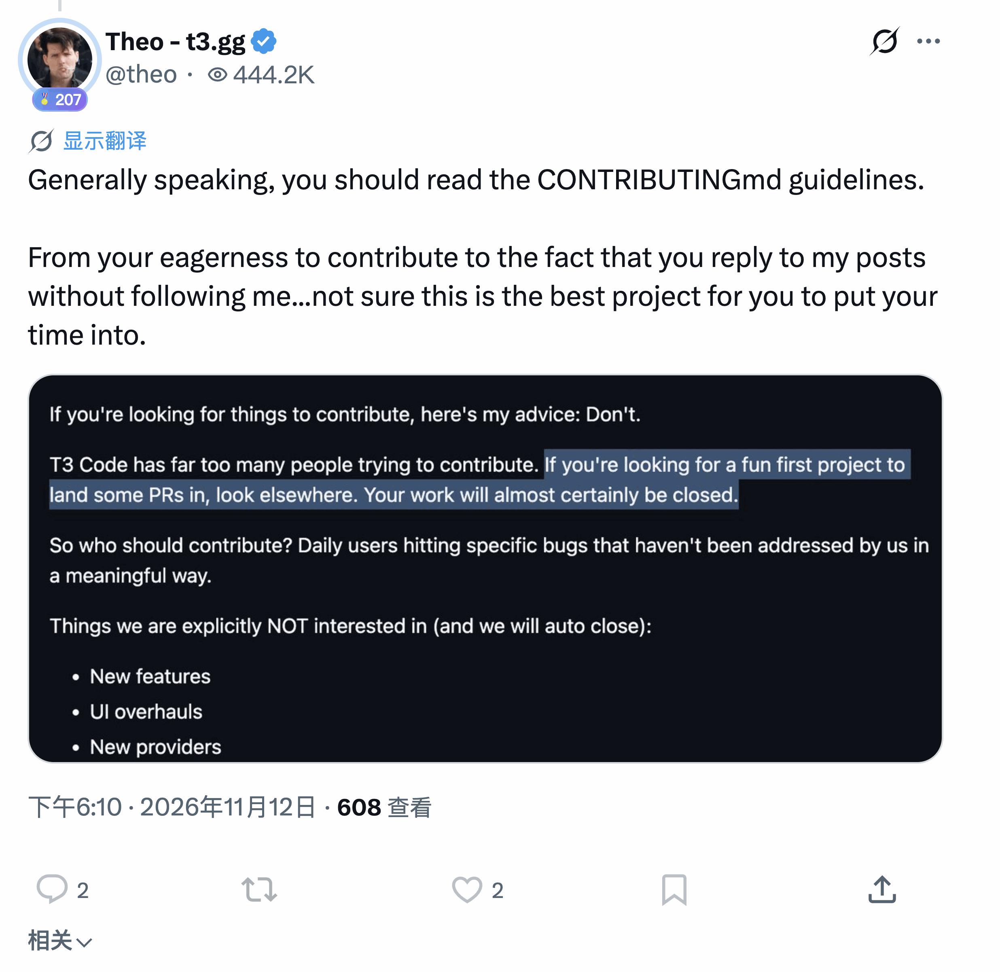

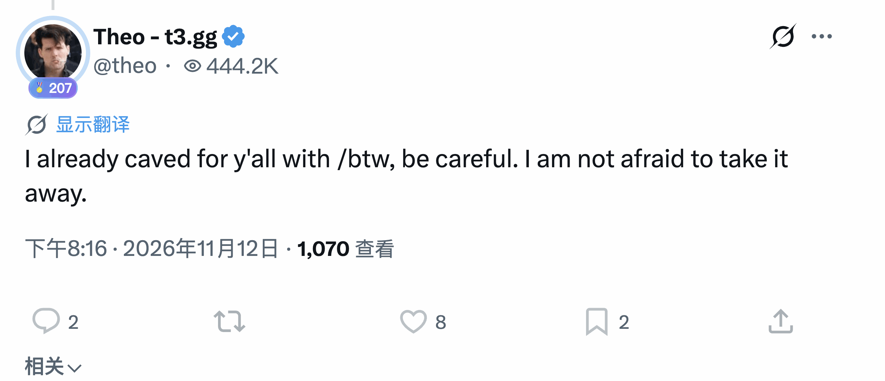

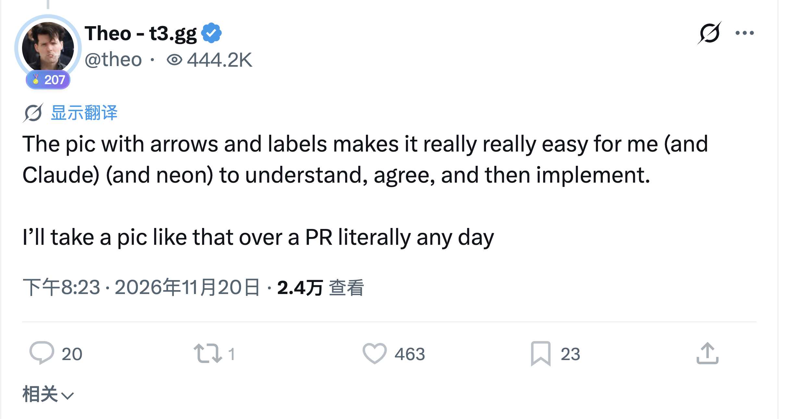

---

## 3. Public `@bot` Fork-Scraping, Community Notes & Auto-Blocker (Part 10)

`@theo`'s public X replies also show an explicit double standard between taking community/competitor features and attacking rivals or critics:

- **Publicly scraping `@MiaAI_lab`'s fork (`2119240683680944172` & `2119240810202034645`, Nov 8, 2026):** After `@MiaAI_lab` posted a custom fork feature, `@theo` replied `"Okay I'm stealing this"` at `09:28:47 BJ`, and **30 seconds later** (`09:29:17 BJ`) commanded his internal bot right in public replies:
  > *"@bot find her fork and see how portable this is. Spin up a thread on beebox with opus 5.5 to implement it. Use my full stop skill."*
- **Publicly cloning praised competitor features (`2121017649652269120`, Nov 13, 2026):** When user `@zqkrq` listed features preferred in rival tools, `@theo` dispatched `@bot` again:
  > *"@bot kick off a t3 code thread with fable 5.2 to explore all the things Zakra prefers about other tools. I want separate threads exploring each feature/preference and figuring out how they'd fit in t3 code :)"*
  *(Across the 1,151-post window, `@theo` tagged `@bot` 18–19 times to control remote boxes `bb-1`, `beebox`, and `leftbook`, while complaining repeatedly that the integration failed 2 out of 3 times or was broken for a month: `2119707535901151420`, `2120832400959873416`, `2122864180659368346`.)*
- **Mocking competitors for shipping similar UI:** On November 16 (`2122243989579632770`), he mocked `@agent_wrapper` for borrowing T3 Code code/UX. On November 24 (`2124987957803446311`), when Claude Code Desktop shipped sidebar tabs, `@theo` quote-tweeted: `"At the rate they're copying our features, they're gonna be adding Antigravity support in a few days"`.
- **Policing critics via Community Notes & auto-blocking:**
  - **Nov 11, 2026 (`2120238923884696025`):** Asked followers to weaponize X's monetization penalty: *"I'd appreciate if you used your community note powers to demonetize them for their lies :)"*.
  - **Nov 24, 2026 (`2125077510941802509` & `2125120041092108678`):** Confirmed his X account runs an automated blocker script (`"My bot blocked you for harassment. I unblocked you so you could reply. Now that I've seen your reply, I agree with my bot. You're a liar and a fucking pussy. China should kick you out for making them look bad"`) and reported `"Blocked like 100 slop accounts today."`

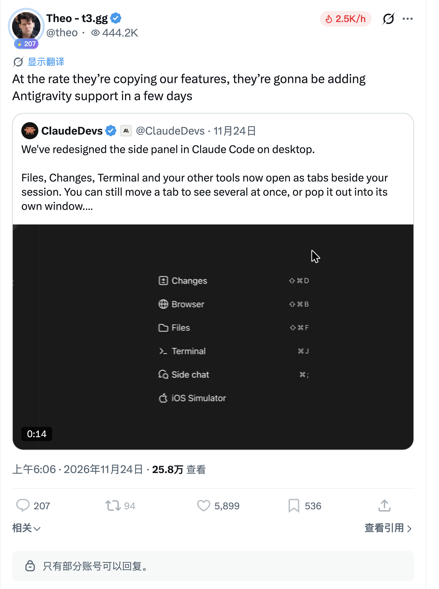

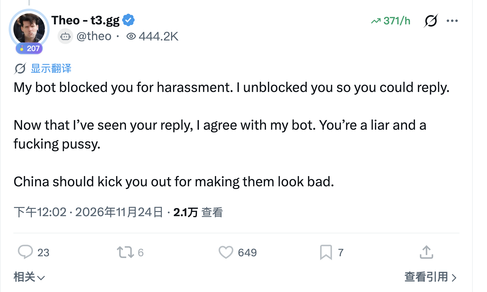

---

## 4. Trademark Audit: USPTO Zero Registrations & Retroactive `PR #41898` (Part 15)

Tracing a lead from `@vildanden_ai` (`2125275487404761555`), inspecting the **USPTO Trademark Status & Document Retrieval (TSDR)** database alongside **GitHub's Trademark Policy** exposes the legal reality behind `@theo`'s November 23 GitHub ban threat:

### 4.1 USPTO Database Verification

| Mark / Applicant | USPTO Serial / Reg. | Status / Date | Relevance |
|---|---|---|---|
| `T3 Code` / `T3 Tools` / `T3 Connect` | **None** | **0 USPTO registrations** | No federal registration existed when takedown threats were made |
| `PING LABS` (filed by T3 Tools Inc.) | Serial **`97294243`** | Filed Mar 2022 → Refused Feb 2025 → **`ABANDONED`** May 19, 2025 | The sole trademark application ever filed by T3 Tools Inc. |
| `T3` (EquipmentShare, Classes 42/9 SaaS & software) | Reg. **`7795672`** / Serial **`90644500`** | Registered **May 13, 2025** | Third party already holds registered `T3` wordmark in software/SaaS classes |
| `T3` (ESG Operations, computer software services) | Reg. **`3324707`** | Registered | Over 1,200 USPTO `T3` records exist; software/SaaS classes are crowded |

### 4.2 GitHub Trademark Policy vs. Retroactive `PR #41898`

Under [GitHub's official Trademark Policy](https://docs.github.com/en/site-policy/content-removal-policies/github-trademark-policy):
- **Commercial entities** submitting a trademark takedown **must provide a federal or international trademark registration number and issuing registry**, and swear ownership under penalty of perjury. Unregistered-mark exceptions apply strictly to **government bodies and nonprofits**.
- Even with a valid registration, GitHub distinguishes non-impersonating open-source confusion from malicious spoofing—typically requesting clarification or renaming rather than terminating a developer's entire account.
- When `@theo` threatened `@DDdxx666` on **November 23 at 19:36 BJ**, T3 Code had **no `TRADEMARK.md`**, **no trademark section in `README.md`**, and **0 USPTO registrations**—meaning T3 Tools Inc. could not even satisfy GitHub's commercial takedown form.

### 4.3 Timeline of Retroactive Enforcement & Contradictory Precedents

1. **Sept 2024 (`1839261574005141945`) & Apr 2025:** `@theo` mocked WordPress for pursuing an `"unenforceable trademark dispute"`, and wrote in April 2025: `"Trademarking something so common with so much prior art is genuinely insane"`.
2. **Nov 24, 08:38–08:39 BJ (`2125026248321872335` / `2125026423769555308`):** Dismissing compliance regulations that restricted AI agent merges, `@theo` told developers: `"Those regulations are really vague and dumb... if your lawyer pushed back on using agents to merge because of some dumb regulation, get a better lawyer."`
3. **Nov 24, 12:21:37 BJ (`04:21:37 UTC`, PR #41898):** **17 hours after** threatening to get `@DDdxx666`'s GitHub account banned, `@theo` merged **PR #41898** (`docs: clarify that MIT covers source code only and protect T3 Code branding`, created with `Gemini 4 Neon in Antigravity`), retroactively inserting `TRADEMARK.md` claiming T3 Tools, Inc. owns `T3 Code`, `T3 Connect`, `T3 Tools`, and the `T3` wordmark **`"whether registered or unregistered"`** and threatening pursuit `"to the full extent of the law"`.
4. **Nov 24, 12:23:09 BJ (`2125082769395220688`):** **94 seconds after** merging `PR #41898`, `@theo` replied to `@DLKFZWilliam2` linking the fresh commit: `"Again, it was always illegal to use our trademark. Now your agent will be more aware of the legality 🫡"`.
5. **Selective Target Verification:** GitHub search (`p1-4`) and `@maria_rcks`'s own repository (`p1-3`) prove that T3 employee Maria herself hosted a public fork named **`maria-rcks/t3libre`** (`"T3 Code, liberated 🤍 Open forever, profitable never"`, 46 stars, linking `t3.codes`), while English community extensions (`Leobai03/t3code-quota-ui`, `erfnzdeh/t3code-atlas`, `ryanrhughes/t3code-wow`, `zortos293/t3code-copilot`, `eliophan/t3code-bar` `"T3 Code Bar"`, `dizys/t3code-docker`) all carried `t3code` / `T3 Code` in their names without public takedown threats.

---

## 5. Two-Year Historical Pattern & Nov 25 4:00 AM Closed-Source Threat (Part 16)

Placing November 2026 alongside `@theo`'s documented public history from 2024–2025 confirms a repeated behavioral cycle:

1. **2024 — `t3dotgg/vsc-material-but-i-wont-sue-you`:** When `@theo` forked another author's VS Code Material theme in 2024, he explicitly named his repository `vsc-material-but-i-wont-sue-you` and mocked the original creator's temperament in the repo description. Two years later, when a community developer forked his MIT-licensed repo under the T3 name, he threatened GitHub account termination and legal pursuit.
2. **2024 — Indian Developer Harassment & `"I screwed up."` Apology:** Two years prior, `@theo` published a video targeting Indian YouTube tutorial channels over open-source PR spam, sparking widespread nationality-based harassment in comments. After major backlash, he posted an apology video (`I screwed up.`, `https://www.youtube.com/watch?v=o2CSJYXJBpc`) condemning nationality-based attacks on developers—only to launch collective attacks against Chinese tech Twitter two years later (`"chinese tech twitter is the biggest fucking cesspit"`).
3. **October 2025 — $20,000 FFmpeg Maintainer Bounty:** Roughly half a month before November's events, `@theo` condemned harassing open-source maintainers. Yet in October 2025 (`https://www.youtube.com/watch?v=1oQ3KMeaH04`), during a public clash with the FFmpeg X account, he swore at maintainers on camera and offered a **$20,000 bounty** aimed at getting an FFmpeg maintainer removed. VPN provider **Windscribe** counter-offered **$21,000** for `@theo` to stay off X for one month, **VLC**'s founder publicly condemned bounties targeting open-source maintainers, and FFmpeg developers documented the incident as public bullying on the project's mailing list—after which `@theo` deleted the video, deleted the tweets, and withdrew the bounty.
4. **November 25, 2026 (~4:00 AM) — Deleted Closed-Source Ultimatum:** Shortly before 4:00 AM on November 25, 2026, `@theo` posted a threat to take T3 Code closed-source that very night, declaring users did not deserve open-source software. After the tweet passed 3,000 likes, he silently deleted it before daybreak while keeping the repository public.

---

## 6. Nov 26–27 Governance Lock, `glacier#1` Precedent & `@dmfigol` AWS HR Case (Exhibits #20 & #27)

1. **`@dmfigol` Private DMs & Retracted AWS HR Inquiry (Nov 26, Exhibit #20):** Former AWS engineer `@dmfigol` (`2126025881844174968`, 639K+ views; `2126025885740626075`; `2126025889016094829`) posted Jan 29, 2025 DM screenshots following an 89-view quote-tweet of `@theo`'s CheckPoint/Palo Alto `t3.chat` unblock ultimatum. `@theo` wrote *"The root of the issue is an incentives problem. Fear is a good incentive."* and *"I have to ask - is English your native language?"*, citing his AWS customer spend before `@dmfigol` received an AWS HR inquiry a month later over a same-day retracted complaint (cleared with zero wrongdoing; `@petersteele` `2126096729934033141` and `@_Defeatable_` `2126096598367117581` corroborated earlier disputes, while `@dmfigol` noted in `2084660216759558593` / `2126094390250590678` that attributing 3 later AWS rejections is explicitly *"circumstantial"*).
2. **`Issue #4123` Org Lock, 1,401 Contributors & `2022` `glacier#1` Comment (Exhibit #27):** Despite `1,401` MIT contributors (0 CLA) vs. `6` core accounts, `@pingdotgg` locked telemetry complaint [`Issue #4123`](https://github.com/pingdotgg/t3code/issues/4123) at `2026-11-24T20:43:48Z` during peak backlash (one of 779 locked items), while `v0.1.13` shipped four silent security patches ([`#42535`](https://github.com/pingdotgg/t3code/pull/42535), [`#39408`](https://github.com/pingdotgg/t3code/pull/39408), [`#39489`](https://github.com/pingdotgg/t3code/pull/39489), [`#41988`](https://github.com/pingdotgg/t3code/pull/41988)) with `0` advisories. Separately, `@hazae41` (`2126134616696520845`) surfaced `@t3dotgg`'s `2022-10-02` comment on [`hazae41/glacier#1`](https://github.com/hazae41/glacier/issues/1#issuecomment-1264711070): *"I wish this was a parody but sadly the maintainer is just a dick :("*. Afterward, `@theo` posted zero original tweets/replies for ~41 hours post-`2125737351901303200`, reposting praise and Mobile 2.4 (`2126054989768675651`, `2126062066809307637`).

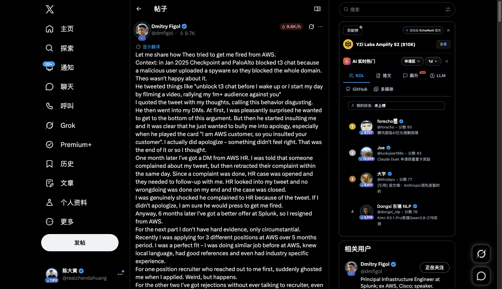

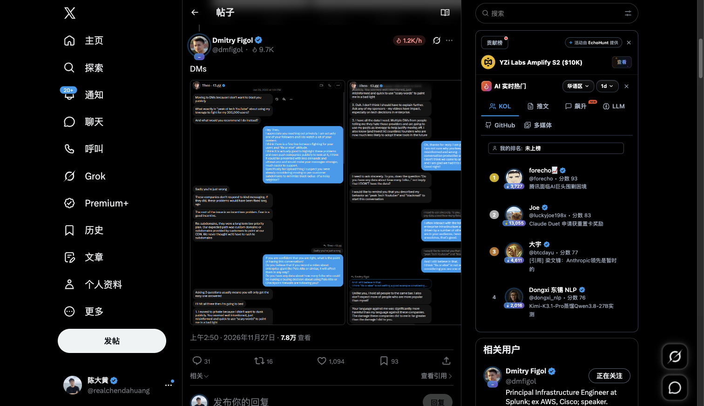

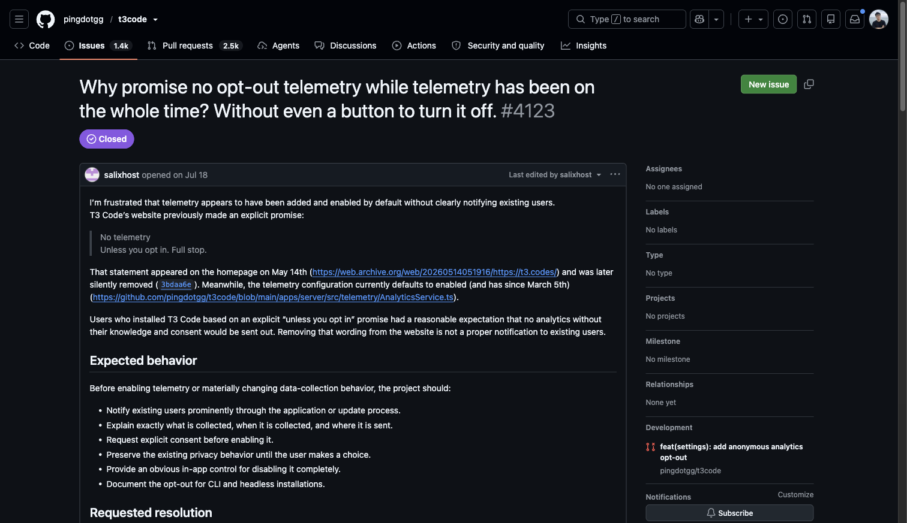

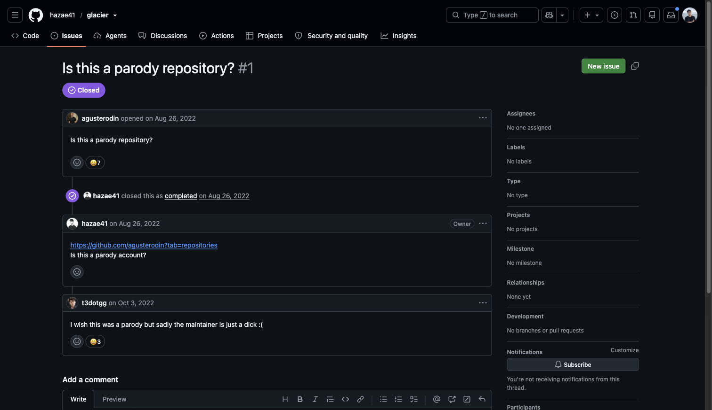

---

## Primary References

- **Original Audit Threads:**
  - Origin 1 (`"Steal our code"`): https://x.com/realchendahuang/status/2125059292919394654
  - Origin 2 (MIT fork dispute & double standard): https://x.com/realchendahuang/status/2125062675147448475
  - Part 9 (500 commits/day, 700 agents, gatekeeping): https://x.com/realchendahuang/status/2125392916369871309
  - Part 10 (`@bot` fork-scraping, Community Notes, auto-blocker): https://x.com/realchendahuang/status/2125393641665671593
  - Part 15 (USPTO 0 registrations, GitHub policy, retroactive `PR #41898`): https://x.com/realchendahuang/status/2125408163273080950
  - Part 16 (2024–2026 historical pattern & deleted closed-source threat): https://x.com/realchendahuang/status/2125408843152953693
- **Origin & Governance Receipts:**
  - Marketing `"Steal our code (legally)"`: https://github.com/pingdotgg/t3code/blob/main/apps/marketing/src/i18n/en.ts#L32
  - Ban threat & trillion-dollar open-source reply: https://x.com/theo/status/2124829315657576890 ; https://x.com/theo/status/2124989435154726982
  - Plan mode & context-ring PRs/Issues (`#5551`, `#9190`, `#33131`, `#33639`, `#41572`): https://github.com/pingdotgg/t3code/pull/5551 ; https://github.com/pingdotgg/t3code/pull/9190 ; https://github.com/pingdotgg/t3code/pull/33131 ; https://github.com/pingdotgg/t3code/issues/33639#issuecomment-6765462545 ; https://github.com/pingdotgg/t3code/pull/41572
  - Governance & automation files (`CONTRIBUTING.md`, `.github/VOUCHED.td`, `.github/scripts/pr-limits.cjs`, `.github/workflows/issue-vouch.yml`): https://github.com/pingdotgg/t3code/blob/main/CONTRIBUTING.md ; https://github.com/pingdotgg/t3code/blob/main/.github/VOUCHED.td ; https://github.com/pingdotgg/t3code/blob/main/.github/scripts/pr-limits.cjs ; https://github.com/pingdotgg/t3code/blob/main/.github/workflows/issue-vouch.yml
  - 500 commits/day, 700 agents, yolo merges, machine nuke, loop, gatekeeping posts: https://x.com/theo/status/2120741101250515322 ; https://x.com/theo/status/2122203951701585972 ; https://x.com/theo/status/2119951615679672513 ; https://x.com/theo/status/2119993037971730879 ; https://x.com/theo/status/2120131740471861485 ; https://x.com/theo/status/2119958282022568059 ; https://x.com/theo/status/2120821423438778667 ; https://x.com/theo/status/2120853340078874923 ; https://x.com/theo/status/2123754193530053110
- **`@bot` Scraping & Moderation Receipts:**
  - `@MiaAI_lab` fork-scraping & `@zqkrq` feature cloning: https://x.com/theo/status/2119240683680944172 ; https://x.com/theo/status/2119240810202034645 ; https://x.com/theo/status/2121017649652269120
  - `@agent_wrapper` & Claude Code Desktop mockery: https://x.com/theo/status/2122243989579632770 ; https://x.com/theo/status/2124987957803446311
  - Community Notes demonetization & auto-blocker bot: https://x.com/theo/status/2120238923884696025 ; https://x.com/theo/status/2125077510941802509 ; https://x.com/theo/status/2125120041092108678
- **USPTO, GitHub Policy & History Receipts:**
  - USPTO TSDR `PING LABS` (`97294243`, abandoned) & EquipmentShare `T3` (`Reg. 7795672` / `Serial 90644500`): https://tsdr.uspto.gov/statusview/sn97294243 ; https://tsdr.uspto.gov/#caseNumber=90644500&caseSearchType=US_APPLICATION&caseType=DEFAULT&searchType=statusSearch
  - GitHub Trademark Policy & `@vildanden_ai` thread: https://docs.github.com/en/site-policy/content-removal-policies/github-trademark-policy ; https://x.com/vildanden_ai/status/2125275487404761555
  - Retroactive `PR #41898`, `TRADEMARK.md`, `"aware of the legality"`, `"get a better lawyer"`, & WordPress tweet: https://github.com/pingdotgg/t3code/pull/41898 ; https://github.com/pingdotgg/t3code/blob/main/TRADEMARK.md ; https://x.com/theo/status/2125082769395220688 ; https://x.com/theo/status/2125026423769555308 ; https://x.com/theo/status/1839261574005141945
  - Historical receipts (`vsc-material-but-i-wont-sue-you`, Indian dev apology video, $20k FFmpeg bounty record): https://github.com/t3dotgg/vsc-material-but-i-wont-sue-you ; https://www.youtube.com/watch?v=o2CSJYXJBpc ; https://www.youtube.com/watch?v=1oQ3KMeaH04
- **Nov 26–27 `@dmfigol` AWS HR Case, Org Lock & `glacier#1` (Exhibits #20 & #27):**
  - https://x.com/dmfigol/status/2126025881844174968 ; https://x.com/dmfigol/status/2126025885740626075 ; https://x.com/dmfigol/status/2126025889016094829 ; https://x.com/petersteele/status/2126096729934033141 ; https://x.com/_Defeatable_/status/2126096598367117581 ; https://x.com/dmfigol/status/2126094390250590678 ; https://x.com/dmfigol/status/2084660216759558593 ; https://x.com/realchendahuang/status/2126204776467853346
  - https://github.com/hazae41/glacier/issues/1#issuecomment-1264711070 ; https://x.com/hazae41/status/2126134616696520845 ; https://github.com/pingdotgg/t3code/pull/42535 ; https://github.com/pingdotgg/t3code/pull/39408 ; https://github.com/pingdotgg/t3code/pull/39489 ; https://github.com/pingdotgg/t3code/pull/41988 ; https://x.com/theo/status/2125737351901303200 ; https://x.com/theo/status/2126054989768675651 ; https://x.com/theo/status/2126062066809307637

---
[← Back to README](../../README.md) · [Complete Source Index](../COMPLETE-SOURCE-INDEX.md) · [← Dossier 04](./04-business-ledger-sponsors-and-77k-stars.md) · [Dossier 06 →](./06-tweet-forensic-dataset-1151.md)
