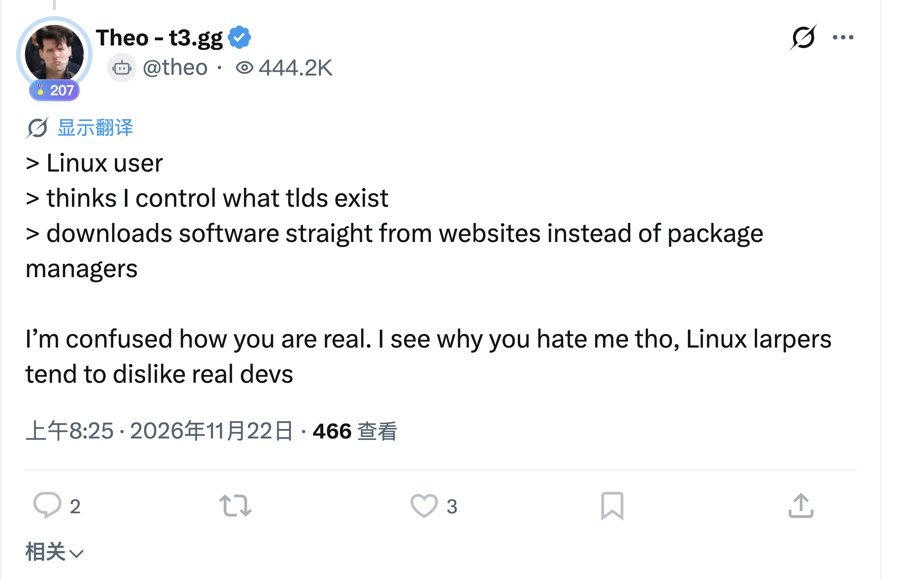
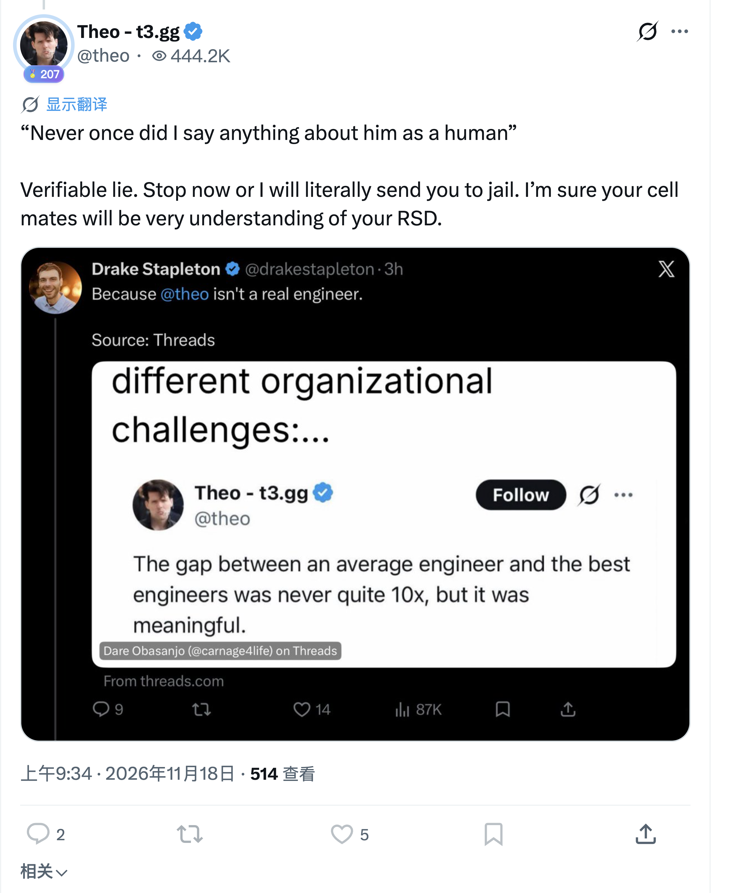

[← Back to README](../../README.md) · [Complete Source Index](../COMPLETE-SOURCE-INDEX.md) · [← Dossier 05](./05-governance-trademark-and-history.md)

# Dossier 06: The 1,151-Tweet Quantitative Forensic Dataset (Nov 7–24, 2026)

> **Covers:** Audit Part 14 & Complete Quantitative Dataset Verification  
> **Dataset Scope:** `1,151` deduplicated public X posts from `@theo` spanning `2026-11-07 06:41:52` through `2026-11-24 12:28:29 UTC` (`2026-11-07 14:41:52` through `2026-11-24 20:28:29` Beijing Time; **17.24 days**).  
> **Audited Upstream Snapshot:** [`9d3195b4`](https://github.com/pingdotgg/t3code/commit/9d3195b49dfb0098e9fa592fe0ada5464206d1c2) (`PR #42000`, `2026-11-24T08:41:04Z` / `2026-11-24 16:41:04 CST`) · **Post-Audit Upstream Re-Audit:** [`ca81b7b9`](https://github.com/pingdotgg/t3code/commit/ca81b7b97a1c4b91e5ac25768d0f6629f37732fd) (`PR #42634`, `2026-11-25T06:49:37Z` / `2026-11-25 14:49:37 CST`, dataset unchanged).

---

## Executive Summary

Instead of cherry-picking isolated replies, [Part 14](https://x.com/realchendahuang/status/2125404517697290438) analyzed **all 1,151 consecutive public posts** published by `@theo` over 17.24 days using deterministic Python lexical matching and manual target verification. Four quantitative findings emerge:

1. **A Reply-Heavy Patrol Account, Not a Product Broadcast Channel:** **75.6% (870 / 1,151)** of all posts are replies (`815` pure replies + `55` quote replies), compared to only **93 (8.1%)** original top-level posts—a reply-to-original ratio of **9.4:1**. Median interval between consecutive posts is **2.7 minutes**, with **61.8%** posted within 5 minutes of the prior post.
2. **Total Commercial Pivot to T3 Code:** Across 1,151 posts, `@theo` mentioned T3 / T3 Code **162 times (14.1%)** while mentioning his three established paid products—`T3 Chat`, `UploadThing`, and `Ping.gg`—**0 times**.
3. **Measurable Selective Politeness (`0.0%` vs. `8.0%`):** Across replies directly addressing 20 major tech executives, AI lab engineers, and top KOLs (`n = 43` primary-`@`; `n = 62` including secondary `@mentions`), **0.0%** directed profanity or insults at those figures (**32.6%** contained explicit gratitude/respect). Across ordinary developers and critics (`n = 766` primary-`@`), hostility and profanity reached **8.0%** (`61 / 766`).
4. **4.0× Spike in Personal Insults During the 25-Hour Crisis Window:** Following the Chinese fork controversy at `2026-11-23 19:00 BJ`, direct personal insults jumped from a 16-day baseline of **3.6% (`37 / 1,019`)** to **14.4% (`19 / 132`)**—less than 24 hours after `@theo` lectured another user that `"burning the trust of everyone around you is pretty much never the best path to get what you want"`.

---

## 1. Methodology & Reproducible Definitions

All metrics below were computed directly over the sorted 1,151-row archive (`theo_posts.csv`) using explicit regular expressions and fixed account lists:

- **Timezones:** Every timestamp is recorded in UTC and converted deterministically to **San Francisco local time (`PST = UTC-8`)** for circadian/daily cadence and **Beijing Time (`BJ = UTC+8`)** for the November 23–24 crisis timeline.
- **20-Account Big-Tech / VIP Group (`vip_handles`):**
  `_mohansolo`, `thsottiaux`, `patricktoulme`, `officiallogank`, `google`, `googledeepmind`, `anthropicai`, `openai`, `sama`, `elonmusk`, `martin_casado`, `theprimeagen`, `jeremyphoward`, `yagiznizipli`, `dhh`, `thdxr`, `gergelyorosz`, `viticci`, `mwseibel`, `jensenhuang`.
- **Fixed Lexical Dictionaries:**
  - **Hostility (`rx_hostile`):** `\b(fuck|fucking|fkn|shit|shitty|bullshit|bitch|pussy|stupid|dumb|dumbass|idiot|moron|retard|braindead|pathetic|loser|cringe|cesspit)\b` (case-insensitive)
  - **Personal Insults (`rx_insult`):** `\b(stupid|dumb|dumbass|idiot|moron|retard|braindead|brain dead|pathetic|loser|pussy|bitch|piece of shit|prick|clown|delusional|schizo|insane|cringe|sensitive)\b`
  - **Profanity (`rx_prof`):** `\b(fuck|fucking|fkn|shit|shitty|bullshit|ass|bitch|pussy|lmao|lmfao|wtf|jfc|stfu)\b`
  - **Polite / Gratitude (`rx_polite`):** `(🙏|🫡|thank|thanks|ty\b|appreciate|love|awesome|cool|respect|great|sorry)`
- **Target Grouping Transparency:** Of the **870** total replies (`815` `reply` + `55` `quote_reply`), **809** begin with a leading `@username`.
  - Under **strict primary-`@` filtering** (classifying by the leading `^@([A-Za-z0-9_]+)` handle): **`n = 43`** address the 20 VIP accounts and **`n = 766`** address ordinary developers/critics (`43 + 766 = 809`).
  - Under **any-`@` mention filtering** across those 809 leading-`@` replies: **`n = 62`** mention at least one VIP handle anywhere in the reply and **`n = 747`** do not (`62 + 747 = 809`; an earlier analysis pass also summarized `60` / `749`). Only **1** post in the `62`-tweet VIP-mention slice matched `rx_hostile` (`2120236607009947760`: `"@opsRich @GergelyOrosz @t3dotcodes That's fine! You can fuck off :)"`), and manual inspection confirms it is directed at ordinary user `@opsRich`, leaving **0.0% VIP-directed hostility** under every grouping.

---

## 2. Post-Type Composition, Product Focus & Interaction Graph

### 2.1 Post-Type & Length Breakdown (`n = 1,151`)

| Post Type | Count | Share | Median Chars | Mean Chars | Max Chars |
|---|---:|---:|---:|---:|---:|
| `reply` | **815** | **70.8%** | 72 | 95.5 | 633 |
| `quote` | 110 | 9.6% | 126.5 | 174.5 | 2,228 |
| `original` | 93 | **8.1%** | 121 | 211.7 | 6,643 |
| `retweet` | 78 | 6.8% | 140.0 | 122.3 | 146 |
| `quote_reply` | 55 | **4.8%** | 81 | 110.9 | 293 |
| **Total (`reply + quote_reply` = 870 / 75.6%)** | **1,151** | **100.0%** | **84** | **115.0** | **6,643** |

### 2.2 Product Mentions & Top 16 Mentioned Handles

While `T3 Code / T3` appeared **162 times (14.1%)**, `T3 Chat`, `UploadThing`, and `Ping.gg` each appeared **0 times**. Across all 1,151 posts, the 16 most-mentioned `@handles` were:

| Rank | Handle | Mentions | Context |
|---:|---|---:|---|
| 1 | `@t3dotcodes` | 36 | Official T3 Code X account |
| 2 | `@maria_rcks` | 23 | T3 team member |
| 3 | `@jullerino` | 21 | Core maintainer Julius |
| 4 | `@bot` | 19 | Internal automation agent (`bb-1`, `beebox`, `leftbook`) |
| 5 | `@adamholtererer` | 18 | AI dev commenter |
| 6 | `@dlkfzwilliam2` | 16 | Primary Nov 24 Chinese-fork debate opponent |
| 7–8 (tie) | `@theo`, `@poteto` | 13 each | Self-mentions, colleague |
| 9–11 (tie) | `@patricktoulme`, `@deepusleepy`, `@0xsero` | 12 each | DeepMind engineer, collaborators/friends |
| 12 | `@_mohansolo` | 11 | Google DeepMind executive |
| 13–16 (tie) | `@agent_wrapper`, `@chrislaupama`, `@elshayib`, `@ryanrhughes` | 10 each | Wrapper conflict, Nov 18 Astra debate & developer replies |

---

## 3. Nov 7–24 Daily Cadence & Circadian Profile (PST)

### 3.1 Summary Cadence Metrics

- **Daily average:** **66.8 posts/day** across 17.24 days.
- **Inter-post interval:** Median **2.7 minutes**; **61.8%** of all consecutive posts landed within 5 minutes.
- **1-hour burst peak:** **32 posts within 60 minutes** starting at `2026-11-11 20:56 PST`.
- **Single-day PST peak:** **125 posts** (`2026-11-11 PST`), followed by **120** (`2026-11-09`) and **117** (`2026-11-23`).
- **"Vacation" & "102°F Fever" periods:** During his stated 3-day "vacation" (`Nov 13–15 PST`), `@theo` posted **64 times** (`21.3/day`, later admitting `"vacation"` was a team work trip, `2120858034092245075`). During his stated 48-hour "102°F fever" (`Nov 17–18 PST`), he posted **177 times**—including the 6,643-character Astra essay, a video, and 8 consecutive profanity-laden replies attacking `@elshayib`.

### 3.2 Complete Daily Counts (PST = UTC-8)

| Date (PST) | Posts | Notable Event / Context | Date (PST) | Posts | Notable Event / Context |
|---|---:|---|---|---:|---|
| `2026-11-06` *(partial)* | 2 | Capture window begins (`22:41 PST`) | `2026-11-16` | 45 | Vibe Kanban shutdown mockery; 700 agents |
| `2026-11-07` | 51 | — | `2026-11-17` | 85 | "102°F fever" day 1; GPT-6.2 Astra essay |
| `2026-11-08` | 81 | `@MiaAI_lab` `@bot` fork scraping | `2026-11-18` | 92 | "102°F fever" day 2; 31.7T / $10.19M radar |
| `2026-11-09` | **120** | Plan mode deleted (`PR #33131`); Fable 5.2 | `2026-11-19` | 40 | Gemini 4 Neon apology to Google |
| `2026-11-10` | 65 | Grok Bot tutorial; $15k Ultra math | `2026-11-20` | 53 | `"pic over a PR"` |
| `2026-11-11` | **125** | Peak day; 32/hr burst; Community Notes call | `2026-11-21` | 68 | Investors outreach reply; ~98.5% share |
| `2026-11-12` | 65 | `CONTRIBUTING.md` rewrite; $800k+ spend | `2026-11-22` | 59 | `"Zero risk"` Antigravity; `"don't burn trust"` |
| `2026-11-13` | 23 | "Vacation" day 1 | `2026-11-23` | **117** | Chinese fork crisis; active 18 of 24 hours |
| `2026-11-14` | 22 | "Vacation" day 2 | `2026-11-24` *(partial)* | 19 | Window ends `04:28 PST` (`20:28 BJ`) |
| `2026-11-15` | 19 | "Vacation" day 3 | **Total** | **1,151** | **17.24 days (`66.8/day`)** |

### 3.3 24-Hour Circadian Distribution (PST = UTC-8)

- **Sleep window (`06:00–09:59 PST`):** Across all 17 days, **0 posts** occurred between `08:00` and `09:59 PST` (`08:xx` = 0, `09:xx` = 0), only **1** at `07:xx`, and **7** at `06:xx`.
- **Late-night window (`00:00–04:59 PST`):** **233 posts (20.2%)** (`00:xx` = 44, `01:xx` = 34, `02:xx` = 53, `03:xx` = 60, `04:xx` = 42). Notably, `02:00–04:59 PST` (`155` posts) aligns directly with **18:00–20:00 Beijing Time**.
- **Evening peak (`19:00–21:59 PST`):** **272 posts** (`19:xx` = 80, `20:xx` = **109** single-hour peak, `21:xx` = 83).

---

## 4. Selective Politeness: Big-Tech Executives vs. Ordinary Developers

### 4.1 Quantitative Contrast

| Reply Cohort | Sample Size (`n`) | Targeted Hostility (`rx_hostile`) | Polite / Gratitude (`rx_polite`) |
|---|---:|---:|---:|
| **Big-Tech Execs, Lab Staff & Top KOLs (primary `@`)** | **43** | **0 (0.0%)** | **14 (32.6%)** |
| **Big-Tech Execs, Lab Staff & Top KOLs (any `@` in leading-`@` replies)** | **62** | **0 targeted (0.0%)** *(1 hit targets `@opsRich`)* | **18 (29.0%)** |
| **Ordinary Developers & Critics (primary `@`)** | **766** | **61 (8.0%)** | **170 (22.2%)** |
| **Full Corpus (`n = 1,151`)** | **1,151** | `rx_prof`: **112 (9.7%)** · `rx_insult`: **56 (4.9%)** | — |

### 4.2 Verbatim Receipts: De-escalating with Labs

Even when criticizing frontier models harshly, `@theo` consistently cushioned or reversed criticism toward Google and OpenAI leadership:

- **Google Gemini 4 Carbon → Neon:** On November 12 (`2120596827980665018`), `@theo` wrote `"Gemini 4 Carbon is here. It's slow, awkward, stupid, and hallucinates all the time"`, immediately adding `"That said, they made a ton of progress and the team is working hard to make it great."` When Neon launched on November 19 (`2123255588570501585`), he posted `"I'm so sorry Google. I didn't recognize your game"`, and on November 21 (`2123995323123343869`) celebrated: `"Happy I didn't burn bridges with my past content and that we can enjoy this moment together :)"`.
- **OpenAI GPT-6.2 Astra:** After publishing a 6,643-character critique of GPT-6.2 Astra on November 18 (`2122760447103484410`), he quote-tweeted it the next morning (`2123166069905105319`) highlighting that `"GPT-6.2 Astra is an incredibly capable model"` alongside praise for OpenAI's unrestricted early access.

### 4.3 Verbatim Receipts: Hostility Toward Ordinary Developers & Groups

Toward ordinary developers without institutional leverage, attacks spanned entire technical communities as well as individual critics:

- **Ordinary Engineers (`2124470530590011704`, Nov 22):** Quote-tweeting a simple question asking whether T3 Code or Antigravity gave better results with Gemini 4:
  > *"Engineers deserve the mass unemployment they have coming"* (386k+ views)
- **Developer Intelligence & "Low Quality Users" (`2123906522728272178`, Nov 21; `2125019705270477102`, Nov 24):**
  > *"the average developer isn't very smart"*  
  > *"We already have all the high quality users, not surprised the low quality ones are now following"*
- **Local / Open-Weight AI Community (`2120733839832273025` & `2120757007523447144`, Nov 12):**
  > *"I'm going to dance on the graves of the 'local ai' community tho"*  
  > *"If I was as dumb as you, I'd probably be fine with Qwen 3.8 too :)"*
- **Linux Users (`2124298216271499605`, Nov 22):**
  > *"I see why you hate me tho, Linux larpers tend to dislike real devs"*
- **Gendered Attacks Against a Female Critic (`2120238201705226498`, `2120240569989624225`, `2120599310211703274`, Nov 11–12):**
  > *"Harassing and lying about open source maintainers is indeed a stupid bitch move."*  
  > *"I do indeed think they are a stupid bitch and I have no regret in saying such."*
- **Jail Threat & Medical Mockery (`2122838455483031925` & `2122865897375400066`, Nov 18):**
  > *"Stop now or I will literally send you to jail. I'm sure your cell mates will be very understanding of your RSD."*

---

## 5. The 25-Hour Chinese-Fork Crisis Window (Nov 23 19:00 – Nov 24 20:28 BJ)

### 5.1 Pre-Crisis vs. Crisis Statistical Delta

Exactly 24 hours before the dispute erupted (`2026-11-22 18:26:44 BJ`, `2124449493513068862`), `@theo` advised another user:
> *"Fwiw, burning the trust of everyone around you is pretty much never the best path to get what you want"*

Comparing the pre-crisis baseline (`2026-11-07 14:41` → `2026-11-23 18:59 BJ`, **`n = 1,019`**) against the 25-hour crisis window (`2026-11-23 19:00` → `2026-11-24 20:28 BJ`, **`n = 132`**):

| Metric | Baseline (`n = 1,019`) | Crisis 25h (`n = 132`) | Change |
|---|---:|---:|---|
| **Reply Share (`reply + quote_reply`)** | 74.8% (`762 / 1,019`) | **81.8%** (`108 / 132`) | +7.0 pp *(peaked at 89.5% on Nov 24 PST)* |
| **Direct Personal Insult Rate (`rx_insult`)** | 3.6% (`37 / 1,019`) | **14.4%** (`19 / 132`) | **4.0×** |
| **Profanity Rate (`rx_prof`)** | 9.4% (`96 / 1,019`) | **12.1%** (`16 / 132`) | **1.3×** |

### 5.2 Three Escalation Waves & Verbatim Quotes

1. **Wave 1 (`Nov 23, 19:00–21:59 BJ` / `03:00–05:59 PST`):** Posted `Chinese knockoff` (`2124823227570745504`), `Temu3 Code` (`2124825920808829077`), and the GitHub account takedown threat (`2124829315657576890`).
2. **Wave 2 (`Nov 24, 11:00–14:59 BJ` / `19:00–22:59 PST`):** Fired 51 posts across four hours, retweeted a Chinese-language insult calling a critic `"你完全是个智障"` (`2125069380988125605`), merged `TRADEMARK.md` (`PR #41898` at `12:21 BJ`), called `@DLKFZWilliam2` `"a liar and a fucking pussy / China should kick you out for making them look bad"` (`2125077510941802509`), mocked `"Did you buy your glass heart from Temu?"` (`2125110339939508514`), and reported blocking ~100 accounts (`2125120041092108678`).
3. **Wave 3 (`Nov 24, 18:39–20:02 BJ` / `02:39–04:02 PST`):**
   - **Collective attack (`18:39:35 BJ`, `2125177503526588877`):**
     > *"I will say that chinese tech twitter is the biggest fucking cesspit I've ever waded into somehow, and if you trust anyone on that side writing slop essays about things you are fucking braindead"*
   - **Three identical Chinese copy-paste replies (`18:41:21`, `18:43:26`, `19:45:14 BJ` — `2125177947376300110`, `2125178474759618748`, `2125194026253255092`):**
     > *"完了，又伤害中国人民的感情了。"* ("Oh no, hurt the Chinese people's feelings again.")
   - **Dismissing audit reach & refusing apology (`18:59:21` & `19:42:43 BJ` — `2125182476943556955`, `2125193393450226024`):**
     > *"He deserves zero attention for his lies and slander. I'm thankful his audience has zero value"*  
     > *"I'm not apologizing. I've done nothing wrong"*

---

## Primary References

- **Original Audit Thread (Part 14):** https://x.com/realchendahuang/status/2125404517697290438
- **Bridge-Mending & Lab Relations:**
  - Gemini 4 Carbon critique, Neon apology & `"Happy I didn't burn bridges"`: https://x.com/theo/status/2120596827980665018 ; https://x.com/theo/status/2123255588570501585 ; https://x.com/theo/status/2123995323123343869
  - GPT-6.2 Astra essay & follow-up praise: https://x.com/theo/status/2122760447103484410 ; https://x.com/theo/status/2123166069905105319
- **Developer Hostility & Crisis Receipts:**
  - Engineers mass unemployment (`2124470530590011704`), average developer (`2123906522728272178`), low-quality users (`2125019705270477102`): https://x.com/theo/status/2124470530590011704 ; https://x.com/theo/status/2123906522728272178 ; https://x.com/theo/status/2125019705270477102
  - Local AI graves (`2120733839832273025`), Qwen insult (`2120757007523447144`), Linux larpers (`2124298216271499605`): https://x.com/theo/status/2120733839832273025 ; https://x.com/theo/status/2120757007523447144 ; https://x.com/theo/status/2124298216271499605
  - `stupid bitch` posts (`2120238201705226498`, `2120240569989624225`, `2120599310211703274`) & jail/RSD threats (`2122838455483031925`, `2122865897375400066`): https://x.com/theo/status/2120238201705226498 ; https://x.com/theo/status/2120240569989624225 ; https://x.com/theo/status/2120599310211703274 ; https://x.com/theo/status/2122838455483031925 ; https://x.com/theo/status/2122865897375400066
  - `"burning the trust"` (`2124449493513068862`), Chinese tech Twitter cesspit (`2125177503526588877`), copy-paste Chinese replies (`2125177947376300110`, `2125178474759618748`, `2125194026253255092`), zero value (`2125182476943556955`), no apology (`2125193393450226024`): https://x.com/theo/status/2124449493513068862 ; https://x.com/theo/status/2125177503526588877 ; https://x.com/theo/status/2125177947376300110 ; https://x.com/theo/status/2125178474759618748 ; https://x.com/theo/status/2125194026253255092 ; https://x.com/theo/status/2125182476943556955 ; https://x.com/theo/status/2125193393450226024

---
[← Back to README](../../README.md) · [Complete Source Index](../COMPLETE-SOURCE-INDEX.md) · [← Dossier 05](./05-governance-trademark-and-history.md)
