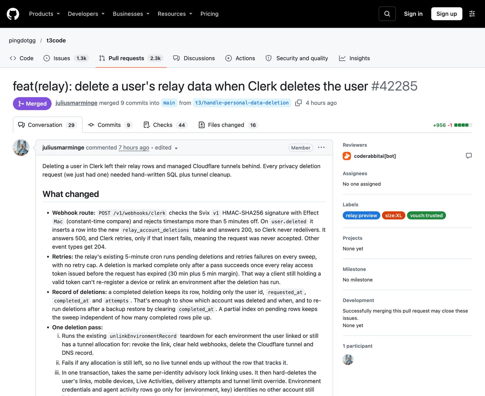

# Bevor Sie T3 Code installieren

<p align="center">
  <strong>Amtssprachen der Vereinten Nationen:</strong>
  <a href="../../README.md">English</a> ·
  <a href="./README.zh-CN.md">简体中文</a> ·
  <a href="./README.fr.md">Français</a> ·
  <a href="./README.es.md">Español</a> ·
  <a href="./README.ru.md">Русский</a> ·
  <a href="./README.ar.md">العربية</a>
</p>
<p align="center">
  <strong>Globale Community-Ausgaben:</strong>
  <a href="./README.zh-TW.md">繁體中文</a> ·
  <a href="./README.ja.md">日本語</a> ·
  <a href="./README.ko.md">한국어</a> ·
  <a href="./README.de.md"><strong>Deutsch</strong></a> ·
  <a href="./README.pt-BR.md">Português</a> ·
  <a href="./README.it.md">Italiano</a> ·
  <a href="./README.nl.md">Nederlands</a> ·
  <a href="./README.pl.md">Polski</a> ·
  <a href="./README.tr.md">Türkçe</a> ·
  <a href="./README.vi.md">Tiếng Việt</a> ·
  <a href="./README.id.md">Bahasa Indonesia</a> ·
  <a href="./README.hi.md">हिन्दी</a>
</p>


> **Untersuchungsumfang & Verifikationsrichtlinie**  
> Dieses Repository ist eine unabhängige Sicherheits-, Telemetrie-, Governance- und Datenschutzprüfung (inklusive DSGVO/GDPR-Relevanz) zu `pingdotgg/t3code` (T3 Code). Es bündelt die beiden Ursprungsbeiträge sowie **18 dokumentierte Analyseteile**, die am 24. und 25. November 2026 veröffentlicht wurden, zusammen mit **über 180 kanonischen Primärquellen-URLs** (GitHub-Commits, Pull Requests, Issues, unveränderten Quelldateien, offizieller Dokumentation, USPTO-TSDR-Markenregistern und archivierten öffentlichen Beiträgen), sechs vertiefenden technischen Dossiers ([`docs/dossiers/`](../dossiers/01-telemetry-and-gdpr-timeline.md)) sowie einem quantitativen Datensatz aus **1.151 aufeinanderfolgenden X-Beiträgen von `@theo`** (7.–24. November 2026). Es sind weder gekürzte Weiterleitungs-URLs noch private Kontaktdaten enthalten. Sachliche Aktualisierungen, nachträglich gemergte Fixes oder weitere Übersetzungen sind per Pull Request unter Angabe von Primärbelegen willkommen — siehe [`CONTRIBUTING.md`](../../CONTRIBUTING.md) und [`docs/COMPLETE-SOURCE-INDEX.md`](../COMPLETE-SOURCE-INDEX.md).

---

## Inhaltsverzeichnis

- [Strukturierte Ergebnisse & Risikomatrix](#strukturierte-ergebnisse--risikomatrix)
- [Chronologische Zeitleiste (2023–2026)](#chronologische-zeitleiste-20232026)
- [1. Ursprungsstreit: „Steal Our Code“, Fork-Namensdrohung & Doppelmoral](#1-ursprungsstreit-steal-our-code-fork-namensdrohung--doppelmoral)
- [2. Telemetrie, werkzeugübergreifendes Auslesen von Zugangsdaten & der nächtliche DSGVO-Sprint (Teile 1, 7, 11, 12)](#2-telemetrie-werkzeugübergreifendes-auslesen-von-zugangsdaten--der-nächtliche-dsgvo-sprint-teile-1-7-11-12)
- [3. Lokale Speicherung, Prozessüberwachung, Umgehung von Schutzmechanismen & unveröffentlichte Sicherheits-Patches (Teile 2, 3, 13)](#3-lokale-speicherung-prozessüberwachung-umgehung-von-schutzmechanismen--unveröffentlichte-sicherheits-patches-teile-2-3-13)
- [4. Google-Antigravity-Nutzungsbedingungen & unverschlüsseltes T3-Connect-Relay (Teile 4, 5)](#4-google-antigravity-nutzungsbedingungen--unverschlüsseltes-t3-connect-relay-teile-4-5)
- [5. Geschäftsbilanz, Investorenkonflikte, Sponsoren & der 77.000-Sterne-Trichter (Teile 6, 8, 17, 18)](#5-geschäftsbilanz-investorenkonflikte-sponsoren--der-77000-sterne-trichter-teile-6-8-17-18)
- [6. Governance, Fork-Scraping-Bots, Markenregister, 1.151-Tweet-Datensatz & Vorgeschichte (Teile 9, 10, 14, 15, 16)](#6-governance-fork-scraping-bots-markenregister-1151-tweet-datensatz--vorgeschichte-teile-9-10-14-15-16)
- [7. Konkrete Gegenmaßnahmen & Bereinigungsleitfaden](#7-konkrete-gegenmaßnahmen--bereinigungsleitfaden)
- [8. Primärquellen & vollständiger Index der 18 Originalbeiträge](#8-primärquellen--vollständiger-index-der-18-originalbeiträge)

---

## Strukturierte Ergebnisse & Risikomatrix

| Bereich & Analyseteile | Risiko / Auswirkung | Dokumentierte Kernergebnisse & Primärbelege | Status (25. Nov. 2026) | Tiefendossier |
|---|---|---|---|---|
| **Telemetrie & Post-DSGVO-Datenschutz**<br>*(Teile 1, 7, 11, 12)* | **Kritisch** | Standardmäßig aktivierte PostHog-Analyse (`PR #174`), obwohl die Startseite `"No telemetry / Unless you opt in. Full stop."` zusicherte (am 18. Juni via `3bdaa6e1` gelöscht); Aufbewahrung von Rohereignissen über das Closed-Source-Gateway `ingest.t3.codes` (`PR #15028`); ungesalzenes SHA-256-Hashing über Werkzeuggrenzen hinweg aus `~/.codex/auth.json` und `~/.claude.json` (`Identify.ts`, `telemetryId.ts`); 4 abgelehnte Opt-out-PRs (`#13458`, `#16763`, `#21248`, `#27077`); Lücken in der Managed Policy (`docs/user/telemetry.md`); nächtliche DSGVO-PRs mit Eingeständnissen zu **2,2 Mio./Std. IP- + UA-Spans**, die 30 Tage in Axiom gespeichert wurden (`#42380`), `git.cwd`-Pfadlecks (`#42450`), ignorierten Win/Mac-Opt-outs (`#42376`, `#42464`), defekter Kontolöschung (`#42285`) und vermischten anonymen Batches (`#42466`). | Unvollständige Nacht-Patches; `AnalyticsService.ts` erzeugt weiterhin beim Start eine lokale Geräte-ID; gehostete Web-App hat weiterhin keinen Schalter; `ingest.t3.codes` bleibt Closed Source | [**Dossier 01**](../dossiers/01-telemetry-and-gdpr-timeline.md) |
| **Lokale Sicherheit & stille Advisories**<br>*(Teile 2, 3, 13)* | **Kritisch** | „Dauerhaftes Löschen“ in der Seitenleiste hängt lediglich `"thread.deleted"` in `statev2.sqlite` an (25,9–41,6 GB Datenbankwachstum, `#17845`); `t3-resource-monitor` scannt alle OS-Prozesse samt Befehlszeilen (`ProcessesToUpdate::All`, `#11222`, `PR #41889`); Claude Auto mode genehmigt `git push --force` beim 3. Versuch stillschweigend (`#15353`, seit 52–53+ Tagen offen); Entfernung des privaten Modellfilters für `slopalytics.com` binnen 21 Std. (`#41237`); **0 GitHub Security Advisories** trotz stiller Fixes (`#39483`, `#41757`, `#42386`, `#42504`); offenes Windows-Base64-PowerShell-AV-Problem (`#30997`); `SECURITY.md` erklärt OS-weites `filesystem:read` und unverschlüsseltes iOS-HTTP für beabsichtigt. | `#17845`, `#15353`, `#26489`, `#30997` weiterhin ungelöst / offen; `0` veröffentlichte Security Advisories | [**Dossier 02**](../dossiers/02-local-safety-and-security-audit.md) |
| **Antigravity-ToS & T3-Connect-Relay**<br>*(Teile 4, 5)* | **Hoch** | `docs/user/faq.md` garantiert ToS-Konformität für Google Antigravity, während `antigravityUsageLimits.ts` Tokens aus dem OS-Schlüsselbund bzw. Windows `CredReadW` ausliest, sich als `antigravity/hub/2.24.0` ausgibt und private `v1internal`-Endpunkte aufruft; `antigravityAuthSupport.ts` injiziert ein gefälschtes `SSH_CONNECTION` und verursacht Kontovermischungen (`#41973`); neues $20-Konto binnen 3 Minuten gesperrt (`#41536`); `PR #33800` verdrahtet gefälschtes CLIProxyAPI-Hub-Polling für `claude`/`xai`/`antigravity`; T3 Connect besitzt **keinerlei Ende-zu-Ende-Verschlüsselung**, ein standardmäßig deaktiviertes `requireConnectDeviceApproval` (`#36419`) und ein offenes OVH-Caddy-Gateway mit TLS-Terminierung (`PR #32945`). | Antigravity-Spoofing-Code bleibt aktiv; E2E-Verschlüsselung für T3 Connect ausdrücklich abgelehnt (`#32098`, Antwort vom 25. Nov.) | [**Dossier 03**](../dossiers/03-antigravity-tos-and-t3connect-relay.md) |
| **Geschäftsbilanz, Sponsoren & 77k Sterne**<br>*(Teile 6, 8, 17, 18)* | **Hoch** | $800k+ Ausgaben für einen kostenlosen Client (`162` T3-Erwähnungen gegenüber `0` für Bezahlprodukte); **31,7T Tokens/Tag** ($10,19M/Tag) Compute-Radar eingetauscht gegen $300k+ kostenlose OpenAI-Early-Access-Tokens und VC-Kontakte; Angel-Überschneidungen mit Vibe Kanban & Daytona; Sponsoren-Stack (Clerk, Axiom, Vercel-Exklusivität); Codex-0%-Exploit (`Endless` / `codex#45444`); 10-Konten-`CLIProxyAPI`-Gist (`555%` Kontingent) vs. FAQ-Sperrwarnung; Toast nach 5 Prompts / 30s Leerlauf löst über Host-Zugangsdaten `PUT user/starred/...` aus (`#27832`, `#29922`, `#29987`), umgeht Macroscope und lässt fehlendes Repo-Pinning in `driver.ts#L60-L99` 19 Tage lang unbehoben. | Ungepinntes Starring in `driver.ts` & Review von `zhilsinger` nach 19 Tagen unbehoben; Repo bei 77k+ Sternen vs. ~129 Watchern | [**Dossier 04**](../dossiers/04-business-ledger-sponsors-and-77k-stars.md) |
| **Governance, Marken & Historie**<br>*(Ursprünge 1–2, Teile 9, 10, 15, 16)* | **Mittel–Hoch** | 500 Commits/Tag / 700 Agenten / `yolo merges` vs. `CONTRIBUTING.md` (`"here's my advice: Don't"`), öffentliche Pranger-Bans in `.github/VOUCHED.td`, `174` `unwanted`-Labels, Entfernung des Plan-Modus (`#5551`, `#9190`, `#33131`) und Beleidigungen in `#33639`; öffentliches Fork-Scraping per `@bot` (`@MiaAI_lab`), Aufruf zur Demonetarisierung via Community Notes und Auto-Blocker; **0 USPTO-Markeneintragungen** für `T3 Code`/`T3 Tools`/`T3 Connect` (`PING LABS` `97294243` aufgegeben; EquipmentShare `7795672` registriert) zum Zeitpunkt der GitHub-Takedown-Drohung; rückwirkender `PR #41898` `TRADEMARK.md` 17 Std. später; Muster 2024–2026 (`vsc-material-but-i-wont-sue-you`, Backlash gegen indische Entwickler, $20k-FFmpeg-Kopfgeld, gelöschte Closed-Source-Drohung am 25. Nov. um 4 Uhr morgens). | `CONTRIBUTING.md` / `.github/VOUCHED.td` & `TRADEMARK.md` bleiben aktiv auf `main` | [**Dossier 05**](../dossiers/05-governance-trademark-and-history.md) |
| **Quantitativer 1.151-Tweet-Datensatz**<br>*(Teil 14)* | **Audit-Baseline** | Vollständiger Korpus vom 7.–24. Nov. (`n = 1.151`, 17,24 Tage, 66,8 Beiträge/Tag, 75,6% Antworten, 2,7m Medianabstand): **0,0% Schimpfwörter/Beleidigungen** gegenüber 20 Big-Tech-Führungskräften/Mitarbeitern/KOLs (`0/43` striktes Primär-`@`, `32,6%` Dankbarkeit) gegenüber **8,0% Feindseligkeit** gegenüber normalen Entwicklern (`61/766`) und einem **4,0-fachen Anstieg auf 14,4%** (`19/132`) bei direkten persönlichen Beleidigungen im 25-Stunden-Fenster der China-Fork-Krise. | Reproduzierbare Regex-Auswertung mit 4 forensischen Diagrammen | [**Dossier 06**](../dossiers/06-tweet-forensic-dataset-1151.md) |
| **Vollständiger Primär-URL-Katalog** | **Referenz** | Vollständig quervernetzter Katalog jeder kanonischen `https://`-URL über dieses Portal, `canonical_refs.txt`, `tco_resolved.json`, `all_18_posts.txt` und `missing_posts_full.json` hinweg. | 100% kanonisiert (null `t.co`-Links) | [**Quellenindex**](../COMPLETE-SOURCE-INDEX.md) |

---

## Chronologische Zeitleiste (2023–2026)

| Datum / Uhrzeit | Meilenstein | Nachprüfbares Artefakt / Quelle |
|---|---|---|
| **2023-05-14** | `@theo` veröffentlicht seine YouTube-Sponsorenliste (`@vercel`, `@clerk`, `@upstash`, `@axiomhq`, `@PlanetScale`). Clerk und Axiom bilden später die zentrale Auth- und Logging-Infrastruktur von T3 Code. | [`1657488850472804353`](https://x.com/theo/status/1657488850472804353) |
| **2024-04 / 2024-09** | Der Vercel-CEO bestätigt, dass nur ein einziger YouTuber (`Theo`) gesponsert wird; `@theo` räumt ein, dass Sponsorenverträge Exklusivitätsklauseln enthielten, die Werbung für Wettbewerber untersagten. | [`1776260839965863965`](https://x.com/rauchg/status/1776260839965863965) · [Video](https://www.youtube.com/watch?v=uv179CTAK-w) |
| **2024** *(2 Jahre zuvor)* | `@theo` forkt ein VS-Code-Theme als `vsc-material-but-i-wont-sue-you` und verspottet das Temperament des Originalautors; nachdem ein Video gegen indische Tutorial-Kanäle Belästigungen auslöst, veröffentlicht er separat das Entschuldigungsvideo `I screwed up.`, in dem er Angriffe aufgrund der Nationalität verurteilt. | [`vsc-material-but-i-wont-sue-you`](https://github.com/t3dotgg/vsc-material-but-i-wont-sue-you) · [`I screwed up.`](https://www.youtube.com/watch?v=o2CSJYXJBpc) |
| **2025-02 – 2025-05** | Das USPTO lehnt den einzigen Markenantrag von T3 Tools Inc. (`PING LABS`, Serial `97294243`) endgültig ab und stuft ihn am 19. Mai 2025 als `ABANDONED` ein. EquipmentShare lässt `T3` in den Software-/SaaS-Klassen 9 & 42 eintragen (`Reg. 7795672`, 13. Mai 2025). | [TSDR `97294243`](https://tsdr.uspto.gov/statusview/sn97294243) · [TSDR `90644500`](https://tsdr.uspto.gov/#caseNumber=90644500&caseSearchType=US_APPLICATION&caseType=DEFAULT&searchType=statusSearch) |
| **2025-10** | `@theo` gerät auf X mit FFmpeg aneinander und setzt ein **$20.000-Kopfgeld** aus, um einen FFmpeg-Maintainer zu verdrängen; Windscribe bietet $21.000 dagegen, der VLC-Gründer widerspricht, FFmpeg-Entwickler dokumentieren öffentliches Mobbing, und `@theo` löscht Video/Tweets und zieht das Kopfgeld zurück. | [FFmpeg-Beleg](https://www.youtube.com/watch?v=1oQ3KMeaH04) |
| **2026-03-06** | **PR #174** wird in `pingdotgg/t3code` gemergt und aktiviert PostHog-Telemetrie standardmäßig ohne Einwilligungsdialog, ohne Schalter in den Einstellungen und ohne Telemetrie-Dokumentation. | [PR #174](https://github.com/pingdotgg/t3code/pull/174) |
| **2026-04-26** | `@theo` veröffentlicht *„Github has a fake star problem“* und schreibt, GitHub-Sterne seien `"mostly a way for companies to trick VCs into investing"`. | [`2048122499834036340`](https://x.com/theo/status/2048122499834036340) |
| **2026-06-18** | **Commit `3bdaa6e1`** löscht stillschweigend `No telemetry / Unless you opt in. Full stop.` von der T3-Code-Startseite, nachdem bereits über drei Monate lang standardmäßig Telemetrie erfasst wurde. | [Commit `3bdaa6e1`](https://github.com/pingdotgg/t3code/commit/3bdaa6e10046945ccc08264d2d6f3b81775efcb3) |
| **2026-06-23** | Maintainer Julius schließt **Issue #1397** (`not planned`): *"We will not make this easier to opt out of, it is crucial for us to know how many users we have"*. | [Issue #1397](https://github.com/pingdotgg/t3code/issues/1397) |
| **2026-07 – 2026-11-17** | **Issue #4123** (archivierte „No telemetry“-Screenshots) wird am 4. Nov. stillschweigend geschlossen; 4 Community-Opt-out-PRs (`#13458`, `#16763`, `#21248`, `#27077`) werden abgelehnt (`#27077` trotz 147 bestandener Tests als `unwanted` geschlossen). | [Issue #4123](https://github.com/pingdotgg/t3code/issues/4123) · [PR #27077](https://github.com/pingdotgg/t3code/pull/27077) |
| **2026-08-06 – 2026-09-02** | **PR #5551** versteckt den Build/Plan-Umschalter (`Reality check for those upset`, 10 Downvotes); **PR #9190** verbirgt die Kontextanzeige (16 Downvotes, Höchstwert im Repo). | [PR #5551](https://github.com/pingdotgg/t3code/pull/5551) · [PR #9190](https://github.com/pingdotgg/t3code/pull/9190) |
| **2026-08-19 – 2026-08-22** | `@theo` prahlt damit, **$800+** über das 0%-Kontingent von Codex hinaus abgeschöpft zu haben, während `@maria_rcks` *Endless* veröffentlicht; beide löschen die Beiträge nach Kritik (`2090972426876129658`); OpenAI verschärft die 0%-Abbruchgrenzen (`openai/codex#45444`). | [`2090972426876129658`](https://x.com/maria_rcks/status/2090972426876129658) · [`codex#45444`](https://github.com/openai/codex/issues/45444) |
| **2026-10-03 – 2026-10-10** | **Issue #15353** (stilles `git push --force` im Claude-Auto-Modus, 3. Okt.), `privacy-policy.astro` (`2026-10-06`) und **Issue #17845** (Scheinlöschung in `statev2.sqlite`, 10. Okt.) werden dokumentiert. | [Issue #15353](https://github.com/pingdotgg/t3code/issues/15353) · [Issue #17845](https://github.com/pingdotgg/t3code/issues/17845) |
| **2026-10 – 2026-10-19** | **PR #15028** leitet Telemetrie über das Closed-Source-Gateway `ingest.t3.codes`; **PR #21506** ergänzt ungesalzenes SHA-256-Cross-Tool-Hashing in `Identify.ts`; `@theo` veröffentlicht seinen 10-Konten-`CLIProxyAPI`-Gist (`555%` Kontingent). | [PR #15028](https://github.com/pingdotgg/t3code/pull/15028) · [PR #21506](https://github.com/pingdotgg/t3code/pull/21506) · [Gist](https://gist.github.com/t3dotgg/59a521d2ee8d70aaf90e280c175072af) |
| **2026-10-30 – 2026-11-06** | **PR #27832**, **#29922** und **#29987** liefern den Star-Toast nach 5 Prompts / 30s Leerlauf aus, der über Host-Zugangsdaten `PUT user/starred/...` abfeuert; `zhilsinger` reicht am 6. Nov. `Request changes` ein (19 Tage unbeantwortet). | [PR #27832](https://github.com/pingdotgg/t3code/pull/27832) · [PR #29922](https://github.com/pingdotgg/t3code/pull/29922) |
| **2026-11-08 – 2026-11-22** | Fork-Scraping durch `@bot` (`@MiaAI_lab`), Streichung des Plan-Modus (`#33131`), Offenlegung von `$800k+` Ausgaben & `31.7T/day` / `$10.19M/day`-Radar, `$300k+` kostenlose OpenAI-Tokens, Neufassung von `CONTRIBUTING.md`, Vibe-Kanban/Daytona-Überschneidung, `PR #41237` entfernt Modellfilter binnen 21 Std. | [PR #33131](https://github.com/pingdotgg/t3code/pull/33131) · [`2122860770329608290`](https://x.com/theo/status/2122860770329608290) · [PR #41237](https://github.com/pingdotgg/t3code/pull/41237) |
| **2026-11-23 19:11–19:54 CST** | `@theo` schreibt `"Chinese knockoff"` und `"Temu3 Code"` und droht mit GitHub-Kontosperrung (`2124829315657576890`); der Autor des MIT-Forks benennt das Repo binnen 30 Min. in `Stardust` um; eine Entschuldigung per DM folgt, die öffentlichen Posts bleiben stehen. | [`2124829315657576890`](https://x.com/theo/status/2124829315657576890) · [Ursprung 2](https://x.com/realchendahuang/status/2125062675147448475) |
| **2026-11-24 06:06–12:23 CST** | `@theo` begrüßt es, wenn US-Konzerne mit Billionenbewertung MIT-Code kopieren (`2124989435154726982`), verspottet rechtliche Einwände (`"get a better lawyer"`), Ursprung 1–2 erscheinen, und um **12:21 CST** (`04:21Z`, 17 Std. nach der Ban-Drohung) mergt `@theo` **PR #41898** und fügt rückwirkend `TRADEMARK.md` hinzu. | [`2124989435154726982`](https://x.com/theo/status/2124989435154726982) · [PR #41898](https://github.com/pingdotgg/t3code/pull/41898) |
| **2026-11-24 17:04–21:21 CST** | Die Analyseteile **1–5** erscheinen (Teil 1 erreicht **1,81 Mio.+ Aufrufe**, 6.640 Lesezeichen). Um `18:39 CST` bezeichnet `@theo` das chinesische Tech-Twitter als `"the biggest fucking cesspit"` (`2125177503526588877`); um `19:13–19:36 CST` behauptet er, Managed Policy schalte jede Telemetrie ab (`2125186071357251715`). | [Teil 1](https://x.com/realchendahuang/status/2125153472450527440) → [Teil 5](https://x.com/realchendahuang/status/2125218189596676555) |
| **2026-11-24 Nacht – 2026-11-25 ~07:00 CST** | Formelle EU-DSGVO-Beschwerde eingereicht; **6-stündiger Nacht-Sprint** mergt `#42380` (2,2 Mio./Std. IP-Spans), `#42285`/`#42430` (Kontolöschung), `#42376`/`#42464` (ignorierte Win/Mac-Opt-outs), `#42450` (`git.cwd`-Pfadlecks, 90 Min. nachdem Theo Pfadsammlung abstritt), `#42459`/`#41859` (Push-Lecks), `#42466` (anonyme Batches), `#41757`/`#42386`/`#42504` (stille Sicherheitsfixes). Vor Sonnenaufgang postet und löscht `@theo` eine Closed-Source-Drohung. | [Teil 11](https://x.com/realchendahuang/status/2125394810559426993) · [Teil 12](https://x.com/realchendahuang/status/2125395501663281198) · [Teil 13](https://x.com/realchendahuang/status/2125395980354994414) |
| **2026-11-25 08:27–10:28 CST** | Die Analyseteile **6–18** erscheinen zu Geschäftsbilanz, Managed-Policy-Lücken, `yolo merges`, `@bot`-Scraping, Post-DSGVO-Enthüllungen, 1.151-Tweet-Datensatz, USPTO-Register, Sponsorenverbindungen und der 77k-Sterne-Maschinerie. | [Teil 6](https://x.com/realchendahuang/status/2125385742243520653) → [Teil 18](https://x.com/realchendahuang/status/2125416210120765799) |

---

## 1. Ursprungsstreit: „Steal Our Code“, Fork-Namensdrohung & Doppelmoral

In den 48 Stunden vom 23. bis 25. November 2026 eskalierte ein Namensstreit um einen Community-MIT-Fork von T3 Code zu einer vollständigen Quellcode-Prüfung, einer europäischen DSGVO-Beschwerde (GDPR) und fast zwanzig nächtlichen Notfall-Patches.

Zwischen dem Abend des 23. November und dem Morgen des 24. November 2026 (Peking-Zeit) beschwerte sich ein Nutzer online über die Benutzeroberfläche eines kostenlosen, unter MIT-Lizenz stehenden Open-Source-Forks eines chinesischen Entwicklers (`@DDdxx666`), weil er ihn mit der offiziellen Anwendung verwechselte. Ohne zu prüfen, ob das Repository ein legitimer MIT-Fork war, veröffentlichte `@theo` innerhalb von elf Minuten zwei Beiträge, bezeichnete das Projekt als `"Chinese knockoff"` und `"Temu3 Code"`, machte sich direkt über die Arbeit des Autors lustig und drohte, GitHub zur Sperrung seines Kontos zu kontaktieren (`"Do it right now or I'm going to contact GitHub and have your account taken down"`). Zur selben Zeit trug der GitHub-Repository-Link auf der T3-Code-Website ([`https://t3.codes/`](https://t3.codes/)) die Aufschrift `"Steal our code (legally)"` (`"steal our code"`) ([Ursprung 1](https://x.com/realchendahuang/status/2125059292919394654), [Ursprung 2](https://x.com/realchendahuang/status/2125062675147448475)).

Der Autor des Forks lenkte sofort ein, benannte das Repository innerhalb von 30 Minuten in `Stardust` um und entfernte jedes T3-Branding. `@theo` entschuldigte sich privat per Direktnachricht, ließ jedoch beide öffentlichen Beiträge — die zusammen über 200.000 Aufrufe erreichten — ohne Löschung oder Richtigstellung online. Weniger als elf Stunden später, am 24. November um `06:12 BJ` (`2124989435154726982`), vertrat er auf die Frage, ob es zu weit gehe, wenn US-Konzerne mit Billionenbewertung Funktionen aus T3 Code kopieren, die exakt entgegengesetzte Position: `"Nah. Open source is open source, even if a trillion dollar company uses it!"` Unterdessen betrieb T3-Mitarbeiterin `@maria_rcks` selbst einen öffentlichen Fork namens `maria-rcks/t3libre` (*„T3 Code, liberated“*), und englischsprachige Repositories wie `t3code-quota-ui`, `t3code-atlas` und `t3code-bar` blieben von öffentlichen Drohungen völlig verschont.


Ab 17:04 Uhr Peking-Zeit am 24. November prüfte ich die Commit-Historie, Quelldateien, Pull Requests, Issues, die offizielle Dokumentation, die USPTO-TSDR-Register sowie die öffentliche X-Timeline von `@theo` rund um `pingdotgg/t3code`. Innerhalb von 24 Stunden veröffentlichte ich **18 dokumentierte Analyseteile** mit direkten Quellennachweisen und Screenshots. Allein Teil 1 überschritt **1,81 Millionen Aufrufe** sowie **6.640 Lesezeichen** und löste sowohl eine DSGVO-Beschwerde in Europa als auch einen sechsstündigen nächtlichen Patch-Marathon des T3-Teams aus.

---

## 2. Telemetrie, werkzeugübergreifendes Auslesen von Zugangsdaten & der nächtliche DSGVO-Sprint (Teile 1, 7, 11, 12)

> **Vertiefende technische Prüfung:** Vollständige Zeilenverweise im Quellcode, Aktionslisten aus `FeatureUsage.ts`, Lücken in `DesktopShellEnvironment.ts` sowie minutengenaue Protokolle vom 23.–25. November finden sich in [**Dossier 01: Telemetrie-Architektur, werkzeugübergreifende Identitätsverknüpfung & der DSGVO-Nachtsprint vom 24.–25. November**](../dossiers/01-telemetry-and-gdpr-timeline.md).

### 2.1 Standardmäßige Telemetrie, gelöschtes Startseiten-Versprechen & werkzeugübergreifendes Credential-Hashing (`Teil 1`)

Am **6. März 2026** mergte `pingdotgg/t3code` den **PR #174**, der PostHog-Telemetrie standardmäßig aktivierte — ohne Telemetrie-Dokumentation im Repository, ohne Einwilligungsabfrage beim ersten Start und ohne Schalter in den Einstellungen. Die Umgebungsvariable zur Deaktivierung blieb im Code vergraben, während Standardinstallationen sofort damit begannen, Ereignisse zu übertragen ([Teil 1](https://x.com/realchendahuang/status/2125153472450527440)).

Über mehr als drei Monate aktiver Standarderfassung hinweg prangten auf der Startseite von T3 Code zwei unmissverständliche Zeilen: `No telemetry / Unless you opt in. Full stop.` Am **18. Juni 2026** entfernte `@theo` beide Sätze im Zuge eines Startseiten-Redesigns stillschweigend ([`commit 3bdaa6e1`](https://github.com/pingdotgg/t3code/commit/3bdaa6e10046945ccc08264d2d6f3b81775efcb3)), ohne Ankündigung oder Benachrichtigung an bestehende Nutzer.


Im Oktober 2026 mergte `@theo` den **PR #15028**, der im 10-Sekunden-Takt gebündelte Telemetrie-Uploads (`FLUSH_INTERVAL_MS = 10_000`) über T3s eigenes Closed-Source-Gateway [`https://ingest.t3.codes/`](https://ingest.t3.codes/) leitete. Zeile 1 von [`apps/server/src/telemetry/AnalyticsService.ts`](https://github.com/pingdotgg/t3code/blob/main/apps/server/src/telemetry/AnalyticsService.ts) hält ausdrücklich fest, dass der Ingest-Endpunkt eine Kopie jedes Rohereignisses speichert, bevor dieses an PostHog weitergeleitet wird:

```ts
// apps/server/src/telemetry/AnalyticsService.ts (lines 1, 71–74, 149)
// T3 ingest retains events and forwards to PostHog; UUIDs deduplicate retries there.
...
  posthogHost: Config.String("T3CODE_POSTHOG_HOST").pipe(
    Config.withDefault("https://ingest.t3.codes"),
  ),
  enabled: Config.Boolean("T3CODE_TELEMETRY_ENABLED").pipe(Config.withDefault(true)),
...
  const { distinctId, installId } = yield* getTelemetryIdentity;
```

Die in [`ProviderUsageAnalytics.ts`](https://github.com/pingdotgg/t3code/blob/main/apps/server/src/telemetry/ProviderUsageAnalytics.ts) und `FeatureUsage.ts` erfassten Felder umfassten Anbieter, Modellwahl (wobei nicht katalogisierte benutzerdefinierte Modell- und Endpunkt-IDs über `ProviderDimensions.ts` im Wortlaut übertragen wurden), Reasoning-Stufe, Berechtigungsmodus, Laufzeiten, Eingabe-/Ausgabe-/Cache-/Reasoning-Tokenzahlen, Tokens untergeordneter Agenten, lokale Projekt- und Thread-Anzahlen, **35 verschiedene UI-/Befehlsaktionen** (`18` `COMMAND_FEATURES` + `17` `METHOD_FEATURES`), Betriebssystemdetails, WSL-Distribution sowie CPU-Architektur.

Am **19. Oktober 2026** legte `@theo` mit **PR #21506** nach, um zu zählen, wie viele Rechner derselben Einzelperson gehören. [`apps/server/src/telemetry/Identify.ts`](https://github.com/pingdotgg/t3code/blob/main/apps/server/src/telemetry/Identify.ts) begann daraufhin, stillschweigend die Zugangsdaten-Dateien fremder KI-Werkzeuge im Home-Verzeichnis des Nutzers auszulesen — `~/.codex/auth.json` und `~/.claude.json` —, den OpenAI-JWT-Claim `user_id` sowie Claudes `oauthAccount.accountUuid` zu dekodieren und diese gemeinsam mit der verknüpften T3-Connect-Nutzer-ID sowie der Geräte-ID zu hashen:

```ts
// apps/server/src/telemetry/Identify.ts (lines 257–269, 321–338)
  const codexTokens = yield* readJsonIdentityFile(
    "codex",
    path.join(homeDirectory, ".codex", "auth.json"),
    decodeCodexAuthJson,
  )...
  const claudeJson = yield* readJsonIdentityFile(
    "claude",
    path.join(homeDirectory, ".claude.json"),
    decodeClaudeJson,
  )...
  const raw: ReadonlyArray<readonly [TelemetryOwnerSource, Option.Option<string>]> = [
    ["connect", connectUser],
    ["openai", Option.flatMap(codexTokens, (tokens) => Option.flatMap(Option.fromUndefinedOr(tokens.id_token), openAiUserId))],
    ["claude", Option.flatMap(claudeJson, (json) => Option.fromUndefinedOr(json.oauthAccount?.accountUuid))],
  ];
  return raw.flatMap(([source, value]) =>
    Option.isSome(value) && value.value.trim() !== "" ? [{ source, ownerId: hashTelemetryId(value.value) }] : [],
  );
```

Und in [`packages/shared/src/telemetryId.ts`](https://github.com/pingdotgg/t3code/blob/main/packages/shared/src/telemetryId.ts) (Zeilen 8–9) berechnet `hashTelemetryId` einen **ungesalzenen SHA-256-Digest** (`Hex.encode(sha256(new TextEncoder().encode(value)))`). Da der Server bereits die Klartext-Konto-IDs von T3 Connect aus Clerk vorliegen hat, lässt sich ein ungesalzener Hash serverseitig durch schlichtes Nachhashen der Klartextwerte direkt auf eine bekannte Person zurückführen; ebenso lassen sich anderswo geleakte OpenAI- oder Claude-IDs deterministisch mit demselben Hash verknüpfen.


Widerspruch aus der Community wurde wiederholt abgewiegelt. Am **23. Juni** eröffnete ein Entwickler **Issue #1397** mit der Bitte um einen Opt-out-Schalter in den Einstellungen; Core-Maintainer Julius schloss das Ticket als `not planned`: `We will not make this easier to opt out of, it is crucial for us to know how many users we have` (*„Wir werden das Opt-out nicht einfacher machen, es ist für uns entscheidend zu wissen, wie viele Nutzer wir haben“*). Im Juli reichte ein Nutzer in **Issue #4123** archivierte Startseiten-Screenshots ein, um auf das gebrochene Versprechen (`"No telemetry"`) hinzuweisen; `@theo`s Konto schloss das Issue am 21. Oktober über einen sachfremden Commit, öffnete es nach Protesten erneut und schloss es am 4. November wieder stillschweigend. Zwischen September und November reichten Mitwirkende **vier separate Opt-out-PRs** ein (`#13458`, `#16763`, `#21248`, `#27077`). Selbst `#27077` — auf echter Hardware mit **147 bestandenen Tests** verifiziert und von Macroscope freigegeben — wurde am **17. November** als `unwanted` geschlossen.


### 2.2 Der Widerspruch um Managed Policy & Dokumentation (`Teil 7`)

Am 24. November, als die Kritik zunahm, behauptete `@theo` auf X, T3 Code verfüge über die branchenweit beste Unternehmens-Managed-Policy (`"trivial to set up and turn off all telemetry"`) und Gesprächsdaten blieben auf der Festplatte und gelangten `"never touches any of our servers"` (*„niemals auf einen unserer Server“*) ([`2125186071357251715`](https://x.com/theo/status/2125186071357251715), [`2125191784859115766`](https://x.com/theo/status/2125191784859115766), [Teil 7](https://x.com/realchendahuang/status/2125391659492081947)).

Ein direkter Abgleich mit [`docs/user/managed-policy.md`](https://github.com/pingdotgg/t3code/blob/main/docs/user/managed-policy.md) und [`docs/user/telemetry.md`](https://github.com/pingdotgg/t3code/blob/main/docs/user/telemetry.md) zeigt das Gegenteil:
1. **Nur über Admin-Rechte konfigurierbar:** Desktop-Nutzer haben weiterhin keinerlei Schalter in der Benutzeroberfläche. Das Abschalten per Managed Policy erfordert MDM/Gruppenrichtlinien oder das Ablegen einer `policy.json` in administratorgeschützten Systempfaden (`/Library/Application Support/T3Code/policy.json` unter macOS, `C:\Program Files\T3Code\policy.json` oder `HKLM\SOFTWARE\Policies\T3Tools\T3Code` unter Windows, `/etc/t3code/policy.json` unter Linux).
2. **Blinder Fleck bei der gehosteten Web-App (`app.t3.codes`):** `docs/user/telemetry.md` räumt ausdrücklich ein, dass die Browser-App keine Server-Umgebungsvariablen liest, die Managed Policy ignoriert, bei aktivem Tracing-Build Verbindungs-Traces sendet und `"has no relay tracing toggle"` besitzt.
3. **Mobile Apps außerhalb der Server-Policy:** Server-Umgebungsvariablen und die Managed Policy `"do not disable mobile tracing"`.
4. **`Publish agent activity` ignoriert Opt-outs:** Ist diese Option auf einem Host aktiviert, fließen Projekttitel, Thread-Titel, Modellnamen und der Live-Aktivitätsstatus über das T3-Connect-Relay — und `"The telemetry opt-out does not disable it."` (Zudem können fehlgeschlagene Axiom-Spans und mobile Absturzprotokolle `"can quote a value the app was handling"` enthalten, während `Agent feedback` bis zu 16 KB an Konversationsnachrichten anhängen kann.)


### 2.3 Klarstellung vom 25. November innerhalb von 2 Stunden widerlegt (`Teil 11`)

Am Morgen des 25. November veröffentlichte `@theo` eine ausführliche Stellungnahme ([`2125332390239494211`](https://x.com/theo/status/2125332390239494211)) samt einem öffentlichen Telemetrie-Export ([`t3code-telemetry-events-jsonl-a4896cdc.gz`](https://files.tslop.org/2026/11/t3code-telemetry-events-jsonl-a4896cdc.gz)) mit drei kategorischen Zusicherungen — gefolgt von einer Antwort, in der er lokale Tracking-Schreibvorgänge bei aktiviertem Opt-out abstritt ([`2125370330244128924`](https://x.com/theo/status/2125370330244128924)) ([Teil 11](https://x.com/realchendahuang/status/2125394810559426993)):

- **„Nie Dateipfade gesammelt“:** 90 Minuten später mergte Julius **PR #42450** und räumte ein, dass über das Relay ausgelöste Webhook-Läufe vollständige Ausführungs-Spans an Axiom exportierten — einschließlich Git-Spans mit `git.cwd` (**absoluter Workspace-Pfad, OS-Benutzername und Repository-Name**).
- **„Umgebungsvariablen haben Telemetrie immer sauber deaktiviert“:** **PR #42376** bestätigte, dass die Windows-Desktop-App gespeicherte Nutzervariablen `T3CODE_TELEMETRY_ENABLED=false` beim Start aus bereits laufenden Prozessen ignorierte, während **PR #42464** bestätigte, dass das Relay-Tracing unter macOS/Linux beim Erststart vor der Shell-Initialisierung ausgewertet wurde und Opt-outs in `~/.zshrc` für die gesamte Laufzeit ignorierte. (`DesktopShellEnvironment.ts` leitet `T3CODE_OTEL_SDK_DISABLED` bis heute nicht weiter.)
- **„Keine Tracking-Dateien bei Opt-out geschrieben“ & „Claude-Hashes waren defekt“:** [`AnalyticsService.ts#L152`](https://github.com/pingdotgg/t3code/blob/main/apps/server/src/telemetry/AnalyticsService.ts#L152) (Zeile 149) ruft `getTelemetryIdentity` beim Start weiterhin bedingungslos auf, legt die lokale Installations-ID an und liest/hasht `~/.codex/auth.json` sowie `~/.claude.json`. Eine Prüfung des Gzip-Headers von `@theo`s ~100-MB-Export (`6.056.594` Bytes komprimiert, `95.789` Ereignisse) ergab zudem den ursprünglichen Dateinamen `events.clean.jsonl`, erstellt 20 Minuten vor seinem Tweet — dennoch enthielt der Dump am 20. Oktober noch **264 aktive Claude-Kontodatensätze**, die **4 getrennte Rechner** (`installId`s) über exakt denselben SHA-256-Hash verknüpften, neben ungekürzten privaten Proxy-Modellnamen (`vibeproxy/gpt-6-luna`, `muse-proxy-wonder-full`).


### 2.4 Sechsstündiger Nacht-Sprint nach DSGVO-Beschwerde (`Teil 12`)

Nachdem in der Nacht des 24. November eine formelle EU-DSGVO-Beschwerde (GDPR) eingereicht worden war, brachten nächtliche Notfall-PRs vier weitere gravierende Datenschutzmängel ans Licht ([Teil 12](https://x.com/realchendahuang/status/2125395501663281198)):

1. **2,2 Mio./Std. IP-verknüpfte Relay-Spans (`PR #42380`):** Bestätigte, dass jeder an Axiom exportierte Relay-Request-Span — rund **2,2 Millionen Spans pro Stunde bei 30 Tagen Aufbewahrung** — `client.address` (Aufrufer-IP aus `cf-connecting-ip`) und `user_agent.original` unmittelbar neben `user.id` protokollierte (wobei Cloudflares 1%-Workers-Invocation-Logs zusätzlich separat blieben). Dreieinhalb Stunden nach dem Merge behauptete `@theo` in Antworten weiterhin, IPs seien bereits entfernt worden.
2. **Defekte Kontolöschung (`PR #42285` & `PR #42430`):** Bestätigte, dass das Löschen eines Kontos in Clerk bislang die zugehörigen PlanetScale-Relay-Zeilen und aktiven Cloudflare-Tunnel unangetastet ließ, bis ein eingegangenes Datenschutz-Löschersuchen **handgeschriebenes SQL und manuelles Abschalten der Tunnel** erforderte.
3. **Lecks in mobilen Push-Benachrichtigungen (`PR #42459` & `PR #41859`):** Android-FCM-Benachrichtigungen übermittelten bei jedem Push unverschlüsselte Clerk-`user_id`-Werte an Google; iOS-Push-Request-Spans und Fehlerprotokolle loggten vollständige Geräte-Push-URLs inklusive Tokens.
4. **Vermischtes „anonymes“ Feedback (`PR #42466`):** Räumte ein, dass angeblich anonyme `agent.feedback`-Ereignisse im selben HTTP-POST-Batch zusammen mit identifizierten `installId`-Ereignissen und vollständigen Host-Fingerprints (OS, Architektur, rohe WSL-Distro) verschickt wurden — im direkten Widerspruch zu `docs/user/telemetry.md`. Zugleich blieb `privacy-policy.astro` seit dem 6. Oktober unverändert.





---

## 3. Lokale Speicherung, Prozessüberwachung, Umgehung von Schutzmechanismen & unveröffentlichte Sicherheits-Patches (Teile 2, 3, 13)

> **Vertiefende technische Prüfung:** Wörtliche SQLite-Pruning-Abfragen, Rust-`sysinfo`-Aufrufe, Berechtigungszeilen aus `ClaudeAdapterV2.ts` und die vollständige Analyse der Sicherheitsgrenzen in `SECURITY.md` finden sich in [**Dossier 02: Lokale Sicherheit, stille Code-Execution-Bypasses und unveröffentlichte Sicherheits-Audits**](../dossiers/02-local-safety-and-security-audit.md).

### 3.1 Scheinlöschung in SQLite & systemweiter Prozess-Scanner (`Teil 2`)

Löscht ein Nutzer einen Thread in der Seitenleiste, verspricht der Bestätigungsdialog (`useThreadActionMenu.ts`): `"This permanently clears conversation history for this thread."` Tatsächlich hängt `ThreadDeletion.ts` lediglich ein `"thread.deleted"`-Ereignis in `statev2.sqlite` an, während `ProjectionMaintenance.ts` `thread.created` und die neuesten Stream-Ereignisse (`MAX(newer.sequence)`) ausnimmt und frühere Ereignisse beibehält. Nutzer meldeten ein Aufblähen von `statev2.sqlite` auf **25,9 GB** in drei Wochen (90% „gelöschte“ Threads), **41,6 GB** in sechs Wochen und **33 GB** in sieben Wochen — **Issue #17845** (sowie **#28903**) blieb seit dem 10. Oktober unbehoben ([Teil 2](https://x.com/realchendahuang/status/2125160473176023486)).


Ein Hintergrund-Hilfsprozess in Rust, `t3-resource-monitor` (**Issue #11222**, `native/resource-monitor/src/main.rs` mit `ProcessesToUpdate::All` und `with_cmd(UpdateKind::Always)`), scannte alle 5 Sekunden selbst bei geschlossener Diagnoseansicht jeden Prozess auf dem System — öffnete unter Windows ohne jede Deaktivierungsmöglichkeit rund 280–300 dauerhafte Handles auf über 440 fremde Anwendungen und Spiele, während die Dokumentation behauptete, die Erfassung laufe nur bei aktiven Abonnenten. Erst am **24. November** bestätigte **PR #41889**, dass die Prozessdiagnose **vollständige Prozess-Befehlszeilenargumente** — in denen häufig Klartext-API-Schlüssel, Datenbankpasswörter und Auth-Tokens stehen — in Live-Telemetrie und Verlaufs-Snapshots erfasst hatte.


Weitere verifizierte lokale Mängel in Teil 2 umfassen:
- **Abfluss interner Hostnamen über Favicons:** Frontend-Anfragen übermittelten interne Hostnamen (z. B. `devbox.localdomain`) an Googles Favicon-API (`PR #16950`, `PR #32657`).
- **Erzwungener Netzwerkabruf beim Start:** Selbst bei deaktivierter Telemetrie lädt der Serverstart ohne Opt-out Kompatibilitätsmanifeste von [`https://raw.githubusercontent.com/`](https://raw.githubusercontent.com/) (**Issue #36479**).
- **Umgehung von Freigaben & Richtlinien:** Fixes für Full-Access- sowie WSL-/Tailscale-Freigabe- und Policy-Bypasses (`PR #21806`, `PR #27322`).
- **1,7-facher Claude-Kontingentverbrauch & 136-facher Strombedarf:** Die Steuerung von Claude über das Agent SDK verbrauchte 5-Stunden-Kontingente bis Anfang November **1,7-mal** schneller als normal (`Issue #7338`, `Issue #24649`, 81 Kommentare); GPU-/Energie-Bugs erreichten den **136-fachen** Verbrauch vergleichbarer Electron-Apps — darunter eine 19-Kern-GPU eines MacBook unter **60 W** Dauerlast (Akku in 78 Minuten leer) sowie **18 W** selbst nach dem Schließen des Web-Tabs (`Issue #3143`, `Issue #40581`).

### 3.2 52 Tage stilles `git push --force` vs. Entfernung des Modell-Datenschutzfilters in 21 Stunden (`Teil 3`)

Seit dem **3. Oktober** — über **52–53 Tage** dokumentiert in **Issue #15353** ([Kommentar](https://github.com/pingdotgg/t3code/issues/15353#issuecomment-6889019695)) — führte der Claude-Auto-Modus stillschweigend gefährliche Befehle aus (`ClaudeAdapterV2.ts` schließt bei `requiresClaudeApproval == false` direkt auf `"allow"` kurz). Selbst ohne benutzerdefinierte Regeln genehmigte T3 Code, nachdem Claudes Klassifikator `git push --force origin main` zweimal blockiert und beim dritten Versuch zur manuellen Freigabe eskaliert hatte, den Befehl stillschweigend ohne UI-Dialog und protokollierte `"source": "user_temporary"`. Zwei Community-Fix-PRs (`#15360`, `#35207`) blieben ungeprüft, bis Bots sie automatisch schlossen; `#40692` blieb offen ([Teil 3](https://x.com/realchendahuang/status/2125201882687881378)).


Im scharfen Kontrast dazu stellte **Issue #40948** am **22. November** fest, dass neuere Modelle nicht in `@theo`s öffentlichem Telemetrie-Leaderboard [`https://slopalytics.com/`](https://slopalytics.com/) ([`t3-usage.json`](https://slopalytics.com/data/t3-usage.json)) erschienen, weil `PR #29001` die Meldung auf eine Positivliste beschränkt hatte. Binnen **21 Stunden** wurde **PR #41237** unter `@theo`s Konto gemergt mit dem ausdrücklichen Vermerk, Theo habe die Entfernung verlangt — wodurch seither `ollama/acme-internal` sowie unternehmensinterne Bezeichnungen wie `acme-azure-deployment` wörtlich an die Analyse übermittelt wurden.


### 3.3 Null Security Advisories, stille Sicherheits-Patches & `SECURITY.md` (`Teil 13`)

Stand 25. November steht der Bereich [GitHub Security Advisories](https://github.com/pingdotgg/t3code/security/advisories) von `pingdotgg/t3code` bei **0 veröffentlichten Advisories** ([Teil 13](https://x.com/realchendahuang/status/2125395980354994414)). Gleichwohl mergten die Maintainer stillschweigend hochriskante Sicherheits-Patches, ohne bestehende Nutzer zu informieren:
- **Stillschweigend gemergte Sicherheitsfixes:** `PR #39483` (`ServerSecretStore`-Path-Traversal über Relay-`jti`/`nonce` vor Gerätefreigabe), `PR #41756` (domainübergreifende Lecks von Enterprise-GitHub-/GitLab-Tokens), `PR #41886`, `PR #22190`, `PR #37823`, `PR #39464`, `PR #39480`, `PR #40133`, `PR #41757` & `PR #42386` (Desktop-Browser-Vorschau ohne Sandbox & Popup-Isolation) sowie `PR #42504` (ein ~3.000 Zeilen langer Patch, der endlich Bestätigungsabfragen für nicht vertrauenswürdige Repository-Konfigurationen nachrüstet, die zuvor lokale Befehle ohne Rückfrage ausführten).
- **Ungelöste / offene Sicherheitsprobleme:** `Issue #26489` (externe Path-Traversal-/Symlink-Risiken), `PR #36216`, `PR #23428`, `PR #33144` und `PR #30997` (Windows-Launcher `externalLauncher.ts` startet `powershell.exe -ExecutionPolicy Bypass -EncodedCommand <base64>`, von AVG/Avast als `IDP.HELU.PSE96` eingestuft).
- **Eilig nachgeschobene [`SECURITY.md`](https://github.com/pingdotgg/t3code/blob/main/SECURITY.md) (`PR #38812`, `PR #41942`):** Deklariert OS-weites `filesystem:read` außerhalb von Workspaces, unverschlüsselten HTTP-Transport unter iOS/LAN sowie vollständige Maschinenübernahme über einen kompromittierten Relay-Signaturschlüssel als **beabsichtigte Designgrenzen** statt als Schwachstellen, während [`https://ingest.t3.codes/`](https://ingest.t3.codes/) Closed Source bleibt (`2125370330244128924`).


---

## 4. Google-Antigravity-Nutzungsbedingungen & unverschlüsseltes T3-Connect-Relay (Teile 4, 5)

> **Vertiefende technische Prüfung:** Vollständige Header-Tabellen aus `cliproxyApi.ts` (`PR #33800`), `AntigravityAcpSupport.ts`, `contracts/src/settings.ts` und Zeilenverweise zu `ManagedEndpointProvider.ts` finden sich in [**Dossier 03: Google-Antigravity-ToS-Spoofing, `PR #33800` und T3-Connect-Relay-Architektur**](../dossiers/03-antigravity-tos-and-t3connect-relay.md).

### 4.1 Google-Antigravity-Header-Spoofing, gefälschtes `SSH_CONNECTION` & Sperren nach 3 Minuten (`Teil 4`)

T3 Codes offizielle [`docs/user/faq.md`](https://github.com/pingdotgg/t3code/blob/main/docs/user/faq.md#will-i-get-banned-for-using-my-subscription) versichert zahlenden Nutzern: *„We work with all of the labs and T3 Code is within the TOS of Claude Code, Codex, and Google Antigravity... If it works in T3 Code, you can trust it is safe.“* Als Nutzer in **Issue #40713** Kontosperrungen meldeten, bestritt ein Maintainer, dass Antigravitys Backend aufgerufen oder Tokens wiederverwendet würden, und behauptete, alle Anfragen stammten aus Googles offizieller CLI — bevor Entwickler (`schlessera`) diese Darstellung anhand von T3 Codes eigenen Quelldateien widerlegten ([Teil 4](https://x.com/realchendahuang/status/2125213397507858657)):

1. **Gefälschter User-Agent, Schlüsselbund-Auslesung & `v1internal`-Aufrufe ([`antigravityUsageLimits.ts`](https://github.com/pingdotgg/t3code/blob/main/apps/server/src/provider/antigravityUsageLimits.ts#L20-L45)):** Extrahiert Google-OAuth-Zugangsdaten aus lokalen Dateien, `@napi-rs/keyring` oder der Windows-Anmeldeinformationsverwaltung (`CredReadW` per `ffi-rs` auf `advapi32.dll`), codiert Googles interne Client-Kennung fest ein und sendet `POST`-Anfragen direkt an Googles undokumentiertes `v1internal`-Backend ([Zeilen 445–476](https://github.com/pingdotgg/t3code/blob/main/apps/server/src/provider/antigravityUsageLimits.ts#L445-L476)). Google-Mitarbeiter bestätigten im [offiziellen Entwicklerforum](https://discuss.ai.google.dev/t/185992), dass Abschnitt 6 der [Google Antigravity ToS](https://antigravity.google/terms) es Drittanbieter-Tools untersagt, Zugangsdaten auszulesen oder weiterzuverwenden, um das Backend direkt abzufragen:

```ts
// apps/server/src/provider/antigravityUsageLimits.ts (lines 20–24, 450–454)
export function antigravityUserAgent(platform: NodeJS.Platform, architecture: NodeJS.Architecture) {
  return `antigravity/hub/2.24.0 (aidev_client; os_type=${platform}; arch=${architecture}; cl=963137146)`;
}
const DAILY_ENDPOINT = "https://daily-cloudcode-pa.googleapis.com";
...
HttpClientRequest.post(`${endpoint}/v1internal:${operation}`).pipe(
  HttpClientRequest.setHeaders({
    Authorization: `Bearer ${accessToken}`,
    "User-Agent": antigravityUserAgent(platform, architecture),
  }),
```

2. **Gefälschte `SSH_CONNECTION`-Injektion & Kontoverwechslung ([`antigravityAuthSupport.ts#L230-L236`](https://github.com/pingdotgg/t3code/blob/main/apps/server/src/provider/antigravityAuthSupport.ts#L230-L236)):** Da Googles CLI jeweils nur eine Anmeldung im OS-Schlüsselbund isoliert, injiziert T3 eine gefälschte `SSH_CONNECTION`-Umgebungsvariable, um die CLI zum Schreiben lokaler Klartext-Token-Dateien zu verleiten. Als Google seine CLI am 24. November aktualisierte und diesen Fallback entfernte, bestätigte **Issue #41973**, dass Prompts von Konto A stillschweigend über Konto B geleitet wurden:

```ts
// apps/server/src/provider/antigravityAuthSupport.ts (lines 230–236)
// The 1.5 CLI ignores AGY_ACP_FORCE_FILE_STORAGE and keeps Google sign-ins in one OS keyring
// entry for every profile, unless it believes it runs over SSH. Sign-in then uses `--login`.
...(auth.authMethod === "oauth-personal"
  ? { SSH_CONNECTION: baseEnv.SSH_CONNECTION || "127.0.0.1 0 127.0.0.1 0" }
  : {}),
GEMINI_HOME: profile.geminiHome,
AGY_ACP_FORCE_FILE_STORAGE: "1",
```

3. **Sperre neuer Konten binnen 3 Minuten (`Issue #41536`) & Client-Spoofing (`PR #26876`):** Am 23. November dokumentierte **Issue #41536** ein frisch erworbenes `$20`-Google-AI-Abonnement **ohne jegliche Proxys** — ausschließlich über verwaltetes Antigravity in T3 Code betrieben —, das bei seiner **allerersten Nachricht, 3 Minuten nach der Einrichtung**, gesperrt wurde (Google gewährt Privatkonten genau einen Einspruch; Maintainer schlossen das Ticket als Duplikat ohne jeden Warnhinweis). Bereits zuvor hatte `@theo` persönlich **PR #26876** gemergt, um T3 Code zur Umgehung von Modell-Whitelists als `"zed"` auszugeben (`AntigravityAcpSupport.ts`). Und obwohl `@theo` am 23. November `T3 Code -> Antigravity binary ✅` zeichnete ([`2124665075638411641`](https://x.com/theo/status/2124665075638411641)) und die Schuld auf CLIProxy schob, als dem Nutzer `@Only_21Mil` sein zweites Google-AI-Ultra-Konto gesperrt wurde ([`2124703048140517397`](https://x.com/theo/status/2124703048140517397)), verdrahtet der gemergte [**PR #33800**](https://github.com/pingdotgg/t3code/pull/33800) natives [`cliproxyApi.ts`](https://github.com/pingdotgg/t3code/blob/main/apps/server/src/usage/cliproxyApi.ts)-Hub-Polling mit gefälschten `claude-code/2.1.273`-, `grok-cli/1.0.77`- und `antigravityUserAgent`-Headern.


### 4.2 T3 Connect: Null Ende-zu-Ende-Verschlüsselung & OVH-Gateway mit TLS-Terminierung (`Teil 5`)

**T3 Connect besitzt keinerlei Ende-zu-Ende-Verschlüsselung — jeder Prompt, jede Quelldatei und jede Terminalausgabe ist für T3 technisch im Klartext einsehbar** ([Teil 5](https://x.com/realchendahuang/status/2125218189596676555)). Derzeit provisioniert [`ManagedEndpointProvider.ts`](https://github.com/pingdotgg/t3code/blob/main/infra/relay/src/environments/ManagedEndpointProvider.ts) Cloudflare Tunnels und DNS-Einträge innerhalb von T3s eigenem Cloudflare-Konto (`06_t3-connect.md`). TLS terminiert am Cloudflare-Edge ohne Payload-Verschlüsselung; das Anhängen einer Workers Route erfasst den gesamten Datenverkehr ohne Codeänderung und ohne Hinweis beim Client.

Die Freigabe neuer Geräte (`requireConnectDeviceApproval`, hinzugefügt in [`PR #36419`](https://github.com/pingdotgg/t3code/pull/36419)) steht standardmäßig auf **`false`**. Wie [`SECURITY.md`](https://github.com/pingdotgg/t3code/blob/main/SECURITY.md) einräumt, kann ein geleakter Relay-Signaturschlüssel oder ein kompromittiertes Cloud-Konto Sitzungen direkt für einen verknüpften Rechner ausstellen — gleichwertig mit einer lokalen Shell. Als **Issue #32098** gegenseitige Authentifizierung und E2E-Verschlüsselung forderte, schloss ein Maintainer das Ticket mit der Begründung, vollständige E2E sei eine zu große Änderung; die Diskussionen `#21286` und `#37831` bleiben unbeantwortet, und am 25. November erklärte `@theo` E2E-Verschlüsselung für unmöglich (`2125370330244128924`).

Weil Cloudflare Tunnels **$25.000 pro Monat** erreichten, eröffnete `@theo` **PR #32945**, um den Datenverkehr auf ein von T3 angemietetes OVH-Hillsboro-Gateway (`gw.t3coderelay.com`) zu verlagern, auf dem T3s eigenes Caddy TLS terminiert und Klartext über einen Unix-Socket an einen Go-`yamux`-Proxy weiterreicht — weiterhin ohne jegliche E2E-Verschlüsselung. Zugleich verspricht [`privacy-policy.astro`](https://github.com/pingdotgg/t3code/blob/main/apps/marketing/src/pages/privacy-policy.astro) (`effectiveDate="2026-10-06"`) `"encrypted network transport"`, ohne die fehlende E2E-Verschlüsselung offenzulegen oder Nicht-Speicherungs-Garantien abzugeben.


---
## 5. Geschäftsbilanz, Investorenkonflikte, Sponsoren & der 77.000-Sterne-Trichter (Teile 6, 8, 17, 18)

> **Vertiefende technische Prüfung:** Vollständige Zitate zu Umsatz/Compute-Radar, `infra/relay/src/observability.ts`-Axiom-Konfiguration und die komplette Analyse von `GitHubStarPrompt.tsx` finden sich in [**Dossier 04: Geschäftsbilanz, Investorenkonflikte, Sponsoren-Stack & die 77k-Sterne-Maschinerie**](../dossiers/04-business-ledger-sponsors-and-77k-stars.md).

### 5.1 $800.000+ Ausgaben & das 31,7T-Token/Tag ($10,19M/Tag) Compute-Radar (`Teil 8`)

Über 1.151 Tweets hinweg innerhalb von 17,24 Tagen erwähnte `@theo` T3 Code **162-mal (14,1%)**, während er seine drei älteren Bezahlprodukte — `T3 Chat`, `UploadThing` und [`https://ping.gg/`](https://ping.gg/) — **0-mal** erwähnte. Am 12. November bestätigte er, über **$800k+** aus eigener Tasche in den kostenlosen MIT-Client investiert zu haben ([`2120729779511124267`](https://x.com/theo/status/2120729779511124267), [Teil 8](https://x.com/realchendahuang/status/2125392410763239723)).

Im Gegenzug formte die in `ingest.t3.codes` zusammenlaufende Telemetrie ein Echtzeit-Compute-Radar mit **31,7 Billionen Tokens/Tag** — am 18. November entsprechend **$10,19 Millionen/Tag** an API-Äquivalenzkosten (Spitzenwert nahe **$10,2M/Tag**) — samt exakten Marktanteilen (`99%` abo-gestützt, `~98,5%` über Codex/Claude/Antigravity verteilt, Anteil von Open-Weight-Tests von `15%` auf `6%` gesunken bei unter 0,5% der Prompts). Als ein Kommentator am 23. November Marktanteile schätzte, verspottete `@theo` ihn dafür, keinen Zugang zu seinen Analysedaten zu haben (`2124682906132181482`).

Dieses Radar verwandelte sich direkt in Verhandlungsmacht: **$300k+ an unbegrenzten kostenlosen OpenAI-Early-Access-Tokens**, verbraucht in einem einzigen GPT-6.2-Astra-Benchmark (`2122760447103484410`), Bare-Metal-Benchmarking bei Google & Austausch mit DeepMind (wobei `@theo`s Behauptung, `@PatrickToulme` von DeepMind habe `"many PRs"` beigesteuert, laut Git-Log von `pingdotgg/t3code` exakt **1 Commit** — `PR #31158` — gegenübersteht) sowie Investorenanfragen (`"multiple investors have asked me about this"`, [`2123885732330885417`](https://x.com/theo/status/2123885732330885417)).


### 5.2 Angel-Investoren-Konflikte (`Teil 6`) & Doppelmoral bei Sponsoren/Kontingenten (`Teil 17`)

- **Überschneidungen bei Vibe Kanban & Daytona ([Teil 6](https://x.com/realchendahuang/status/2125385742243520653)):** Am 16. November (`2122201981167251877`) legte `@theo` offen, Investor und Mitwirkender bei **Vibe Kanban** gewesen zu sein — das vor seiner Schließung auf T3 Codes UI-Konzept umschwenkte — und verspottete diese Oberfläche anschließend als großartig `"for running out of runway and killing your business"`. Am 18. November (`2123011578090127499`) bestätigte er ein Investment in das Cloud-Sandbox-Unternehmen **Daytona** neben Wettbewerbern — nur neun Tage, nachdem er selbst kostenpflichtige Cloud-Sandboxes in T3 Code ins Spiel gebracht hatte (`2119705561679933806`).
- **Sponsoren-Stack im Relay verankert ([Teil 17](https://x.com/realchendahuang/status/2125411353393553744)):** Zwei Sponsoren aus `@theo`s YouTube-Sponsorenliste vom Mai 2023 (`1657488850472804353`) — **Clerk** und **Axiom** — betreiben T3 Codes Cloud-Authentifizierung und die 30-tägige IP-verknüpfte Relay-Protokollierung. Im April 2024 bestätigte Vercel-CEO `@rauchg`, dass Vercel ausschließlich Theo sponsore (`1776260839965863965`), und Theo räumte später Exklusivitätsklauseln in Sponsorenverträgen ein (`uv179CTAK-w`). Er ist zudem Angel-Investor bei Cursor und Cline.
- **Widerspruch um Codex-0%-Exploit & 10-Konten-CLIProxyAPI:** Am 21. August 2026 prahlte `@theo` damit, **$800+** über das 0%-Kontingent-Kulanzfenster von Codex hinaus abgeschöpft zu haben, während T3-Mitarbeiterin `@maria_rcks` *Endless* veröffentlichte, um Turns über null hinaus weiterlaufen zu lassen; nach Kritik am 22. August löschten beide ihre Posts und Maria hoffte, Codex würde Konten sperren (`2090972426876129658`), woraufhin OpenAI harte Abbruchgrenzen einführte (`openai/codex#45444`). Im Oktober veröffentlichte `@theo` einen Gist mit 452 Sternen (`59a521d2ee8d70aaf90e280c175072af`), der **7 Claude- + 3 Codex-Konten** bündelte (`555%` Kontingent über 12+ Rechner; außerdem prahlte er mit `$14.662` / `$15k` Ultra-Ausbeute über 1,1 Mio. geproxyte Requests und verfasste ein Grok-Bot- + `$100`-Claude-Setup-Tutorial) — genau jenen Gist, den T3 Codes eigene `docs/user/faq.md` direkt verlinkt, nachdem sie einen integrierten Kontowechsel wegen Sperrrisiken ablehnt (`"Early apologies if it gets you banned 💀"`).


### 5.3 Wie T3 Code in 25 Tagen von 30k auf 77k Sterne sprang (129 Watcher) (`Teil 18`)

Sechs Monate nach seinem Beitrag *„Github has a fake star problem“* (`2048122499834036340`, in dem er warnte, Sterne seien zu einem Werkzeug geworden, `"to trick VCs into investing"`), schrieb und mergte `@theo` eigenhändig drei PRs ([Teil 18](https://x.com/realchendahuang/status/2125416210120765799)):
1. **30. Okt. (`PR #27832`):** Fügte oben rechts nach 5 gesendeten Prompts eine Stern-Aufforderung hinzu (`PROMPTS_BEFORE_ASKING = 5`, Auslösung beim 6. Prompt in [`GitHubStarPrompt.tsx`](https://github.com/pingdotgg/t3code/blob/main/apps/web/src/components/GitHubStarPrompt.tsx)), was die täglichen Sterne sofort **verzehnfachte** (`2117065834267136469`) und auf GitHub Trending **+3.094 Sterne/Tag** erreichte (`2117172614158508400`).
2. **3. Nov. (`PR #29922` & `PR #29987`):** Erweiterte das Ganze um eine **30-sekündige Fenster-Leerlauferkennung** (`IDLE_MS = 30_000`), während Nutzer auf Agent-Antworten warten, und ersetzte die Browser-Weiterleitung durch den RPC-Aufruf `sourceControl.star` — der `PUT user/starred/pingdotgg/t3code` direkt über die **GitHub-Zugangsdaten des Host-Servers** abfeuert und anschließend 160 Konfetti-Partikel zündet.
3. **Umgehung des Reviews & Bug für beliebiges Repo-Starring:** Macroscope markierte `PR #29922` mit `Needs Human Approval`; `@theo` mergte trotzdem selbst. Am 6. November reichte `zhilsinger` `Request changes` ein und warnte vor der Intransparenz bei geteilten Host-Zugangsdaten (bestätigt in `GitHubStarPrompt.tsx#L115`) sowie davor, dass [`packages/source-control-github/src/server/driver.ts#L60-L99`](https://github.com/pingdotgg/t3code/blob/main/packages/source-control-github/src/server/driver.ts#L60-L99) niemals auf `pingdotgg/t3code` festpinnt:

```ts
// packages/source-control-github/src/server/driver.ts (lines 60–66, 90–96)
const starredPath = (repository: string) => {
  const segments = repository.split("/");
  // "." and ".." survive encoding and would normalize the URL out of user/starred.
  return segments.length === 2 && segments.every((segment) => !["", ".", ".."].includes(segment))
    ? `user/starred/${segments.map(encodeURIComponent).join("/")}`
    : undefined;
};
...
  return Effect.fn("GitHubDriver.starRepository")(
    function* (host: string, repository: string) {
      const path = starredPath(repository);
      if (path === undefined) return false;
      const response = yield* api.rest({ host, operation: "starRepository", method: "PUT", path });
```

Jeder Client mit `source-control:write` kann über die Zugangsdaten des Hosts beliebige Repositories mit einem Stern versehen. `zhilsinger`s Review blieb **19 Tage** lang unbeantwortet, während das Repository von 30k auf 77k Sterne stieg (bei 129 Watchern).


---

## 6. Governance, Fork-Scraping-Bots, Markenregister, 1.151-Tweet-Datensatz & Vorgeschichte (Teile 9, 10, 14, 15, 16)

> **Vertiefende technische Prüfung:** Vollständiger Governance-Automatisierungscode (`.github/scripts/pr-limits.cjs`), USPTO-TSDR-Prüfung sowie die komplette Methodik und lexikalischen Tabellen für `n = 1.151` finden sich in [**Dossier 05: Repository-Governance, Fork-Scraping-Bots, Markenrechts-Übergriffe & Historie**](../dossiers/05-governance-trademark-and-history.md) und [**Dossier 06: Der quantitative forensische Datensatz aus 1.151 Tweets (7.–24. Nov. 2026)**](../dossiers/06-tweet-forensic-dataset-1151.md).

### 6.1 Interne Geschwindigkeit vs. externe Feindseligkeit (`Teil 9`) & Fork-Scraping (`Teil 10`)

- **500 Commits/Tag & `yolo merges` vs. `CONTRIBUTING.md` ([Teil 9](https://x.com/realchendahuang/status/2125392916369871309)):** `@theo` berichtete von **500 Commits/Tag** (`2120741101250515322`), **700 Agenten**, Julius' automatisiertem Batch-Mergen von PRs per Agenten-Loop, `"my yolo merges breaking shit sometimes"` (`2119951615679672513`) und dem Risiko kompletter Rechner-Löschungen für `"free content"` (`2119993037971730879`). Externe Nutzer traf hingegen eine harte Front: **PR #5551** vergrub den Plan-Modus (`"Reality check for those upset"`, 10 Downvotes), **PR #9190** verbarg die Kontextanzeige (16 Downvotes, Höchstwert im Repo), **PR #33131** löschte den Plan-Modus mit einer absurden KI-Zusammenfassung, **Issue #33639** beantwortete Nutzerkritik mit `"uninstall our software"` / `"ungrateful prick"` (und **PR #41572** wurde am nächsten Morgen abgelehnt), `CONTRIBUTING.md` begann mit `"here's my advice: Don't"` samt Modellverboten und öffentlichen Pranger-Bans in `.github/VOUCHED.td` (174 `unwanted`-Labels im Repository), und X-Mitwirkende wurden gerügt, weil sie ihm nicht folgten (`2120821423438778667`), mit der Entfernung von `/btw` bedroht (`2120853340078874923`) oder auf annotierte Screenshots statt PRs verwiesen (`2123754193530053110`).
- **Öffentliches `@bot`-Scraping vs. Spott über Konkurrenten ([Teil 10](https://x.com/realchendahuang/status/2125393641665671593)):** Am 8. November antwortete `@theo` auf ein Fork-Feature von `@MiaAI_lab` mit `"Okay I'm stealing this"` und wies 30 Sekunden später öffentlich `@bot` an, ihren Fork via Opus 5.5 auf `beebox` abzugreifen (`2119240810202034645`); am 13. November schickte er `@bot` erneut los, um gelobte Features von Konkurrenz-Tools zu klonen (`2121017649652269120`). Am 24. November verspottete er jedoch Claude Code Desktop für das Hinzufügen von Seitenleisten-Tabs (`2124987957803446311`). Gegen Kritiker rief er Follower auf, Community Notes einzusetzen, um `"demonetize them"` zu erreichen (`2120238923884696025`), und bestätigte einen X-Auto-Blocker-Bot (~100 blockierte Konten am 24. Nov., `2125077510941802509`).


### 6.2 Markenprüfung: 0 USPTO-Eintragungen & rückwirkender `PR #41898` (`Teil 15`)

Einem Hinweis von `@vildanden_ai` folgend (`2125275487404761555`) ergibt eine Abfrage der USPTO-TSDR-Datenbank **0 Eintragungen** für `T3 Code`, `T3 Tools` oder `T3 Connect` ([Teil 15](https://x.com/realchendahuang/status/2125408163273080950)). Der einzige USPTO-Antrag von T3 Tools Inc. (`PING LABS`, Serial [`97294243`](https://tsdr.uspto.gov/statusview/sn97294243)) wurde im Februar 2025 endgültig zurückgewiesen und am 19. Mai 2025 als `ABANDONED` geführt, während Dritte bereits `T3`-Eintragungen für Software/SaaS in den Klassen 42 und 9 halten (`EquipmentShare` Reg. `7795672` / Serial [`90644500`](https://tsdr.uspto.gov/#caseNumber=90644500&caseSearchType=US_APPLICATION&caseType=DEFAULT&searchType=statusSearch); `ESG Operations` Reg. `3324707`).

Gemäß der [GitHub Trademark Policy](https://docs.github.com/en/site-policy/content-removal-policies/github-trademark-policy) müssen kommerzielle Unternehmen bei Marken-Takedown-Anträgen unter Strafandrohung bei Falschangaben eine bundesstaatliche oder internationale Registrierungsnummer vorlegen (Ausnahmen für nicht eingetragene Marken gelten nur für Behörden und gemeinnützige Organisationen). Zum Zeitpunkt, als `@theo` drohte, `@DDdxx666`s GitHub-Konto sperren zu lassen, hätte er das GitHub-Formular gar nicht ausfüllen können. Erst **17 Stunden später** (`12:21 BJ` am 24. November) mergte `@theo` **PR #41898**, fügte rückwirkend `TRADEMARK.md` ein (`"whether registered or unregistered"`) und zitierte diese Datei 94 Sekunden danach (`2125082769395220688`) — obwohl er WordPress im September 2024 wegen eines `"unenforceable trademark dispute"` verspottet hatte (`1839261574005141945`) und Entwicklern drei Stunden zuvor am 24. November `"get a better lawyer"` entgegnete (`2125026423769555308`).


### 6.3 Quantitativer 1.151-Tweet-Datensatz (`Teil 14`) & Zweijahres-Rückblick (`Teil 16`)

Die Auswertung aller **1.151 aufeinanderfolgenden X-Beiträge von `@theo`** vom 7. bis 24. November 2026 (`17,24` Tage; `66,8/Tag`; `75,6%` Antworten; `2,7m` Medianabstand) beziffert eine extreme Machtasymmetrie ([Teil 14](https://x.com/realchendahuang/status/2125404517697290438)):
- **Big-Tech-Führungskräfte, Lab-Mitarbeiter & Top-KOLs (`n = 43` striktes Primär-`@` / `n = 60`–`62` weiter gefasst):** **0,0%** gezielte Schimpfwörter oder persönliche Beleidigungen (`30,0%`–`32,6%` höflicher Dank). Scharfe Kritik an Gemini 4 Carbon und GPT-6.2 Astra wurde abgefedert oder von öffentlichen Entschuldigungen begleitet (`2123255588570501585`, `2123995323123343869`).
- **Normale Entwickler & Kritiker (`n = 766` striktes Primär-`@` / `n = 749` weiter gefasst):** Feindseligkeit/Schimpfwörter sprangen auf **8,0%** (`61/766`), einschließlich `"Engineers deserve the mass unemployment they have coming"` (`2124470530590011704`), `"dance on the graves of the 'local ai' community"` (`2120733839832273025`), `"Linux larpers"` (`2124298216271499605`), wiederholter `stupid bitch`-Beiträge (`2120599310211703274`) sowie Gefängnis-/RSD-Spott (`2122865897375400066`).
- **25-Stunden-Fenster der China-Fork-Krise (`n = 132`):** Direkte persönliche Beleidigungen stiegen um das **4,0-Fache** von `3,6%` Basisniveau auf **14,4%** (`19/132`), darunter `"chinese tech twitter is the biggest fucking cesspit"` und die Beschimpfung chinesischer Audit-Leser als `"fucking braindead"` (`2125177503526588877`) — keine 24 Stunden, nachdem er einem anderen Nutzer gepredigt hatte, kein Vertrauen zu verspielen (`2124449493513068862`).


Der Blick zwei Jahre zurück bestätigt ein wiederkehrendes Muster ([Teil 16](https://x.com/realchendahuang/status/2125408843152953693)):
- **2024 Fork-Verspottung:** Nannte seinen eigenen Fork des VS-Code-Themes eines anderen Entwicklers [`vsc-material-but-i-wont-sue-you`](https://github.com/t3dotgg/vsc-material-but-i-wont-sue-you) und verspottete das Temperament des ursprünglichen Autors.
- **2024 Belästigung indischer Entwickler & Entschuldigung:** Nachdem sein Video gegen indische Tutorial-Kanäle eine Belästigungswelle ausgelöst hatte, lud er [`I screwed up.`](https://www.youtube.com/watch?v=o2CSJYXJBpc) hoch und verurteilte nationalitätsbezogene Angriffe — zwei Jahre vor dem Ausfall gegen das chinesische Tech-Twitter.
- **Oktober 2025 FFmpeg-Kopfgeld:** Fluchte vor laufender Kamera und setzte ein **$20.000-Kopfgeld** aus, um einen FFmpeg-Maintainer aus dem Projekt zu drängen ([Beleg](https://www.youtube.com/watch?v=1oQ3KMeaH04)), zog es aber nach Windscribes $21k-Gegenangebot, VLCs öffentlichem Widerspruch und Kritik auf der FFmpeg-Mailingliste wieder zurück und löschte die Beiträge.
- **25. November 2026 (~4:00 Uhr morgens) Gelöschte Closed-Source-Drohung:** Drohte in der Nacht, T3 Code Closed Source zu machen, weil Nutzer Open Source nicht verdienten; löschte den Tweet noch vor Sonnenaufgang stillschweigend, nachdem er über 3.000 Likes überschritten hatte.

---

## 7. Konkrete Gegenmaßnahmen & Bereinigungsleitfaden

Wenn T3 Code auf einem privaten oder geschäftlichen Rechner installiert ist, empfiehlt sich eine gestaffelte Absicherung (Defense-in-Depth) über Umgebungsvariablen, Netzwerkblockaden auf Betriebssystemebene, Managed Policy, Bereinigung von SQLite/Zugangsdaten sowie den Widerruf von Cloud-Tokens.

### 7.1 Umgebungsvariablen + Netzwerkblockade auf OS-Ebene (Lokale / Desktop-Nutzer)

Verlassen Sie sich **nicht** allein auf Umgebungsvariablen (`PR #42376`, `PR #42464` und `DesktopShellEnvironment.ts` leiten `T3CODE_OTEL_SDK_DISABLED` nicht weiter, während `AnalyticsService.ts:149` beim Start weiterhin eine lokale Identität initialisiert). Kombinieren Sie Shell-/Benutzervariablen mit einer OS-seitigen `/etc/hosts`-Sperre:

```bash
# 1. macOS / Linux: add to ~/.zshrc (or ~/.bashrc), reload shell, and restart T3 Code completely
export T3CODE_TELEMETRY_ENABLED=false
export T3CODE_OTEL_SDK_DISABLED=true
export OTEL_SDK_DISABLED=true

# 2. Block the closed-source ingestion gateway at the OS boundary (/etc/hosts)
#    (Windows path: C:\Windows\System32\drivers\etc\hosts)
127.0.0.1 ingest.t3.codes
::1 ingest.t3.codes
```

Setzen Sie unter Windows zusätzlich `T3CODE_TELEMETRY_ENABLED=false`, `T3CODE_OTEL_SDK_DISABLED=true` und `OTEL_SDK_DISABLED=true` in **Systemeigenschaften → Umgebungsvariablen** (Benutzer & System) und starten Sie den Rechner bzw. Hintergrunddienste neu. Beachten Sie gemäß `Issue #36479`, dass der Serverstart weiterhin eine ausgehende Anfrage an `raw.githubusercontent.com` absetzt, sofern diese nicht per Firewall oder Proxy blockiert wird.

### 7.2 Administrator-Managed-Policy (`macOS`, `Linux`, `Windows`)

Um Telemetrie, T3-Connect-Tunnel, Webhook-Tasks, Browser-Cookie-Import und Preview-Tunnel gemäß [`docs/user/managed-policy.md`](https://github.com/pingdotgg/t3code/blob/main/docs/user/managed-policy.md) zu sperren, stellen Sie eine durch Administratoren verwaltete `policy.json` (bzw. das MDM-/GPO-Äquivalent) bereit:

| Betriebssystem | Native Richtlinie / Registry | Dateipfad (`chmod 644` / Root- oder Admin-Eigentum) |
|---|---|---|
| **macOS** | Gerätekonfigurationsprofil für `com.t3tools.t3code` *(Benutzerprofile werden ignoriert)* | `/Library/Application Support/T3Code/policy.json` |
| **Linux / WSL** | — *(in jeder WSL-Distribution separat ausrollen)* | `/etc/t3code/policy.json` |
| **Windows** | GPO (`t3code.admx`) oder `REG_SZ` `Policy` unter `HKLM\SOFTWARE\Policies\T3Tools\T3Code` | `C:\Program Files\T3Code\policy.json` |

```json
{
  "schemaVersion": 1,
  "organization": "Local Hardening Policy",
  "limits": {
    "maxRuntimeMode": "auto-accept-edits",
    "clients": ["desktop"],
    "connect": false,
    "webhookTasks": false,
    "browserCookieImport": false,
    "previewTunnel": false,
    "telemetry": false
  }
}
```

Prüfen und verifizieren Sie die Durchsetzung mit `t3 policy check policy.json`, starten Sie T3 Code vollständig neu und führen Sie `t3 policy show` aus. **Beachten Sie die in `docs/user/telemetry.md` dokumentierten blinden Flecken:** Die Managed Policy deaktiviert **kein** Relay-Tracing auf dem gehosteten `app.t3.codes`, steuert **nicht** das Tracing mobiler Apps und schaltet auch ein zuvor aktiviertes `Publish agent activity` **nicht** ab.

### 7.3 Prüfung von `statev2.sqlite` & Bereinigung lokaler Zustände

Da das Löschen von Threads in der UI frühere Ereignisse in `~/.t3/userdata/statev2.sqlite` beibehält (`Issue #17845`):

```bash
# Inspect local T3 state directory size and database bloat (macOS / Linux)
ls -lh ~/.t3/userdata/statev2.sqlite*

# Optional read-only check of retained deletion markers (quit T3 Code first)
sqlite3 -readonly ~/.t3/userdata/statev2.sqlite \
  "SELECT COUNT(*) FROM orchestration_events WHERE event_type = 'thread.deleted';"

# If uninstalling completely, remove ~/.t3 after backing up any needed custom data
rm -rf ~/.t3
```

*(Prüfen und bereinigen Sie unter Windows `%USERPROFILE%\.t3\userdata\` einschließlich `statev2.sqlite`, `anonymous-id` und `secrets`.)*

### 7.4 Google Antigravity, T3 Connect, Clerk/Cloudflare & GitHub-Widerruf

1. **Google Antigravity:** Beenden Sie umgehend die Nutzung persönlicher Google-AI- / Antigravity-Abonnements über das von T3 verwaltete Antigravity oder CLIProxyAPI, um die einmalige Einspruchsmöglichkeit Ihres Kontos zu schützen. Entfernen Sie `~/.t3/userdata/providers/antigravity/` und `~/.t3/tools/antigravity-acp/`.
2. **T3 Connect & Cloud-Datenlöschung (DSGVO Art. 17):** Deaktivieren Sie **Publish agent activity** unter **Settings → Sharing & access**, entkoppeln Sie alle lokalen Rechner (`t3` logout / unlink) und aktivieren Sie `requireConnectDeviceApproval`, falls Sie Fernzugriff je wieder nutzen sollten. Beantragen Sie eine vollständige Konto- und Relay-Löschung über Clerk sowie den in `privacy-policy.astro` genannten offiziellen Datenschutzkontakt von T3 Tools (damit der Clerk-Lösch-Webhook aus `PR #42285` PlanetScale-Relay-Zeilen und Cloudflare-Tunnel abbaut).
3. **GitHub-Token & Rotation von Geheimnissen:** Widerrufen Sie die GitHub-OAuth-/-App-Autorisierung von T3 Code unter **GitHub Settings → Applications / Authorized GitHub Apps** (`driver.ts` hält Starring-Berechtigungen auf Host-Ebene). Rotieren Sie sämtliche API-Schlüssel, Datenbank-URLs oder Tokens, die möglicherweise vor `PR #41889` als Prozess-Befehlszeilenargumente von `t3-resource-monitor` erfasst oder über Webhook-/Relay-Fehlermeldungen an Axiom übertragen wurden.

### 7.5 Alternative Clients

In Antworten aus der Community wurden wiederholt **Mirasim** (`@Mirasim_ADE`), **Paseo** (`@paseo_sh`), **Paradev** (`@ParadevAI`) und **Cloudroom** genannt ([Alternativen-Thread](https://x.com/realchendahuang/status/2125244977878036713)). Prüfen Sie vor dem Umstieg auf einen anderen Client eigenständig: (1) standardmäßig deaktivierte Telemetrie samt sauberer Netzwerkmitschnitte, (2) echtes `DELETE` + `VACUUM` oder Dateilöschung beim Entfernen von Threads, (3) strikte Delegation an die offizielle CLI ohne Credential-Extraktion oder Header-Spoofing und (4) echte clientseitige Ende-zu-Ende-Verschlüsselung für Remote-Tunnel.

---

## 8. Primärquellen & vollständiger Index der 18 Originalbeiträge

> Die tabellarische Gesamtreferenz mit Zuordnung aller Belege `SRC-001` bis `SRC-206+` über sämtliche Analyseteile und Screenshots hinweg findet sich in [`docs/COMPLETE-SOURCE-INDEX.md`](../COMPLETE-SOURCE-INDEX.md).

### Ursprungsbeiträge und vollständiger 18-teiliger X-Index (chronologisch)

- Ursprung 1 (GitHub-Link auf der Startseite mit Aufschrift `"steal our code"`): https://x.com/realchendahuang/status/2125059292919394654
- Ursprung 2 (Namensstreit um MIT-Fork, Temu-Beschimpfungen und Doppelmoral): https://x.com/realchendahuang/status/2125062675147448475
- Teil 1 (Standard-Telemetrie, gebrochenes `"No telemetry"`-Versprechen, ungesalzenes Cross-Tool-Hashing): https://x.com/realchendahuang/status/2125153472450527440
- Teil 2 (SQLite-Scheinlöschung, 5-Sekunden-Prozess-Scanner, Streichung des Plan-Modus, `CONTRIBUTING.md`-Bans): https://x.com/realchendahuang/status/2125160473176023486
- Teil 3 (Stilles `git push --force` im Auto-Modus, Entfernung des Datenschutzfilters in 21 Std., 0 Advisories, Beschimpfung von Nutzern): https://x.com/realchendahuang/status/2125201882687881378
- Teil 4 (Google-Antigravity-Header-Spoofing, gefälschtes `SSH_CONNECTION`, 3-Minuten-Sperre bei neuem Konto): https://x.com/realchendahuang/status/2125213397507858657
- Teil 5 (Fehlende E2E-Verschlüsselung bei T3 Connect, Cloudflare Tunnel, selbst gehostetes OVH-Klartext-Gateway): https://x.com/realchendahuang/status/2125218189596676555
- Teil 6 (Angel-Investoren-Konflikte: Spott über Vibe-Kanban-Schließung und Daytona-Sandbox-Überschneidung): https://x.com/realchendahuang/status/2125385742243520653
- Teil 7 (Managed-Policy-Behauptung `"turn off all telemetry"` vs. drei blinde Flecken in der offiziellen Doku): https://x.com/realchendahuang/status/2125391659492081947
- Teil 8 (Die $800k+-Geschäftsbilanz des Gratis-Clients und das 31,7T-Token- / $10,19M-Tagesradar): https://x.com/realchendahuang/status/2125392410763239723
- Teil 9 (500 Commits/Tag, 700 Agenten, `yolo merges` vs. Abschreckung externer PRs und Follower-Gatekeeping): https://x.com/realchendahuang/status/2125392916369871309
- Teil 10 (Einsatz von `@bot` zum Scraping von Forks und Konkurrenten, Auto-Blocker-Bot, Community-Notes-Demonetarisierung): https://x.com/realchendahuang/status/2125393641665671593
- Teil 11 (Klarstellung vom 25. Nov. binnen 2 Stunden durch Nacht-PRs und 264 Claude-Datensätze im 100-MB-Dump widerlegt): https://x.com/realchendahuang/status/2125394810559426993
- Teil 12 (Post-DSGVO-Nachtfixes enthüllen 2,2 Mio./Std. IP-Logs, defekte Kontolöschung, Push-Lecks, vermischte anonyme Batches): https://x.com/realchendahuang/status/2125395501663281198
- Teil 13 (Beschimpfung des chinesischen Tech-Twitter als Kloake bei gleichzeitig stillen Patches gegen ungesandboxte Previews und ungefragte Befehlsausführung): https://x.com/realchendahuang/status/2125395980354994414
- Teil 14 (Quantitative Aufschlüsselung über 1.151 Tweets: 0% Beleidigungen gegen Big-Tech-Manager vs. 8% Feindseligkeit gegen normale Entwickler): https://x.com/realchendahuang/status/2125404517697290438
- Teil 15 (Null USPTO-Markeneintragungen für T3 Code und Vorgaben der GitHub Trademark Policy): https://x.com/realchendahuang/status/2125408163273080950
- Teil 16 (Wiederkehrende Vorgeschichte: `vsc-material-but-i-wont-sue-you`, Backlash gegen indische Entwickler, $20k-FFmpeg-Kopfgeld, gelöschte Closed-Source-Drohung): https://x.com/realchendahuang/status/2125408843152953693
- Teil 17 (Sponsoren-Stack Clerk/Axiom, Codex-0%-Exploit & Löschung, 10-Konten-`CLIProxyAPI`-Gist): https://x.com/realchendahuang/status/2125411353393553744
- Teil 18 (Wie 77k GitHub-Sterne entstanden: 30-Sekunden-Leerlauf-Toast feuert API-Stars über Host-Zugangsdaten & ungepinntes Repo-Starring): https://x.com/realchendahuang/status/2125416210120765799
- Liste der Community-Alternativen: https://x.com/realchendahuang/status/2125244977878036713

### Quellcode, PRs, Issues, Richtlinien und Primärbelege

**Telemetrie, Datenschutz und nächtliche Post-DSGVO-Patches (Teile 1, 7, 11, 12)**

- Offizielle Landing-Domain: https://t3.codes/
- Standardmäßige PostHog-Telemetrie (PR #174): https://github.com/pingdotgg/t3code/pull/174
- Stille Löschung des Startseiten-Versprechens `"No telemetry"` (`commit 3bdaa6e1`): https://github.com/pingdotgg/t3code/commit/3bdaa6e10046945ccc08264d2d6f3b81775efcb3
- Ablehnung eines leichteren Opt-outs (Issue #1397) und Nachfrage zum gebrochenen Versprechen (Issue #4123): https://github.com/pingdotgg/t3code/issues/1397 ; https://github.com/pingdotgg/t3code/issues/4123
- Selbst gehostete `ingest.t3.codes`-Rohereigniskopie (PR #15028) und ungesalzenes Cross-Tool-Hashing (PR #21506): https://github.com/pingdotgg/t3code/pull/15028 ; https://github.com/pingdotgg/t3code/pull/21506 ; https://ingest.t3.codes/
- Vier abgelehnte Community-Opt-out-PRs (`#13458` / `#16763` / `#21248` / `#27077`): https://github.com/pingdotgg/t3code/pull/13458 ; https://github.com/pingdotgg/t3code/pull/16763 ; https://github.com/pingdotgg/t3code/pull/21248 ; https://github.com/pingdotgg/t3code/pull/27077
- Telemetrie- & Identifikations-Quelldateien (`AnalyticsService.ts` / `Identify.ts` / `ProviderUsageAnalytics.ts` / `telemetryId.ts`): https://github.com/pingdotgg/t3code/blob/main/apps/server/src/telemetry/AnalyticsService.ts ; https://github.com/pingdotgg/t3code/blob/main/apps/server/src/telemetry/AnalyticsService.ts#L152 ; https://github.com/pingdotgg/t3code/blob/main/apps/server/src/telemetry/Identify.ts ; https://github.com/pingdotgg/t3code/blob/main/apps/server/src/telemetry/ProviderUsageAnalytics.ts ; https://github.com/pingdotgg/t3code/blob/main/packages/shared/src/telemetryId.ts
- Offizielle Telemetrie- & Managed-Policy-Dokumentation: https://github.com/pingdotgg/t3code/blob/main/docs/user/telemetry.md ; https://github.com/pingdotgg/t3code/blob/main/docs/user/managed-policy.md
- Theos Aussagen zu Managed Policy, Klarstellung und fehlenden Tracking-Dateien + öffentlicher `events.clean.jsonl`-Export: https://x.com/theo/status/2125186071357251715 ; https://x.com/theo/status/2125191784859115766 ; https://x.com/theo/status/2125332390239494211 ; https://x.com/theo/status/2125370330244128924 ; https://files.tslop.org/2026/11/t3code-telemetry-events-jsonl-a4896cdc.gz
- Leck absoluter Workspace-Pfade (PR #42450) sowie unter Win/Mac ignorierte Opt-outs (PR #42376 / #42464): https://github.com/pingdotgg/t3code/pull/42450 ; https://github.com/pingdotgg/t3code/pull/42376 ; https://github.com/pingdotgg/t3code/pull/42464
- 2,2 Mio./Std. IP-Logs für 30 Tage (PR #42380), unvollständige Kontolöschung (PR #42285 / #42430), mobile Push-Lecks (PR #42459 / #41859) und Bündelung anonymen Feedbacks (PR #42466): https://github.com/pingdotgg/t3code/pull/42380 ; https://github.com/pingdotgg/t3code/pull/42285 ; https://github.com/pingdotgg/t3code/pull/42430 ; https://github.com/pingdotgg/t3code/pull/42459 ; https://github.com/pingdotgg/t3code/pull/41859 ; https://github.com/pingdotgg/t3code/pull/42466

**Lokale Sicherheit, stille Sicherheits-Patches, Antigravity und T3 Connect (Teile 2, 3, 4, 5, 13)**

- SQLite-Scheinlöschung (Issue #17845 / #28903), 5-Sekunden-Prozessmonitor (Issue #11222) und Fix für Befehlszeilen-Erfassung (PR #41889): https://github.com/pingdotgg/t3code/issues/17845 ; https://github.com/pingdotgg/t3code/issues/28903 ; https://github.com/pingdotgg/t3code/issues/11222 ; https://github.com/pingdotgg/t3code/pull/41889
- Übermittlung interner Hostnamen an Google Favicon (PR #16950 / #32657), erzwungene Start-Abfrage (Issue #36479 / `raw.githubusercontent.com`), Berechtigungs-/Policy-Bypasses (PR #21806 / #27322), 1,7-facher Claude-Kontingentverbrauch (Issue #7338 / #24649) und Stromverbrauchs-Bugs (Issue #3143 / #40581): https://github.com/pingdotgg/t3code/pull/16950 ; https://github.com/pingdotgg/t3code/pull/32657 ; https://github.com/pingdotgg/t3code/issues/36479 ; https://raw.githubusercontent.com/ ; https://github.com/pingdotgg/t3code/pull/21806 ; https://github.com/pingdotgg/t3code/pull/27322 ; https://github.com/pingdotgg/t3code/issues/7338 ; https://github.com/pingdotgg/t3code/issues/24649 ; https://github.com/pingdotgg/t3code/issues/3143 ; https://github.com/pingdotgg/t3code/issues/40581
- Stilles `git push --force` im Claude-Auto-Modus (Issue #15353 & Reproduktionskommentar) sowie Community-Fix-PRs (`#15360` / `#35207` / `#40692`): https://github.com/pingdotgg/t3code/issues/15353 ; https://github.com/pingdotgg/t3code/issues/15353#issuecomment-6889019695 ; https://github.com/pingdotgg/t3code/pull/15360 ; https://github.com/pingdotgg/t3code/pull/35207 ; https://github.com/pingdotgg/t3code/pull/40692
- Entfernung der Filterung privater Modelle für `slopalytics.com` binnen 21 Stunden (PR #29001 / Issue #40948 / PR #41237): https://github.com/pingdotgg/t3code/pull/29001 ; https://github.com/pingdotgg/t3code/issues/40948 ; https://github.com/pingdotgg/t3code/pull/41237 ; https://slopalytics.com/ ; https://slopalytics.com/data/t3-usage.json
- Leerer Security-Advisories-Reiter, `SECURITY.md` (`PR #38812` / `#41942`), stillschweigend gemergte Sicherheitsfixes (`#22190` / `#37823` / `#39464` / `#39480` / `#39483` / `#40133` / `#41756` / `#41757` / `#41886` / `#42386` / `#42504`) und offene Sicherheits-/Launcher-Tickets (`Issue #26489` / `PR #23428` / `PR #30997` / `PR #33144` / `PR #36216`): https://github.com/pingdotgg/t3code/security/advisories ; https://github.com/pingdotgg/t3code/blob/main/SECURITY.md ; https://github.com/pingdotgg/t3code/pull/38812 ; https://github.com/pingdotgg/t3code/pull/41942 ; https://github.com/pingdotgg/t3code/pull/22190 ; https://github.com/pingdotgg/t3code/pull/37823 ; https://github.com/pingdotgg/t3code/pull/39464 ; https://github.com/pingdotgg/t3code/pull/39480 ; https://github.com/pingdotgg/t3code/pull/39483 ; https://github.com/pingdotgg/t3code/pull/40133 ; https://github.com/pingdotgg/t3code/pull/41756 ; https://github.com/pingdotgg/t3code/pull/41757 ; https://github.com/pingdotgg/t3code/pull/41886 ; https://github.com/pingdotgg/t3code/pull/42386 ; https://github.com/pingdotgg/t3code/pull/42504 ; https://github.com/pingdotgg/t3code/issues/26489 ; https://github.com/pingdotgg/t3code/pull/23428 ; https://github.com/pingdotgg/t3code/pull/30997 ; https://github.com/pingdotgg/t3code/pull/33144 ; https://github.com/pingdotgg/t3code/pull/36216
- Antigravity-FAQ-Garantie, Code-Widerlegung in Issue #40713, 3-Minuten-Sperre (Issue #41536), Kontoverwechslung (Issue #41973), Whitelist-Editor-Spoofing (PR #26876), CLIProxyAPI-Hub-PR #33800, Theos Posts zu „Null Risiko“, Diagramm und CLIProxy-Schuldzuweisung sowie Quellcode: https://github.com/pingdotgg/t3code/blob/main/docs/user/faq.md ; https://github.com/pingdotgg/t3code/blob/main/docs/user/faq.md#will-i-get-banned-for-using-my-subscription ; https://github.com/pingdotgg/t3code/issues/40713 ; https://github.com/pingdotgg/t3code/issues/41536 ; https://github.com/pingdotgg/t3code/issues/41973 ; https://github.com/pingdotgg/t3code/pull/26876 ; https://github.com/pingdotgg/t3code/pull/33800 ; https://github.com/pingdotgg/t3code/blob/main/apps/server/src/usage/cliproxyApi.ts ; https://github.com/pingdotgg/t3code/blob/main/apps/server/src/provider/antigravityUsageLimits.ts#L20-L45 ; https://github.com/pingdotgg/t3code/blob/main/apps/server/src/provider/antigravityUsageLimits.ts#L445-L476 ; https://github.com/pingdotgg/t3code/blob/main/apps/server/src/provider/antigravityAuthSupport.ts#L230-L236 ; https://x.com/theo/status/2124264935505199294 ; https://x.com/theo/status/2124665075638411641 ; https://x.com/theo/status/2124703048140517397
- Nutzungsbedingungen von Google Antigravity und Verbot im offiziellen Forum: https://antigravity.google/terms ; https://discuss.ai.google.dev/t/185992
- Ablehnung der T3-Connect-E2E-Verschlüsselung (Issue #32098), standardmäßig deaktiviertes `requireConnectDeviceApproval` (PR #36419), selbst gehostetes OVH-Caddy-Gateway (PR #32945), Relay-Code, Datenschutzerklärung und unbeantwortete Diskussionen: https://github.com/pingdotgg/t3code/issues/32098#issuecomment-6869049926 ; https://github.com/pingdotgg/t3code/pull/36419 ; https://github.com/pingdotgg/t3code/pull/32945 ; https://github.com/pingdotgg/t3code/blob/main/docs/internals/06_t3-connect.md ; https://github.com/pingdotgg/t3code/blob/main/infra/relay/src/environments/ManagedEndpointProvider.ts ; https://github.com/pingdotgg/t3code/blob/main/apps/marketing/src/pages/privacy-policy.astro ; https://github.com/pingdotgg/t3code/discussions/21286 ; https://github.com/pingdotgg/t3code/discussions/37831

**Geschäftsbilanz, Investorenkonflikte, Sponsoren und 77k Sterne (Teile 6, 8, 17, 18)**

- $800k+ Ausgaben, 31,7T-Token- / $10,19M-Tages-Dashboard, 98,5% Anteil der drei Labore, Analyse-Konter, $300k+ kostenlose OpenAI-Early-Access-Tokens, Patricks 1-Commit-PR #31158, Investorenanfragen und `Ping.gg`: https://x.com/theo/status/2120729779511124267 ; https://x.com/theo/status/2122860770329608290 ; https://x.com/theo/status/2123965784888377541 ; https://x.com/theo/status/2124682906132181482 ; https://x.com/theo/status/2122760447103484410 ; https://github.com/pingdotgg/t3code/pull/31158 ; https://x.com/theo/status/2123885732330885417 ; https://ping.gg/
- Spott über Vibe Kanban, Offenlegung des Daytona-Investments und Plan kostenpflichtiger Cloud-Sandboxes: https://x.com/theo/status/2122201981167251877 ; https://x.com/theo/status/2123011578090127499 ; https://x.com/theo/status/2119705561679933806
- YouTube-Sponsorenliste, Bestätigung durch Vercel-CEO, Video zu Exklusivitätsklauseln, Marias Lösch-Post, `openai/codex#45444`, CLIProxyAPI-Tweets zu ClickHouse/Ultra/GrokBot, CLIProxyAPI-Gist und FAQ: https://x.com/theo/status/1657488850472804353 ; https://x.com/rauchg/status/1776260839965863965 ; https://www.youtube.com/watch?v=uv179CTAK-w ; https://x.com/maria_rcks/status/2090972426876129658 ; https://github.com/openai/codex/issues/45444 ; https://x.com/theo/status/2119193502852755520 ; https://x.com/theo/status/2119960608816988596 ; https://x.com/theo/status/2119994608516276256 ; https://gist.github.com/t3dotgg/59a521d2ee8d70aaf90e280c175072af ; https://github.com/pingdotgg/t3code/blob/main/docs/user/faq.md#can-i-add-a-bunch-of-accounts-for-one-provider
- „Fake star“-VC-Video, 10x-Sterne-Sprung, +3.094-Trending-Post, „missed 70k“-Post, PR #27832 / #29922 / #29987, `GitHubStarPrompt.tsx` und Code für beliebiges Repo-Starring in `driver.ts`: https://x.com/theo/status/2048122499834036340 ; https://x.com/theo/status/2117065834267136469 ; https://x.com/theo/status/2117172614158508400 ; https://x.com/theo/status/2124992724223029538 ; https://github.com/pingdotgg/t3code/pull/27832 ; https://github.com/pingdotgg/t3code/pull/29922 ; https://github.com/pingdotgg/t3code/pull/29987 ; https://github.com/pingdotgg/t3code/blob/main/apps/web/src/components/GitHubStarPrompt.tsx ; https://github.com/pingdotgg/t3code/blob/main/packages/source-control-github/src/server/driver.ts#L60-L99

**Governance, Marken, selektive Höflichkeit und frühere Vorfälle (Teile 9, 10, 14, 15, 16)**

- Entfernung des Plan-Modus (PR #5551 / #33131), versteckter Fortschrittsring (PR #9190), Beleidigungen in Issue #33639, abgelehnter PR #41572, `CONTRIBUTING.md` und `.github/VOUCHED.td`: https://github.com/pingdotgg/t3code/pull/5551 ; https://github.com/pingdotgg/t3code/pull/9190 ; https://github.com/pingdotgg/t3code/pull/33131 ; https://github.com/pingdotgg/t3code/issues/33639#issuecomment-6765462545 ; https://github.com/pingdotgg/t3code/pull/41572 ; https://github.com/pingdotgg/t3code/blob/main/CONTRIBUTING.md ; https://github.com/pingdotgg/t3code/blob/main/.github/VOUCHED.td
- 500 Commits/Tag, `yolo merges`, `"nukes my machine = free content"`, Follower-Gatekeeping bei PRs, `/btw`-Drohung und Posts „Screenshot statt PR“: https://x.com/theo/status/2119993037971730879 ; https://x.com/theo/status/2119951615679672513 ; https://x.com/theo/status/2120741101250515322 ; https://x.com/theo/status/2119958282022568059 ; https://x.com/theo/status/2120821423438778667 ; https://x.com/theo/status/2120853340078874923 ; https://x.com/theo/status/2123754193530053110
- Fork-Scraping-Anweisungen an `@bot`, Spott über Claude Desktop, Aufruf zur Community-Notes-Demonetarisierung und Bestätigung des Auto-Blockers: https://x.com/theo/status/2119240810202034645 ; https://x.com/theo/status/2121017649652269120 ; https://x.com/theo/status/2124987957803446311 ; https://x.com/theo/status/2120238923884696025 ; https://x.com/theo/status/2125077510941802509
- USPTO-TSDR-Einträge (`PING LABS` 97294243 aufgegeben; EquipmentShare `T3` Reg. 7795672), GitHub Trademark Policy, rückwirkender `PR #41898`, Ban-Drohung, Open-Source-Antwort zu Billionenkonzernen, `"aware of the legality"`, `"get a better lawyer"` sowie frühere Marken-Tweets: https://tsdr.uspto.gov/statusview/sn97294243 ; https://tsdr.uspto.gov/#caseNumber=90644500&caseSearchType=US_APPLICATION&caseType=DEFAULT&searchType=statusSearch ; https://docs.github.com/en/site-policy/content-removal-policies/github-trademark-policy ; https://github.com/pingdotgg/t3code/pull/41898 ; https://github.com/pingdotgg/t3code/blob/main/TRADEMARK.md ; https://x.com/theo/status/2124829315657576890 ; https://x.com/theo/status/2124989435154726982 ; https://x.com/theo/status/2125082769395220688 ; https://x.com/theo/status/2125026423769555308 ; https://x.com/vildanden_ai/status/2125275487404761555 ; https://x.com/theo/status/1839261574005141945
- Belege zur selektiven Höflichkeit (Google-Neon-Entschuldigung & Brückenbau, Entwickler-Arbeitslosigkeit, „local ai“-Gräber, Linux-Larper, Gefängnis-/RSD-Drohung, `stupid bitch`-Posts, chinesische Tech-Twitter-Kloake, fehlende Entschuldigung, Vortrag über verspieltes Vertrauen): https://x.com/theo/status/2123255588570501585 ; https://x.com/theo/status/2123995323123343869 ; https://x.com/theo/status/2124470530590011704 ; https://x.com/theo/status/2120733839832273025 ; https://x.com/theo/status/2124298216271499605 ; https://x.com/theo/status/2122865897375400066 ; https://x.com/theo/status/2120599310211703274 ; https://x.com/theo/status/2125177503526588877 ; https://x.com/theo/status/2125193393450226024 ; https://x.com/theo/status/2124449493513068862
- Historische Belege (`vsc-material-but-i-wont-sue-you`, Entschuldigungsvideo zu indischen Entwicklern, Beleg zum $20k-FFmpeg-Kopfgeld): https://github.com/t3dotgg/vsc-material-but-i-wont-sue-you ; https://www.youtube.com/watch?v=o2CSJYXJBpc ; https://www.youtube.com/watch?v=1oQ3KMeaH04
