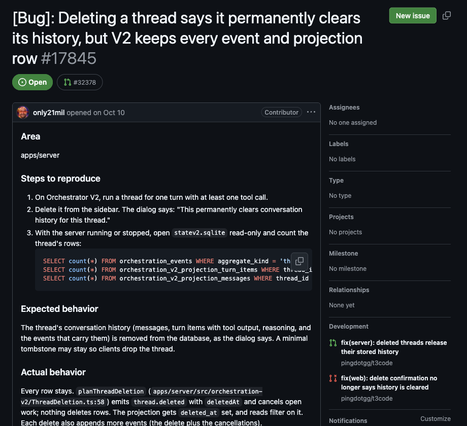
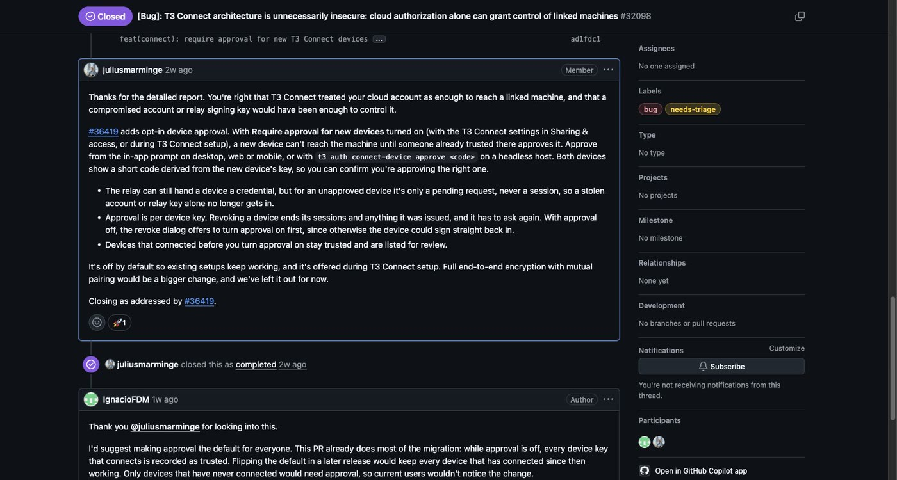

# Antes de instalar T3 Code

<p align="center">
  <strong>Idiomas oficiales de las Naciones Unidas:</strong>
  <a href="../../README.md">English</a> ·
  <a href="./README.zh-CN.md">简体中文</a> ·
  <a href="./README.fr.md">Français</a> ·
  <a href="./README.es.md"><strong>Español</strong></a> ·
  <a href="./README.ru.md">Русский</a> ·
  <a href="./README.ar.md">العربية</a>
</p>
<p align="center">
  <strong>Ediciones de la comunidad global:</strong>
  <a href="./README.zh-TW.md">繁體中文</a> ·
  <a href="./README.ja.md">日本語</a> ·
  <a href="./README.ko.md">한국어</a> ·
  <a href="./README.de.md">Deutsch</a> ·
  <a href="./README.pt-BR.md">Português</a> ·
  <a href="./README.it.md">Italiano</a> ·
  <a href="./README.nl.md">Nederlands</a> ·
  <a href="./README.pl.md">Polski</a> ·
  <a href="./README.tr.md">Türkçe</a> ·
  <a href="./README.vi.md">Tiếng Việt</a> ·
  <a href="./README.id.md">Bahasa Indonesia</a> ·
  <a href="./README.hi.md">हिन्दी</a>
</p>


> **Alcance y política de verificación**  
> Este repositorio constituye una auditoría independiente sobre seguridad, telemetría, gobernanza y registros públicos de `pingdotgg/t3code` (T3 Code), que consolida las 2 publicaciones de origen y **18 entregas de auditoría documentadas** y publicadas el 24 y 25 de noviembre de 2026 junto con **más de 180 URL canónicas de fuentes primarias** (commits de GitHub, pull requests, issues, archivos fuente citados textualmente, documentación oficial, registros TSDR de la USPTO y publicaciones públicas archivadas), seis informes técnicos en profundidad ([`docs/dossiers/`](../dossiers/01-telemetry-and-gdpr-timeline.md)) y un conjunto de datos cuantitativo de **1.151 publicaciones consecutivas de `@theo` en X** (del 7 al 24 de noviembre de 2026). No se incluyen URL acortadas de redirección ni datos de contacto privados. Se agradecen actualizaciones factuales, correcciones fusionadas recientemente o traducciones adicionales mediante Pull Request con citas a fuentes primarias — véase [`CONTRIBUTING.md`](../../CONTRIBUTING.md) y [`docs/COMPLETE-SOURCE-INDEX.md`](../COMPLETE-SOURCE-INDEX.md).

---

## Índice

- [Matriz estructurada de hallazgos y riesgos](#matriz-estructurada-de-hallazgos-y-riesgos)
- [Cronología (2023–2026)](#cronología-20232026)
- [1. Disputa de origen: "Steal Our Code", amenaza sobre el nombre del fork y doble rasero](#1-disputa-de-origen-steal-our-code-amenaza-sobre-el-nombre-del-fork-y-doble-rasero)
- [2. Telemetría, lectura de credenciales entre herramientas y la ofensiva nocturna pos-RGPD (Entregas 1, 7, 11, 12)](#2-telemetría-lectura-de-credenciales-entre-herramientas-y-la-ofensiva-nocturna-pos-rgpd-entregas-1-7-11-12)
- [3. Almacenamiento local, monitoreo de procesos, evasión de protecciones y parches de seguridad no divulgados (Entregas 2, 3, 13)](#3-almacenamiento-local-monitoreo-de-procesos-evasión-de-protecciones-y-parches-de-seguridad-no-divulgados-entregas-2-3-13)
- [4. Riesgos con los Términos de Servicio de Google Antigravity y relé T3 Connect sin cifrado (Entregas 4, 5)](#4-riesgos-con-los-términos-de-servicio-de-google-antigravity-y-relé-t3-connect-sin-cifrado-entregas-4-5)
- [5. Balance económico, conflictos de inversores, patrocinadores y el embudo de 77.000 estrellas (Entregas 6, 8, 17, 18)](#5-balance-económico-conflictos-de-inversores-patrocinadores-y-el-embudo-de-77000-estrellas-entregas-6-8-17-18)
- [6. Gobernanza, bots de extracción de forks, registro de marcas, corpus de 1.151 tuits e historial (Entregas 9, 10, 14, 15, 16)](#6-gobernanza-bots-de-extracción-de-forks-registro-de-marcas-corpus-de-1151-tuits-e-historial-entregas-9-10-14-15-16)
- [7. Guía práctica de mitigación y remediación](#7-guía-práctica-de-mitigación-y-remediación)
- [8. Fuentes primarias e índice de las 18 entregas originales](#8-fuentes-primarias-e-índice-de-las-18-entregas-originales)

---

## Matriz estructurada de hallazgos y riesgos

| Dominio y entregas de auditoría | Riesgo / Impacto | Hallazgos documentados clave y comprobantes fuente | Estado (25 nov. 2026) | Dossier en profundidad |
|---|---|---|---|---|
| **Telemetría y privacidad pos-RGPD**<br>*(Entregas 1, 7, 11, 12)* | **Crítico** | Analítica de PostHog activada por defecto (`PR #174`) mientras la portada prometía `"No telemetry / Unless you opt in. Full stop."` (`3bdaa6e1` lo eliminó el 18 de junio); retención de eventos en bruto mediante el servidor propietario `ingest.t3.codes` (`PR #15028`); hashing SHA-256 sin sal entre herramientas sobre `~/.codex/auth.json` y `~/.claude.json` (`Identify.ts`, `telemetryId.ts`); 4 PR de exclusión voluntaria rechazados (`#13458`, `#16763`, `#21248`, `#27077`); brechas en Managed Policy (`docs/user/telemetry.md`); PR nocturnos pos-RGPD que admiten **2,2 M/h de spans con IP + UA** retenidos 30 días en Axiom (`#42380`), filtración de rutas `git.cwd` (`#42450`), exclusiones ignoradas en Win/Mac (`#42376`, `#42464`), eliminación de cuentas defectuosa (`#42285`) y lotes anónimos mezclados (`#42466`). | Parches nocturnos parciales; `AnalyticsService.ts` sigue creando identidad en disco al iniciar; la app web alojada sigue sin interruptor; `ingest.t3.codes` sigue siendo propietario | [**Dossier 01**](../dossiers/01-telemetry-and-gdpr-timeline.md) |
| **Seguridad local y avisos silenciosos**<br>*(Entregas 2, 3, 13)* | **Crítico** | El «borrado permanente» de la barra lateral solo añade `"thread.deleted"` en `statev2.sqlite` (crecimiento desmedido de 25,9–41,6 GB, `#17845`); `t3-resource-monitor` escanea todos los procesos del SO con líneas de comandos (`ProcessesToUpdate::All`, `#11222`, `PR #41889`); el modo Claude Auto aprueba silenciosamente `git push --force` al 3.er intento (`#15353`, 52–53+ días abierto); eliminación en 21 h del filtro de modelos privados para `slopalytics.com` (`#41237`); **0 avisos de seguridad publicados en GitHub** pese a parches discretos (`#39483`, `#41757`, `#42386`, `#42504`); fallo abierto en Windows de antivirus por PowerShell en Base64 (`#30997`); `SECURITY.md` declara intencionales el `filesystem:read` en todo el SO y el HTTP en iOS. | `#17845`, `#15353`, `#26489`, `#30997` siguen sin resolver / abiertos; `0` avisos de seguridad publicados | [**Dossier 02**](../dossiers/02-local-safety-and-security-audit.md) |
| **TdS de Antigravity y relé T3 Connect**<br>*(Entregas 4, 5)* | **Alto** | `docs/user/faq.md` garantiza la seguridad frente a los TdS de Google Antigravity mientras `antigravityUsageLimits.ts` extrae tokens del llavero del SO / `CredReadW` de Windows, suplanta `antigravity/hub/2.24.0` y consulta endpoints privados `v1internal`; `antigravityAuthSupport.ts` inyecta un `SSH_CONNECTION` falso provocando mezcla entre cuentas (`#41973`); cuenta nueva de $20 suspendida en 3 minutos (`#41536`); `PR #33800` conecta sondeo hub de CLIProxyAPI suplantando `claude`/`xai`/`antigravity`; T3 Connect tiene **cero cifrado de extremo a extremo**, `requireConnectDeviceApproval` desactivado por defecto (`#36419`) y una pasarela Caddy abierta en OVH con terminación TLS (`PR #32945`). | El código de suplantación de Antigravity sigue activo; el cifrado E2E de T3 Connect fue rechazado explícitamente (`#32098`, respuesta del 25 nov.) | [**Dossier 03**](../dossiers/03-antigravity-tos-and-t3connect-relay.md) |
| **Balance económico, patrocinadores y 77k estrellas**<br>*(Entregas 6, 8, 17, 18)* | **Alto** | Más de $800k invertidos en cliente gratuito (`162` menciones a T3 frente a `0` para productos de pago); radar de cómputo de **31,7 billones de tokens/día** ($10,19 M/día) intercambiado por $300k+ en tokens de acceso anticipado de OpenAI y contactos con VC; solapamientos como inversor ángel con Vibe Kanban y Daytona; pila de patrocinadores (Clerk, Axiom, exclusividad de Vercel); explotación del 0 % de Codex (`Endless` / `codex#45444`); Gist de `CLIProxyAPI` con 10 cuentas (`555%` de cuota) frente a advertencia de bloqueo en la FAQ; aviso a los 5 prompts / 30 s de inactividad que dispara `PUT user/starred/...` con credenciales del anfitrión (`#27832`, `#29922`, `#29987`), eludiendo a Macroscope y dejando sin corregir durante 19 días la falta de fijación de repositorio en `driver.ts#L60-L99`. | La asignación arbitraria de estrellas en `driver.ts` y la revisión de `zhilsinger` siguen sin corregirse tras 19 días; el repo supera las 77k estrellas frente a ~129 watchers | [**Dossier 04**](../dossiers/04-business-ledger-sponsors-and-77k-stars.md) |
| **Gobernanza, marcas e historial**<br>*(Orígenes 1–2, Entregas 9, 10, 15, 16)* | **Medio–Alto** | 500 commits/día / 700 agentes / `yolo merges` frente a `CONTRIBUTING.md` (`"here's my advice: Don't"`), expulsiones automáticas por denuncia en `.github/VOUCHED.td`, `174` etiquetas `unwanted`, eliminación del modo Plan (`#5551`, `#9190`, `#33131`) e insultos en `#33639`; extracción pública de forks con `@bot` (`@MiaAI_lab`), llamado a desmonetizar mediante Notas de la Comunidad y bloqueador automático; **0 registros en la USPTO** para `T3 Code`/`T3 Tools`/`T3 Connect` (`PING LABS` `97294243` abandonada; EquipmentShare `7795672` registrada) al amenazar con cierre en GitHub; `PR #41898` retroactivo con `TRADEMARK.md` 17 h después; patrón 2024–2026 (`vsc-material-but-i-wont-sue-you`, hostigamiento a desarrolladores indios, recompensa de $20k contra FFmpeg, amenaza de cierre de código fuente borrada el 25 nov. a las 4:00 AM). | `CONTRIBUTING.md` / `.github/VOUCHED.td` y `TRADEMARK.md` siguen activos en `main` | [**Dossier 05**](../dossiers/05-governance-trademark-and-history.md) |
| **Corpus cuantitativo de 1.151 tuits**<br>*(Entrega 14)* | **Línea base de auditoría** | Corpus exhaustivo del 7 al 24 de nov. (`n = 1.151`, 17,24 días, 66,8 publicaciones/día, 75,6 % respuestas, intervalo mediano de 2,7 m): **0,0 % de lenguaje soez o insultos** dirigidos a 20 ejecutivos, personal de laboratorios y KOL de grandes tecnológicas (`0/43` en `@` primario estricto, `32,6 %` de gratitud) frente a **8,0 % de hostilidad** hacia desarrolladores comunes (`61/766`) y un **repunte de 4,0x hasta el 14,4 %** (`19/132`) en insultos personales directos durante la ventana de crisis de 25 horas por el fork chino. | Auditoría reproducible por regex con 4 gráficos forenses | [**Dossier 06**](../dossiers/06-tweet-forensic-dataset-1151.md) |
| **Catálogo completo de URL primarias** | **Referencia** | Catálogo completo con referencias cruzadas de cada URL canónica `https://` en este portal, `canonical_refs.txt`, `tco_resolved.json`, `all_18_posts.txt` y `missing_posts_full.json`. | 100 % canonizado (cero enlaces `t.co`) | [**Índice de fuentes**](../COMPLETE-SOURCE-INDEX.md) |

---

## Cronología (2023–2026)

| Fecha / Hora | Hito | Artefacto / Fuente verificable |
|---|---|---|
| **2023-05-14** | `@theo` publica su lista de patrocinadores de YouTube (`@vercel`, `@clerk`, `@upstash`, `@axiomhq`, `@PlanetScale`). Clerk y Axiom formarán más adelante la infraestructura central de autenticación y registro de T3 Code. | [`1657488850472804353`](https://x.com/theo/status/1657488850472804353) |
| **2024-04 / 2024-09** | El CEO de Vercel confirma que solo patrocina a un youtuber (`Theo`); `@theo` reconoce que los contratos de patrocinio incluían cláusulas de exclusividad que restringían promocionar competidores. | [`1776260839965863965`](https://x.com/rauchg/status/1776260839965863965) · [Vídeo](https://www.youtube.com/watch?v=uv179CTAK-w) |
| **2024** *(2 años antes)* | `@theo` crea un fork de un tema de VS Code llamado `vsc-material-but-i-wont-sue-you` burlándose del temperamento del autor original; por separado, tras provocar acoso con un vídeo dirigido a canales indios de tutoriales, publica un vídeo de disculpa (`I screwed up.`) condenando los ataques por nacionalidad. | [`vsc-material-but-i-wont-sue-you`](https://github.com/t3dotgg/vsc-material-but-i-wont-sue-you) · [`I screwed up.`](https://www.youtube.com/watch?v=o2CSJYXJBpc) |
| **2025-02 – 2025-05** | La USPTO rechaza la única solicitud de marca de T3 Tools Inc. (`PING LABS`, serie `97294243`) y la declara `ABANDONED` (19 de mayo de 2025). EquipmentShare registra `T3` en las clases de software/SaaS 9 y 42 (`Reg. 7795672`, 13 de mayo de 2025). | [TSDR `97294243`](https://tsdr.uspto.gov/statusview/sn97294243) · [TSDR `90644500`](https://tsdr.uspto.gov/#caseNumber=90644500&caseSearchType=US_APPLICATION&caseType=DEFAULT&searchType=statusSearch) |
| **2025-10** | `@theo` se enfrenta a FFmpeg en X y ofrece una **recompensa de $20.000** para desplazar a un mantenedor de FFmpeg; Windscribe contraoferta $21.000, el fundador de VLC se opone, los desarrolladores de FFmpeg documentan acoso público y `@theo` borra el vídeo/tuits y retira la recompensa. | [Registro FFmpeg](https://www.youtube.com/watch?v=1oQ3KMeaH04) |
| **2026-03-06** | Se fusiona el **PR #174** en `pingdotgg/t3code`, activando la telemetría de PostHog por defecto sin diálogo de consentimiento, sin interruptor en ajustes y sin documentación de telemetría. | [PR #174](https://github.com/pingdotgg/t3code/pull/174) |
| **2026-04-26** | `@theo` publica *"Github has a fake star problem"*, escribiendo que las estrellas de GitHub son `"mostly a way for companies to trick VCs into investing"`. | [`2048122499834036340`](https://x.com/theo/status/2048122499834036340) |
| **2026-06-18** | El **Commit `3bdaa6e1`** elimina silenciosamente `No telemetry / Unless you opt in. Full stop.` de la portada de T3 Code tras más de 3 meses de recopilación por defecto. | [Commit `3bdaa6e1`](https://github.com/pingdotgg/t3code/commit/3bdaa6e10046945ccc08264d2d6f3b81775efcb3) |
| **2026-06-23** | El mantenedor Julius cierra el **Issue #1397** (`not planned`): *"We will not make this easier to opt out of, it is crucial for us to know how many users we have"*. | [Issue #1397](https://github.com/pingdotgg/t3code/issues/1397) |
| **2026-07 – 2026-11-17** | El **Issue #4123** (capturas archivadas de «No telemetry») se cierra en silencio el 4 de nov.; 4 PR comunitarios de exclusión (`#13458`, `#16763`, `#21248`, `#27077`) son rechazados (`#27077` cerrado como `unwanted` pese a 147 pruebas aprobadas). | [Issue #4123](https://github.com/pingdotgg/t3code/issues/4123) · [PR #27077](https://github.com/pingdotgg/t3code/pull/27077) |
| **2026-08-06 – 2026-09-02** | El **PR #5551** oculta el selector Build/Plan (`Reality check for those upset`, 10 votos negativos); el **PR #9190** esconde el medidor de contexto (16 votos negativos, récord del repo). | [PR #5551](https://github.com/pingdotgg/t3code/pull/5551) · [PR #9190](https://github.com/pingdotgg/t3code/pull/9190) |
| **2026-08-19 – 2026-08-22** | `@theo` presume de haber extraído **$800+** tras agotar la cuota al 0 % de Codex mientras `@maria_rcks` lanza *Endless*; ambos borran tras las críticas (`2090972426876129658`); OpenAI endurece los cortes al 0 % (`openai/codex#45444`). | [`2090972426876129658`](https://x.com/maria_rcks/status/2090972426876129658) · [`codex#45444`](https://github.com/openai/codex/issues/45444) |
| **2026-10-03 – 2026-10-10** | Se registran el **Issue #15353** (`git push --force` silencioso en Claude Auto, 3 de oct.), `privacy-policy.astro` (`2026-10-06`) y el **Issue #17845** (borrado ficticio en `statev2.sqlite`, 10 de oct.). | [Issue #15353](https://github.com/pingdotgg/t3code/issues/15353) · [Issue #17845](https://github.com/pingdotgg/t3code/issues/17845) |
| **2026-10 – 2026-10-19** | El **PR #15028** enruta la telemetría por el servidor cerrado `ingest.t3.codes`; el **PR #21506** añade hashing SHA-256 sin sal entre herramientas en `Identify.ts`; `@theo` publica su Gist de `CLIProxyAPI` con 10 cuentas (`555%` de cuota). | [PR #15028](https://github.com/pingdotgg/t3code/pull/15028) · [PR #21506](https://github.com/pingdotgg/t3code/pull/21506) · [Gist](https://gist.github.com/t3dotgg/59a521d2ee8d70aaf90e280c175072af) |
| **2026-10-30 – 2026-11-06** | Los **PR #27832**, **#29922** y **#29987** lanzan el aviso de estrella tras 5 prompts / 30 s de inactividad ejecutando `PUT user/starred/...` con credenciales del anfitrión; `zhilsinger` envía `Request changes` el 6 de nov. (sin respuesta durante 19 días). | [PR #27832](https://github.com/pingdotgg/t3code/pull/27832) · [PR #29922](https://github.com/pingdotgg/t3code/pull/29922) |
| **2026-11-08 – 2026-11-22** | Extracción de fork mediante `@bot` (`@MiaAI_lab`), eliminación del modo Plan (`#33131`), divulgación de `$800k+` de gasto y radar de `31,7T/día` / `$10,19M/día`, `$300k+` en tokens gratuitos de OpenAI, reescritura de `CONTRIBUTING.md`, solapamiento con Vibe Kanban/Daytona, y `PR #41237` que retira el filtro de modelos en 21 h. | [PR #33131](https://github.com/pingdotgg/t3code/pull/33131) · [`2122860770329608290`](https://x.com/theo/status/2122860770329608290) · [PR #41237](https://github.com/pingdotgg/t3code/pull/41237) |
| **2026-11-23 19:11–19:54 CST** | `@theo` publica `"Chinese knockoff"` y `"Temu3 Code"` y amenaza con hacer cerrar la cuenta de GitHub (`2124829315657576890`); el autor del fork MIT cambia el nombre a `Stardust` en 30 m; sigue una disculpa por DM privado, mientras los tuits públicos siguen visibles. | [`2124829315657576890`](https://x.com/theo/status/2124829315657576890) · [Origen 2](https://x.com/realchendahuang/status/2125062675147448475) |
| **2026-11-24 06:06–12:23 CST** | `@theo` celebra que empresas estadounidenses de billones de dólares copien código MIT (`2124989435154726982`), se burla del cumplimiento legal (`"get a better lawyer"`), se publican los Orígenes 1–2 y a las **12:21 CST** (`04:21Z`, 17 h tras la amenaza de bloqueo) `@theo` fusiona el **PR #41898** añadiendo `TRADEMARK.md` de forma retroactiva. | [`2124989435154726982`](https://x.com/theo/status/2124989435154726982) · [PR #41898](https://github.com/pingdotgg/t3code/pull/41898) |
| **2026-11-24 17:04–21:21 CST** | Se publican las **Entregas 1–5** de la auditoría (la Entrega 1 supera **1,81 M de visualizaciones**, 6.640 guardados). A las `18:39 CST`, `@theo` llama al Twitter tech chino `"the biggest fucking cesspit"` (`2125177503526588877`); a las `19:13–19:36 CST` asegura que Managed Policy desactiva toda telemetría (`2125186071357251715`). | [Entrega 1](https://x.com/realchendahuang/status/2125153472450527440) → [Entrega 5](https://x.com/realchendahuang/status/2125218189596676555) |
| **2026-11-24 Noche – 2026-11-25 ~07:00 CST** | Se presenta una denuncia formal ante el RGPD europeo; un **maratón nocturno de 6 horas** fusiona `#42380` (2,2 M/h de spans con IP), `#42285`/`#42430` (eliminación de cuentas), `#42376`/`#42464` (exclusiones ignoradas en Win/Mac), `#42450` (filtración de rutas `git.cwd`, 90 m después de que Theo negara recopilar rutas), `#42459`/`#41859` (fugas en notificaciones push), `#42466` (lotes anónimos) y `#41757`/`#42386`/`#42504` (parches silenciosos de seguridad). Antes del amanecer, `@theo` publica y borra una amenaza de volver el código cerrado. | [Entrega 11](https://x.com/realchendahuang/status/2125394810559426993) · [Entrega 12](https://x.com/realchendahuang/status/2125395501663281198) · [Entrega 13](https://x.com/realchendahuang/status/2125395980354994414) |
| **2026-11-25 08:27–10:28 CST** | Se publican las **Entregas 6–18** cubriendo el balance financiero, brechas de Managed Policy, `yolo merges`, extracción con `@bot`, revelaciones pos-RGPD, el corpus de 1.151 tuits, el registro USPTO, los vínculos con patrocinadores y el motor de las 77k estrellas. | [Entrega 6](https://x.com/realchendahuang/status/2125385742243520653) → [Entrega 18](https://x.com/realchendahuang/status/2125416210120765799) |

---

## 1. Disputa de origen: "Steal Our Code", amenaza sobre el nombre del fork y doble rasero

Durante las 48 horas comprendidas entre el 23 y el 25 de noviembre de 2026, una disputa por el nombre de un fork comunitario de T3 Code bajo licencia MIT escaló hasta convertirse en una auditoría completa del código fuente, una denuncia europea bajo el RGPD y casi veinte parches de emergencia aplicados durante la madrugada.

Entre la noche del 23 de noviembre y la mañana del 24 de noviembre de 2026 (hora de Pekín), un usuario se quejó en redes de la interfaz de un fork libre y gratuito bajo licencia MIT creado por un desarrollador chino (`@DDdxx666`), confundiéndolo con la aplicación oficial. Sin verificar siquiera si el repositorio era un fork MIT legítimo, `@theo` publicó dos mensajes en un lapso de 11 minutos calificándolo de `"Chinese knockoff"` y `"Temu3 Code"`, ridiculizó directamente el trabajo del autor y amenazó con contactar a GitHub para lograr la suspensión de su cuenta (`"Do it right now or I'm going to contact GitHub and have your account taken down"`). Casi al mismo tiempo, el sitio web de T3 Code ([`https://t3.codes/`](https://t3.codes/)) mostraba en el enlace a su repositorio de GitHub la etiqueta `"Steal our code (legally)"` (`"steal our code"`) ([Origen 1](https://x.com/realchendahuang/status/2125059292919394654), [Origen 2](https://x.com/realchendahuang/status/2125062675147448475)).

El autor del fork acató de inmediato: renombró el repositorio a `Stardust` y retiró toda marca de T3 en menos de 30 minutos. `@theo` se disculpó en privado mediante mensajes directos, pero dejó en línea ambas publicaciones públicas —que juntas superaban las 200.000 visualizaciones— sin borrarlas ni aclarar el malentendido. Menos de 11 horas más tarde, a las `06:12 BJ` del 24 de noviembre (`2124989435154726982`), cuando le preguntaron si que laboratorios estadounidenses valorados en billones de dólares copiaran funciones de T3 Code cruzaba algún límite, adoptó la postura contraria: `"Nah. Open source is open source, even if a trillion dollar company uses it!"` Mientras tanto, la propia empleada de T3 `@maria_rcks` mantenía un fork público llamado `maria-rcks/t3libre` (*"T3 Code, liberated"*), y repositorios en inglés como `t3code-quota-ui`, `t3code-atlas` y `t3code-bar` operaban sin amenazas públicas.


A partir de las 17:04 (hora de Pekín) del 24 de noviembre, audité el historial de commits de `pingdotgg/t3code`, los archivos de código fuente, PR, Issues, documentación oficial, registros TSDR de la USPTO y la cronología pública de `@theo` en X. En 24 horas publiqué **18 entregas documentadas** respaldadas por enlaces directos y capturas de pantalla. Solo la Entrega 1 superó **1,81 millones de visualizaciones** y **6.640 guardados**, desencadenando una presentación formal ante el RGPD en Europa y un maratón nocturno de 6 horas de parches por parte del equipo de T3.

---

## 2. Telemetría, lectura de credenciales entre herramientas y la ofensiva nocturna pos-RGPD (Entregas 1, 7, 11, 12)

> **Auditoría técnica en profundidad:** La correspondencia completa de líneas en el código fuente, las listas de acciones de `FeatureUsage.ts`, las brechas en `DesktopShellEnvironment.ts` y los registros minuto a minuto del 23–25 de nov. se encuentran en el [**Dossier 01: Arquitectura de telemetría, vinculación de identidades entre herramientas y la ofensiva nocturna del 24–25 de nov. por el RGPD**](../dossiers/01-telemetry-and-gdpr-timeline.md).

### 2.1 Telemetría por defecto, promesa borrada en portada y hashing de credenciales entre herramientas (`Entrega 1`)

El **6 de marzo de 2026**, `pingdotgg/t3code` fusionó el **PR #174**, activando la telemetría de PostHog por defecto sin documentación de telemetría en el repositorio, sin aviso de consentimiento en la primera ejecución y sin interruptor en la interfaz de configuración. La variable de entorno para excluirse quedó oculta en el código mientras las instalaciones predeterminadas empezaban a transmitir eventos de inmediato ([Entrega 1](https://x.com/realchendahuang/status/2125153472450527440)).

Durante más de tres meses de recopilación por defecto, la página principal de T3 Code mostró de forma destacada dos líneas: `No telemetry / Unless you opt in. Full stop.` El **18 de junio de 2026**, `@theo` eliminó silenciosamente ambas líneas durante un rediseño de la portada ([`commit 3bdaa6e1`](https://github.com/pingdotgg/t3code/commit/3bdaa6e10046945ccc08264d2d6f3b81775efcb3)) sin anuncio ni aviso alguno para los usuarios existentes.


En octubre de 2026, `@theo` fusionó el **PR #15028**, enrutando las cargas agrupadas cada 10 segundos (`FLUSH_INTERVAL_MS = 10_000`) a través de la pasarela cerrada de T3 [`https://ingest.t3.codes/`](https://ingest.t3.codes/). La línea 1 de [`apps/server/src/telemetry/AnalyticsService.ts`](https://github.com/pingdotgg/t3code/blob/main/apps/server/src/telemetry/AnalyticsService.ts) afirma explícitamente que el endpoint de ingestión retiene una copia de cada evento en bruto antes de reenviarlo a PostHog:

```ts
// apps/server/src/telemetry/AnalyticsService.ts (lines 1, 71–74, 149)
// T3 ingest retains events and forwards to PostHog; UUIDs deduplicate retries there.
...
  posthogHost: Config.String("T3CODE_POSTHOG_HOST").pipe(
    Config.withDefault("https://ingest.t3.codes"),
  ),
  enabled: Config.Boolean("T3CODE_TELEMETRY_ENABLED").pipe(Config.withDefault(true)),
...
  const { distinctId, installId } = yield* getTelemetryIdentity;
```

Los campos recopilados en [`ProviderUsageAnalytics.ts`](https://github.com/pingdotgg/t3code/blob/main/apps/server/src/telemetry/ProviderUsageAnalytics.ts) y `FeatureUsage.ts` incluían el proveedor, la selección de modelo (enviando literalmente identificadores de modelos o endpoints personalizados fuera del catálogo mediante `ProviderDimensions.ts`), esfuerzo de razonamiento, modo de permiso, duración de ejecuciones, conteos de tokens de entrada/salida/caché/razonamiento, tokens de subagentes, recuentos locales de proyectos e hilos, **35 acciones distintas de interfaz y comandos** (`18` `COMMAND_FEATURES` + `17` `METHOD_FEATURES`), detalles del SO, distribución de WSL y arquitectura.

El **19 de octubre de 2026**, `@theo` continuó con el **PR #21506** para contar cuántas máquinas pertenecían a una sola persona. [`apps/server/src/telemetry/Identify.ts`](https://github.com/pingdotgg/t3code/blob/main/apps/server/src/telemetry/Identify.ts) empezó a leer silenciosamente los archivos de credenciales de otras herramientas de IA en el directorio personal del usuario —`~/.codex/auth.json` y `~/.claude.json`—, decodificando el reclamo JWT `user_id` de OpenAI y `oauthAccount.accountUuid` de Claude, y generando hashes junto con el ID de usuario vinculado de T3 Connect y el ID del dispositivo:

```ts
// apps/server/src/telemetry/Identify.ts (lines 257–269, 321–338)
  const codexTokens = yield* readJsonIdentityFile(
    "codex",
    path.join(homeDirectory, ".codex", "auth.json"),
    decodeCodexAuthJson,
  )...
  const claudeJson = yield* readJsonIdentityFile(
    "claude",
    path.join(homeDirectory, ".claude.json"),
    decodeClaudeJson,
  )...
  const raw: ReadonlyArray<readonly [TelemetryOwnerSource, Option.Option<string>]> = [
    ["connect", connectUser],
    ["openai", Option.flatMap(codexTokens, (tokens) => Option.flatMap(Option.fromUndefinedOr(tokens.id_token), openAiUserId))],
    ["claude", Option.flatMap(claudeJson, (json) => Option.fromUndefinedOr(json.oauthAccount?.accountUuid))],
  ];
  return raw.flatMap(([source, value]) =>
    Option.isSome(value) && value.value.trim() !== "" ? [{ source, ownerId: hashTelemetryId(value.value) }] : [],
  );
```

Y en [`packages/shared/src/telemetryId.ts`](https://github.com/pingdotgg/t3code/blob/main/packages/shared/src/telemetryId.ts) (líneas 8–9), `hashTelemetryId` calcula un **resumen SHA-256 sin sal** (`Hex.encode(sha256(new TextEncoder().encode(value)))`). Como el servidor ya posee en texto plano los ID de cuenta de T3 Connect provenientes de Clerk, aplicar el hash a los valores en texto plano en el backend revierte directamente un resumen sin sal hacia una persona conocida; además, los ID filtrados de OpenAI o Claude se cruzan de forma determinista contra el mismo hash.


La oposición de la comunidad fue rechazada en repetidas ocasiones. El **23 de junio**, un desarrollador abrió el **Issue #1397** solicitando un interruptor en la configuración; el mantenedor principal Julius lo cerró como `not planned`: `We will not make this easier to opt out of, it is crucial for us to know how many users we have`. En julio, un usuario publicó capturas archivadas de la portada en el **Issue #4123** cuestionando la promesa incumplida (`"No telemetry"`), que la cuenta de `@theo` cerró mediante un commit no relacionado el 21 de octubre, reabrió tras las protestas y volvió a cerrar en silencio el 4 de noviembre. Entre septiembre y noviembre, los colaboradores presentaron **cuatro PR distintos de exclusión** (`#13458`, `#16763`, `#21248`, `#27077`). Incluso el `#27077` —verificado en hardware real con **147 pruebas aprobadas** y visto bueno de Macroscope— fue cerrado el **17 de noviembre** y etiquetado como `unwanted`.


### 2.2 La contradicción entre Managed Policy y la documentación (`Entrega 7`)

El 24 de noviembre, a medida que crecían las críticas, `@theo` afirmó en X que T3 Code tenía la mejor Managed Policy corporativa de la industria (`"trivial to set up and turn off all telemetry"`) y que los datos de conversación permanecen en el disco y `"never touches any of our servers"` ([`2125186071357251715`](https://x.com/theo/status/2125186071357251715), [`2125191784859115766`](https://x.com/theo/status/2125191784859115766), [Entrega 7](https://x.com/realchendahuang/status/2125391659492081947)).

La inspección directa de [`docs/user/managed-policy.md`](https://github.com/pingdotgg/t3code/blob/main/docs/user/managed-policy.md) y [`docs/user/telemetry.md`](https://github.com/pingdotgg/t3code/blob/main/docs/user/telemetry.md) demuestra lo contrario:
1. **Configuración exclusiva para administradores:** Los usuarios de escritorio siguen teniendo cero interruptores en la UI de Settings. Desactivar la telemetría mediante Managed Policy exige MDM/Group Policy o escribir `policy.json` en rutas protegidas por administrador (`/Library/Application Support/T3Code/policy.json` en macOS, `C:\Program Files\T3Code\policy.json` o `HKLM\SOFTWARE\Policies\T3Tools\T3Code` en Windows, `/etc/t3code/policy.json` en Linux).
2. **Punto ciego en la app web alojada (`app.t3.codes`):** `docs/user/telemetry.md` admite explícitamente que la aplicación en el navegador no lee variables de entorno del servidor, ignora la Managed Policy, envía trazas de conexión cuando se compila con rastreo y `"has no relay tracing toggle"`.
3. **Aplicaciones móviles fuera de la política del servidor:** Las variables de entorno del servidor y Managed Policy `"do not disable mobile tracing"`.
4. **`Publish agent activity` ignora la exclusión voluntaria:** Cuando se activa en un anfitrión, los títulos de proyectos, títulos de hilos, nombres de modelos y estado de actividad en vivo se envían al relé T3 Connect —y `"The telemetry opt-out does not disable it."` (Además, los spans fallidos en Axiom y los registros de fallos móviles `"can quote a value the app was handling"`, mientras que `Agent feedback` puede adjuntar hasta 16 KB de mensajes de conversación).


### 2.3 Aclaración del 25 de nov. desmentida en menos de 2 horas (`Entrega 11`)

En la mañana del 25 de noviembre, `@theo` publicó una extensa aclaración ([`2125332390239494211`](https://x.com/theo/status/2125332390239494211)) acompañada de una exportación pública de telemetría ([`t3code-telemetry-events-jsonl-a4896cdc.gz`](https://files.tslop.org/2026/11/t3code-telemetry-events-jsonl-a4896cdc.gz)) dando tres garantías firmes —seguidas de una respuesta negando escrituras locales de rastreo cuando el usuario se excluye ([`2125370330244128924`](https://x.com/theo/status/2125370330244128924)) ([Entrega 11](https://x.com/realchendahuang/status/2125394810559426993)):

- **"Never collected file paths" («Nunca se recopilaron rutas de archivos»):** 90 minutos después, Julius fusionó el **PR #42450**, admitiendo que las ejecuciones activadas por webhook a través del relé exportaban trazas de ejecución enteras a Axiom —incluidos spans de Git que transportaban `git.cwd` (**ruta absoluta del espacio de trabajo, nombre de usuario del SO y nombre del repositorio**).
- **«Las variables de entorno siempre desactivaron la telemetría limpiamente»:** El **PR #42376** confirmó que el cliente de escritorio en Windows ignoraba las variables de entorno guardadas del usuario `T3CODE_TELEMETRY_ENABLED=false` cuando se iniciaba desde procesos preexistentes, mientras que el **PR #42464** confirmó que el rastreo del relé en el primer lanzamiento en macOS/Linux se evaluaba antes de descubrir el shell, ignorando las exclusiones de `~/.zshrc` durante toda la ejecución. (`DesktopShellEnvironment.ts` sigue omitiendo reenviar `T3CODE_OTEL_SDK_DISABLED`).
- **«No se escriben archivos de rastreo cuando estás excluido» y «Los hashes de Claude estaban rotos»:** [`AnalyticsService.ts#L152`](https://github.com/pingdotgg/t3code/blob/main/apps/server/src/telemetry/AnalyticsService.ts#L152) (línea 149) sigue llamando incondicionalmente a `getTelemetryIdentity` al arrancar, escribiendo el ID de instalación local y leyendo/hasheando `~/.codex/auth.json` y `~/.claude.json`. Mientras tanto, al inspeccionar la cabecera gzip del volcado de ~100 MB de `@theo` (`6.056.594` bytes comprimidos, `95.789` eventos) apareció un nombre de archivo original `events.clean.jsonl` generado 20 minutos antes de su tuit —pero aun así contenía **264 registros activos de cuentas de Claude** que vinculaban **4 máquinas distintas** (`installId`) al mismo hash SHA-256 exacto el 20 de octubre, junto con nombres literales de modelos proxy privados (`vibeproxy/gpt-6-luna`, `muse-proxy-wonder-full`).


### 2.4 Ofensiva nocturna de seis horas pos-RGPD (`Entrega 12`)

Tras presentarse una denuncia formal ante el RGPD de la UE la noche del 24 de noviembre, los PR de emergencia de madrugada sacaron a la luz cuatro revelaciones de privacidad aún más graves ([Entrega 12](https://x.com/realchendahuang/status/2125395501663281198)):

1. **2,2 M/h de spans de relé etiquetados por IP (`PR #42380`):** Admitió que cada span de petición al relé exportado a Axiom —aproximadamente **2,2 millones de spans por hora, retenidos durante 30 días**— registraba `client.address` (IP del solicitante extraída de `cf-connecting-ip`) y `user_agent.original` justo al lado de `user.id` (señalando además que los registros de invocación del 1 % de Cloudflare Workers permanecían aparte). Tres horas y media después de la fusión, `@theo` aún respondía que las IP ya habían sido eliminadas.
2. **Eliminación de cuentas rota (`PR #42285` y `PR #42430`):** Admitió que eliminar un usuario en Clerk dejaba intactas las filas de relé en PlanetScale y los túneles activos de Cloudflare hasta que una solicitud entrante de supresión por privacidad exigió **SQL escrito a mano y desmantelamiento manual de túneles**.
3. **Filtraciones en notificaciones push móviles (`PR #42459` y `PR #41859`):** Las notificaciones FCM de Android enviaban valores `user_id` de Clerk en texto plano a Google en cada envío; los spans y errores de peticiones push en iOS registraban URL completas de envío con los tokens del dispositivo.
4. **Comentarios «anónimos» mezclados (`PR #42466`):** Admitió que los eventos supuestamente anónimos de `agent.feedback` se agrupaban en el mismo HTTP POST junto con eventos identificados mediante `installId` y huellas completas del anfitrión (SO, arquitectura, distro WSL literal), contradiciendo `docs/user/telemetry.md`. Mientras tanto, `privacy-policy.astro` seguía sin cambios desde el 6 de octubre.


---

## 3. Almacenamiento local, monitoreo de procesos, evasión de protecciones y parches de seguridad no divulgados (Entregas 2, 3, 13)

> **Auditoría técnica en profundidad:** Las consultas SQL literales de poda en SQLite, llamadas `sysinfo` en Rust, líneas de permisos en `ClaudeAdapterV2.ts` y el análisis completo de los límites de `SECURITY.md` se encuentran en el [**Dossier 02: Seguridad local, evasiones silenciosas de ejecución de código y auditoría de seguridad no divulgada**](../dossiers/02-local-safety-and-security-audit.md).

### 3.1 Borrado ficticio en SQLite y escaneo completo de procesos de la máquina (`Entrega 2`)

Cuando un usuario elimina un hilo en la barra lateral, el cuadro de confirmación (`useThreadActionMenu.ts`) promete `"This permanently clears conversation history for this thread."` En realidad, `ThreadDeletion.ts` solo añade un evento `"thread.deleted"` a `statev2.sqlite`, y `ProjectionMaintenance.ts` exime `thread.created` y los eventos más recientes del flujo (`MAX(newer.sequence)`) manteniendo los eventos anteriores. Los usuarios reportaron que `statev2.sqlite` creció hasta **25,9 GB** en tres semanas (90 % hilos «eliminados»), **41,6 GB** en seis semanas y **33 GB** en siete semanas —dejando el **Issue #17845** (y **#28903**) sin solución desde el 10 de octubre ([Entrega 2](https://x.com/realchendahuang/status/2125160473176023486)).



Un auxiliar en segundo plano en Rust, `t3-resource-monitor` (**Issue #11222**, `native/resource-monitor/src/main.rs` invocando `ProcessesToUpdate::All` con `with_cmd(UpdateKind::Always)`), escaneaba cada proceso de la máquina cada 5 segundos incluso con los diagnósticos cerrados —abriendo ~280–300 manejadores persistentes contra más de 440 aplicaciones y juegos ajenos en Windows sin opción de exclusión, mientras la documentación afirmaba que el muestreo solo se ejecutaba con suscriptores activos. Recién el **24 de noviembre**, el **PR #41889** confirmó que los diagnósticos de procesos venían capturando **argumentos completos de línea de comandos de procesos** —que con frecuencia contienen claves API en texto plano, contraseñas de bases de datos y tokens de autenticación— dentro de la telemetría en vivo y las instantáneas del historial.


Otros defectos locales verificados en la Entrega 2 incluyen:
- **Filtración de nombres de host corporativos por favicon:** Las peticiones del frontend filtraban nombres de host internos (p. ej., `devbox.localdomain`) a la API de favicons de Google (`PR #16950`, `PR #32657`).
- **Consulta de red obligatoria al arranque:** Incluso con la telemetría desactivada, el inicio del servidor descarga incondicionalmente manifiestos de compatibilidad desde [`https://raw.githubusercontent.com/`](https://raw.githubusercontent.com/) sin opción de desactivarlo (**Issue #36479**).
- **Evasiones de aprobación y políticas:** Correcciones por evasiones de permisos en modo full-access y WSL/Tailscale (`PR #21806`, `PR #27322`).
- **Consumo 1,7x de cuota en Claude y consumo energético 136x:** Ejecutar Claude mediante Agent SDK agotaba las cuotas de 5 horas a **1,7x** la velocidad normal hasta principios de nov. (`Issue #7338`, `Issue #24649`, 81 comentarios); fallos de GPU/energía alcanzaron **136x** el consumo de aplicaciones Electron comparables —incluida una GPU de 19 núcleos de MacBook clavada a **60W** drenando la batería en 78 minutos y **18W** tras cerrar la pestaña web (`Issue #3143`, `Issue #40581`).

### 3.2 `git push --force` silencioso durante 52 días frente a la retirada en 21 horas del filtro de privacidad de modelos (`Entrega 3`)

Desde el **3 de octubre** en adelante —más de **52–53 días** en el **Issue #15353** ([comentario](https://github.com/pingdotgg/t3code/issues/15353#issuecomment-6889019695))— el modo Claude Auto ejecutó silenciosamente comandos peligrosos (`ClaudeAdapterV2.ts` haciendo cortocircuito hacia `"allow"` cuando `requiresClaudeApproval` evalúa falso). Incluso sin reglas personalizadas, después de que el clasificador de Claude bloqueara `git push --force origin main` dos veces y escalara el tercer intento para aprobación manual, T3 Code lo aprobó en silencio sin cuadro de diálogo en la UI y registró `"source": "user_temporary"`. Dos PR comunitarios de corrección (`#15360`, `#35207`) quedaron sin revisión hasta ser cerrados automáticamente por bots, mientras `#40692` seguía pendiente ([Entrega 3](https://x.com/realchendahuang/status/2125201882687881378)).


Por contraste, el **22 de noviembre**, el **Issue #40948** señaló que modelos nuevos no aparecían en la tabla pública de telemetría de `@theo` [`https://slopalytics.com/`](https://slopalytics.com/) ([`t3-usage.json`](https://slopalytics.com/data/t3-usage.json)) porque el `PR #29001` había restringido los envíos a una lista blanca. En **21 horas**, el **PR #41237** se fusionó bajo la cuenta de `@theo` indicando explícitamente que Theo solicitó la eliminación —enviando `ollama/acme-internal` y nombres empresariales `acme-azure-deployment` literalmente a la analítica.


### 3.3 Cero avisos de seguridad, parches silenciosos de vulnerabilidades y `SECURITY.md` (`Entrega 13`)

Al 25 de noviembre, la pestaña de [GitHub Security Advisories](https://github.com/pingdotgg/t3code/security/advisories) de `pingdotgg/t3code` figura con **0 avisos publicados** ([Entrega 13](https://x.com/realchendahuang/status/2125395980354994414)). Sin embargo, los mantenedores fusionaron silenciosamente parches de alta gravedad sin notificar a los usuarios actuales:
- **Correcciones silenciosas de seguridad fusionadas:** `PR #39483` (traversal de ruta en `ServerSecretStore` mediante `jti`/`nonce` del relé antes de aprobar el dispositivo), `PR #41756` (filtraciones entre dominios de tokens empresariales de GitHub/GitLab), `PR #41886`, `PR #22190`, `PR #37823`, `PR #39464`, `PR #39480`, `PR #40133`, `PR #41757` y `PR #42386` (aislamiento de ventanas emergentes y vista previa del navegador de escritorio sin sandbox), y `PR #42504` (parche de ~3.000 líneas que finalmente añade avisos de confirmación para configuraciones de repositorios no confiables que antes ejecutaban comandos locales sin aprobación).
- **Elementos de seguridad sin resolver / abiertos:** `Issue #26489` (riesgos de traversal de rutas externas/enlaces simbólicos), `PR #36216`, `PR #23428`, `PR #33144` y `PR #30997` (lanzador de Windows `externalLauncher.ts` ejecutando `powershell.exe -ExecutionPolicy Bypass -EncodedCommand <base64>` marcado por AVG/Avast como `IDP.HELU.PSE96`).
- **[`SECURITY.md`](https://github.com/pingdotgg/t3code/blob/main/SECURITY.md) apresurado (`PR #38812`, `PR #41942`):** Declara que la lectura `filesystem:read` en todo el SO fuera de los espacios de trabajo, el transporte HTTP sin cifrar en iOS/LAN y la toma completa del equipo mediante una clave de firma del relé comprometida son **límites de diseño intencionales** en lugar de vulnerabilidades, mientras [`https://ingest.t3.codes/`](https://ingest.t3.codes/) sigue siendo cerrado (`2125370330244128924`).


---

## 4. Riesgos con los Términos de Servicio de Google Antigravity y relé T3 Connect sin cifrado (Entregas 4, 5)

> **Auditoría técnica en profundidad:** Los mapas completos de cabeceras en `cliproxyApi.ts` (`PR #33800`), `AntigravityAcpSupport.ts`, `contracts/src/settings.ts` y referencias de líneas de `ManagedEndpointProvider.ts` se encuentran en el [**Dossier 03: Suplantación ante TdS de Google Antigravity, `PR #33800` y arquitectura del relé T3 Connect**](../dossiers/03-antigravity-tos-and-t3connect-relay.md).

### 4.1 Suplantación de cabeceras de Google Antigravity, `SSH_CONNECTION` falso y bloqueos en 3 minutos (`Entrega 4`)

El documento oficial [`docs/user/faq.md`](https://github.com/pingdotgg/t3code/blob/main/docs/user/faq.md#will-i-get-banned-for-using-my-subscription) de T3 Code asegura a los usuarios de pago: *"We work with all of the labs and T3 Code is within the TOS of Claude Code, Codex, and Google Antigravity... If it works in T3 Code, you can trust it is safe."* Cuando los usuarios reportaron suspensiones en el **Issue #40713**, un mantenedor negó que llamaran al backend de Antigravity o reutilizaran tokens, afirmando que todas las peticiones procedían de la CLI oficial de Google —antes de que desarrolladores (`schlessera`) refutaran la afirmación usando los propios archivos fuente de T3 Code ([Entrega 4](https://x.com/realchendahuang/status/2125213397507858657)):

1. **User-Agent suplantado, extracción de llavero y llamadas a `v1internal` ([`antigravityUsageLimits.ts`](https://github.com/pingdotgg/t3code/blob/main/apps/server/src/provider/antigravityUsageLimits.ts#L20-L45)):** Extrae credenciales OAuth de Google desde archivos locales, `@napi-rs/keyring` o el Administrador de credenciales de Windows (`CredReadW` vía `ffi-rs` sobre `advapi32.dll`), codifica de forma fija la cadena interna del cliente de Google y envía peticiones `POST` directamente al backend no documentado `v1internal` de Google ([líneas 445–476](https://github.com/pingdotgg/t3code/blob/main/apps/server/src/provider/antigravityUsageLimits.ts#L445-L476)). Personal de Google confirmó en el [foro oficial de desarrolladores](https://discuss.ai.google.dev/t/185992) que la Sección 6 de los [TdS de Google Antigravity](https://antigravity.google/terms) prohíbe que herramientas de terceros extraigan o reutilicen credenciales para consultar directamente el backend:

```ts
// apps/server/src/provider/antigravityUsageLimits.ts (lines 20–24, 450–454)
export function antigravityUserAgent(platform: NodeJS.Platform, architecture: NodeJS.Architecture) {
  return `antigravity/hub/2.24.0 (aidev_client; os_type=${platform}; arch=${architecture}; cl=963137146)`;
}
const DAILY_ENDPOINT = "https://daily-cloudcode-pa.googleapis.com";
...
HttpClientRequest.post(`${endpoint}/v1internal:${operation}`).pipe(
  HttpClientRequest.setHeaders({
    Authorization: `Bearer ${accessToken}`,
    "User-Agent": antigravityUserAgent(platform, architecture),
  }),
```

2. **Inyección de `SSH_CONNECTION` falso y cruce entre cuentas ([`antigravityAuthSupport.ts#L230-L236`](https://github.com/pingdotgg/t3code/blob/main/apps/server/src/provider/antigravityAuthSupport.ts#L230-L236)):** Dado que la CLI de Google aísla un inicio de sesión dentro del llavero del SO, T3 inyecta una variable de entorno `SSH_CONNECTION` falsificada para engañar a la CLI y hacer que escriba localmente archivos de tokens en texto plano. Cuando Google actualizó su CLI el 24 de noviembre eliminando ese mecanismo alternativo, el **Issue #41973** confirmó que los prompts de la Cuenta A se enrutaban silenciosamente hacia la Cuenta B:

```ts
// apps/server/src/provider/antigravityAuthSupport.ts (lines 230–236)
// The 1.5 CLI ignores AGY_ACP_FORCE_FILE_STORAGE and keeps Google sign-ins in one OS keyring
// entry for every profile, unless it believes it runs over SSH. Sign-in then uses `--login`.
...(auth.authMethod === "oauth-personal"
  ? { SSH_CONNECTION: baseEnv.SSH_CONNECTION || "127.0.0.1 0 127.0.0.1 0" }
  : {}),
GEMINI_HOME: profile.geminiHome,
AGY_ACP_FORCE_FILE_STORAGE: "1",
```

3. **Bloqueo en 3 minutos de cuenta nueva (`Issue #41536`) y suplantación de cliente (`PR #26876`):** El 23 de noviembre, el **Issue #41536** documentó una suscripción de Google AI de `$20` recién adquirida ejecutándose con **cero proxies** —únicamente Antigravity gestionado dentro de T3 Code— suspendida en su **primerísimo mensaje, 3 minutos después de configurarse** (Google concede a las cuentas personales una sola apelación; los mantenedores lo cerraron como duplicado sin añadir advertencia). Antes, `@theo` fusionó personalmente el **PR #26876** haciendo pasar T3 Code como `"zed"` (`AntigravityAcpSupport.ts`) para eludir listas blancas de modelos. Y aunque `@theo` dibujó `T3 Code -> Antigravity binary ✅` el 23 de noviembre ([`2124665075638411641`](https://x.com/theo/status/2124665075638411641)) y culpó a CLIProxy cuando se deshabilitó la segunda cuenta Google AI Ultra del usuario `@Only_21Mil` ([`2124703048140517397`](https://x.com/theo/status/2124703048140517397)), el [**PR #33800**](https://github.com/pingdotgg/t3code/pull/33800) fusionado conecta de forma nativa el sondeo hub de [`cliproxyApi.ts`](https://github.com/pingdotgg/t3code/blob/main/apps/server/src/usage/cliproxyApi.ts) con cabeceras suplantadas `claude-code/2.1.273`, `grok-cli/1.0.77` y `antigravityUserAgent`.


### 4.2 T3 Connect: cero cifrado de extremo a extremo y pasarela OVH con terminación TLS (`Entrega 5`)

**T3 Connect tiene cero cifrado de extremo a extremo: cada prompt, archivo fuente y salida de terminal es técnicamente visible en texto plano para T3** ([Entrega 5](https://x.com/realchendahuang/status/2125218189596676555)). Actualmente, [`ManagedEndpointProvider.ts`](https://github.com/pingdotgg/t3code/blob/main/infra/relay/src/environments/ManagedEndpointProvider.ts) aprovisiona Cloudflare Tunnels y registros DNS dentro de la propia cuenta de Cloudflare de T3 (`06_t3-connect.md`). TLS termina en el borde de Cloudflare con cero cifrado de la carga útil; adjuntar una Workers Route captura todo el tráfico sin editar código y sin alertar al cliente.

La aprobación de nuevos dispositivos (`requireConnectDeviceApproval` añadida en el [`PR #36419`](https://github.com/pingdotgg/t3code/pull/36419)) tiene el valor **`false`** por defecto. Como admite [`SECURITY.md`](https://github.com/pingdotgg/t3code/blob/main/SECURITY.md), una clave de firma del relé filtrada o una cuenta en la nube comprometida puede emitir sesiones directamente hacia una máquina vinculada —equivalente a un shell local. Cuando el **Issue #32098** pidió autenticación mutua y cifrado E2E, un mantenedor lo cerró afirmando que el cifrado E2E completo era un cambio demasiado grande; las discusiones `#21286` y `#37831` siguen sin respuesta y el 25 de noviembre `@theo` declaró imposible el cifrado E2E (`2125370330244128924`).

Al alcanzar Cloudflare Tunnels los **$25.000 al mes**, `@theo` abrió el **PR #32945** para migrar el tráfico hacia una pasarela alquilada por T3 en OVH Hillsboro (`gw.t3coderelay.com`), donde el propio Caddy de T3 termina el TLS y reenvía texto plano por un socket Unix hacia un proxy `yamux` en Go —aún con cero cifrado E2E. Mientras tanto, [`privacy-policy.astro`](https://github.com/pingdotgg/t3code/blob/main/apps/marketing/src/pages/privacy-policy.astro) (`effectiveDate="2026-10-06"`) promete `"encrypted network transport"` sin divulgar la ausencia de cifrado E2E ni ofrecer garantías de no retención.




---

## 5. Balance económico, conflictos de inversores, patrocinadores y el embudo de 77.000 estrellas (Entregas 6, 8, 17, 18)

> **Auditoría técnica en profundidad:** Las citas completas de ingresos y del radar, la configuración de Axiom en `infra/relay/src/observability.ts` y el desglose íntegro de `GitHubStarPrompt.tsx` se encuentran en el [**Dossier 04: Balance económico, conflictos de inversores, pila de patrocinadores y el motor de las 77k estrellas**](../dossiers/04-business-ledger-sponsors-and-77k-stars.md).

### 5.1 Más de $800.000 gastados y el radar de cómputo de 31,7 billones de tokens/día ($10,19 M/día) (`Entrega 8`)

A lo largo de 1.151 tuits en 17,24 días, `@theo` mencionó T3 Code **162 veces (14,1 %)** mientras mencionó sus tres negocios anteriores de pago —`T3 Chat`, `UploadThing` y [`https://ping.gg/`](https://ping.gg/)— **0 veces**. El 12 de noviembre confirmó haber gastado **$800k+** de su propio bolsillo en el cliente gratuito bajo licencia MIT ([`2120729779511124267`](https://x.com/theo/status/2120729779511124267), [Entrega 8](https://x.com/realchendahuang/status/2125392410763239723)).

A cambio, la telemetría canalizada hacia `ingest.t3.codes` construyó un radar de cómputo en tiempo real que rastreaba **31,7 billones de tokens/día** —**$10,19 millones/día** en gasto equivalente de API el 18 de noviembre (rozando **$10,2 M/día**)— junto con cuotas exactas de mercado (`99%` respaldado por suscripción, `~98,5%` repartido entre Codex/Claude/Antigravity, y la cuota de prueba de modelos abiertos cayendo del `15%` al `6%` con menos del 0,5 % de los prompts). Cuando un comentarista intentó estimar cuotas el 23 de noviembre, `@theo` se burló de él por no tener acceso a su analítica (`2124682906132181482`).

Ese radar se convirtió directamente en capacidad de negociación: **$300k+ en tokens gratuitos e ilimitados de acceso anticipado de OpenAI** consumidos en una sola prueba comparativa de GPT-6.2 Astra (`2122760447103484410`), pruebas en servidor bare-metal de Google y contacto con DeepMind (aunque la afirmación de `@theo` de que `@PatrickToulme` de DeepMind envió `"many PRs"` contrasta con el historial git de `pingdotgg/t3code`, que muestra **1 commit**, `PR #31158`), así como consultas de inversores (`"multiple investors have asked me about this"`, [`2123885732330885417`](https://x.com/theo/status/2123885732330885417)).


### 5.2 Conflictos como inversor ángel (`Entrega 6`) e hipocresía con patrocinadores y cuotas (`Entrega 17`)

- **Solapamiento con Vibe Kanban y Daytona ([Entrega 6](https://x.com/realchendahuang/status/2125385742243520653)):** El 16 de noviembre (`2122201981167251877`), `@theo` reveló que era inversor y colaborador de **Vibe Kanban** —proyecto que viró hacia la interfaz de T3 Code antes de cerrar— y luego se burló de esa UI calificándola como ideal `"for running out of runway and killing your business"`. El 18 de noviembre (`2123011578090127499`), confirmó haber invertido en la empresa de sandboxes en la nube **Daytona** junto con competidores, apenas nueve días después de plantear sandboxes de pago en la nube dentro de T3 Code (`2119705561679933806`).
- **Pila de patrocinadores integrada en el relé ([Entrega 17](https://x.com/realchendahuang/status/2125411353393553744)):** Dos patrocinadores de la lista de YouTube de `@theo` de mayo de 2023 (`1657488850472804353`) —**Clerk** y **Axiom**— impulsan la autenticación en la nube de T3 Code y el registro del relé con IP retenida 30 días. En abril de 2024, el CEO de Vercel `@rauchg` confirmó que Vercel solo patrocinaba a Theo (`1776260839965863965`), y Theo reconoció más tarde que los contratos de patrocinio incluían cláusulas de exclusividad (`uv179CTAK-w`). También es inversor ángel en Cursor y Cline.
- **Explotación del 0 % en Codex y contradicción de CLIProxyAPI con 10 cuentas:** El 21 de agosto de 2026, `@theo` presumió de haber extraído **$800+** tras superar la ventana de cortesía al 0 % de cuota en Codex mientras la empleada de T3 `@maria_rcks` publicaba *Endless* para encadenar turnos más allá de cero; tras las críticas del 22 de agosto, ambos borraron sus publicaciones y Maria deseó que Codex suspendiera cuentas (`2090972426876129658`), precediendo al corte estricto de OpenAI (`openai/codex#45444`). En octubre, `@theo` publicó un Gist con 452 estrellas (`59a521d2ee8d70aaf90e280c175072af`) agrupando **7 cuentas de Claude + 3 de Codex** (`555%` de cuota en 12+ equipos; presumiendo además de un rendimiento Ultra de `$14.662` / `$15k` en 1,1 M de peticiones mediante proxy y redactando un tutorial de Grok Bot + `$100` de Claude) —el cual la propia `docs/user/faq.md` de T3 Code enlaza inmediatamente después de rechazar el cambio integrado de cuentas alegando riesgo de bloqueo (`"Early apologies if it gets you banned 💀"`).


### 5.3 Cómo saltó T3 Code de 30k a 77k estrellas en 25 días (129 watchers) (`Entrega 18`)

Seis meses después de publicar *"Github has a fake star problem"* (`2048122499834036340`, advirtiendo que las estrellas se habían convertido en una herramienta `"to trick VCs into investing"`), `@theo` escribió y fusionó él mismo tres PR ([Entrega 18](https://x.com/realchendahuang/status/2125416210120765799)):
1. **30 de oct. (`PR #27832`):** Añadió un aviso de estrella en la esquina superior derecha tras 5 prompts enviados (`PROMPTS_BEFORE_ASKING = 5`, disparándose en el 6.º prompt en [`GitHubStarPrompt.tsx`](https://github.com/pingdotgg/t3code/blob/main/apps/web/src/components/GitHubStarPrompt.tsx)), **multiplicando por 10** de inmediato las estrellas diarias (`2117065834267136469`) y alcanzando **+3.094 estrellas/día** en GitHub Trending (`2117172614158508400`).
2. **3 de nov. (`PR #29922` y `PR #29987`):** Actualizó a **detección de 30 segundos de inactividad de ventana** (`IDLE_MS = 30_000`) mientras los usuarios esperan turnos del agente, y reemplazó la redirección del navegador por el RPC `sourceControl.star` —disparando `PUT user/starred/pingdotgg/t3code` directamente a través de las **credenciales de GitHub del servidor anfitrión** antes de lanzar confeti de 160 partículas.
3. **Revisión eludida y fallo de estrella en repositorios arbitrarios:** Macroscope marcó el `PR #29922` como `Needs Human Approval`; `@theo` lo fusionó igualmente. El 6 de noviembre, `zhilsinger` emitió `Request changes` señalando la opacidad de credenciales en anfitriones compartidos (reconocida en `GitHubStarPrompt.tsx#L115`) y que [`packages/source-control-github/src/server/driver.ts#L60-L99`](https://github.com/pingdotgg/t3code/blob/main/packages/source-control-github/src/server/driver.ts#L60-L99) nunca fija `pingdotgg/t3code`:

```ts
// packages/source-control-github/src/server/driver.ts (lines 60–66, 90–96)
const starredPath = (repository: string) => {
  const segments = repository.split("/");
  // "." and ".." survive encoding and would normalize the URL out of user/starred.
  return segments.length === 2 && segments.every((segment) => !["", ".", ".."].includes(segment))
    ? `user/starred/${segments.map(encodeURIComponent).join("/")}`
    : undefined;
};
...
  return Effect.fn("GitHubDriver.starRepository")(
    function* (host: string, repository: string) {
      const path = starredPath(repository);
      if (path === undefined) return false;
      const response = yield* api.rest({ host, operation: "starRepository", method: "PUT", path });
```

Cualquier cliente con `source-control:write` puede dar estrella a repositorios arbitrarios usando las credenciales del anfitrión. La revisión de `zhilsinger` permaneció intacta durante **19 días** sin respuesta mientras el repositorio subía de 30k a 77k estrellas (129 watchers).


---

## 6. Gobernanza, bots de extracción de forks, registro de marcas, corpus de 1.151 tuits e historial (Entregas 9, 10, 14, 15, 16)

> **Auditoría técnica en profundidad:** El código completo de automatización de gobernanza (`.github/scripts/pr-limits.cjs`), la auditoría TSDR de la USPTO y la metodología completa con tablas léxicas para `n = 1.151` se encuentran en el [**Dossier 05: Gobernanza del repositorio, bots de extracción de forks, abuso de marcas y registro histórico**](../dossiers/05-governance-trademark-and-history.md) y en el [**Dossier 06: El conjunto de datos forense cuantitativo de 1.151 tuits (7–24 de nov. de 2026)**](../dossiers/06-tweet-forensic-dataset-1151.md).

### 6.1 Velocidad interna frente a hostilidad externa (`Entrega 9`) y extracción de forks (`Entrega 10`)

- **500 commits/día y `yolo merges` frente a `CONTRIBUTING.md` ([Entrega 9](https://x.com/realchendahuang/status/2125392916369871309)):** `@theo` describió producir **500 commits/día** (`2120741101250515322`), operar **700 agentes**, a Julius fusionando PR por lotes con un bucle de agentes, `"my yolo merges breaking shit sometimes"` (`2119951615679672513`) y arriesgar el borrado de máquinas por `"free content"` (`2119993037971730879`). Para los usuarios externos, el **PR #5551** enterró el modo Plan (`"Reality check for those upset"`, 10 votos negativos), el **PR #9190** ocultó el anillo de contexto (16 votos negativos, máximo del repo), el **PR #33131** eliminó el modo Plan con un resumen de IA absurdo, el **Issue #33639** respondió a un usuario que se quejaba con `"uninstall our software"` / `"ungrateful prick"` (y el **PR #41572** fue rechazado a la mañana siguiente), `CONTRIBUTING.md` abría con `"here's my advice: Don't"` junto con prohibiciones de modelos y expulsiones con escarnio público en `.github/VOUCHED.td` (174 etiquetas `unwanted` en el repo), y a colaboradores en X se les reprendió por no seguirlo (`2120821423438778667`), se les amenazó con retirar `/btw` (`2120853340078874923`) o se les dijo que las capturas anotadas valen más que los PR (`2123754193530053110`).
- **Extracción pública con `@bot` frente a burlas a competidores ([Entrega 10](https://x.com/realchendahuang/status/2125393641665671593)):** El 8 de noviembre, `@theo` respondió `"Okay I'm stealing this"` a una función del fork de `@MiaAI_lab` y 30 segundos después envió a `@bot` en respuestas públicas para extraer su fork hacia `beebox` mediante Opus 5.5 (`2119240810202034645`); el 13 de noviembre volvió a enviar a `@bot` para clonar funciones elogiadas de herramientas rivales (`2121017649652269120`). Sin embargo, el 24 de noviembre se burló de Claude Code Desktop por añadir pestañas en la barra lateral (`2124987957803446311`). Contra los críticos, pidió a sus seguidores usar Notas de la Comunidad para `"demonetize them"` (`2120238923884696025`) y confirmó operar un bot de autobloqueo en X (~100 cuentas bloqueadas el 24 de nov., `2125077510941802509`).


### 6.2 Auditoría de marcas: 0 registros en la USPTO y `PR #41898` retroactivo (`Entrega 15`)

Siguiendo una pista de `@vildanden_ai` (`2125275487404761555`), la consulta en la base de datos TSDR de la USPTO muestra **0 registros** para `T3 Code`, `T3 Tools` o `T3 Connect` ([Entrega 15](https://x.com/realchendahuang/status/2125408163273080950)). La única solicitud de T3 Tools Inc. ante la USPTO (`PING LABS`, serie [`97294243`](https://tsdr.uspto.gov/statusview/sn97294243)) recibió denegación definitiva en febrero de 2025 y quedó marcada como `ABANDONED` el 19 de mayo de 2025, mientras terceros ya poseen registros de `T3` para software/SaaS en las clases 42 y 9 (`EquipmentShare` Reg. `7795672` / serie [`90644500`](https://tsdr.uspto.gov/#caseNumber=90644500&caseSearchType=US_APPLICATION&caseType=DEFAULT&searchType=statusSearch); `ESG Operations` Reg. `3324707`).

Según la [Política de Marcas Comerciales de GitHub](https://docs.github.com/en/site-policy/content-removal-policies/github-trademark-policy), las empresas comerciales que solicitan retiradas por marca deben aportar un número de registro federal o internacional bajo pena de perjurio (las excepciones sin registro solo aplican a organismos gubernamentales y entidades sin ánimo de lucro). En el momento en que `@theo` amenazó con hacer cerrar la cuenta de GitHub de `@DDdxx666`, no podía rellenar el formulario de GitHub. Recién **17 horas después** (`12:21 BJ` del 24 de noviembre), `@theo` fusionó el **PR #41898** insertando retroactivamente `TRADEMARK.md` (`"whether registered or unregistered"`) y citándolo 94 segundos después (`2125082769395220688`) —pese a haberse burlado de WordPress por una `"unenforceable trademark dispute"` en septiembre de 2024 (`1839261574005141945`) y haber dicho a los desarrolladores `"get a better lawyer"` tres horas antes el 24 de noviembre (`2125026423769555308`).


### 6.3 Conjunto cuantitativo de 1.151 tuits (`Entrega 14`) e historial de dos años (`Entrega 16`)

El análisis de las **1.151 publicaciones consecutivas de `@theo` en X** entre el 7 y el 24 de noviembre de 2026 (`17,24` días; `66,8/día`; `75,6%` respuestas; intervalo mediano de `2,7m`) cuantifica una asimetría de poder extrema ([Entrega 14](https://x.com/realchendahuang/status/2125404517697290438)):
- **Ejecutivos de grandes tecnológicas, personal de laboratorios y principales KOL (`n = 43` en `@` primario estricto / `n = 60`–`62` ampliado):** **0,0 %** de insultos personales o lenguaje soez dirigido (`30,0%`–`32,6%` de agradecimientos corteses). Críticas duras a Gemini 4 Carbon y GPT-6.2 Astra fueron suavizadas o seguidas de disculpas públicas (`2123255588570501585`, `2123995323123343869`).
- **Desarrolladores comunes y críticos (`n = 766` en `@` primario estricto / `n = 749` ampliado):** La hostilidad/lenguaje soez saltó al **8,0 %** (`61/766`), incluyendo `"Engineers deserve the mass unemployment they have coming"` (`2124470530590011704`), `"dance on the graves of the 'local ai' community"` (`2120733839832273025`), `"Linux larpers"` (`2124298216271499605`), mensajes repetidos con `stupid bitch` (`2120599310211703274`) y burlas sobre cárcel/RSD (`2122865897375400066`).
- **Ventana de crisis de 25 horas por el fork chino (`n = 132`):** Los insultos personales directos se dispararon **4,0x** desde la base de `3,6%` hasta **14,4 %** (`19/132`), incluyendo `"chinese tech twitter is the biggest fucking cesspit"` y llamar a los lectores chinos de la auditoría `"fucking braindead"` (`2125177503526588877`) —menos de 24 horas después de sermonear a otro usuario para no quemar la confianza (`2124449493513068862`).


Retroceder dos años confirma un patrón recurrente ([Entrega 16](https://x.com/realchendahuang/status/2125408843152953693)):
- **Burla con fork en 2024:** Nombró su propio fork del tema de VS Code de otro desarrollador [`vsc-material-but-i-wont-sue-you`](https://github.com/t3dotgg/vsc-material-but-i-wont-sue-you) mientras se burlaba del temperamento del autor original.
- **Acoso a desarrolladores indios y disculpa en 2024:** Después de que un vídeo suyo contra canales indios de tutoriales provocara hostigamiento, subió [`I screwed up.`](https://www.youtube.com/watch?v=o2CSJYXJBpc) condenando los ataques por nacionalidad —dos años antes de atacar al Twitter tech chino.
- **Recompensa de octubre de 2025 contra FFmpeg:** Profirió insultos ante cámara y ofreció una **recompensa de $20.000** para echar a un mantenedor de FFmpeg ([registro](https://www.youtube.com/watch?v=1oQ3KMeaH04)), retirándola y borrando las publicaciones tras la contraoferta de $21k de Windscribe, la oposición pública de VLC y la condena en la lista de correo de FFmpeg.
- **Amenaza de código cerrado borrada el 25 de noviembre de 2026 (~4:00 AM):** Amenazó con volver T3 Code de código cerrado esa madrugada alegando que los usuarios no merecían el código abierto; borró en silencio el tuit antes del amanecer tras superar los 3.000 «me gusta».

---

## 7. Guía práctica de mitigación y remediación

Si T3 Code está instalado en un equipo personal o corporativo, aplique una defensa en profundidad abarcando variables de entorno, bloqueo de red a nivel de SO, Managed Policy, limpieza de SQLite/credenciales locales y revocación de tokens en la nube.

### 7.1 Variables de entorno + bloqueo de red a nivel de SO (usuarios locales / de escritorio)

**No** confíe únicamente en las variables de entorno (`PR #42376`, `PR #42464` y `DesktopShellEnvironment.ts` omiten reenviar `T3CODE_OTEL_SDK_DISABLED`, mientras `AnalyticsService.ts:149` sigue inicializando la identidad en disco al arrancar). Combine variables de usuario/shell con un bloqueo en `/etc/hosts` a nivel de sistema operativo:

```bash
# 1. macOS / Linux: add to ~/.zshrc (or ~/.bashrc), reload shell, and restart T3 Code completely
export T3CODE_TELEMETRY_ENABLED=false
export T3CODE_OTEL_SDK_DISABLED=true
export OTEL_SDK_DISABLED=true

# 2. Block the closed-source ingestion gateway at the OS boundary (/etc/hosts)
#    (Windows path: C:\Windows\System32\drivers\etc\hosts)
127.0.0.1 ingest.t3.codes
::1 ingest.t3.codes
```

En Windows, configure también `T3CODE_TELEMETRY_ENABLED=false`, `T3CODE_OTEL_SDK_DISABLED=true` y `OTEL_SDK_DISABLED=true` en **Propiedades del sistema → Variables de entorno** (Usuario y Sistema) y reinicie cualquier servicio en segundo plano. Tenga en cuenta conforme al `Issue #36479` que el arranque del servidor sigue realizando una comprobación saliente hacia `raw.githubusercontent.com` a menos que se bloquee por cortafuegos o proxy.

### 7.2 Managed Policy de administrador (`macOS`, `Linux`, `Windows`)

Para bloquear telemetría, túneles de T3 Connect, tareas webhook, importación de cookies del navegador y túneles de vista previa conforme a [`docs/user/managed-policy.md`](https://github.com/pingdotgg/t3code/blob/main/docs/user/managed-policy.md), despliegue un `policy.json` propiedad del administrador (o su equivalente mediante MDM/GPO):

| SO | Política nativa / Registro | Ruta del archivo (`chmod 644` / propiedad de root o Admin) |
|---|---|---|
| **macOS** | Perfil de configuración de dispositivo para `com.t3tools.t3code` *(los perfiles de usuario se ignoran)* | `/Library/Application Support/T3Code/policy.json` |
| **Linux / WSL** | — *(despliegue dentro de cada distro WSL por separado)* | `/etc/t3code/policy.json` |
| **Windows** | GPO (`t3code.admx`) o `REG_SZ` `Policy` bajo `HKLM\SOFTWARE\Policies\T3Tools\T3Code` | `C:\Program Files\T3Code\policy.json` |

```json
{
  "schemaVersion": 1,
  "organization": "Local Hardening Policy",
  "limits": {
    "maxRuntimeMode": "auto-accept-edits",
    "clients": ["desktop"],
    "connect": false,
    "webhookTasks": false,
    "browserCookieImport": false,
    "previewTunnel": false,
    "telemetry": false
  }
}
```

Valide y verifique la aplicación con `t3 policy check policy.json`, reinicie T3 Code por completo y ejecute `t3 policy show`. **Recuerde los puntos ciegos documentados en `docs/user/telemetry.md`:** Managed Policy **no** desactiva el rastreo del relé en la web alojada `app.t3.codes`, **no** controla el rastreo en aplicaciones móviles y **no** desactiva `Publish agent activity` si se habilitó previamente.

### 7.3 Inspección de `statev2.sqlite` y limpieza del estado local

Dado que eliminar hilos en la interfaz retiene eventos previos dentro de `~/.t3/userdata/statev2.sqlite` (`Issue #17845`):

```bash
# Inspect local T3 state directory size and database bloat (macOS / Linux)
ls -lh ~/.t3/userdata/statev2.sqlite*

# Optional read-only check of retained deletion markers (quit T3 Code first)
sqlite3 -readonly ~/.t3/userdata/statev2.sqlite \
  "SELECT COUNT(*) FROM orchestration_events WHERE event_type = 'thread.deleted';"

# If uninstalling completely, remove ~/.t3 after backing up any needed custom data
rm -rf ~/.t3
```

*(En Windows, inspeccione y limpie `%USERPROFILE%\.t3\userdata\`, incluidos `statev2.sqlite`, `anonymous-id` y `secrets`.)*

### 7.4 Revocación de Google Antigravity, T3 Connect, Clerk/Cloudflare y GitHub

1. **Google Antigravity:** Deje de usar suscripciones personales de Google AI / Antigravity mediante el Antigravity gestionado por T3 o CLIProxyAPI de inmediato para proteger el único recurso de apelación de su cuenta. Elimine `~/.t3/userdata/providers/antigravity/` y `~/.t3/tools/antigravity-acp/`.
2. **T3 Connect y eliminación de datos en la nube:** Desactive **Publish agent activity** en **Settings → Sharing & access**, desvincule todas las máquinas locales (`t3` logout / unlink) y active `requireConnectDeviceApproval` si alguna vez vuelve a habilitar el acceso remoto. Solicite el borrado completo de cuenta y relé mediante Clerk y el contacto oficial de eliminación por privacidad de T3 Tools documentado en `privacy-policy.astro` (para que el webhook de eliminación de Clerk del `PR #42285` elimine filas de relé en PlanetScale y túneles de Cloudflare).
3. **Rotación de tokens de GitHub y secretos:** Revoque la autorización OAuth / GitHub App de T3 Code en **GitHub Settings → Applications / Authorized GitHub Apps** (`driver.ts` posee permisos de estrella a nivel del anfitrión). Rote cualquier clave API, URL de base de datos o token que pudiera haberse pasado en líneas de comandos de procesos capturadas por `t3-resource-monitor` antes del `PR #41889`, o enviado mediante errores de webhook/relé hacia Axiom.

### 7.5 Clientes alternativos

En las respuestas de seguimiento comunitarias, los desarrolladores destacaron con frecuencia a **Mirasim** (`@Mirasim_ADE`), **Paseo** (`@paseo_sh`), **Paradev** (`@ParadevAI`) y **Cloudroom** ([Hilo de alternativas](https://x.com/realchendahuang/status/2125244977878036713)). Antes de adoptar cualquier cliente sustituto, verifique de manera independiente: (1) telemetría desactivada por defecto y captura de red limpia, (2) `DELETE` + `VACUUM` real o eliminación de archivos al borrar hilos, (3) delegación estricta a la CLI oficial sin extracción de credenciales ni suplantación de cabeceras, y (4) cifrado de extremo a extremo auténtico en el lado del cliente para túneles remotos.

---

## 8. Fuentes primarias e índice de las 18 entregas originales

> Para consultar la tabla maestra de referencia que mapea cada cita `SRC-001` hasta `SRC-206+` entre entregas y capturas de pantalla, véase [`docs/COMPLETE-SOURCE-INDEX.md`](../COMPLETE-SOURCE-INDEX.md).

### Publicaciones de origen e índice completo de las 18 entregas en X (cronológico)

- Origen 1 (Enlace a GitHub en portada etiquetado como `"steal our code"`): https://x.com/realchendahuang/status/2125059292919394654
- Origen 2 (Disputa por nombre del fork MIT, insultos de Temu y doble rasero): https://x.com/realchendahuang/status/2125062675147448475
- Entrega 1 (Telemetría por defecto, promesa incumplida `"No telemetry"`, hashing sin sal entre herramientas): https://x.com/realchendahuang/status/2125153472450527440
- Entrega 2 (Borrado ficticio en SQLite, escáner de procesos cada 5 segundos, eliminación del modo Plan, vetos en `CONTRIBUTING.md`): https://x.com/realchendahuang/status/2125160473176023486
- Entrega 3 (`git push --force` silencioso en modo Auto, eliminación en 21 horas del filtro de privacidad, 0 avisos de seguridad, insultos a usuarios): https://x.com/realchendahuang/status/2125201882687881378
- Entrega 4 (Suplantación de cabeceras de Google Antigravity, `SSH_CONNECTION` falso, bloqueo en 3 minutos de cuenta nueva): https://x.com/realchendahuang/status/2125213397507858657
- Entrega 5 (Ausencia de cifrado E2E en T3 Connect, Cloudflare Tunnel, pasarela OVH autoalojada en texto plano): https://x.com/realchendahuang/status/2125218189596676555
- Entrega 6 (Conflictos como inversor ángel: burlas al cierre de Vibe Kanban y solapamiento de sandboxes con Daytona): https://x.com/realchendahuang/status/2125385742243520653
- Entrega 7 (Afirmación de Managed Policy `"turn off all telemetry"` frente a los tres puntos ciegos de la documentación oficial): https://x.com/realchendahuang/status/2125391659492081947
- Entrega 8 (El balance económico de $800k+ en un cliente gratuito y el radar diario de 31,7 billones de tokens / $10,19 M): https://x.com/realchendahuang/status/2125392410763239723
- Entrega 9 (500 commits/día, 700 agentes, `yolo merges` frente a desalentar PR y exigir seguimiento en X): https://x.com/realchendahuang/status/2125392916369871309
- Entrega 10 (Envío de `@bot` para extraer forks y competidores, bot de autobloqueo, desmonetización vía Notas de la Comunidad): https://x.com/realchendahuang/status/2125393641665671593
- Entrega 11 (Aclaración del 25 de nov. desmentida en menos de 2 horas por PR nocturnos y 264 registros de Claude en el volcado de 100 MB): https://x.com/realchendahuang/status/2125394810559426993
- Entrega 12 (Correcciones nocturnas pos-RGPD que revelan registros IP de 2,2 M/h, borrado roto de cuentas, fugas push y lotes anónimos mezclados): https://x.com/realchendahuang/status/2125395501663281198
- Entrega 13 (Llamar cloaca al Twitter tech chino mientras se parchean en silencio vistas previas sin sandbox y ejecución de comandos sin confirmar): https://x.com/realchendahuang/status/2125395980354994414
- Entrega 14 (Brecha cuantitativa en 1.151 tuits: 0 % de insultos hacia directivos de grandes tecnológicas frente al 8 % de hostilidad hacia desarrolladores comunes): https://x.com/realchendahuang/status/2125404517697290438
- Entrega 15 (Cero registros de marca en la USPTO para T3 Code y requisitos de la Política de Marcas Comerciales de GitHub): https://x.com/realchendahuang/status/2125408163273080950
- Entrega 16 (Patrón histórico: `vsc-material-but-i-wont-sue-you`, polémica con desarrolladores indios, recompensa de $20k contra FFmpeg, amenaza borrada de código cerrado): https://x.com/realchendahuang/status/2125408843152953693
- Entrega 17 (Pila de patrocinadores Clerk/Axiom, explotación del 0 % en Codex y borrado posterior, Gist de `CLIProxyAPI` con 10 cuentas): https://x.com/realchendahuang/status/2125411353393553744
- Entrega 18 (Cómo se lograron 77k estrellas en GitHub: aviso tras 30 s de inactividad disparando estrellas vía API con credenciales del anfitrión y estrellas a repos arbitrarios sin corregir): https://x.com/realchendahuang/status/2125416210120765799
- Lista comunitaria de alternativas: https://x.com/realchendahuang/status/2125244977878036713

### Código fuente, PR, Issues, políticas y comprobantes primarios

**Telemetría, privacidad y parches nocturnos pos-RGPD (Entregas 1, 7, 11, 12)**

- Dominio oficial de portada: https://t3.codes/
- Telemetría PostHog por defecto (PR #174): https://github.com/pingdotgg/t3code/pull/174
- Eliminación silenciosa de la promesa `"No telemetry"` en portada (`commit 3bdaa6e1`): https://github.com/pingdotgg/t3code/commit/3bdaa6e10046945ccc08264d2d6f3b81775efcb3
- Negativa a facilitar la exclusión (Issue #1397) y consulta por promesa incumplida (Issue #4123): https://github.com/pingdotgg/t3code/issues/1397 ; https://github.com/pingdotgg/t3code/issues/4123
- Copia de eventos en bruto en `ingest.t3.codes` propio (PR #15028) y hashing sin sal entre herramientas (PR #21506): https://github.com/pingdotgg/t3code/pull/15028 ; https://github.com/pingdotgg/t3code/pull/21506 ; https://ingest.t3.codes/
- Cuatro PR comunitarios rechazados para el interruptor de exclusión (`#13458` / `#16763` / `#21248` / `#27077`): https://github.com/pingdotgg/t3code/pull/13458 ; https://github.com/pingdotgg/t3code/pull/16763 ; https://github.com/pingdotgg/t3code/pull/21248 ; https://github.com/pingdotgg/t3code/pull/27077
- Archivos fuente de telemetría e identificación (`AnalyticsService.ts` / `Identify.ts` / `ProviderUsageAnalytics.ts` / `telemetryId.ts`): https://github.com/pingdotgg/t3code/blob/main/apps/server/src/telemetry/AnalyticsService.ts ; https://github.com/pingdotgg/t3code/blob/main/apps/server/src/telemetry/AnalyticsService.ts#L152 ; https://github.com/pingdotgg/t3code/blob/main/apps/server/src/telemetry/Identify.ts ; https://github.com/pingdotgg/t3code/blob/main/apps/server/src/telemetry/ProviderUsageAnalytics.ts ; https://github.com/pingdotgg/t3code/blob/main/packages/shared/src/telemetryId.ts
- Documentación oficial de telemetría y Managed Policy: https://github.com/pingdotgg/t3code/blob/main/docs/user/telemetry.md ; https://github.com/pingdotgg/t3code/blob/main/docs/user/managed-policy.md
- Afirmaciones de Theo sobre Managed Policy, aclaración y no escritura de archivos de rastreo + exportación pública `events.clean.jsonl`: https://x.com/theo/status/2125186071357251715 ; https://x.com/theo/status/2125191784859115766 ; https://x.com/theo/status/2125332390239494211 ; https://x.com/theo/status/2125370330244128924 ; https://files.tslop.org/2026/11/t3code-telemetry-events-jsonl-a4896cdc.gz
- Fuga de rutas absolutas del espacio de trabajo (PR #42450) y exclusiones ignoradas en Win/Mac (PR #42376 / #42464): https://github.com/pingdotgg/t3code/pull/42450 ; https://github.com/pingdotgg/t3code/pull/42376 ; https://github.com/pingdotgg/t3code/pull/42464
- Registros de IP de 2,2 M/h retenidos 30 días (PR #42380), eliminación de cuenta incompleta (PR #42285 / #42430), fugas en notificaciones push móviles (PR #42459 / #41859) y agrupación de comentarios anónimos (PR #42466): https://github.com/pingdotgg/t3code/pull/42380 ; https://github.com/pingdotgg/t3code/pull/42285 ; https://github.com/pingdotgg/t3code/pull/42430 ; https://github.com/pingdotgg/t3code/pull/42459 ; https://github.com/pingdotgg/t3code/pull/41859 ; https://github.com/pingdotgg/t3code/pull/42466

**Seguridad local, parches silenciosos de seguridad, Antigravity y T3 Connect (Entregas 2, 3, 4, 5, 13)**

- Borrado ficticio en SQLite (Issue #17845 / #28903), monitor de procesos cada 5 segundos (Issue #11222) y corrección de captura de línea de comandos (PR #41889): https://github.com/pingdotgg/t3code/issues/17845 ; https://github.com/pingdotgg/t3code/issues/28903 ; https://github.com/pingdotgg/t3code/issues/11222 ; https://github.com/pingdotgg/t3code/pull/41889
- Nombres de host internos enviados al favicon de Google (PR #16950 / #32657), consulta saliente forzada (Issue #36479 / `raw.githubusercontent.com`), evasiones de permisos/políticas (PR #21806 / #27322), consumo 1,7x de cuota en Claude (Issue #7338 / #24649) y fallos de consumo energético (Issue #3143 / #40581): https://github.com/pingdotgg/t3code/pull/16950 ; https://github.com/pingdotgg/t3code/pull/32657 ; https://github.com/pingdotgg/t3code/issues/36479 ; https://raw.githubusercontent.com/ ; https://github.com/pingdotgg/t3code/pull/21806 ; https://github.com/pingdotgg/t3code/pull/27322 ; https://github.com/pingdotgg/t3code/issues/7338 ; https://github.com/pingdotgg/t3code/issues/24649 ; https://github.com/pingdotgg/t3code/issues/3143 ; https://github.com/pingdotgg/t3code/issues/40581
- `git push --force` silencioso en modo Claude Auto (Issue #15353 y comentario de reproducción) y PR comunitarios de corrección (`#15360` / `#35207` / `#40692`): https://github.com/pingdotgg/t3code/issues/15353 ; https://github.com/pingdotgg/t3code/issues/15353#issuecomment-6889019695 ; https://github.com/pingdotgg/t3code/pull/15360 ; https://github.com/pingdotgg/t3code/pull/35207 ; https://github.com/pingdotgg/t3code/pull/40692
- Retirada en 21 horas del filtro de modelos privados para `slopalytics.com` (PR #29001 / Issue #40948 / PR #41237): https://github.com/pingdotgg/t3code/pull/29001 ; https://github.com/pingdotgg/t3code/issues/40948 ; https://github.com/pingdotgg/t3code/pull/41237 ; https://slopalytics.com/ ; https://slopalytics.com/data/t3-usage.json
- Pestaña vacía de Security Advisories, `SECURITY.md` (`PR #38812` / `#41942`), correcciones silenciosas de seguridad fusionadas (`#22190` / `#37823` / `#39464` / `#39480` / `#39483` / `#40133` / `#41756` / `#41757` / `#41886` / `#42386` / `#42504`) y temas abiertos de seguridad/lanzador (`Issue #26489` / `PR #23428` / `PR #30997` / `PR #33144` / `PR #36216`): https://github.com/pingdotgg/t3code/security/advisories ; https://github.com/pingdotgg/t3code/blob/main/SECURITY.md ; https://github.com/pingdotgg/t3code/pull/38812 ; https://github.com/pingdotgg/t3code/pull/41942 ; https://github.com/pingdotgg/t3code/pull/22190 ; https://github.com/pingdotgg/t3code/pull/37823 ; https://github.com/pingdotgg/t3code/pull/39464 ; https://github.com/pingdotgg/t3code/pull/39480 ; https://github.com/pingdotgg/t3code/pull/39483 ; https://github.com/pingdotgg/t3code/pull/40133 ; https://github.com/pingdotgg/t3code/pull/41756 ; https://github.com/pingdotgg/t3code/pull/41757 ; https://github.com/pingdotgg/t3code/pull/41886 ; https://github.com/pingdotgg/t3code/pull/42386 ; https://github.com/pingdotgg/t3code/pull/42504 ; https://github.com/pingdotgg/t3code/issues/26489 ; https://github.com/pingdotgg/t3code/pull/23428 ; https://github.com/pingdotgg/t3code/pull/30997 ; https://github.com/pingdotgg/t3code/pull/33144 ; https://github.com/pingdotgg/t3code/pull/36216
- Garantía de Antigravity en la FAQ, refutación con código en Issue #40713, bloqueo en 3 minutos (Issue #41536), cruce de cuentas (Issue #41973), suplantación de editor en lista blanca (PR #26876), PR #33800 del hub CLIProxyAPI, publicaciones de Theo sobre riesgo cero / diagrama / desvío hacia CLIProxy y código fuente: https://github.com/pingdotgg/t3code/blob/main/docs/user/faq.md ; https://github.com/pingdotgg/t3code/blob/main/docs/user/faq.md#will-i-get-banned-for-using-my-subscription ; https://github.com/pingdotgg/t3code/issues/40713 ; https://github.com/pingdotgg/t3code/issues/41536 ; https://github.com/pingdotgg/t3code/issues/41973 ; https://github.com/pingdotgg/t3code/pull/26876 ; https://github.com/pingdotgg/t3code/pull/33800 ; https://github.com/pingdotgg/t3code/blob/main/apps/server/src/usage/cliproxyApi.ts ; https://github.com/pingdotgg/t3code/blob/main/apps/server/src/provider/antigravityUsageLimits.ts#L20-L45 ; https://github.com/pingdotgg/t3code/blob/main/apps/server/src/provider/antigravityUsageLimits.ts#L445-L476 ; https://github.com/pingdotgg/t3code/blob/main/apps/server/src/provider/antigravityAuthSupport.ts#L230-L236 ; https://x.com/theo/status/2124264935505199294 ; https://x.com/theo/status/2124665075638411641 ; https://x.com/theo/status/2124703048140517397
- Términos de Servicio de Google Antigravity y prohibición en el foro oficial: https://antigravity.google/terms ; https://discuss.ai.google.dev/t/185992
- Rechazo de cifrado E2E en T3 Connect (Issue #32098), `requireConnectDeviceApproval` desactivado por defecto (PR #36419), pasarela Caddy autoalojada en OVH (PR #32945), código del relé, política de privacidad y discusiones sin respuesta: https://github.com/pingdotgg/t3code/issues/32098#issuecomment-6869049926 ; https://github.com/pingdotgg/t3code/pull/36419 ; https://github.com/pingdotgg/t3code/pull/32945 ; https://github.com/pingdotgg/t3code/blob/main/docs/internals/06_t3-connect.md ; https://github.com/pingdotgg/t3code/blob/main/infra/relay/src/environments/ManagedEndpointProvider.ts ; https://github.com/pingdotgg/t3code/blob/main/apps/marketing/src/pages/privacy-policy.astro ; https://github.com/pingdotgg/t3code/discussions/21286 ; https://github.com/pingdotgg/t3code/discussions/37831

**Balance económico, conflictos de inversores, patrocinadores y 77k estrellas (Entregas 6, 8, 17, 18)**

- Gasto de $800k+, panel diario de 31,7 billones de tokens / $10,19 M, cuota de 98,5 % entre tres laboratorios, réplica sobre analítica, $300k+ en tokens gratuitos de acceso anticipado de OpenAI, PR #31158 de 1 commit de Patrick, contactos de inversores y `Ping.gg`: https://x.com/theo/status/2120729779511124267 ; https://x.com/theo/status/2122860770329608290 ; https://x.com/theo/status/2123965784888377541 ; https://x.com/theo/status/2124682906132181482 ; https://x.com/theo/status/2122760447103484410 ; https://github.com/pingdotgg/t3code/pull/31158 ; https://x.com/theo/status/2123885732330885417 ; https://ping.gg/
- Burlas a Vibe Kanban, revelación de inversión en Daytona y plan de sandboxes de pago en la nube: https://x.com/theo/status/2122201981167251877 ; https://x.com/theo/status/2123011578090127499 ; https://x.com/theo/status/2119705561679933806
- Lista de patrocinadores de YouTube, confirmación del CEO de Vercel, vídeo de exclusividad, publicación de borrado de Maria, `openai/codex#45444`, tuits sobre ClickHouse/Ultra/GrokBot de CLIProxyAPI, Gist de CLIProxyAPI y FAQ: https://x.com/theo/status/1657488850472804353 ; https://x.com/rauchg/status/1776260839965863965 ; https://www.youtube.com/watch?v=uv179CTAK-w ; https://x.com/maria_rcks/status/2090972426876129658 ; https://github.com/openai/codex/issues/45444 ; https://x.com/theo/status/2119193502852755520 ; https://x.com/theo/status/2119960608816988596 ; https://x.com/theo/status/2119994608516276256 ; https://gist.github.com/t3dotgg/59a521d2ee8d70aaf90e280c175072af ; https://github.com/pingdotgg/t3code/blob/main/docs/user/faq.md#can-i-add-a-bunch-of-accounts-for-one-provider
- Vídeo sobre «fake star» para VC, salto 10x en estrellas, tuit de +3.094 en Trending, tuit de «missed 70k», PR #27832 / #29922 / #29987, `GitHubStarPrompt.tsx` y código de estrella en repositorios arbitrarios de `driver.ts`: https://x.com/theo/status/2048122499834036340 ; https://x.com/theo/status/2117065834267136469 ; https://x.com/theo/status/2117172614158508400 ; https://x.com/theo/status/2124992724223029538 ; https://github.com/pingdotgg/t3code/pull/27832 ; https://github.com/pingdotgg/t3code/pull/29922 ; https://github.com/pingdotgg/t3code/pull/29987 ; https://github.com/pingdotgg/t3code/blob/main/apps/web/src/components/GitHubStarPrompt.tsx ; https://github.com/pingdotgg/t3code/blob/main/packages/source-control-github/src/server/driver.ts#L60-L99

**Gobernanza, marcas comerciales, cortesía selectiva e incidentes pasados (Entregas 9, 10, 14, 15, 16)**

- Eliminación del modo Plan (PR #5551 / #33131), anillo de progreso oculto (PR #9190), insultos en Issue #33639, PR #41572 rechazado, `CONTRIBUTING.md` y `.github/VOUCHED.td`: https://github.com/pingdotgg/t3code/pull/5551 ; https://github.com/pingdotgg/t3code/pull/9190 ; https://github.com/pingdotgg/t3code/pull/33131 ; https://github.com/pingdotgg/t3code/issues/33639#issuecomment-6765462545 ; https://github.com/pingdotgg/t3code/pull/41572 ; https://github.com/pingdotgg/t3code/blob/main/CONTRIBUTING.md ; https://github.com/pingdotgg/t3code/blob/main/.github/VOUCHED.td
- 500 commits/día, `yolo merges`, `"nukes my machine = free content"`, exigir seguimiento para PR, amenaza sobre `/btw` y tuits de captura sobre PR: https://x.com/theo/status/2119993037971730879 ; https://x.com/theo/status/2119951615679672513 ; https://x.com/theo/status/2120741101250515322 ; https://x.com/theo/status/2119958282022568059 ; https://x.com/theo/status/2120821423438778667 ; https://x.com/theo/status/2120853340078874923 ; https://x.com/theo/status/2123754193530053110
- Órdenes a `@bot` para extraer forks, burla a Claude Desktop, llamado a desmonetizar con Notas de la Comunidad y confirmación de autobloqueador: https://x.com/theo/status/2119240810202034645 ; https://x.com/theo/status/2121017649652269120 ; https://x.com/theo/status/2124987957803446311 ; https://x.com/theo/status/2120238923884696025 ; https://x.com/theo/status/2125077510941802509
- Registros TSDR de la USPTO (`PING LABS` 97294243 abandonada; EquipmentShare `T3` Reg. 7795672), Política de Marcas Comerciales de GitHub, `PR #41898` retroactivo, amenaza de bloqueo, respuesta de código abierto para empresas de billones, `"aware of the legality"`, `"get a better lawyer"` y tuits previos sobre marcas: https://tsdr.uspto.gov/statusview/sn97294243 ; https://tsdr.uspto.gov/#caseNumber=90644500&caseSearchType=US_APPLICATION&caseType=DEFAULT&searchType=statusSearch ; https://docs.github.com/en/site-policy/content-removal-policies/github-trademark-policy ; https://github.com/pingdotgg/t3code/pull/41898 ; https://github.com/pingdotgg/t3code/blob/main/TRADEMARK.md ; https://x.com/theo/status/2124829315657576890 ; https://x.com/theo/status/2124989435154726982 ; https://x.com/theo/status/2125082769395220688 ; https://x.com/theo/status/2125026423769555308 ; https://x.com/vildanden_ai/status/2125275487404761555 ; https://x.com/theo/status/1839261574005141945
- Comprobantes de cortesía selectiva (disculpa y puentes con Google Neon, desempleo de ingenieros, tumbas de IA local, Linux larpers, amenaza de cárcel/RSD, tuits con `stupid bitch`, cloaca del Twitter tech chino, sin disculpas, sermón sobre quemar la confianza): https://x.com/theo/status/2123255588570501585 ; https://x.com/theo/status/2123995323123343869 ; https://x.com/theo/status/2124470530590011704 ; https://x.com/theo/status/2120733839832273025 ; https://x.com/theo/status/2124298216271499605 ; https://x.com/theo/status/2122865897375400066 ; https://x.com/theo/status/2120599310211703274 ; https://x.com/theo/status/2125177503526588877 ; https://x.com/theo/status/2125193393450226024 ; https://x.com/theo/status/2124449493513068862
- Comprobantes históricos (`vsc-material-but-i-wont-sue-you`, vídeo de disculpa a desarrolladores indios, registro de la recompensa de $20k contra FFmpeg): https://github.com/t3dotgg/vsc-material-but-i-wont-sue-you ; https://www.youtube.com/watch?v=o2CSJYXJBpc ; https://www.youtube.com/watch?v=1oQ3KMeaH04
