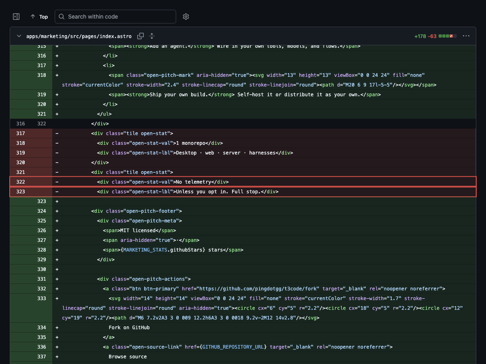

# Temu3 Code — Avant d'installer T3 Code

<p align="center">
  <em>Un registre public indépendant et fondé sur les preuves de pingdotgg/t3code — documentant des deux poids deux mesures raciaux, une télémétrie trompeuse, des failles de sécurité critiques et des manipulations commerciales.</em>
</p>

<p align="center">
  <a href="https://temu3code.com/?lang=fr"><strong>🌐 temu3code.com</strong></a> ·
  <a href="https://temu3code.com/mail/?lang=fr"><strong>✉ Boîte Tmail</strong></a> ·
  <a href="https://temu3code.com/?lang=fr#x-receipts"><strong>📸 12 captures X originales</strong></a> ·
  <a href="https://temu3code.com/memes/?lang=fr"><strong>🃏 61 mèmes</strong></a>
</p>
<p align="center">
  <a href="https://github.com/realchendahuang/temu3code/actions/workflows/verify.yml"></a> ·
  <a href="../EVIDENCE-INDEX.md"><strong>109 preuves</strong></a> ·
  <a href="../COMPLETE-SOURCE-INDEX.md"><strong>327 sources</strong></a>
</p>

<p align="center">
  <strong>Langues (18) :</strong><br />
  <a href="../../README.md">English</a> ·
  <a href="./README.zh-CN.md">简体中文</a> ·
  <a href="./README.zh-TW.md">繁體中文</a> ·
  <a href="./README.fr.md"><strong>Français</strong></a> ·
  <a href="./README.es.md">Español</a> ·
  <a href="./README.ru.md">Русский</a> ·
  <a href="./README.ar.md">العربية</a> ·
  <a href="./README.ja.md">日本語</a> ·
  <a href="./README.ko.md">한국어</a> ·
  <a href="./README.de.md">Deutsch</a> ·
  <a href="./README.pt-BR.md">Português</a> ·
  <a href="./README.it.md">Italiano</a> ·
  <a href="./README.nl.md">Nederlands</a> ·
  <a href="./README.pl.md">Polski</a> ·
  <a href="./README.tr.md">Türkçe</a> ·
  <a href="./README.vi.md">Tiếng Việt</a> ·
  <a href="./README.id.md">Bahasa Indonesia</a> ·
  <a href="./README.hi.md">हिन्दी</a>
</p>

> [!IMPORTANT]
> **Enquête indépendante sur registre public · 18 langues**
>
> Aucune télémétrie. Aucune discrimination raciale. Chaque affirmation ci-dessous est ancrée dans des déclarations publiques citées mot pour mot, des commits du dépôt, des pull requests, des dépôts USPTO et des captures d’écran archivées.
>
> - **Pièces vérifiées:** 20 pièces (n° 00–19)
> - **Preuves primaires:** 109 justificatifs visuels · 327 URL canoniques
> - **Vérification en amont:** [`9d3195b4`](https://github.com/pingdotgg/t3code/commit/9d3195b49dfb0098e9fa592fe0ada5464206d1c2) → [`ca81b7b9`](https://github.com/pingdotgg/t3code/commit/ca81b7b97a1c4b91e5ac25768d0f6629f37732fd) (`+259` commits · 2026-11-25 14:49 CST)
> - **Avis de sécurité:** 0 avis de sécurité GitHub publié

<!-- origin-story:start -->
> [!TIP]
> **Pourquoi « Temu3 Code » ?**
>
> Le 23 novembre 2026 — 10 minutes après avoir qualifié le fork MIT gratuit d’un développeur chinois de « Chinese knockoff » — @theo a généreusement offert notre nom de marque sur X : « Temu3 Code » (84k vues).
>
> Un branding offert par un fondateur avec 0 marques déposées à l’USPTO, c’était trop beau pour être gaspillé — nous avons donc enregistré temu3code.com, déplacé l’audit public chez nous et laissé de côté la télémétrie PostHog. Merci pour la consultation de naming gratuite, Theo. (CC0 1.0 — sentez-vous libres de nous forker en retour.) — [Voir le tweet de naming de @theo ↗](https://x.com/theo/status/2124825920808829077)
<!-- origin-story:end -->
---

## Comment cela s’est produit en 60 secondes

Un simple différend de nommage autour d’un fork MIT communautaire a mis au jour une série de deux poids deux mesures raciaux, une télémétrie dissimulée, des correctifs de sécurité silencieux et des risques architecturaux non corrigés.

1. **L’étincelle discriminatoire** *(23 nov. 2026)* — Après qu’un utilisateur a confondu le fork MIT gratuit d’un développeur chinois avec le T3 Code officiel, @theo l’a qualifié de « Chinese knockoff » et de « Temu3 Code » et a menacé de faire bannir son compte GitHub — alors qu’il ne détenait aucune marque déposée auprès de l’USPTO et qu’il avait publiquement salué, 11 heures plus tard, la copie du code MIT par des laboratoires américains à mille milliards de dollars.
2. **L’ouverture du code source** *(24 nov. 2026)* — L’inspection ligne par ligne de pingdotgg/t3code a révélé une télémétrie PostHog activée par défaut, contrairement à la promesse « No telemetry » affichée sur la page d’accueil ; une conservation des événements en source fermée sur ingest.t3.codes ; des lectures SHA-256 non salées de ~/.codex et ~/.claude.json ; une fausse suppression SQLite de 41,6 Go ; un bug de git push --force resté silencieux pendant 52 jours ; une usurpation d’en-tête Google Antigravity ; et un T3 Connect en clair, sans E2E.
3. **Plus de 2,26 M de vues, plainte RGPD dans l’UE et salve de panique de 6 heures** *(Nuit du 24 au 25 novembre)* — La partie 1 a dépassé 2,26 millions de vues et déclenché une plainte RGPD dans l’UE. Des PR d’urgence publiées pendant la nuit ont involontairement reconnu que des journaux d’IP + User-Agent à 2,2 M/h étaient conservés 30 jours dans Axiom, des fuites de chemins absolus d’espace de travail via git.cwd, une suppression de compte défaillante et le non-respect des désactivations sous Windows/macOS.
4. **Ce qui reste ouvert aujourd’hui** *(25 novembre (ca81b7b9) et suivi en cours)* — Le suivi de +259 commits jusqu’à ca81b7b9 a confirmé des correctifs partiels de télémétrie — mais aussi des écritures d’ID au démarrage non corrigées, l’absence totale de bascule dans l’interface, 0 avis de sécurité GitHub, l’ajout d’étoiles à des dépôts arbitraires non épinglés, des cookies de shell --lan en clair valables 30 jours, des jetons Bearer non révocables et l’exposition de SSH_AUTH_SOCK par des dépôts non approuvés (n° 19).

---

## Les 20 pièces vérifiées (n° 00–19)

Chaque pièce ci-dessous renvoie à son fichier de pièce localisé dédié et sans tableau dans ce dépôt, ainsi qu’à sa fiche visuelle partageable sur le portail web. Le suivi se poursuivra séquentiellement (n° 20, n° 21, ...).

### Partie I · Discrimination raciale, deux poids deux mesures et schéma récurrent

*Des menaces de retrait « Chinese knockoff » et « Temu3 Code », sans aucune marque USPTO, à une analyse quantitative de 1 151 tweets (0,0 % de grossièretés chez les VIP, 8,0 % d’hostilité envers les développeurs et 14,4 % de pic de crise antichinoise) et à un historique récurrent sur deux ans.*

- **#00 · [Litige sur l'origine : « Steal our code », menaces autour du nommage du fork et deux poids deux mesures raciaux](../../cases/fr/00-origin-fork-dispute-and-double-standard.md)** — `📌 Registre public`
  En l'espace de 11 minutes, @theo a qualifié le fork MIT gratuit d'un développeur chinois de « Chinese knockoff » et de « Temu3 Code », et a menacé de faire fermer son compte GitHub — avant d'accueillir publiquement, moins de 11 heures plus tard, le copiage de code MIT par des entreprises américaines à mille milliards de dollars.
  [Ouvrir la pièce complète](../../cases/fr/00-origin-fork-dispute-and-double-standard.md) · [Fiche interactive](https://temu3code.com/mail/?thread=2026-11-23-origin-temu3-threat&lang=fr) · [Publication X d’origine](https://x.com/realchendahuang/status/2125062675147448475)
- **#14 · [Jeu de données quantitatif de 1 151 tweets : politesse sélective et pic de crise antichinois de 4,0×](../../cases/fr/14-1151-tweet-quantitative-double-standard.md)** — `📌 Registre public`
  Analyse quantitative exhaustive de 1 151 publications consécutives de @theo sur X (7–24 novembre 2026) qui démontre une asymétrie de pouvoir flagrante : 0,0 % d'injures envers 20 dirigeants de la big tech et membres de laboratoires, contre 8,0 % d'hostilité envers de simples développeurs — un taux multiplié par 4,0 pour atteindre 14,4 % pendant le conflit de 25 heures autour du fork chinois.
  [Ouvrir la pièce complète](../../cases/fr/14-1151-tweet-quantitative-double-standard.md) · [Fiche interactive](https://temu3code.com/mail/?thread=2026-11-19-selective-politeness-vips&lang=fr) · [Publication X d’origine](https://x.com/realchendahuang/status/2125404517697290438)
- **#15 · [Aucune marque déposée à l'USPTO derrière la menace de bannissement GitHub, et un `TRADEMARK.md` rétroactif en 17 heures](../../cases/fr/15-zero-uspto-trademarks-and-retroactive-policy.md)** — `📌 Registre public`
  Quand @theo a menacé de contacter GitHub pour faire supprimer le compte d'un développeur chinois pour "trademark infringement", T3 Tools Inc. ne détenait aucun enregistrement à l'USPTO pour `T3 Code`, `T3 Tools` ou `T3 Connect` — et a fusionné `TRADEMARK.md` de façon rétroactive 17 heures plus tard.
  [Ouvrir la pièce complète](../../cases/fr/15-zero-uspto-trademarks-and-retroactive-policy.md) · [Fiche interactive](https://temu3code.com/mail/?thread=2026-11-24-retroactive-trademark-blocker&lang=fr) · [Publication X d’origine](https://x.com/realchendahuang/status/2125408163273080950)
- **#16 · [Un schéma historique sur deux ans : les représailles fondées sur la nationalité, la prime FFmpeg de 20 000 $ et les menaces supprimées](../../cases/fr/16-two-year-pattern-of-bullying-and-deletions.md)** — `📌 Registre public`
  L'éclat de novembre 2026 autour du fork chinois n'était pas un dérapage isolé — les archives publiques de 2024 à 2026 documentent un cycle récurrent de harcèlement ciblé sur la nationalité, d'intimidation envers l'open source, de moqueries visant les interfaces d'autres développeurs et de suppressions après les représailles.
  [Ouvrir la pièce complète](../../cases/fr/16-two-year-pattern-of-bullying-and-deletions.md) · [Fiche interactive](https://temu3code.com/mail/?thread=2025-10-ffmpeg-bounty&lang=fr) · [Publication X d’origine](https://x.com/realchendahuang/status/2125408843152953693)

### Partie II · Télémétrie trompeuse et atteintes à la vie privée

*Comment « No telemetry. Full stop. » a masqué des envois PostHog par défaut, une conservation en source fermée sur ingest.t3.codes, le hachage d’identifiants entre outils, des angles morts de Managed Policy et des journaux Axiom marqués par IP à 2,2 M/h.*

- **#01 · [La télémétrie par défaut derrière une promesse « Zéro télémétrie » affichée en page d'accueil](../../cases/fr/01-default-telemetry-and-cross-tool-tracking.md)** — `🟡 Partiellement corrigé`
  Alors que sa page d'accueil promettait « No telemetry. Unless you opt in. Full stop. », T3 Code a activé un pistage PostHog par défaut, fait transiter des copies brutes par le service closed-source `ingest.t3.codes`, haché les identifiants externes de `~/.codex` et `~/.claude.json`, et rejeté quatre PR communautaires de désactivation.
  [Ouvrir la pièce complète](../../cases/fr/01-default-telemetry-and-cross-tool-tracking.md) · [Fiche interactive](https://temu3code.com/mail/?thread=2026-03-06-pr174-default-telemetry&lang=fr) · [Publication X d’origine](https://x.com/realchendahuang/status/2125153472450527440)
- **#07 · [La contradiction du dispositif Managed Policy : quatre angles morts documentés de la télémétrie](../../cases/fr/07-managed-policy-blind-spots.md)** — `🔴 Non corrigé`
  @theo affirmait que T3 Code disposait du "best corporate managed policy system", ce qui rendait "trivial to turn off all telemetry" — une affirmation directement contredite par les propres fichiers `docs/user/telemetry.md` et `docs/user/managed-policy.md` de T3 Code.
  [Ouvrir la pièce complète](../../cases/fr/07-managed-policy-blind-spots.md) · [Fiche interactive](https://temu3code.com/mail/?thread=2026-11-24-managed-policy-plaintext-relay&lang=fr) · [Publication X d’origine](https://x.com/realchendahuang/status/2125391659492081947)
- **#11 · [La clarification du 25 novembre contredite en moins de 2 heures par des PR nocturnes et un dump de 100 Mo](../../cases/fr/11-nov25-clarification-contradicted-in-2-hours.md)** — `🟡 Partiellement corrigé`
  Le matin du 25 novembre, @theo a formulé trois assurances générales sur la confidentialité et publié un dump de télémétrie de 100 Mo — les trois affirmations ont été contredites en moins de deux heures par les PR de sa propre équipe et par le dump gzippé lui-même.
  [Ouvrir la pièce complète](../../cases/fr/11-nov25-clarification-contradicted-in-2-hours.md) · [Fiche interactive](https://temu3code.com/mail/?thread=2026-11-25-gdpr-overnight-collapse&lang=fr) · [Publication X d’origine](https://x.com/realchendahuang/status/2125394810559426993)
- **#12 · [Blitz nocturne de six heures après le RGPD : 2,2 M de journaux d'IP par heure et suppression de compte défaillante](../../cases/fr/12-post-gdpr-overnight-blitz-2m-ip-logs.md)** — `🟡 Partiellement corrigé`
  Après le dépôt d'une plainte formelle auprès du RGPD de l'UE le 24 novembre, six heures de correctifs d'urgence passés en pleine nuit ont involontairement mis au jour quatre révélations plus profondes sur la vie privée — à commencer par 2,2 millions de spans Axiom étiquetés par IP par heure, conservés pendant 30 jours.
  [Ouvrir la pièce complète](../../cases/fr/12-post-gdpr-overnight-blitz-2m-ip-logs.md) · [Fiche interactive](https://temu3code.com/mail/?thread=2026-11-25-gdpr-overnight-collapse&lang=fr) · [Publication X d’origine](https://x.com/realchendahuang/status/2125395501663281198)

### Partie III · Défauts produit et failles de sécurité critiques

*Fausse suppression SQLite de 41,6 Go, analyse des processus du système d’exploitation toutes les 5 secondes, git push --force silencieux pendant 52 jours, usurpation des ToS de Google Antigravity provoquant des bannissements de 3 minutes, T3 Connect en clair sans E2E, 0 avis de sécurité et vulnérabilités LAN/Bearer/SSH_AUTH_SOCK de ca81b7b9.*

- **#02 · [Suppression factice des fils dans SQLite (gonflement à 41.6 GB) et scan de tous les processus du système toutes les 5 secondes](../../cases/fr/02-fake-sqlite-delete-and-process-scanner.md)** — `🟡 Partiellement corrigé`
  Cliquer sur "permanently delete" laissait l'intégralité de l'historique de conversation intact dans `statev2.sqlite` (gonflant les disques locaux jusqu'à 41.6 GB), tandis qu'un moniteur Rust en arrière-plan scannait chaque processus du système et chaque ligne de commande complète toutes les 5 secondes, sans aucun moyen de refuser.
  [Ouvrir la pièce complète](../../cases/fr/02-fake-sqlite-delete-and-process-scanner.md) · [Fiche interactive](https://temu3code.com/mail/?thread=2026-10-28-fake-delete-process-spy&lang=fr) · [Publication X d’origine](https://x.com/realchendahuang/status/2125160473176023486)
- **#03 · [52 jours de silence sur un `git push --force` contre 21 heures pour retirer le filtre de confidentialité des modèles](../../cases/fr/03-silent-force-push-vs-21h-filter-removal.md)** — `🔴 Non corrigé`
  Pendant plus de 52 jours, T3 Code a laissé ouvert un bug dans lequel le mode Auto de Claude approuvait silencieusement `git push --force origin main` sans demander de confirmation — alors qu'il n'a fallu que 21 heures pour retirer une liste blanche de confidentialité, afin que des modèles privés apparaissent sur le classement public de @theo.
  [Ouvrir la pièce complète](../../cases/fr/03-silent-force-push-vs-21h-filter-removal.md) · [Fiche interactive](https://temu3code.com/mail/?thread=2026-10-03-issue15353-force-push&lang=fr) · [Publication X d’origine](https://x.com/realchendahuang/status/2125201882687881378)
- **#04 · [Usurpation d'en-têtes Google Antigravity, fausse `SSH_CONNECTION` et bannissements de compte en 3 minutes](../../cases/fr/04-antigravity-spoofing-and-3-minute-bans.md)** — `🔴 Non corrigé`
  Bien que sa FAQ garantisse le respect des conditions d'utilisation, T3 Code extrait les identifiants du trousseau de l'OS, usurpe des en-têtes internes de Google (`antigravity/hub/2.24.0`) face à `v1internal` et injecte de fausses valeurs `SSH_CONNECTION` — exposant les abonnements Google personnels à des bannissements rapides.
  [Ouvrir la pièce complète](../../cases/fr/04-antigravity-spoofing-and-3-minute-bans.md) · [Fiche interactive](https://temu3code.com/mail/?thread=2026-11-22-antigravity-spoof-3min-ban&lang=fr) · [Publication X d’origine](https://x.com/realchendahuang/status/2125213397507858657)
- **#05 · [T3 Connect : chiffrement de bout en bout inexistant et passerelle de terminaison TLS en clair](../../cases/fr/05-t3-connect-zero-e2e-plaintext-relay.md)** — `🔴 Non corrigé`
  Chaque prompt, fichier source et flux de terminal acheminé par T3 Connect aboutit en clair dans l'infrastructure contrôlée par T3 — sans aucun chiffrement de bout en bout et avec une approbation d'appareil désactivée par défaut.
  [Ouvrir la pièce complète](../../cases/fr/05-t3-connect-zero-e2e-plaintext-relay.md) · [Fiche interactive](https://temu3code.com/mail/?thread=2026-11-24-managed-policy-plaintext-relay&lang=fr) · [Publication X d’origine](https://x.com/realchendahuang/status/2125218189596676555)
- **#13 · [Zéro avis de sécurité GitHub, correctifs critiques silencieux et `SECURITY.md` rédigé dans la précipitation](../../cases/fr/13-zero-security-advisories-and-silent-patches.md)** — `🔴 Non corrigé`
  Tout en dénigrant sur X les auditeurs de code source chinois, T3 Code a discrètement fusionné des correctifs de vulnérabilités de gravité élevée — dont une traversée de répertoire dans le magasin de secrets, des fuites de jetons entre domaines et l'exécution de commandes issues de dépôts non fiables — tout en maintenant à 0 le nombre d'avis de sécurité GitHub publiés.
  [Ouvrir la pièce complète](../../cases/fr/13-zero-security-advisories-and-silent-patches.md) · [Fiche interactive](https://temu3code.com/mail/?thread=2026-11-25-ca81b7b9-active-vulns&lang=fr) · [Publication X d’origine](https://x.com/realchendahuang/status/2125395980354994414)
- **#19 · [Audit critique de l'authentification et de l'exécution de dépôts : shell LAN en clair pendant 30 jours, jetons non révocables et exposition de `SSH_AUTH_SOCK`](../../cases/fr/19-ca81b7b9-lan-cookie-bearer-ws-and-repo-rce.md)** — `🔴 Non corrigé`
  La vérification ligne par ligne du dernier HEAD de `main` (`ca81b7b9`, 25 nov. 14:49 CST) a confirmé cinq failles de sécurité et de fiabilité actives : cookies de shell `--lan` en clair pendant 30 jours avec contournement en l'absence d'en-tête `Origin`, jetons Bearer de 30 jours non révocables, URLs `?wsTicket=` rejouables, `isIPv4` qui tue les tunnels `::1`, et des dépôts non fiables exécutant des hooks et des sous-modules avec héritage de `SSH_AUTH_SOCK` et de `GITHUB_TOKEN`.
  [Ouvrir la pièce complète](../../cases/fr/19-ca81b7b9-lan-cookie-bearer-ws-and-repo-rce.md) · [Fiche interactive](https://temu3code.com/mail/?thread=2026-11-25-ca81b7b9-active-vulns&lang=fr) · [Publication X d’origine](https://x.com/realchendahuang/status/2125494234614788390)

### Partie IV · Manipulation commerciale et harcèlement communautaire

*Le radar de calcul quotidien à plus de 800 k$ / 31,7 T de tokens, les conflits d’intérêts liés aux business angels (Vibe Kanban, Daytona), les recoupements entre sponsors, l’ajout d’étoiles à des dépôts avec identifiants de l’hôte après 30 secondes d’inactivité, à l’origine de 77 k stars, le scraping de forks par @bot et les bannissements via .github/VOUCHED.td.*

- **#06 · [Conflits d’investisseur providentiel : moqueries sur l’arrêt de Vibe Kanban et chevauchement avec Daytona](../../cases/fr/06-angel-investor-conflicts-vibe-kanban-daytona.md)** — `📌 Registre public`
  Au-delà des défauts de code, les publications publiques de @theo sur X documentent de nets conflits entre son rôle d’investisseur providentiel dans des startups de développement concurrentes et l’exploitation de T3 Code.
  [Ouvrir la pièce complète](../../cases/fr/06-angel-investor-conflicts-vibe-kanban-daytona.md) · [Fiche interactive](https://temu3code.com/mail/?thread=2026-11-16-vibe-kanban-daytona&lang=fr) · [Publication X d’origine](https://x.com/realchendahuang/status/2125385742243520653)
- **#08 · [Le grand livre d'affaires à plus de 800 000 $ et le radar de calcul quotidien de 31,7 billions de tokens](../../cases/fr/08-800k-spend-and-31t-token-radar.md)** — `📌 Registre public`
  La télémétrie activée par défaut n'était pas une négligence d'ingénierie : elle finançait un radar de renseignement en temps réel à 31,7 billions de tokens par jour (soit 10,19 M$ par jour de dépenses API équivalentes), monnayé contre plus de 300 k$ de tokens OpenAI d'accès anticipé gratuits et des sollicitations d'investisseurs.
  [Ouvrir la pièce complète](../../cases/fr/08-800k-spend-and-31t-token-radar.md) · [Fiche interactive](https://temu3code.com/mail/?thread=2026-11-18-31t-token-radar&lang=fr) · [Publication X d’origine](https://x.com/realchendahuang/status/2125392410763239723)
- **#09 · [`yolo merges` internes vs. hostilité envers la communauté externe et bannissements via `.github/VOUCHED.td`](../../cases/fr/09-yolo-merges-vs-community-hostility.md)** — `📌 Registre public`
  En interne, T3 Code livrait 500 commits/jour via des boucles d'agents automatisées et admettait « yolo merges breaking shit » — tandis qu'en externe, il expliquait aux contributeurs « here's my advice: Don't », dénonçait des utilisateurs via `.github/VOUCHED.td` et insultait les personnes qui ouvraient des issues.
  [Ouvrir la pièce complète](../../cases/fr/09-yolo-merges-vs-community-hostility.md) · [Fiche interactive](https://temu3code.com/mail/?thread=2026-11-09-issue33639-bermudi-insult&lang=fr) · [Publication X d’origine](https://x.com/realchendahuang/status/2125392916369871309)
- **#10 · [Scraping public de fork par `@bot`, moqueries envers les concurrents et étouffement des critiques](../../cases/fr/10-fork-scraping-bot-and-critics-suppression.md)** — `📌 Registre public`
  Alors qu'il raillait les rivaux qui copient ses schémas d'interface, `@theo` a publiquement répondu "Okay I'm stealing this" à une développeuse qui avait forké son projet, puis a dépêché `@bot` 30 secondes plus tard pour aspirer son code — tout en déployant des bloqueurs automatiques et en exhortant ses abonnés à démonétiser ses critiques.
  [Ouvrir la pièce complète](../../cases/fr/10-fork-scraping-bot-and-critics-suppression.md) · [Fiche interactive](https://temu3code.com/mail/?thread=2026-11-08-stealing-miaai-fork&lang=fr) · [Publication X d’origine](https://x.com/realchendahuang/status/2125393641665671593)
- **#17 · [Les liens du stack de sponsors, l'exploit du quota à 0 % de Codex et l'hypocrisie du `CLIProxyAPI` à 10 comptes](../../cases/fr/17-sponsor-stack-and-quota-exploit-hypocrisy.md)** — `📌 Registre public`
  Tandis qu'il prêche la conformité et refuse l'ajout d'un changement de compte intégré au nom des risques de bannissement, T3 Code intègre les sponsors YouTube de @theo (Clerk et Axiom) dans son stack cloud, alors que @theo se vantait d'exploiter le bug du quota à 0 % de Codex et publiait un Gist de mutualisation `CLIProxyAPI` à 10 comptes, lié directement depuis la FAQ de T3.
  [Ouvrir la pièce complète](../../cases/fr/17-sponsor-stack-and-quota-exploit-hypocrisy.md) · [Fiche interactive](https://temu3code.com/mail/?thread=2023-05-sponsor-roster&lang=fr) · [Publication X d’origine](https://x.com/realchendahuang/status/2125411353393553744)
- **#18 · [L’entonnoir des 77 000 étoiles : ajout d’une étoile après 30 s d’inactivité via les identifiants de l’hôte et bug non corrigé d’ajout d’étoile à un dépôt arbitraire](../../cases/fr/18-77k-star-funnel-and-arbitrary-repo-starring.md)** — `🔴 Non corrigé`
  Six mois après avoir dénoncé les étoiles GitHub comme un moyen "to trick VCs into investing", @theo a fusionné lui-même une notification dans l’application, déclenchée après 30 secondes d’inactivité, qui exécute `PUT user/starred/...` avec les identifiants GitHub de l’hôte — faisant bondir le dépôt de 30 k à 77 k étoiles (avec ~129 watchers) tout en laissant non corrigé un bug d’ajout d’étoile à un dépôt arbitraire.
  [Ouvrir la pièce complète](../../cases/fr/18-77k-star-funnel-and-arbitrary-repo-starring.md) · [Fiche interactive](https://temu3code.com/mail/?thread=2026-11-02-pr29922-77k-stars&lang=fr) · [Publication X d’origine](https://x.com/realchendahuang/status/2125416210120765799)

---

## Principaux justificatifs visuels





---

## Guide de durcissement et de nettoyage en 2 minutes

Si T3 Code est déjà installé sur votre machine, ne vous fiez pas aux seules variables d’environnement — AnalyticsService.ts:156 écrit un identifiant local avant de vérifier les désactivations, et DesktopShellEnvironment.ts omet OTEL_SDK_DISABLED. Combinez les indicateurs d’environnement, le blocage via le fichier hosts du système, la compaction hors ligne de SQLite et la révocation des jetons.

- [ ] Exportez DO_NOT_TRACK=1 et les interrupteurs d’arrêt de télémétrie hérités, puis neutralisez ingest.t3.codes dans /etc/hosts.
- [ ] Quittez T3 Code, inspectez statev2.sqlite, exécutez VACUUM; en mode hors ligne, ou supprimez complètement ~/.t3.
- [ ] Cessez d’utiliser des comptes Google AI / Antigravity personnels via les répertoires gérés par T3 pour préserver votre unique possibilité de recours.
- [ ] Désactivez « Publish agent activity », dissociez les machines T3 Connect, demandez la suppression des données Clerk + relay et révoquez l’application OAuth GitHub de T3 Code.
- [ ] N’exposez jamais t3 up --lan en clair sans TLS, évitez les jetons Bearer non-DPoP valables 30 jours dans la CI, et nettoyez SSH_AUTH_SOCK / GITHUB_TOKEN avant d’ouvrir des dépôts non approuvés.

```bash
# macOS / Linux: combine DO_NOT_TRACK=1 with legacy flags + /etc/hosts sinkhole
export DO_NOT_TRACK=1
export T3CODE_TELEMETRY_ENABLED=false
export T3CODE_OTEL_SDK_DISABLED=true
export OTEL_SDK_DISABLED=true
sudo sh -c 'printf "\n127.0.0.1 ingest.t3.codes\n::1 ingest.t3.codes\n" >> /etc/hosts'

# Quit T3 Code first, then compact statev2.sqlite or clean local directories
sqlite3 ~/.t3/userdata/statev2.sqlite "VACUUM;"
rm -rf ~/.t3/userdata/providers/antigravity/ ~/.t3/tools/antigravity-acp/
```

**Alternatives recommandées par la communauté:** Des développeurs ont cité Mirasim (@Mirasim_ADE), Paseo (@paseo_sh), Paradev (@ParadevAI), Cloudroom, Conductor, Emdash et Orca. Avant d’adopter un client, vérifiez que la télémétrie est désactivée par défaut, que la suppression locale est effective, que la délégation officielle au CLI se fait sans usurpation d’en-tête et que le chiffrement E2E est assuré côté client.

---

## Signalements de la communauté et commentaires indépendants

Les 20 pièces numérotées (n° 00–19) contiennent strictement du code, des pull requests, des documents officiels et des publications publiques archivées, tous vérifiables publiquement. Les contributions de la communauté et les allégations issues de messages privés sont séparées ici par souci de clarté probatoire.

- **Issue n° 1 · « The Case Against Theo » (@opserx)** — Archive mot pour mot des commentaires de la communauté soumis à ce dépôt le 25 novembre 2026, accompagnée de notes de précision issues de sources primaires sur la PR n° 42450 et la PR n° 41237. ([Lire l’issue n° 1 archivée](../community/issue-1-the-case-against-theo.md))
- **Plaintes par messages privés et soumissions en cours** — Plusieurs développeurs ont envoyé des récits privés de leur expérience avec @theo et T3 Code. Pour respecter des normes de vérification strictes, les signalements privés restent séparés du dossier principal des pièces n° 00–19, sauf s’ils sont corroborés de manière indépendante par des artefacts publics. Soumettez des constats vérifiables ou des confirmations de correctifs en amont via une pull request ou une issue GitHub. ([Politique de soumission et de vérification](../../CONTRIBUTING.md))

---

## Dossiers techniques approfondis et index principaux

Pour les diffs de code source ligne par ligne, le SQL mot pour mot et les catalogues complets avec renvois croisés, explorez les archives de référence conservées :

- [Dossier 01 · Telemetry Architecture, Cross-Tool Stitching & GDPR Sprint](../dossiers/01-telemetry-and-gdpr-timeline.md)
- [Dossier 02 · Local Safety, Guardrail Bypasses & Undisclosed Security Patches](../dossiers/02-local-safety-and-security-audit.md)
- [Dossier 03 · Google Antigravity ToS Spoofing & T3 Connect Plaintext Relay](../dossiers/03-antigravity-tos-and-t3connect-relay.md)
- [Dossier 04 · Business Ledger, Investor Conflicts, Sponsors & 77k-Star Funnel](../dossiers/04-business-ledger-sponsors-and-77k-stars.md)
- [Dossier 05 · Governance, Fork-Scraping Bots, USPTO Trademark Record & History](../dossiers/05-governance-trademark-and-history.md)
- [Dossier 06 · 1,151-Tweet Quantitative Forensic Dataset](../dossiers/06-tweet-forensic-dataset-1151.md)
- [109 justificatifs visuels (`docs/EVIDENCE-INDEX.md`)](../EVIDENCE-INDEX.md)
- [327 sources primaires (`docs/COMPLETE-SOURCE-INDEX.md`)](../COMPLETE-SOURCE-INDEX.md)

### Suivi continu et contributions

Ce dépôt est activement maintenu. Les corrections factuelles, les correctifs amont récemment fusionnés avec preuve par commit/PR ou les nouvelles preuves primaires sont les bienvenus via une pull request ou une issue GitHub — voir CONTRIBUTING.md.
