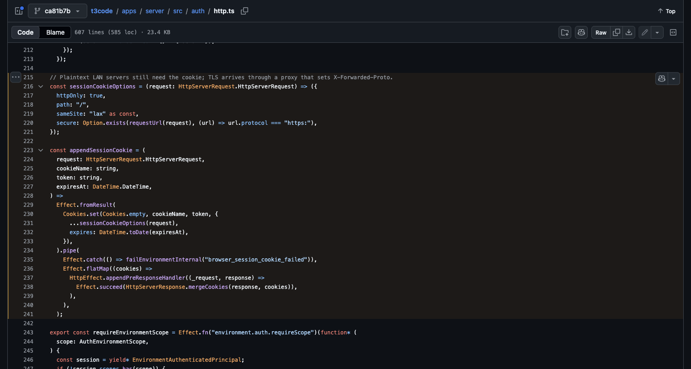

# Temu3 Code — Sebelum Memasang T3 Code

<p align="center">
  <em>Catatan publik independen yang mengutamakan bukti atas pingdotgg/t3code — mendokumentasikan standar ganda rasial, telemetri yang menyesatkan, cacat keamanan kritis, dan manipulasi komersial.</em>
</p>

<p align="center">
  <a href="https://temu3code.com/?lang=id"><strong>🌐 temu3code.com</strong></a> ·
  <a href="https://temu3code.com/mail/?lang=id"><strong>✉ Kotak Masuk Tmail</strong></a> ·
  <a href="https://temu3code.com/?lang=id#x-receipts"><strong>📸 12 Foto X Asli</strong></a> ·
  <a href="https://temu3code.com/memes/?lang=id"><strong>🃏 61 Meme</strong></a>
</p>
<p align="center">
  <a href="https://github.com/realchendahuang/temu3code/actions/workflows/verify.yml"></a> ·
  <a href="../EVIDENCE-INDEX.md"><strong>109 Bukti</strong></a> ·
  <a href="../COMPLETE-SOURCE-INDEX.md"><strong>327 Sumber</strong></a>
</p>

<p align="center">
  <strong>Bahasa (18):</strong><br />
  <a href="../../README.md">English</a> ·
  <a href="./README.zh-CN.md">简体中文</a> ·
  <a href="./README.zh-TW.md">繁體中文</a> ·
  <a href="./README.fr.md">Français</a> ·
  <a href="./README.es.md">Español</a> ·
  <a href="./README.ru.md">Русский</a> ·
  <a href="./README.ar.md">العربية</a> ·
  <a href="./README.ja.md">日本語</a> ·
  <a href="./README.ko.md">한국어</a> ·
  <a href="./README.de.md">Deutsch</a> ·
  <a href="./README.pt-BR.md">Português</a> ·
  <a href="./README.it.md">Italiano</a> ·
  <a href="./README.nl.md">Nederlands</a> ·
  <a href="./README.pl.md">Polski</a> ·
  <a href="./README.tr.md">Türkçe</a> ·
  <a href="./README.vi.md">Tiếng Việt</a> ·
  <a href="./README.id.md"><strong>Bahasa Indonesia</strong></a> ·
  <a href="./README.hi.md">हिन्दी</a>
</p>


> [!IMPORTANT]
> **Investigasi Catatan Publik Independen · 18 Bahasa**
>
> Tanpa telemetri. Tanpa diskriminasi rasial. Setiap klaim di bawah ini berpangkal pada pernyataan publik yang verbatim, commit repositori, pull request, berkas USPTO, dan tangkapan layar yang diarsipkan.
>
> - **Bukti terverifikasi:** 20 Bukti (#00–#19)
> - **Bukti primer:** 109 Bukti Visual · 327 URL Kanonik
> - **Pemeriksaan upstream:** [`9d3195b4`](https://github.com/pingdotgg/t3code/commit/9d3195b49dfb0098e9fa592fe0ada5464206d1c2) → [`ca81b7b9`](https://github.com/pingdotgg/t3code/commit/ca81b7b97a1c4b91e5ac25768d0f6629f37732fd) (`+259` commits · 2026-11-25 14:49 CST)
> - **Advisori keamanan:** 0 Advisori GitHub yang Diterbitkan


<!-- origin-story:start -->
> [!TIP]
> **Kenapa "Temu3 Code"?**
>
> Pada 23 Nov 2026 — 10 menit setelah menyebut fork gratis dari developer China sebagai "Chinese knockoff" — @theo dengan murah hati memberikan nama brand kami di X: "Temu3 Code" (84k views).
>
> Gratisnya nama brand dari founder yang punya 0 USPTO trademarks terlalu bagus untuk disia-siakan — jadi kami mendaftarkan temu3code.com, memindahkan audit publik ke sana, dan tidak pasang telemetry PostHog. Terima kasih atas konsultasi penamaan gratis, Theo. (CC0 1.0 — silakan fork kami balik.) — [Lihat tweet penamaan @theo ↗](https://x.com/theo/status/2124825920808829077)
<!-- origin-story:end -->
---

## Bagaimana Ini Terjadi dalam 60 Detik

Satu sengketa penamaan atas fork MIT komunitas mengungkap pola standar ganda rasial, telemetri tersembunyi, tambalan keamanan senyap, dan risiko arsitektural yang belum diperbaiki.

1. **Percikan diskriminatif** *(23 Nov 2026)* — Setelah seorang pengguna keliru mengira fork MIT gratis milik pengembang Tiongkok sebagai T3 Code resmi, @theo menyebutnya "tiruan Tiongkok" dan "Temu3 Code" serta mengancam akan memblokir akun GitHub — padahal ia tidak memegang satu pun merek dagang USPTO dan secara terbuka menyambut laboratorium AS bernilai triliunan dolar yang menyalin kode MIT 11 jam kemudian.
2. **Membuka kode sumber** *(24 Nov 2026)* — Pemeriksaan baris demi baris atas pingdotgg/t3code mengungkap telemetri PostHog yang aktif secara bawaan di balik janji halaman depan "Tanpa telemetri", retensi peristiwa sumber tertutup di ingest.t3.codes, pembacaan SHA-256 tanpa salt atas ~/.codex dan ~/.claude.json, penghapusan SQLite palsu sebesar 41,6 GB, bug git push --force senyap selama 52 hari, pemalsuan header Google Antigravity, dan T3 Connect teks polos tanpa E2E.
3. **2,26 juta+ tayangan, pengaduan GDPR UE & gempuran panik 6 jam** *(Semalam 24–25 Nov)* — Bagian 1 melewati 2,26 juta tayangan dan memicu pengaduan GDPR UE. PR darurat tengah malam tanpa sengaja mengakui log IP + User-Agent 2,2 juta/jam yang disimpan 30 hari di Axiom, kebocoran jalur workspace absolut git.cwd, penghapusan akun yang rusak, dan pengabaian opt-out Windows/macOS.
4. **Yang masih terbuka hari ini** *(25 Nov (`ca81b7b9`) & Berlanjut)* — Pelacakan +259 commit hingga ca81b7b9 mengonfirmasi tambalan telemetri sebagian — disertai penulisan ID saat startup yang belum diperbaiki, tidak ada tombol di UI, 0 Advisori Keamanan GitHub, pemberian bintang ke repositori sembarang tanpa pin, cookie shell --lan teks polos berumur 30 hari, token Bearer yang tak dapat dicabut, dan paparan SSH_AUTH_SOCK pada repositori tak tepercaya (#19).

---

## Semua 20 Bukti Terverifikasi (#00–#19)

Setiap bukti di bawah ini tertaut ke berkas bukti terlokalisasi khusus yang tanpa tabel di repositori ini serta kartu visual yang dapat dibagikan di portal web. Pelacakan berkelanjutan akan berlanjut secara berurutan (#20, #21, ...).

### Bagian I · Diskriminasi Rasial, Standar Ganda & Pola

*Dari ancaman penurunan "tiruan Tiongkok" dan "Temu3 Code" tanpa satu pun merek dagang USPTO, hingga pemilahan kuantitatif 1.151 tweet (0,0% makian terhadap VIP vs. 8,0% permusuhan terhadap pengembang vs. 14,4% lonjakan krisis anti-Tiongkok) dan riwayat berulang selama dua tahun.*

- **#00 · [Sengketa Asal-Usul: "Steal Our Code", Ancaman Penamaan Fork & Standar Ganda Rasial](../../cases/id/00-origin-fork-dispute-and-double-standard.md)** — `📌 Catatan Publik`
  Dalam waktu 11 menit, @theo menyebut fork MIT gratis milik pengembang Tiongkok sebagai "Chinese knockoff" dan "Temu3 Code" serta mengancam akan memblokir akun GitHub — lalu secara terbuka menyambut perusahaan-perusahaan Amerika bernilai triliunan dolar yang menyalin kode MIT kurang dari 11 jam kemudian.
  [Buka bukti lengkap](../../cases/id/00-origin-fork-dispute-and-double-standard.md) · [Kartu interaktif](https://temu3code.com/mail/?thread=2026-11-23-origin-temu3-threat&lang=id) · [Unggahan X asli](https://x.com/realchendahuang/status/2125062675147448475)
- **#14 · [Dataset Kuantitatif 1.151 Tweet: Kesopanan Selektif & Lonjakan Krisis Anti-Tiongkok 4,0×](../../cases/id/14-1151-tweet-quantitative-double-standard.md)** — `📌 Catatan Publik`
  Analisis kuantitatif menyeluruh atas 1.151 unggahan @theo di X secara berurutan (7–24 November 2026) membuktikan asimetri kekuasaan yang mencolok: 0,0% makian terhadap 20 eksekutif big-tech dan staf lab vs. 8,0% permusuhan terhadap pengembang biasa — melonjak 4,0× menjadi 14,4% selama perselisihan fork Tiongkok berdurasi 25 jam.
  [Buka bukti lengkap](../../cases/id/14-1151-tweet-quantitative-double-standard.md) · [Kartu interaktif](https://temu3code.com/mail/?thread=2026-11-19-selective-politeness-vips&lang=id) · [Unggahan X asli](https://x.com/realchendahuang/status/2125404517697290438)
- **#15 · [Nol Merek Dagang USPTO di Balik Ancaman Larangan GitHub & `TRADEMARK.md` yang Dibuat Surut 17 Jam Kemudian](../../cases/id/15-zero-uspto-trademarks-and-retroactive-policy.md)** — `📌 Catatan Publik`
  Ketika @theo mengancam akan menghubungi GitHub untuk menangguhkan akun seorang pengembang Tiongkok karena "pelanggaran merek dagang", T3 Tools Inc. tidak memiliki satu pun pendaftaran USPTO untuk `T3 Code`, `T3 Tools`, atau `T3 Connect` — dan menggabungkan `TRADEMARK.md` secara surut 17 jam kemudian.
  [Buka bukti lengkap](../../cases/id/15-zero-uspto-trademarks-and-retroactive-policy.md) · [Kartu interaktif](https://temu3code.com/mail/?thread=2026-11-24-retroactive-trademark-blocker&lang=id) · [Unggahan X asli](https://x.com/realchendahuang/status/2125408163273080950)
- **#16 · [Pola Historis Dua Tahun: Serangan Balik Bernuansa Kebangsaan, Bounty FFmpeg $20k & Ancaman yang Dihapus](../../cases/id/16-two-year-pattern-of-bullying-and-deletions.md)** — `📌 Catatan Publik`
  Ledakan emosional fork China pada November 2026 bukan kekhilafan yang berdiri sendiri — catatan publik dari 2024 hingga 2026 mendokumentasikan siklus berulang berupa pelecehan yang menyasar kebangsaan, perundungan open-source, olok-olok terhadap UI pengembang lain, dan penghapusan unggahan setelah serangan balik.
  [Buka bukti lengkap](../../cases/id/16-two-year-pattern-of-bullying-and-deletions.md) · [Kartu interaktif](https://temu3code.com/mail/?thread=2025-10-ffmpeg-bounty&lang=id) · [Unggahan X asli](https://x.com/realchendahuang/status/2125408843152953693)

### Bagian II · Telemetri Menyesatkan & Pelanggaran Privasi

*Bagaimana "Tanpa telemetri. Titik." menyembunyikan unggahan PostHog bawaan, retensi ingest.t3.codes yang sumber tertutup, hashing kredensial lintas alat, titik buta Managed Policy, dan log Axiom bertanda IP sebanyak 2,2 juta/jam.*

- **#01 · [Telemetri Default di Balik Janji "No Telemetry" pada Halaman Depan](../../cases/id/01-default-telemetry-and-cross-tool-tracking.md)** — `🟡 Sebagian Ditambal`
  Saat halaman depannya menjanjikan *"No telemetry. Unless you opt in. Full stop."*, T3 Code mengaktifkan pelacakan PostHog secara default, mengalirkan salinan mentah lewat `ingest.t3.codes` yang closed-source, melakukan hashing terhadap kredensial eksternal `~/.codex` dan `~/.claude.json`, serta menolak empat PR opt-out dari komunitas.
  [Buka bukti lengkap](../../cases/id/01-default-telemetry-and-cross-tool-tracking.md) · [Kartu interaktif](https://temu3code.com/mail/?thread=2026-03-06-pr174-default-telemetry&lang=id) · [Unggahan X asli](https://x.com/realchendahuang/status/2125153472450527440)
- **#07 · [Kontradiksi Managed Policy: Empat Titik Buta Telemetri yang Terdokumentasi](../../cases/id/07-managed-policy-blind-spots.md)** — `🔴 Belum Diperbaiki`
  @theo mengklaim T3 Code punya "best corporate managed policy system" sehingga "trivial to turn off all telemetry" — dikontradiksi langsung oleh `docs/user/telemetry.md` dan `docs/user/managed-policy.md` milik T3 Code sendiri.
  [Buka bukti lengkap](../../cases/id/07-managed-policy-blind-spots.md) · [Kartu interaktif](https://temu3code.com/mail/?thread=2026-11-24-managed-policy-plaintext-relay&lang=id) · [Unggahan X asli](https://x.com/realchendahuang/status/2125391659492081947)
- **#11 · [Klarifikasi 25 November Dibantah dalam 2 Jam oleh PR Semalam & Dump 100 MB](../../cases/id/11-nov25-clarification-contradicted-in-2-hours.md)** — `🟡 Sebagian Ditambal`
  Pada pagi 25 November, @theo menyampaikan tiga jaminan privasi yang bersifat menyeluruh dan merilis dump telemetri berukuran 100 MB — ketiga klaim itu dibantah dalam waktu dua jam oleh PR timnya sendiri dan oleh isi dump terkompresi gzip tersebut.
  [Buka bukti lengkap](../../cases/id/11-nov25-clarification-contradicted-in-2-hours.md) · [Kartu interaktif](https://temu3code.com/mail/?thread=2026-11-25-gdpr-overnight-collapse&lang=id) · [Unggahan X asli](https://x.com/realchendahuang/status/2125394810559426993)
- **#12 · [Blitz Tengah Malam Enam Jam Pasca-GDPR: Log IP 2,2 Juta/Jam & Penghapusan Akun yang Rusak](../../cases/id/12-post-gdpr-overnight-blitz-2m-ip-logs.md)** — `🟡 Sebagian Ditambal`
  Setelah keluhan resmi GDPR Uni Eropa diajukan pada 24 November, enam jam tambalan darurat sepanjang malam tanpa sengaja memunculkan empat pengungkapan privasi yang lebih dalam — terutama span Axiom bertanda IP sebanyak 2,2 juta/jam yang disimpan selama 30 hari.
  [Buka bukti lengkap](../../cases/id/12-post-gdpr-overnight-blitz-2m-ip-logs.md) · [Kartu interaktif](https://temu3code.com/mail/?thread=2026-11-25-gdpr-overnight-collapse&lang=id) · [Unggahan X asli](https://x.com/realchendahuang/status/2125395501663281198)

### Bagian III · Cacat Produk & Cacat Keamanan Kritis

*Penghapusan SQLite palsu 41,6 GB, pemindaian proses OS setiap 5 detik, git push --force senyap selama 52 hari, pemalsuan ToS Google Antigravity yang menyebabkan larangan 3 menit, T3 Connect teks polos tanpa E2E, 0 Advisori Keamanan, dan kerentanan LAN/Bearer/SSH_AUTH_SOCK pada ca81b7b9.*

- **#02 · [Penghapusan Thread SQLite Palsu (Pembengkakan 41,6 GB) & Pemindaian Proses Seluruh OS Setiap 5 Detik](../../cases/id/02-fake-sqlite-delete-and-process-scanner.md)** — `🟡 Sebagian Ditambal`
  Menekan "hapus permanen" meninggalkan seluruh riwayat percakapan utuh di dalam `statev2.sqlite` (membengkakkan disk lokal hingga 41,6 GB), sementara pemantau Rust di latar belakang memindai setiap proses OS dan baris perintah lengkapnya setiap 5 detik tanpa opsi untuk mematikannya.
  [Buka bukti lengkap](../../cases/id/02-fake-sqlite-delete-and-process-scanner.md) · [Kartu interaktif](https://temu3code.com/mail/?thread=2026-10-28-fake-delete-process-spy&lang=id) · [Unggahan X asli](https://x.com/realchendahuang/status/2125160473176023486)
- **#03 · [52 Hari `git push --force` Senyap vs. 21 Jam Penghapusan Filter Privasi Model](../../cases/id/03-silent-force-push-vs-21h-filter-removal.md)** — `🔴 Belum Diperbaiki`
  Selama 52+ hari, T3 Code membiarkan sebuah bug tetap terbuka di mana mode Claude Auto diam-diam menyetujui `git push --force origin main` tanpa meminta konfirmasi — namun hanya butuh 21 jam untuk mencabut whitelist privasi agar model privat muncul di leaderboard publik @theo.
  [Buka bukti lengkap](../../cases/id/03-silent-force-push-vs-21h-filter-removal.md) · [Kartu interaktif](https://temu3code.com/mail/?thread=2026-10-03-issue15353-force-push&lang=id) · [Unggahan X asli](https://x.com/realchendahuang/status/2125201882687881378)
- **#04 · [Pemalsuan Header Google Antigravity, `SSH_CONNECTION` Palsu & Larangan Akun dalam 3 Menit](../../cases/id/04-antigravity-spoofing-and-3-minute-bans.md)** — `🔴 Belum Diperbaiki`
  Meski menjamin kepatuhan ToS di FAQ-nya, T3 Code mengekstrak kredensial keyring OS, memalsukan header internal Google (`antigravity/hub/2.24.0`) ke endpoint `v1internal`, dan menyuntikkan nilai `SSH_CONNECTION` palsu — membuat langganan Google pribadi rentan dilarang dalam hitungan menit.
  [Buka bukti lengkap](../../cases/id/04-antigravity-spoofing-and-3-minute-bans.md) · [Kartu interaktif](https://temu3code.com/mail/?thread=2026-11-22-antigravity-spoof-3min-ban&lang=id) · [Unggahan X asli](https://x.com/realchendahuang/status/2125213397507858657)
- **#05 · [T3 Connect: Nol Enkripsi End-to-End & Gateway Terminasi TLS Plaintext](../../cases/id/05-t3-connect-zero-e2e-plaintext-relay.md)** — `🔴 Belum Diperbaiki`
  Setiap prompt, berkas sumber, dan aliran terminal yang melewati T3 Connect berakhir sebagai plaintext di dalam infrastruktur yang dikendalikan T3 — tanpa enkripsi end-to-end sama sekali dan dengan persetujuan perangkat yang secara bawaan mati.
  [Buka bukti lengkap](../../cases/id/05-t3-connect-zero-e2e-plaintext-relay.md) · [Kartu interaktif](https://temu3code.com/mail/?thread=2026-11-24-managed-policy-plaintext-relay&lang=id) · [Unggahan X asli](https://x.com/realchendahuang/status/2125218189596676555)
- **#13 · [Nol Security Advisory GitHub, Patch Severity Tinggi yang Senyap & `SECURITY.md` yang Terburu-buru](../../cases/id/13-zero-security-advisories-and-silent-patches.md)** — `🔴 Belum Diperbaiki`
  Saat meremehkan auditor kode sumber Tiongkok di X, T3 Code diam-diam menggabungkan perbaikan kerentanan severity tinggi — termasuk path traversal pada secret store, kebocoran token lintas domain, dan eksekusi perintah dari repo tak tepercaya — sambil membiarkan Security Advisory GitHub yang terbit tetap 0.
  [Buka bukti lengkap](../../cases/id/13-zero-security-advisories-and-silent-patches.md) · [Kartu interaktif](https://temu3code.com/mail/?thread=2026-11-25-ca81b7b9-active-vulns&lang=id) · [Unggahan X asli](https://x.com/realchendahuang/status/2125395980354994414)
- **#19 · [`ca81b7b9` Audit Kritis Autentikasi & Eksekusi Repo: Shell LAN Plaintext 30 Hari, Token Tanpa Pencabutan & Paparan `SSH_AUTH_SOCK`](../../cases/id/19-ca81b7b9-lan-cookie-bearer-ws-and-repo-rce.md)** — `🔴 Belum Diperbaiki`
  Verifikasi baris demi baris terhadap `main` HEAD terbaru (`ca81b7b9`, 25 Nov 14:49 CST) mengonfirmasi lima cacat keamanan dan keandalan yang masih aktif: cookie shell `--lan` plaintext berumur 30 hari dengan bypass `Origin` yang hilang, token Bearer 30 hari yang tak dapat dicabut, URL `?wsTicket=` yang dapat diputar ulang, `isIPv4` yang mematikan tunnel `::1`, serta repositori tak tepercaya yang mengeksekusi hook/submodule dengan `SSH_AUTH_SOCK` dan `GITHUB_TOKEN` warisan.
  [Buka bukti lengkap](../../cases/id/19-ca81b7b9-lan-cookie-bearer-ws-and-repo-rce.md) · [Kartu interaktif](https://temu3code.com/mail/?thread=2026-11-25-ca81b7b9-active-vulns&lang=id) · [Unggahan X asli](https://x.com/realchendahuang/status/2125494234614788390)

### Bagian IV · Manipulasi Komersial & Intimidasi Komunitas

*Radar komputasi harian senilai $800 ribu+ / 31,7 triliun token, konflik angel investor (Vibe Kanban, Daytona), tumpang tindih tumpukan sponsor, pemberian bintang dengan kredensial host setelah 30 detik menganggur yang mendorong 77 ribu bintang, penggarukan fork oleh @bot, dan larangan .github/VOUCHED.td.*

- **#06 · [Konflik Investor Angel: Ejekan Penutupan Vibe Kanban & Tumpang Tindih Daytona](../../cases/id/06-angel-investor-conflicts-vibe-kanban-daytona.md)** — `📌 Catatan Publik`
  Di luar cacat kode, unggahan publik @theo di X mendokumentasikan konflik tajam antara perannya sebagai investor angel di startup pengembang yang bersaing dan pengelolaan T3 Code olehnya.
  [Buka bukti lengkap](../../cases/id/06-angel-investor-conflicts-vibe-kanban-daytona.md) · [Kartu interaktif](https://temu3code.com/mail/?thread=2026-11-16-vibe-kanban-daytona&lang=id) · [Unggahan X asli](https://x.com/realchendahuang/status/2125385742243520653)
- **#08 · [Buku Besar Bisnis Senilai $800 Ribu+ & Radar Komputasi Harian 31,7 Triliun Token](../../cases/id/08-800k-spend-and-31t-token-radar.md)** — `📌 Catatan Publik`
  Telemetri yang aktif secara default bukanlah kelalaian teknis: ia membiayai radar intelijen real-time berkapasitas 31,7 triliun token/hari (setara pengeluaran API $10,19 juta/hari) yang ditukar dengan token early-access OpenAI gratis senilai $300 ribu+ dan pendekatan kepada investor.
  [Buka bukti lengkap](../../cases/id/08-800k-spend-and-31t-token-radar.md) · [Kartu interaktif](https://temu3code.com/mail/?thread=2026-11-18-31t-token-radar&lang=id) · [Unggahan X asli](https://x.com/realchendahuang/status/2125392410763239723)
- **#09 · [`yolo merges` Internal vs. Permusuhan Komunitas Eksternal & Larangan `.github/VOUCHED.td`](../../cases/id/09-yolo-merges-vs-community-hostility.md)** — `📌 Catatan Publik`
  Secara internal, T3 Code mengirim 500 commit/hari melalui loop agen otomatis dan mengakui "yolo merges breaking shit" — sementara secara eksternal memberi tahu kontributor "here's my advice: Don't", mengecam pengguna lewat `.github/VOUCHED.td`, dan menghina pelapor issue.
  [Buka bukti lengkap](../../cases/id/09-yolo-merges-vs-community-hostility.md) · [Kartu interaktif](https://temu3code.com/mail/?thread=2026-11-09-issue33639-bermudi-insult&lang=id) · [Unggahan X asli](https://x.com/realchendahuang/status/2125392916369871309)
- **#10 · [Pengambilan Kode Fork Publik lewat `@bot`, Ejekan terhadap Pesaing & Penindasan Kritikus](../../cases/id/10-fork-scraping-bot-and-critics-suppression.md)** — `📌 Catatan Publik`
  Sambil mengejek para pesaing karena meniru pola UI, @theo secara publik membalas *"Okay I'm stealing this"* kepada pengembang yang membuat fork dan mengerahkan `@bot` 30 detik kemudian untuk mengambil kodenya — sekaligus memasang pemblokir otomatis dan mendesak pengikutnya agar mematikan monetisasi kritikus.
  [Buka bukti lengkap](../../cases/id/10-fork-scraping-bot-and-critics-suppression.md) · [Kartu interaktif](https://temu3code.com/mail/?thread=2026-11-08-stealing-miaai-fork&lang=id) · [Unggahan X asli](https://x.com/realchendahuang/status/2125393641665671593)
- **#17 · [Keterikatan Sponsor Stack, Eksploitasi Kuota 0% Codex & Kemunafikan `CLIProxyAPI` 10 Akun](../../cases/id/17-sponsor-stack-and-quota-exploit-hypocrisy.md)** — `📌 Catatan Publik`
  Sambil mengkampanyekan kepatuhan dan menolak fitur pergantian akun bawaan karena risiko banned, T3 Code menyematkan sponsor YouTube @theo (Clerk dan Axiom) ke dalam cloud stack-nya, sementara @theo membanggakan eksploitasi bug kuota 0% Codex dan menerbitkan Gist `CLIProxyAPI` berisi 10 akun yang ditautkan langsung dari FAQ T3.
  [Buka bukti lengkap](../../cases/id/17-sponsor-stack-and-quota-exploit-hypocrisy.md) · [Kartu interaktif](https://temu3code.com/mail/?thread=2023-05-sponsor-roster&lang=id) · [Unggahan X asli](https://x.com/realchendahuang/status/2125411353393553744)
- **#18 · [Corong 77.000 Bintang: Pemberian Bintang Memakai Kredensial Host Saat Idle 30 Detik & Bug Repo Sewenang-wenang yang Tak Kunjung Diperbaiki](../../cases/id/18-77k-star-funnel-and-arbitrary-repo-starring.md)** — `🔴 Belum Diperbaiki`
  Enam bulan setelah mengecam bintang GitHub sebagai cara "to trick VCs into investing", @theo melakukan self-merge atas toast in-app yang muncul setelah idle 30 detik dan memicu `PUT user/starred/...` memakai kredensial GitHub host — melambungkan repo dari 30 ribu ke 77 ribu bintang (dengan ~129 watcher), sementara bug pemberian bintang ke repo sewenang-wenang dibiarkan tak diperbaiki.
  [Buka bukti lengkap](../../cases/id/18-77k-star-funnel-and-arbitrary-repo-starring.md) · [Kartu interaktif](https://temu3code.com/mail/?thread=2026-11-02-pr29922-77k-stars&lang=id) · [Unggahan X asli](https://x.com/realchendahuang/status/2125416210120765799)

---

## Bukti Visual Utama




---

## Panduan Pengerasan & Pembersihan 2 Menit

Jika T3 Code sudah terpasang di mesin Anda, jangan bergantung pada variabel lingkungan saja — AnalyticsService.ts:156 menulis ID lokal sebelum memeriksa opt-out dan DesktopShellEnvironment.ts menghilangkan OTEL_SDK_DISABLED. Gabungkan flag lingkungan, pemblokiran hosts di tingkat OS, pemadatan SQLite secara offline, dan pencabutan token.

- [ ] Ekspor DO_NOT_TRACK=1 dan sakelar mati telemetri lama, DAN lakukan sinkhole pada ingest.t3.codes di /etc/hosts.
- [ ] Keluar dari T3 Code, periksa statev2.sqlite, jalankan VACUUM; secara offline, atau hapus ~/.t3 sepenuhnya.
- [ ] Berhenti menjalankan akun Google AI / Antigravity pribadi melalui direktori yang dikelola T3 untuk melindungi satu-satunya kesempatan banding Anda.
- [ ] Nonaktifkan Publish agent activity, putuskan tautan mesin T3 Connect, minta penghapusan data Clerk + relay, dan cabut aplikasi OAuth GitHub milik T3 Code.
- [ ] Jangan pernah mengekspos t3 up --lan teks polos tanpa TLS, hindari token Bearer non-DPoP berumur 30 hari di CI, dan bersihkan SSH_AUTH_SOCK / GITHUB_TOKEN sebelum membuka repositori tak tepercaya.

```bash
# macOS / Linux: combine DO_NOT_TRACK=1 with legacy flags + /etc/hosts sinkhole
export DO_NOT_TRACK=1
export T3CODE_TELEMETRY_ENABLED=false
export T3CODE_OTEL_SDK_DISABLED=true
export OTEL_SDK_DISABLED=true
sudo sh -c 'printf "\n127.0.0.1 ingest.t3.codes\n::1 ingest.t3.codes\n" >> /etc/hosts'

# Quit T3 Code first, then compact statev2.sqlite or clean local directories
sqlite3 ~/.t3/userdata/statev2.sqlite "VACUUM;"
rm -rf ~/.t3/userdata/providers/antigravity/ ~/.t3/tools/antigravity-acp/
```

**Alternatif yang Direkomendasikan Komunitas:** Para pengembang menyoroti Mirasim (@Mirasim_ADE), Paseo (@paseo_sh), Paradev (@ParadevAI), Cloudroom, Conductor, Emdash, dan Orca. Sebelum mengadopsi klien mana pun, verifikasi telemetri yang mati secara bawaan, penghapusan lokal yang sesungguhnya, delegasi CLI resmi tanpa pemalsuan header, dan enkripsi E2E di sisi klien.

---

## Laporan Komunitas & Komentar Independen

Ke-20 bukti bernomor (#00–#19) secara ketat memuat kode, pull request, berkas resmi, dan unggahan publik terarsip yang dapat diverifikasi publik. Kiriman komunitas dan tuduhan dari pesan pribadi dipisahkan di sini demi kejelasan pembuktian.

- **Issue #1 · "Kasus terhadap Theo" (@opserx)** — Arsip verbatim komentar komunitas yang dikirimkan ke repositori ini pada 25 Nov 2026, disertai catatan presisi bersumber primer atas PR #42450 dan PR #41237. ([Baca Issue #1 yang diarsipkan](../community/issue-1-the-case-against-theo.md))
- **Keluhan via Pesan Pribadi & Kiriman Berkelanjutan** — Sejumlah pengembang telah mengirimkan kesaksian pribadi tentang pengalaman mereka dengan @theo dan T3 Code. Untuk menjaga standar verifikasi yang ketat, laporan pribadi tetap dipisahkan dari catatan bukti primer #00–#19 kecuali dikonfirmasi secara independen oleh artefak publik. Kirimkan temuan yang dapat diverifikasi atau konfirmasi perbaikan upstream melalui Pull Request atau GitHub Issue. ([Kebijakan pengiriman & verifikasi](../../CONTRIBUTING.md))

---

## Dossier Teknis Mendalam & Indeks Induk

Untuk diff kode sumber baris demi baris, SQL verbatim, dan katalog lengkap dengan rujukan silang, telusuri arsip referensi yang terpelihara:

- [Dossier 01 · Telemetry Architecture, Cross-Tool Stitching & GDPR Sprint](../dossiers/01-telemetry-and-gdpr-timeline.md)
- [Dossier 02 · Local Safety, Guardrail Bypasses & Undisclosed Security Patches](../dossiers/02-local-safety-and-security-audit.md)
- [Dossier 03 · Google Antigravity ToS Spoofing & T3 Connect Plaintext Relay](../dossiers/03-antigravity-tos-and-t3connect-relay.md)
- [Dossier 04 · Business Ledger, Investor Conflicts, Sponsors & 77k-Star Funnel](../dossiers/04-business-ledger-sponsors-and-77k-stars.md)
- [Dossier 05 · Governance, Fork-Scraping Bots, USPTO Trademark Record & History](../dossiers/05-governance-trademark-and-history.md)
- [Dossier 06 · 1,151-Tweet Quantitative Forensic Dataset](../dossiers/06-tweet-forensic-dataset-1151.md)
- [109 Bukti Visual (`docs/EVIDENCE-INDEX.md`)](../EVIDENCE-INDEX.md)
- [327 Sumber Primer (`docs/COMPLETE-SOURCE-INDEX.md`)](../COMPLETE-SOURCE-INDEX.md)

### Pelacakan Berkelanjutan & Kontribusi

Repositori ini dipelihara secara aktif. Koreksi faktual, perbaikan upstream yang baru digabungkan dengan bukti commit/PR, atau bukti primer baru dipersilakan melalui Pull Request atau GitHub Issue — lihat CONTRIBUTING.md.
