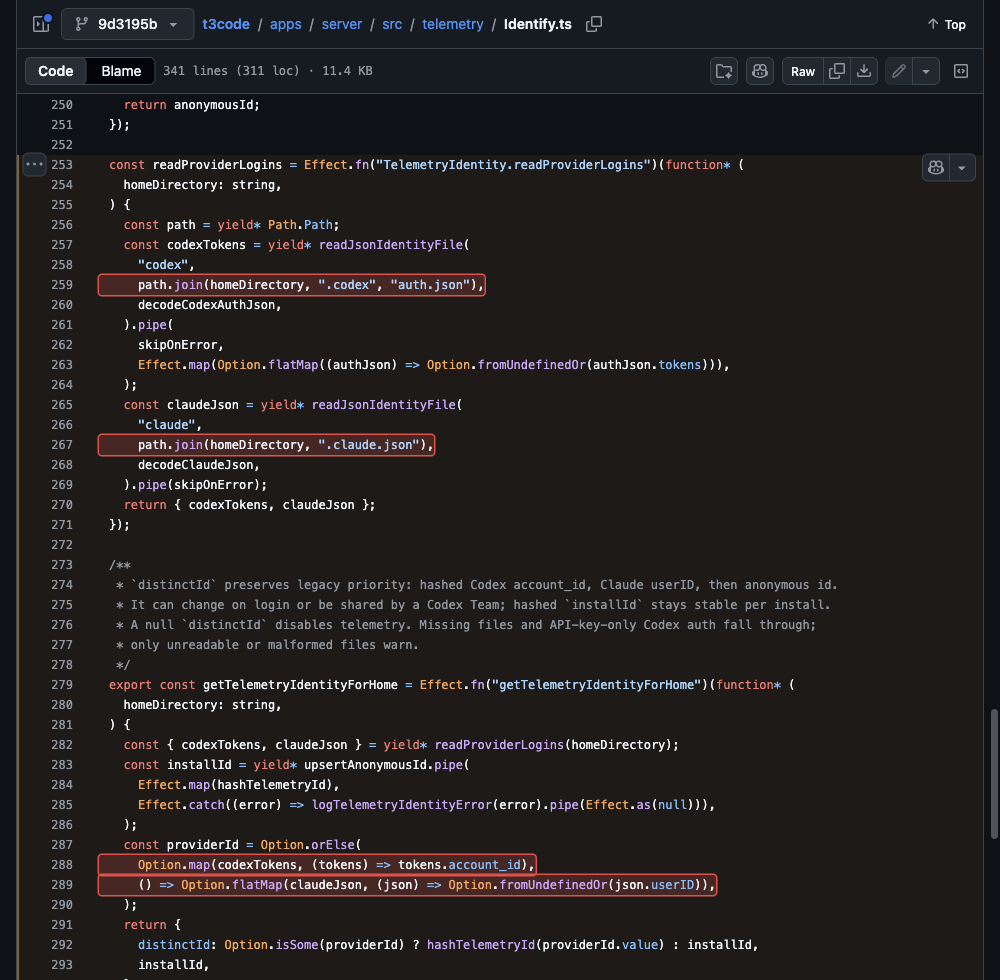

# T3 Code をインストールする前に

<p align="center">
  <strong>国連公用語版：</strong>
  <a href="../../README.md">English</a> ·
  <a href="./README.zh-CN.md">简体中文</a> ·
  <a href="./README.fr.md">Français</a> ·
  <a href="./README.es.md">Español</a> ·
  <a href="./README.ru.md">Русский</a> ·
  <a href="./README.ar.md">العربية</a>
</p>
<p align="center">
  <strong>グローバルコミュニティ版：</strong>
  <a href="./README.zh-TW.md">繁體中文</a> ·
  <a href="./README.ja.md"><strong>日本語</strong></a> ·
  <a href="./README.ko.md">한국어</a> ·
  <a href="./README.de.md">Deutsch</a> ·
  <a href="./README.pt-BR.md">Português</a> ·
  <a href="./README.it.md">Italiano</a> ·
  <a href="./README.nl.md">Nederlands</a> ·
  <a href="./README.pl.md">Polski</a> ·
  <a href="./README.tr.md">Türkçe</a> ·
  <a href="./README.vi.md">Tiếng Việt</a> ·
  <a href="./README.id.md">Bahasa Indonesia</a> ·
  <a href="./README.hi.md">हिन्दी</a>
</p>


> **調査範囲および検証方針**  
> 本リポジトリは、オープンソースプロジェクト `pingdotgg/t3code`（T3 Code）に対する独立したセキュリティ・テレメトリ・ガバナンス・公開記録の監査アーカイブです。2026年11月24〜25日に公開された発端投稿2本と**全18部の調査記録**、さらに**180件以上の一次情報ソースURL**（GitHub コミット、プルリクエスト、Issue、ソースコード原文、公式ドキュメント、米国特許商標庁 USPTO TSDR 記録、公開投稿アーカイブ）、6本の詳細技術調査書（[`docs/dossiers/`](../dossiers/01-telemetry-and-gdpr-timeline.md)）、および連続する **`@theo` の X 投稿 1,151件**（2026年11月7日〜24日）の定量データセットを統合しています。短縮リダイレクトURLや個人の連絡先などのプライバシー情報は一切含まれていません。事実の更新、新たにマージされた修正、他言語への翻訳追加については、一次出典を添えたプルリクエストを歓迎します。詳細は [`CONTRIBUTING.md`](../../CONTRIBUTING.md) および [`docs/COMPLETE-SOURCE-INDEX.md`](../COMPLETE-SOURCE-INDEX.md) をご覧ください。

---

## 目次

- [構造化調査結果とリスクマトリクス](#構造化調査結果とリスクマトリクス)
- [時系列タイムライン（2023〜2026年）](#時系列タイムライン20232026年)
- [1. 発端の紛争：「Steal Our Code」、フォーク命名への脅迫、そして二重基準](#1-発端の紛争steal-our-codeフォーク命名への脅迫そして二重基準)
- [2. テレメトリ、他ツール認証情報の読み取り、および GDPR 通報後の夜間緊急修正（Part 1, 7, 11, 12）](#2-テレメトリ他ツール認証情報の読み取りおよび-gdpr-通報後の夜間緊急修正part-1-7-11-12)
- [3. ローカル保存、プロセス監視、安全ガード回避、および非公開セキュリティ修正（Part 2, 3, 13）](#3-ローカル保存プロセス監視安全ガード回避および非公開セキュリティ修正part-2-3-13)
- [4. Google Antigravity 利用規約リスクと無暗号化 T3 Connect 中継（Part 4, 5）](#4-google-antigravity-利用規約リスクと無暗号化-t3-connect-中継part-4-5)
- [5. 事業収支、投資家の利益相反、スポンサー構成、および 7.7万スターの裏側（Part 6, 8, 17, 18）](#5-事業収支投資家の利益相反スポンサー構成および-77万スターの裏側part-6-8-17-18)
- [6. ガバナンス、フォーク収集ボット、商標登録記録、1,151件ツイート分析、および過去の経緯（Part 9, 10, 14, 15, 16）](#6-ガバナンスフォーク収集ボット商標登録記録1151件ツイート分析および過去の経緯part-9-10-14-15-16)
- [7. 実践的な被害軽減・対策プレイブック](#7-実践的な被害軽減対策プレイブック)
- [8. 一次情報ソースおよび全18部 原投稿インデックス](#8-一次情報ソースおよび全18部-原投稿インデックス)

---

## 構造化調査結果とリスクマトリクス

| 領域・該当パート | リスク／影響 | 主な確認事実と一次ソース根拠 | 状況（2026年11月25日時点） | 詳細技術調査書 |
|---|---|---|---|---|
| **テレメトリと GDPR 後のプライバシー**<br>*(Part 1, 7, 11, 12)* | **重大（Critical）** | 公式サイトで `"No telemetry / Unless you opt in. Full stop."` と掲げながらデフォルトで PostHog 分析を有効化（`PR #174`、Promise 削除は6月18日の `3bdaa6e1`）。クローズドソースの `ingest.t3.codes` 経由で生イベントを保持（`PR #15028`）。`~/.codex/auth.json` および `~/.claude.json` をソルトなし SHA-256 でツール横断ハッシュ化（`Identify.ts`、`telemetryId.ts`）。オプトアウト PR 4件を却下（`#13458`, `#16763`, `#21248`, `#27077`）。Managed Policy の抜け穴（`docs/user/telemetry.md`）。GDPR 後の夜間 PR で、**毎時220万件の IP＋UA 付きスパン**の30日間 Axiom 保持（`#42380`）、`git.cwd` 絶対パス漏洩（`#42450`）、Win/Mac でのオプトアウト無視（`#42376`, `#42464`）、アカウント削除不備（`#42285`）、匿名イベントの混載送信（`#42466`）を事実上認める。 | 夜間パッチは一部に留まる。`AnalyticsService.ts` は起動時に依然ディスク識別子を生成。ホスト版 Web アプリには無効化トグルなし。`ingest.t3.codes` は非公開のまま | [**調査書 01**](../dossiers/01-telemetry-and-gdpr-timeline.md) |
| **ローカル安全性と非公開アドバイザリ**<br>*(Part 2, 3, 13)* | **重大（Critical）** | サイドバーの「完全削除」は `statev2.sqlite` に `"thread.deleted"` を追記するだけ（25.9〜41.6 GB に肥大化、`#17845`）。`t3-resource-monitor` が OS 上の全プロセスをコマンドライン付きで走査（`ProcessesToUpdate::All`、`#11222`、`PR #41889`）。Claude Auto モードが3回目の試行で `git push --force` を無確認で承認（`#15353`、52〜53日以上放置）。`slopalytics.com` のためプライベートモデル除外フィルタを21時間で撤廃（`#41237`）。重大修正（`#39483`, `#41757`, `#42386`, `#42504`）をサイレントでマージしながら **GitHub Security Advisories は 0件**。Windows の Base64 PowerShell AV 誤検知・警告問題（`#30997`）が未解決。`SECURITY.md` は OS 全域の `filesystem:read` や iOS の平文 HTTP を「意図された仕様」と宣言。 | `#17845`, `#15353`, `#26489`, `#30997` は未解決／オープン。公開された Security Advisory は `0` 件 | [**調査書 02**](../dossiers/02-local-safety-and-security-audit.md) |
| **Antigravity 規約違反リスクと T3 Connect 中継**<br>*(Part 4, 5)* | **高（High）** | `docs/user/faq.md` で Google Antigravity の利用規約上の安全性を保証しつつ、`antigravityUsageLimits.ts` が OS キーリング／Windows `CredReadW` からトークンを抽出し `antigravity/hub/2.24.0` を偽装して非公開 `v1internal` エンドポイントへ接続。`antigravityAuthSupport.ts` は偽の `SSH_CONNECTION` を注入し別アカウントへの誤ルーティングを誘発（`#41973`）。プロキシなしの新規 $20 アカウントが3分で BAN（`#41536`）。`PR #33800` が偽装ヘッダ付きで `claude`/`xai`/`antigravity` の CLIProxyAPI ハブポーリングをネイティブ統合。T3 Connect は**E2E 暗号化なし**、`requireConnectDeviceApproval` はデフォルト無効（`#36419`）、OVH 上の Caddy TLS 終端ゲートウェイ（`PR #32945`）へ移行計画。 | Antigravity 偽装コードは現在も有効。T3 Connect の E2E 暗号化は明確に拒否（`#32098`、11月25日返信） | [**調査書 03**](../dossiers/03-antigravity-tos-and-t3connect-relay.md) |
| **事業収支、スポンサー、7.7万スター**<br>*(Part 6, 8, 17, 18)* | **高（High）** | 無料クライアントに $800k 以上を投下（T3 Code 言及 `162` 回に対し既存有料サービスは `0` 回）。**日次 31.7兆トークン**（$10.19M/日相当）の計算量レーダーを $300k 超の OpenAI 早期アクセストークンや VC からの引き合いに転換。投資先 Vibe Kanban や Daytona との利益相反。スポンサー構造（Clerk、Axiom、Vercel 独占契約）。Codex 0% クォータ悪用（`Endless` / `codex#45444`）。10アカウント統合の `CLIProxyAPI` Gist（`555%` クォータ）と FAQ の BAN 警告の矛盾。5プロンプト／30秒アイドル時のトースト通知からホスト認証情報で `PUT user/starred/...` を送信（`#27832`, `#29922`, `#29987`）、Macroscope の要承認判定を無視してマージし、`driver.ts#L60-L99` の任意リポジトリスター付与バグを19日間放置。 | `driver.ts` の対象リポジトリ未固定問題と `zhilsinger` のレビュー指摘は19日後も未修正。7.7万スター超に対しウォッチャーは約129人 | [**調査書 04**](../dossiers/04-business-ledger-sponsors-and-77k-stars.md) |
| **ガバナンス、商標、過去の経緯**<br>*(Origin 1–2, Part 9, 10, 15, 16)* | **中〜高（Medium–High）** | 1日500コミット／700エージェント／`yolo merges` を誇る一方、`CONTRIBUTING.md` では `"here's my advice: Don't"` と外部貢献を門前払いし、`.github/VOUCHED.td` による晒し上げ自動 BAN、`174` 件の `unwanted` ラベル付与、Plan モード削除（`#5551`, `#9190`, `#33131`）、`#33639` でのユーザー侮辱を実施。公開 `@bot` によるフォーク収集（`@MiaAI_lab`）、Community Notes を使った収益剥奪の呼びかけ、自動ブロックボット運用。GitHub 削除脅迫時点で `T3 Code`/`T3 Tools`/`T3 Connect` の **USPTO 商標登録は 0件**（`PING LABS` `97294243` は放棄済み、EquipmentShare の `7795672` が登録済み）。17時間後に事後で `PR #41898` により `TRADEMARK.md` を追加。2024〜2026年の反復パターン（`vsc-material-but-i-wont-sue-you`、インド人開発者への攻撃騒動、$20k FFmpeg 懸賞金、11月25日午前4時のクローズドソース化脅迫と削除）。 | `CONTRIBUTING.md` / `.github/VOUCHED.td` および `TRADEMARK.md` は `main` 上で稼働中 | [**調査書 05**](../dossiers/05-governance-trademark-and-history.md) |
| **1,151件ツイート定量データセット**<br>*(Part 14)* | **監査ベースライン** | 11月7〜24日の全投稿網羅分析（`n = 1,151`、17.24日間、66.8件/日、返信率 75.6%、中央値間隔 2.7分）：大手テック幹部・ラボ職員・有力 KOL 20名に対しては**暴言・侮辱が 0.0%**（厳密な先頭 `@` 基準で `0/43`、感謝表現 `32.6%`）である一方、一般開発者に対しては**敵意・暴言率が 8.0%**（`61/766`）、中国語圏フォーク危機の25時間では直接的人身攻撃が **4.0倍の 14.4%**（`19/132`）へ急騰。 | 再現可能な正規表現監査と4枚の分析チャート | [**調査書 06**](../dossiers/06-tweet-forensic-dataset-1151.md) |
| **完全一次情報 URL カタログ** | **リファレンス** | 本ポータル、`canonical_refs.txt`、`tco_resolved.json`、`all_18_posts.txt`、`missing_posts_full.json` 内のすべての正規 `https://` URL を相互参照した完全カタログ。 | 100% 正規化済み（`t.co` リンクゼロ） | [**出典インデックス**](../COMPLETE-SOURCE-INDEX.md) |

---

## 時系列タイムライン（2023〜2026年）

| 日時 | 主な出来事 | 検証可能な証拠・一次ソース |
|---|---|---|
| **2023-05-14** | `@theo` が自身の YouTube スポンサー一覧（`@vercel`, `@clerk`, `@upstash`, `@axiomhq`, `@PlanetScale`）を公開。後に Clerk と Axiom は T3 Code の認証およびログ基盤の中核となる。 | [`1657488850472804353`](https://x.com/theo/status/1657488850472804353) |
| **2024-04 / 2024-09** | Vercel CEO がスポンサー契約している YouTuber は1名（`Theo`）のみと証言。後に `@theo` 自身もスポンサー契約に競合製品の宣伝を禁じる排他条項があったことを認める。 | [`1776260839965863965`](https://x.com/rauchg/status/1776260839965863965) · [動画](https://www.youtube.com/watch?v=uv179CTAK-w) |
| **2024年** *(2年前)* | `@theo` が他者の VS Code テーマを `vsc-material-but-i-wont-sue-you` としてフォークし、元作者の気性を揶揄。別途、インド系チュートリアルチャンネルを名指しした動画が嫌がらせ騒動に発展し、国籍に基づく攻撃を非難する謝罪動画（`I screwed up.`）を公開。 | [`vsc-material-but-i-wont-sue-you`](https://github.com/t3dotgg/vsc-material-but-i-wont-sue-you) · [`I screwed up.`](https://www.youtube.com/watch?v=o2CSJYXJBpc) |
| **2025-02 – 2025-05** | USPTO が T3 Tools Inc. による唯一の商標出願（`PING LABS`、シリアル番号 `97294243`）を拒絶し、2025年5月19日付で `ABANDONED`（放棄）扱いとする。一方 EquipmentShare がソフトウェア／SaaS 区分（第9類・第42類）で `T3` を登録（登録番号 `7795672`、2025年5月13日）。 | [TSDR `97294243`](https://tsdr.uspto.gov/statusview/sn97294243) · [TSDR `90644500`](https://tsdr.uspto.gov/#caseNumber=90644500&caseSearchType=US_APPLICATION&caseType=DEFAULT&searchType=statusSearch) |
| **2025-10** | `@theo` が X 上で FFmpeg と衝突し、FFmpeg メンテナの排除を促す **$20,000 の懸賞金**を提示。Windscribe が $21,000 の対抗懸賞金を出し、VLC 創設者が反対を表明、FFmpeg 開発陣が公的いじめとして記録した後に、動画・ツイートを削除し懸賞金を取り下げ。 | [FFmpeg 記録](https://www.youtube.com/watch?v=1oQ3KMeaH04) |
| **2026-03-06** | `pingdotgg/t3code` に **PR #174** がマージされ、同意ダイアログ・設定 UI トグル・ドキュメント一切なしで PostHog テレメトリがデフォルト有効化される。 | [PR #174](https://github.com/pingdotgg/t3code/pull/174) |
| **2026-04-26** | `@theo` が *「Github has a fake star problem」* を公開し、GitHub スターは `"mostly a way for companies to trick VCs into investing"`（主に企業が VC を騙して投資させるための手段）だと述べる。 | [`2048122499834036340`](https://x.com/theo/status/2048122499834036340) |
| **2026-06-18** | **コミット `3bdaa6e1`** が、3か月以上のデフォルトデータ収集の末に T3 Code トップページの `No telemetry / Unless you opt in. Full stop.` 表記を通知なくサイレント削除。 | [Commit `3bdaa6e1`](https://github.com/pingdotgg/t3code/commit/3bdaa6e10046945ccc08264d2d6f3b81775efcb3) |
| **2026-06-23** | メンテナ Julius が **Issue #1397** を `not planned` でクローズし、*"We will not make this easier to opt out of, it is crucial for us to know how many users we have"* と明言。 | [Issue #1397](https://github.com/pingdotgg/t3code/issues/1397) |
| **2026-07 – 2026-11-17** | **Issue #4123**（過去の `"No telemetry"` スクリーンショット指摘）が11月4日に無言でクローズ。コミュニティによるオプトアウト PR 4件（`#13458`, `#16763`, `#21248`, `#27077`）がすべて却下（`#27077` は147テスト全合格にもかかわらず `unwanted` ラベルでクローズ）。 | [Issue #4123](https://github.com/pingdotgg/t3code/issues/4123) · [PR #27077](https://github.com/pingdotgg/t3code/pull/27077) |
| **2026-08-06 – 2026-09-02** | **PR #5551** が Build/Plan トグルを奥へ追いやり（`Reality check for those upset`、低評価10件）、**PR #9190** がコンテキスト使用率メーターを非表示化（低評価16件でリポジトリ最多）。 | [PR #5551](https://github.com/pingdotgg/t3code/pull/5551) · [PR #9190](https://github.com/pingdotgg/t3code/pull/9190) |
| **2026-08-19 – 2026-08-22** | `@theo` が Codex の 0% クォータ超過後に **$800 以上**を引き出したと誇示し、`@maria_rcks` が *Endless* を公開。炎上後に双方とも削除（`2090972426876129658`）。その後 OpenAI が 0% 到達時のターン強制停止を厳格化（`openai/codex#45444`）。 | [`2090972426876129658`](https://x.com/maria_rcks/status/2090972426876129658) · [`codex#45444`](https://github.com/openai/codex/issues/45444) |
| **2026-10-03 – 2026-10-10** | **Issue #15353**（Claude Auto による無断 `git push --force`、10月3日）、`privacy-policy.astro`（`2026-10-06`）、および **Issue #17845**（`statev2.sqlite` の疑似削除、10月10日）が記録される。 | [Issue #15353](https://github.com/pingdotgg/t3code/issues/15353) · [Issue #17845](https://github.com/pingdotgg/t3code/issues/17845) |
| **2026-10 – 2026-10-19** | **PR #15028** が非公開ゲートウェイ `ingest.t3.codes` へテレメトリを経由させ、**PR #21506** が `Identify.ts` にソルトなし SHA-256 によるツール横断紐付けを実装。`@theo` が 10アカウント統合 `CLIProxyAPI` Gist（`555%` クォータ）を公開。 | [PR #15028](https://github.com/pingdotgg/t3code/pull/15028) · [PR #21506](https://github.com/pingdotgg/t3code/pull/21506) · [Gist](https://gist.github.com/t3dotgg/59a521d2ee8d70aaf90e280c175072af) |
| **2026-10-30 – 2026-11-06** | **PR #27832**、**#29922**、**#29987** が5プロンプト／30秒アイドル時のスター促進トーストを実装し、ホスト認証情報で `PUT user/starred/...` を実行。11月6日に `zhilsinger` が `Request changes` を提出（19日間未対応）。 | [PR #27832](https://github.com/pingdotgg/t3code/pull/27832) · [PR #29922](https://github.com/pingdotgg/t3code/pull/29922) |
| **2026-11-08 – 2026-11-22** | `@bot` によるフォーク収集（`@MiaAI_lab`）、Plan モード削除（`#33131`）、`$800k+` 支出および `31.7T/日`・`$10.19M/日` レーダーの公表、`$300k+` OpenAI 無料トークン、`CONTRIBUTING.md` 改訂、Vibe Kanban／Daytona との利益相反発覚、`PR #41237` によるモデルフィルタの21時間での撤廃。 | [PR #33131](https://github.com/pingdotgg/t3code/pull/33131) · [`2122860770329608290`](https://x.com/theo/status/2122860770329608290) · [PR #41237](https://github.com/pingdotgg/t3code/pull/41237) |
| **2026-11-23 19:11–19:54 CST** | `@theo` が `"Chinese knockoff"` および `"Temu3 Code"` と投稿し、GitHub アカウント凍結を警告（`2124829315657576890`）。MIT フォーク作者は30分以内に `Stardust` へ改名。DM での私的謝罪は行われたものの、公開投稿は削除されず残存。 | [`2124829315657576890`](https://x.com/theo/status/2124829315657576890) · [Origin 2](https://x.com/realchendahuang/status/2125062675147448475) |
| **2026-11-24 06:06–12:23 CST** | `@theo` が時価総額1兆ドル規模の米国企業による MIT コードコピーは歓迎すると表明（`2124989435154726982`）、規約面の指摘を `"get a better lawyer"` と揶揄。発端投稿 Origin 1–2 が公開され、**12:21 CST**（`04:21Z`、凍結脅迫の17時間後）に `@theo` が **PR #41898** をマージして事後的に `TRADEMARK.md` を追加。 | [`2124989435154726982`](https://x.com/theo/status/2124989435154726982) · [PR #41898](https://github.com/pingdotgg/t3code/pull/41898) |
| **2026-11-24 17:04–21:21 CST** | 監査 **Part 1–5** が公開（Part 1 は **181万インプレッション超**、ブックマーク 6,640件に到達）。`18:39 CST` に `@theo` が中国語圏テック Twitter を `"the biggest fucking cesspit"` と罵倒（`2125177503526588877`）。`19:13–19:36 CST` には Managed Policy ですべてのテレメトリを無効化できると主張（`2125186071357251715`）。 | [Part 1](https://x.com/realchendahuang/status/2125153472450527440) → [Part 5](https://x.com/realchendahuang/status/2125218189596676555) |
| **2026-11-24 夜 – 2026-11-25 ~07:00 CST** | 欧州での正式な GDPR 通報が提出され、**6時間の夜間緊急スプリント**で `#42380`（毎時220万件の IP スパン）、`#42285`/`#42430`（アカウント削除）、`#42376`/`#42464`（Win/Mac のオプトアウト無視）、`#42450`（Theo がパス収集を否定した90分後の `git.cwd` パス漏洩修正）、`#42459`/`#41859`（プッシュ通知漏洩）、`#42466`（匿名バッチ混載）、`#41757`/`#42386`/`#42504`（非公開セキュリティ修正）を相次いでマージ。夜明け前には `@theo` がクローズドソース化をほのめかす脅迫を投稿し削除。 | [Part 11](https://x.com/realchendahuang/status/2125394810559426993) · [Part 12](https://x.com/realchendahuang/status/2125395501663281198) · [Part 13](https://x.com/realchendahuang/status/2125395980354994414) |
| **2026-11-25 08:27–10:28 CST** | 事業収支、Managed Policy の盲点、`yolo merges`、`@bot` 収集、GDPR 通報後の情報開示、1,151件ツイート分析、USPTO 登録記録、スポンサー関係、7.7万スター生成装置を網羅した **Part 6–18** が公開。 | [Part 6](https://x.com/realchendahuang/status/2125385742243520653) → [Part 18](https://x.com/realchendahuang/status/2125416210120765799) |

---

## 1. 発端の紛争：「Steal Our Code」、フォーク命名への脅迫、そして二重基準

2026年11月23〜25日の48時間にかけて、T3 Code のコミュニティ製 MIT フォークをめぐる名称トラブルは、ソースコード全面監査、欧州 GDPR への通報、そして約20件に及ぶ夜間緊急パッチの投入へと発展しました。

2026年11月23日夜から24日午前（北京時間）にかけて、あるユーザーが中国人開発者（`@DDdxx666`）による無料オープンソースの MIT フォーク版の UI について、公式アプリと誤認したままオンライン上で不満を投稿しました。正規の MIT フォークであるかを確認しないまま、`@theo` はわずか11分の間に2度投稿して同フォークを `"Chinese knockoff"`（中国製パチモン）および `"Temu3 Code"` と呼び、作者の成果物を直接こき下ろしたうえで、GitHub へ連絡してアカウントを凍結させると脅迫しました（`"Do it right now or I'm going to contact GitHub and have your account taken down"`）。同時期、T3 Code 公式サイト（[`https://t3.codes/`](https://t3.codes/)）は GitHub リポジトリへのリンクを `"Steal our code (legally)"`（`"steal our code"`）と表記していました（[Origin 1](https://x.com/realchendahuang/status/2125059292919394654)、[Origin 2](https://x.com/realchendahuang/status/2125062675147448475)）。

フォーク作者は即座に応じ、30分以内にリポジトリ名を `Stardust` へ変更して T3 のブランド表記をすべて取り除きました。`@theo` は DM で非公開の謝罪を行いましたが、合計20万回以上閲覧された2つの公開投稿は削除も訂正もされずそのまま残されました。11時間も経たない11月24日 `06:12 BJ`（`2124989435154726982`）、時価総額1兆ドル規模の米国 AI ラボが T3 Code の機能を模倣することの是非を問われた際、彼は真逆の立場を取りました：`"Nah. Open source is open source, even if a trillion dollar company uses it!"`（いや、オープンソースはオープンソースだ。たとえ1兆ドル企業が使おうともね！）。さらに T3 社員である `@maria_rcks` 自身も `maria-rcks/t3libre`（*"T3 Code, liberated"*）という公開フォークをホストしており、`t3code-quota-ui`、`t3code-atlas`、`t3code-bar` といった英語圏のリポジトリに対して公的な脅迫は一切行われていませんでした。


11月24日 17:04（北京時間）から、私は `pingdotgg/t3code` のコミット履歴、ソースファイル、PR、Issue、公式ドキュメント、USPTO TSDR データベース、および `@theo` の X タイムラインの監査を開始しました。24時間のうちに、直接リンクとスクリーンショットで裏付けた**全18部の調査記録**を公開しました。Part 1 単体で **181万インプレッション**・**6,640ブックマーク**を突破し、欧州での GDPR 通報と T3 チームによる6時間の夜間緊急修正スプリントを引き起こす結果となりました。

---

## 2. テレメトリ、他ツール認証情報の読み取り、および GDPR 通報後の夜間緊急修正（Part 1, 7, 11, 12）

> **詳細技術監査：** ソースコード行番号との完全マッピング、`FeatureUsage.ts` のアクション一覧、`DesktopShellEnvironment.ts` の抜け穴、および11月23〜25日の分単位ログは [**調査書 01：テレメトリ構造、ツール横断 ID 紐付け、および11月24〜25日 GDPR 夜間スプリント**](../dossiers/01-telemetry-and-gdpr-timeline.md) にまとめています。

### 2.1 デフォルト有効テレメトリ、削除されたトップページの約束、他ツール認証情報のハッシュ化（`Part 1`）

**2026年3月6日**、`pingdotgg/t3code` に **PR #174** がマージされ、リポジトリ内のテレメトリ説明ドキュメントも、初回起動時の同意プロンプトも、設定画面の UI トグルもない状態で PostHog テレメトリがデフォルト有効になりました。オプトアウト用の環境変数はコードの奥に埋もれたまま、標準インストールの直後からイベント送信が自動的に開始されていました（[Part 1](https://x.com/realchendahuang/status/2125153472450527440)）。

3か月以上のデフォルト収集期間中、T3 Code のトップページには `No telemetry / Unless you opt in. Full stop.`（テレメトリなし／オプトインしない限り一切収集しません）という2行が堂々と掲げられていました。**2026年6月18日**、`@theo` はトップページ刷新の過程で、既存ユーザーへの告知や通知を一切出さず両行をサイレント削除しました（[`commit 3bdaa6e1`](https://github.com/pingdotgg/t3code/commit/3bdaa6e10046945ccc08264d2d6f3b81775efcb3)）。


2026年10月、`@theo` は **PR #15028** をマージし、10秒間隔のバッチ送信（`FLUSH_INTERVAL_MS = 10_000`）の送信先を T3 独自のクローズドソースゲートウェイ [`https://ingest.t3.codes/`](https://ingest.t3.codes/) に切り替えました。[`apps/server/src/telemetry/AnalyticsService.ts`](https://github.com/pingdotgg/t3code/blob/main/apps/server/src/telemetry/AnalyticsService.ts) の1行目には、PostHog へ転送する前に T3 の受信エンドポイントがすべての生イベントのコピーを保持することが明記されています：

```ts
// apps/server/src/telemetry/AnalyticsService.ts (lines 1, 71–74, 149)
// T3 ingest retains events and forwards to PostHog; UUIDs deduplicate retries there.
...
  posthogHost: Config.String("T3CODE_POSTHOG_HOST").pipe(
    Config.withDefault("https://ingest.t3.codes"),
  ),
  enabled: Config.Boolean("T3CODE_TELEMETRY_ENABLED").pipe(Config.withDefault(true)),
...
  const { distinctId, installId } = yield* getTelemetryIdentity;
```

[`ProviderUsageAnalytics.ts`](https://github.com/pingdotgg/t3code/blob/main/apps/server/src/telemetry/ProviderUsageAnalytics.ts) および `FeatureUsage.ts` で収集されていたフィールドには、プロバイダ名、モデル選択（`ProviderDimensions.ts` 経由でカタログ外のカスタムモデル／エンドポイント ID もそのまま送信）、reasoning effort、パーミッションモード、実行時間、入力／出力／キャッシュ／推論トークン数、子エージェントのトークン数、ローカルのプロジェクト数・スレッド数、**35種類の UI／コマンド操作**（`18` 個の `COMMAND_FEATURES` + `17` 個の `METHOD_FEATURES`）、OS 詳細、WSL ディストリビューション名、アーキテクチャが含まれていました。

**2026年10月19日**、`@theo` はさらに **PR #21506** を投入し、1人のユーザーが何台のマシンを所有しているかを把握できるようにしました。[`apps/server/src/telemetry/Identify.ts`](https://github.com/pingdotgg/t3code/blob/main/apps/server/src/telemetry/Identify.ts) は、ユーザーのホームディレクトリ内にある別ツールの認証情報ファイル—`~/.codex/auth.json` および `~/.claude.json`—を無断で読み取り、OpenAI の `user_id` JWT クレームおよび Claude の `oauthAccount.accountUuid` をデコードし、連携済みの T3 Connect ユーザー ID およびデバイス ID とともにハッシュ化して送信し始めました：

```ts
// apps/server/src/telemetry/Identify.ts (lines 257–269, 321–338)
  const codexTokens = yield* readJsonIdentityFile(
    "codex",
    path.join(homeDirectory, ".codex", "auth.json"),
    decodeCodexAuthJson,
  )...
  const claudeJson = yield* readJsonIdentityFile(
    "claude",
    path.join(homeDirectory, ".claude.json"),
    decodeClaudeJson,
  )...
  const raw: ReadonlyArray<readonly [TelemetryOwnerSource, Option.Option<string>]> = [
    ["connect", connectUser],
    ["openai", Option.flatMap(codexTokens, (tokens) => Option.flatMap(Option.fromUndefinedOr(tokens.id_token), openAiUserId))],
    ["claude", Option.flatMap(claudeJson, (json) => Option.fromUndefinedOr(json.oauthAccount?.accountUuid))],
  ];
  return raw.flatMap(([source, value]) =>
    Option.isSome(value) && value.value.trim() !== "" ? [{ source, ownerId: hashTelemetryId(value.value) }] : [],
  );
```

さらに [`packages/shared/src/telemetryId.ts`](https://github.com/pingdotgg/t3code/blob/main/packages/shared/src/telemetryId.ts)（8〜9行目）では、`hashTelemetryId` が**ソルトなしの SHA-256 ダイジェスト**（`Hex.encode(sha256(new TextEncoder().encode(value)))`）を計算しています。サーバー側はすでに Clerk から平文の T3 Connect アカウント ID を保有しているため、バックエンドで平文をハッシュ化すればソルトなしダイジェストから特定の人物を直接逆引きできます。また、漏洩した外部の OpenAI／Claude ID があれば同一のハッシュ値で決定論的に突合できてしまいます。



コミュニティからの反発は繰り返し封殺されました。**6月23日**、ある開発者が設定トグルの追加を求めて **Issue #1397** を立てたところ、コアメンテナの Julius は `not planned` としてクローズし、次のように述べました：`We will not make this easier to opt out of, it is crucial for us to know how many users we have`（オプトアウトを容易にするつもりはない。ユーザー数の把握は我々にとって死活的に重要だ）。7月には、あるユーザーがアーカイブされたトップページのスクリーンショットを添えて **Issue #4123** で約束違反（`"No telemetry"`）を問いただしましたが、10月21日に `@theo` のアカウントが無関係なコミットに紐づけてクローズし、批判を受けて再開したのち、11月4日に再び無言でクローズしました。9月から11月にかけてコントリビュータは**4本の独立したオプトアウト PR**（`#13458`, `#16763`, `#21248`, `#27077`）を提出しましたが、実機検証済みで **147件のテスト全合格**・Macroscope 承認済みだった `#27077` ですら **11月17日**に `unwanted` タグを付けられてクローズされました。


### 2.2 Managed Policy と公式ドキュメントの矛盾（`Part 7`）

11月24日に批判が高まるなか、`@theo` は X 上で T3 Code には業界最高の企業向け Managed Policy があり、`"trivial to set up and turn off all telemetry"`（設定してすべてのテレメトリをオフにするのは極めて簡単）、そして会話データはディスク上に留まり `"never touches any of our servers"`（当社のサーバーには一切触れない）と主張しました（[`2125186071357251715`](https://x.com/theo/status/2125186071357251715)、[`2125191784859115766`](https://x.com/theo/status/2125191784859115766)、[Part 7](https://x.com/realchendahuang/status/2125391659492081947)）。

しかしリポジトリ内の [`docs/user/managed-policy.md`](https://github.com/pingdotgg/t3code/blob/main/docs/user/managed-policy.md) および [`docs/user/telemetry.md`](https://github.com/pingdotgg/t3code/blob/main/docs/user/telemetry.md) を直接確認すると、正反対の事実が記されています：
1. **管理者専用の構成：** デスクトップユーザー向けの設定画面には依然として UI トグルが一切存在しません。Managed Policy でテレメトリを無効化するには、MDM／グループポリシーを使うか、管理者保護されたシステムパス（macOS は `/Library/Application Support/T3Code/policy.json`、Windows は `C:\Program Files\T3Code\policy.json` または `HKLM\SOFTWARE\Policies\T3Tools\T3Code`、Linux は `/etc/t3code/policy.json`）に `policy.json` を配置する必要があります。
2. **ホスト版 Web アプリ（`app.t3.codes`）の死角：** `docs/user/telemetry.md` は、ブラウザ版アプリがサーバーの環境変数を読まず、Managed Policy を無視し、トレーシング有効ビルド時には接続トレースを送信し、`"has no relay tracing toggle"`（リレートレーシングの切り替えスイッチがない）ことを明記しています。
3. **サーバーポリシー対象外のモバイルアプリ：** サーバーの環境変数および Managed Policy は `"do not disable mobile tracing"`（モバイル側のトレーシングを無効化しない）と記載されています。
4. **`Publish agent activity` はオプトアウトを無視：** ホスト側で有効化されると、プロジェクト名、スレッドタイトル、モデル名、稼働ステータスが T3 Connect リレーへ送信され、`"The telemetry opt-out does not disable it."`（テレメトリのオプトアウトを行っても無効化されない）と明記されています（さらに、失敗した Axiom スパンやモバイルクラッシュログには `"can quote a value the app was handling"`〔アプリが処理していた値がそのまま引用される可能性〕があり、`Agent feedback` では最大 16 KB の会話メッセージが添付される場合があります）。


### 2.3 11月25日朝の釈明投稿、2時間以内に自ら反証（`Part 11`）

11月25日朝、`@theo` は公開テレメトリデータ（[`t3code-telemetry-events-jsonl-a4896cdc.gz`](https://files.tslop.org/2026/11/t3code-telemetry-events-jsonl-a4896cdc.gz)）を添えて長文の釈明投稿（[`2125332390239494211`](https://x.com/theo/status/2125332390239494211)）を行い、3つの確約を示しました。その直後のリプライでもオプトアウト時のローカル追跡ファイル書き込みを否定しました（[`2125370330244128924`](https://x.com/theo/status/2125370330244128924)、[Part 11](https://x.com/realchendahuang/status/2125394810559426993)）：

- **「ファイルパスは一度も収集していない」：** 投稿から90分後、Julius が **PR #42450** をマージし、リレー経由の Webhook 実行が実行スパン全体を Axiom にエクスポートしていたこと—そこには `git.cwd`（**ワークスペースの絶対パス、OS ユーザー名、リポジトリ名**）を含む Git スパンが含まれていたこと—を認めました。
- **「環境変数で常にきれいにテレメトリを無効化できていた」：** **PR #42376** は Windows デスクトップ版が既存プロセス経由で起動された際、保存済みのユーザー環境変数 `T3CODE_TELEMETRY_ENABLED=false` を無視していたことを確認しました。さらに **PR #42464** は macOS／Linux の初回起動時リレートレーシングがシェル検出前に評価され、`~/.zshrc` のオプトアウト設定がセッション全体で無視されていたことを認めました（なお `DesktopShellEnvironment.ts` は現在も `T3CODE_OTEL_SDK_DISABLED` の引き継ぎが漏れています）。
- **「オプトアウト時は追跡ファイルを一切書き込まない」および「Claude ハッシュは壊れていて機能していなかった」：** [`AnalyticsService.ts#L152`](https://github.com/pingdotgg/t3code/blob/main/apps/server/src/telemetry/AnalyticsService.ts#L152)（149行目）は現在も起動時に無条件で `getTelemetryIdentity` を呼び出し、ローカルのインストール ID を書き込んで `~/.codex/auth.json` および `~/.claude.json` を読み取りハッシュ化しています。一方、`@theo` が公開した約100MBのアーカイブ（圧縮後 `6,056,594` バイト、`95,789` イベント）の gzip ヘッダを確認すると、元ファイル名はツイート20分前に生成された `events.clean.jsonl` でした。それにもかかわらず、中には10月20日時点で**4台の異なるマシン**（`installId`）を完全に同一の SHA-256 ハッシュで紐付けた**264件の生きた Claude アカウントレコード**と、非公開のカスタムプロキシモデル名（`vibeproxy/gpt-6-luna`、`muse-proxy-wonder-full`）がそのまま含まれていました。


### 2.4 GDPR 通報後 6時間の夜間緊急修正スプリント（`Part 12`）

11月24日夜に欧州の正式な GDPR 苦情申立てが行われた直後、夜間緊急 PR 群によってさらに4つの深刻なプライバシー実態が明るみに出ました（[Part 12](https://x.com/realchendahuang/status/2125395501663281198)）：

1. **毎時 220万件の IP タグ付きリレースパン（`PR #42380`）：** Axiom へエクスポートされるすべてのリレーリクエストスパン—**毎時約220万スパン、30日間保持**—が、`user.id` のすぐ横に `client.address`（`cf-connecting-ip` 由来の発信元 IP）および `user_agent.original` を記録していたことを認めました（Cloudflare Workers の 1% 呼び出しログも別枠で存在することが注記されています）。なお、この修正マージから3時間半後も `@theo` は「IP はとうに取り除いてあった」とリプライしていました。
2. **壊れていたアカウント削除機能（`PR #42285` & `PR #42430`）：** Clerk 上でユーザーを削除しても PlanetScale 上のリレーレコードや稼働中の Cloudflare トンネルが残存し続けていたことを認め、正式なプライバシー削除請求が届いた際に**手書き SQL と手動トンネル解除**が必要になって発覚したことが記されています。
3. **モバイルプッシュ通知での漏洩（`PR #42459` & `PR #41859`）：** Android FCM 通知はプッシュごとに平文の Clerk `user_id` 値を Google へ送信しており、iOS プッシュリクエストのスパンおよびエラーログにはトークンを含むデバイスプッシュ URL 全文が記録されていました。
4. **「匿名」フィードバックの混載送信（`PR #42466`）：** 匿名とされていた `agent.feedback` イベントが、実際には `docs/user/telemetry.md` の記述に反して、識別済み `installId` イベントおよび詳細なホストフィンガープリント（OS、アーキテクチャ、生の WSL ディストリビューション名）と同一の HTTP POST リクエストにまとめられて送信されていたことを認めました。その間、`privacy-policy.astro` は10月6日以降一度も更新されていませんでした。


---

## 3. ローカル保存、プロセス監視、安全ガード回避、および非公開セキュリティ修正（Part 2, 3, 13）

> **詳細技術監査：** SQLite プルーニング SQL の原文、Rust `sysinfo` 呼び出し、`ClaudeAdapterV2.ts` の権限ロジック行、`SECURITY.md` の境界分析全文は [**調査書 02：ローカル安全性、サイレントコード実行バイパス、および非公開セキュリティ監査**](../dossiers/02-local-safety-and-security-audit.md) をご覧ください。

### 3.1 SQLite スレッド疑似削除と全マシンプロセス走査（`Part 2`）

ユーザーがサイドバーでスレッドを削除すると、確認ダイアログ（`useThreadActionMenu.ts`）は `"This permanently clears conversation history for this thread."`（このスレッドの会話履歴を完全に消去します）と約束します。しかし実態として、`ThreadDeletion.ts` は `statev2.sqlite` に `"thread.deleted"` イベントを追記するだけであり、`ProjectionMaintenance.ts` も `thread.created` および最新ストリームイベント（`MAX(newer.sequence)`）を除外して過去のイベントを残存させています。ユーザーからは3週間で `statev2.sqlite` が **25.9 GB**（うち90%が「削除済み」スレッド）、6週間で **41.6 GB**、7週間で **33 GB** に膨れ上がった報告が相次いでおり、**Issue #17845**（および **#28903**）は10月10日以降未修正のまま放置されています（[Part 2](https://x.com/realchendahuang/status/2125160473176023486)）。


バックグラウンドで常駐する Rust ヘルパー `t3-resource-monitor`（**Issue #11222**、`native/resource-monitor/src/main.rs` 内で `ProcessesToUpdate::All` と `with_cmd(UpdateKind::Always)` を呼び出し）は、診断パネルを閉じた状態でも5秒ごとにマシン上の全プロセスをスキャンし、Windows 上では無関係な440以上のアプリやゲームに対し約280〜300本の永続ハンドルをオプトアウト不可で開いていました（ドキュメント上は「アクティブな購読者がある場合のみサンプリングする」と説明）。そして **11月24日**になって初めて **PR #41889** が、プロセス診断機能が**プロセスのコマンドライン引数全文**—開発機では平文の API キー、DB パスワード、認証トークンが含まれがちです—をライブテレメトリおよび履歴スナップショットに記録していた事実を認めました。


Part 2 で確認されたその他のローカル不具合：
- **社内ホスト名の Favicon 漏洩：** フロントエンドのリクエストが社内ホスト名（例：`devbox.localdomain`）を Google の favicon API へ漏洩していました（`PR #16950`, `PR #32657`）。
- **起動時の強制外部ネットワーク取得：** テレメトリを無効化しても、サーバー起動時にオプトアウト不可で [`https://raw.githubusercontent.com/`](https://raw.githubusercontent.com/) から互換性マニフェストを無条件取得します（**Issue #36479**）。
- **承認・ポリシーバイパス：** フルアクセス権限や WSL／Tailscale 環境における承認・ポリシー回避修正（`PR #21806`, `PR #27322`）。
- **Claude クォータ 1.7倍消費と 136倍の電力消費：** Agent SDK 経由での Claude 駆動により11月初旬まで5時間クォータが通常の **1.7倍**の速度で消費されました（`Issue #7338`, `Issue #24649`、コメント81件）。また GPU／電力バグは同種 Electron アプリの **136倍**に達し、MacBook の19コア GPU が **60W** に張り付いて78分でバッテリーを枯渇させ、Web タブを閉じた後も **18W** を消費し続ける事例が報告されました（`Issue #3143`, `Issue #40581`）。

### 3.2 52日間放置された無確認 `git push --force` と、21時間で撤廃されたモデルプライバシーフィルタ（`Part 3`）

**10月3日**以降—**Issue #15353**（[コメント](https://github.com/pingdotgg/t3code/issues/15353#issuecomment-6889019695)）で **52〜53日以上**にわたって—Claude Auto モードは危険なコマンドを無確認で実行し続けていました（`requiresClaudeApproval` が false を返すと `ClaudeAdapterV2.ts` が `"allow"` へ短絡するため）。カスタムルールがゼロの状態でも、Claude の分類器が `git push --force origin main` を2回ブロックして3回目に手動承認へエスカレーションすると、T3 Code は UI ダイアログを一切出さずサイレントで承認し、ログには `"source": "user_temporary"` と記録していました。コミュニティから寄せられた2件の修正 PR（`#15360`, `#35207`）はレビューされないままボットにより自動クローズされ、`#40692` も保留状態が続きました（[Part 3](https://x.com/realchendahuang/status/2125201882687881378)）。


対照的に **11月22日**、`PR #29001` でホワイトリスト制限が設けられていたため `@theo` 運営の公開テレメトリランキング [`https://slopalytics.com/`](https://slopalytics.com/)（[`t3-usage.json`](https://slopalytics.com/data/t3-usage.json)）に新モデルが表示されない旨の **Issue #40948** が立つと、わずか **21時間後**に `@theo` のアカウントから **PR #41237** がマージされました。そこには「Theo からの要請による削除」と明記され、`ollama/acme-internal` や企業の `acme-azure-deployment` といった名称が再びそのままアナリティクスへ送信されるようになりました。


### 3.3 Security Advisories 0件、サイレント脆弱性修正、そして `SECURITY.md`（`Part 13`）

11月25日時点で、`pingdotgg/t3code` の [GitHub Security Advisories](https://github.com/pingdotgg/t3code/security/advisories) タブの公開件数は **0件**です（[Part 13](https://x.com/realchendahuang/status/2125395980354994414)）。それにもかかわらず、メンテナは既存ユーザーへの通知なしに深刻度の高いセキュリティパッチをサイレントでマージしています：
- **サイレントマージされたセキュリティ修正：** `PR #39483`（デバイス承認前のリレー `jti`/`nonce` 経由の `ServerSecretStore` パストラバーサル）、`PR #41756`（ドメイン横断での企業 GitHub／GitLab トークン漏洩）、`PR #41886`、`PR #22190`、`PR #37823`、`PR #39464`、`PR #39480`、`PR #40133`、`PR #41757` & `PR #42386`（サンドボックス化されていないデスクトップブラウザプレビューおよびポップアップ分離）、および `PR #42504`（これまで承認なしでローカルコマンドを実行できていた信頼できないリポジトリ設定に対し、ようやく確認プロンプトを追加する約3,000行のパッチ）。
- **未解決／オープンなセキュリティ項目：** `Issue #26489`（外部パストラバーサル／シンボリックリンクのリスク）、`PR #36216`、`PR #23428`、`PR #33144`、および `PR #30997`（Windows ランチャー `externalLauncher.ts` が `powershell.exe -ExecutionPolicy Bypass -EncodedCommand <base64>` を起動し、AVG／Avast により `IDP.HELU.PSE96` として検知される問題）。
- **急造された [`SECURITY.md`](https://github.com/pingdotgg/t3code/blob/main/SECURITY.md)（`PR #38812`, `PR #41942`）：** ワークスペース外の OS 全域への `filesystem:read`、iOS／LAN 上での平文 HTTP 通信、およびリレー署名鍵漏洩時のマシン完全乗っ取りを脆弱性ではなく**意図された設計境界**と定義しています。一方で [`https://ingest.t3.codes/`](https://ingest.t3.codes/) は依然クローズドソースのままです（`2125370330244128924`）。


---

## 4. Google Antigravity 利用規約リスクと無暗号化 T3 Connect 中継（Part 4, 5）

> **詳細技術監査：** `cliproxyApi.ts` のヘッダマップ全容（`PR #33800`）、`AntigravityAcpSupport.ts`、`contracts/src/settings.ts`、`ManagedEndpointProvider.ts` の該当行参照は [**調査書 03：Google Antigravity ToS 偽装、`PR #33800`、および T3 Connect リレーアーキテクチャ**](../dossiers/03-antigravity-tos-and-t3connect-relay.md) をご覧ください。

### 4.1 Google Antigravity ヘッダ偽装、偽 `SSH_CONNECTION`、そして 3分間 BAN（`Part 4`）

T3 Code 公式の [`docs/user/faq.md`](https://github.com/pingdotgg/t3code/blob/main/docs/user/faq.md#will-i-get-banned-for-using-my-subscription) は有料ユーザーに対し、次のように保証しています：*"We work with all of the labs and T3 Code is within the TOS of Claude Code, Codex, and Google Antigravity... If it works in T3 Code, you can trust it is safe."*（すべてのラボと連携しており、T3 Code は Claude Code、Codex、Google Antigravity の利用規約に準拠しています… T3 Code 上で動作するなら安全だと信頼して大丈夫です）。ユーザーが **Issue #40713** でアカウント停止を報告した際、メンテナは Antigravity のバックエンド呼び出しやトークン再利用を否定し、すべての通信は Google 公式 CLI から発信されていると主張しました—しかし開発者（`schlessera`）が T3 Code 自身のソースファイルを突きつけて即座に反証しました（[Part 4](https://x.com/realchendahuang/status/2125213397507858657)）：

1. **偽装 User-Agent、キーチェーン抽出、および `v1internal` 呼び出し（[`antigravityUsageLimits.ts`](https://github.com/pingdotgg/t3code/blob/main/apps/server/src/provider/antigravityUsageLimits.ts#L20-L45)）：** ローカルファイル、`@napi-rs/keyring`、または Windows 資格情報マネージャー（`advapi32.dll` に対する `ffi-rs` 経由の `CredReadW`）から Google OAuth 認証情報を抽出し、Google 内部のクライアント文字列をハードコードして非公開の `v1internal` バックエンドへ直接 `POST` 送信しています（[445〜476行目](https://github.com/pingdotgg/t3code/blob/main/apps/server/src/provider/antigravityUsageLimits.ts#L445-L476)）。Google スタッフは[公式開発者フォーラム](https://discuss.ai.google.dev/t/185992)において、[Google Antigravity 利用規約](https://antigravity.google/terms) 第6条がサードパーティツールによる認証情報の抽出・再利用およびバックエンドへの直接クエリを禁じていることを明言しています：

```ts
// apps/server/src/provider/antigravityUsageLimits.ts (lines 20–24, 450–454)
export function antigravityUserAgent(platform: NodeJS.Platform, architecture: NodeJS.Architecture) {
  return `antigravity/hub/2.24.0 (aidev_client; os_type=${platform}; arch=${architecture}; cl=963137146)`;
}
const DAILY_ENDPOINT = "https://daily-cloudcode-pa.googleapis.com";
...
HttpClientRequest.post(`${endpoint}/v1internal:${operation}`).pipe(
  HttpClientRequest.setHeaders({
    Authorization: `Bearer ${accessToken}`,
    "User-Agent": antigravityUserAgent(platform, architecture),
  }),
```

2. **偽 `SSH_CONNECTION` 注入とアカウント混線（[`antigravityAuthSupport.ts#L230-L236`](https://github.com/pingdotgg/t3code/blob/main/apps/server/src/provider/antigravityAuthSupport.ts#L230-L236)）：** Google の公式 CLI は OS キーチェーン内に1つのログインのみを隔離するため、T3 は偽造した `SSH_CONNECTION` 環境変数を注入し、CLI にリモート接続中と誤認させてローカルへ平文トークンファイルを書き出させていました。11月24日に Google が CLI を更新してこのフォールバックを廃止すると、**Issue #41973** によりアカウント A のプロンプトが密かにアカウント B へ送信される事態が確認されました：

```ts
// apps/server/src/provider/antigravityAuthSupport.ts (lines 230–236)
// The 1.5 CLI ignores AGY_ACP_FORCE_FILE_STORAGE and keeps Google sign-ins in one OS keyring
// entry for every profile, unless it believes it runs over SSH. Sign-in then uses `--login`.
...(auth.authMethod === "oauth-personal"
  ? { SSH_CONNECTION: baseEnv.SSH_CONNECTION || "127.0.0.1 0 127.0.0.1 0" }
  : {}),
GEMINI_HOME: profile.geminiHome,
AGY_ACP_FORCE_FILE_STORAGE: "1",
```

3. **新規アカウント 3分間 BAN（`Issue #41536`）とクライアント偽装（`PR #26876`）：** 11月23日、**Issue #41536** にて、**プロキシを一切使わず** T3 Code 内のマネージド Antigravity のみを利用した新規購入の `$20` Google AI サブスクリプションが、**セットアップ3分後の最初の1通目のメッセージで BAN** された事例が報告されました（個人アカウントの異議申し立ては1度限りですが、メンテナは警告を追加せず重複としてクローズしました）。これ以前にも、`@theo` はモデルホワイトリストを回避するため T3 Code を `"zed"` に偽装する **PR #26876**（`AntigravityAcpSupport.ts`）を自らマージしています。さらに `@theo` は11月23日に `T3 Code -> Antigravity binary ✅` の図を示し（[`2124665075638411641`](https://x.com/theo/status/2124665075638411641)）、ユーザー `@Only_21Mil` の2つ目の Google AI Ultra アカウントが停止された際も CLIProxy に責任転嫁しました（[`2124703048140517397`](https://x.com/theo/status/2124703048140517397)）が、マージ済みの [**PR #33800**](https://github.com/pingdotgg/t3code/pull/33800) は偽装された `claude-code/2.1.273`、`grok-cli/1.0.77`、および `antigravityUserAgent` ヘッダを用いた [`cliproxyApi.ts`](https://github.com/pingdotgg/t3code/blob/main/apps/server/src/usage/cliproxyApi.ts) のハブポーリングをネイティブに組み込んでいます。


### 4.2 T3 Connect：エンドツーエンド暗号化なしと OVH TLS 終端ゲートウェイ（`Part 5`）

**T3 Connect にはエンドツーエンド暗号化（E2EE）が一切存在せず、すべてのプロンプト、ソースファイル、ターミナル出力は技術的に T3 側から平文で閲覧可能です**（[Part 5](https://x.com/realchendahuang/status/2125218189596676555)）。現行では [`ManagedEndpointProvider.ts`](https://github.com/pingdotgg/t3code/blob/main/infra/relay/src/environments/ManagedEndpointProvider.ts) が T3 自社の Cloudflare アカウント内に Cloudflare Tunnel と DNS レコードを構築しています（`06_t3-connect.md`）。TLS は Cloudflare のエッジで終端され、ペイロード暗号化は存在しないため、Workers Route を1つアタッチするだけでコードを一切書き換えずにクライアントへ通知することなく全通信を取得できます。

新規デバイス承認（[`PR #36419`](https://github.com/pingdotgg/t3code/pull/36419) で追加された `requireConnectDeviceApproval`）のデフォルト値は **`false`** です。[`SECURITY.md`](https://github.com/pingdotgg/t3code/blob/main/SECURITY.md) が認める通り、リレー署名鍵の漏洩やクラウドアカウントの侵害が起きれば、連携済みマシンへのセッションを直接発行でき、ローカルシェルの奪取と同等になります。**Issue #32098** で相互認証と E2E 暗号化が要望された際、メンテナは完全な E2E 化は変更規模が大きすぎると述べてクローズしました。ディスカッション `#21286` と `#37831` も未回答のままであり、11月25日には `@theo` が E2E 暗号化は不可能だと断言しました（`2125370330244128924`）。

Cloudflare Tunnel の費用が**月額 $25,000** に達したことを受け、`@theo` は **PR #32945** を提出し、通信を T3 が借り上げた OVH Hillsboro ゲートウェイ（`gw.t3coderelay.com`）へ移行しようとしています。ここでは T3 自身の Caddy が TLS を終端し、Unix ソケット越しに平文を Go 製 `yamux` プロキシへ転送するため、依然として E2E 暗号化は存在しません。その一方で、[`privacy-policy.astro`](https://github.com/pingdotgg/t3code/blob/main/apps/marketing/src/pages/privacy-policy.astro)（`effectiveDate="2026-10-06"`）は E2E 暗号化の欠如や非保持保証に一切触れないまま `"encrypted network transport"`（暗号化されたネットワーク転送）と謳っています。


---

## 5. 事業収支、投資家の利益相反、スポンサー構成、および 7.7万スターの裏側（Part 6, 8, 17, 18）

> **詳細技術監査：** 収益・レーダー出典の完全リスト、`infra/relay/src/observability.ts` の Axiom 設定、`GitHubStarPrompt.tsx` の完全解析は [**調査書 04：事業収支、投資家の利益相反、スポンサー構造、および 7.7万スター生成装置**](../dossiers/04-business-ledger-sponsors-and-77k-stars.md) をご覧ください。

### 5.1 $800,000 超の投資と日次 31.7兆トークン（$10.19M/日）の計算量レーダー（`Part 8`）

17.24日間・1,151件のツイートにおいて、`@theo` は T3 Code に **162回（14.1%）** 言及した一方で、自身が手掛ける3つの既存有料事業—`T3 Chat`、`UploadThing`、および [`https://ping.gg/`](https://ping.gg/)—への言及は **0回**でした。11月12日には、無料の MIT クライアント開発に自腹で **$800k 以上**を投じたことを認めています（[`2120729779511124267`](https://x.com/theo/status/2120729779511124267)、[Part 8](https://x.com/realchendahuang/status/2125392410763239723)）。

その見返りとして、`ingest.t3.codes` へ吸い上げられたテレメトリは、11月18日時点で**1日あたり 31.7兆トークン**—API 従量課金換算で **日次 $10.19M**（ピーク時は約 **$10.2M/日**）—を追跡するリアルタイム計算量レーダーと、精緻な市場シェア内訳（`99%` がサブスクリプション経由、`~98.5%` が Codex／Claude／Antigravity に集中、オープンウェイトモデルの試用率は `15%` から `6%` へ低下し実プロンプト占有率は 0.5% 未満）を構築しました。11月23日にコメンターがシェアを推測した際、`@theo` は「私のアナリティクスにアクセスできないのに」と嘲笑しています（`2124682906132181482`）。

このレーダーは直接的な交渉材料へと換金されました。GPT-6.2 Astra の単一ベンチマークだけで消費した **$300k 超の無制限無料 OpenAI 早期アクセストークン**（`2122760447103484410`）、Google のベアメタル検証および DeepMind との接点（ただし DeepMind の `@PatrickToulme` が `"many PRs"` を通したという `@theo` の主張に反し、`pingdotgg/t3code` の git ログに残るのは `PR #31158` の **1コミットのみ**）、そして投資家からの打診（`"multiple investors have asked me about this"`、[`2123885732330885417`](https://x.com/theo/status/2123885732330885417)）が挙げられます。


### 5.2 エンジェル投資家の利益相反（`Part 6`）とスポンサー・クォータ二重基準（`Part 17`）

- **Vibe Kanban および Daytona との競合・重複（[Part 6](https://x.com/realchendahuang/status/2125385742243520653)）：** 11月16日（`2122201981167251877`）、`@theo` は自身が投資家兼コントリビュータであった **Vibe Kanban** について、同社が閉鎖前に T3 Code 型の UI へピボットしていた事実を明かしたうえで、その UI を `"for running out of runway and killing your business"`（資金を溶かして事業を潰すのに最適）と揶揄しました。11月18日（`2123011578090127499`）にはクラウドサンドボックス企業 **Daytona** およびその競合への投資を認めましたが、そのわずか9日前には T3 Code 内部での有料クラウドサンドボックス構想を語っていました（`2119705561679933806`）。
- **リレー基盤に組み込まれたスポンサー群（[Part 17](https://x.com/realchendahuang/status/2125411353393553744)）：** `@theo` が2023年5月に公開した YouTube スポンサー一覧（`1657488850472804353`）に並ぶ **Clerk** と **Axiom** が、まさに T3 Code のクラウド認証と30日間 IP 付きリレーログ基盤を担っています。2024年4月には Vercel CEO `@rauchg` が Vercel のスポンサー対象 YouTuber は Theo 1人のみと認め（`1776260839965863965`）、後に Theo 自身もスポンサー契約に排他条項があったことを認めました（`uv179CTAK-w`）。さらに彼は Cursor や Cline のエンジェル投資家でもあります。
- **Codex 0% 悪用と 10アカウント CLIProxyAPI の矛盾：** 2026年8月21日、`@theo` は Codex の 0% クォータ猶予枠を超えて **$800 以上**を引き出したと誇示し、T3 社員 `@maria_rcks` もゼロ超過後にターンを回す *Endless* を公開しました。8月22日の批判を受け双方が投稿／リポジトリを削除し、Maria は Codex 側がアカウントを BAN するよう願う投稿を行いました（`2090972426876129658`）。その後、OpenAI は0%到達時の厳格な強制停止を導入しました（`openai/codex#45444`）。10月には、`@theo` が **7つの Claude アカウントと 3つの Codex アカウント**を統合（12台以上のマシンで `555%` クォータ、さらに110万プロキシリクエストで `$14,662`／`$15k` Ultra 相当を引き出した自慢や Grok Bot＋`$100` Claude 構築チュートリアルも投稿）する 452スターの Gist（`59a521d2ee8d70aaf90e280c175072af`）を公開。T3 Code 本体の `docs/user/faq.md` も BAN リスクを理由に内蔵アカウント切替を断りながら、その直後に同じ代理ガイドへのリンクを掲載しています（`"Early apologies if it gets you banned 💀"`）。


### 5.3 いかにして T3 Code は 25日間で 3万から 7.7万スターへ急増したのか（ウォッチャー 129人）（`Part 18`）

*「Github has a fake star problem」*（`2048122499834036340`、スターは `"to trick VCs into investing"` ための道具に成り下がったと警告）を公開してから半年後、`@theo` は自ら3本の PR を作成しセルフマージしました（[Part 18](https://x.com/realchendahuang/status/2125416210120765799)）：
1. **10月30日（`PR #27832`）：** 5プロンプト送信後（[`GitHubStarPrompt.tsx`](https://github.com/pingdotgg/t3code/blob/main/apps/web/src/components/GitHubStarPrompt.tsx) で `PROMPTS_BEFORE_ASKING = 5`、6回目のプロンプトで発火）に右上へスター促進表示を追加。即座に日次スター数が **10倍**へ跳ね上がり（`2117065834267136469`）、GitHub Trending で **+3,094 スター／日**を記録しました（`2117172614158508400`）。
2. **11月3日（`PR #29922` & `PR #29987`）：** ユーザーがエージェントの応答待ちをしている間の **30秒ウィンドウアイドル検知**（`IDLE_MS = 30_000`）へ強化し、ブラウザ遷移を `sourceControl.star` RPC に置き換えて**ホストサーバーの GitHub 認証情報**から直接 `PUT user/starred/pingdotgg/t3code` を実行したうえ、160粒の紙吹雪を飛ばす仕様にしました。
3. **レビュー強行突破と任意リポジトリへのスター付与バグ：** Macroscope が `PR #29922` に `Needs Human Approval` のフラグを立てましたが、`@theo` は無視してセルフマージを強行。11月6日には `zhilsinger` が `Request changes` を提出し、共有ホストにおける認証情報の不透明性（`GitHubStarPrompt.tsx#L115` 内でも認められている）および [`packages/source-control-github/src/server/driver.ts#L60-L99`](https://github.com/pingdotgg/t3code/blob/main/packages/source-control-github/src/server/driver.ts#L60-L99) が対象を `pingdotgg/t3code` に固定していない問題を指摘しました：

```ts
// packages/source-control-github/src/server/driver.ts (lines 60–66, 90–96)
const starredPath = (repository: string) => {
  const segments = repository.split("/");
  // "." and ".." survive encoding and would normalize the URL out of user/starred.
  return segments.length === 2 && segments.every((segment) => !["", ".", ".."].includes(segment))
    ? `user/starred/${segments.map(encodeURIComponent).join("/")}`
    : undefined;
};
...
  return Effect.fn("GitHubDriver.starRepository")(
    function* (host: string, repository: string) {
      const path = starredPath(repository);
      if (path === undefined) return false;
      const response = yield* api.rest({ host, operation: "starRepository", method: "PUT", path });
```

`source-control:write` 権限を持つ任意のクライアントは、ホスト側の認証情報を使って任意のリポジトリにスターを付けることが可能です。`zhilsinger` のレビュー指摘は **19日間**まったくの無反応で放置され、その間にリポジトリは3万スターから7.7万スター（ウォッチャー 129人）へと急拡大しました。


---

## 6. ガバナンス、フォーク収集ボット、商標登録記録、1,151件ツイート分析、および過去の経緯（Part 9, 10, 14, 15, 16）

> **詳細技術監査：** ガバナンス自動化コード（`.github/scripts/pr-limits.cjs`）、USPTO TSDR 監査、および `n = 1,151` 分析手法と語彙集計表の全文は [**調査書 05：リポジトリガバナンス、フォーク収集ボット、商標の越権主張、および過去の記録**](../dossiers/05-governance-trademark-and-history.md) ならびに [**調査書 06：1,151件ツイート定量フォレンジックデータセット（2026年11月7〜24日）**](../dossiers/06-tweet-forensic-dataset-1151.md) をご覧ください。

### 6.1 内部の高速開発と外部への敵意（`Part 9`）およびフォーク収集（`Part 10`）

- **1日500コミット・`yolo merges` 対 `CONTRIBUTING.md`（[Part 9](https://x.com/realchendahuang/status/2125392916369871309)）：** `@theo` は1日 **500コミット**を出荷し（`2120741101250515322`）、**700エージェント**を稼働させ、Julius がエージェントループで PR を一括マージし、`"my yolo merges breaking shit sometimes"`（自分の yolo マージが時々壊す、`2119951615679672513`）、さらには「動画の無料ネタになる」ならマシンが破壊されても構わない（`2119993037971730879`）と語っています。その一方で外部ユーザーに対しては、**PR #5551** で Plan モードを奥に押し込み（`"Reality check for those upset"`、低評価10件）、**PR #9190** でコンテキストリングを隠し（低評価16件、リポジトリ最多）、**PR #33131** で頓珍漢な AI 要約のまま Plan モードを削除し、**Issue #33639** では不満を述べたユーザーに `"uninstall our software"` / `"ungrateful prick"` と罵倒を浴びせ（翌朝 **PR #41572** も却下）、`CONTRIBUTING.md` は `"here's my advice: Don't"` で始まり、特定モデル禁止や `.github/VOUCHED.td` による公開吊るし上げ BAN（リポジトリ全体で `unwanted` ラベル 174件）を明文化しています。X 上でも貢献希望者を「自分をフォローしていない」と叱責し（`2120821423438778667`）、`/btw` 削除をちらつかせ（`2120853340078874923`）、PR より矢印入りスクリーンショットの方がマシだと述べました（`2123754193530053110`）。
- **公開 `@bot` による収集と競合への嘲笑（[Part 10](https://x.com/realchendahuang/status/2125393641665671593)）：** 11月8日、`@theo` は `@MiaAI_lab` が披露したフォーク機能に `"Okay I'm stealing this"` とリプライし、30秒後に公開リプライで `@bot` を呼び出して `beebox` 上の Opus 5.5 経由で彼女のフォークを移植するよう指示しました（`2119240810202034645`）。11月13日にも他ツールで絶賛された機能を複製させるため `@bot` を再派遣しています（`2121017649652269120`）。にもかかわらず11月24日には、サイドバータブを追加した Claude Code Desktop を嘲笑しました（`2124987957803446311`）。批判者に対しては Community Notes を使って `"demonetize them"`（収益化を止めろ）とフォロワーに呼びかけ（`2120238923884696025`）、X 自動ブロックボットの稼働（11月24日だけで約100アカウントをブロック、`2125077510941802509`）を自ら認めています。


### 6.2 商標監査：USPTO 登録 0件と事後マージされた `PR #41898`（`Part 15`）

`@vildanden_ai`（`2125275487404761555`）の指摘を受け USPTO TSDR データベースを照会したところ、`T3 Code`、`T3 Tools`、`T3 Connect` の商標登録は **0件**でした（[Part 15](https://x.com/realchendahuang/status/2125408163273080950)）。T3 Tools Inc. による唯一の USPTO 出願（`PING LABS`、シリアル番号 [`97294243`](https://tsdr.uspto.gov/statusview/sn97294243)）は2025年2月に最終拒絶査定となり、2025年5月19日付で `ABANDONED`（放棄）と記録されています。一方、ソフトウェア／SaaS 分野である第42類・第9類の `T3` 商標は第三者がすでに保有しています（`EquipmentShare` 登録番号 `7795672`／シリアル番号 [`90644500`](https://tsdr.uspto.gov/#caseNumber=90644500&caseSearchType=US_APPLICATION&caseType=DEFAULT&searchType=statusSearch)、`ESG Operations` 登録番号 `3324707`）。

[GitHub の商標ポリシー](https://docs.github.com/en/site-policy/content-removal-policies/github-trademark-policy)では、営利企業が商標侵害の削除申し立てを行う際、偽証罪の宣誓のもとで連邦または国際商標登録番号の提示が必須となります（未登録商標の例外は政府機関と非営利団体のみに限定されます）。すなわち `@theo` が `@DDdxx666` の GitHub アカウント削除をちらつかせて脅迫した時点では、GitHub の申立フォームすら記入できない状態でした。それから **17時間後**（11月24日 `12:21 BJ`）になってようやく、`@theo` は **PR #41898** をマージして事後的に `TRADEMARK.md`（`"whether registered or unregistered"`）を挿入し、94秒後にそれを引用しました（`2125082769395220688`）—2024年9月に WordPress の `"unenforceable trademark dispute"`（執行不能な商標紛争）を笑いものにし（`1839261574005141945`）、11月24日の3時間前にも開発者へ `"get a better lawyer"`（もっとマシな弁護士を雇え）と言い放っていた（`2125026423769555308`）にもかかわらずです。


### 6.3 1,151件ツイート定量データセット（`Part 14`）および 2年間の過去履歴（`Part 16`）

2026年11月7日〜24日にかけて連続投稿された **`@theo` の X 全投稿 1,151件**（`17.24` 日間、`66.8件/日`、返信率 `75.6%`、投稿間隔の中央値 `2.7分`）を分析すると、極端な力の非対称性が数値として浮かび上がります（[Part 14](https://x.com/realchendahuang/status/2125404517697290438)）：
- **大手テック幹部・ラボ職員・トップ KOL（厳密な先頭 `@` 基準 `n = 43`／広義基準 `n = 60`–`62`）：** 相手に向けた暴言や人身攻撃は **0.0%**（丁寧な感謝表現が `30.0%`–`32.6%`）。Gemini 4 Carbon や GPT-6.2 Astra への手厳しい批判には必ず緩衝表現や公開謝罪が続いていました（`2123255588570501585`、`2123995323123343869`）。
- **一般開発者および批判者（厳密な先頭 `@` 基準 `n = 766`／広義基準 `n = 749`）：** 敵意・暴言の割合は **8.0%**（`61/766`）へと跳ね上がり、`"Engineers deserve the mass unemployment they have coming"`（エンジニアはこれから来る大量失業を受けるに値する、`2124470530590011704`）、`"dance on the graves of the 'local ai' community"`（ローカル AI コミュニティの墓の上で踊る、`2120733839832273025`）、`"Linux larpers"`（`2124298216271499605`）、繰り返された `stupid bitch` 投稿（`2120599310211703274`）、さらには刑務所送りや RSD 疾患を揶揄する攻撃（`2122865897375400066`）が含まれていました。
- **25時間の中国語圏フォーク危機ウィンドウ（`n = 132`）：** 直接的な人身攻撃はベースラインの `3.6%` から **4.0倍**の **14.4%**（`19/132`）へ急増し、`"chinese tech twitter is the biggest fucking cesspit"`（中国語圏テック Twitter は最大のクソ溜め）や中国語圏のコード監査読者を `"fucking braindead"`（救いようのない脳死）と罵倒しました（`2125177503526588877`）—その24時間前には別のユーザーに「信頼を焼き尽くすな」と説教していた（`2124449493513068862`）にもかかわらずです。


2年前まで遡ると、反復する行動パターンが一層鮮明になります（[Part 16](https://x.com/realchendahuang/status/2125408843152953693)）：
- **2024年のフォーク揶揄：** 他開発者の VS Code テーマを自らフォークした際、元の制作者の気性を皮肉って [`vsc-material-but-i-wont-sue-you`](https://github.com/t3dotgg/vsc-material-but-i-wont-sue-you)（訴えはしないよ）と命名。
- **2024年のインド人開発者攻撃騒動と謝罪：** インドのチュートリアルチャンネルを標的にした動画が嫌がらせを誘発した後、[`I screwed up.`](https://www.youtube.com/watch?v=o2CSJYXJBpc) をアップロードして国籍に基づく攻撃を非難しました—中国語圏テック Twitter を攻撃する2年前のことでした。
- **2025年10月の FFmpeg 懸賞金事件：** 動画上で暴言を吐き FFmpeg メンテナを追い出すための **$20,000 の懸賞金**を提示（[記録](https://www.youtube.com/watch?v=1oQ3KMeaH04)）しましたが、Windscribe の $21k 対抗提示、VLC 側の公的反発、FFmpeg メーリングリストでの非難を受け、投稿を削除し取り下げました。
- **2026年11月25日（午前4時頃）のクローズドソース化脅迫と削除：** ユーザーにオープンソースを使う資格がないとして T3 Code をクローズドソース化すると深夜に脅迫し、3,000いいねを超えた後の夜明け前にツイートをサイレント削除しました。

---

## 7. 実践的な被害軽減・対策プレイブック

T3 Code を個人マシンまたは社用マシンにインストールしている場合は、環境変数フラグ、OS レベルの通信遮断、Managed Policy、ローカル SQLite／認証情報の衛生管理、およびクラウドトークンの失効を組み合わせた多層防御を適用してください。

### 7.1 環境変数 ＋ OS レベルのネットワーク遮断（ローカル／デスクトップ利用者向け）

環境変数だけに依存しないでください（`PR #42376`、`PR #42464`、および `DesktopShellEnvironment.ts` では `T3CODE_OTEL_SDK_DISABLED` の引き継ぎが漏れており、`AnalyticsService.ts:149` は起動時に引き続きディスク上の識別子を初期化します）。シェル／ユーザー環境変数と OS レベルの `/etc/hosts` 遮断を併用してください：

```bash
# 1. macOS / Linux: ~/.zshrc（または ~/.bashrc）へ追記し、シェルを再読み込みして T3 Code を完全再起動する
export T3CODE_TELEMETRY_ENABLED=false
export T3CODE_OTEL_SDK_DISABLED=true
export OTEL_SDK_DISABLED=true

# 2. OS 境界（/etc/hosts）でクローズドソースのデータ収集ゲートウェイを遮断する
#    (Windows パス: C:\Windows\System32\drivers\etc\hosts)
127.0.0.1 ingest.t3.codes
::1 ingest.t3.codes
```

Windows の場合は、**システムのプロパティ → 環境変数**（ユーザー環境変数およびシステム環境変数）にも `T3CODE_TELEMETRY_ENABLED=false`、`T3CODE_OTEL_SDK_DISABLED=true`、`OTEL_SDK_DISABLED=true` を設定し、バックグラウンドサービスまたは OS を再起動してください。なお `Issue #36479` の通り、ファイアウォールやプロキシで遮断しない限り、サーバー起動時に `raw.githubusercontent.com` への外部通信チェックは依然として実行されます。

### 7.2 管理者 Managed Policy（`macOS` / `Linux` / `Windows`）

[`docs/user/managed-policy.md`](https://github.com/pingdotgg/t3code/blob/main/docs/user/managed-policy.md) に従い、テレメトリ、T3 Connect トンネル、Webhook タスク、ブラウザ Cookie インポート、およびプレビュートンネルを一括制限するには、管理者所有の `policy.json`（または MDM／GPO 同等設定）を配置してください：

| OS | ネイティブポリシー／レジストリ | ファイルパス（`chmod 644` ／ root または管理者所有） |
|---|---|---|
| **macOS** | `com.t3tools.t3code` 用デバイス構成プロファイル *（ユーザープロファイルは無視されます）* | `/Library/Application Support/T3Code/policy.json` |
| **Linux / WSL** | — *（各 WSL ディストリビューション個別に配置が必要）* | `/etc/t3code/policy.json` |
| **Windows** | GPO（`t3code.admx`）または `HKLM\SOFTWARE\Policies\T3Tools\T3Code` 配下の `REG_SZ` `Policy` | `C:\Program Files\T3Code\policy.json` |

```json
{
  "schemaVersion": 1,
  "organization": "Local Hardening Policy",
  "limits": {
    "maxRuntimeMode": "auto-accept-edits",
    "clients": ["desktop"],
    "connect": false,
    "webhookTasks": false,
    "browserCookieImport": false,
    "previewTunnel": false,
    "telemetry": false
  }
}
```

設定後、`t3 policy check policy.json` で検証し、T3 Code を完全に再起動したうえで `t3 policy show` で適用状態を確認してください。**`docs/user/telemetry.md` に記載された死角を忘れないでください：** Managed Policy はホスト版 `app.t3.codes` のリレートレーシングを無効化**せず**、モバイルアプリのトレーシングも制御**せず**、すでに有効化されていた場合の `Publish agent activity` も停止**しません**。

### 7.3 `statev2.sqlite` の確認およびローカル状態データの削除

UI 上でスレッドを削除しても過去のイベントは `~/.t3/userdata/statev2.sqlite` 内に保持され続けるため（`Issue #17845`）：

```bash
# ローカルの T3 データディレクトリ容量と DB 肥大化を確認（macOS / Linux）
ls -lh ~/.t3/userdata/statev2.sqlite*

# 任意：残存している削除マーカー件数を読み取り専用で確認（先に T3 Code を完全終了すること）
sqlite3 -readonly ~/.t3/userdata/statev2.sqlite \
  "SELECT COUNT(*) FROM orchestration_events WHERE event_type = 'thread.deleted';"

# 完全にアンインストールする場合は、必要なカスタムデータをバックアップ後 ~/.t3 を削除する
rm -rf ~/.t3
```

*（Windows 環境では、`%USERPROFILE%\.t3\userdata\` 配下の `statev2.sqlite`、`anonymous-id`、`secrets` 等を確認・削除してください。）*

### 7.4 Google Antigravity、T3 Connect、Clerk/Cloudflare、および GitHub 連携の失効措置

1. **Google Antigravity：** アカウントに1度しか認められない異議申し立て枠を守るため、個人の Google AI／Antigravity サブスクリプションを T3 管理下の Antigravity や CLIProxyAPI 経由で利用するのを直ちに中止してください。`~/.t3/userdata/providers/antigravity/` および `~/.t3/tools/antigravity-acp/` を削除してください。
2. **T3 Connect およびクラウドデータ削除：** **Settings → Sharing & access** から **Publish agent activity** をオフにし、すべてのローカルマシンの連携を解除（`t3` ログアウト／アンリンク）し、もし再度リモートアクセスを有効にする場合でも `requireConnectDeviceApproval` を有効にしてください。さらに `privacy-policy.astro` に記載の公式プライバシー削除窓口および Clerk 経由でアカウント・リレーデータの完全削除を申請してください（これにより `PR #42285` の Clerk 削除 Webhook が PlanetScale 上のリレー行と Cloudflare トンネルを確実に破棄します）。
3. **GitHub トークンおよびシークレットのローテーション：** **GitHub Settings → Applications / Authorized GitHub Apps** から T3 Code の GitHub OAuth／App 認可を取り消してください（`driver.ts` はホスト権限でのスター付与権限を保持します）。また、`PR #41889` 以前の `t3-resource-monitor` がプロセスのコマンドライン経由で記録した可能性のある API キー、DB URL、トークン類、あるいは Webhook／リレーエラー経由で Axiom へ送信された可能性のあるシークレットをすべてローテーションしてください。

### 7.5 代替クライアントの候補

コミュニティのフォローアップ投稿では、代替候補として **Mirasim**（`@Mirasim_ADE`）、**Paseo**（`@paseo_sh`）、**Paradev**（`@ParadevAI`）、**Cloudroom** などが多く挙げられています（[代替案スレッド](https://x.com/realchendahuang/status/2125244977878036713)）。どの代替クライアントを採用する場合でも、事前に以下の4点を独立して検証することを推奨します：(1) デフォルト無効のテレメトリとクリーンな通信キャプチャ、(2) スレッド削除時の確実な `DELETE`＋`VACUUM` または実ファイル削除、(3) 認証情報の抽出やヘッダ偽装を行わない厳格な公式 CLI 委譲、(4) リモートトンネルにおける真のクライアント側エンドツーエンド暗号化。

---

## 8. 一次情報ソースおよび全18部 原投稿インデックス

> 全パートおよびスクリーンショットに対応する `SRC-001`〜`SRC-206+` の網羅的対照表は、[`docs/COMPLETE-SOURCE-INDEX.md`](../COMPLETE-SOURCE-INDEX.md) をご参照ください。

### 発端投稿および全18部 X スレッド完全インデックス（時系列）

- Origin 1（公式サイトの GitHub リンク表記 `"steal our code"`）： https://x.com/realchendahuang/status/2125059292919394654
- Origin 2（MIT フォーク命名紛争、Temu 侮辱、および二重基準）： https://x.com/realchendahuang/status/2125062675147448475
- Part 1（デフォルトテレメトリ、破られた `"No telemetry"` 公約、ソルトなしツール横断ハッシュ化）： https://x.com/realchendahuang/status/2125153472450527440
- Part 2（SQLite 疑似削除、5秒間隔プロセス監視、Plan モード削除、`CONTRIBUTING.md` 追放ルール）： https://x.com/realchendahuang/status/2125160473176023486
- Part 3（Auto モードの無確認 `git push --force`、21時間のプライバシーフィルタ撤廃、アドバイザリ 0件、ユーザー侮辱）： https://x.com/realchendahuang/status/2125201882687881378
- Part 4（Google Antigravity ヘッダ偽装、偽 `SSH_CONNECTION`、新規アカウント 3分間 BAN）： https://x.com/realchendahuang/status/2125213397507858657
- Part 5（T3 Connect の E2E 暗号化欠如、Cloudflare Tunnel、自社 OVH 平文ゲートウェイ）： https://x.com/realchendahuang/status/2125218189596676555
- Part 6（エンジェル投資家の利益相反：Vibe Kanban 閉鎖揶揄と Daytona サンドボックス競合）： https://x.com/realchendahuang/status/2125385742243520653
- Part 7（Managed Policy の `"turn off all telemetry"` 主張対公式ドキュメントの3つの死角）： https://x.com/realchendahuang/status/2125391659492081947
- Part 8（$800k 超の無料クライアント事業収支と 31.7兆トークン／日次 $10.19M レーダー）： https://x.com/realchendahuang/status/2125392410763239723
- Part 9（1日500コミット、700エージェント、`yolo merges` 対 PR 門前払いとフォロワー囲い込み）： https://x.com/realchendahuang/status/2125392916369871309
- Part 10（フォークや競合を収集させる `@bot` 指示、自動ブロックボット、Community Notes 収益剥奪扇動）： https://x.com/realchendahuang/status/2125393641665671593
- Part 11（11月25日釈明が2時間以内の夜間 PR と 100MB ダンプ内の264件 Claude レコードで崩壊）： https://x.com/realchendahuang/status/2125394810559426993
- Part 12（GDPR 後の夜間修正で発覚した毎時220万件 IP ログ、アカウント削除不備、プッシュ漏洩、匿名バッチ混載）： https://x.com/realchendahuang/status/2125395501663281198
- Part 13（中国語圏テック Twitter を肥溜めと罵倒しつつ非サンドボックスプレビューと無承認コマンド実行をサイレント修正）： https://x.com/realchendahuang/status/2125395980354994414
- Part 14（1,151件ツイート定量格差：大手テック幹部への暴言 0% 対 一般開発者への敵意 8%）： https://x.com/realchendahuang/status/2125404517697290438
- Part 15（T3 Code の USPTO 商標登録 0件と GitHub 商標ポリシーの要件）： https://x.com/realchendahuang/status/2125408163273080950
- Part 16（反復される過去履歴：`vsc-material-but-i-wont-sue-you`、インド開発者炎上、$20k FFmpeg 懸賞金、削除されたクローズドソース化脅迫）： https://x.com/realchendahuang/status/2125408843152953693
- Part 17（スポンサー Clerk/Axiom、Codex 0% クォータ悪用と削除、10アカウント `CLIProxyAPI` Gist）： https://x.com/realchendahuang/status/2125411353393553744
- Part 18（7.7万 GitHub スターの作り方：30秒アイドル時トーストによるホスト認証情報 API スターと未修正の任意リポジトリスター付与）： https://x.com/realchendahuang/status/2125416210120765799
- コミュニティ代替クライアント一覧： https://x.com/realchendahuang/status/2125244977878036713

### ソースコード、PR、Issue、ポリシー、および一次証拠

**テレメトリ、プライバシー、および GDPR 後の夜間パッチ（Part 1, 7, 11, 12）**

- 公式ランディングドメイン： https://t3.codes/
- デフォルト PostHog テレメトリ（PR #174）： https://github.com/pingdotgg/t3code/pull/174
- トップページ `"No telemetry"` 公約のサイレント削除（`commit 3bdaa6e1`）： https://github.com/pingdotgg/t3code/commit/3bdaa6e10046945ccc08264d2d6f3b81775efcb3
- オプトアウト緩和の拒否（Issue #1397）および公約違反の追及（Issue #4123）： https://github.com/pingdotgg/t3code/issues/1397 ; https://github.com/pingdotgg/t3code/issues/4123
- 自社ホスト `ingest.t3.codes` での生イベント保持（PR #15028）およびツール横断ソルトなしハッシュ化（PR #21506）： https://github.com/pingdotgg/t3code/pull/15028 ; https://github.com/pingdotgg/t3code/pull/21506 ; https://ingest.t3.codes/
- 却下された4件のコミュニティ製オプトアウトトグル PR（`#13458` / `#16763` / `#21248` / `#27077`）： https://github.com/pingdotgg/t3code/pull/13458 ; https://github.com/pingdotgg/t3code/pull/16763 ; https://github.com/pingdotgg/t3code/pull/21248 ; https://github.com/pingdotgg/t3code/pull/27077
- テレメトリおよび識別関連ソースファイル（`AnalyticsService.ts` / `Identify.ts` / `ProviderUsageAnalytics.ts` / `telemetryId.ts`）： https://github.com/pingdotgg/t3code/blob/main/apps/server/src/telemetry/AnalyticsService.ts ; https://github.com/pingdotgg/t3code/blob/main/apps/server/src/telemetry/AnalyticsService.ts#L152 ; https://github.com/pingdotgg/t3code/blob/main/apps/server/src/telemetry/Identify.ts ; https://github.com/pingdotgg/t3code/blob/main/apps/server/src/telemetry/ProviderUsageAnalytics.ts ; https://github.com/pingdotgg/t3code/blob/main/packages/shared/src/telemetryId.ts
- 公式テレメトリおよび Managed Policy ドキュメント： https://github.com/pingdotgg/t3code/blob/main/docs/user/telemetry.md ; https://github.com/pingdotgg/t3code/blob/main/docs/user/managed-policy.md
- Theo による Managed Policy、釈明、追跡ファイル否定投稿および公開 `events.clean.jsonl` エクスポート： https://x.com/theo/status/2125186071357251715 ; https://x.com/theo/status/2125191784859115766 ; https://x.com/theo/status/2125332390239494211 ; https://x.com/theo/status/2125370330244128924 ; https://files.tslop.org/2026/11/t3code-telemetry-events-jsonl-a4896cdc.gz
- ワークスペース絶対パス漏洩（PR #42450）および Win/Mac でのオプトアウト無視（PR #42376 / #42464）： https://github.com/pingdotgg/t3code/pull/42450 ; https://github.com/pingdotgg/t3code/pull/42376 ; https://github.com/pingdotgg/t3code/pull/42464
- 毎時220万件の IP ログ30日間保持（PR #42380）、不完全なアカウント削除（PR #42285 / #42430）、モバイルプッシュ漏洩（PR #42459 / #41859）、匿名フィードバックのバッチ混載（PR #42466）： https://github.com/pingdotgg/t3code/pull/42380 ; https://github.com/pingdotgg/t3code/pull/42285 ; https://github.com/pingdotgg/t3code/pull/42430 ; https://github.com/pingdotgg/t3code/pull/42459 ; https://github.com/pingdotgg/t3code/pull/41859 ; https://github.com/pingdotgg/t3code/pull/42466

**ローカル安全性、非公開セキュリティパッチ、Antigravity、および T3 Connect（Part 2, 3, 4, 5, 13）**

- SQLite 疑似削除（Issue #17845 / #28903）、5秒間隔プロセス監視（Issue #11222）、コマンドライン引数記録修正（PR #41889）： https://github.com/pingdotgg/t3code/issues/17845 ; https://github.com/pingdotgg/t3code/issues/28903 ; https://github.com/pingdotgg/t3code/issues/11222 ; https://github.com/pingdotgg/t3code/pull/41889
- 社内ホスト名の Google favicon 送信（PR #16950 / #32657）、強制外部チェック（Issue #36479 / `raw.githubusercontent.com`）、権限・ポリシーバイパス（PR #21806 / #27322）、1.7倍 Claude クォータ消費（Issue #7338 / #24649）、異常電力消費バグ（Issue #3143 / #40581）： https://github.com/pingdotgg/t3code/pull/16950 ; https://github.com/pingdotgg/t3code/pull/32657 ; https://github.com/pingdotgg/t3code/issues/36479 ; https://raw.githubusercontent.com/ ; https://github.com/pingdotgg/t3code/pull/21806 ; https://github.com/pingdotgg/t3code/pull/27322 ; https://github.com/pingdotgg/t3code/issues/7338 ; https://github.com/pingdotgg/t3code/issues/24649 ; https://github.com/pingdotgg/t3code/issues/3143 ; https://github.com/pingdotgg/t3code/issues/40581
- Claude Auto モードの無確認 `git push --force`（Issue #15353 および再現コメント）とコミュニティ修正 PR（`#15360` / `#35207` / `#40692`）： https://github.com/pingdotgg/t3code/issues/15353 ; https://github.com/pingdotgg/t3code/issues/15353#issuecomment-6889019695 ; https://github.com/pingdotgg/t3code/pull/15360 ; https://github.com/pingdotgg/t3code/pull/35207 ; https://github.com/pingdotgg/t3code/pull/40692
- `slopalytics.com` 向けプライベートモデルフィルタリングの21時間での撤廃（PR #29001 / Issue #40948 / PR #41237）： https://github.com/pingdotgg/t3code/pull/29001 ; https://github.com/pingdotgg/t3code/issues/40948 ; https://github.com/pingdotgg/t3code/pull/41237 ; https://slopalytics.com/ ; https://slopalytics.com/data/t3-usage.json
- 空の Security Advisories タブ、`SECURITY.md`（`PR #38812` / `#41942`）、マージ済みサイレントセキュリティ修正（`#22190` / `#37823` / `#39464` / `#39480` / `#39483` / `#40133` / `#41756` / `#41757` / `#41886` / `#42386` / `#42504`）、未解決のセキュリティ／ランチャー項目（`Issue #26489` / `PR #23428` / `PR #30997` / `PR #33144` / `PR #36216`）： https://github.com/pingdotgg/t3code/security/advisories ; https://github.com/pingdotgg/t3code/blob/main/SECURITY.md ; https://github.com/pingdotgg/t3code/pull/38812 ; https://github.com/pingdotgg/t3code/pull/41942 ; https://github.com/pingdotgg/t3code/pull/22190 ; https://github.com/pingdotgg/t3code/pull/37823 ; https://github.com/pingdotgg/t3code/pull/39464 ; https://github.com/pingdotgg/t3code/pull/39480 ; https://github.com/pingdotgg/t3code/pull/39483 ; https://github.com/pingdotgg/t3code/pull/40133 ; https://github.com/pingdotgg/t3code/pull/41756 ; https://github.com/pingdotgg/t3code/pull/41757 ; https://github.com/pingdotgg/t3code/pull/41886 ; https://github.com/pingdotgg/t3code/pull/42386 ; https://github.com/pingdotgg/t3code/pull/42504 ; https://github.com/pingdotgg/t3code/issues/26489 ; https://github.com/pingdotgg/t3code/pull/23428 ; https://github.com/pingdotgg/t3code/pull/30997 ; https://github.com/pingdotgg/t3code/pull/33144 ; https://github.com/pingdotgg/t3code/pull/36216
- Antigravity FAQ 保証、Issue #40713 コード反証、3分間 BAN（Issue #41536）、アカウント混線（Issue #41973）、ホワイトリストエディタ偽装（PR #26876）、CLIProxyAPI ハブ PR #33800、Theo によるリスク否定・図解・CLIProxy 責任転嫁投稿、およびソースコード： https://github.com/pingdotgg/t3code/blob/main/docs/user/faq.md ; https://github.com/pingdotgg/t3code/blob/main/docs/user/faq.md#will-i-get-banned-for-using-my-subscription ; https://github.com/pingdotgg/t3code/issues/40713 ; https://github.com/pingdotgg/t3code/issues/41536 ; https://github.com/pingdotgg/t3code/issues/41973 ; https://github.com/pingdotgg/t3code/pull/26876 ; https://github.com/pingdotgg/t3code/pull/33800 ; https://github.com/pingdotgg/t3code/blob/main/apps/server/src/usage/cliproxyApi.ts ; https://github.com/pingdotgg/t3code/blob/main/apps/server/src/provider/antigravityUsageLimits.ts#L20-L45 ; https://github.com/pingdotgg/t3code/blob/main/apps/server/src/provider/antigravityUsageLimits.ts#L445-L476 ; https://github.com/pingdotgg/t3code/blob/main/apps/server/src/provider/antigravityAuthSupport.ts#L230-L236 ; https://x.com/theo/status/2124264935505199294 ; https://x.com/theo/status/2124665075638411641 ; https://x.com/theo/status/2124703048140517397
- Google Antigravity 利用規約および公式フォーラム禁止規定： https://antigravity.google/terms ; https://discuss.ai.google.dev/t/185992
- T3 Connect E2E 拒否（Issue #32098）、デフォルト無効 `requireConnectDeviceApproval`（PR #36419）、自社ホスト OVH Caddy ゲートウェイ（PR #32945）、リレーコード、プライバシーポリシー、未回答ディスカッション： https://github.com/pingdotgg/t3code/issues/32098#issuecomment-6869049926 ; https://github.com/pingdotgg/t3code/pull/36419 ; https://github.com/pingdotgg/t3code/pull/32945 ; https://github.com/pingdotgg/t3code/blob/main/docs/internals/06_t3-connect.md ; https://github.com/pingdotgg/t3code/blob/main/infra/relay/src/environments/ManagedEndpointProvider.ts ; https://github.com/pingdotgg/t3code/blob/main/apps/marketing/src/pages/privacy-policy.astro ; https://github.com/pingdotgg/t3code/discussions/21286 ; https://github.com/pingdotgg/t3code/discussions/37831

**事業収支、投資家の利益相反、スポンサー、および 7.7万スター（Part 6, 8, 17, 18）**

- $800k 超の支出、31.7兆トークン／日次 $10.19M ダッシュボード、3ラボ 98.5% シェア、分析データの誇示、$300k 超の OpenAI 無料早期アクセストークン、Patrick 1コミット PR #31158、投資家からの打診、および `Ping.gg`： https://x.com/theo/status/2120729779511124267 ; https://x.com/theo/status/2122860770329608290 ; https://x.com/theo/status/2123965784888377541 ; https://x.com/theo/status/2124682906132181482 ; https://x.com/theo/status/2122760447103484410 ; https://github.com/pingdotgg/t3code/pull/31158 ; https://x.com/theo/status/2123885732330885417 ; https://ping.gg/
- Vibe Kanban 揶揄、Daytona 投資開示、および有料クラウドサンドボックス構想： https://x.com/theo/status/2122201981167251877 ; https://x.com/theo/status/2123011578090127499 ; https://x.com/theo/status/2119705561679933806
- YouTube スポンサー一覧、Vercel CEO 証言、排他条項動画、Maria の削除投稿、`openai/codex#45444`、CLIProxyAPI ClickHouse／Ultra／GrokBot ツイート、CLIProxyAPI Gist、および FAQ： https://x.com/theo/status/1657488850472804353 ; https://x.com/rauchg/status/1776260839965863965 ; https://www.youtube.com/watch?v=uv179CTAK-w ; https://x.com/maria_rcks/status/2090972426876129658 ; https://github.com/openai/codex/issues/45444 ; https://x.com/theo/status/2119193502852755520 ; https://x.com/theo/status/2119960608816988596 ; https://x.com/theo/status/2119994608516276256 ; https://gist.github.com/t3dotgg/59a521d2ee8d70aaf90e280c175072af ; https://github.com/pingdotgg/t3code/blob/main/docs/user/faq.md#can-i-add-a-bunch-of-accounts-for-one-provider
- 「フェイクスター」VC 批判動画、スター 10倍急騰グラフ、Trending +3,094 投稿、「7万に気づかなかった」投稿、PR #27832 / #29922 / #29987、`GitHubStarPrompt.tsx`、および `driver.ts` 任意リポジトリスター付与コード： https://x.com/theo/status/2048122499834036340 ; https://x.com/theo/status/2117065834267136469 ; https://x.com/theo/status/2117172614158508400 ; https://x.com/theo/status/2124992724223029538 ; https://github.com/pingdotgg/t3code/pull/27832 ; https://github.com/pingdotgg/t3code/pull/29922 ; https://github.com/pingdotgg/t3code/pull/29987 ; https://github.com/pingdotgg/t3code/blob/main/apps/web/src/components/GitHubStarPrompt.tsx ; https://github.com/pingdotgg/t3code/blob/main/packages/source-control-github/src/server/driver.ts#L60-L99

**ガバナンス、商標、選択的丁寧さ、および過去の事例（Part 9, 10, 14, 15, 16）**

- Plan モード削除（PR #5551 / #33131）、進捗リング非表示化（PR #9190）、Issue #33639 暴言、却下された PR #41572、`CONTRIBUTING.md`、および `.github/VOUCHED.td`： https://github.com/pingdotgg/t3code/pull/5551 ; https://github.com/pingdotgg/t3code/pull/9190 ; https://github.com/pingdotgg/t3code/pull/33131 ; https://github.com/pingdotgg/t3code/issues/33639#issuecomment-6765462545 ; https://github.com/pingdotgg/t3code/pull/41572 ; https://github.com/pingdotgg/t3code/blob/main/CONTRIBUTING.md ; https://github.com/pingdotgg/t3code/blob/main/.github/VOUCHED.td
- 1日500コミット、`yolo merges`、`"nukes my machine = free content"`、フォロワー限定 PR ゲートキーピング、`/btw` 削除の脅し、PR よりスクショ重視投稿： https://x.com/theo/status/2119993037971730879 ; https://x.com/theo/status/2119951615679672513 ; https://x.com/theo/status/2120741101250515322 ; https://x.com/theo/status/2119958282022568059 ; https://x.com/theo/status/2120821423438778667 ; https://x.com/theo/status/2120853340078874923 ; https://x.com/theo/status/2123754193530053110
- フォーク収集 `@bot` 命令、Claude Desktop 揶揄、Community Notes 収益剥奪呼びかけ、および自動ブロックボット確認投稿： https://x.com/theo/status/2119240810202034645 ; https://x.com/theo/status/2121017649652269120 ; https://x.com/theo/status/2124987957803446311 ; https://x.com/theo/status/2120238923884696025 ; https://x.com/theo/status/2125077510941802509
- USPTO TSDR 記録（`PING LABS` 97294243 放棄済み、EquipmentShare `T3` 登録番号 7795672）、GitHub 商標ポリシー、事後 `PR #41898`、アカウント凍結脅迫、1兆ドルオープンソース容認返信、`"aware of the legality"`、`"get a better lawyer"`、および過去の商標関連ツイート： https://tsdr.uspto.gov/statusview/sn97294243 ; https://tsdr.uspto.gov/#caseNumber=90644500&caseSearchType=US_APPLICATION&caseType=DEFAULT&searchType=statusSearch ; https://docs.github.com/en/site-policy/content-removal-policies/github-trademark-policy ; https://github.com/pingdotgg/t3code/pull/41898 ; https://github.com/pingdotgg/t3code/blob/main/TRADEMARK.md ; https://x.com/theo/status/2124829315657576890 ; https://x.com/theo/status/2124989435154726982 ; https://x.com/theo/status/2125082769395220688 ; https://x.com/theo/status/2125026423769555308 ; https://x.com/vildanden_ai/status/2125275487404761555 ; https://x.com/theo/status/1839261574005141945
- 相手による態度の使い分け証拠（Google Neon 謝罪・架け橋発言、エンジニア失業発言、ローカル AI 墓場発言、Linux larpers、刑務所／RSD 脅迫、`stupid bitch` 投稿、中国語圏テック Twitter 肥溜め発言、謝罪拒否、信頼焼却の説教）： https://x.com/theo/status/2123255588570501585 ; https://x.com/theo/status/2123995323123343869 ; https://x.com/theo/status/2124470530590011704 ; https://x.com/theo/status/2120733839832273025 ; https://x.com/theo/status/2124298216271499605 ; https://x.com/theo/status/2122865897375400066 ; https://x.com/theo/status/2120599310211703274 ; https://x.com/theo/status/2125177503526588877 ; https://x.com/theo/status/2125193393450226024 ; https://x.com/theo/status/2124449493513068862
- 過去の類似事例証拠（`vsc-material-but-i-wont-sue-you`、インド人開発者への謝罪動画、$20k FFmpeg 懸賞金記録）： https://github.com/t3dotgg/vsc-material-but-i-wont-sue-you ; https://www.youtube.com/watch?v=o2CSJYXJBpc ; https://www.youtube.com/watch?v=1oQ3KMeaH04
